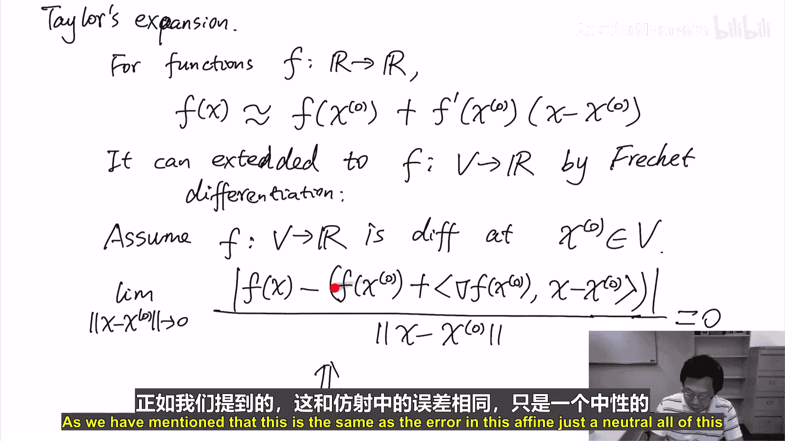
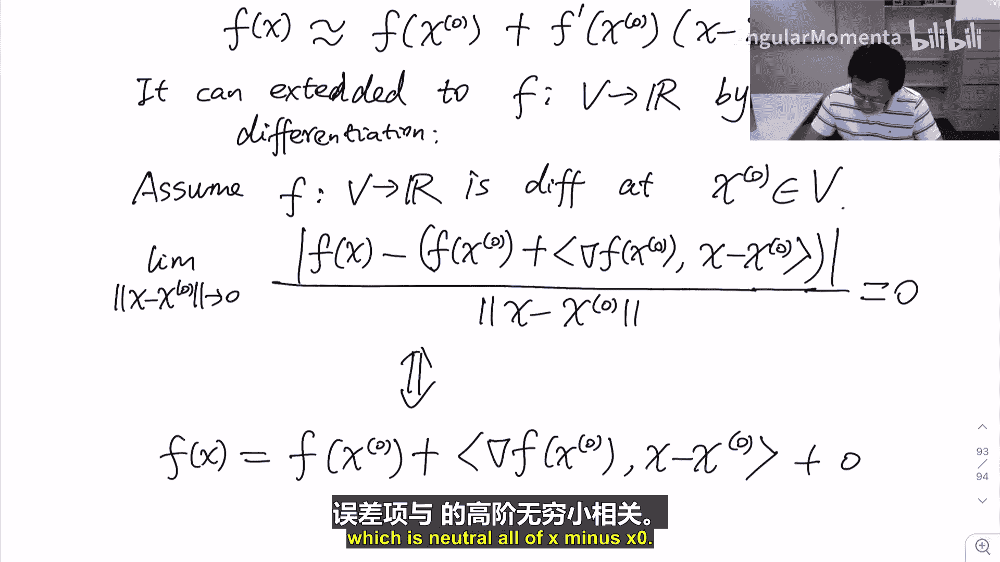
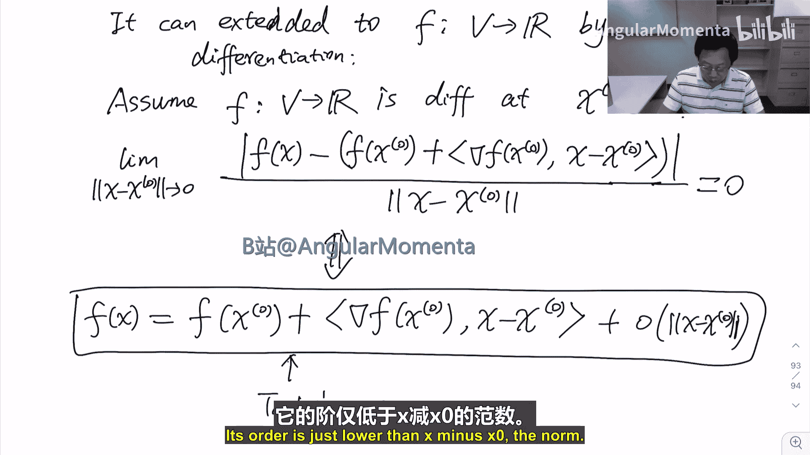
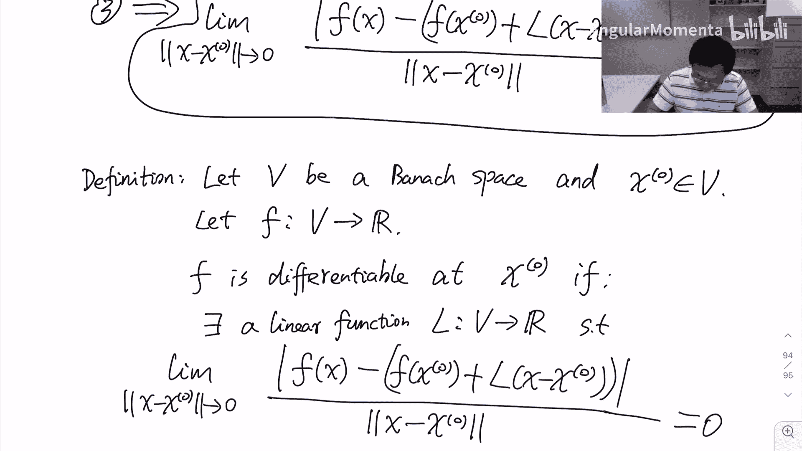
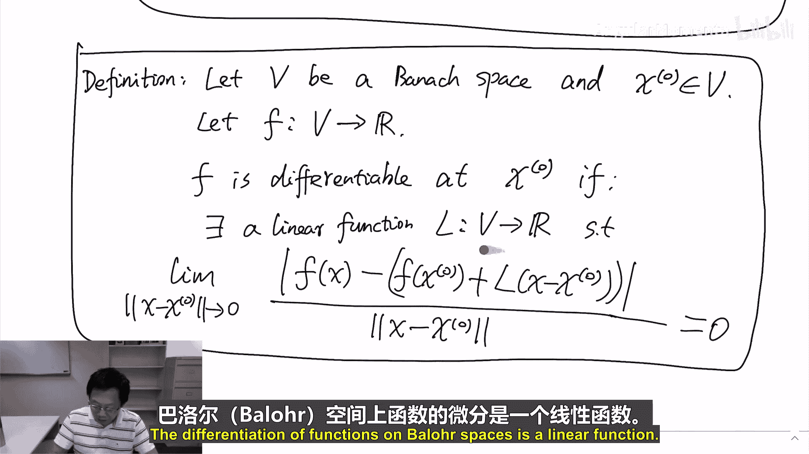
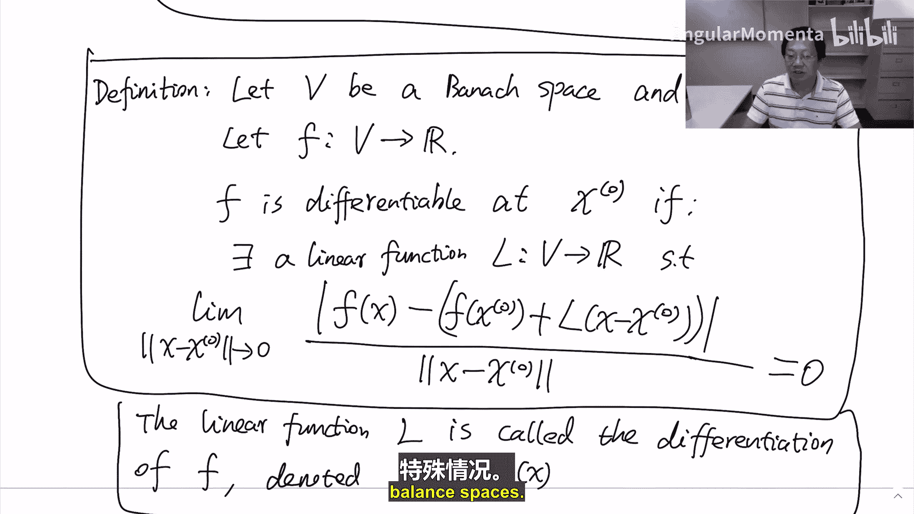

# 【香港科技大学】数据分析的数学方法 ｜ Mathematical Methods for Data Analysis p72 13-09-02视频 -BV1DEFDzGEZW_p72-

Pressure differentiation will also generalize the tail expansion。

From single variable function to functions on here spaces。For functions of R to R。

We know that we have the tailor expansion from cculus。 F X is just approximately。F at x 0。Plus。

F prime at x 0。Times x minus x 0。We can use fresher differentiation to extend this。

Taylor expansion of first order。It can be。Extend it。To have from V to R。Bye。Fresher differentiation。

We used时在贷款你息。阿小。F。From B to R， its differentiable。At x0。Y V。

By the definition of fresh differentiation。The differential is the same as an image。X minus x0。

Approache is 0。F of x。Minus F of x 0。Plus， gradient F X 0。X minus x 0。X minus x is0。E equals0。

As we have mentioned， this is the same as。Thearrow in this a fine approximation is just a little all of this denominator。

In other words， F X equals F X 0。Plus。Gredient F X 0。X minus x0。P。The error term， which is little of。

X minus x 0。This expansion is just a generalized tailor expansion。For functions on hereable spaces。

Here， this tail expansion is only up to the first order。

Because we used only the first other derivatives here。

Though we don't know what exactly this error term is。We know that this error term is very。

 very small。This order is just lower than x minus x is0 than normal。

All those are about fresh air differentiation。We can also extend the pressure differentiation。

Of functions on hearable spaces， to functions on bananana spaces。Different A。Offfer functions。

On balance has spaces。Let we be a banner space。Or equivalently a normal vector space。

Let F be a function from。B2 R。On this v space。For the differentiation。

 we use the same idea as in the differentiation of functions on here spaces。

 that is we use a fine approximation。We。Use。A fine。Approximation。For differentiation。Let。

X 0 be a point on this V。 We want to find the differentiation of F at x 0。We find。A function。

This function is now from B to R again。I call it a G， this function should satisfy。

Exactly the same as the differentiation。Of functions on hubless spaces。 We want this function。

 First of all， ages of fine。Secondly， it is consistent with the F at x 0。G at x 0。

Is the same as F at Texas。Thirdly， the arrow is just。Equals a litter o of。X minus x is 0。

Now we are going to find out this function G from one。

 we see that this G of x must be a linear function plus a constant。Where L is an linear function。

From V to R。Is Nya。And A is a constant。Different to that， here was a space case。

We don't have the risk representation， though。So we can only write this L as a linear function here。

 We cannot write it into an in product form because we don't have inner product on norm vector spaces。

Then from2。This g of x 0。It is L x0。pl a。It is enough at x 0。This implies G of x equals L X plus a。

Es l。X minus x 0。Plus， L X 0。Plus a。Which is L x minus x 0。Plus， F at x 0。

This G is now rewritten as a linear function applies to x minus x0 plus F at x0。Here。

 from the first equality to the second equality， we used the linear of well。Indeed。

This is just the L X。For minus L X 0 plus L X 0 plus a。Now， from here to here。

 because L is linear so that L x minus L x0 equals L applies to x minus x 0。Because G is a fine。

 and it passes through X 0 F X 0。 G X is written into this form。Now， we want this。

Third condition holds true。It implies that the limit when x minus x 0。

Approaches there we want the error。 The error it is now F。X minus Fx 0。Plus L X minus x 0。

The absent value， this is thearrow of this approximation。Divided by x minus x0。E equals 0。

We obtain this。Limit should be true。From this， we can define differenti of functions on other spaces definition。

Let we be about her space。안 돼。X zero is O B。That。F be a function from V to R。Then。

 F is differentiable。At x at 0。If this is satisfied。We can find a linear function。L from V to R。

Sasha that's。This limit equals 0。

This is the definition of differentiable。On parallel spaces。Different to the hereboed case。

We don't have the risk representation。 Any linear function cannot be represented by an in product form because we don't have in product。

Onbar her spaces。 Therefore， we keep this linear function。

The differentiation of functions on bound spaces is a。linearer function。

This linear functioning。L is called the differentiation of F。And denoted by。There's the D of F at X。

You can see that here we don't have a gradient anymore。Because gradient is a vector in me。

Now here we don't have the in product representation of the linear function。

 We just define that linear function as the differentiation of F。In particular。

 if this V is a huber space， then this L can be。Represented by an inner product。Then。

 the vector in the。Definition of this linear function L is just called the gradient。So in this sense。

The different AC。Unheable spaces can be viewed as a special case of this differentiation on other spaces。

