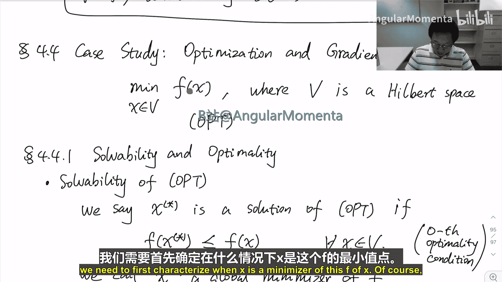
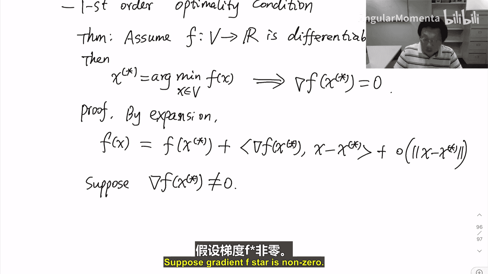
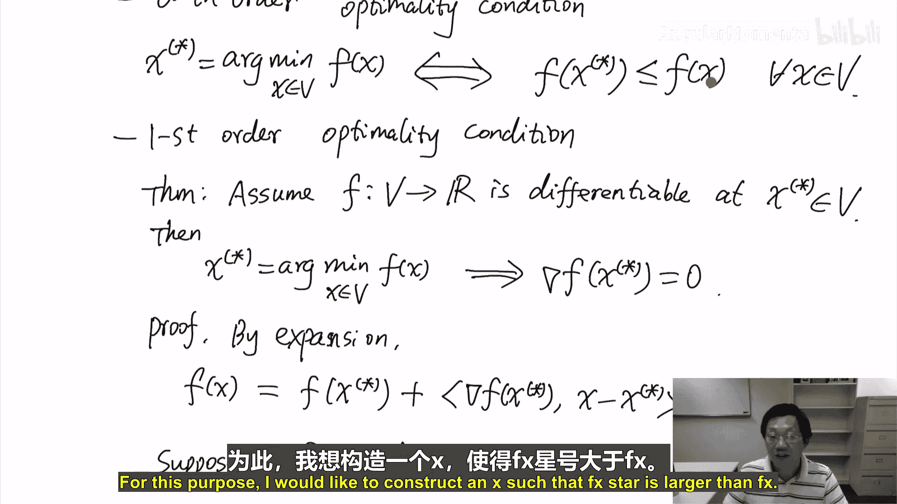
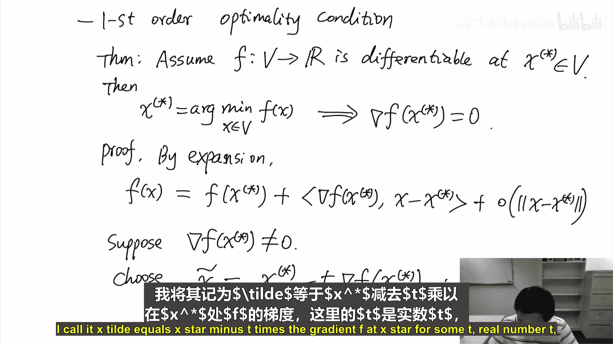
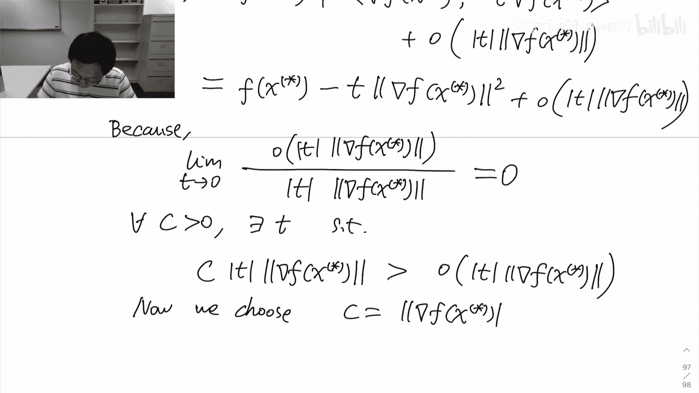
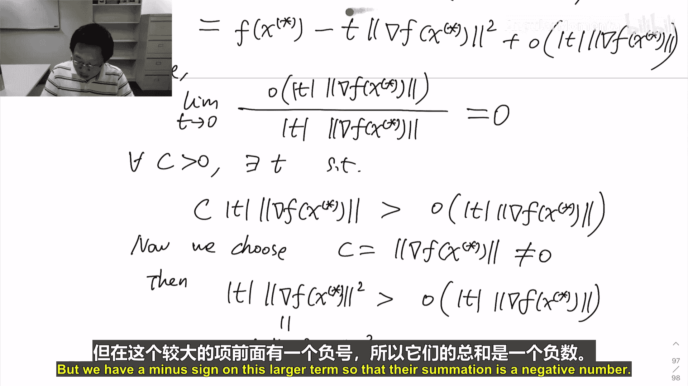
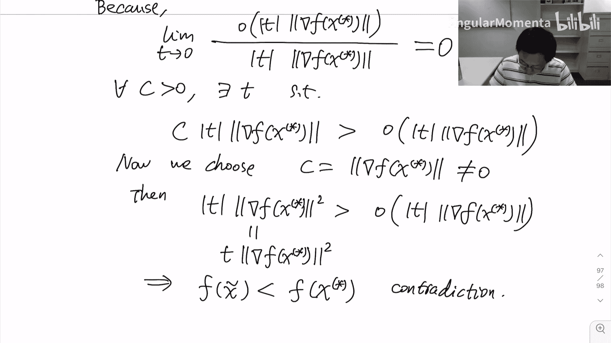

# 【香港科技大学】数据分析的数学方法 ｜ Mathematical Methods for Data Analysis p74 14-02-02-视频 -BV1DEFDzGEZW_p74-

Now we assume that we solve an optimization problem that has a solution。

In order to solve this miniization problem。We needed to first the car rights。

When X is a minimizer of this F of X， Of course， this is one of the first condition。

 F X starts more than all F of X。

But this condition is just very difficult to check because it's global， you have to try all X in V。

And to test F X stars smaller than all equals to FX for all x in B。

This is generally very difficult to check。We need some other easier conditions for the characterization of the solution。

The first day is the zeros。Op。Cond。Zeros order of humanity condition。We have discussed it just now。

It is。Ex to star。Is the urgamin。Of F of X， X in B。It is equivalent to。Andfa a star。

Smaller than all equals to F X for any。X on B。This condition is very difficult to check。

One relatively easier condition for the Op is the first order。Oportimity。Cond。

It uses the differentiation， it uses the gradient。Theorem。Assume F is differentiable。At X star U。

Then。If X star is the solution。Of the minimization。If X star is a global minimizer of F。

Then we must have Fx star。The gradient of f at x star equals the zero vector。

In this characterization， we used the first order derivative。

So this is called a first order Op condition。This condition is relatively easier to check than this one because we just need to test the function。

At X star。While in this zero order Op condition， we need to test compare this FX star with F X for any other X UV。

But here it involves only x star1 point。So this condition is relatively easier to check。

Let's prove this a theorem。The proof of this theorem will use the definition of differentiability。

In particular， we will use the expansion by Taylor's expansion。Which is derived from that。

Definition of different ability。F of X。Is F X star。Plus。Greedients， F X star。X minus x star。

This is the linear approximation to Fx at X star。Because F is differentiable at x star so that this makes sense and the arrow is just as small。

It's a little O of this x minus x star。This is from the definition of the differentiability because F is differentiable at x star。

We have this expansion。To prove the theorem， we use a contradiction， suppose。Greedient F。

 X star is non 0。

We want to derive contradiction。We will show that this zeros order opportunity will be。Violated if。

Greent F at x star is 9，0。For this purpose， I would like to construct an X such that F X star is larger than。

F， X。

We just choose this X B。I call it x tuta equals x star。Minus t times the gradient f at axis。

For some tea。

real number T， positiveitive number T。We have。We just let this X here be executed。FX t with that。

Heres Fx star。Plus， gradient， F X star。Now， this x tta minus x star is just。Minus T。Greedients， F。

 X star。Plus。A little old of。Absolutely the value of T the ingredients F x star。Here。

We have this one because。X minus X star is minus T gradient F X star。 We take this norm。

 is just the absolute value of T times the norm of gradient F at X star。This equals。F x star。Minus T。

 the gradient F X star。Enor square。Plus， a little or。Of this absolute value opportunity。

 the norm of gradient。Of F at X star。In order to show FX tutor is smaller than FX star。

 I need to compare these two terms。We start with this little old term。For this term。

According to the definition of this little an。T goes to zero。Oh。T gradients F X star。

T gradient F X star。This limit is zero。It just means that this little old term is significantly smaller than this one。

Wen Qi is sufficiently small。In other words， for any seed。Positive C。We can find a tea。Sly that's。

This。Little O term is significantly smaller than this one。They a C times t gradient， F x star。

Larger than this little old term。This， you can choose it to be a very small number。

 as long as it is a constant。 it is independent of T。

Then I can always find a T such that this holds true。

 because this term is significantly smaller than this one。Now， we choose。

C equals the gradient of Fx star。This is a non zero number because we have assumed gradient of Fx star is non0。

Then。Absolute the value of T times gradient F X star。

The norm squared is just larger than little O of T gradient F x star。Since our tea is positive。

This is the same as。T gradient， F， X star。The norm squared。

This means that we can find a T such that this term。Is larger than this term。

But we have a minus sign on this larger term so that their summation is a negative number。

This is a negative number。 F X tuta equals F X star plus a negative number。Then we just have。F x a2a。

Is smaller than。Exs star。This contradict with that X star is a minimizer。

We finished the proof。