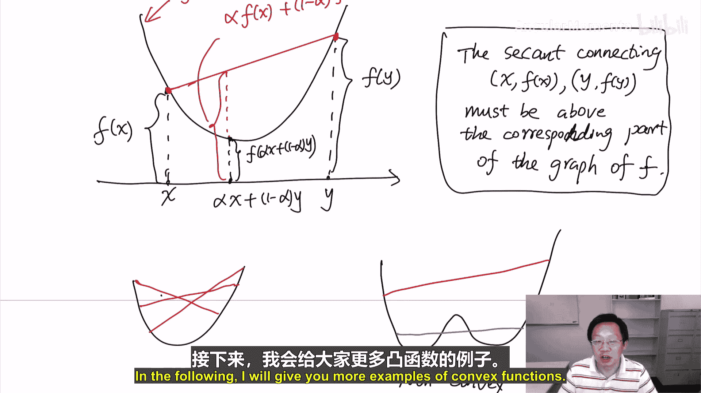
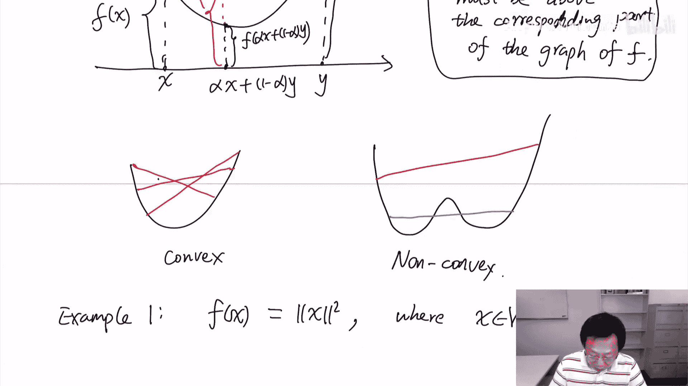
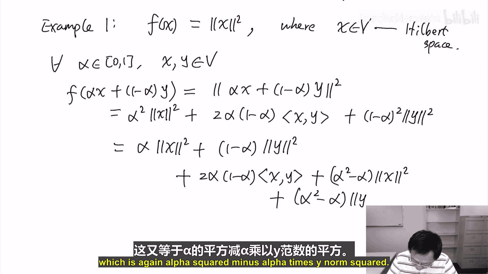
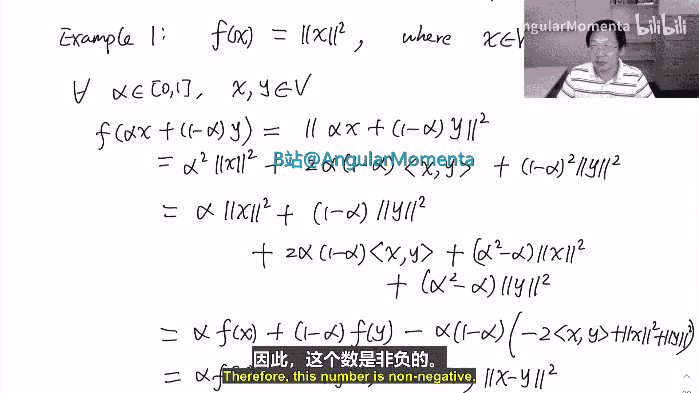
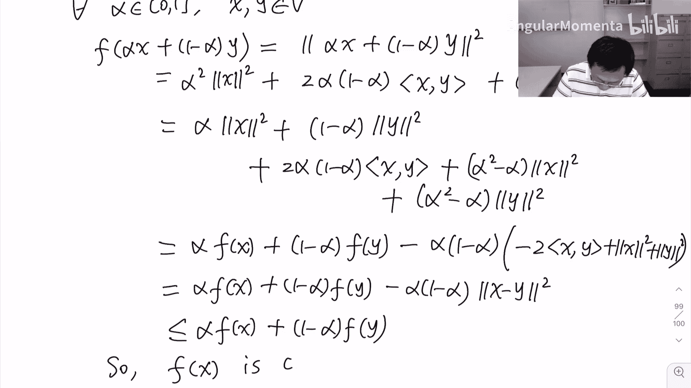
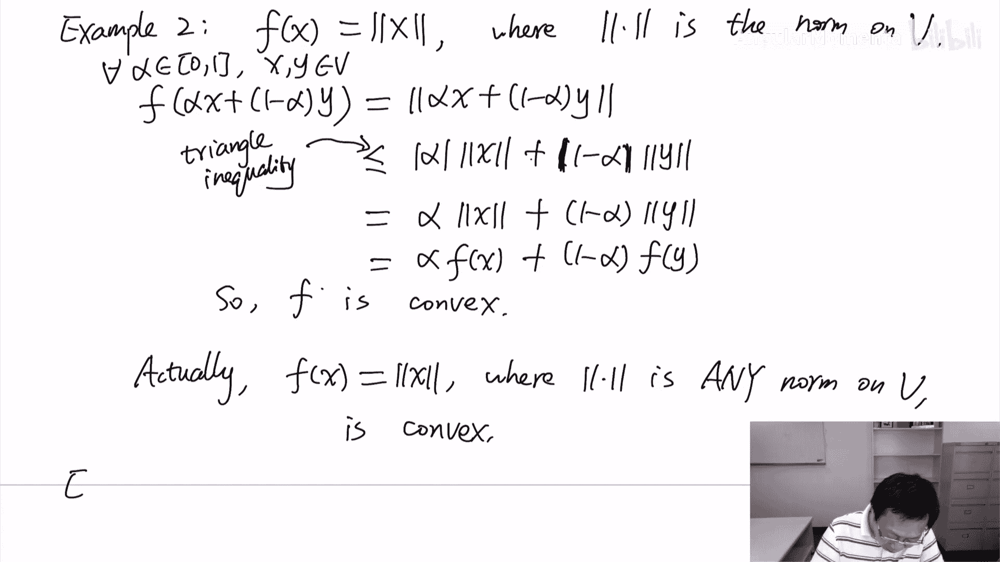
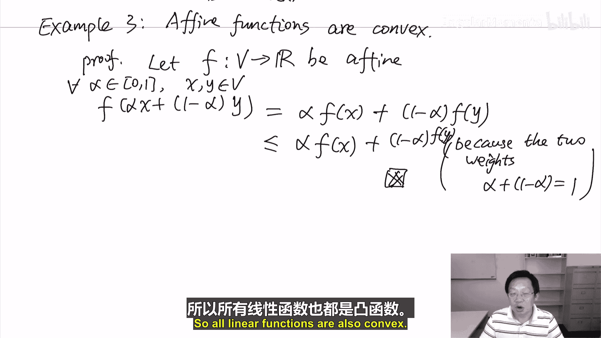

# 【香港科技大学】数据分析的数学方法 ｜ Mathematical Methods for Data Analysis p77 14-05-02-视频 -BV1DEFDzGEZW_p77-

In the following， I will give you more examples of complex functions， example 1。

F of x equals。X norm squared where x on B。And the V is a herepot space。And the norm here。

 it is just the standard norm， the norm induced by the in product on B。To check the convexity。

 we use the analytical definition directly。We check this in P。

Thus， we consider。Apha in 0，1 under X， Y in B for any alpha and for any X， Y。

F of alphapha X plus1 minus alphapha y。This is。Apha x plus 1 alpha。Y norm squared。

The first step is that we expanded this norm squared， which is alpha squared， x norm squared。Plus。

Class。1 alpha squared。Y norm squared。Plus， the cross term。

 which is the in product of these two terms。2 alpha times 1 minus alpha X， Y in the product。

Since we want to show that this is smaller than all equals to alpha fx plus1 minus alpha Fy。

 we want alpha fx first。Apha。X norm squared。Plus。We want one minus alpha F of y。

1 minus alpha Y norm squared。And then we have the remainders， the remainders。

Will be the difference of this term， and this term。By direct calculation。It is two alpha。

1 minus alpha X， Y。Plus， alpha squared minus alpha。X norm square other。Plus。

1 minus alphapha squared-1 alpha。Which is， again， alpha a squared。Minus alpha times y Nor squaredta。

This equals alpha F of x plus 1 minus alpha F Y。For the rest three terms， they have a common factor。

 alpha squared minus alpha。Minus alpha times1 minus alpha。in-2。

X y in the protector plus x norm squared plus y norm squared。It's equals rhi Fx。Plus，1 R 5， F Y。

Minus alpha 1 minus alpha。For these three terms together， it is a complete square。

It is exactly x minus y norm squared。Apha is non negative。1 minus alpha is non negative。

 X minus y squared is non negative。Therefore， this number is non negative。

So that this is just smaller than or equals to alpha F X plus 1 minus alpha F Y。So。F， X is convex。

This example tells us that any norm squared function。Is。A Comx function。Of course。

 here this norm should be the norm induced by in production。Example 2。

We consider F x equals to the norm of x。Without a square。Where。This is the。Norm。

On the the norm induced by the in protector on the。We want to show the conity of this function。

 We consider F alpha x plus 1 minus alpha y。For any alpha in the interval from 0 to1。

 for any x and y on V。By definition， it is alpha x plus1 minus alpha y and the norm。

By the triangle inequality， this is smaller than over equals to alpha。X the norm plus。1 minus alpha。

The norm of why。This is from the triangle inequality。For norm。

And because we have chosen alpha to be non negative。

1 minus alpha is non negative because alpha is smaller than one。

So that we can remove these two absolute valuess。It is alpha。The norm of x plus1 minus alpha。

 the norm of y。This is the exactly alpha F x plus1 minus alpha。So。F。Is convex。In this example。

We can see the only step we used in equality is this triangle in equality。

The triangle inequality holdss true for any norm。 As long as we have a norm。

 the triangle inequality always holds true。Therefore， this example not only hold for the norm en。

 but also any norm en。Actually。Fx。E course。Where。This is any norm。Onvi。Is Comx。The全国盈 quality。

Grant is the complexityity of the norm function。Some more explicit examples are the one norm。

 the P norm。On Euck Canadianian spaces are always convex。The F norm of a matrix Coms。

The infinity norm of a matrix is a convex function in x。Any norm function is a convex function。

Example 3。

We have seen there is a connection between convexity and inerity。Now， we consider linear functions。

 all generally are fine functions。All fine functions are convex。Proof。That F be an a fine function。

Then F of alpha x plus1 minus alpha y for any alpha in between。0 and1。 And for any x and Y on B。

This equals alpha F x。Plus，1 minus alpha F Y。Because here the two weights here， the sum is one。

Just the big。That。2。Wais。Apha plus 1 minus alphapha equals 1。We know that。For a fine functions。

 if the two weights。三玩。Then the equality holds true。Therefore， this equality holds true。

 This is definitely smaller than O equals to alpha F X。Plus 1 minus alpha F of y。Thus。

This example is proved。But's a special case。Linear functions are a functions。

So all linear functions are also convex。

