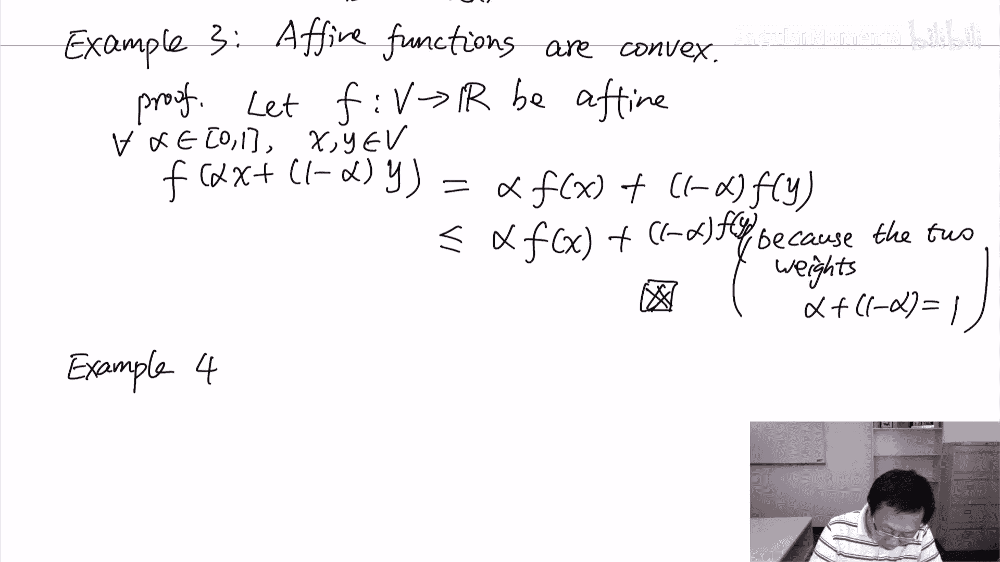
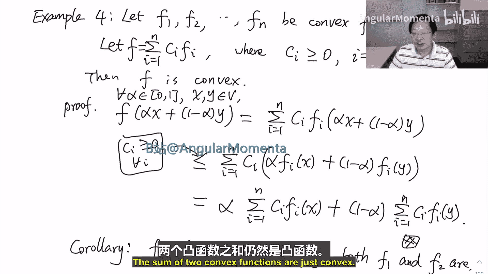
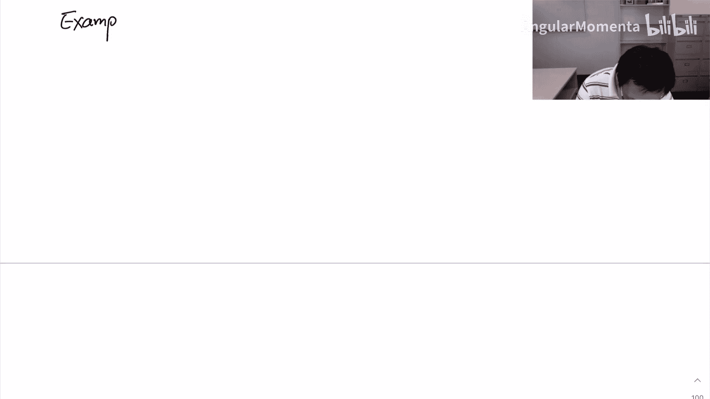
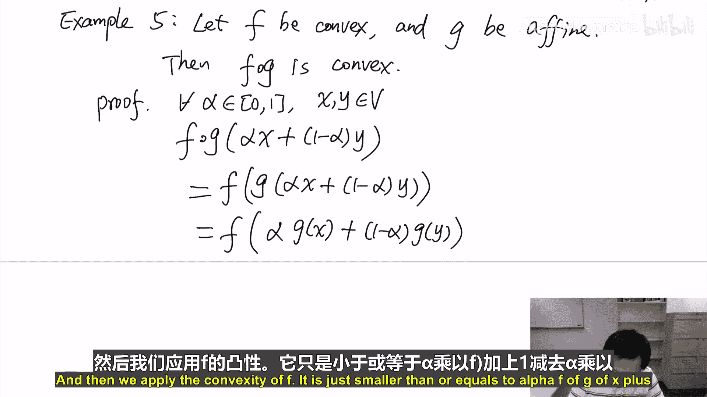
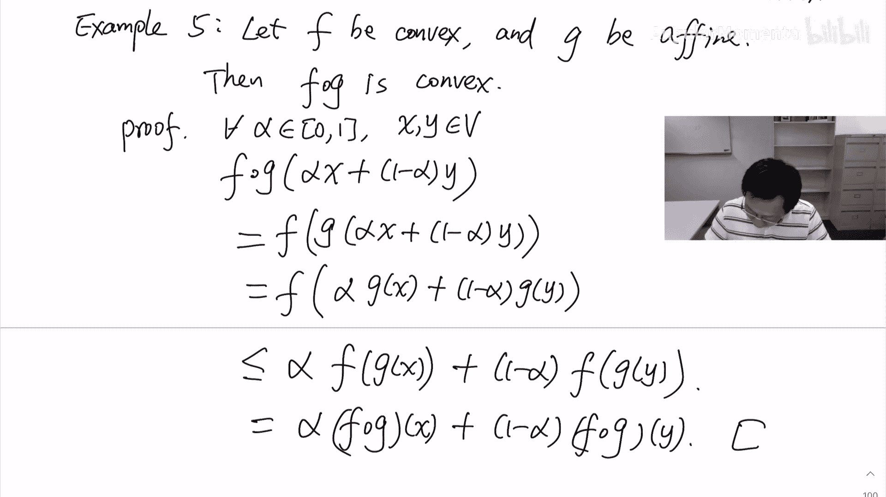
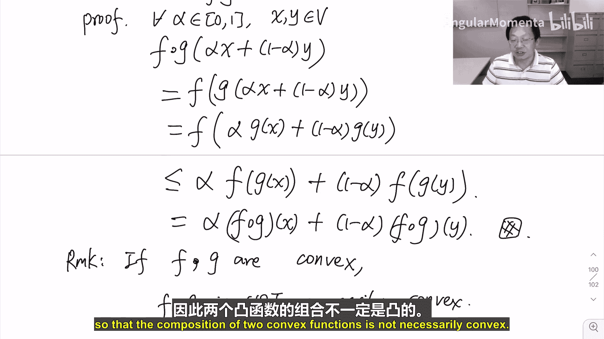

# 【香港科技大学】数据分析的数学方法 ｜ Mathematical Methods for Data Analysis p78 14-06-02-视频 -BV1DEFDzGEZW_p78-

You jump before。

We consider N convex functions。Now we consider their initial accommodation that Sigma I from1 to N C IFI。

Equal this。But I have a constraint on the。Coeffiics here， C I are just non negative for all I。

We consider a non negative weighted sum of FI。Then。F is convex。Proof。We just consider F。

Apha X plus 1 minus alpha y。For any alpha音。0，1。X and Y in V。This is the sigma I from1 to N IFI。

阿pha x plus 1 minus阿 y。By the definition of F。Now， I would like to use the convexity of F。

Since F I is co X， it is just smaller than or equals to alpha F I of x plus 1 minus alpha times F I of y。

For each F I， this just hood。 And also， we know C I is non negative。 So I multiply both side by C， I。

 The inequality does not change。 and then I sum them up。Therefore， in this inequality。

 I used the fact that CI is non negative for all I。

Then the direction of thisequality does not change。If one of the C is negative。

 then when we apply the Comity of FI， when we multily both side by CI。

The direction of this inequality will be changed。Therefore， this might not holds true。So the key。

To let this inequality hold is that the C I are all un negative。With this term。It can be rewritten。S。

Rpha times the sigma iPhone 12 N C， I， F， I of x。Plus。1 minus alpha sigma I from 1 to N， C， I， F I。

 Y。So we finished that proof。There is an interesting special case of this。Exampled。

We set n equals to 2 and C1 C2 equals to1。Then we obtain F1 plus F 2。Is convex。Ifve。Both。

F1 and F2 are。The sum of two Comvex functions are just a Comx。

Also， if I take F1 minus F2。If both。F1 and F2。comics。Though both F1 and F2 are convex。

 one of the coefficient C2 is just a negative。Then this inequality here may not hold true so that F1 minus F2 is not necessarily convex。

Of course， you can construct some example such that F1 and F2 are convex and F1 minus F2 is convex。

 but F1 minus F2 is not necessarily convex。On the contrary， F1 plus F2 must be complexvex。Example 5。

We consider the composition of two conx functions that。F B convex。And G B G is not only convex。

 but also a fine。Then。F composed with Gs conve。Proof。

Use the definition F composed with G alpha X plus1 minus alpha y。For all alpha in 0，1。X and Y in V。

This is F of G。Of G of alpha x plus 1 minus alpha y。Because this G is a fine。We have。

This g of alpha x plus1 minus alpha y is alpha G of x plus1 minus alpha G of y。Big costs。

G is a fine for a fine functions。 if the two weights。Someone， them。

It equals the alpha G X plus 1 minus alpha G1。So this is a equal because this equals this。

And then we apply the convexity of F。 It is just smaller than。

Or equals to alpha F of G of x。Plus，1 minus alpha F of G of y。

This is exactly alpha F composed with G at X plus1 minus alpha F composed with G at y。

The proof is finished。

If we have the composition of two convex functions， remark。If， F and G。A comics。

This F composed with G is not necessarily。Conx。The reason is that in the proof。

 this inequality will not hold true anymore because from here to here， we used the a property of G。

 Now， if G is only convex， then this will not be this one。This term can be larger than this term。

 This term can be smaller than this term。 It depends on the monotonity of F。

 If F is monotonically increasing。Then this is just as smaller than or equals2。Otherwise， in general。

 this will not be。Smaller than this term。 so that the composition of two convex functions is not necessarily a convex。

