# 【香港科技大学】数据分析的数学方法 ｜ Mathematical Methods for Data Analysis p79 14-07-02-视频 -BV1DEFDzGEZW_p79-

Now we are going to give a sufficient condition for the global Op for convex functions。This。

 together with the sufficient condition， we get the necessary and sufficient condition for the global opportunity of convex functions。

Theorum。If F from V to R。Is Comx and different。Then。We have X star is that global minimizer。

Of F of x。If and only if the gradient F of x star。E equals 0。

This theorem tells us that x star is a global minimizer if and only if the gradient of f at x star is 0。

Therefore， to check the global opportunity， we just needed to check。

Whether or not the gradient of F is0。 If the gradient of F X X star is 0。

 then it must be a global minimizer。To prove this a theorem。We need a name。

Which itself is very interesting。This lemma says。Ifve。E is differentiable。Then。F is convex。Ifve。

 and only if。F，Y。Is larger than all equals to F of x plus。Greients， Fx。Y minus X？

For any x and Y you be。This Nema gives an characterization of the convexity through this condition。

F is Comx is equivalent to this inequality holdss true for any x and y。In this inequality。

 the right hand side is the linear approximation to FY。

This inequality just says that the function value should be greater than or equals to its linear approximation。

At any point why？Graphally it， this number is。

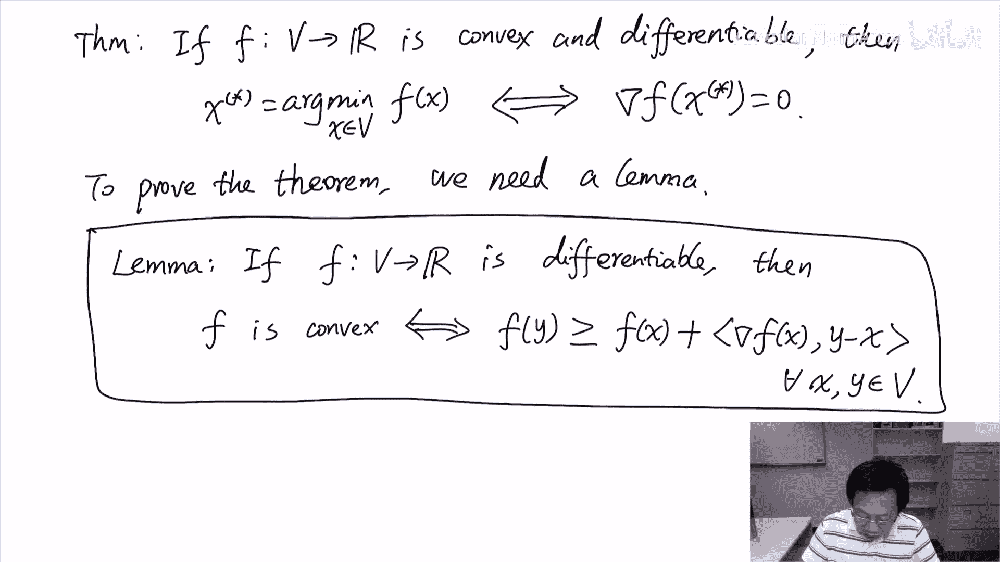

We have a Comx function， if and only if。We consider its linear approximation。

This linear approximation must be below this function graph。

 or equivalently the function graph must be above this linear approximation。

This is the equation for this linear approximation。 This is the equation for this。Graph。Therefore。

 this exactly says that the function graph should be above its linear approximation at any point。

Any point I just make a linear approximation then。This function must be above this linear approximation。

And to this point。It is also， true。We call this the linear approximation support the function graph。

Therefore， this nema tells us that。For convex functions。It is a equivalent that you。

Linear approximation。Support。The function。Because the graph of this function。

It is just on the above side of this linear approximation。

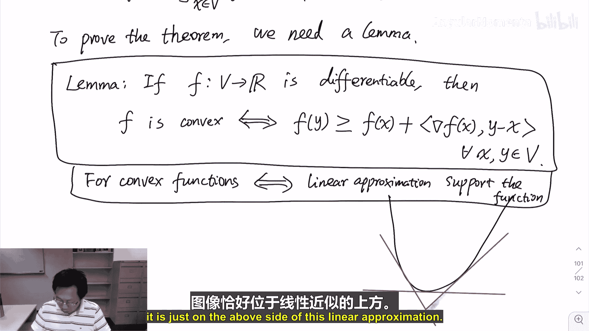

Let us prove thislemma。We first approved the lelemma when v equals to R。In this special case。

This cinemama is proved by。They're following it。First， we approve。From the left to the right。

 that is F is convex， then we must have the function value is greater than or equals to its linear approximation。

Assume F is Com。From our to R， is convex。We would like to use the definition of the convexity。

We consider。Apha y。0， one。안 돼。X， Y， in R。With。X is not Y。

We should have that this F of alphapha x plus1 minus alpha y。By convic city。

 it is just smaller than or equals to alpha F X plus1 minus alpha F of y。Then。This implies。F y。

Larger than all equals 2。Let me just move this from the right to the left and divide it both side by one minus alpha。

F alpha x plus1 minus alpha y。mininus offer f x。Divided by 1 minus alpha。

Because our alpha is not one。This makes sense because that denominator is90。

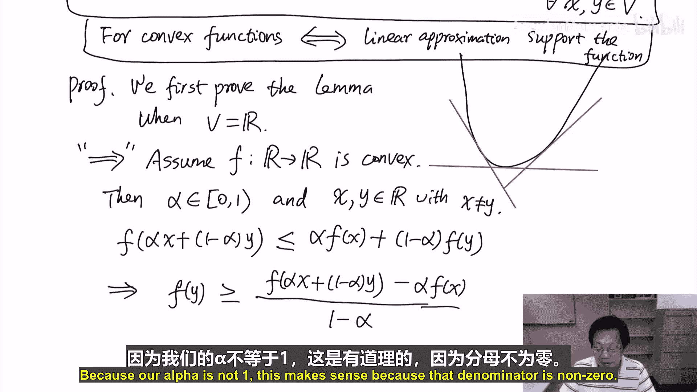

This is the same as F of upperpa x plus 1 minus upper y。Minus F X plus F X。Minus alpha Fx。

Do you mind it by one minus alpha。These two terms together is just 1 minus alpha F x。

And this one minus alpha cancels this one minus alpha。So this becomes F X plus。Now。

 for the second term， I would like to multiply both the numerator and denominator by y minus6。

Both are multiplied by y minus x。Y -6。We rated this one。It is。F of。X plus 1 minus alpha。Y-6。

This number is exactly this number here。Minus F x。Times y minus X。Now let's look at this under this。

We can see that the numerator is just the difference in function values。

 The denominator is the difference in x。 The denominator is just this minus x。

This is a divided difference。Now we'll let this alpha goes to one。Let alpha goes to one。From。Left。

 because our alpha is in the interval from 0 to 1。 Al is smaller than one。

Then we let this alpha approach one。This denominator goes to zero。Because y is not x。

So this y minus x is a non0 number。Therefore。This limit becomes the derivative of F at x。

So we obtain F Y is larger than。Or equals to。Fx。Plus。

This now becomes F prime x because alphapha approaches1 minus。 This is a divided difference。Prime X。

Times y minus x。Which comes here。We have proven that that。If。F is convex。

 then F Y must be larger than F X plus F prime x times y minus x for all。 X is not y。When x equals y。

Of course， this holds true obvious because this is 0。 So 0 times any number is 0 FY。Narger than FY。

Then in any case， we just have this。

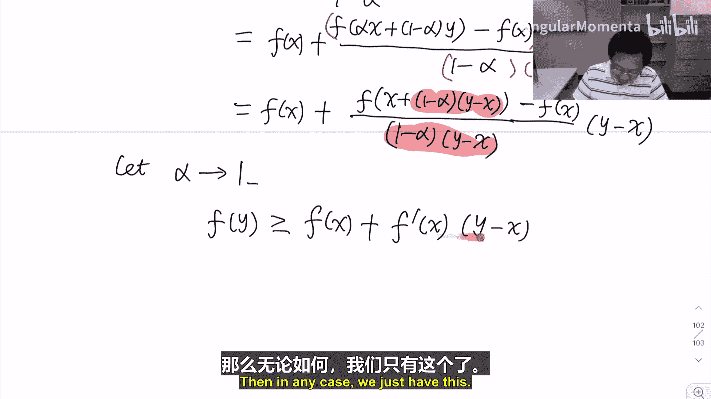

Now we want to show the reverse。When B equals to R。That is from this， we want to show this is true。

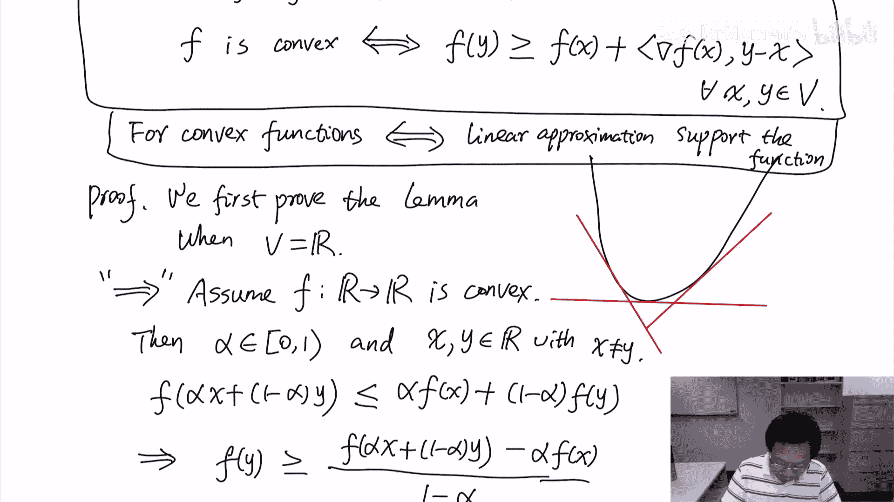

We assume。F， Y is larger than F X plus F prime of X， Y minus X for any X and Y R。

We want to show that this F is Com。We choose special x and y in this inequality。

We choose X and y in R。With。X not equals to y。And we define。Z equals alpha x plus 1 minus alpha y。

For some offer。In 0，1。

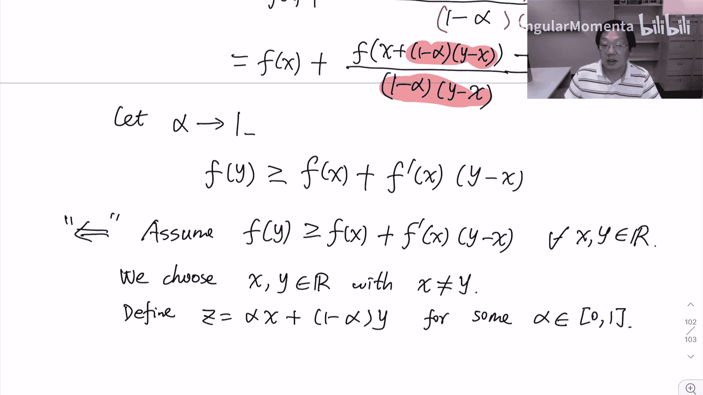

Now， in this， we set this。This is why。By x。F， x larger than。And this x by z。Similarly。

 we choose another set of x y in this quantity， in particular。

 we choose y equals to y and this x equals to z。We get two inequalities。

I call this inequ quantity one， this inequ quantity 2。

I do a linear combination of these two inequalities。 I multiply。

The first inequality by alpha and the second inequality by 1 minus alpha。

Since both alpha and1 minus alpha， they are from。Here。This is non negative。

 This is also non negative。 So the sign of this inequality does not change。

So the direction of this inequality does not change。We obtain alpha Fx。Plus，1 minus alpha FY。

Larger than or equals to。阿发。F Z。Plus， alpha F prime Z X minus Z。Plus，1 minus alpha F Z。

Plus1 minus alpha F from z。Y minus Z。

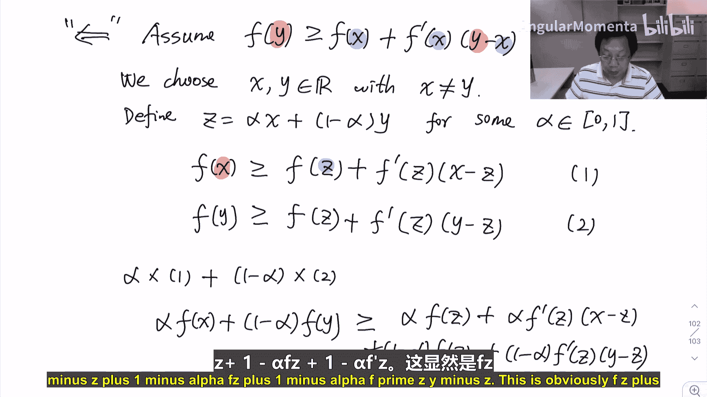

This is， obviously， F Z plus。F prime Z of this alpha x minus Z。Plus，1 minus alphapha Y minus Z。

This number here equals。Apha x plus。1 minus R y。inus6， which is 0。In this equality。

 I use that the definition of Z Z is just alpha x plus1 minus alpha y。 Therefore。

 these two numbers are the same。 so their difference is 0。

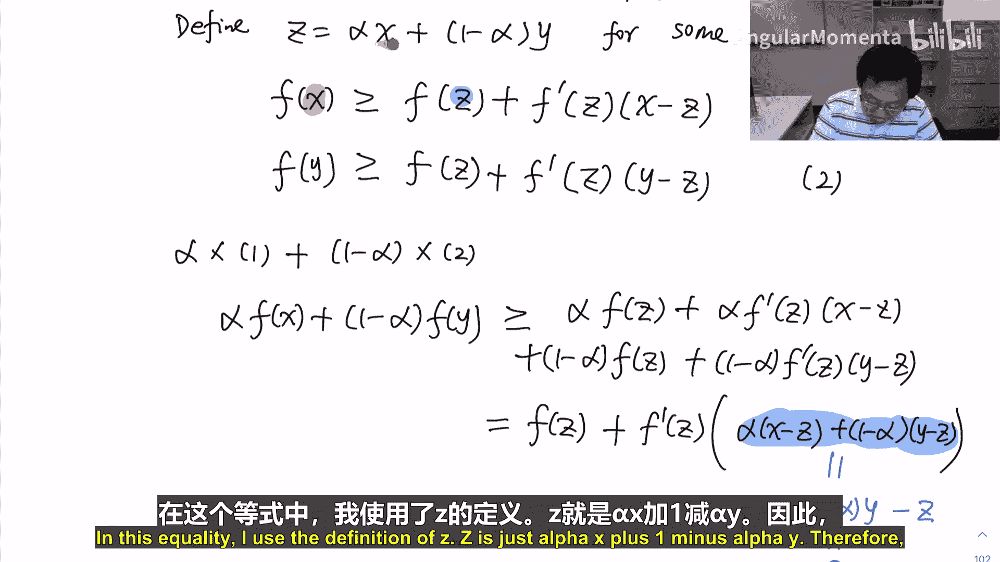

Then this becomes f prime z times0。The right hand side is the em。We just obtain that F for z。

Is smaller than or equals to alpha F X plus 1 minus r F Y。Z is just。Apha x plus 1 minus alpha y。

The right hand side is just the r5 Fx。Plus，1 minus alpha F。This inequality， holdss true for any。

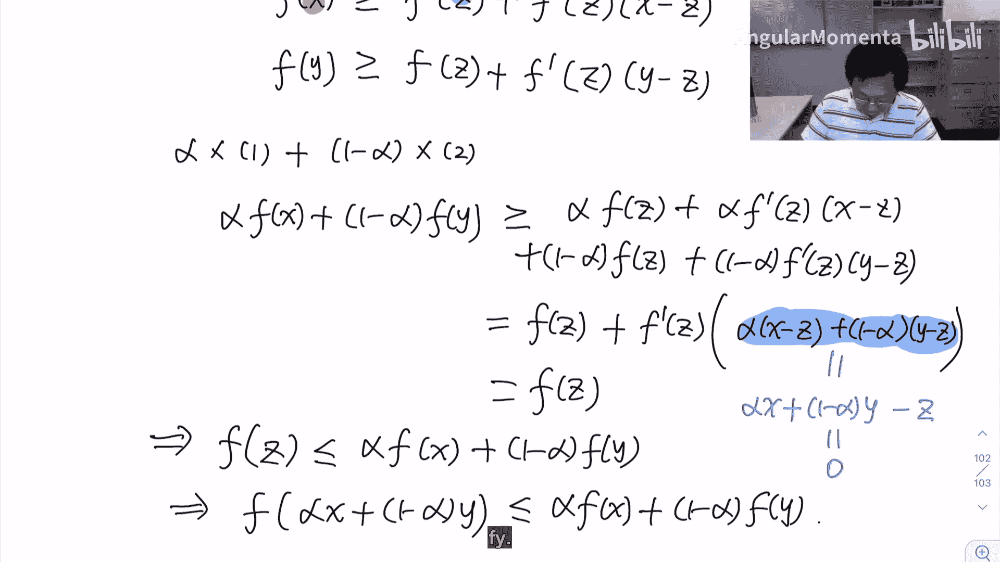

X and Y。With x is not y， and for any alpha。

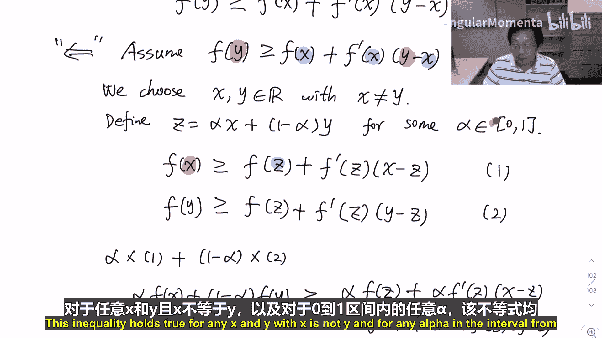

In the interval from0 to one。But when x equals to y this inequality obviously is2。

 because both hand sides are just F of x。 Obviously， F x is smaller than or equals to F x。Therefore。

 this inequality， who's true for all X and Y for all alpha法 in0，1。It just implies F is convex。

So from this inequality， we have shown the complexity of F。Therefore。

When v equals to R in a one dimensional case， we have shown that F is convex if and only if this holds true。

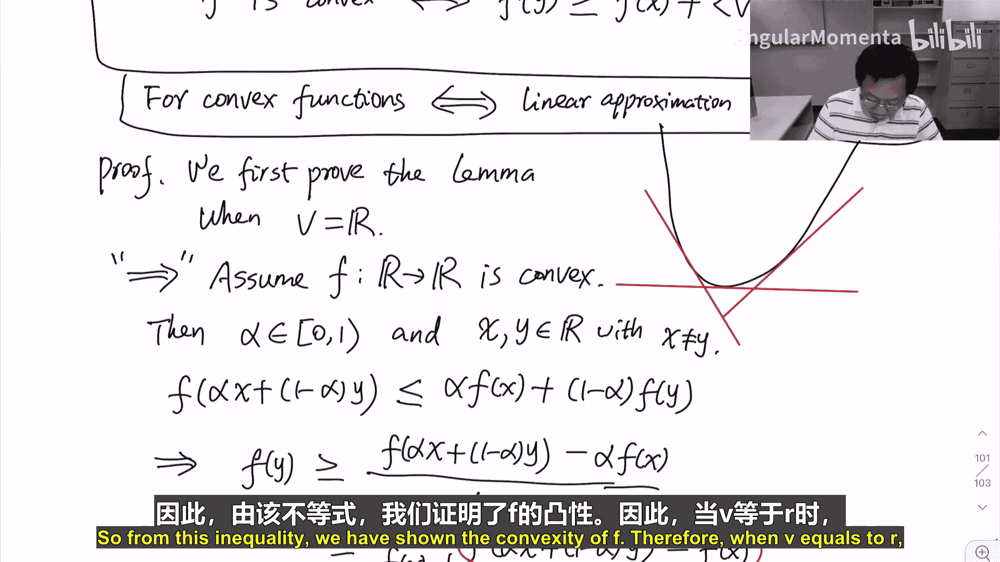

Now， in this case， this inner product is the multiplication， and this gradient is just F prime x。

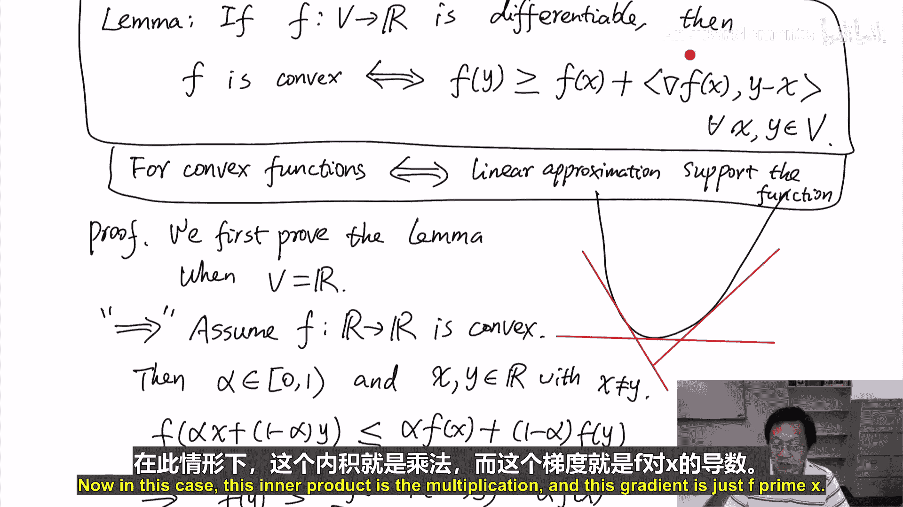