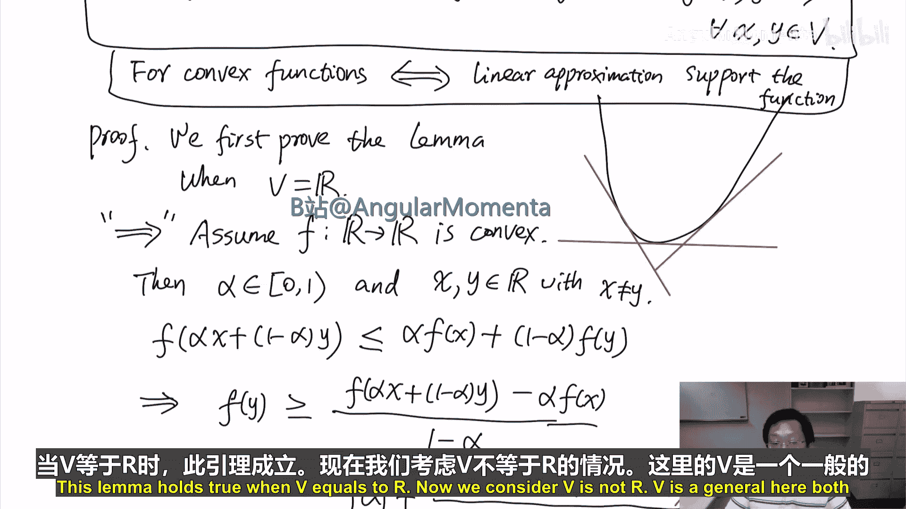
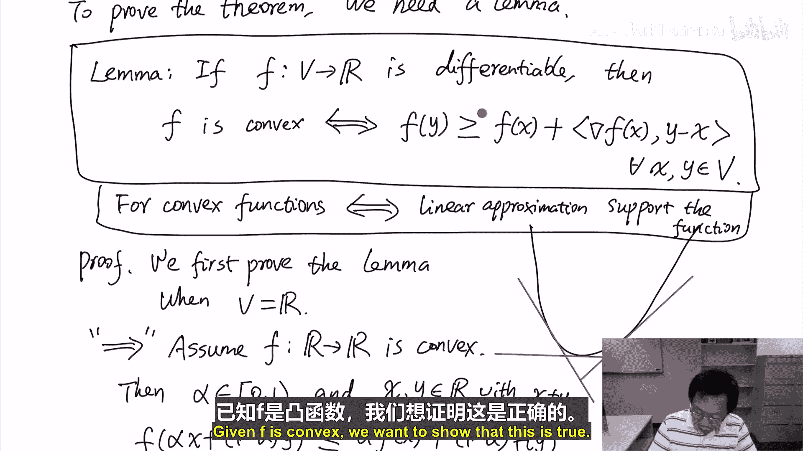
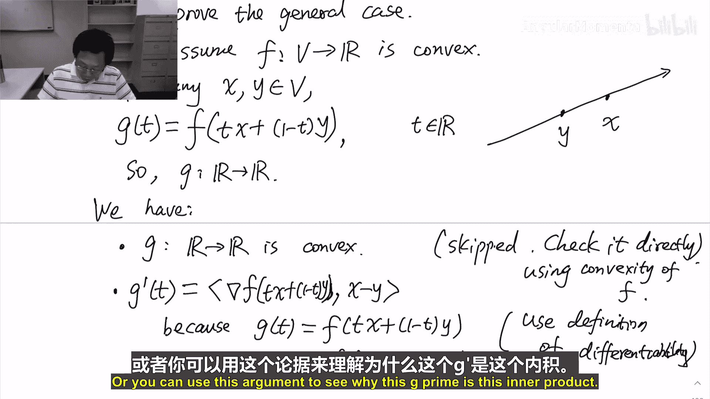
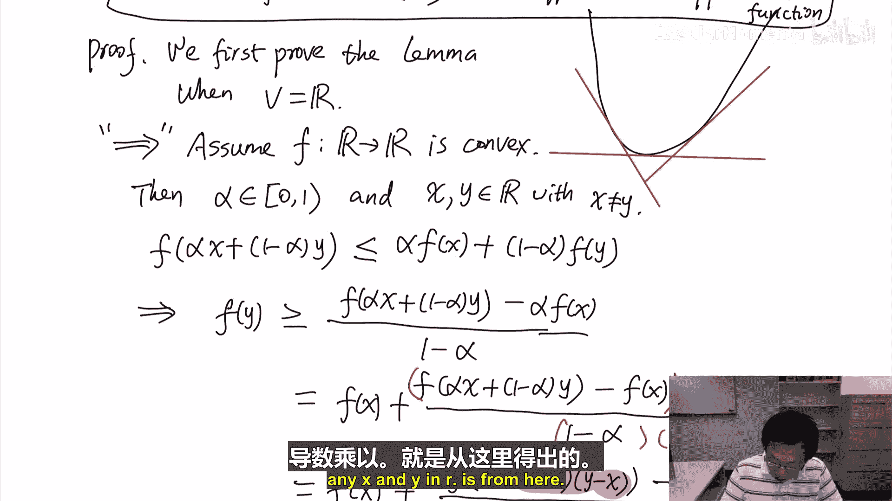
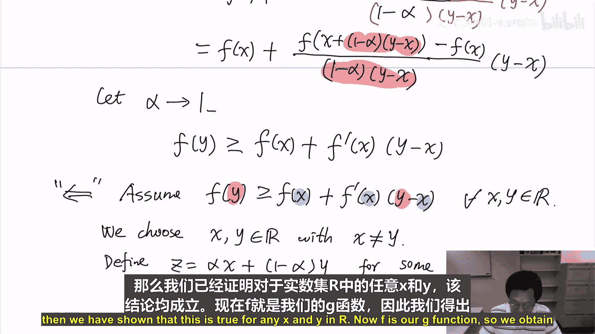
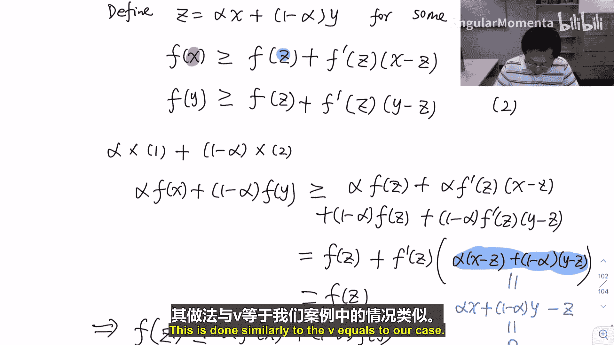
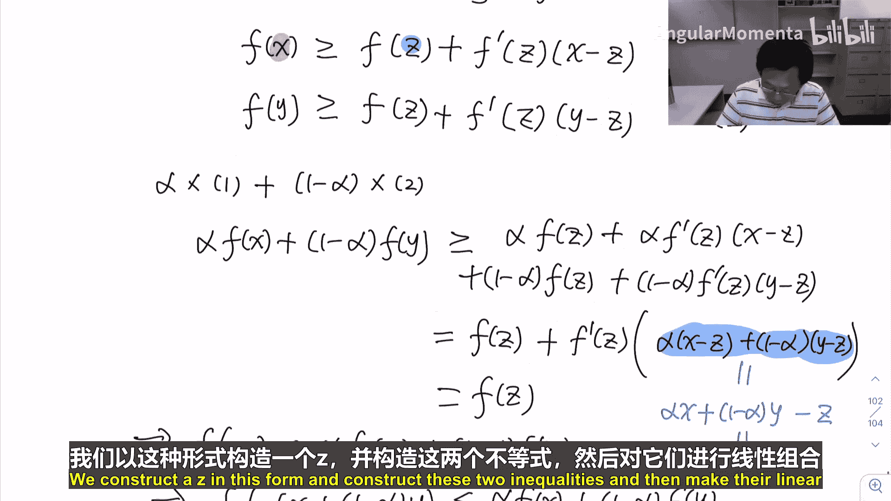
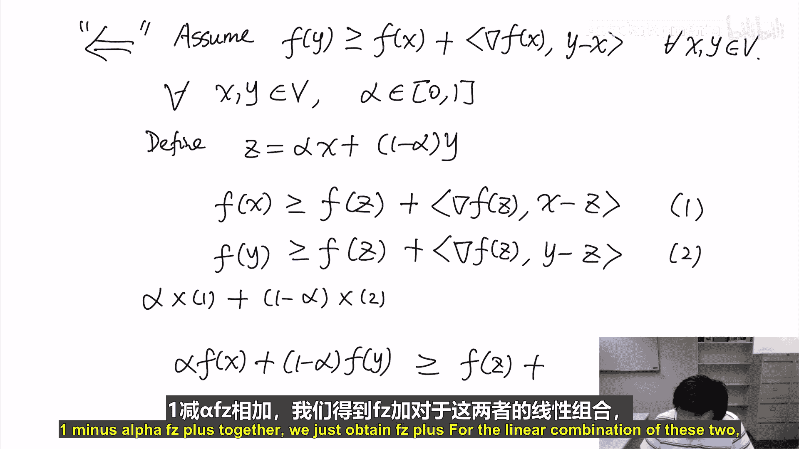
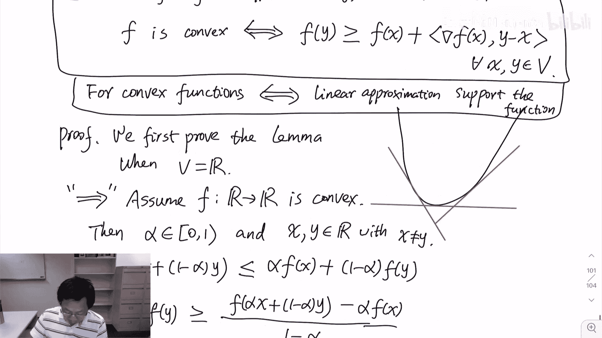

# 【香港科技大学】数据分析的数学方法 ｜ Mathematical Methods for Data Analysis p80 14-08-02-视频 -BV1DEFDzGEZW_p80-

This Nem holds to when V equals to R。Now we consider V is not R V is a general here birth space。

Next， that we prove the general case。Again， we first approve。

From the convexity implies that the function value is always above its linear approximation。

Given F is convex， we want to show that this is true。

The idea is that we use what we have proved in the one dimensional case。Assume Ems comics。

Now we construct a function on R for any x and y in V。We consider vectors on the line。

That connecting is Y and the x。That is Tx plus。1 minus T Y。Where tea is in。

Then all these vectors will be on this line with different t we get different points。 for example。

 if t equals to0， then we get y When t equals to1， we get x When t is larger than one。

 we get points here When t is smaller than0， we get points here。

So that this is a parametery transition of vectors on this line。Then we consider this F on this mine。

We denote this to be a function of T G of T。So。G is from R to R。

We want to apply our results for the R case。To G， because G is from R to R。We have。First of all。

 this G is a convex function。Because this G is only a restriction of this convex function in V onto this one dimensional。

Space。You can easily show that this one。Is convex in our。It is just a ski。Check it directly。

 You can check it directly。Using complexity of F。Secondly， we consider the derivative of this G。

For this derivative of this G because。Or G of T， H is F of T， X plus 1 minus T Y。

It is just F of y plus T of this x minus y。You can see that here we restrict this。

Bector changes only in the x minus y direction。This vector is changes only in the x minus y direction。

So that this G parameter is actually。A directional derivative of this effort。Or you can use the。

Definition of differentiation， you can show that this indeed is the directional derivative。

It is just the gradient of F in the product with the direction x minus1。Because we use the T。

 right so that whats inside this bracket is steel T X。Plus。17Y。This can be shown。Use。Definition。off。

Differentability。Or you can use this argument to see why this G prime is this inner the product。

 just because in this G of T， the vector is just allowed changes along this y minus x direction。

Therefore， when you take the derivative with respect to T。

 it is equivalent to do the directional derivative so that it is just the gradient in the product with this direction x minus1。

For a rigorous proof， you may use the definition of differentiability。Not very difficult to show。Now。

 with these two facts， we can use our results when v equals to R。From。Our result。Wen。V equals to R。

Because J。From R to R is convex。Then we just have that this G of y is larger than G of x plus G prime at。

X times y minus x for any x and the y E。Is from。

Here， assume after his commentss。And then we have shown that this is true for any X and YER。

Now F is our G function， so we obtain this must be true。

Now， I choose a special Y and x。I choose x to be one。Y to be 0。

We obtain G 0 is larger than or equals to G1 plus G prime 1 times 0-1。Which。Is the same as。

We rewrite this back to F G0。It's F 0 x plus 1 minus0 Y， is's just F y。Narer than or equals to奇1。

It's just the F of x。Class G prime。1。It is just the gradient of。F of x。In the product with x minus y。

Times-1。Therefore， this  -1 is multiplied with。X minus y first we obtain y minus X。

So we obtain that the function value of F must be greater than or equals2。

This linear approximation for any X and Y。Because our eggs and the way are arbitrary here。

For any X under。So then from F is comm x， we have derived Fy larger than or equals to Fx plus。

The inner product of the gradient of Fx and y minus x。Now we you the reverse。From this。

We want to show that F is convex。啊小。F， Y is larger than all equals to F x plus gradients F x。

Y minus x for any x and y U B。We want to show that F is conx。This is done， similarly to。

V equals to our case。

We construct a z in this form and construct these two inalities。

And then make their linear combination to obtain the convexity of app。

For any x and y in V。And alpha is 0，1。We define。Z equals alpha x plus。1 minus alpha y。Then， we have。

F x larger than all equals to Fz。Plus。Greedients， F for Z。Thanks， minus is Z。

We just choose a special set of X and Y。In particular， this y is replaced by x。

 This x is replaced by z。Similarly， Fy。Should be larger than or equals to F Z plus。The ingredients。

F z。Yイ minus。I call this inequ quantity 1， this inequ quantity 2。 I do an linear combination。

 alpha times1。Plus，1 minus or at times 2。Again， because alpha is in between 0 and 1。

 Al is non negative。1 minus alpha is also non negative。

So that this direction of the inequality does not change。We obtain。Apha F X。Plus，1 r5 F Y。

Larger than all equals to alpha F Z 1 minus alpha F Z plus together。We just obtain efficacyZ。Class。

For the linear combination of these two。Apha x minus Z plus 1 minus alpha。Y minus Z。

 these two together is just alpha x plus 1 minus alpha y minus Z。 This is Z。

 So this is the zero vector。Then we obtain。It is。The gradient， F Z。Zero vector， the inner product。

So this is exactly the opposite。But F Z is just F of alpha x plus1 minus alpha y。

According to the definition of Z Z is exactly R X plus1 minus R y。Therefore。

 this is just smaller than or equals to alpha Fx plus 1 minus alpha F1。We have shown F is convex。

We finish it as the proof of this film。

