# 【香港科技大学】数据分析的数学方法 ｜ Mathematical Methods for Data Analysis p81 14-09-02-视频 -BV1DEFDzGEZW_p81-

This network gives us a。Equient definition of the Comx。 F is Comx。 if and only if this is satisfied。

 and also in this。In quantity， we used the gradient of F of X。Therefore。

 this is a first order characterization of the complexity。In the original definition of convexity。

We use only the function value here。It does not involve any gradient， any derivatives。

 so this is a zero characterization of the comic city。

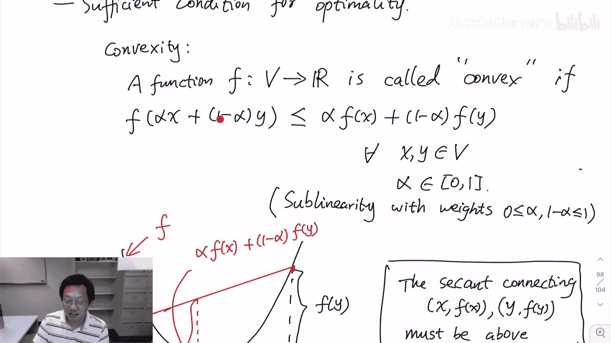

It's just a say that any seconder should be above。

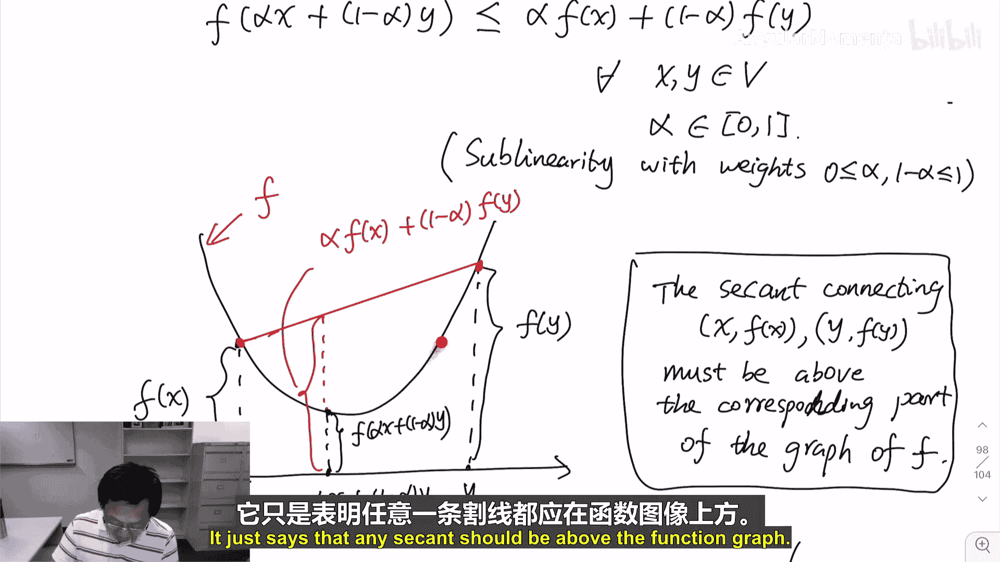

Function graph。For this。First， the other characterization of the convexity is just to see that any linear approximation should be below function graph。

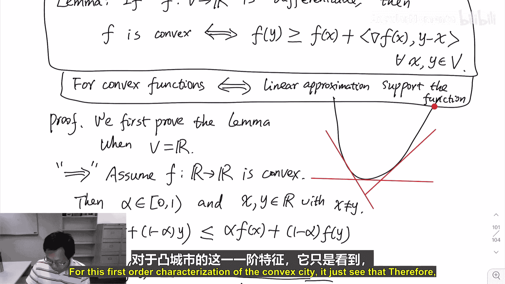

Therefore， this Nema itself is very， very interesting。 It is also fundamental in Comx analysis。

Now with this lemma， we are ready to prove this theorem。

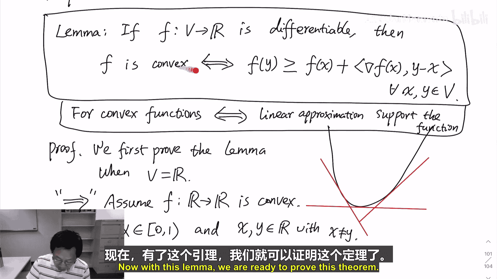

Let me restate this theorem。This theorem says that。If F is from B to R is convex and differentiable。

 then x star is the global minimizer of F if and only if the gradient of F at x star is 0。Truth。

From the left to the right。We have dominate to be4。Because this zero。

Gregens is a necessary condition for a global minimizer。And we only need to show。

From the right to the left， all the sufficiency of this condition。That is。X star is the argument。

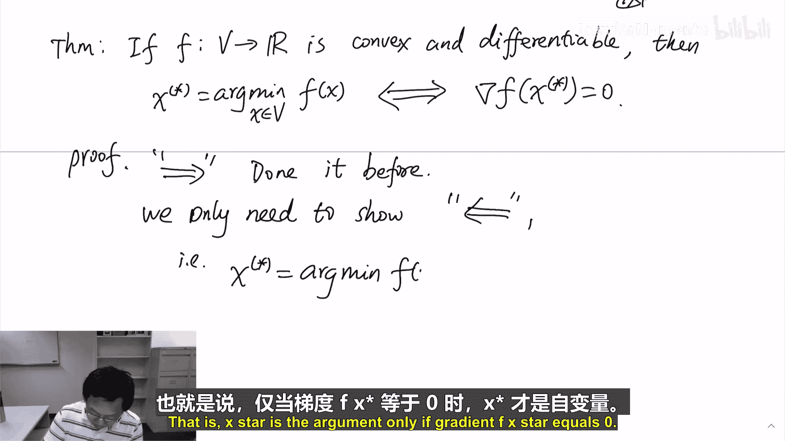

Only if gradients F X star。E equals 0。I want to show this。For this。We just use the Ne。

Because F is convex and differentiable。

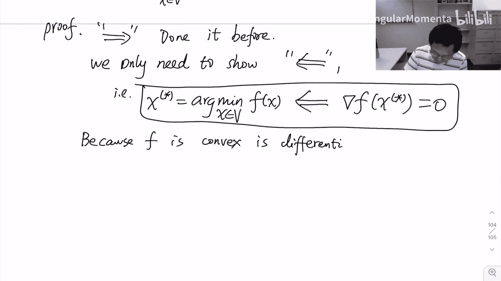

By our lemma。

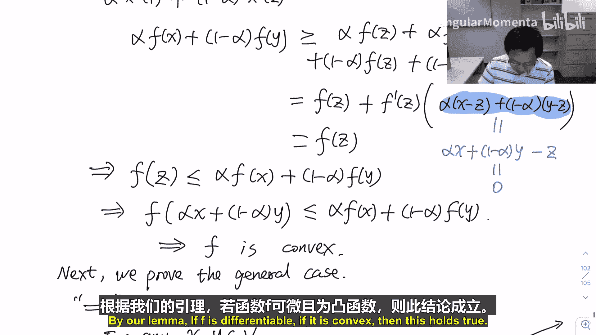

If F is differentiable。If it is complex， then this holds true。Then we just have this。 F。

Y is larger than。

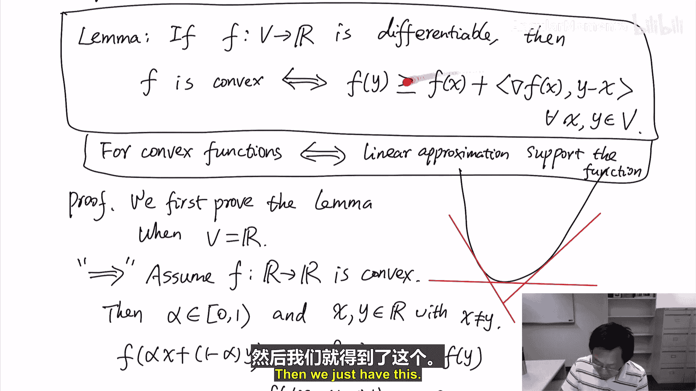

F X x。Plus。G of F F X。Y minus x。This is true on any X。And the why why。

Now I want to replace this X by x star。I want to replace Y by x。So this x is just arbitrary。

 now y is the x star which is fixed， because we know that gradient of f at x star equals 0。

So that this x star is a given vector。Then in this inequality， we have only X is arbitrary。

 So this is true for any x just because of the convexity and differentiability of F。

We also know that this gradient F at x star equals 0。We just plug this into this inequality。

We obtain Fx larger than or equals to Fx star。

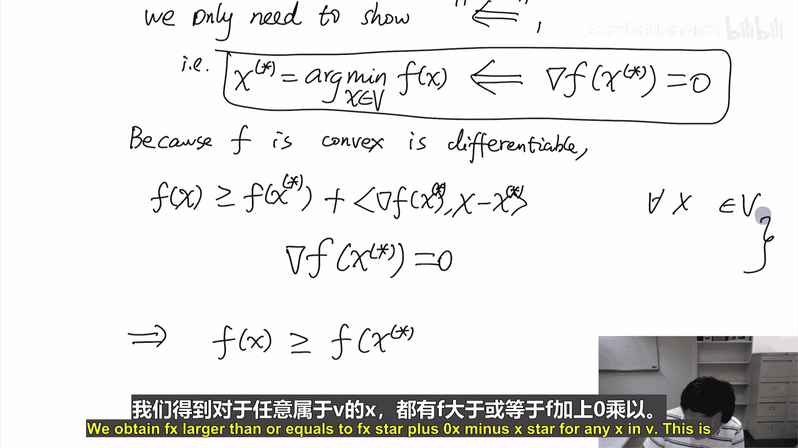

Plus，0 x minus x star。For any X U B。This is obviously Fx is larger than FX star。For any X U B。This。

Is the zero condition for X star to be a global minimizer。Thus， we obtain X star is the argument。

Of F X。Therefore， from x star satisfying gradient F x star equals to 0。

 we derive the x star is the argument of F。We finished the proof。

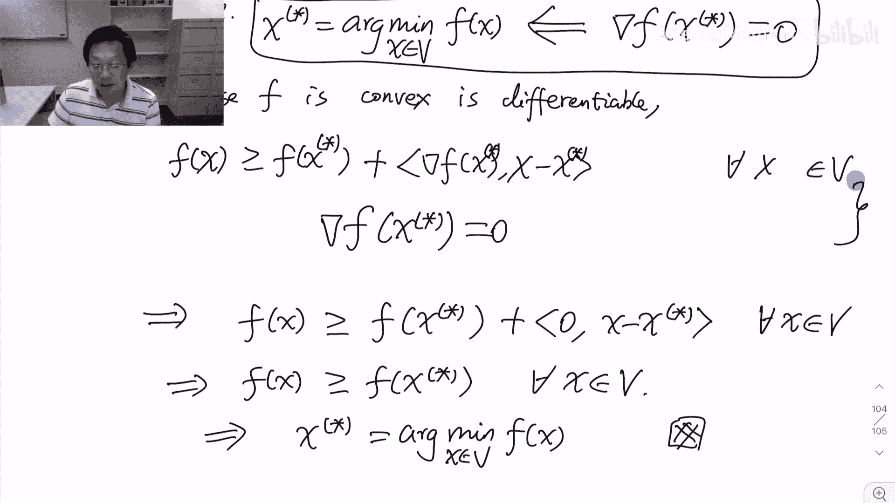

In summary。We get unnecessary and sufficient condition for the opportunity。For convex functions。If F。

Is a function on the H space V， If it is convex and differentiable。

 then an X star is the global minimizer of F of x。If and only if gradient F at x star equals to 0。

Was this equivalent characterterization？We only need to find out x star such that the gradient f of x star equals 0。

That is exactly many numerical optimization algorithms do。In many numerical optimization algorithms。

 we just find a solution such that ingredient is zero。

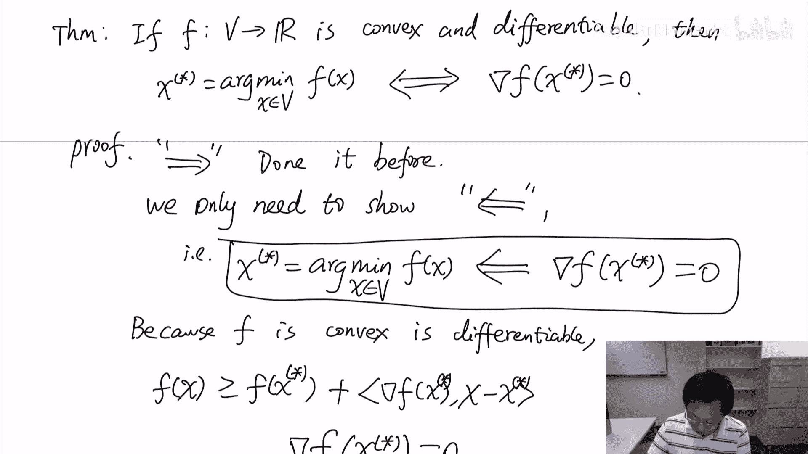