# 【香港科技大学】数据分析的数学方法 ｜ Mathematical Methods for Data Analysis p82 14-10-02-视频 -BV1DEFDzGEZW_p82-

We have used the linear approximation and differentiation to characterize Opity。 In particular。

 we have shown that。

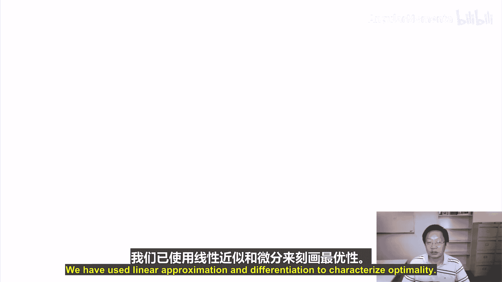

If a function is convex and differentiable， then x is a global minimizer of F。

 if and only if the gradient of f at x star equals to 0。If F is just differentiable。

 but not necessarily common X， then x star is a global minimizer of F。Only if。Greient F。

 X star equals to 0。The reverse is not true gradient of F X star equals to 0 does not imply that x is a global minimizer for general。

 not necessary convex functions。In the following， we would like to use the idea of linear approximation and differentiation to develop algorithms for the minimization of F。

In particular， we will consider gradient decent。We would like to minimize F of x。For all X on B。

Where。F is a function from。V2 R。And we assume F is differentiable。

This is an unconstraint optimization because our x can be any vector on V。

 We don't have a constraint on x。The algorithm will be an iterative algorithm。

 which means that we have an estimation and we improve this estimation so that we obtain the global minimizer gradually。

阿孙。At step K， we have the estimation X K。Of course。

 this XK is an estimation of the global minimizer F x star。Then with this X K ready。

 we want to find a better estimation。We call it X， K plus1。

Because this will be the estimation in the next step in step K plus1。

Our idea is still to use a fine approximation， or a linear approximation。

Since we wanted to minimize F。This F might be very， very complicated。

 It's very difficult to minimize this F directly。The idea here is that we approximate this F by an a fine function for a functions。

 we have an easy way to find out its global minimizer。For this purpose。

 we needed to approximate our Fx at。XK。We obtain。This。Relation。

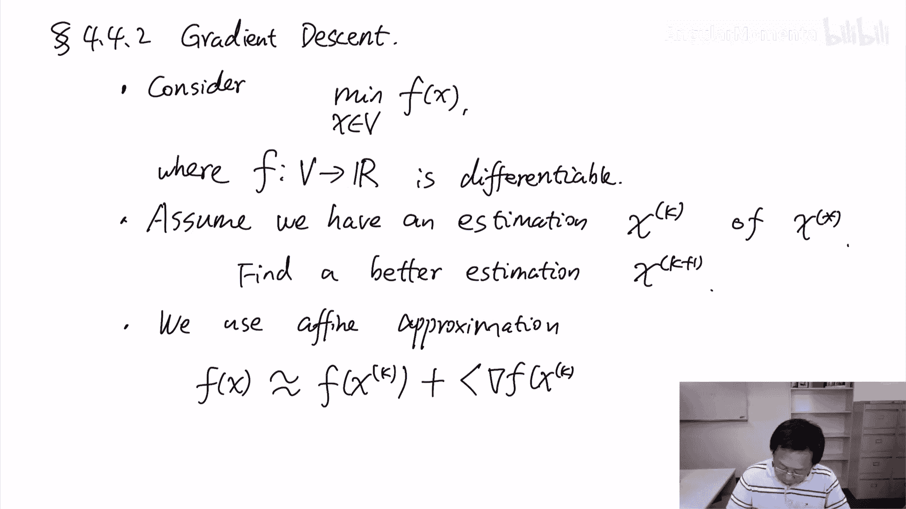

This is only an approximation because I have ignored this remainder term， The error term。

 The error will be very small when X approaches X， K。It's a little o of the norm of x minus xk。

So thearrow just becomes very， very small when x is very， very close to Xk。

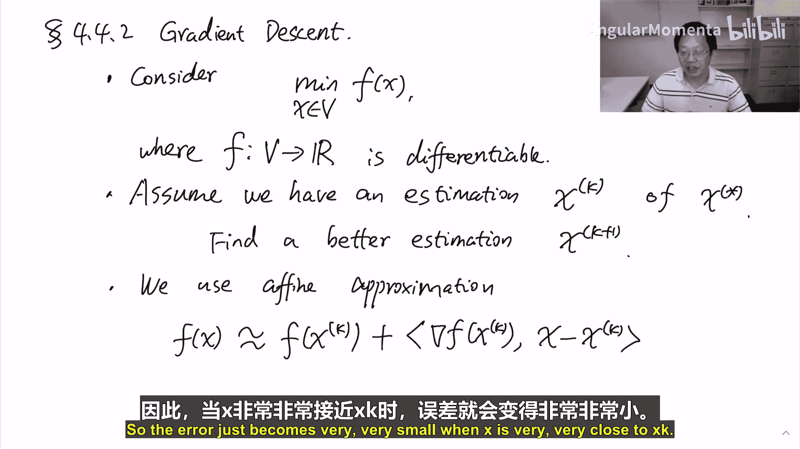

Graphally。We have this。X。And that we have in the graph of this function。And then we have Xk。

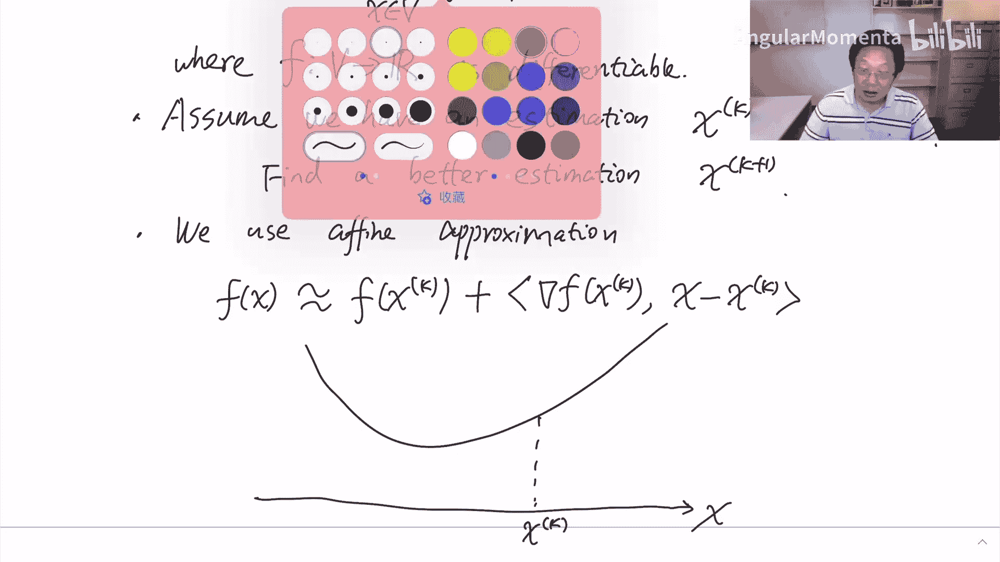

This is F of x。We used a fine function to approximate it。

The equation for this fine approximation is the right hand side F X star plus gradient F x star。

X minus x is star。We know that globally， this approximation might not be good。

 This approximation is accurate only if x minus xk is small。In the neighborhood of X， K。

This approximation。Is accurate。Onlyly衣。X is close to X K。 That is x minus X K。Its a small。Therefore。

 we cannot。Approximate this F directly by this one globally。

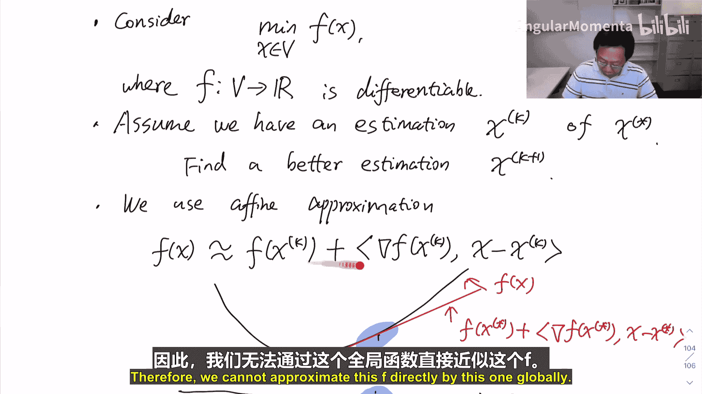

We have to go local， we have to develop an algorithm for the local minimization。

To minimize FX locally around a neighborhood of Xk。Then， instead of consider。

The minimization of F globally。We go local。That is。

 we gradually approximate x star by finding a solution that is in the neighborhood of Xk。Therefore。

 we just minimize。Of F of x。X U V。We don't to minimize this F globally instead that we minimize this F lower calling。

 such that。This x minus x k。Is smaller than some number。I will write this number into a multiple of。

Guidnt F at X， K。Assuming gradient F of X K is non0。 If this vector is 0。

 then we find out the point that the gradient of F equals 0。So X K has a non zero gradient。

 That's our assumption。 Then this is a non0 number。

 So this distance from x to x star is just a multiple of this fixed number， so it can be any number。

If we adjust alpha K。How to choose a FAK that will be discussed later。Therefore。

 we may just define our XK plus1 to be the argument， the solution of this constrained optimization。

Graphically， this algorithm is just done in this way。We have Xk。Now， we。

Restrict our solution in the neighborhood of this Xk。 We find the Xk plus 1。Next。

 we just find a solution in the neighborhood of this X K plus1。To obtain Xk plus 2。And so on。

 so eventually we will get this X star。This algorithm， actually。

 it is known as the proxima algorithm。

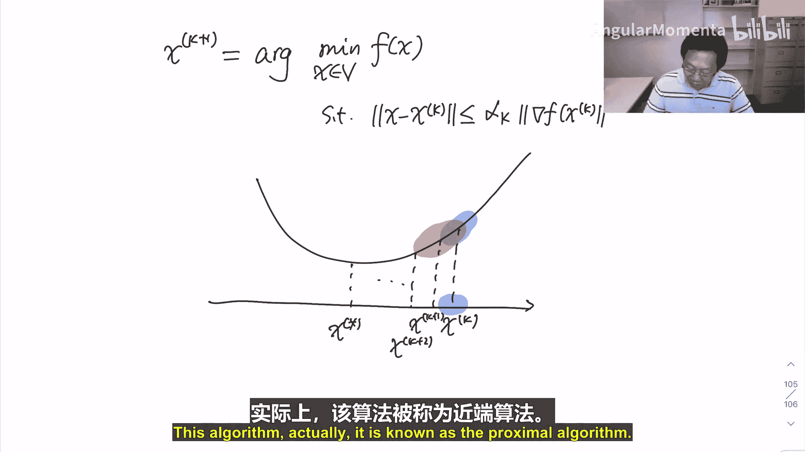

Proximal algorithm。It is also a very powerful tool for the minimization of F， of X。

But this algorithm， usually， it is very difficult to implement because。In each step。

 we need to solve this minimization。This constraint minimization。

 this may be even more difficult than the original problem because we have an extra constraint here。

So this algorithm， in most of the cases， it is just impractical。In most of the cases。

But it will work in some cases， in some very special cases。

We want to improve this proximal algorithm to get a practical computable algorithm。For this purpose。

 as I have mentioned in the very beginning， we can use the linear approximation， the a approximation。

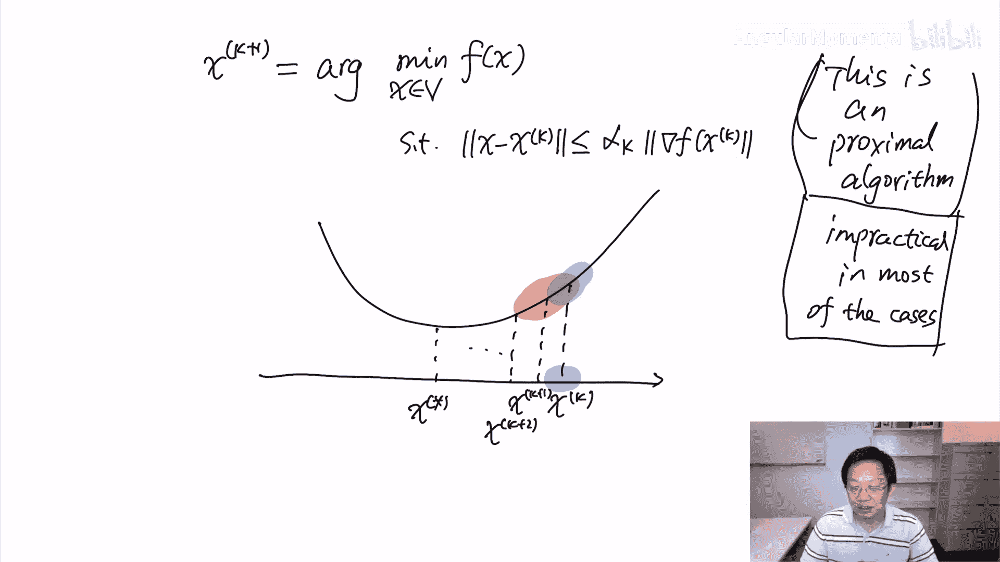

Because now we are in a small neighborhood of X K， and this linear approximation can be very accurate。

 If F is differentiable， which is the case we are discussing。

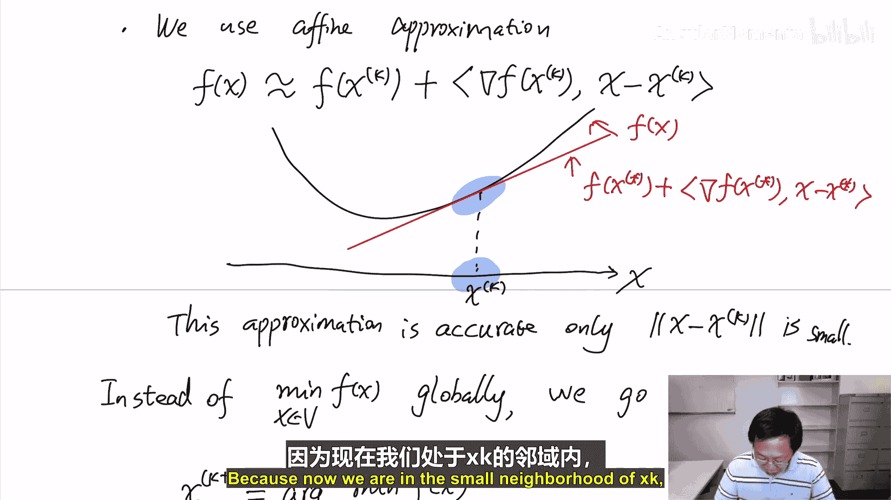

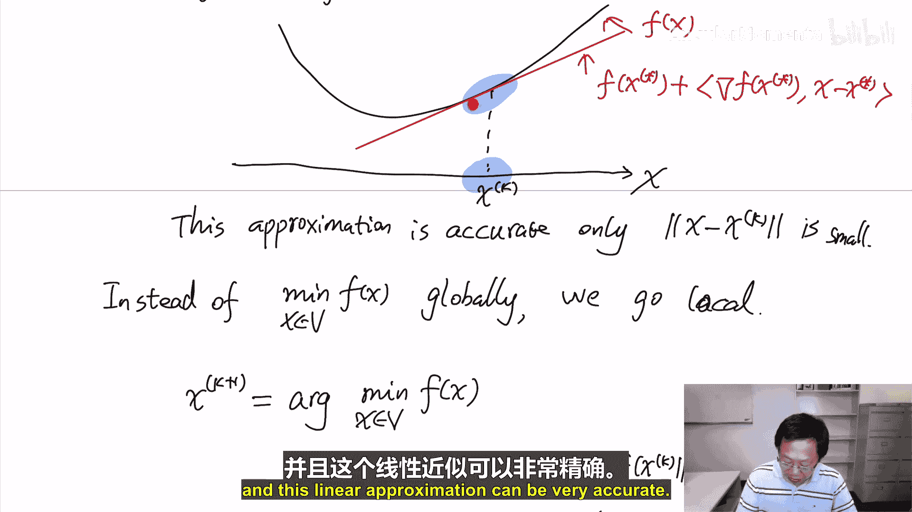

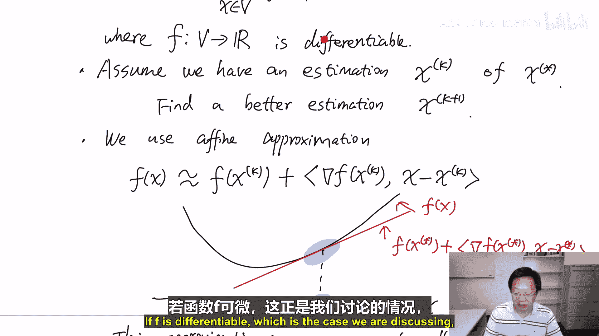

This linear approximationarrow will be very small。 It is just a little o of x minus Xk。

 It will be significantly smaller than this distance of x to x K。

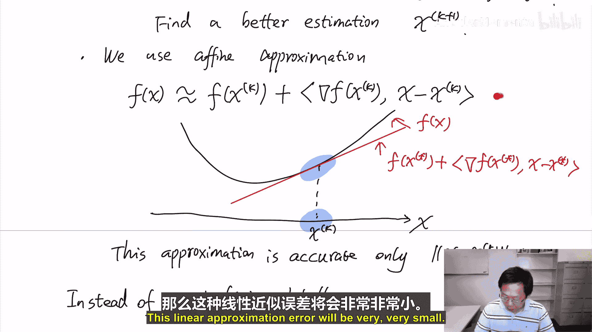

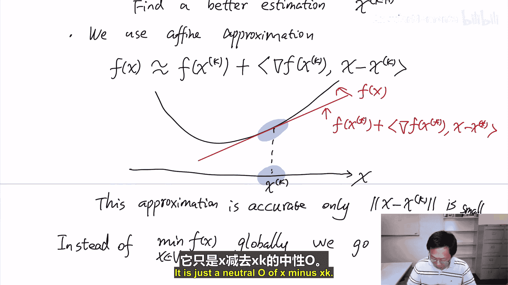

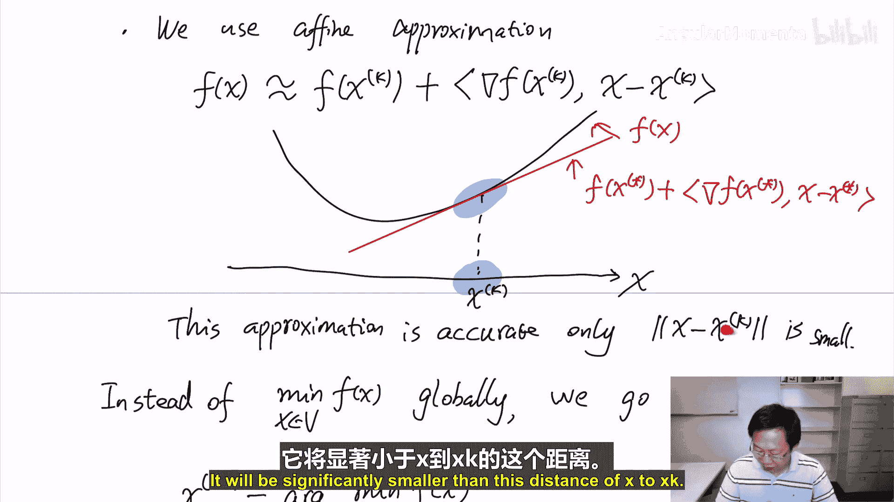

Therefore， this term， this error term may be neglected。

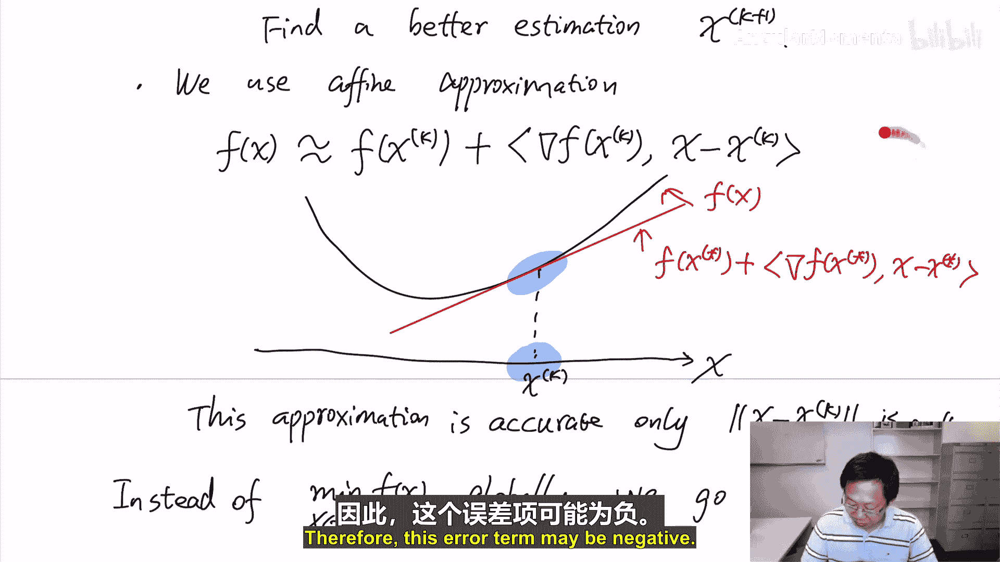

Then instead of minimize this F of x in the neighborhood of Xk。

 we minimize its linearization in the neighborhood of Xk。

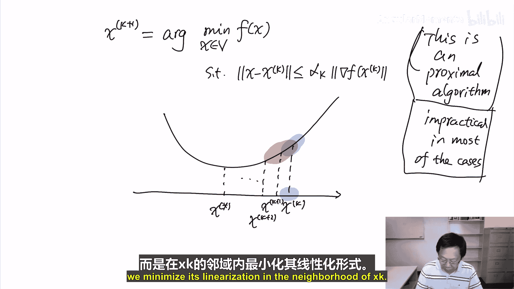

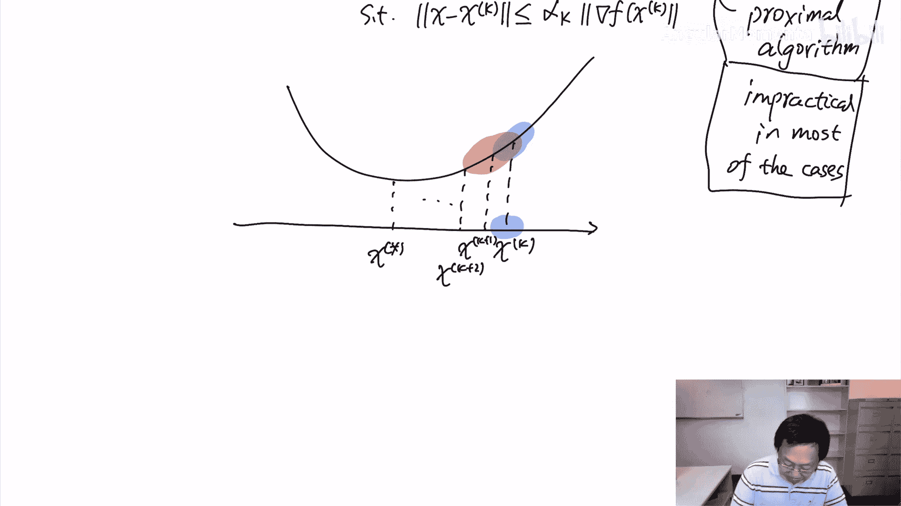

We approximate。Its by。X， K plus one。Es argumentmin。

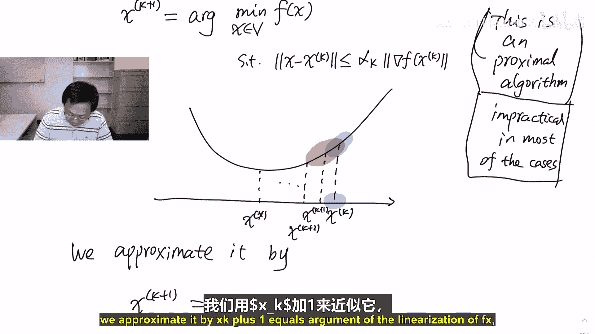

Of。The linearization of F X， which is F X K。Cls。The inner product of the gradient of FXK。X minus X K。

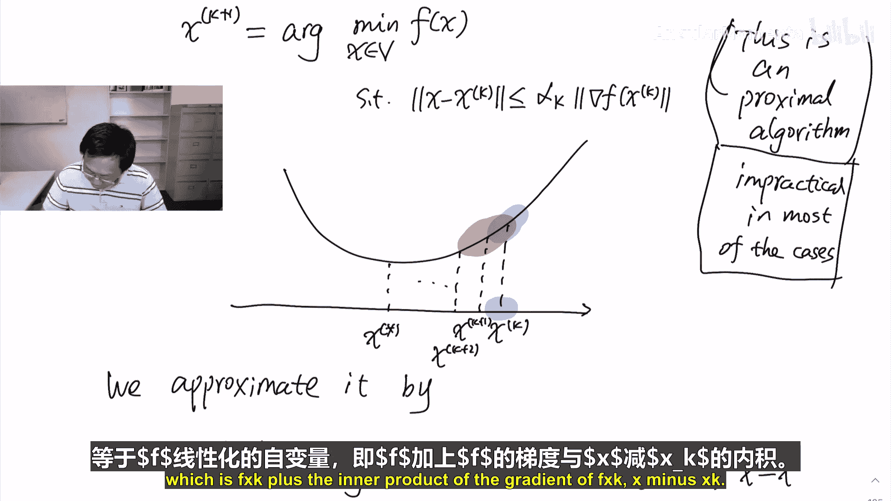

Subject to the same constraint。X minus X K。Smaller than O equals to alpha K。The gradient F at。

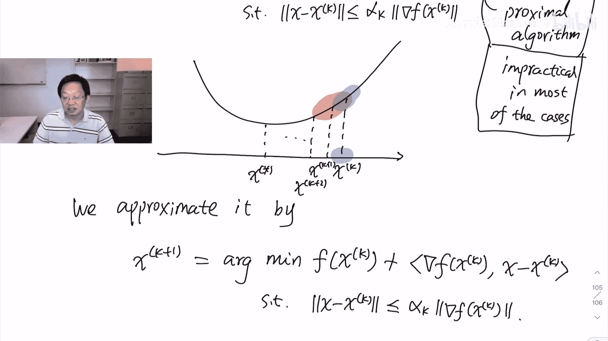