# 【香港科技大学】数据分析的数学方法 ｜ Mathematical Methods for Data Analysis p83 14-11-02-视频 -BV1DEFDzGEZW_p83-

Now we needed to solve this minimization problem。We needed to get an explicit form of the solution of this minimization。

 then we get an Xk plus one。

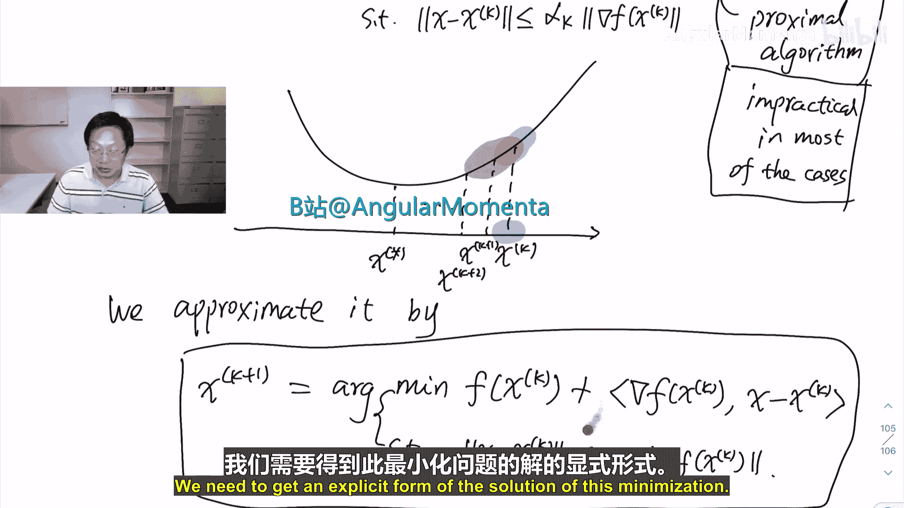

I will call this problem。TheSt。Now we want to find a close the form solution of this。Here。

 this alpha K is a number。It is a small number。Because we want to make sure that x is in a small neighborhood of X K。

 Otherwise， if this。Apha K is very big。 Then this neighborhood may be very big so that this linear approximation may not be good enough。

 So this alpha K should be a。

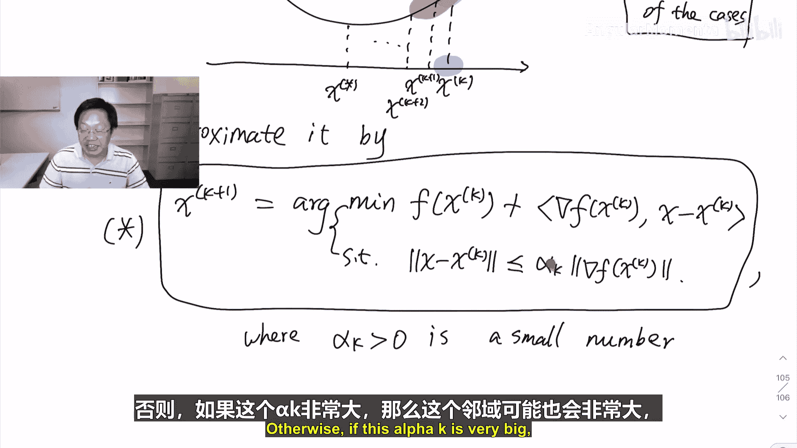

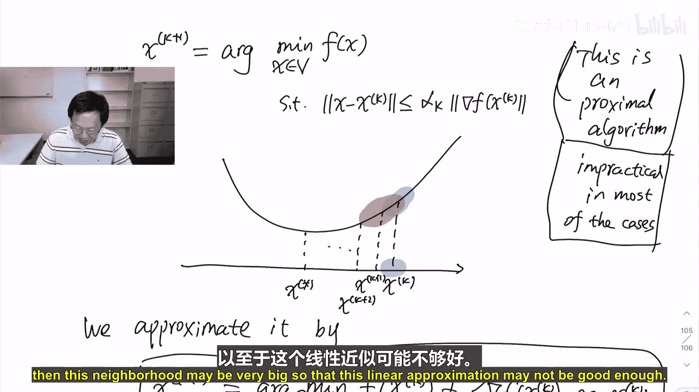

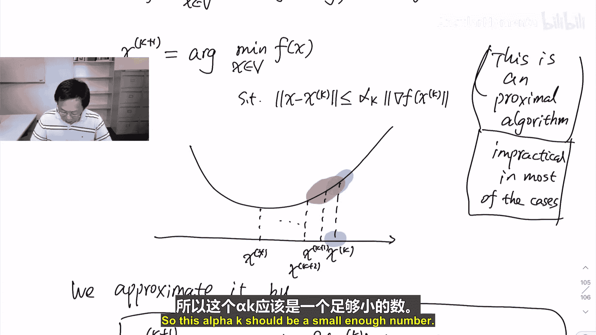

Small enough number。Then we solve it， thiss a star problem。The solution。off。Star。

To solve the star problem， let's just go back here。You can see that this star is equivalent to。

Because here， F， X K is a constant。Then， minimizing this。

Its just the equivalent to minimizing only the in the product term。Subject to the same constraint。

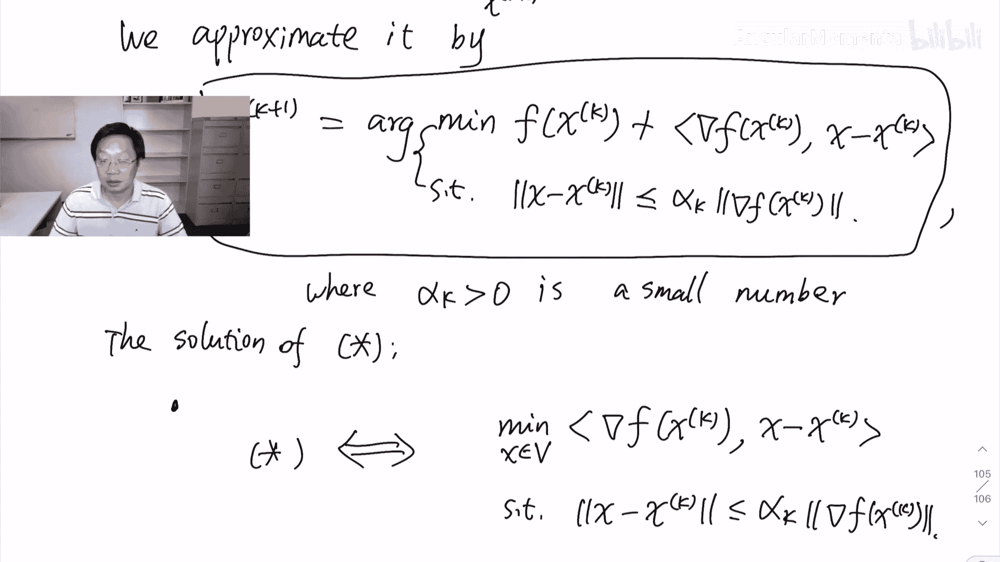

For this minimization。We can obtain its solution by the inality， by cautious。

Because the objective function is only an inner product。 This inner product will be lower bounded。

This inner product is larger than all equals to minus the gradient F Xk。

The norm times the norm of x minus X K。Because we are going to minimize this inner product。

This will be the。Minimal possible value for this inner protector。This is further。

Larger than or equals to minus gradients F。ケ？Now， because we have a constraint。

 x minus X K is smaller than this number， so that this is just larger than or equals to alpha K。

Times gradientd into F at Xk。The norm。This is exactly minus K。Greedients， F， X， K。

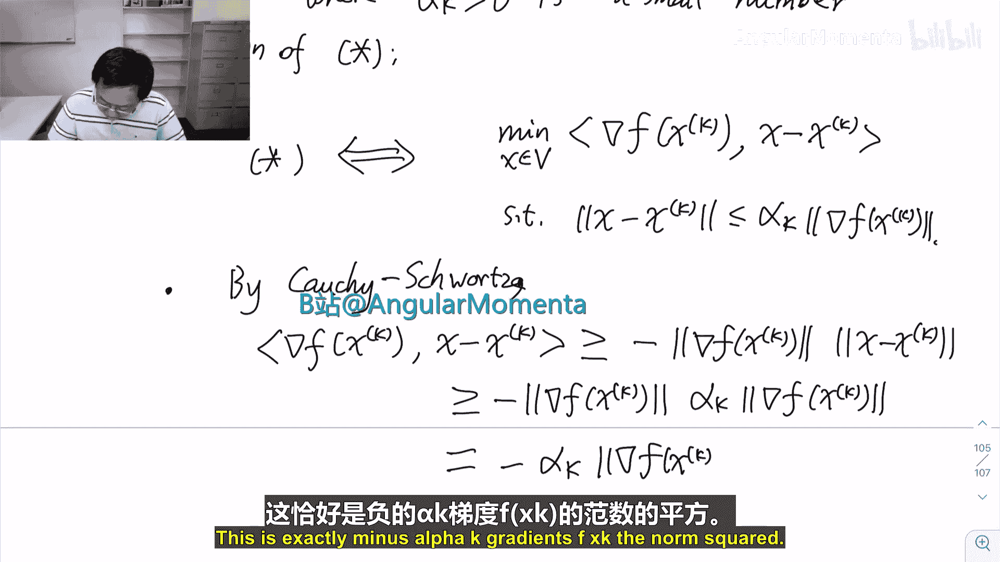

The norm squared that。Therefore。The minimal。Value。Of this star larger than or equals to minus alpha K gradient。

The minimum possible value of this objective function in this optimizationization is just larger than this minus alpha k times this norm squared。

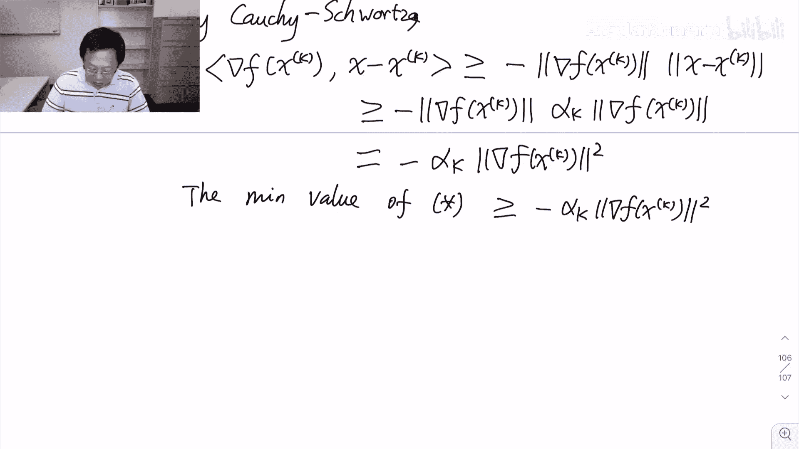

This lower bound actually is attainable。I call these two equal， equality 1 and 2， respectively。

If we want the inner protector。The objective function in star to attain the slower bound。

Then both these two inequalities should attain equality。In the following。

 we discuss when these two inequalities。Attains equality。For the first inequality。The E is attained。

Wen。This inequality is obtained by the co inequality。From cos's inality。

 we also know that the equality is attained when these two vectors satisfies one vector is a multiple of the other。

Since now， here is the lower bound of the cost inequality。

These two vectors should be in opposite directions。Which means that X。Minus X。

 K should be a negative multiple of gradient of F at X， K， minus C gradient F at X， K。Where。

C is a positive number。

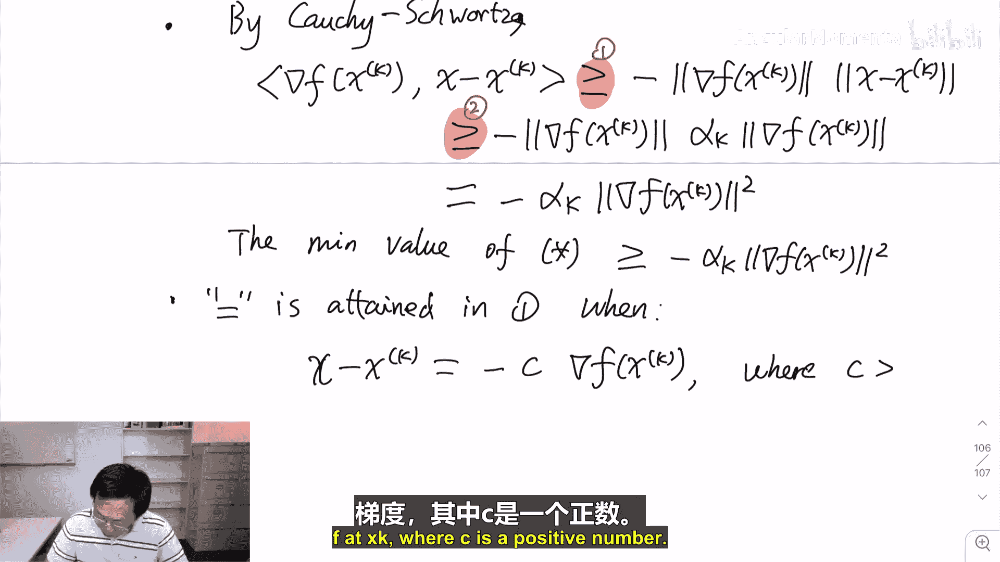

For the second inequality， the equality is attain。Wen。Obviously， x minus X K vector is norm。

 should attain this upper bound。

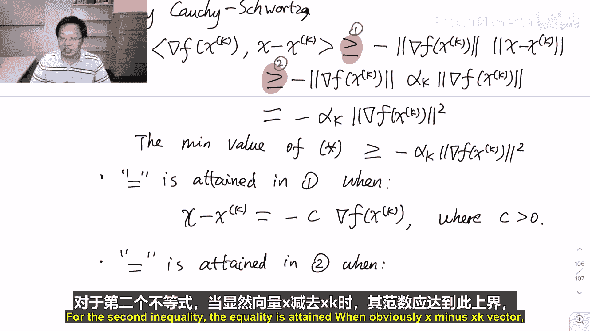

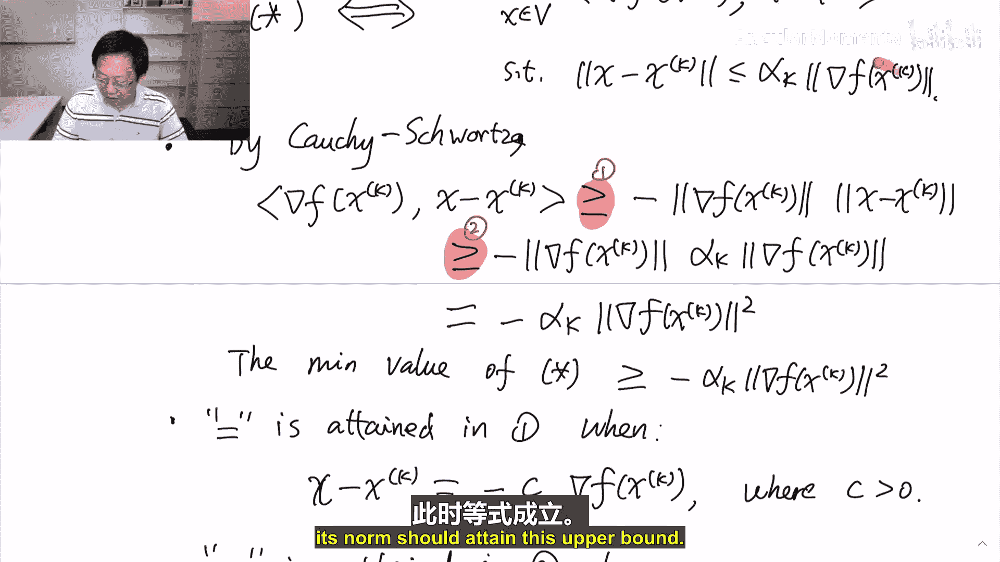

In other words。The norm of x minus X K。Should be the same as alpha K。

The norm of the gradient of F at Xk。

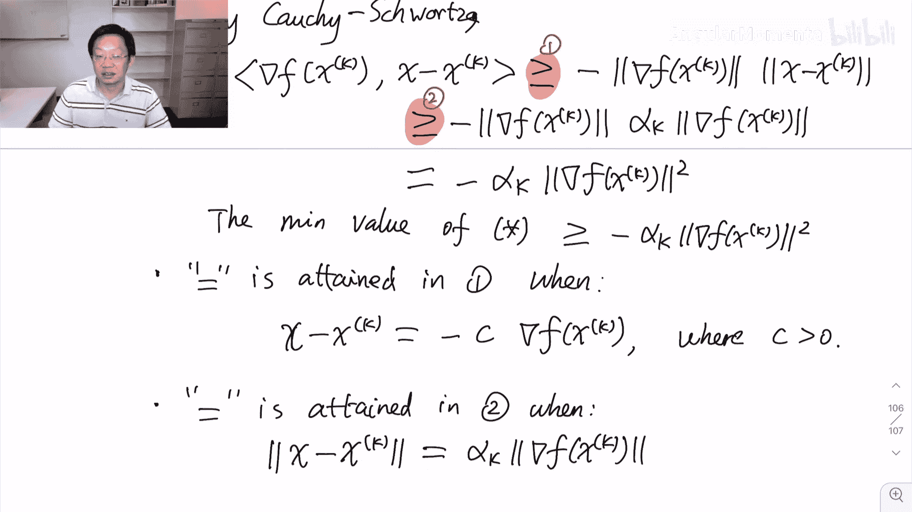

Then， from this two。Now I take the norm on both side of the first equation。We obtain C。Greedients。

 F at X， K。From this two， we just obtain that this C must be alphacade。Therefore， if we want。

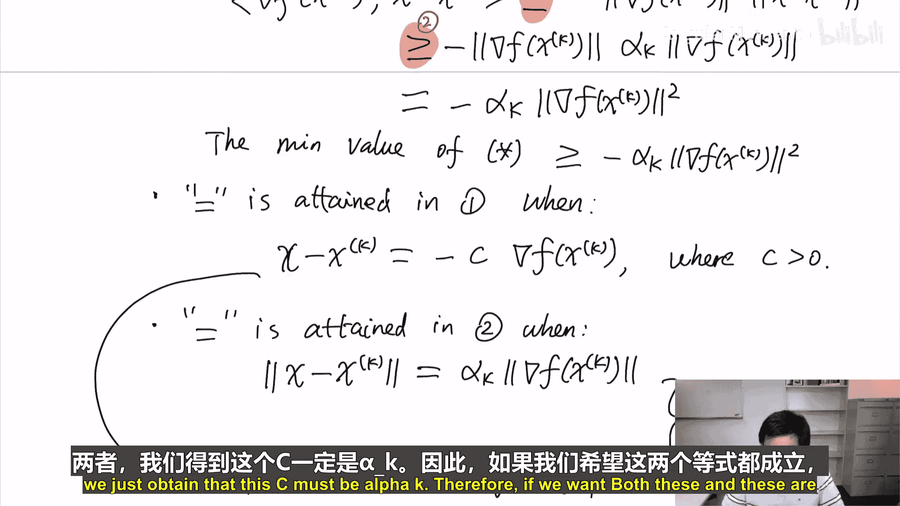

Both these and these are equalities。Then we should choose。X minus X K to B。

 minus alpha K gradient F at X K。This means。X is just X K minus alpha K gradient F X， K。

If we choose this X。Then the inner product attains its lower bond。

So that it will obtained the minimum possible value of this star。

So that the solution to this star problem is just。This。This is the solution of。

Opptimization problem star。We obtained the closed form solution of this minimization in our algorithm。

Therefore， we just the that。

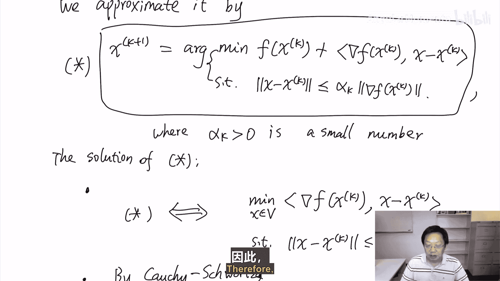

X， K plus 1。Equals X K minus alpha K gradient F at X K。This algorithm is known us。Greent。

 decent algorithm。To start this algorithm， we should first specify an x0。G x 0。

This x0 is just known as the initial gas。Then this grid in the de is just this one。4K。E equals 0，1，2。

 and4。Until we get a satisfactory result。Here。阿发 k。Are called。Step size。

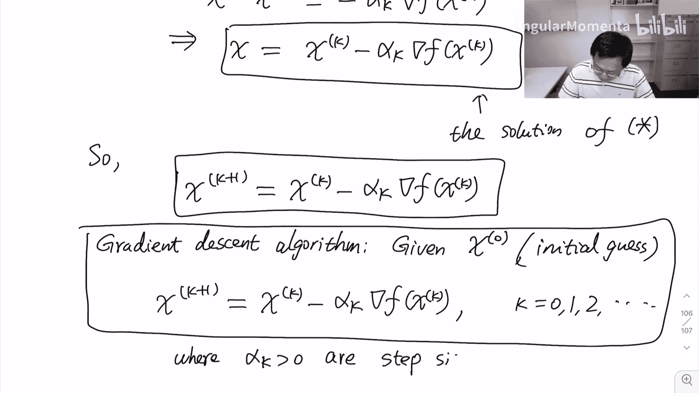

This simple algorithm is just the gradient， decent algorithm。Though very simple。

 this gradient in the decent algorithm is very powerful， and it is the very basic algorithm。

For many other advanced algorithms， for example， the stochastic gradient descent in the training of neural networks is only a stochastic version of this gradient descent。

In this algorithm， you can see that we have this parameter of a。

This parameter alpha K is called the step size。How to choose the steps？阿发奇。

This is a key question in efficient algorithms。How to choose it is very crucial。

There are many tricks。I will not discuss it here。It might be discussed in advanced courses。

 in optimization。And there are many strategies。4。This阿K。

We may wonder the convergence of the gradient descent。

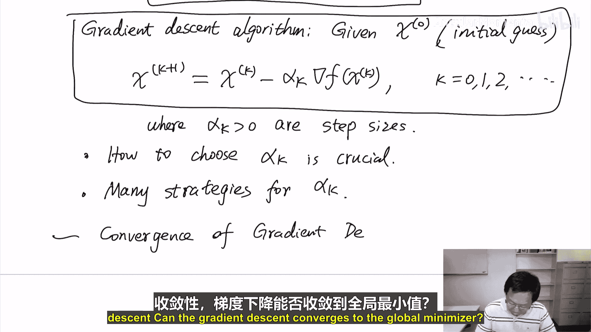

Can the gradient decentcent converges to the global minir。

The first factor that agreed the decent converges。With a sufficiently small alpha K。

This gradient in a decent algorithm。It always converges。If we choose a sufficiently small RFcade。

How about it an limit if it's a converge？Then the limit。I call it X infinity。Satisffiy。

The gradient of F x infinity。E equals0。We can only guarantee that the limit has a zero gradient。

But as we have known before。If F is convex， of course。

 x infinity will be the solution because its gradient is0 for convex functions，0 gradient means。

The global minimizer。But however， if F is non convex。In general。

 X infinity is not guaranteed to be a global minimizer。Because as we have seen。

 if the gradient equals to 0， it might be a local minimum， it might be a global max。

 it might be a saddle point。 It might be a local max。 It might be nothing。

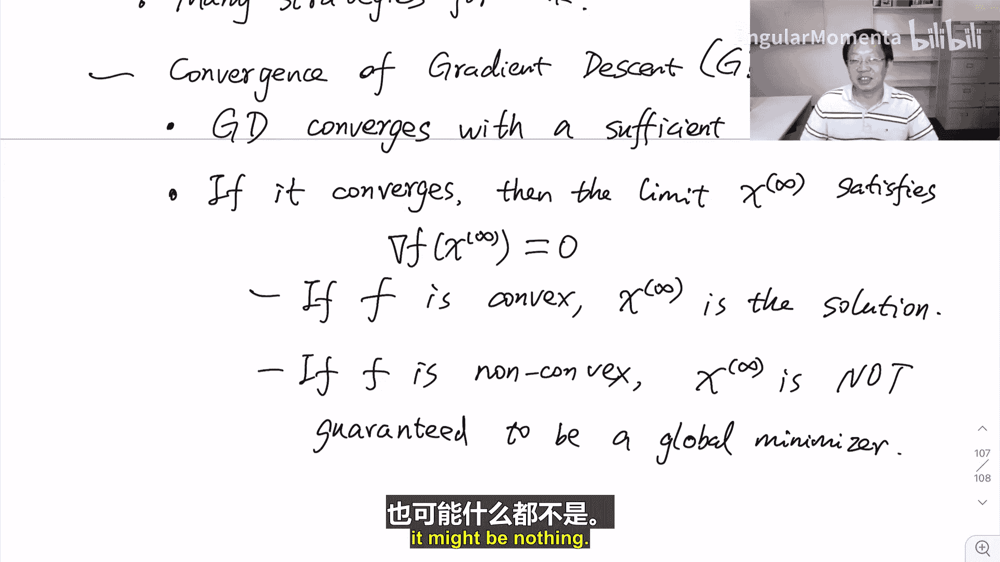