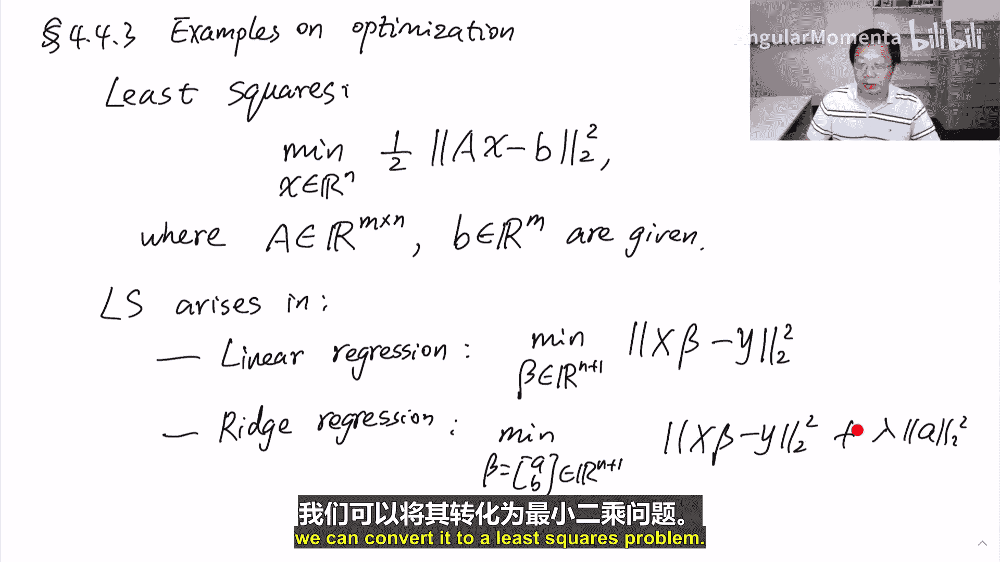
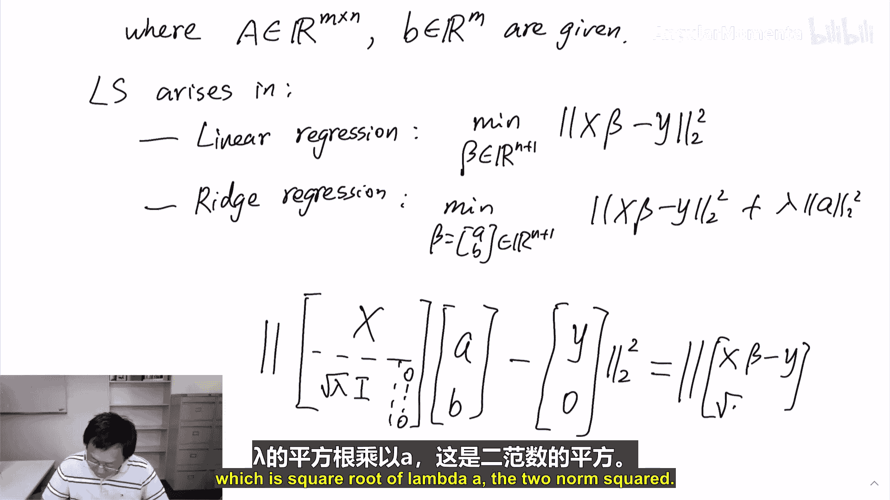
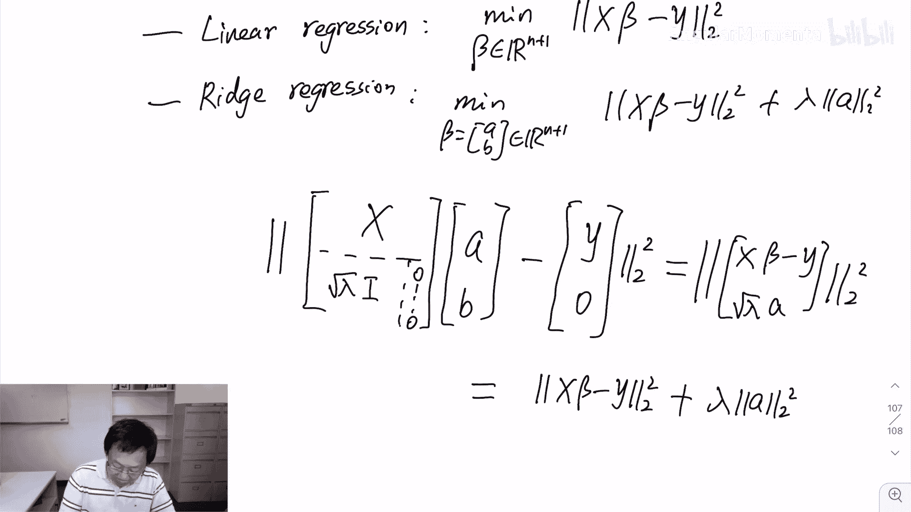
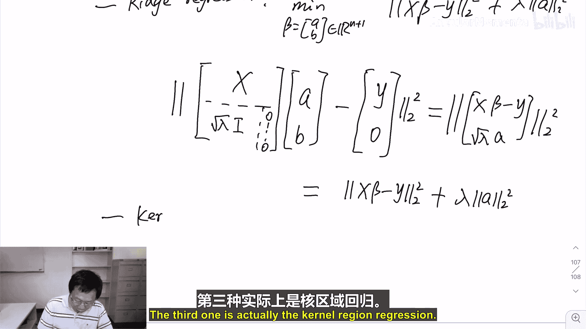
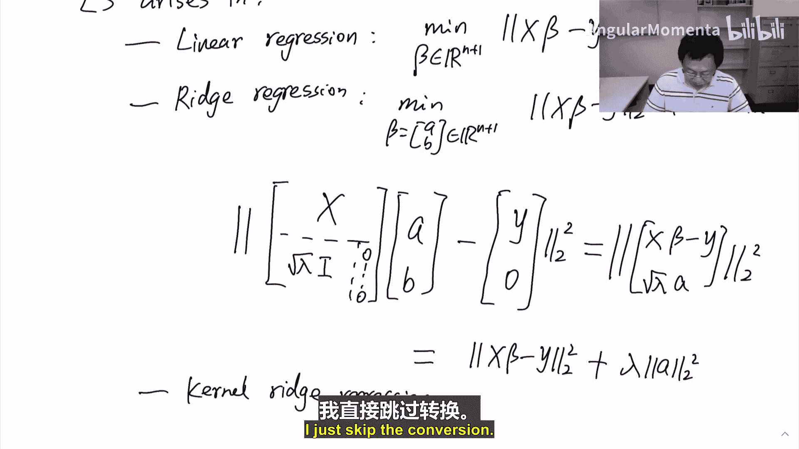
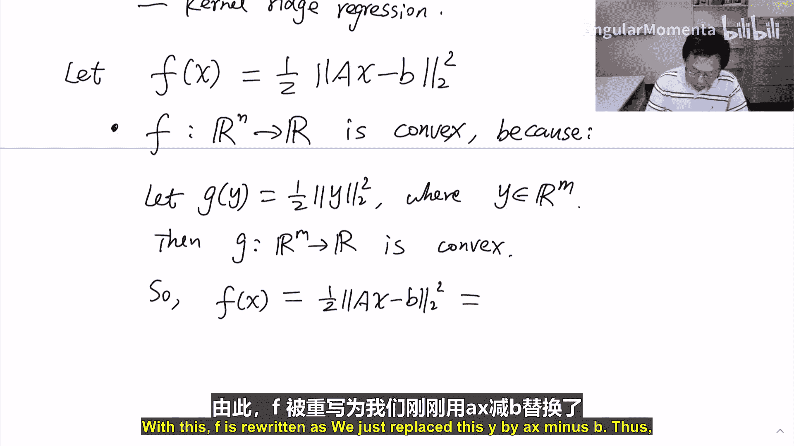
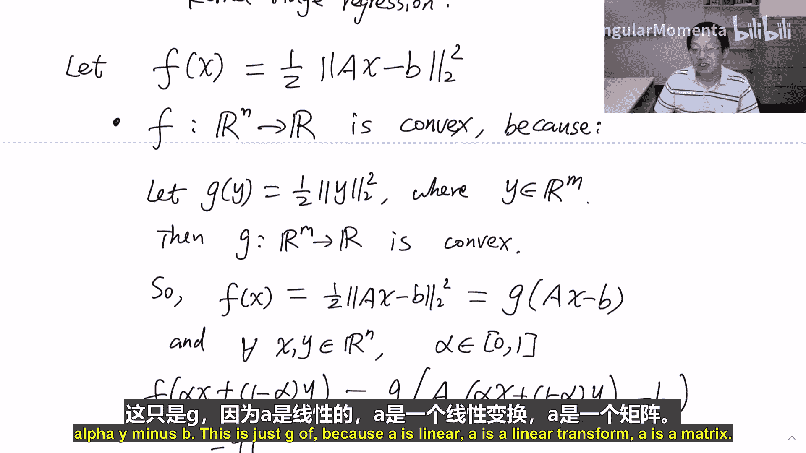
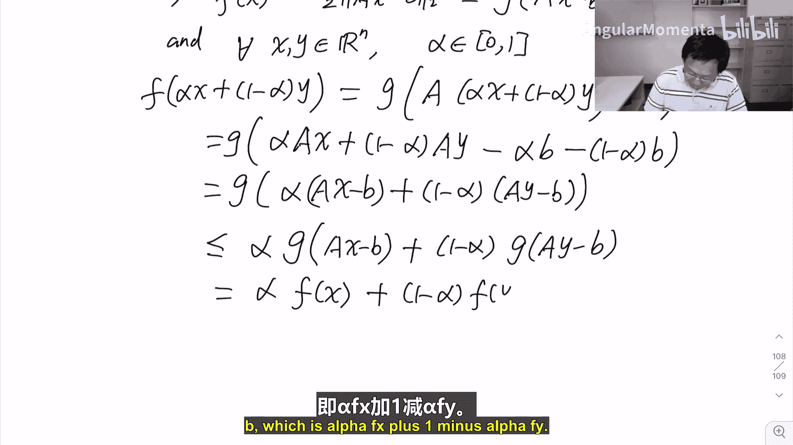
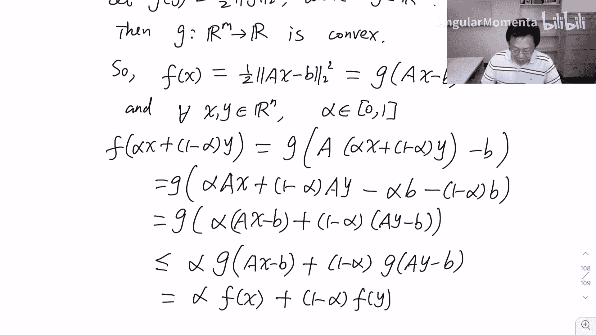
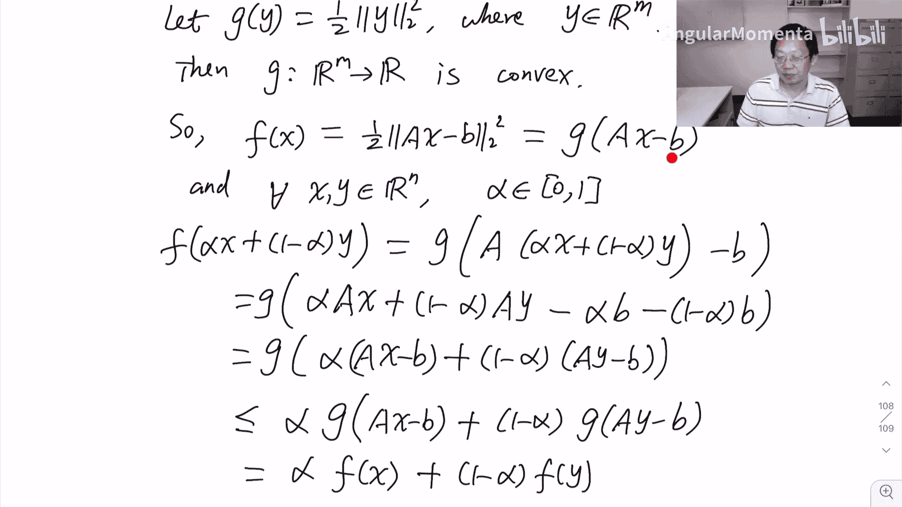

# 【香港科技大学】数据分析的数学方法 ｜ Mathematical Methods for Data Analysis p84 14-12-02-视频 -BV1DEFDzGEZW_p84-

Now， I'm going to give some more examples on optimization。In particular。

 I will demonstrate how to use the gradient， the differentiation， the linear approximation。

 the gradient， the distant。To solve some optimization problems arising in machine learning。

In particular， I will consider the list squares problem。Which can be written into this standard form。

 minimize。X in R， N。Half of。A X minus B， the two norm squared。Where a is a matrix。B is a megater。

They are given。And X is the unknown。Here， this a is an M by M matrix。 In general。

 it will be a very tall matrix because our training data is usually more than the number of unknowns。

This listta squares problem arises。In many applications of the machine learning， for example。

 in linear regression。In linear regression， we have seen that we minimize our beta in R M plus1。

X beta minus y， the norm square rootta。So the only difference is that I added a half here。

 but I multiply this objective function by a constant will not change in the minimizer。

So this is a I used the squares probe。Where X is from the training data。

 Y is also from the training data。They are given。 only beta is unknown。

 Beta is coefficient in the linear function。And also for the rich regression。We needed to minimize。

Again， beta equals a B。In R， M plus1。We have this x beta minus y the 2 norm squared。

 we need a regularization on the A2 norm squared。This problem looks not the least squares problem。

 but indeed， we can convert it to a list squares problem by the following。

We define an augmented the matrix。It's a block matrix。 The top block is x。

 The bottom block is further splitd into two sub blockss。The left is square root of lambda I。

The right is just 1，0 vector。And the unknown is still beta， which is A and B。Minus this。Y and 0。

Now this two norms squared。We use the matrix multiplication rules。 You can write this as。

We have the top one is just x times this vector， which is beta just x beta minus y。

And the bottom one。Is square root of lambda I times a plus 0 times B， which is。

Squared root have lambda A， the two norm squared。

This is exactly x beta minus y 2 norm squared plus。Lambda a 2 norm squared。

 because this two norm squared is just this two norm squared plus this two norm squared。

 This two norm squared is this term。 This two norm squared is just this term。So by this way。

 I have rewritten。This objective function in the rigid regression to this one。 Now。

 this is a typical。D square， because this is the a matrix。 This is the x vector。

 This is the B right hand side。

The third one is， actually the。Currental age regression。

It can also be converted to a least squares problem。It is just similar to this one。

I just skip that conversation。

Now we focus on the solution of this list squares problem。

We let this objective function in the least square to be F。 we define F。就B。Half of A X minus B。

 that two norm squared。Let's focus on the properties of this F function。F is from R， N to R。

Because x is on N， this is convex。Because。To see this， let us just define G of y to be half of。

Yhy2 norms squared where。W is a vector on R M。Then this G function。It is from R M to。And also。

 this G function is a two norm squared。And the two norm is the norm on RN induced by the inner product。

We know that norm squared is a convex function。So this G is a convex function。Was this。F。

 X is rewritten as。We just replaced this y by A X minus b。

Thus， F X is just the G of A X minus。Now， to show the convexity。For any X and Y in R N。

For any alpha in 0，1。We want to consider F of R x plus1 minus R y。

This is G of a plus alpha x plus1 minus alpha y。Mus B。This is just G of because a is linear。

 A is a linear transform。 A is a matrix。

Therefore。A applies to this vector is the same as alpha A X plus 1 minus alpha A Y minus。阿法B。

-1 minus alpha b。We have G of。Alpha A X minus。Plus，1 minus alpha。AY minus B。Since G is convex。

We can apply the complexityity of G。To obtain。阿法G of AX minus B。Plus，1 minus alpha法 G of a Y minus B。

Which is alpha F。X。Plus 1 minus alpha。喂。

Therefore。

F is a convex function。Indeed， you can see here this F is a composition of G and this fine transform。

Therefore， it is a convex function。