# 【香港科技大学】数据分析的数学方法 ｜ Mathematical Methods for Data Analysis p87 15-01-02-视频 -BV1DEFDzGEZW_p87-

In Cha4， we have studied linear functions and differentiation。

Differentiation is actually linear approximation or more precisely a fine approximation。

We have seen that differentiation is a powerful tool for characterizing the Op and developing numerical algorithms for optimization。

However， our tools for differentiation are still very limited。In chapter 4， for differentiation。

 we used the only。Its definition。Its linearity。And a very elementary version of the Qnin rule。

Using these tools， we cannot even give the gradient of the objective function in the list squares problem。

We have to develop our own tool for the gradient of the lister squares。Therefore。

 we have to extend our tools for differentiation。Moreover。

 we just defined the first order differentiation。In many advanced algorithms for optimization。

 we may need higher order differentiations。For these purposes in this chapter。We will study。

L their transformations。And higher order。Differentation。

We will study transformations between two vector spaces。Based on this。

 we will develop higher order differentiation。We start with linear transformations。

Or it is also known as linear operators。We consider functions between two vector spaces。

 let V1 and V2 be two vector spaces。We have a map。I know from V1 to V2。That is L of x。

Is a vector in me， too。We call this out。Is linear transformation。Or a linear operator。

If this l is linear。In a sense that。This L is commutable with the linear combination。More precisely。

 L applies to alpha x plus beta。 Y should be alpha L of x plus beta L of y。Where。

Alpha and beta are real numbers。And X and y are vectors on V1。

This L maps this vector in V1 to a vector in V2， so that this addition。

 this scalar multiplication R in V2。If L is commutable with the linear combination。That is。

We first do the linear combination and then do the L mapping is the same as I first do the L mapping respectively and then do the linear combination。

If this is satisfied， L is called a linear transformation。Or a linear operator。

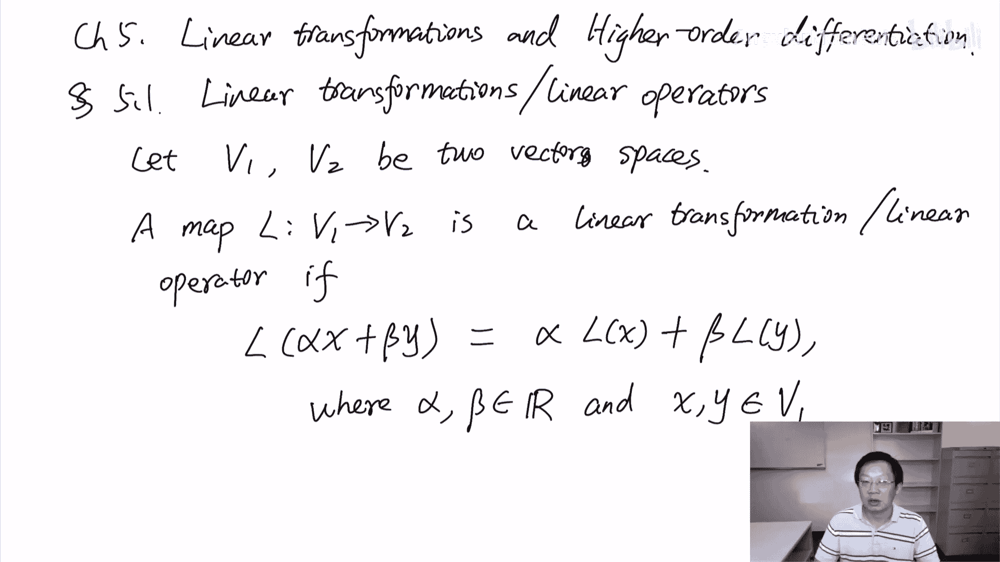

To understand this， let us see some examples。

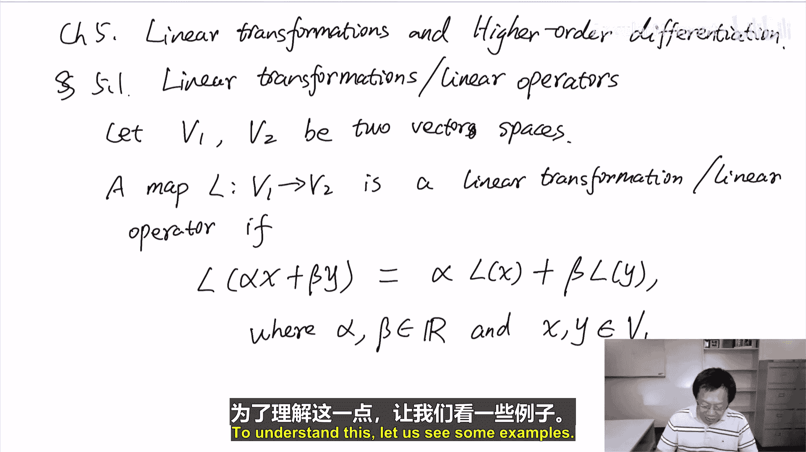

Example 1。We start with linear transformations between Ekanadian spaces， lets。AB AI J。

I is from one to M。 J is from one to N。 be a matrix in R， M by M。Which means that A is a 2D array。

With these metrics， we can define a transformation。Define。A transformation。Between RM and RN。

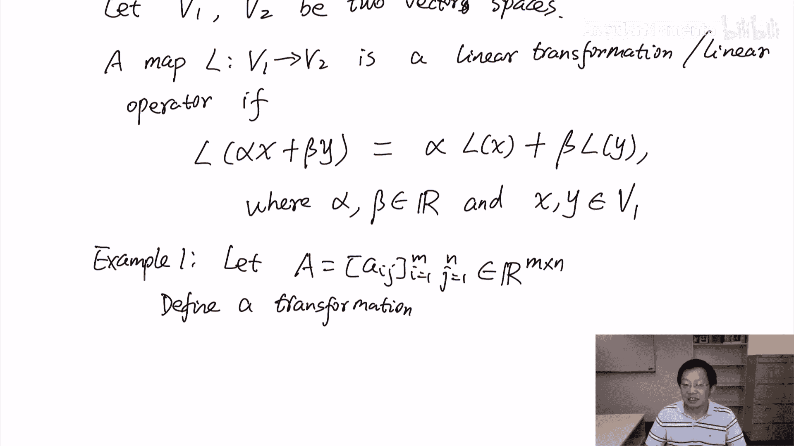

From R， N to RM。

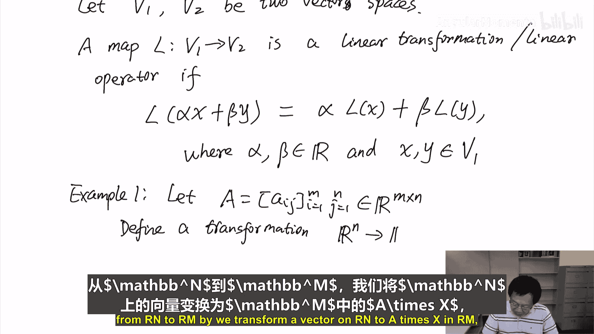

Bye。We transform a vector on R， N。To a times X。In R M。

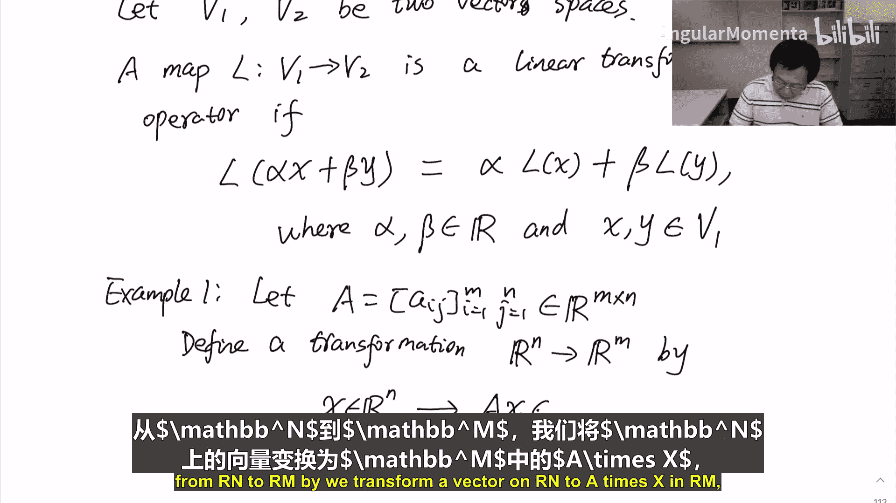

Where it。X is the standard。Matrix vector product。Then。It is an linear transformation。

Because we can check this directly。A times alpha x plus beta y， where x and y are vectors in R N。

Eals阿法 A X plus beta A Y。Because matrix vector product is linear in this axis。Therefore。

 from a matrix， we can define a linear transformation from R N to RM。Rversely， consider。

A linear transformation。L from R， N to RM。For any linear transformation from RN to RM。

From linear algebra， we know that there must be a matrix representation of this linear transformation。

Indeed， we just set up coordinate systems on R N and RM。 Then we can easily obtain this a matrix。

This is from lineara algebra。

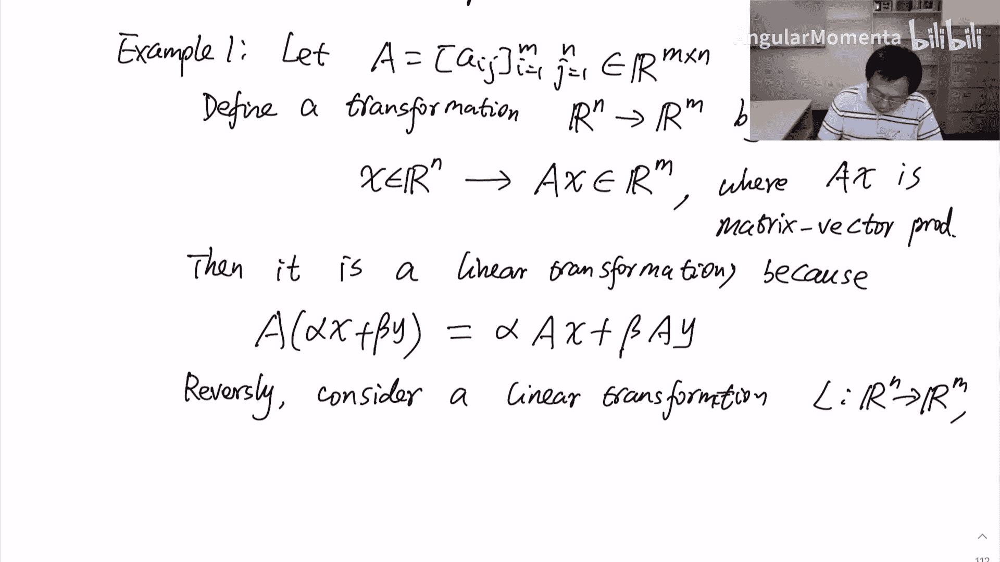

Then， we must。Can find a matrix in R。And by N such that。L of x equals a times x for any x in R N。

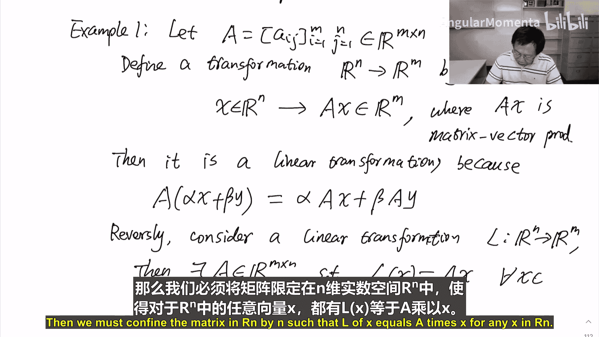

This is from Ninya algebraba。Therefore。For linear transformations from R N to RM。

There is a correspondence between such a linear transformation and a matrix。

 a linear transformation is a matrix。 a matrix is a linear transformation。Example 2。

We consider linear function。Let F from V to R。Be a linear function。Where me is a vector space then。

F is linear transformation。This is quite obvious， because are。Is a special vector space。Then。

 we can view。V and R be two vector spaces。So F is a linear transformation between this vector space and this vector space。

So its an linear transformation。In this sense， linear transformation is a generalization of linear functions。

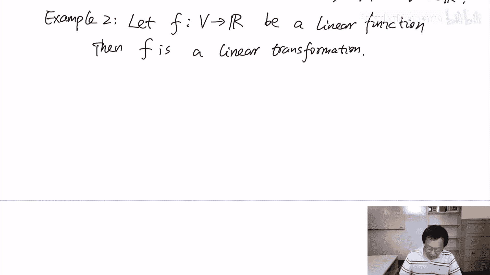

Example 3。We consider。A vector on V。Here B is a。Vectctor space。Then we define。L from R to V。

Byuy this weight。L of。C equals C times a。Here this multiplication is the scalar multiplication。

 a scalar multiply vector。 then we get a vector。So that this L of C is in B。能。This hour is。

I in their transformation。You example 4。Let。A 1， a 22 A K， B， K vector on the Hiber space H。Define。

A map L from。H to RK。Bye。L of x equals。The first。

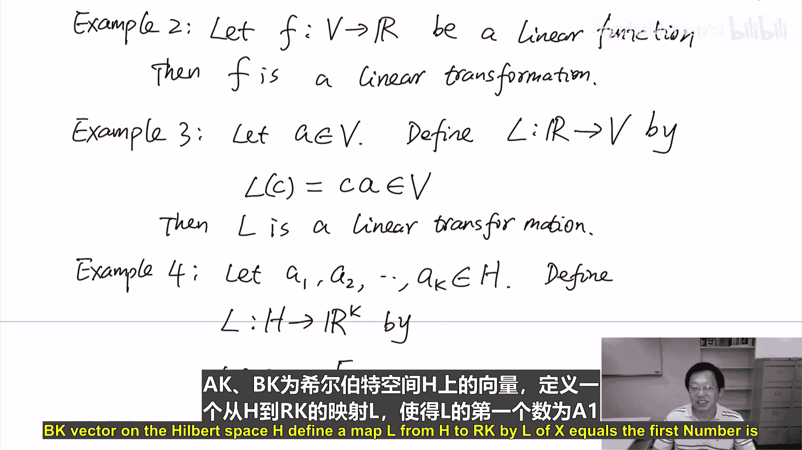

Number is the inner product of a 1 and x。 The second is just a 2 x。And the last is A K X。

This is in our。

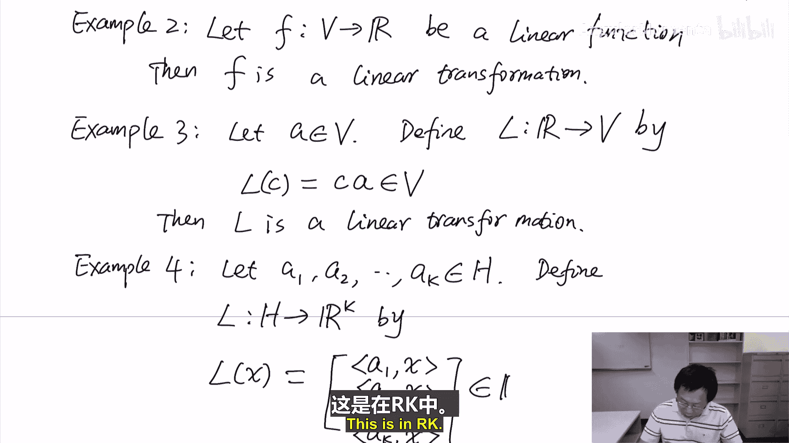

Therefore， this L maps a vector on H to a vector in R。

Since each entry in this transformation is linear， you can check that this L。

Is a linear transformation。From H to RK。We can also define linear transformations on function spaces。

You example5。Let V1 be our function space。All functions， F such that F and F prime are continuous。哦。

AB。

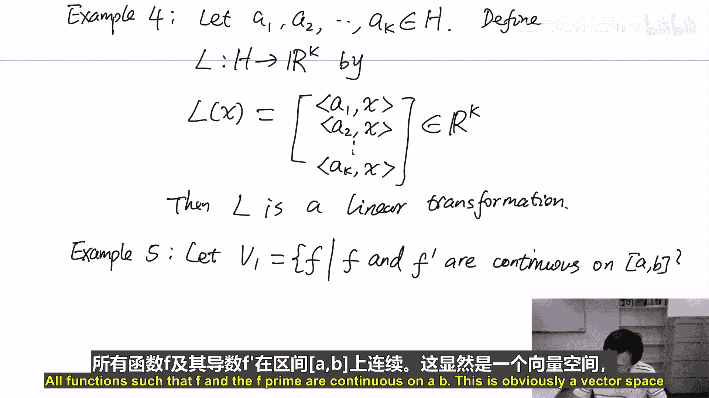

This is obviously a vector space because we can define function addition and scar multiplication for functions。

And there would V2 be。The function spaces of all functions， such that F is continuous。Anng。AB。

This is the CAAB space。

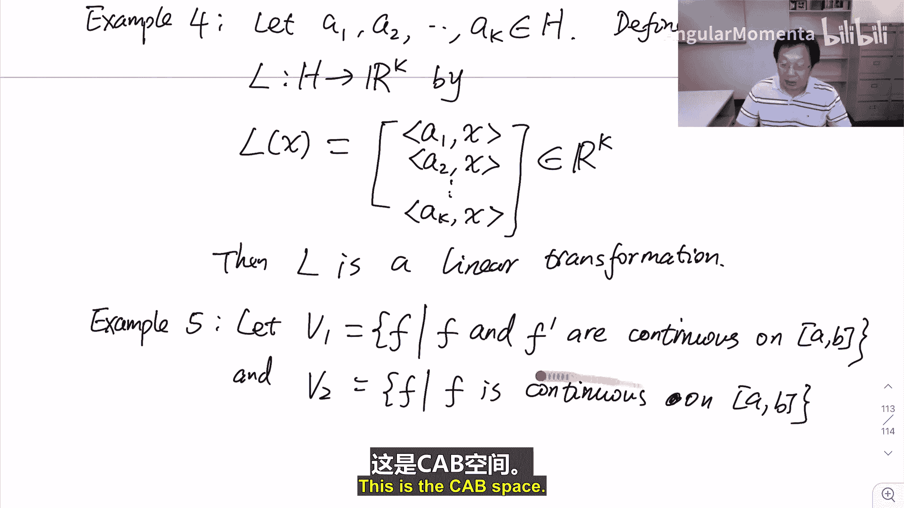

We define a map。That makess a function on V1，2， V2。This map， I call it D。B 1，2， B，2， bye。D of F。

Its just the derivative of F。For all F on V one。Since。F and F prime are continuous on A B。

 so that this F prime is continuous on A B。 Therefore， this F prime is in V2。That's this transform。

Is indeed a transformation between V1 and V2。We know that the derivative is linear。Therefore。

 this transformation is a linear transformation。You example example6。Example 6。

We consider a function。Space。Es。嗯。You example6。We consider。2 function spaces， C，-1，1 and。C，0，2。

Thatice the set of our continuous functions on-1，1 and on 0，2， respectively。Would you fine。

A mapping between these two spaces。Bye。T。From C minus-1，1 to C0，2。Bye。For any F。On C，-1，1。Tf。

At the tea。Is F of。T-1 for any t on0，2。That is the function on C minus-11 is shifted。To the right。

 by one unit。This is called a translation operator。This translation operator。Is linear operator。

You can check it directly， by the definition。This translation operator is very useful in the modeling of。

 for example， image data， because images contains many socal translation invari features。

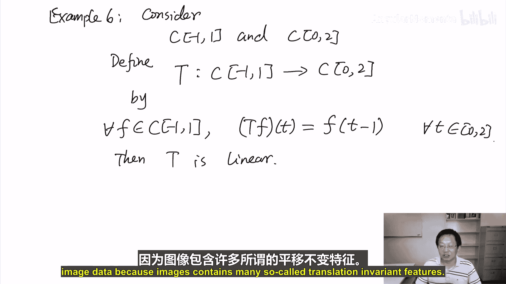