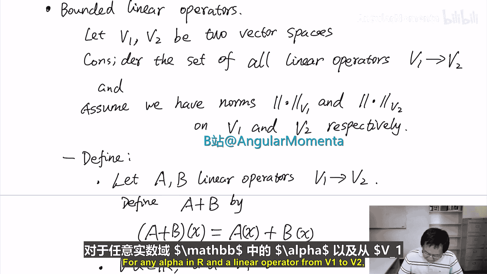
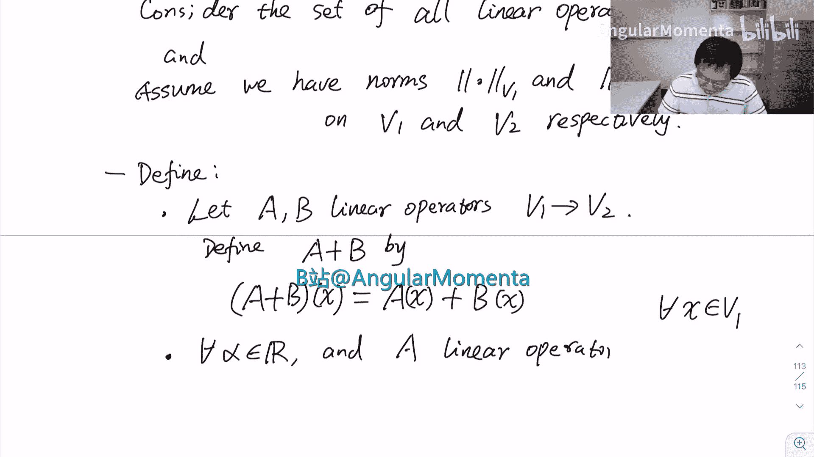
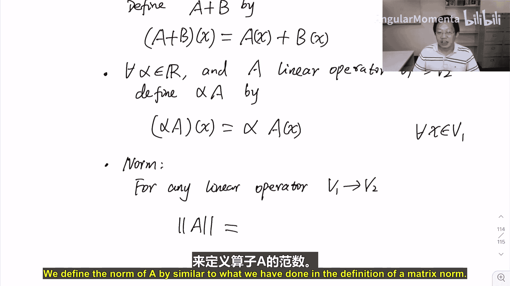
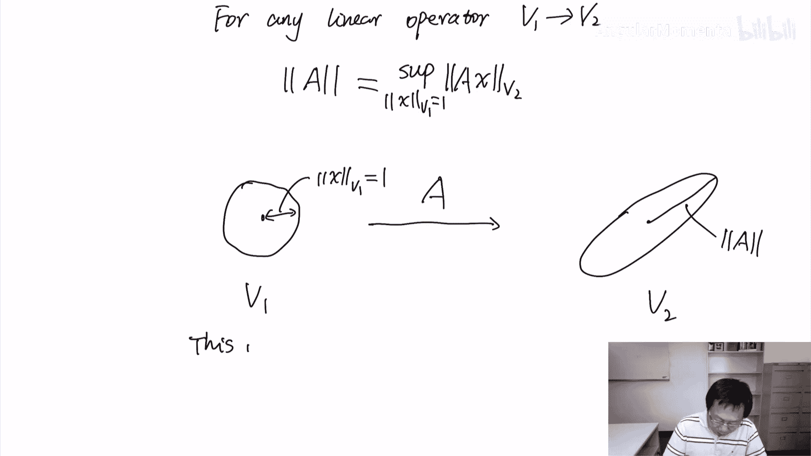
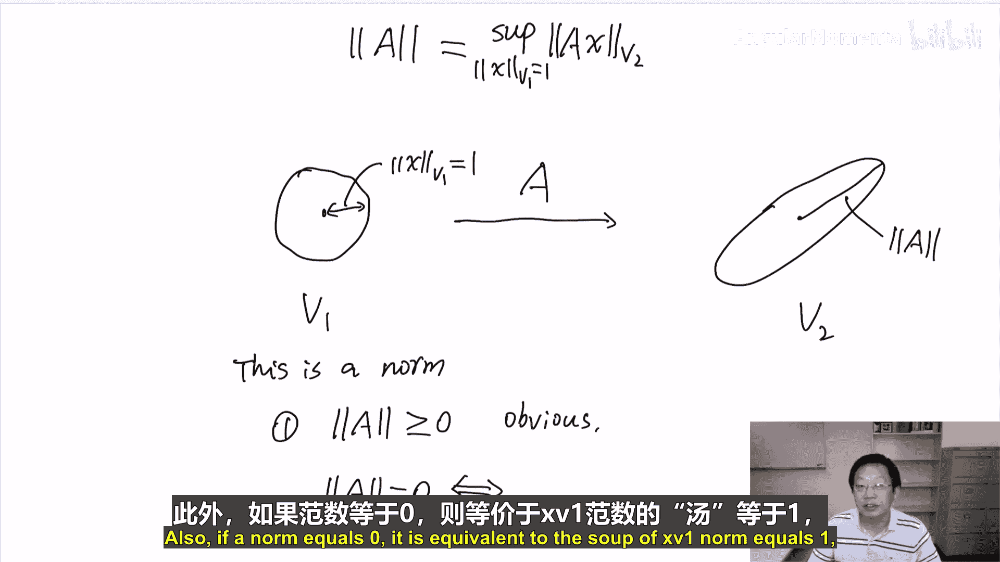
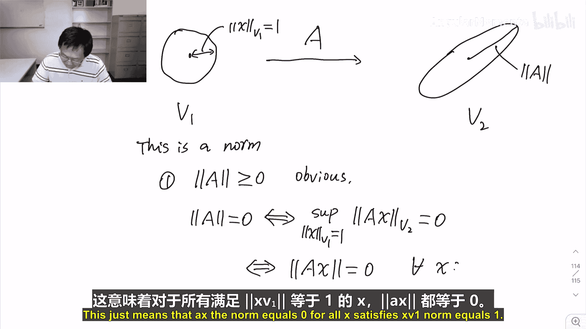
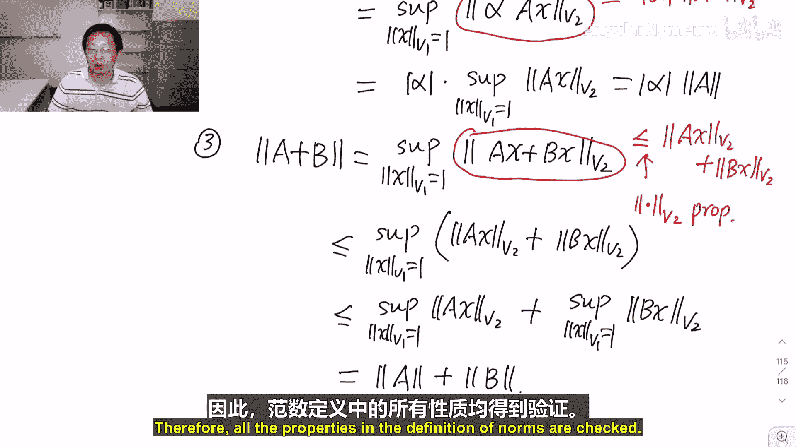
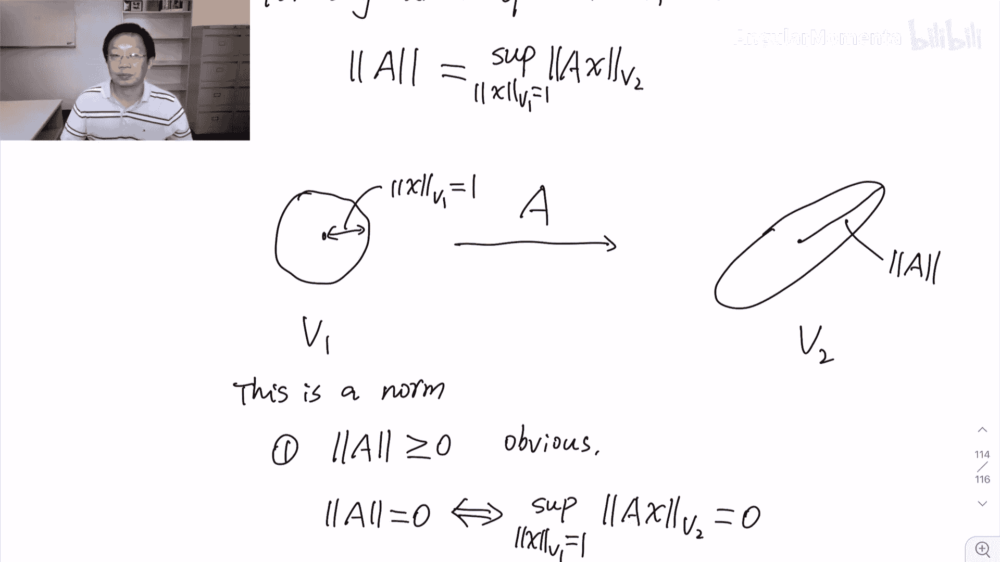

# 【香港科技大学】数据分析的数学方法 ｜ Mathematical Methods for Data Analysis p88 15-02-02-视频 -BV1DEFDzGEZW_p88-

Just like we prefer linear and bounded functions rather than linear functions。

 we are also more interested in bounded linear operators， rather than。Diner operators。

We consider the set of all linear transformations from V1 to V2。Let's V one。B2， B2 vector spaces。

Consider。That set。Of all linear transforms。我 in operators。From V1 to V2。This is a set。Andた。Assume。

On V1， we have a norm。I call it the V1 norm， and on V2 we have also a norm， I call it the V2 norm。

On V1 and V 2， respectively。In order to define the boundedness。

 I needed first to define a norm of a linear transform。For this。

 I first need to set up a vector space for the set of all linear transformations。For this purpose。

 we need a first define that。Addition and scalar multiplication of linear operators。Let A and B。

Are2 linear operators from V12 V2。Would you find。A plus B， the addition of A and B by。A plus B of。

X for any X on V 1。It is just A X plus B， X。Since A X and B， X， they are on V 2， they have an。

Addition。This edition is on B， too。Therefore， A X plus B， X is on V2。

 so that this a plus re maps X on V1，2 A X plus B， X on V 2。

And you can easily check that this a plus B is still a linear operator from V1 to V 2。Therefore。

 this A plus B is a good。Addition。For any r发 in R。And。A a linear operator from V 1，2 V 2。

We can define them。Scalar multiplication。麻烦哎。Bye。Apha a applies to x for any x on。V one。

Is just alpha times A X。Because A X is on V2， so that this scalener multiplication is on V2。

Therefore， alpha times A X is a vector on V2。So this alpha a maps a vector on V1 to a vector on V 2。

You can also check that this alpha is linear。From V1 to V2。And we define a norm of a linear operator。

For any linear operator from V1 to V2。What define。The norm of a by。

Similar to what we have done in the definition of a matrix norm。

In the definition of the matrix P norm， we viewed this matrix A as a linear transformation from RN to RM。

 therefore we used the norm of the image of the unit ball as the matrix norm。We do the same here。

We just consider a unpo in V1。This is U V1。 And we have the。X v1 norm equals1。

And through this linear transformation， we transformed this unitable into V2。

And then we just check which one has the largest B2 norm。On this image。

Then this largest V2 norm will be the operator norm。off肥。Or in other words， we just define。A X。

 the B2 norm， the maximum1。X。V 1 norm equals one。But the different to the matrix case in the matrix case。

 because we are。Considering R N to RM， both of them are finite dimension vector spaces so that we can use a max。

But here V one and V too， they can have very strange structures。 They can be infinitely dimensional。

This max will not be always attainable。In those cases， we should replace this max by a soup。

By this way， we obtain the definition of the linear operator norm。

It is just the largest norm of the image of the unit ball in V1。With this definition。

 you may wonder whether or not it is a norm。 Indeed， this is a norm。

On this vector space with all linear operators with addition and scale modification defined in this way。

Let's check。This， indeed， defineies a norm。First of all。That norm of a is non negative。

This is quite obvious because the V2 norm of A X is non negative。Also。If a norm equals 0。

 it is equivalent to the soup。

Of X v 1 norm equals1。A X。The V2 norm equals 0。This just means that A X， the norm equals 0 for all。

 X satisfies X， V 1 norm equals。

1。This is the same as I consider all Y U V1 and y is non0。We noize this y over y the B1 norm。Now。

 this vector has a norm one on B1。I treat this as the X here。Then， a applies to this。

That V2 norm should be0。This is the same as。Since here y is non zero so that this is non zero。

 then A Y。The B2 norm equals0 for O y on。V 1， y is non 0。But when y equals 0。

 this A Y is obviously 0 because linear transforms， transforms the zero vector to the zero vector。

You can easily see that。Therefore， a times 0， the B2 normally is 0， so that we can。

Remove this constraint。We obtain for all Y on B1 A Y， the B2 norm is 0。This just means that。

For any y on V1， A Y is the zero。Or equivalently， a is the zero linear operator。

Because it maps everything to 0。Secondly。Or won't check that。

Scaning property of the operator norm alpha a the norm， by definition， is the soup。X。

 V1 norm equals 1。阿发 a。X， that be2 norm。This is the same as soup。X， V1 equals1。

Apha times A X w be2 norm。Now， this。Because it's a norm in V2。 So this is the same as alpha times AX。

V2， norm by the。Property of this be two more。This is obviously alpha times the soup of x V1 equals 1。

A X。That be too more。So this is just the absolute value of upperpa times the norm of a。

Then the scanning property of an norm is checked。The triangle E quantity。We consider A plus B。

The norm， it is。By definition， supremo of X V1 equals 1。A X plus B X的 V2 norm。Now， again。

 I'd like to use the norm property of the V2 norm。This is just smaller than o equals to A X that B2 norm plus。

B， X， that be true normal。This is from the norm property of。The V2 norm。Because it's a norm。

 then it has to satisfy the triangle inequality。A X is a vector。 B， X is a vector。

 So there sum the norm should be smaller than A X， the norm plus B， X， than norm。Was this？

We can submit the soup now。 It is smaller than all equals to soup。X比1 equals1。A X。V 2 plus。B X。

Me too。For the soup， there is a nice property。 The soup of the summation will be the smaller than all equals to the summation of the soups。

A X。V 2 norm plus soup。X， v 1 equals 1， B， X。Liqhu。Thus this equals a norm plus B norm。Therefore。

 all the properties in the definition of norms are checked。

So if we define a norm in this。Then it is indeed a norm。

It is just the maximum V2 norm on the image of the V1 norm unitable。

