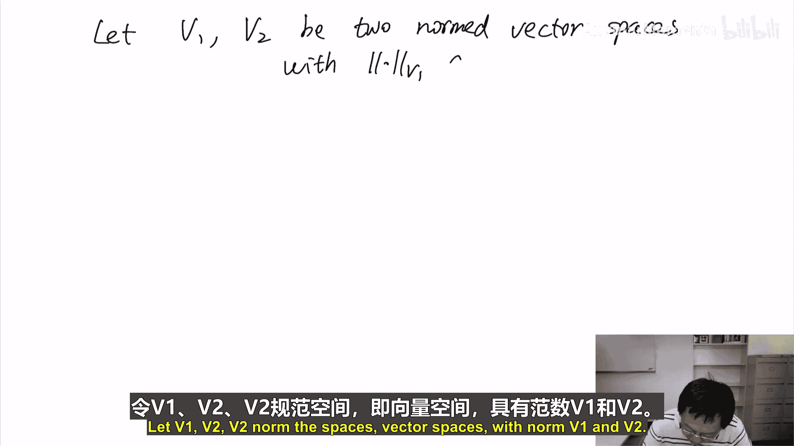
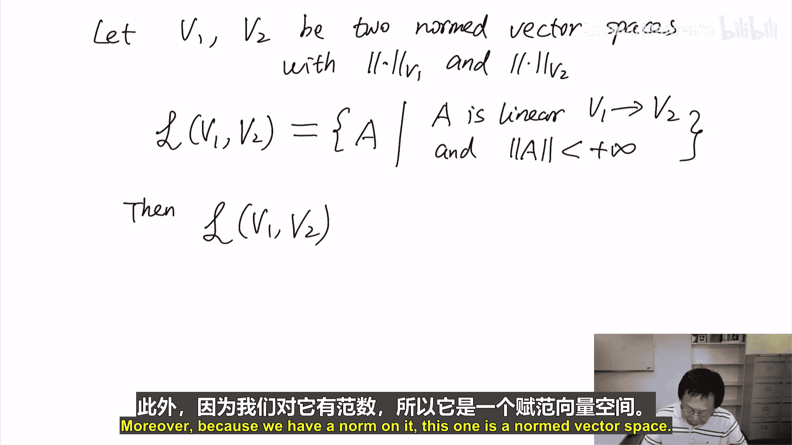
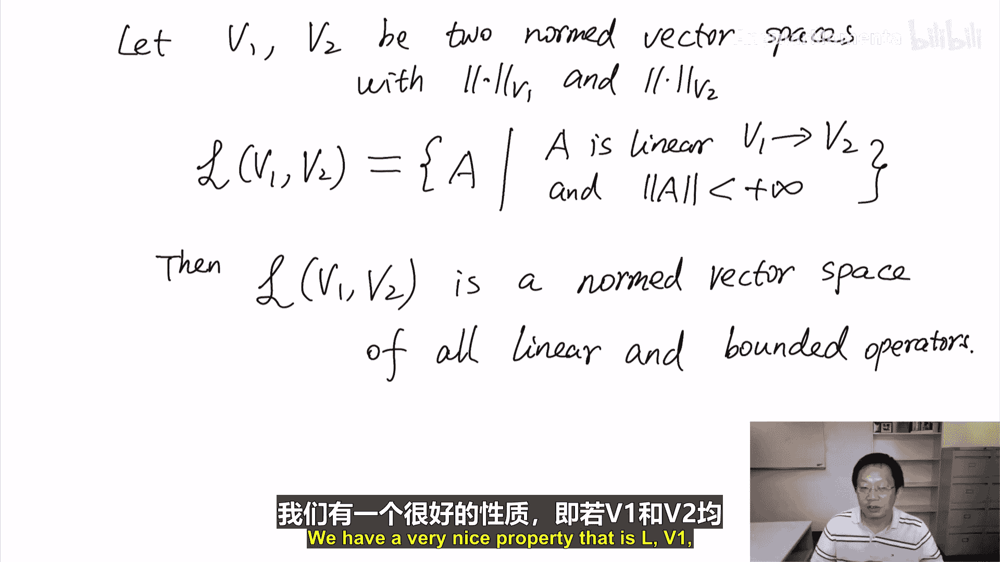
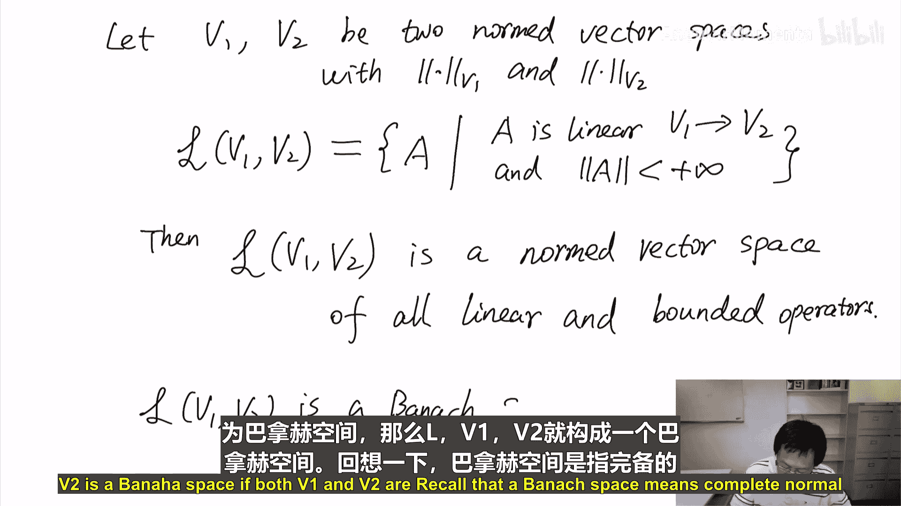
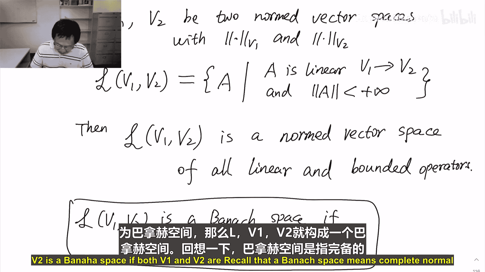
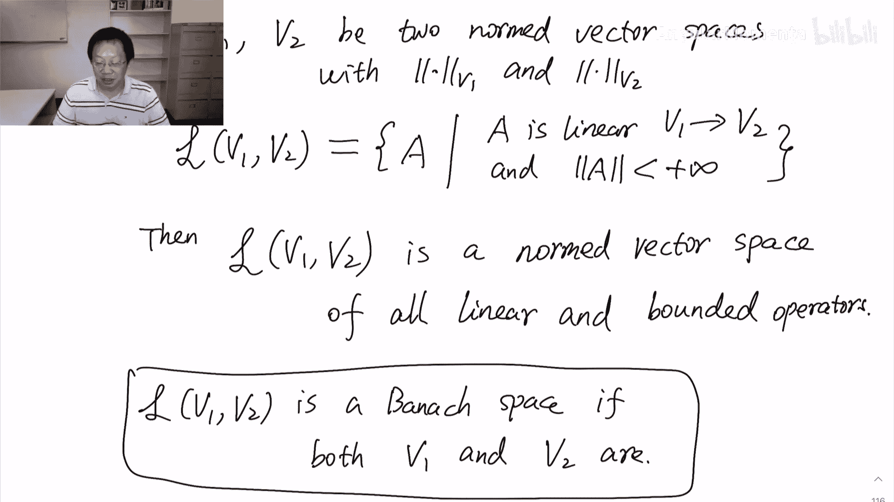
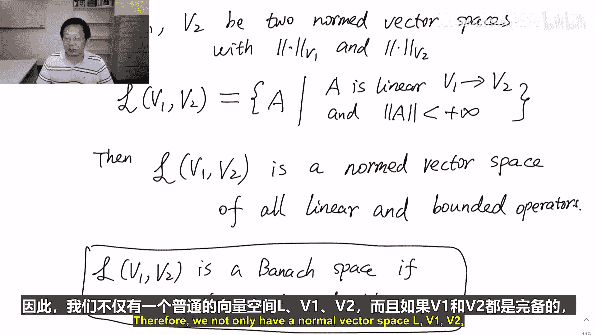
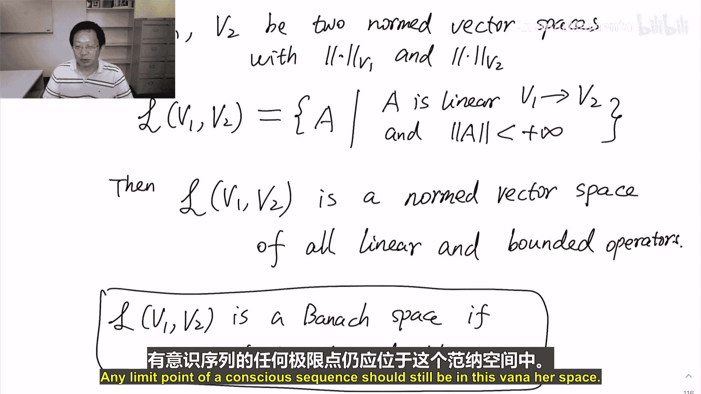
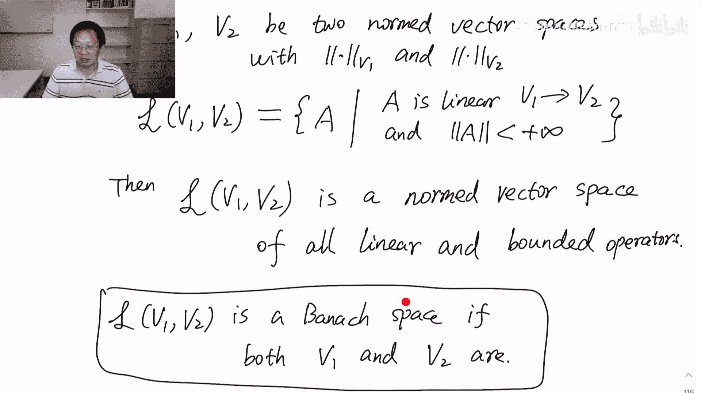

# 【香港科技大学】数据分析的数学方法 ｜ Mathematical Methods for Data Analysis p90 15-04-02-视频 -BV1DEFDzGEZW_p90-

We have defined a linear structure on the set of all linear operators and defined a norm on it。

Now we can define the bounded linear operators。

Nextt。V 1， V，2， B2。Norman the space。Vectctor spaces。With。Norn V1 on the beach。

We define this L of V1 V2 to B。This is sent。就 beA。A is linear。From V1 to V2。And。

The operator norm of a respond。We consider this set。Then。This scent。Because we have the addition。

 we have the scalar matchplication， you can check that this space is closed under the addition and scalar matchplication。

 That is if A and B are two elements on this set， then their linear combination are still on this set。

Therefore， this LB1B2 forms a vector space。Moreover， because we have a norm on it。

This one is a norm vector space。

It is of allwe。00儿。And 돼。Because their norms are finite。So we just call them bonded。Operators。

We have a very nice property that is。

V 1， V2 is Banahan space。

If both。V 1 and V 2 R。

Recall that band has space means complete norm vector space。 Therefore。

 we not only have a normal vector space， L V1， V2， but a complete norm vector space。

 if both V1 and V2 are complete。

Thus， we don't need to worry about the limit the convergence。

 those very strange behaviors of sequences on this L V1，2， B2。

Any limit point of a conscious sequence should still be in this banana space。

