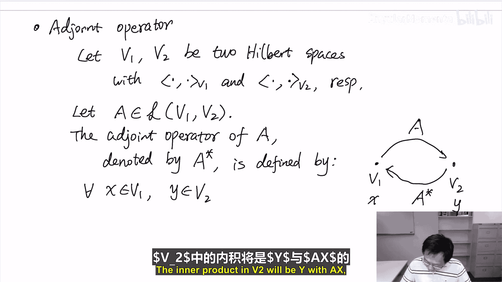
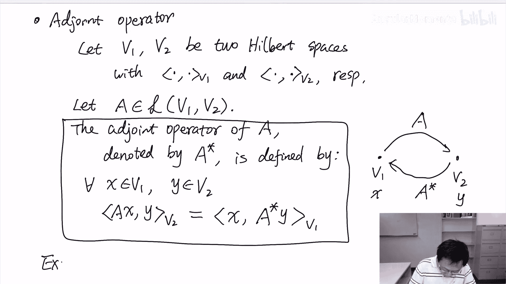
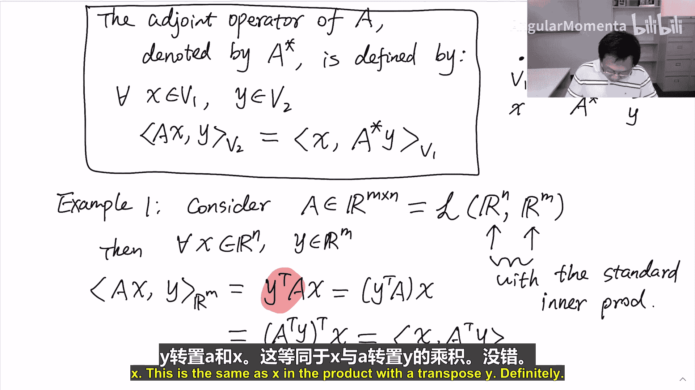
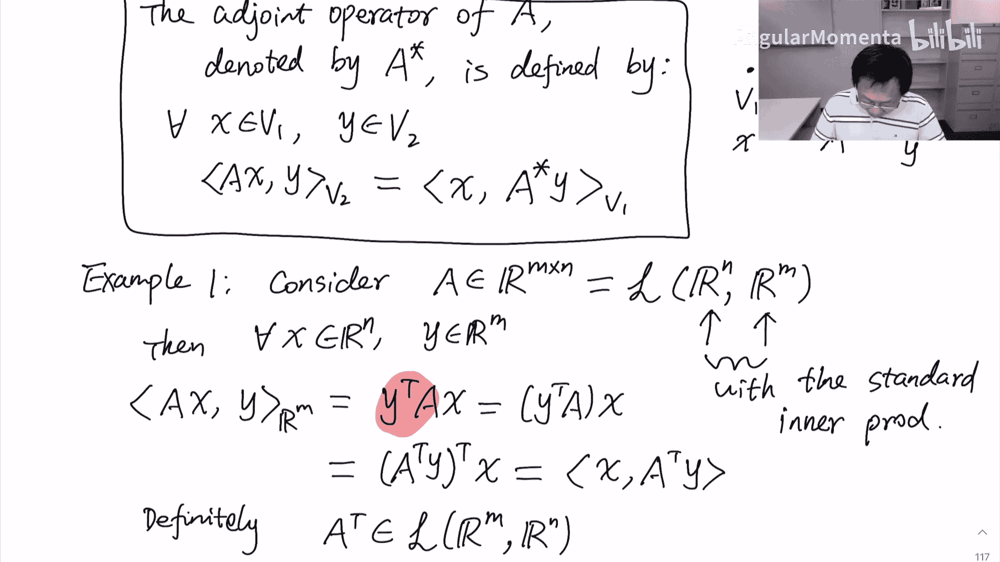
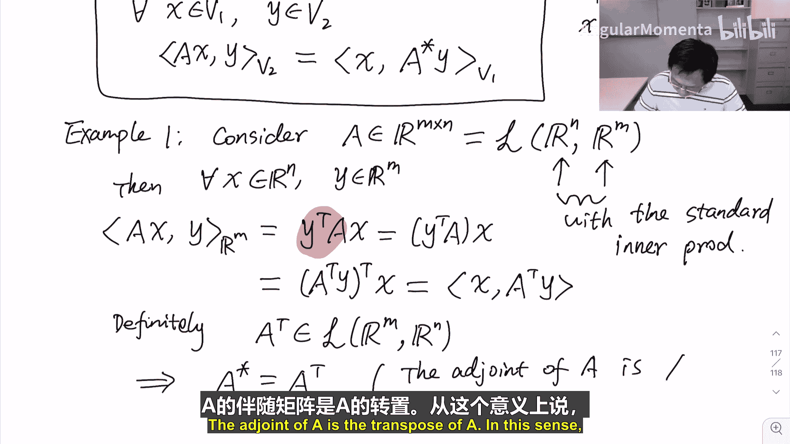
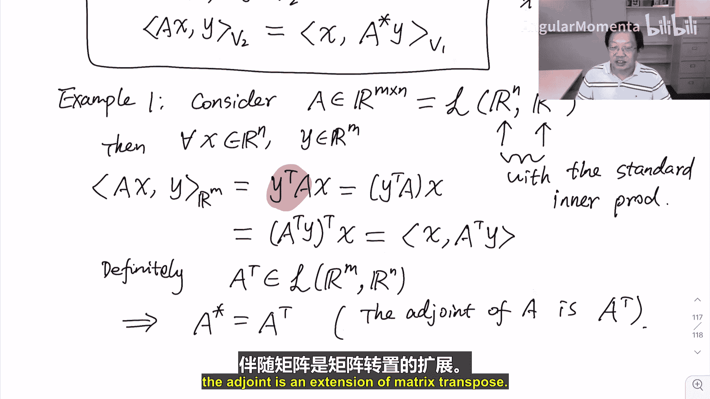
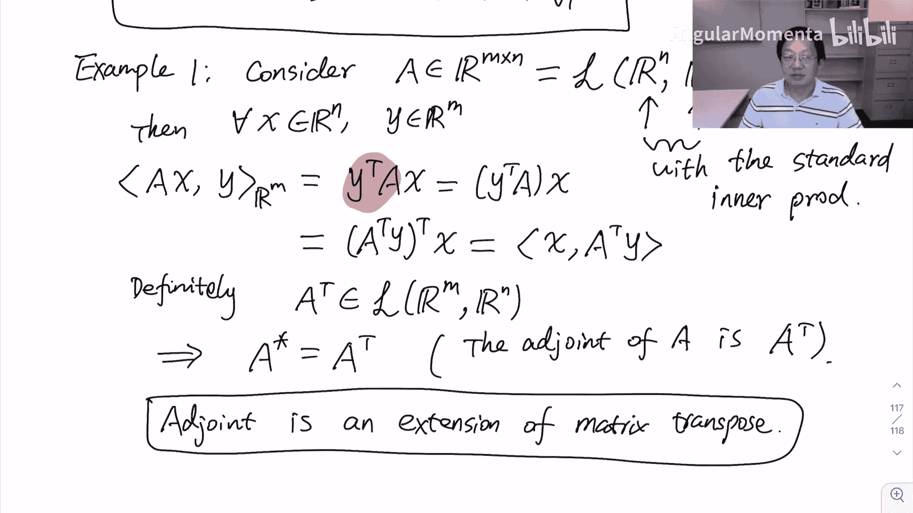
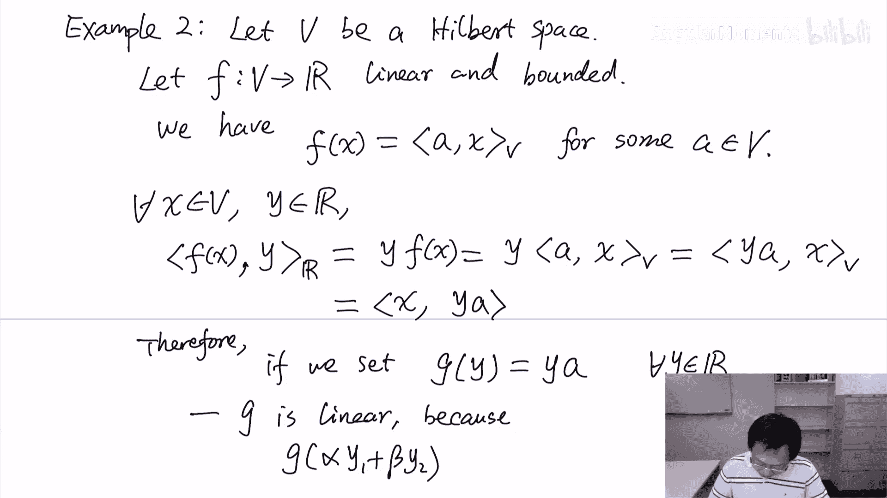
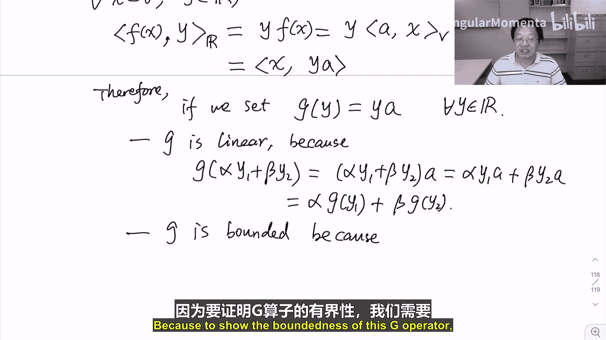
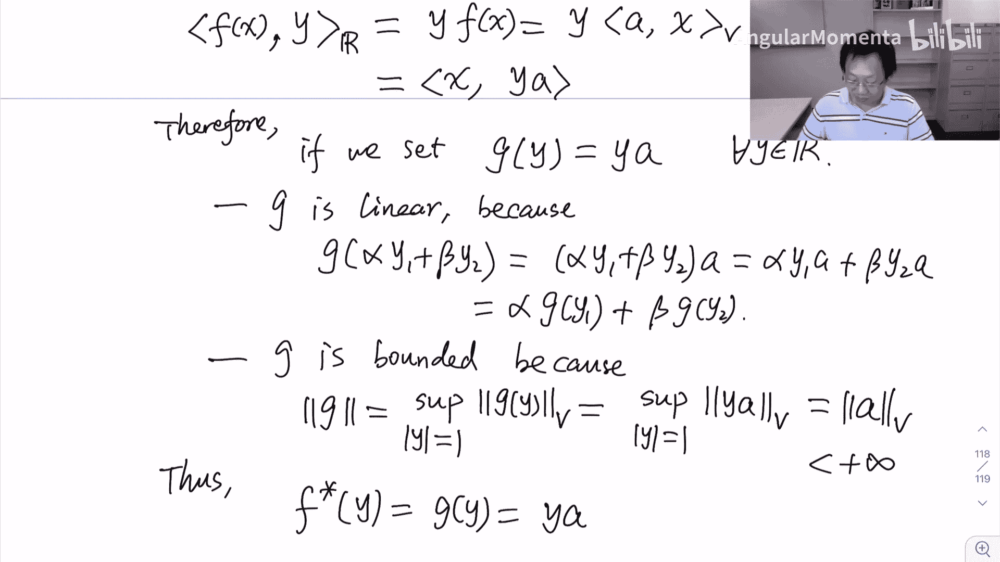

# 【香港科技大学】数据分析的数学方法 ｜ Mathematical Methods for Data Analysis p91 15-05-02视频 -BV1DEFDzGEZW_p91-

This is about linear and bounded operator on Bha spaces。

Now we consider linear and bounded operator on hereable spaces。We have two hereboard spaces。

 V1 and V2。With inner the product。On V1 and in the product on B 2。Respectively。Let a。Be a。

Bounded and linear operator from B12 V2。This is V1， this is V2。A is from V1 to V2。

Now we define a cell called a joint operator。Of a。Denoted by。A star。This a star， it maps a vector。

On V 2，2 V1。Therefore， a star is a kind of universeverse of a。This a star is defined by。

We consider a pair of vectors。X on V 1 and Y on V 2。X is here。 Y is here。

We consider the inner product in B2 is the same as the inner product in B1。

The in production E V2 will be y with A X。

Or A X。In the product with why。Because this A A transforms x onto V2。

 And then we take the inner product with one。 We get a number。This in the product is M2。

And on the other hand， we have X。In the V1 space。Under this A star maps 1，2， V1。

We have X in the product， with a star Y。This is an inner product in UV1。

We want these two inner products are the same。This operator is called them。A joint operator of a。

This should be true for any X in M V1 and Y UV2。Let's see some。examplesamples。

Example one。We consider。A matrix， A A， on， R， M， by， N。Which is viewed as a linear transformation。

 Boed and linear transformation from R， N to R M。On this R N and on this RM， both are with。

The standard inner the product。Now we want to find the a joint operator of this linear transformation day。

We have。For any x on R N。For any Y， R， R M。A X， Y。Is in the product in R M。

The standard in the product in RM。Is， by definition， iss that Y transpose A X。Now。

 we wanted to single this X out。 We wanted to write it into。

An X with some operator applies to why this in the product。For this purpose， I needed to。

Combine A and Y together。This Y transfers a。It's actually a transpose， Y the transpose。

Because when you take the transpose of this one， you get y transpose first times a transpose transpose。

 which is a。 so we obtain y transpose a。And the X。This is the same as x in the protector with a transpose y。

Definitely。

This a transpose is a bounded and linear operator from R M to R， N。

Because matrix are linear transformations on finite dimensional spaces。 on finite dimensional spaces。

 linear operators are just bounded and linear。

So from this， we just see。A star is a transpose。The adjoint of A is the transpose of A。

In this sense， the a joint is an extension of matrix transpose。

From this example， we also see that if we changed in the product。

 we don't use the standard in the product。We use some weighted in the product。

Then this a joint operator of a under those weighted in the product will not be a transpose。

Therefore， the adjoint operator depends on the inner product。 We change inner products。

 then the adjoint will also change。

Example 2。We consider。A hairless space。We have。啊。Function from V to R。This function is an linear。

 and buned。Then by rich representation theoryem， we must have。

F X equals the inner product of A and X on V。For some。A on B。

This is from rich representation theorem。We also know that R is a vector space。

 is a normal vector space。 It's a huber space。Therefore。

This F is an linear transformation between two heless spaces。Then what is the adjoint of this F。

 What is F star。To find out inside the joint， let's just consider for any。X on V。Y on R。

In the product of FX and Y。This is on R。Y course。The inner product on R is just the standard number multiplication。

It is y times f of x。By the definition of this F of X y。A X in the protector with B。

This is the same as Y a。X。Because。Why is a number。A is a vector。

 So this Y a is the scalar multiplication of a vector。This inner product is on。

Because in the product is commutable。 It is X in the product with Y。Therefore。If we said。G of。

Y equals y times a。For any way on R。First of all， this G is linear。Because。

You consider G of alpha y1 plus beta y 2， All these alpha beta y 1， y 2 are numbers。

It is。Alpha y 1 plus beta y 2 times a， it is。Apha y 1， A plus beta Y 2， A， which is alpha G Y 1。

Plus贝ta G Y2。SoGE is linear。Gi respondeded。Because。To show the boundedness of this G operator。

 we need to consider the norm of G。

The norm of G， by definition， is the soup。O。G。喂hy。Y norm equals one。but because y1张2。Therefore。

 the norm on R is just the。Absolutely value。This can be replaced by the absolute value of y equals one。

This is a soup。Y equals1。Y a。Then norm。The norm is on。Because y times a is a。Vectctor on me。Now。

 this is a number。 This is a vector。 This satisfies that。Sar property。

 So this is just the absence value of y times the norm a。Now why。

The absolute value of y is a constant， so this is just the norm of it。I闭。Of course， this is。

F it because a is a given vector for any given vector， the norm should be finite。Therefore。

 J is linear and bounded。Thus。F a star。Of y is g Y。It is white time say。

We have found adjo of this linear operator。

