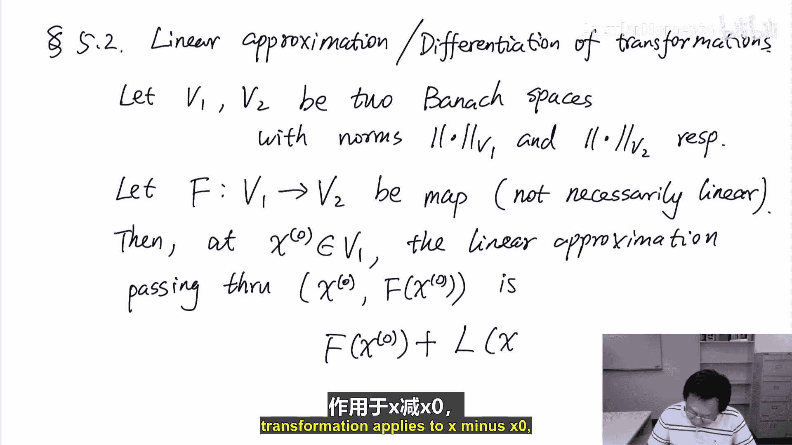
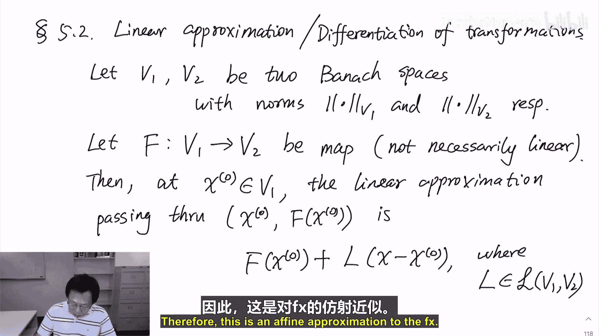
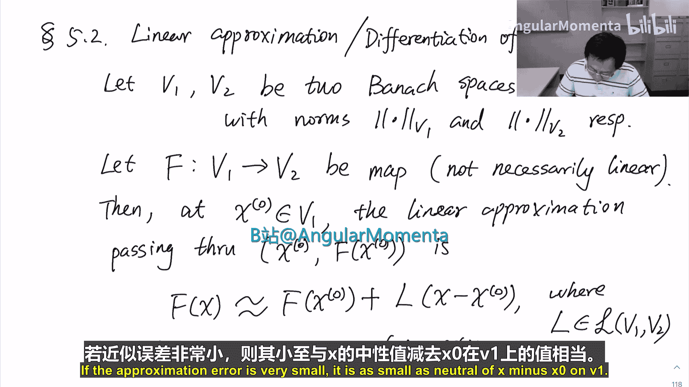
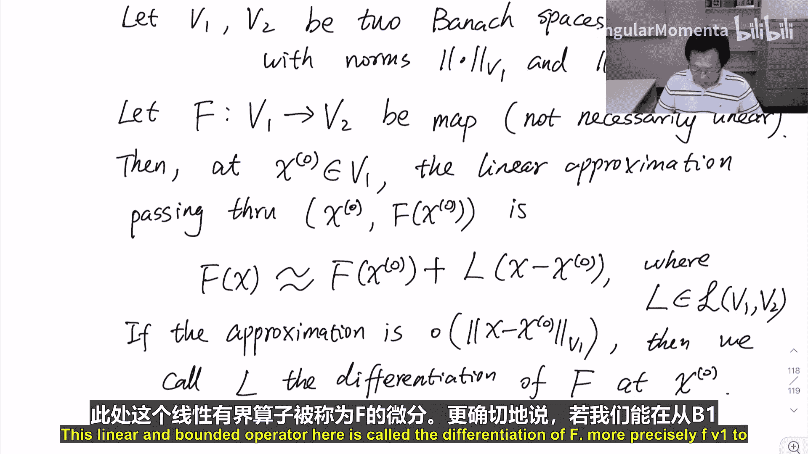
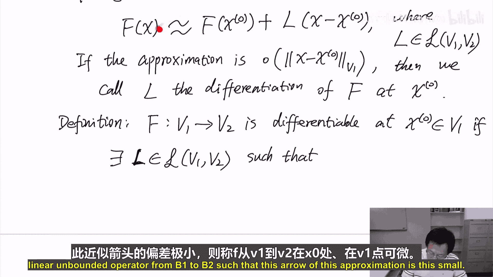
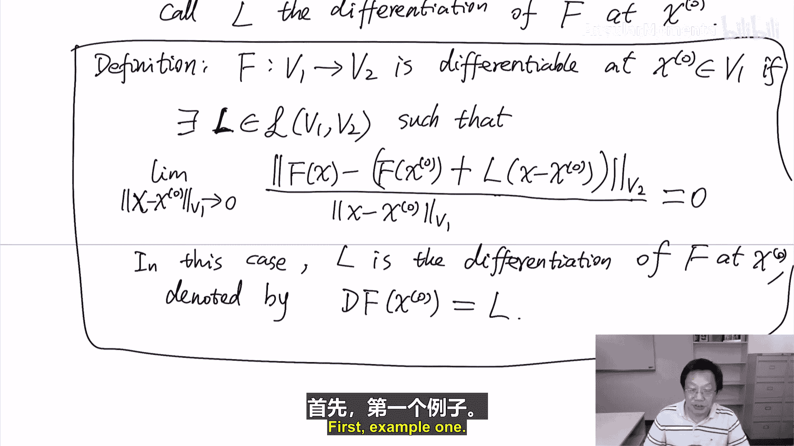
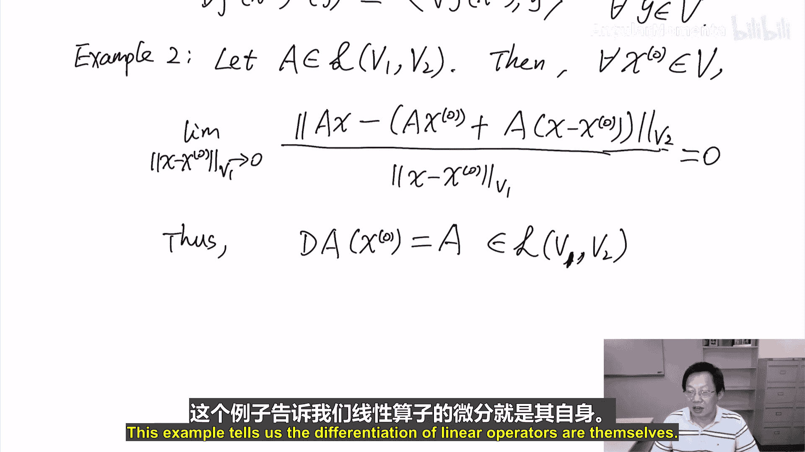

# 【香港科技大学】数据分析的数学方法 ｜ Mathematical Methods for Data Analysis p92 16-01-02-视频 -BV1DEFDzGEZW_p92-

Most transformations or mappings we are interested in are nonlinear。To study them。

 we again introduce the linear approximation。And this will give us the differentiation of transformations。

Let V1。B2， B2。Find the host spaces。With。EnNormous。The norm on V 1 is denoted by norm V1。

And the norm M V2 is deed by norm V2， respectively。Letch。F B。From V1 to V2。Be a map。

This map is not necessarily linear。Then we consider at。A specific vector x 0 on B 1。You comes that。

Nearar approximation。Or more precisely， a fine approximation passing through。

Similar to the differentiation of functions will require this。

A fine transformation passes through x0。And the F。X is 0。Is it should to be the same at x0 with F？

This a fine approximation is。F x is 0。Plus。A linear transformation applies to x minus x0。

Where。This L is a linear and bounded operator from V12 V2。Because this is a constant vector。

 This is just a linear transformation plus a constant。 It's a shifted linear transformation。

 Therefore， this is an a fine transformation。For this applying transformation， when x equals x0。

 it is the same as Fx0。Therefore， this is an fine approximation to the。

F。X。If。The approximationarrow is very small。It is as small as little or of。X minus x 0 on V1。

Then。Weiko。L the differentiation。O。F at x is0。This is completely the same as then function case in a function case。

 we find an a function to approximate our non nonlinear function。

Here we find an a fine transformation， which is a linear and bounded transformation plus a consistent vector to approximate our non nonlinear。

Transformation。But because we don't have the inner product representation for functions。

 we have only keep this linear and bounded operator here。

 This linear and bounded operator here is called the differentiation of F。

More precisely。F。They 1，2， V，2。Is differentiable。At x 0。At。理完。If。We cant find an。And bonded operator。

L。In the set of all linear and bounded operator from V1 to B2。Such that。

Thisarrow of this approximation is this small。

More precisely， the image。Wen。X。Minus x is0， the V1 norm approaches 0。X minus x0， the V1 norm。

 the numerator is F。X minus F X 0。Plus。L， x minus x is0。Because。Now， this difference is a vector。

 We cannot use the absolute value anymore。We have to use the norm。This norm is on V 2。

This distance from FX to this is the error of this fine approximation。

If this error divided by this distance from x to x0， when x minus x0 distance approaches 0。

 this limit is 0。Then we just call F is differentiable。In this case。L is that。Differentiation。O。

F at x 0。Denoted by。D of F DF。X 0。以コ是。So this is D letter maps。F to an operator。

DFE together is the differentiation of F。Differentiation of F at x 0 is the L operator。

Let me give you several examples， first example one。

We consider functions on herebal spaces， if F。Is from B to R。Where。V is here， budget space。Then。

The differentiation of F at x 0。It is a bounded and linear operator from Vi。

It maps a vector to a number， or equivalently is a function on the Hubal space。From V to R。

 we know that this function。At y equals the inner product of gradient of F X 0。喂hy。

Because we just used the vector in the inner product representation of this linear function to be the gradient。

Therefore， obviously DF at x0 applies to one is just this inner product。Therefore， D F X 0。

 this linear operator， this linear function maps y to this inner product。For any in V。Ex example 2。

We consider linear and bounded operator A。From v 1 to V 2。Then。For any x0 on V。

Now we wanted to approximate this linear transformation。Bimit。X minus x0， the B1 norm approaches 0。

 the difference。X minus x0。It's V one norm。We want to approximate this A。 A applies to X。

We use a linear， a file function to approximate it。In the form of A X 0。Plus。

 something applies to x minus x 0。If I choose here to be a。Then easily。

 you can see that this is just the zero vector because this Ax 0 cancels this minus Ax0 here。

 So what inside this bracket is just A X。AX minus Ax is 0。So this is obviously zero。In this sense。啲。

A at x 0。Is。This linear operator， it is just a。Because A is in L， V 1，2 me2。

A is an linear and bounded operator。Therefore， the differentiation of a at any x0 is a itself。

This is quite normal because a itself is already linear and bounded。

 We use an fine and bounded operator to approximate it。 Of course， itself is the best approximation。

Thearrow is exact same is zero。This example tells us the differentiation of linear operators are themselves。

