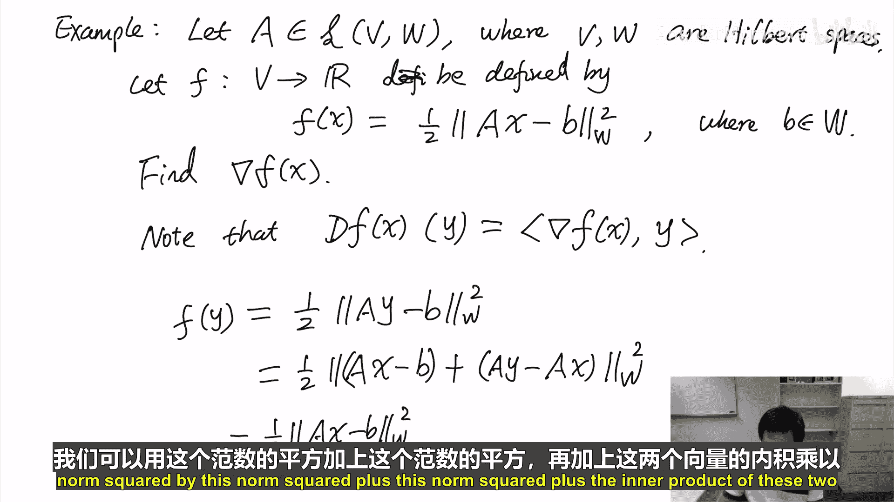
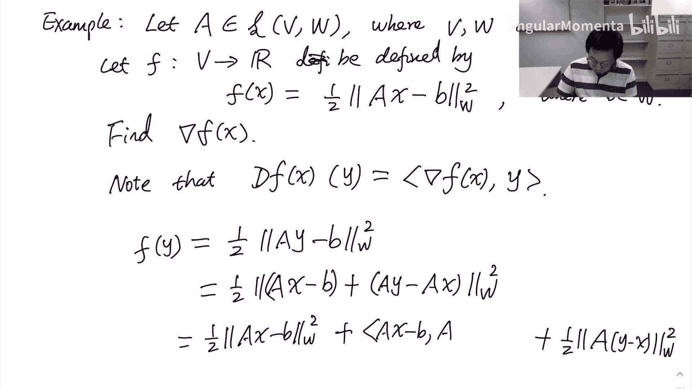
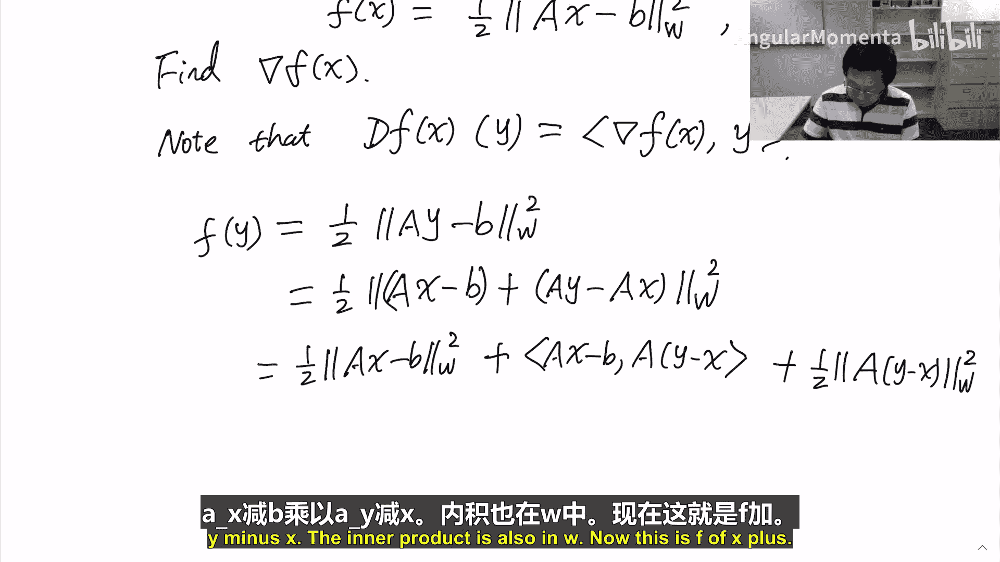
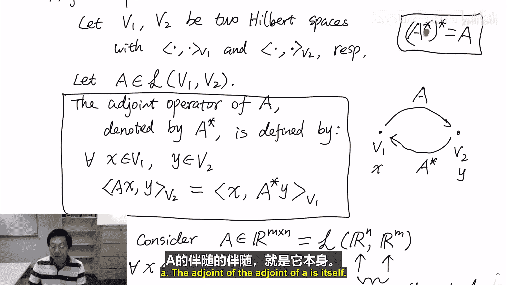
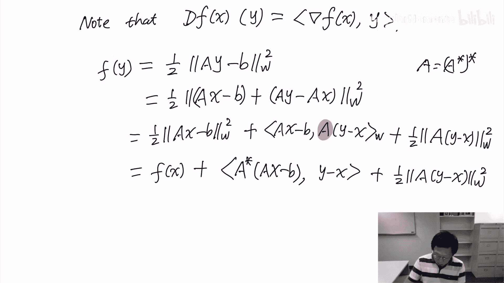
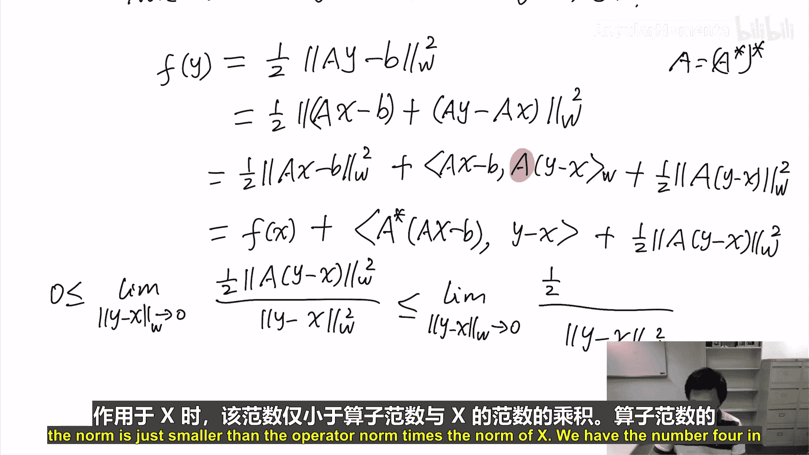
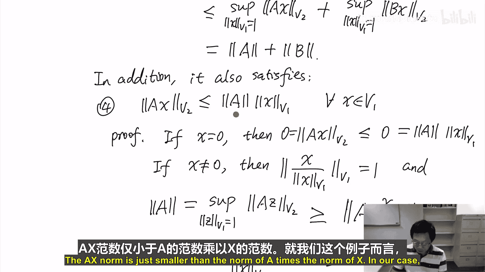
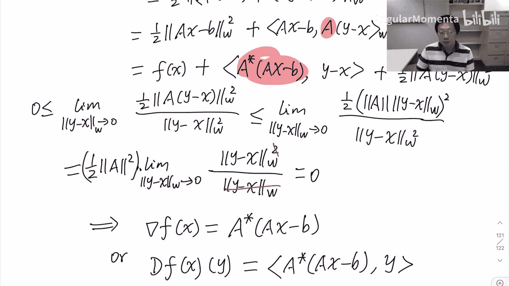
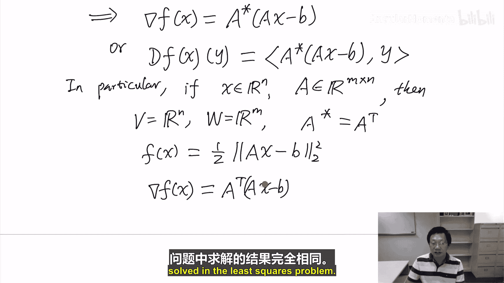

# 【香港科技大学】数据分析的数学方法 ｜ Mathematical Methods for Data Analysis p93 16-02-02-视频 -BV1DEFDzGEZW_p93-

One more example。Let a be a linear and bounded operator。From B to W。

Where V and W are two herebal spaces。Let F be a function from V to R。Define the by。F of x equals。

Half of。A X minus P。The norm in the W space squared。Here B is just a vector in W。

We first transform X from B to W through the A linear transformation。Then we compare it with B。

 make the difference with B， take the norm squared。Let's calculate the gradient of F of x。Find。

Greedient F of x。To this， and we use the definition of gradient and the differentiation note。That。

D of F， X。Applies to why it is the gradient of F of x and y。To find out the D F or gradient of F。

We need to do the a fine approximation to F。F of y。Equs half of。A y minus B， W norm squared。

We need that。A X minus BW squared。Therefore。We split this AY。By a X plus A Y minus A X。Which is。

Half of Ax minus Pw norm squared， because w is a herebut space。

 we can expand this norm squared by this norm squared plus this norm squared plus the inner product of this two vectors times 2。

Plus。Plus。The last term。Which is A Y minus A X， which is also a applies to y minus X。

And W norm squared。 and we have the。Cross term， A X minus B。诶。

Y minus X。The inner product is also in W。 Now， this is F of x plus。

We want to write this into this form or into this form。

 they are equivalent because now this is in the hereboard space。Therefore， we need a y minus x here。

 We need to。Write it into gradient。F of x， Y minus x in this form plus。

This will be the arrow in the approximation。To this end。

 we want to move this a operator from here to here。For this purpose， we just use a joint operator。

 Go back to the ad jointin operator。The joint operator is defined in this way。 A X。

 the inner product with Y should be always X。A star away， the Indian product。

And I forgot to mention that we have a very interesting and useful fact。That's this AS star。

Star is a。The adjoint of the adjoint of it is itself itself。

Therefore， this a is just a star star。So when we move this a from here to here。

 we just obtain a star。A x minus B。Because the adjoin of this a star operator is just a。

 So when we move this a star to here， we get a。This is the Fx。

 This is the a fine approximation to this F Y， and this is the arrow。 Now。

 we want to show that this arrow is very small。

We consider the image。Y minus x approaches 0。 The W norm approaches 0。The half of。A y minus x。

 the W norm squared。Divided by y and minus x， the W norm squared。

This limit is definitely non negative because all the numerator and denominator are now negative。

And we needed to estimate this。Arrow here。For this purpose。I need to use the property of norms。

Of operator norms。We know that for operator norms， A applies to x。

 the norm is just smaller than the operator norm times the norm of x。

We have the number four in the property of operator norms。

The A X norm is just smaller than the norm of A times the norm of X。

In our case。This a times y minus x W norm squared is just smaller than the a norm times y minus x。

 the W norm and then squared。This is their Ni。Y minus x W approaches 0。

Now I want to pull this constant out this limit because a is independent of y。When we take the limit。

 why changes。Now， this a is。A constant of why。Therefore， I can pull this out of this limit。Times。

The limit of y minus x W norm squared y minus x。咖背多。This squared cancels this denominator。Of course。

 this limit is 0。Therefore， indeed， this is just a very small。 Its a little O of y minus x。

 the W norm。Therefore， this one is just the gradient。Or equivalently。D FX applies to Y equals。A star。

AX minus B in the product with y。These two are equivalent。Because now we are in the hereable space。

For herebal spaces， linear function。Is the same as in product。

In particular。There is a very interesting special case of this example if。X1 R。A is a matrix。

Off size and by N。Then。Our V is just R N， and W is RM。And this A star is the a transpose。And the Fx。

Is half of。A matrix applies to the x vector minus the B vector。

 and the norm in RM is just two norm squared。From this example。

 we see that the gradient of F of x is a transpose， A X minus B。

This is exactly the same as we have solved in the list squares problem。

