# 【香港科技大学】数据分析的数学方法 ｜ Mathematical Methods for Data Analysis p95 16-04-02-视频 -BV1DEFDzGEZW_p95-

Maant me give you more rules on differentiation。The first rule is the linearity of differentiation。

Similar to the differentiation of functions on vector spaces。

 the differentiation on mappings between vector spaces is also linear。

Let F and G be2 mappings between V 1 and V 2。We consider the differentiation of alpha times F plus beta times G at X。

 This is a linear and bonded operator。It equals alpha D of F。At X plus贝ta D G at X。Where。X is on V1。

And alpha beta are real numbers。This linearity tells us that the differentiation is commutable with linear combination。

 We can first do the linear combination and then do the differentiation。

 It is the same as we first do the differentiation respectively and then do the linear combination。

The second rule is the Chen rule。Which I have introduced before。Let。F be a mapping from V 1 to V 2。

 and G be a mapping from V 2 to V 3。Then。G composed with F。Will be from v 1 to V 3。The Che rule。

Tells us that。D of G composed with F is just a D G composer with D， F。

Or more precisely for any X and y on B1。第。G of F。At X。Applies to white。Es。D G at， F， X。

This is a linear operator， applies to D F at X。 This is a linear operator。Applies to why。

In this formula。It involves three linear and bounded operators。 One is。This。

D of G composed with F at X。It is。Yin。L of V 1，2 V 3。

 It is a linear and bounded operator from V 1 to V 3。And DGFX。This is a linear and bonded operator。

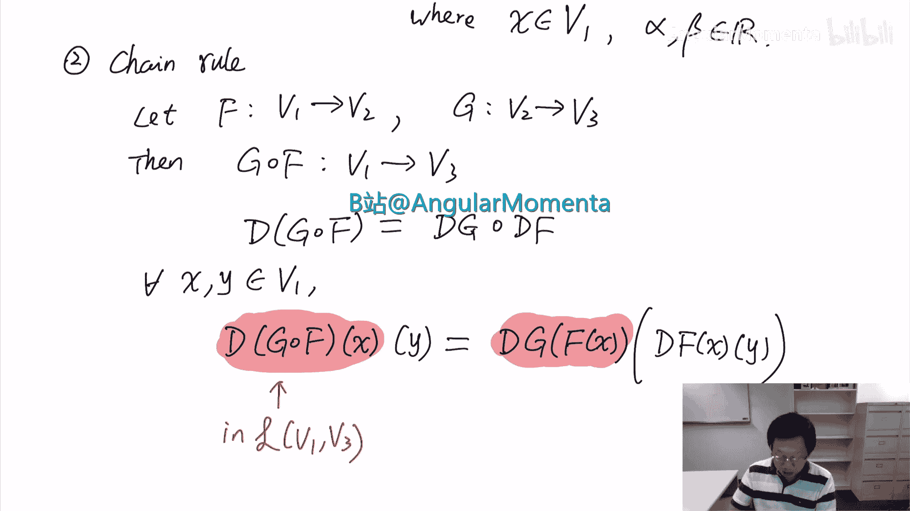

It is。In the set of all linear and bounded operator from V 2 to V 3。And this D F。Of x。

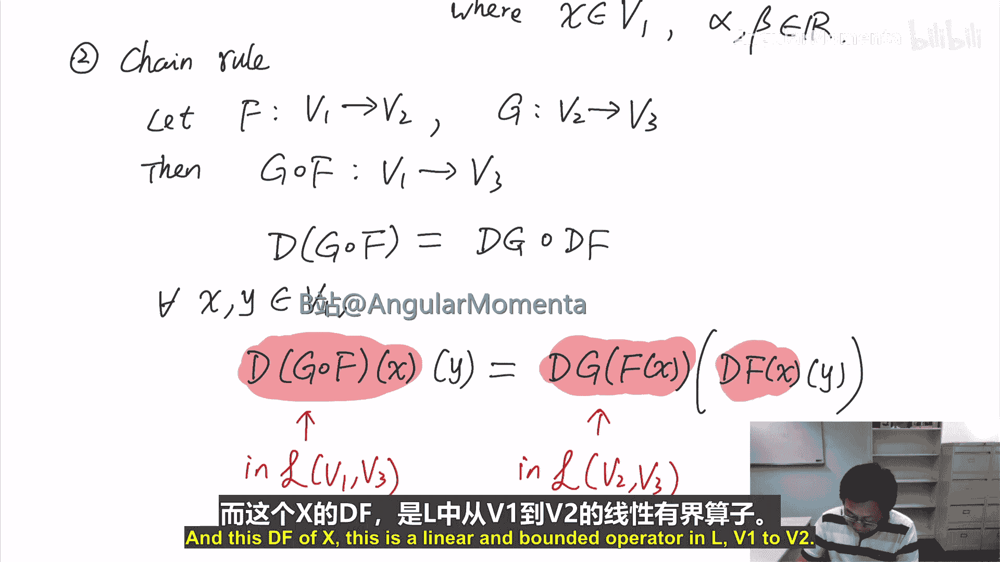

This is a linear and bounded operator in L V 1，2， V 2。

As we have seen that this Qn rule is very powerful。

We have used it to develop a much beicative rule for functions。In the following。

 I will give you some interesting special cases of the Qn rule。In particular。페이1。If V 2 and V3。

Real numbers。Then。We will have F is from V1 to R。And G is from R to R。

Now we have a composition of a function on the Hebal space and a function on R。Then。

G compose with F is just from V1 to R。

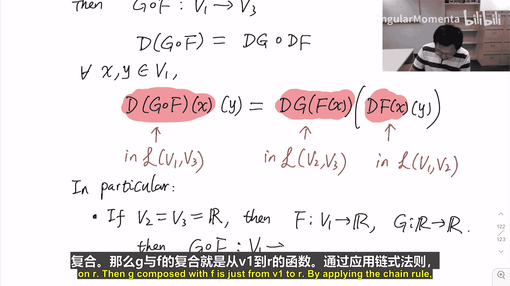

By applying the chain rule， we obtain D G composed with F at X。 This is linear operator。

 applies to Y should be D G。Of F， X， this is a linear operator applies to D F X。

 This linear operator applies to y。For all X and Y on V 1。Now。We check DG and DF， respectively。

Since G is a function from R to R。And the in product on R is just the number of multiplication。

Therefore， DG。Of F X， this media operator applies to a number。It is just a G prime。At F X。

Times this number。This is the inner product on R。Since it's a function on R。

 therefore the D differentiation is just the inner product of the gradient。

 which is the derivative under alpha。So we obtain this。For this D F。X of y。

Because F is a function on the hub space we want to R。Therefore。

 it is just the inner product of the gradient F x。喂hy。

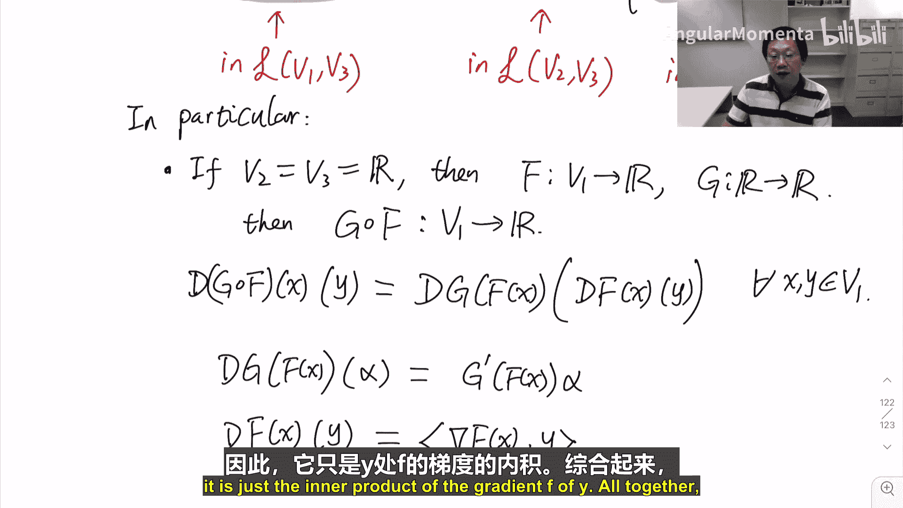

Altoge， we just obtained this。Equals7 prime F X。Times the In product gradient Fx。喂。Which is。

G prime F X。Times。Grient F X。Then we obtain a vector here。

 This is a scr multiplication a number times a vector。 We obtain a vector in B1。

 This vector in the product with Y。From here we see that the differentiation of this G composed f at x applies to y is the inner product of this vector with y。

Therefore。This vector is just the gradient。We obtain。The gradient of G composed with F。At X。

 it is G prime F， X。Times the gradient f of x。This special case is actually the one we introduced in the very beginning。

It's the very preliminary version of the Chen rule。

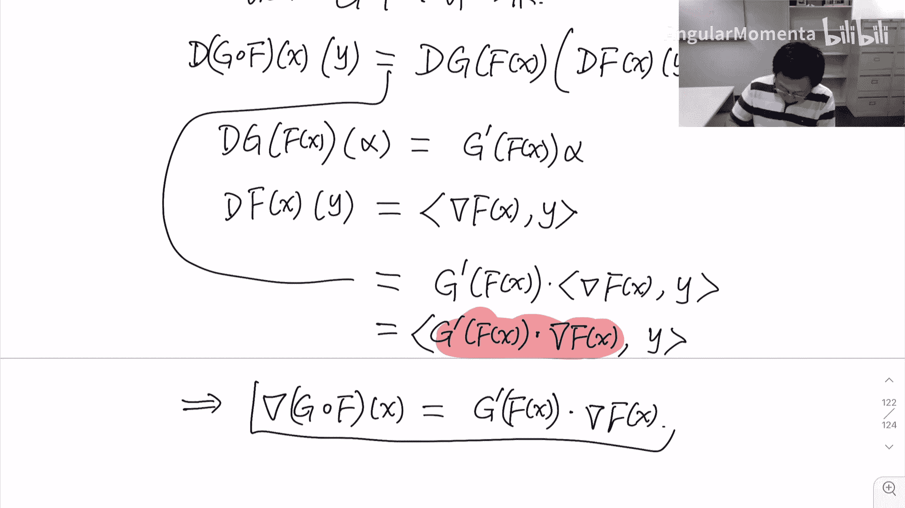

The second special case is E。V3 equals to R， in this case。F is from V1 to V 2。And G is from B2 to R。

We first transform。A vector from V1 to V2， and then we map the vector on V2 to our number R。Then。

G composed with F is from B1 to R is a function on B1。Therefore。

 we can find out the gradient if V1 is a here space。By applying the chain rule。

 D G composed with F at X。Applies to one。依国第次。At Fx。Applied to D F at X applies to Y。

For any x and Y on。李 one。Let's check DG and D F again。This DG is from V2 to R。Therefore， D G of。F， X。

Of this vector Z on V2。It will be in the product form， because this G is a function from。

V 22 R is a function on the Hubal space V2。Therefore， its differentiation is only an inner product。

It's the gradient of this G at F。X。In the product with the。So， we obtain。

This equals the gradient G of F X。In the product with D FX。喂hy。

This is a vector because this is a linear transformation。

 This linear transformation transforms y to another vector。In V2。 So the Internet product is in V2。

Since G composed F is a function on the hereber space V1， we wanted to find out gradient。Therefore。

 we need to rewrite this differentiation into the inner product of some vector with y。To this end。

 we notice that this Df of x is a linear and bounded operator。It is in。The L of V 1， V 2。

 because F is from V 1 to V2。 So the D F X is in。Then set of all linear and bounded operators from V1 to V2。

Now we want to move this DFX from here to here。This is done by the adjoint operator。

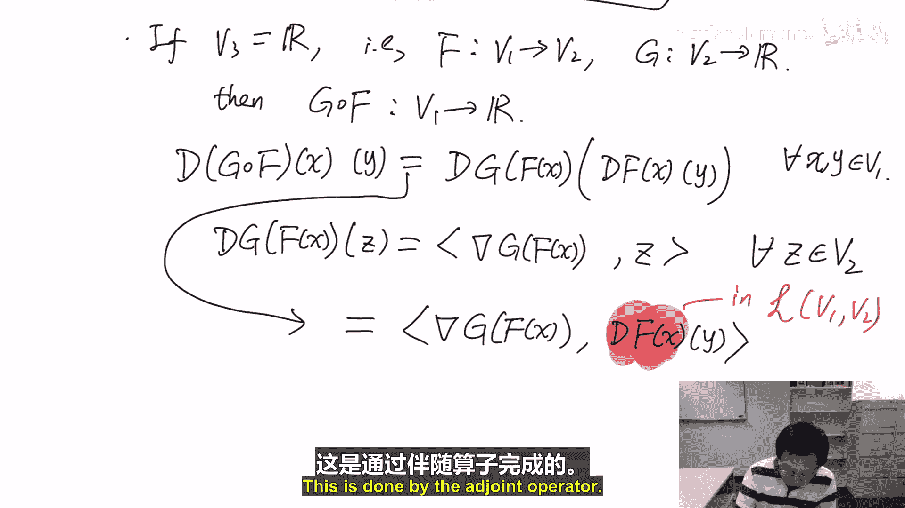

It is the ad joint of this DFX。Applies to the gradient G of F of x。Wei。

And this in the product is now in V1。This in the product is U V2。

 They are the same because this is the adjoint of this， or this is the adjoint of this。

Because the adjoint of the adjoint is itself。Therefore， we have rewritten the differentiation。

Applies to why in the， in the productive form。

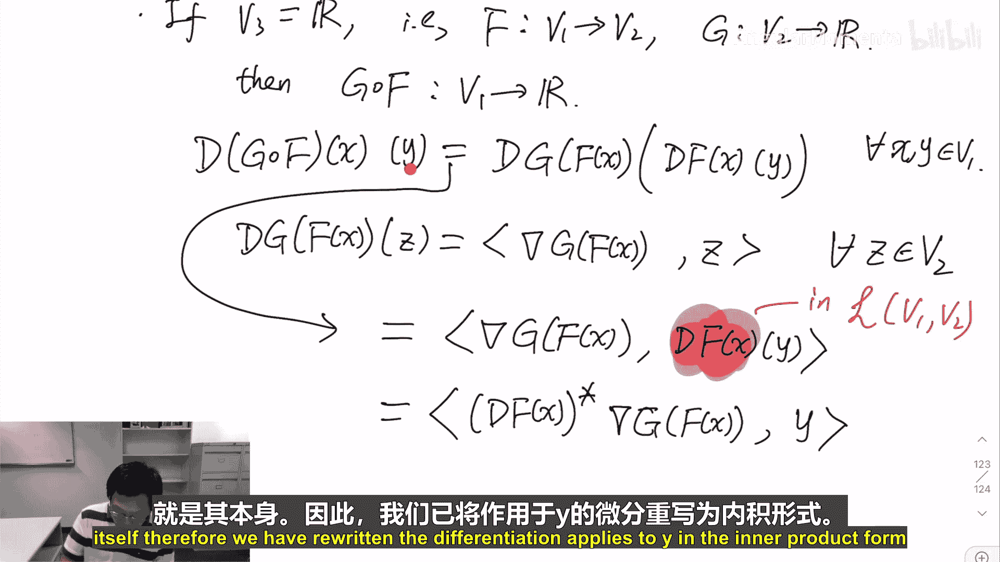

This vector here is just the gradient of this function。The gradient of G composed is F is。D FX。

 the the joint applies to gradient G at F X。

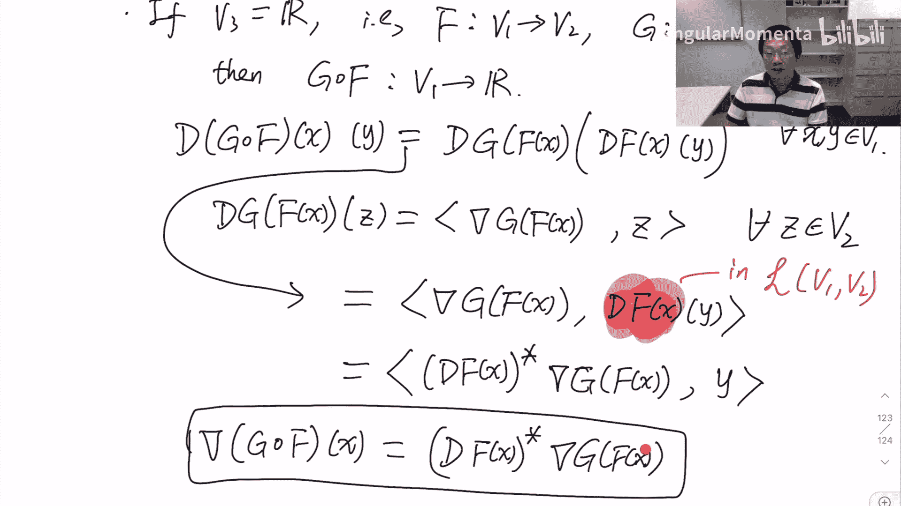

Furthermore， if she is linear and bounded。

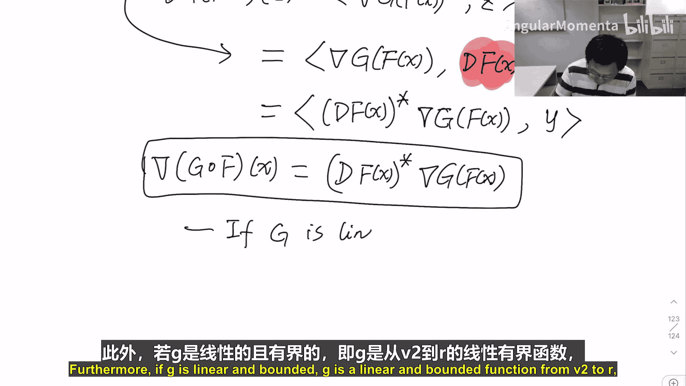

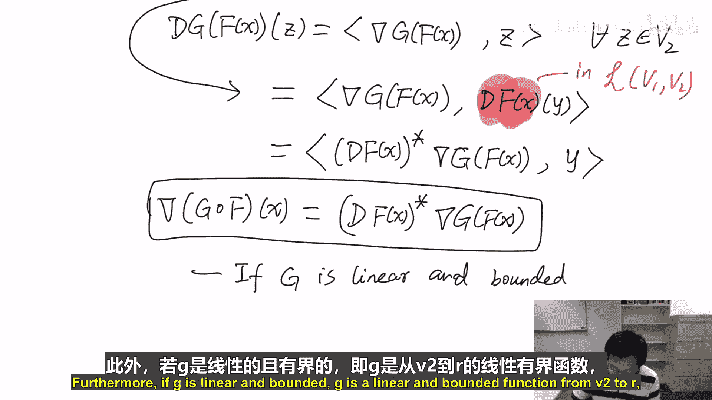

G is an linear and bounded function from B2 to R。Then by the risk representation theory。

 we must have that。

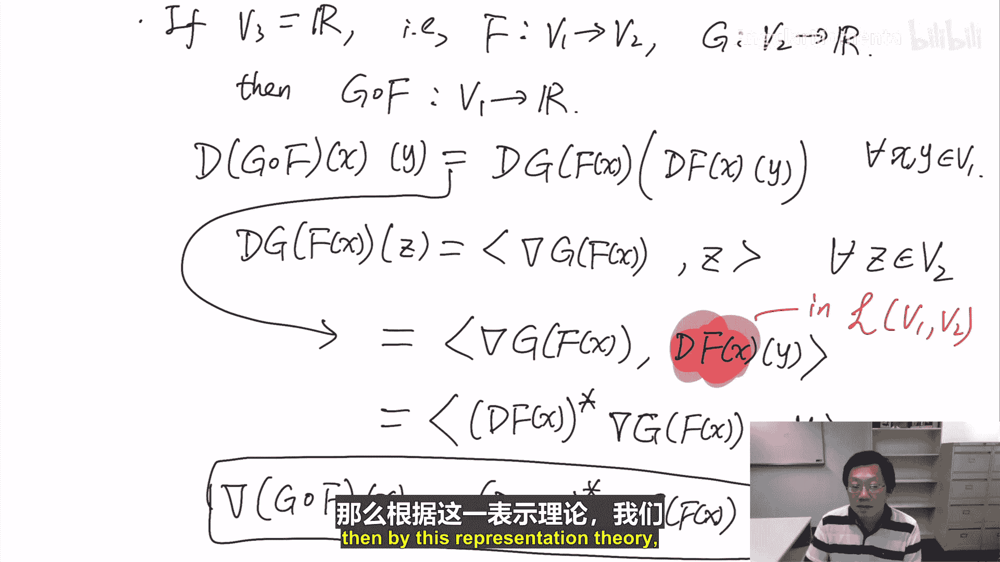

There exist a G vector on V2， such that G applies to any vector， Z on V2。

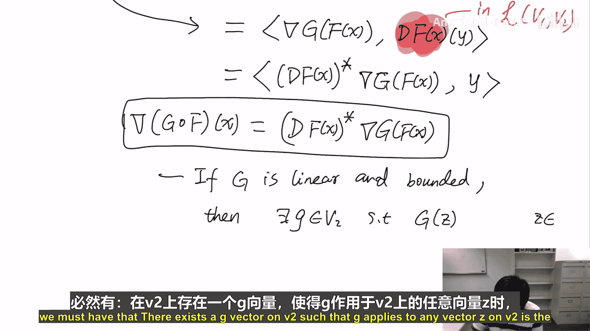

Is the in product。And 돼。Greeddent of G at X for any X on V2。This is only the G vector。So we obtain。

Greedient G composed F。At X is D FX。There are the joints。Applies to the G vector。

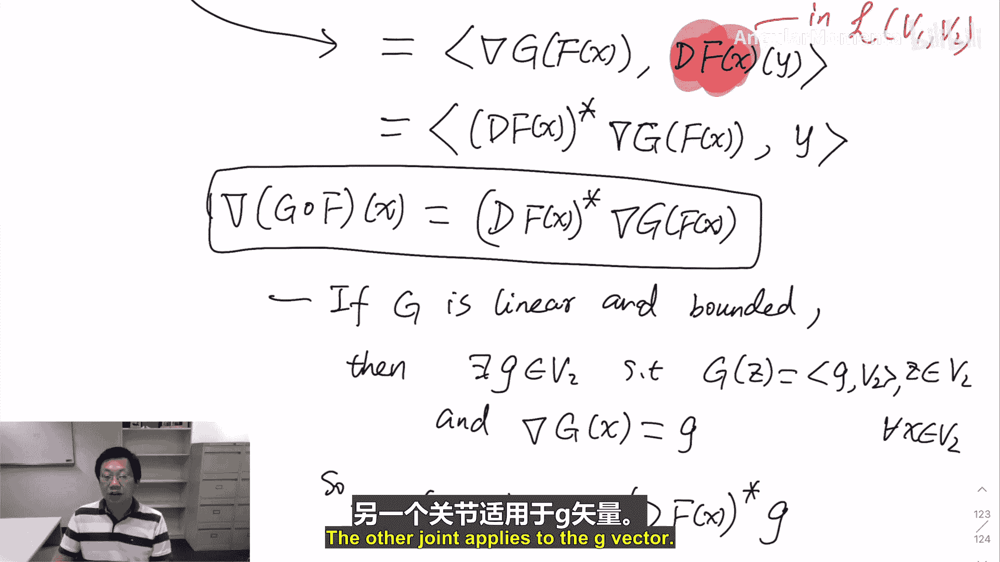

If F is an engineer。And the bou。Since F is from v1 to v2。This means F。

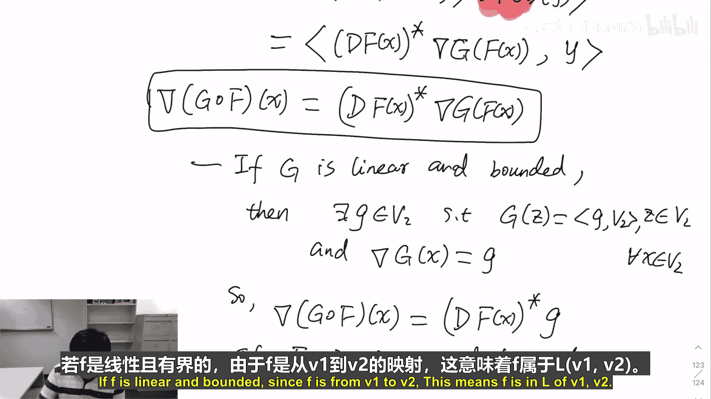

Is in L of V 1， V2。Therefore。This D F of x。Is just the F itself。

Because we have shown that for linear operators， linear and bounded operators， DF is always F itself。

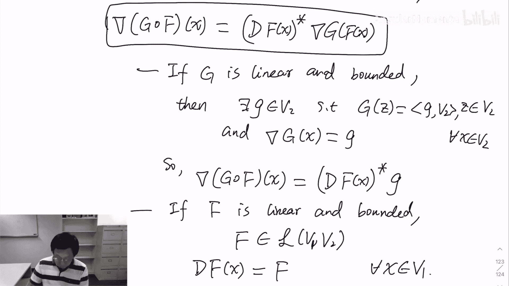

In this case， we obtain the gradient of G composed with F。X is。F star。鬼电视机。F， X。

We have used this in the derivation of the gradient of the objective function in the list squares。

This we have not used AP for。All those special cases are just very， very useful。

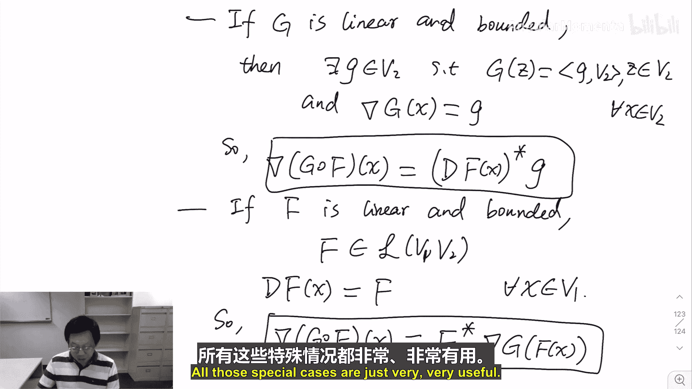

They are powerful tools for many differentiation。

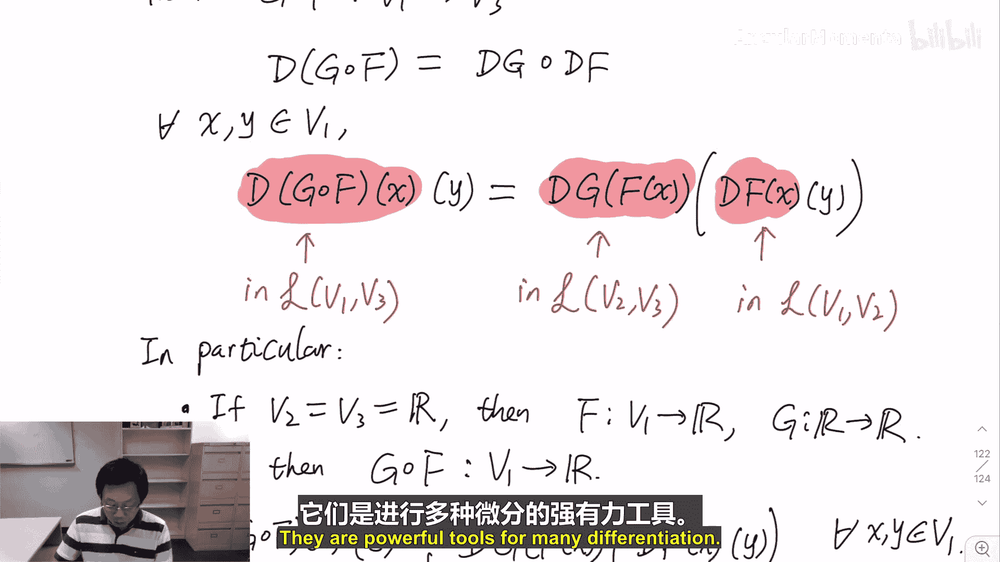