# 【香港科技大学】数据分析的数学方法 ｜ Mathematical Methods for Data Analysis p96 16-05-02-视频 -BV1DEFDzGEZW_p96-

The third one。We consider mappings between eucanian spaces， that。F B of mapping from R N to RM。

This is a vector valued multivariant function。 The input is un variableable。

 The output is a vector in R M。We assume that R N and RM are with the standard inner the protector。

Then。We have the explicit form of Df of x。D FX will be a linear and bound operator from RN。2 R M。

Or linear transformations from RN to RM。We know that linear transformations。

 they can write into a matrix。Therefore， this D FX is just a matrix of size。M by N。

We have the explicit form for the entries of this matrix it is。

Its I J entry is the partial derivative of F X。The ice component。With respect to the J variable。

I is from1 to M。J is from one to n。Where。F， X， I。Is the。Ice component。Of5。

Because F X is a vector in R M。 We have M components， the I component。Just denoted by F X subi。

With these notations， the differentiation of F at x is a matrix of size M by N。

 and its IJ entry is just the partial derivative of the I component F with respect to the J variable。

This DFX。In calculus， we call it。The Jacobin matrix。You must have learned it in calculus。

Let me prove this fact。For simplicity， I wanted to denote。F X， the I component to be F I of x。

Which is a number。

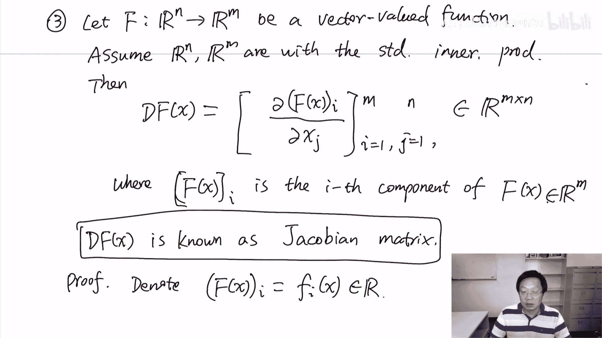

Or which is a function from R N to R。That is。F X capital F x is just F1 x to F M X。

Which is a vector in RM。Therefore， capital the F maps x to a vector in RM。

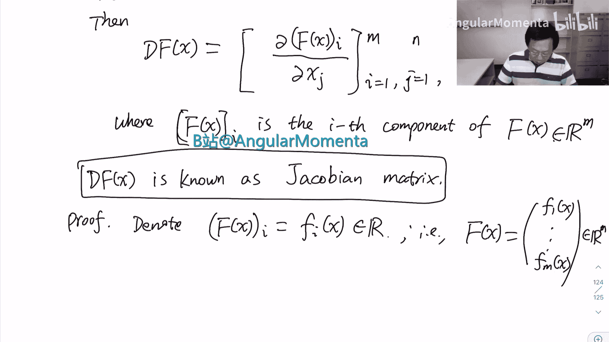

In order to get D F of x， we use the different ability。By different ability。

Here we will assume that all these F are differentiable。 otherwise， of course。

 there is no differentiation for this capital F。We assume all F I are differentiable。 Therefore。

 we have its。A fine approximation。F， I at Y is F， I X。Plus。The gradient F I of x， Y minus x because。

FI is a function from R N to R。Therefore， its differentiation is in this inner product form because we have defined inner product on this space and this space respectively。

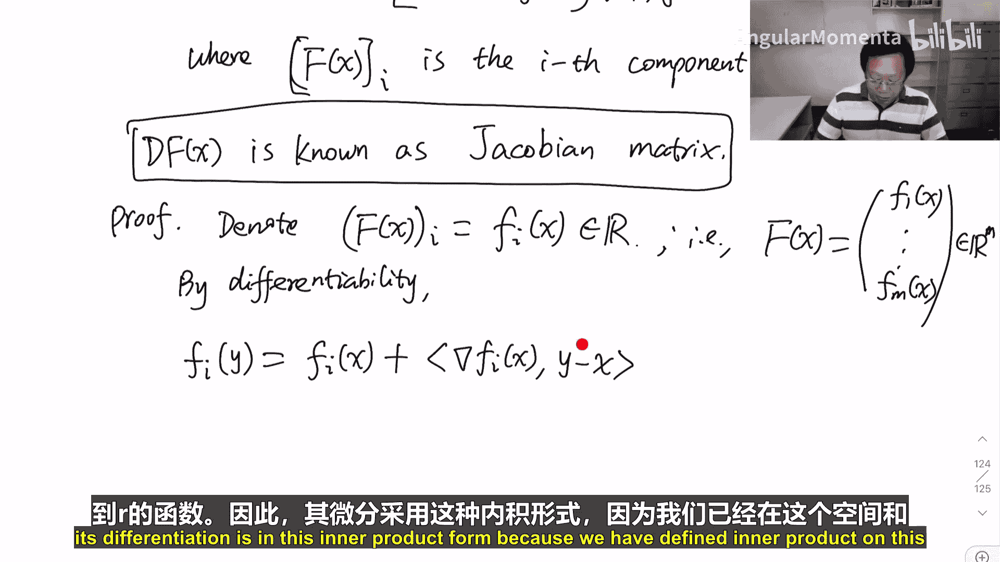

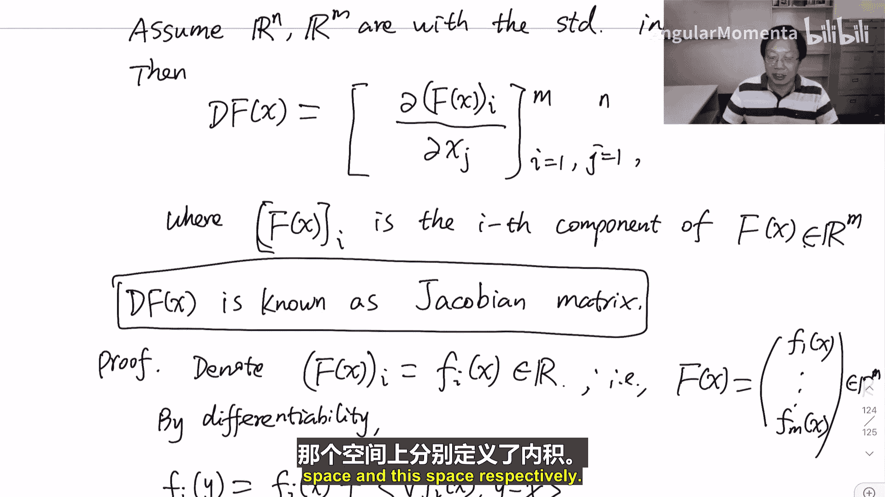

Class and error。In this time， I will denote the error be Eom I。This original I is just the arrow。

Of this a fine approximation to F I Y。And from the different ability， we know that they say。

Yipson I is very small， it is just a little o of this y minus x that2 norm。Or more precisely。

 we should have the ni。When y minus x that2 norm approaches 0， the absolute value of Epson I。

Divided by y minus x， the2 norm equals 0。This is true for all I。For any FI。

 we have this a fine approximation and the error E I is just satisfied this。Limit equals 0。Therefore。

We rewrite this。M equations into a vector equation。The left hand side is all F IY。

 that is kind of F of Y。E course。This is capital F x。And this， I will write it into a vector form。

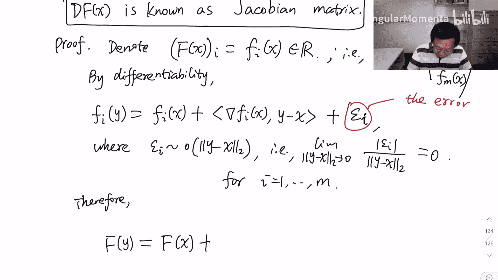

Hiss first component is gradient F1 x。Y minus x。Greient F 2 x。Y minus x。Gradient F。M X。Y minus x。

And that we have an error vector。Epson 1， Epson 2，2， Epson and。I will call this error vector。Here。

就比医不生。Vter。In RM。This is that。Errror in this are fine approximation to F Y， F X。

This is an a fine approximation to FY because y is now the variable。

 This is an linear function in y plus a constant vector。This a fine approximation。

 the error is just given by this e vector。

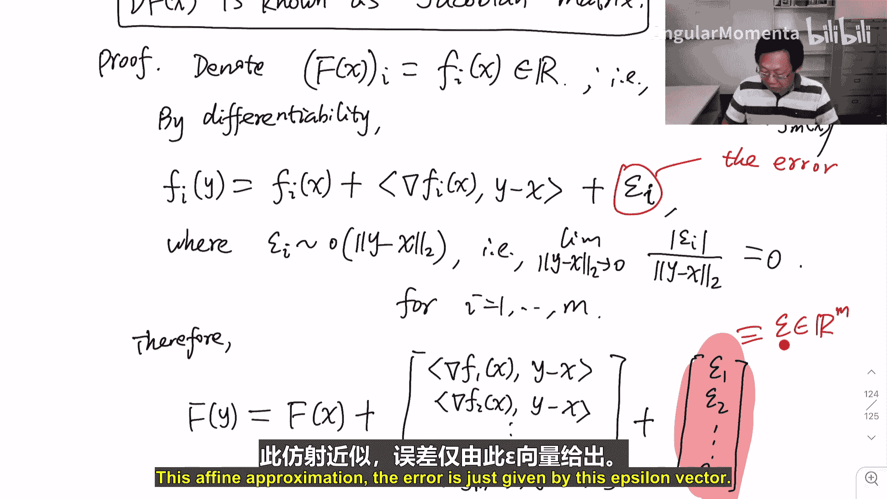

In order to find out the differentiation of this Ker F， we needed this。

Impson vector is little O of y minus x， the tuner。For this purpose， we needed to。

Check how large this Epsom vector is since。This Y soon。

Because we are in R M with the standard inner product。This norm here should be the two norm。

We know that norms in finite dimensional are equivalent。

 The two norm is always smaller than all equals to the one norm。And by the definition。

 the one norm is just the ailon one absolute value plus， absoluteil value of Epson 2 plus。Plus。

 Epil M。With this。The limit y minus x， the2 norm approaches 0， y minus x the2 norm， thisarrow vector。

 the2 norm。In this a fine approximation。Of course， this error is non negative because all the numerator and denominator are。

This is smaller than or equals to by this inequality。

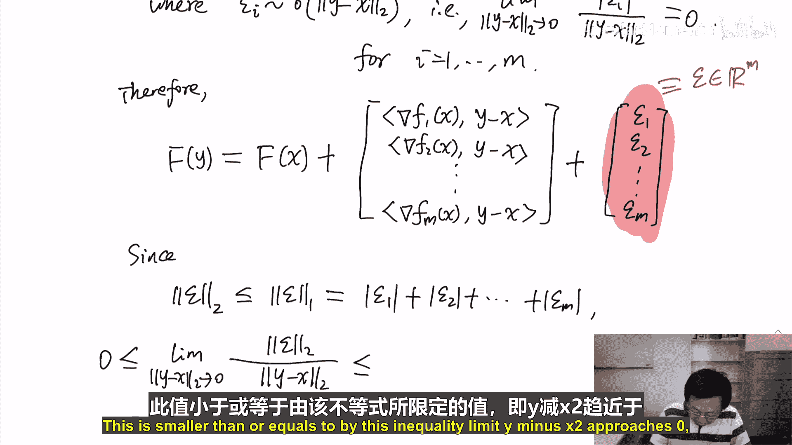

Dage。Y minus x2 approaches zero。Y minus x the two norm Eon one。Plus。

 Epson 2 plus plus the epson value of Epson M。Because each ratio here。When y minus x。

 the two normal approaches0， the limit of this ratio is just 0。 So we have M zeros added together。

Of course， this image is 0。From this inequality， we just obtain that the limit of this is0。Therefore。

 this is a good differentiation， this is a good a fine approximation for the differentiation。

This is supposed to be。The D of Fx applies to y minus x。

From the definition of the difference ability。

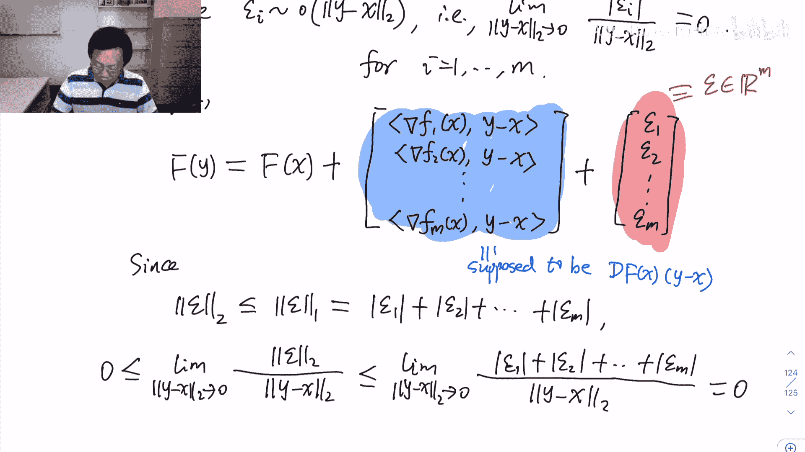

Therefore， we just obtain D of F X。Applies to Y is just。Greientent F1 x。

 I'd like to replace y minus x by y。Why。Greedients F 2， X， Y。Greedient， F M， X。Why。This。

Because we are taking in the product in R N。

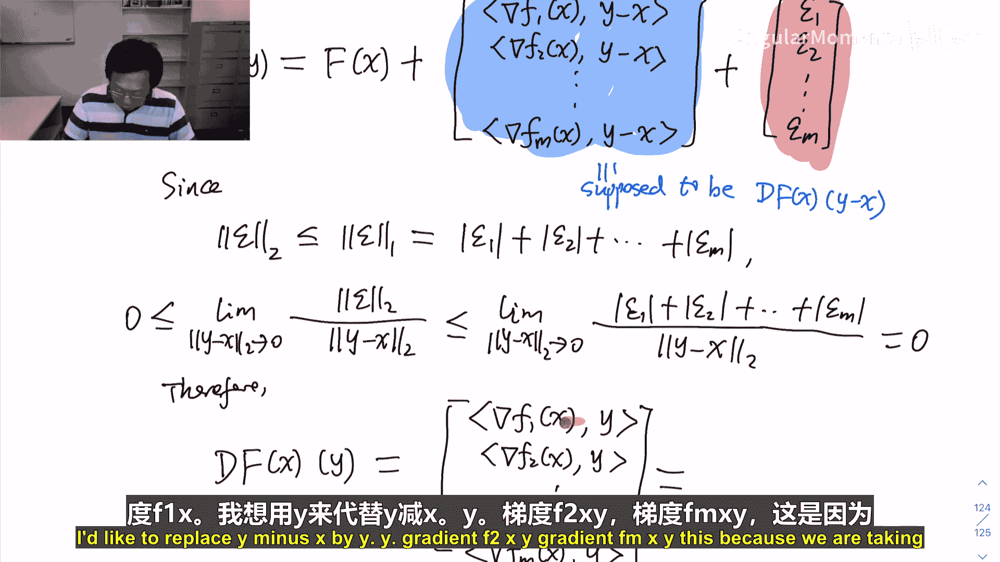

This inner product is defined by transpose。Greedient， F1 x transpose y。Greedient F2 x transpose y。

Greent， F M。X。Transfer away。This can be written into a matrix。Vectctor product。Greient F1 x。

Transpose。Greent F 2 x transpose。Guent F and。X transpose。This matrix times1。From here。

 we just see that。This matrix will be the DFX matrix。This is the D F X matrix， which is in R M by N。

To find out elements of this matrix， we needed to use our result for the gradient of multivarient functions because。

FI。It is a function from R N to R。From the differentiation of functions。

 we know that gradient F I of X， it is。Its first component is just F I， X 1 X。F I X 2 x。2 F。I， X， N。

 X。Is I component just the ice partial derivative？We just plug in this into this expression。

 we obtain the explicit form of DFX。This。Impice。D FX equals。The first row is only。F1。

The transpose of this with I equals to one。Partial F1， partial X 1 x。Partial F1， partialio x 2 x。

Partial F1， partialial X N X。This is the first all。The second rower and theung。

 the last row will be patch your F M。Partial X， I X。Partial FM。Conio x2 x。

The last element will be partial F， M， partial X， N X。This is a matrix in。And by n。

We finished that proof。

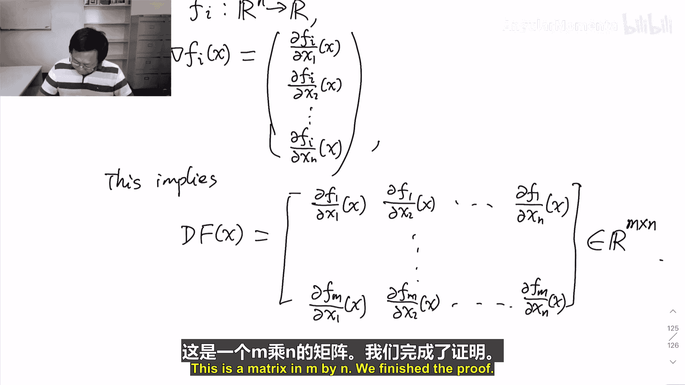

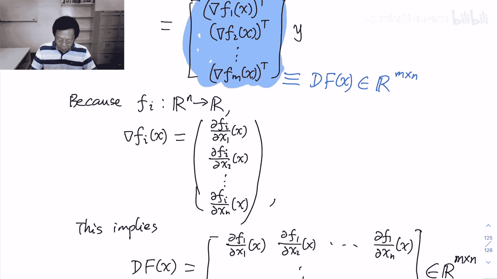

From this。Result， we also see that the differentiation of mappings between vector spaces is just an extension of the Jacob matrix for vector valued multivarient functions。

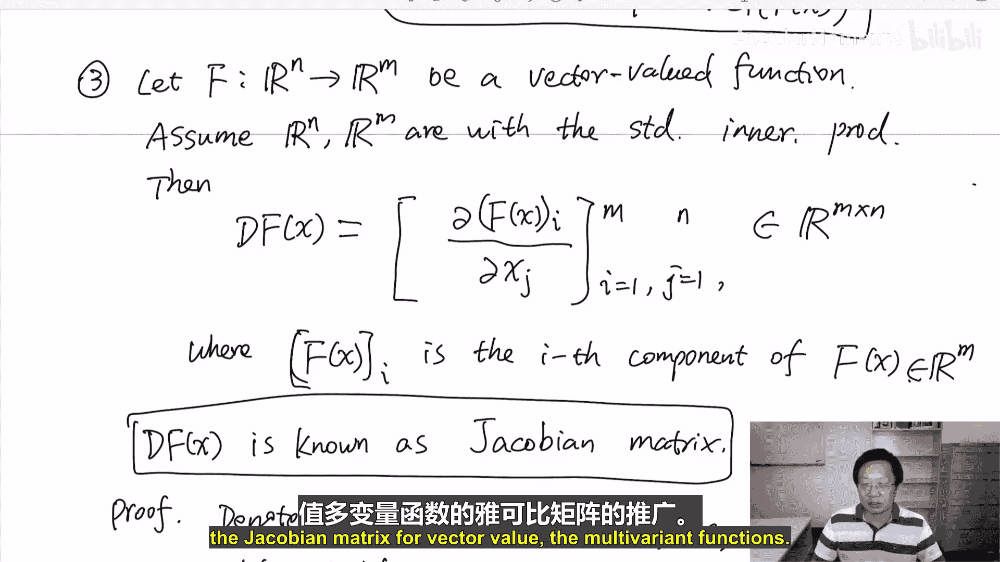

Differentiation。Is an extension。Of。Jacoby matrix。

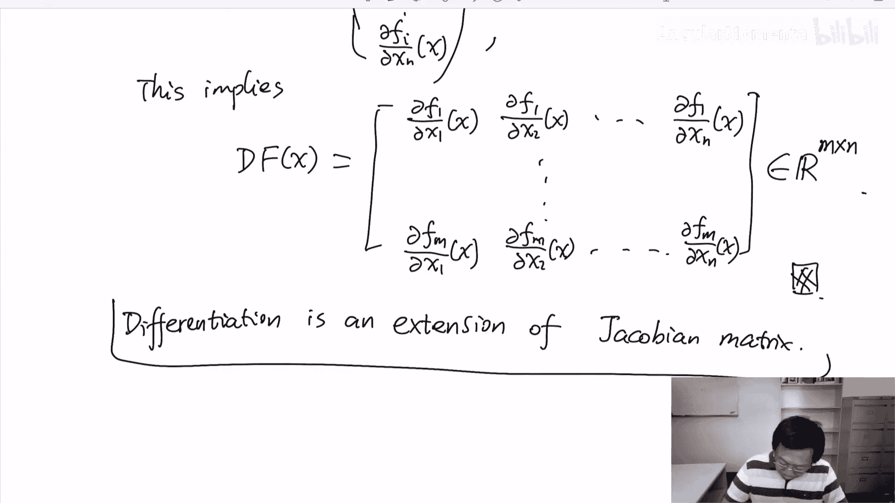