# 【香港科技大学】数据分析的数学方法 ｜ Mathematical Methods for Data Analysis p97 16-06-02-视频 -BV1DEFDzGEZW_p97-

The differentiation of mappings between two vector spaces enable us to define higher order。

Appreciation of functions on hypospaces。Section 5。3。Passion。Of functions。We consider a function， F。

From B to R where V is a hybrid space。We have defined this gradient。

Which is a first order derivative。Dis gradient of F at x is a vector on B。

Now we want to define the second other derivative。It is just the derivative of the derivative。

 the differentiation of the first order differentiation。For these purpose， we view。

X to the gradient F at x。M。This mapping maps a vector on V to a vector on V。Therefore。

 we can define its differentiation。The differentiation of gradient of f at x。

This is a second order derivative of F because it's the derivative of the derivative。

This second other derivative is called the Hasian。hashing。Of F is just there。

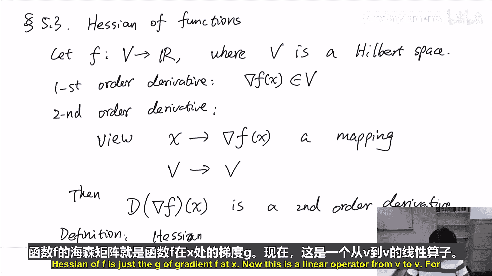

D of gradient F at x。Now， this is an linear operator from B to B。For this， we have a notation。

 It is just denoted by the。N plus squared the f of x。Therefore。This。Is a mapping from V to V。

Because it's the differentiation of the mapping of this gradient of F， which is from B2 v。

 therefore its differentiation is also from V2 V。Moreover， it is linear and bounded。

It just belongs to the L of V。There is an interesting， special case。If F is from R N to R。

If F is a function on U Canadian basiss。Or it is a function of multi variable。Then。

We just have the gradient F x。 This。 it is now D of the gradient F of x。

We know that gradient F is just the partial derivatives。Greetient to Fx。

The I component is just partial F， partial X。At X。Therefore。

 the I component of this function is just the I partial derivative。

We know that the differentiation of a multi variableable vector value function is known as the Jacob matrix。

For the Jacob matrix， its IJ element is just the I component of this function。

 Take the J partial derivative。It is just the the I component of this function。

 It is now partial F partial X， I X。Take the J partial derivative。

 This further taken derivative with respect to XJ。We use a new notation。

 just this sum partial squared F of partial X， I， partial X G。

I is from one to and J is also from one to end。This is the heing of this function from RN to R。

Because for gradient， we have the explicit form， is I component is just the I partial derivative of F。

Now， for this differentiation of this vector valued function， we have also an explicit form of。

The Jacobian matrix。We obtain this。So the Hessian。Of F of x is just the second order partial derivative。

With respect to X， I and X J， it will be the I J entry of this heim matrix。This hashing is a matrix。

Yin。RM by N。Therefore， in this sense， this Hahing is just an extension of the hesing of functions on ekanadian spaces。

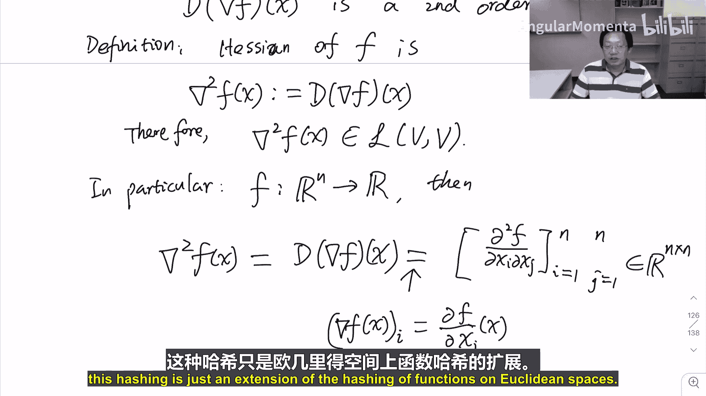

Let's see some examples。

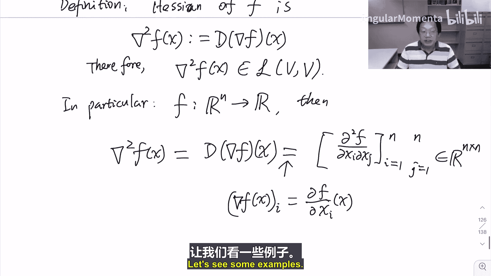

examplele， one。We consider F X equals half of。A X minus P， the w norm squared。

Where a is a bounded and linear operator。From V to W。And P is a vector in W。

And this is the norm in W。And， of course， x is U V。For this function， we know that its gradients。Is。

We have computed。 The gradient。 Its just a star。 The joint of a applies to。A X minus B。

In order to obtain its hesian， we further simplify this to。A star A X minus a star B。Because this。

A star a。A is from。V 2 W A is a linear and buned operator from。V 2 W and a star by the definition。

 it is a linear and bounded operator from W to V。Therefore。

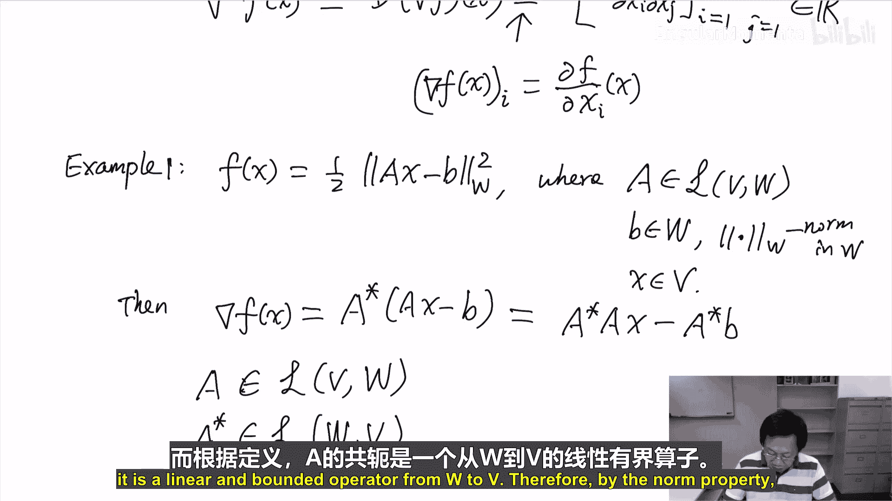

Byy the Nor property。The norm of the product of two operators will be smaller than their norm。

Multiped together。Since。Both a and a star are bounded。

 So these are finite numbers so that this A star A is just a finite number。Therefore。

 A star A is bounded。 A star A is linear。 That's obvious。That's from here， we get a star a。

Is a linear and bounded operator from V to V。Because A first transform V to W。

 and then a star transforms W to V。 So is from B to B。Now， this。Greent F of x。

 It is a linear and bounded operator applies to x plus a constant vector。

This A starP is a constant vector in V。Therefore， this gradient of Fx is a linear transformation plus a constant vector。

Therefore， it is a shift。Linear transformation isn't a fine transformation。

So when't we do the differentiation？Of this gradient， F of x。It is just the linear part。

If we use a fine function to approximate a fine function， of course， we just obtain itself。

The linear part will be this a star A。Or equivalently， the heing of this F X is just a star A。

 which is in。LVV is linear and bounded。

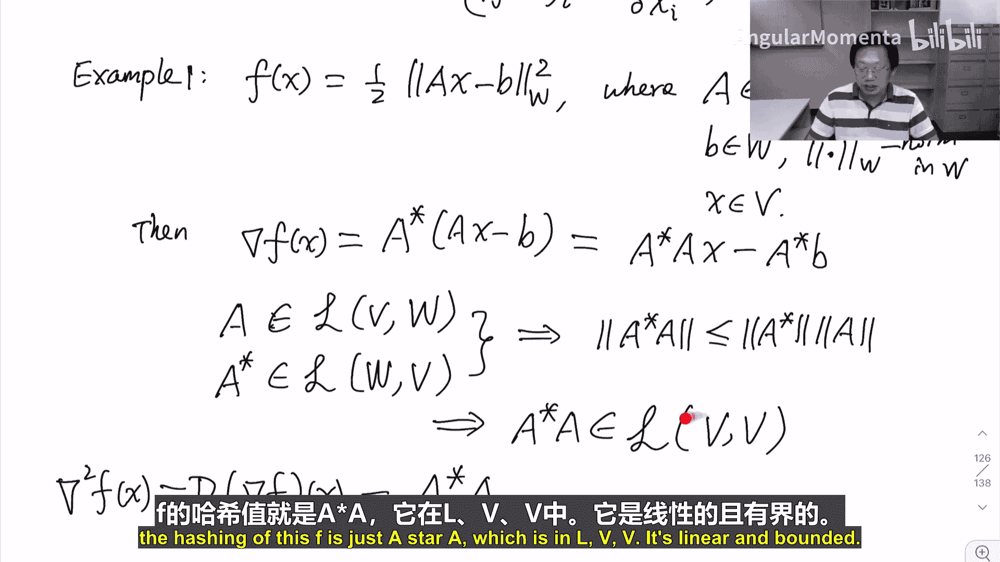

In particular。A special case is。When our。A is a matrix from R M to R N。

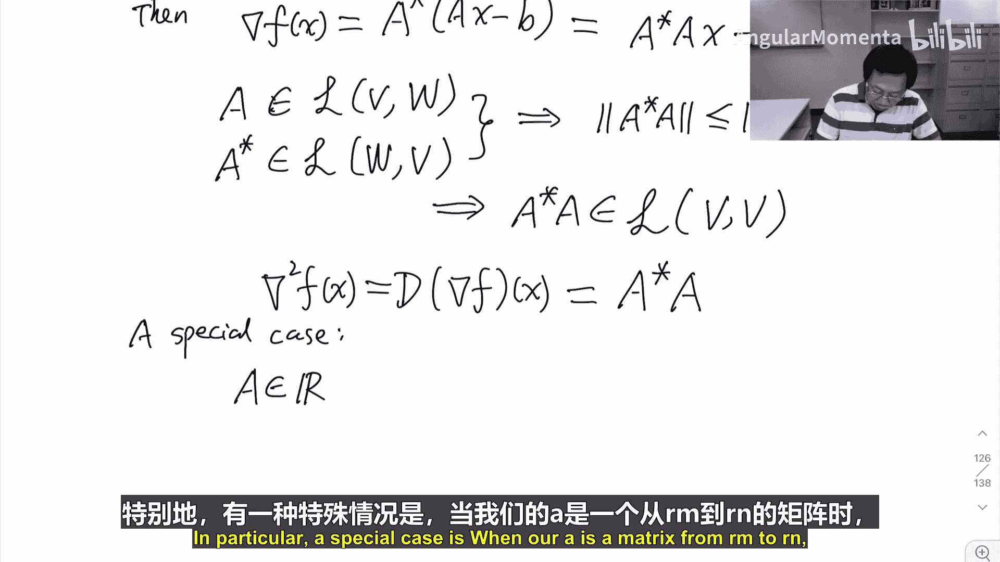

Which means that our B is just RN。Our W is RM。

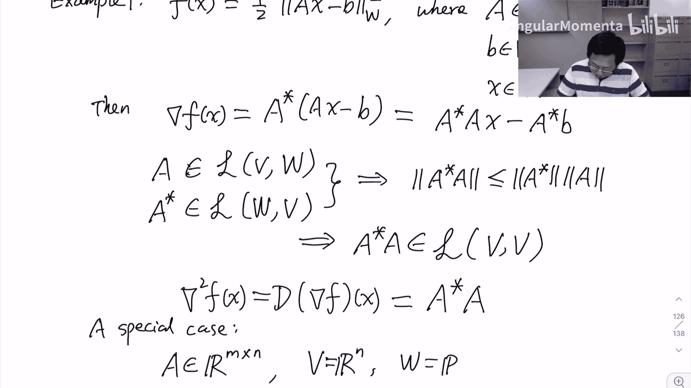

Then， F， X equals。Half of A X minus B the two norm squared。

This is the objective function in our list squares problem。Then the gradient F x is a star。

 A star is now a transpose for the matrix case。A X minus B， and the hassian。It's just a transpose a。

So we obtain the gradient and heing of the objective function in east squares。

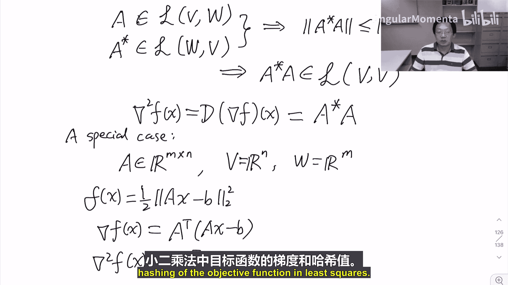

이거 example2。We consider a function F of x。Equals a capital F of A X。

Where a is a dinner and bounded operator from。V2 W。And the F is from W to R。That is we have a vector。

 we first transform it to the space W and then apply a function on it。

This little F of x is a composition of an linear transformation and a function on hub space。

Therefore， we can the Qin rule。

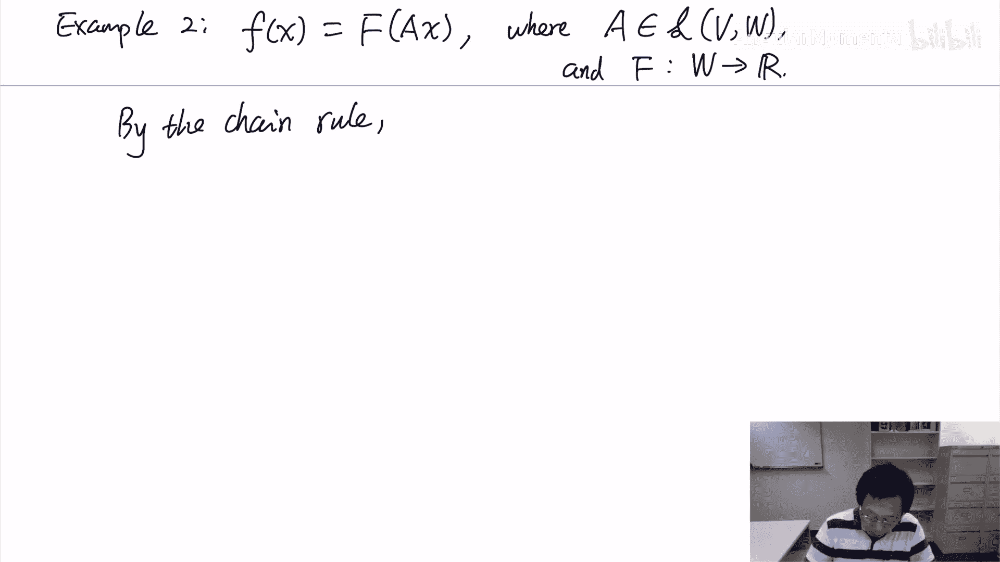

We showed do the Q rule of this case。 The inner function is linear and bounded。

 The outer function is function on the cablebal space。 So it is just the F star。

 The adjoin of F applies to the gradient of the outer function。

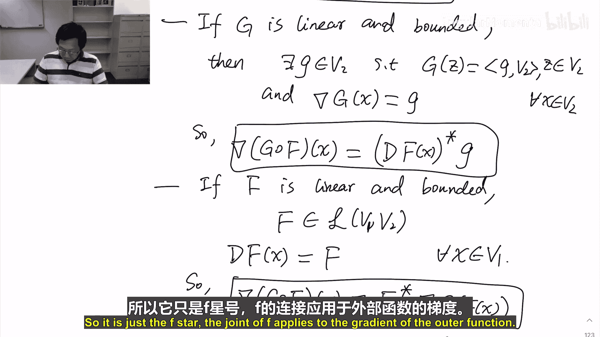

Therefore。

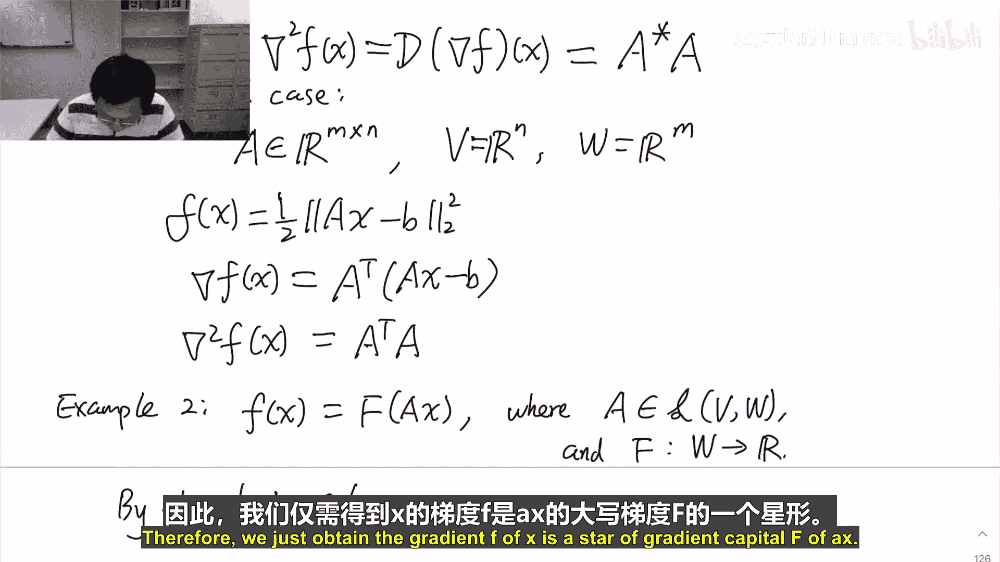

We just obtain the gradient F of x is a star of gradient capital F of A X。

Now we want to find out the hsing for the hesian。We need to differentiate the gradient in the F of x。

And now this is a linear operator。 We consider this linear operator is applied to Y for any。On V。

 the same as x。It is。D of the A star。Greient F of A X。Apps to why。

The Qin rule tells us because this is a composition of three functions。

 One the most inner one is the linear transformation a and the。

Middle one is the gradient of capital F。 The outer one is a star。So it is just D A star first。

Apply the two。D of the middle one。Apply the two。D of the last one。Applies to why。So basically。

 this chain rule says that D of a composition is the composition of D's。

 so D applies to D gradient F applies to DX。Let's find out these three differentiations respectively。

或的。D a star。Because our D A star is linear。It is linear and bounded from W to V。

We just obtain that its differentiation is itself at any point。

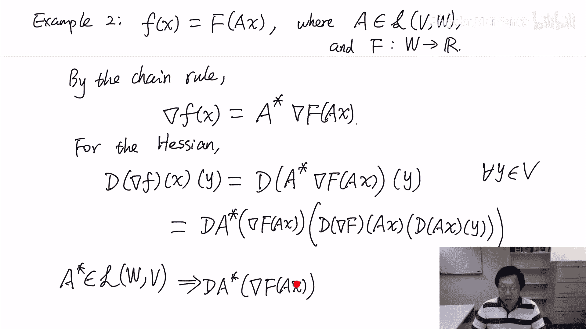

Therefore， this is just a start。And similarly， a is a linear and bounded operator from V to W。

Therefore， D A X。

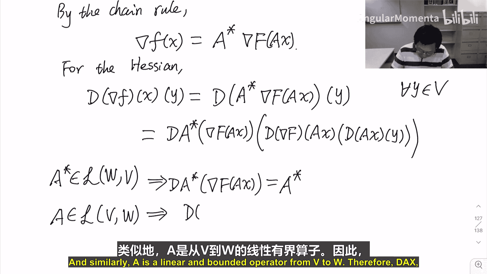

It is just a。And finally， this d gradient of F。At A X。By our definition。

 it's only the hasing of this F at A X， which is also a。

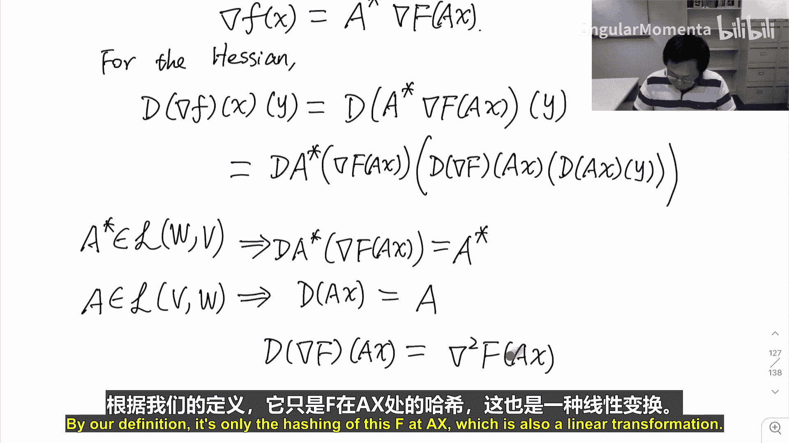

In your transformation。With these three differentiations ready。We can get the hasing of thisitto F。

It equals。A star。Greedient squared F。A X。And A applies to Y。

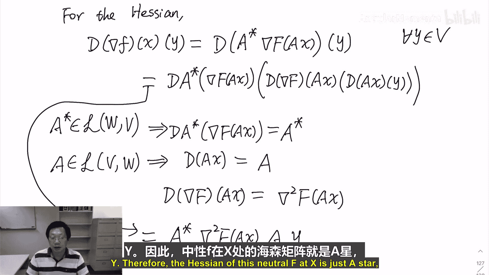

Therefore。The Hassian。Of this little F at x is just a star。The hasing of the capital F at A X。

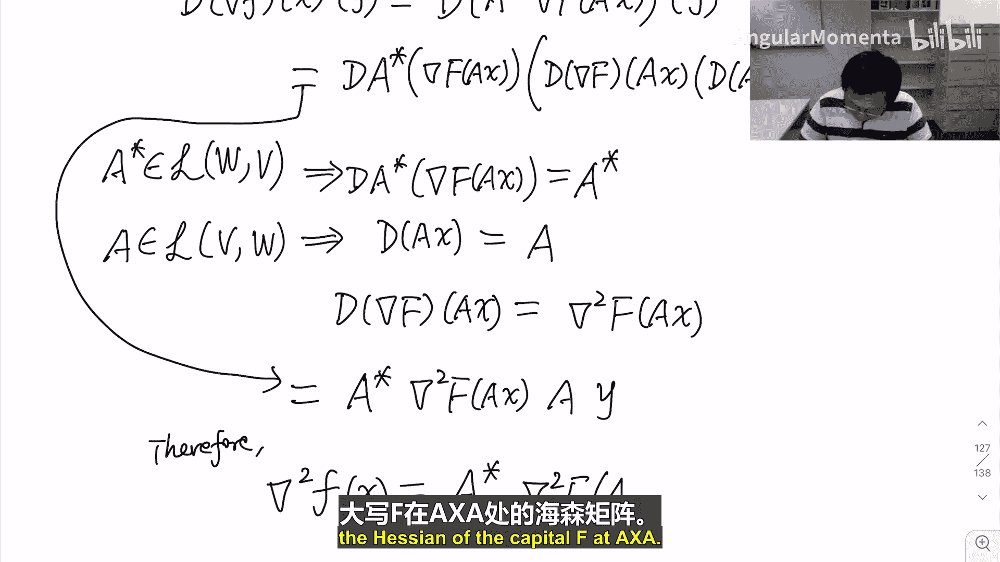

8。And the multi between linear transformations means the composition。

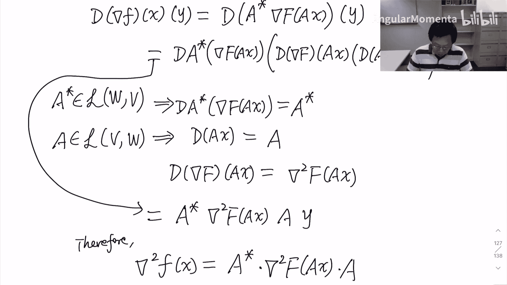

We obtain that if you we have a function， which is a composition of a linear operator and an outer function。

Then this has of this function will be。A star times the hesing of capital F times a。

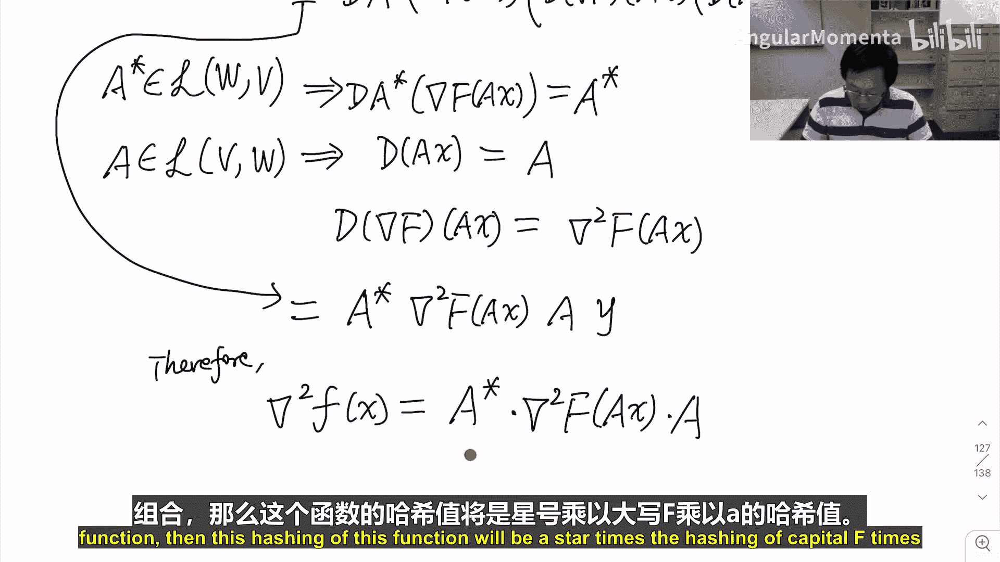