# 【香港科技大学】数据分析的数学方法 ｜ Mathematical Methods for Data Analysis p98 17-01-02-视频 -BV1DEFDzGEZW_p98-

I want to present a final case study。On the deep neural network training in deep learning。

We apply deep learning to regression。 recall that in regression， we are given a training data set。

Which are denoted by X， I and Y， I。 This is one pair of data。 We have many pairs of data。

As here we have M pairs of training data。Where each X， I for simplicity is a vector in R N。

 and each Y， I is a real number。In regression， we want to find。A function F。This F maps R， N to R。

It's just the maps Xi to Yi。S that。This F function fit the input output pairs very well。F， X。

 I is about Y I for all I from one to M。To solve the regression problem。

We use the different models in linear regression。We choose the F to be a fine functions。

But linear models are too simple， they have some limitations。Then， in regression。

We choose a non nonlinear function， which is a linear function on the non nonlinear transform domain。

We choose。F。呃，零点方形。In the feature domain。Of course。

 we can choose other classes of functions F in deep learning。We choose F。

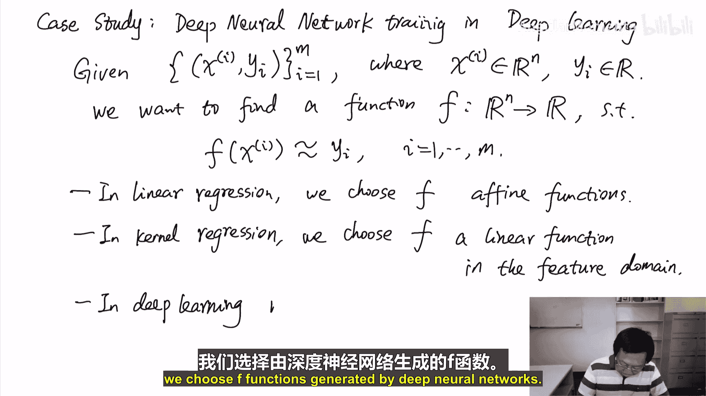

Functions generated by deep neural networks。Let's start what is this function。

 What is a function generated by a neural network。For simplicity。

I will consider a fully connected neural network。There are many other different neural networks available。

 This fully connected neural network is the simplest one。Our motivation is from an artificial neuro。

In artificial neuro round， we have an input。Say x1， x2 to x 3 to x。Assume we have an input。

And for this neuro round， it will connect information from this input。

Then X1 will send some information to this neuron。 X 2 will also send some information to this neuro underscore the。

All these inputs have different weight。

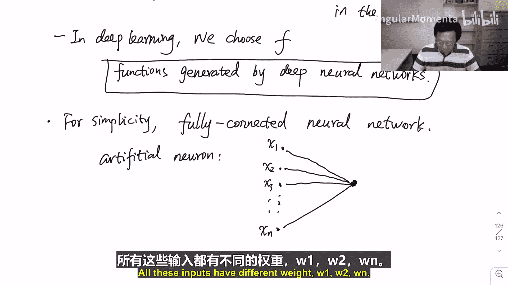

W 1， W 2。WN。Once this neuron gets some information， it will response if the stimulation is very。

 very low， then there is no response If the stimulation is very high， then this neuron will response。

This response function is an approximation to the 01 function。 We call it the activation function。

I denote it by sigma， then we got the outputs。This is a typical， artificial neuro。

We have an inputs for each inputs， they have a weight W1 to WN。Then the information。

 x1 W1 plus x2 W2 plus WN XN together。This will be the signal received by the neuron after the neuron received the signal。

 it will response。The response is a 01 function， which is called the activation function。

Then we get the output。Mathematic on it， the output。I call it a why。Equals first。

 we do the linear conversation。This is the signal received by the neuron and it will response。

By the activation function。Where。Sigma。From R to R。Here is the activation function。For example。

 a typical。Response。Will be。If the signal received is very weak， it is just 0。If it is strong。

 it is just。ForOne， so its a function like this。 They call it a scratch the function。

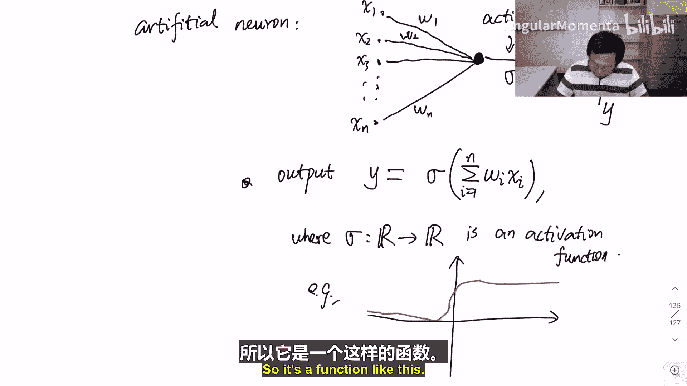

We can simplify the notation of this function in the artificial neuron。

By introducing this to be a vector x， this to be a vector W。

Then it is just sigma applies to that in the product of W and X。

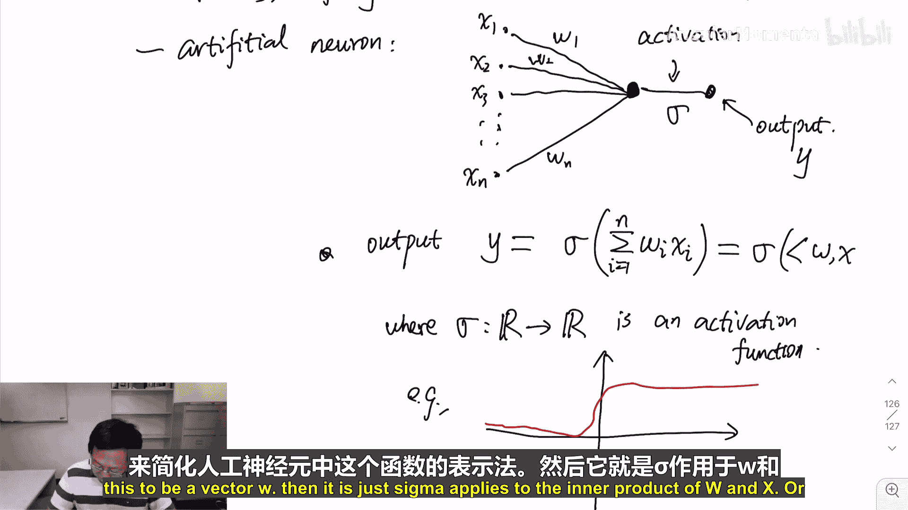

Or sometimes is sigma of W transpose X。 This is one artificial neuron with artificial neuron。

 then we construct a neural network。

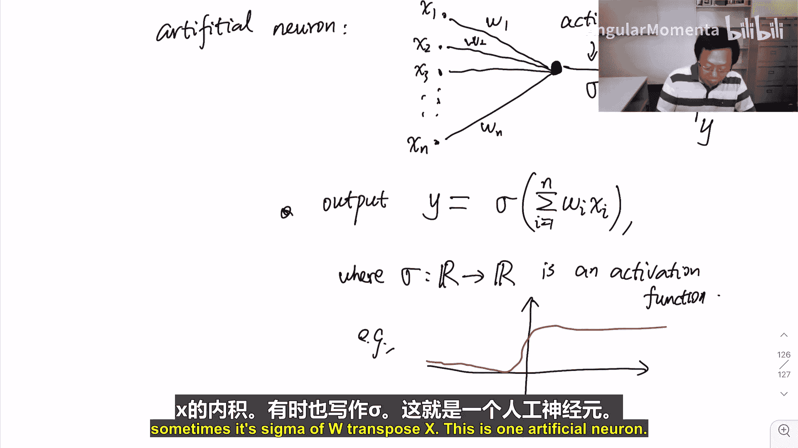

Where we put many artificial neurons together to form a network。For example， in the simplesies case。

 we have the input。X1， x2。X， N。We have a new run。This is one neuro。We may have another neuron。

The other neuro。And we have many， many neurons。And then the outputs of all artificial neurons are merged into a final output。

This final output， I call it why。Then you can see for the first neuro round， it's just a sigma。W1 X。

This W1 vector is the weight in the first neuro。For the eyes new wrong。It is in the product of W，I X。

 and then sigma。So this is the output of the I artificial neuro。

 Then all these outputs are merged together。I will assume the width here is U1 U2 to U P。

 assume I have P mirrors。So it's just the UI sigma i from 1 to P。

This is the output of these neural networks。

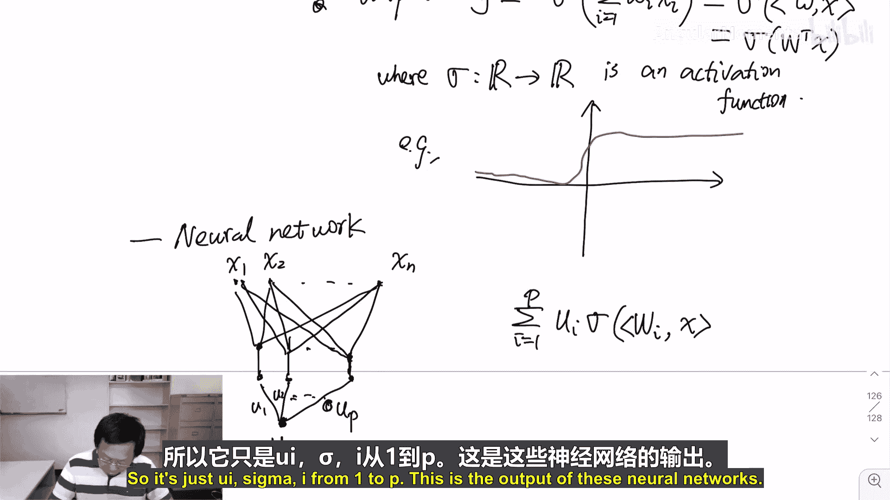

This neural network， we have only one layer because all the neurons are just parallel to each other。

 So we have only one layer。 So this is a one layer。Neural network。

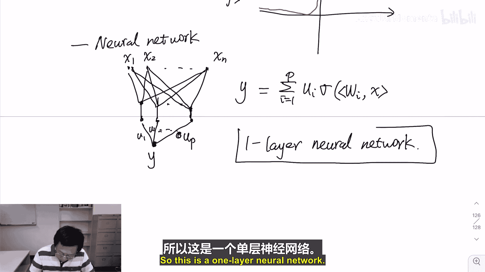

Now， I introduce some new notations that。W， matrix。Be the matrix， Who first row is W 1 transpose。

 W2 transpose and so on WP transpose。This is a matrix of size。P八 n。

This is the coefficient matrix of all weights in this neural network。

And I also introduce a U vector by。U equals u1， U2，2， U p。It is a vector in R P。

This U vector is the coefficient in the final output。I also wanted to extend the。

Definition of this sigma， the activation function here to the multivari case。

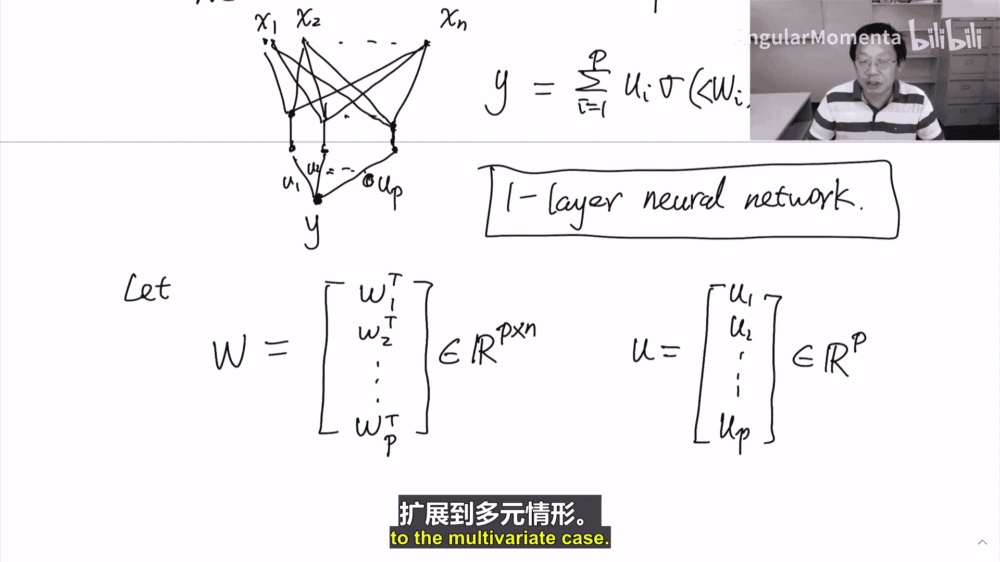

Define a function， Sigma。Still denot by Sigma。From R to R。Bye。Sigma applies to a vector。Y equals。

We just activate each component of this y vector。Sigma of y 1， Sigma of y 2。Sigma of Yp。

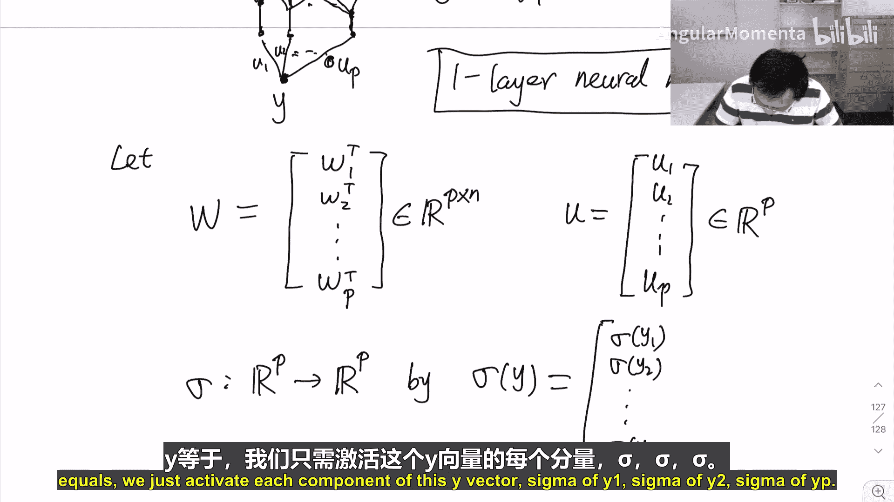

So here， each component here is an activation。Every component of Y is activated。

I still dennoted this function sigma。

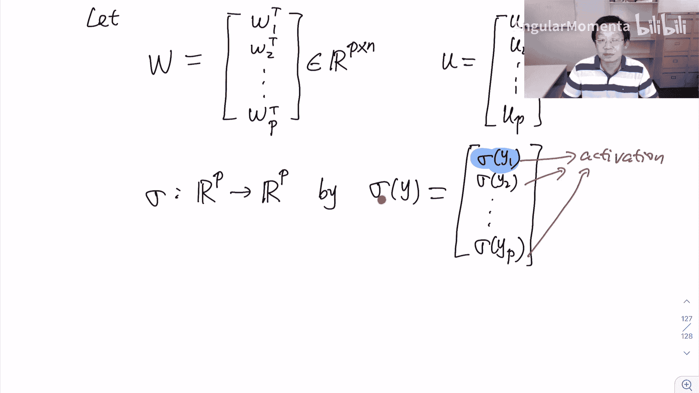

With all these notations， I can rewrite this function in x into a very compact form， in particular。

 y equals。

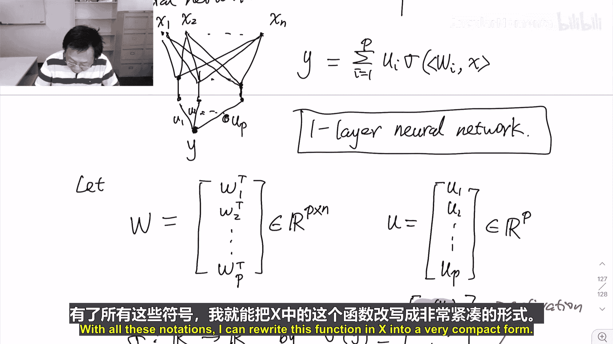

The inner product of U and sigma applies to W X。

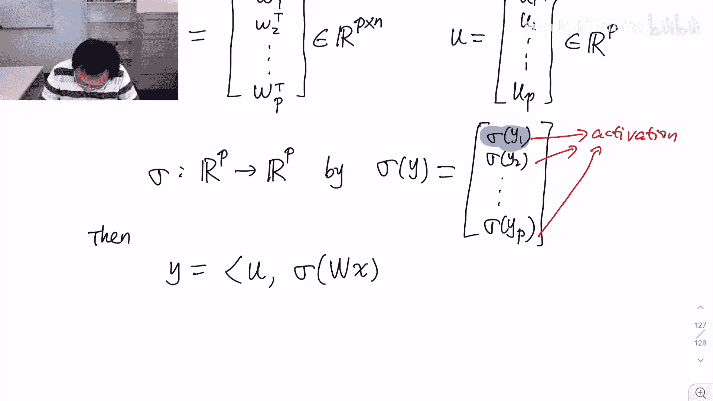

It is obvious that the I component of this W X vector is just the inner product of W， I and X。

 because。The eyerow of this W matrix is the W I transportse。

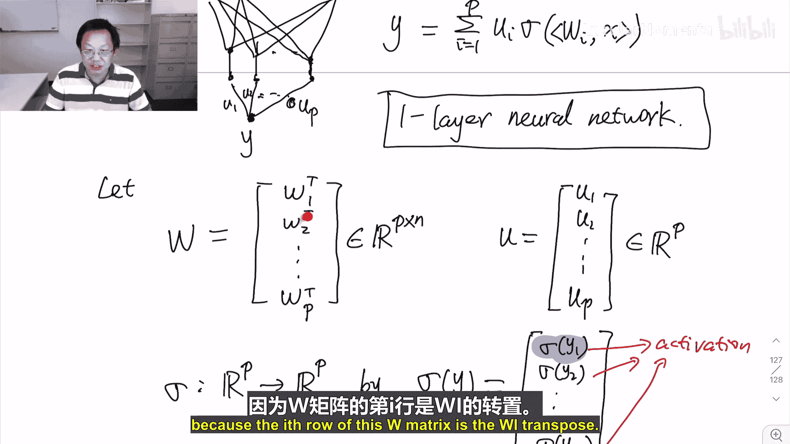

And then we apply sigma to each component。

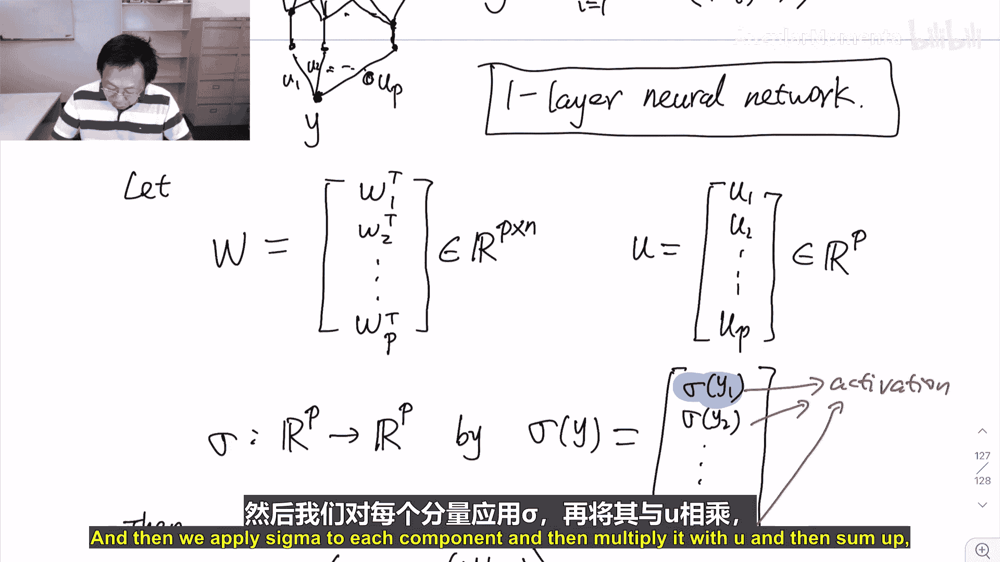

And then match it with you。 I and then sum up， which is exactly the inner product with you and sigma。

This is a function of x。 I want to call it Fx。But in the definition of this function。

 we have some parameters。 The parameters are the W parameter and the U parameter。

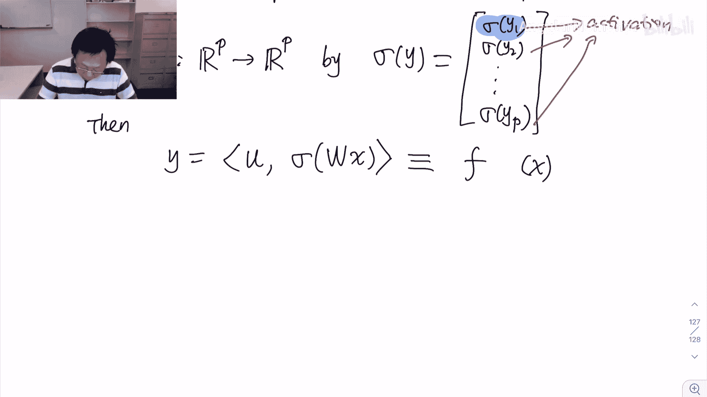

W and U are the coefficients in the widths of this neural network to define this neural network。

 we need to specify the widths here and the widths here。W matrix is here， U vector is here。

They are the parameters of this neural network。 If I change to another set of W and U。

 I change to another neural network function。

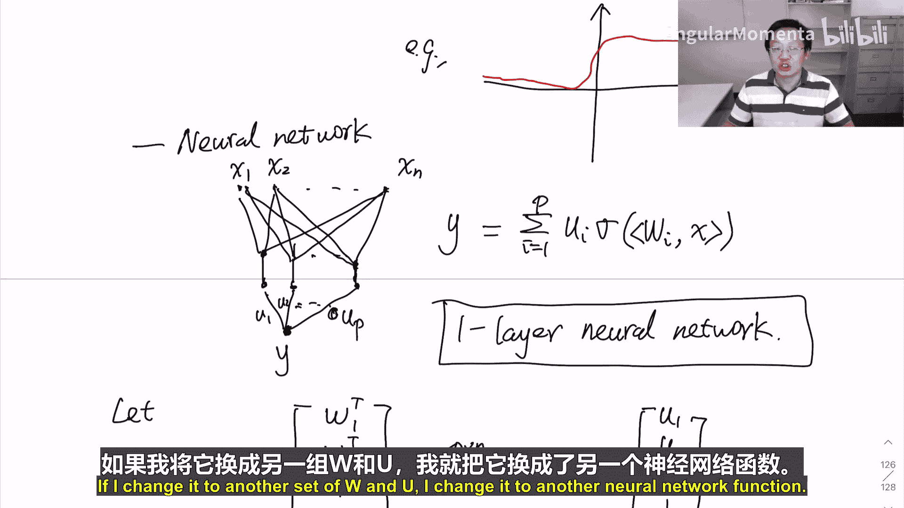

Therefore， this neural network function is determined by W and U iss parametermettriized by W and U。

It applies to X， we get the output of this neural network。

Then if we want to use the neural network for regression。It becomes， we use。

This FW is the F in the regression task。

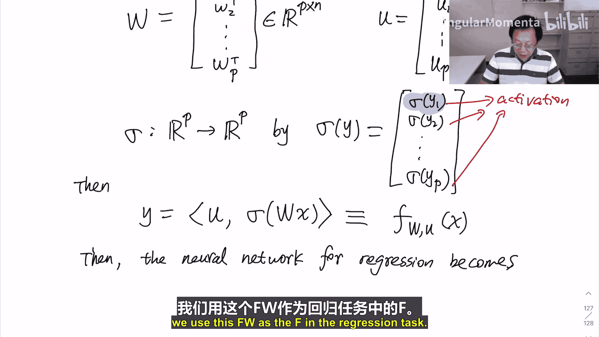

We find W and U。Such that FW U， the neural network function defined by W and U applies to X， I。

Is approximately white for all I。Here， W is a matrix of size P by N。And you is a vector of size P。

Similar to the linear regression case， we need to define quantitatively the error of these equations。

There are many different choices here I just use the simple a square loss function。Therefore。

We just let this W F U X I。Mus y I squared this as the equationarrow。And we have M equations to fit。

 So I just sum these  errorss up to get the total error。Then I want this total error is minimized。

Among all neural network functions。This means that I need to minimize this function among all W and U because one set of W and U corresponding to one。

Specific and neural network。

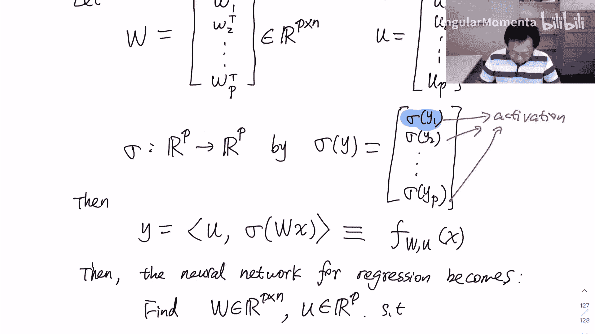

W is in RRP by N。 U is in RRP。

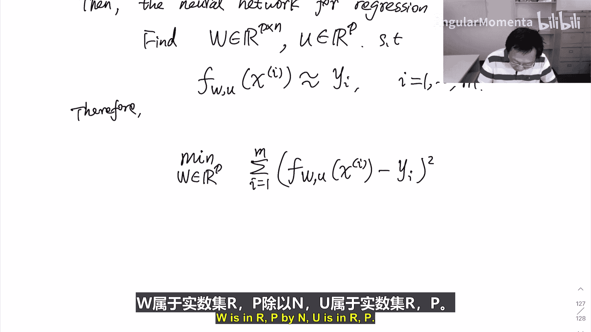