# 【香港科技大学】数据分析的数学方法 ｜ Mathematical Methods for Data Analysis p99 17-02-02-视频 -BV1DEFDzGEZW_p99-

So VW and U from this minimization with given X IYII from1 to M is known as the neural network training。

It is a key stage in deep learning。Let's check on how to train this neural network here。To this end。

 we need the first define two functions on W and U。In particular， I define capital F I。

Which is thearrow of the I equation here。It's F W U X， I。Mus Y I squared。

This error is viewed as a function of W and U changing W and U， we get a different value。

So W U are the variables in this function。 Then this function， we call it the capital F I。

And since in the training of neural network， we need the summation of that。M equations。

We need the summ of errors of the M equations。 We need to define a capital F of W。

To be the summation of the total error。

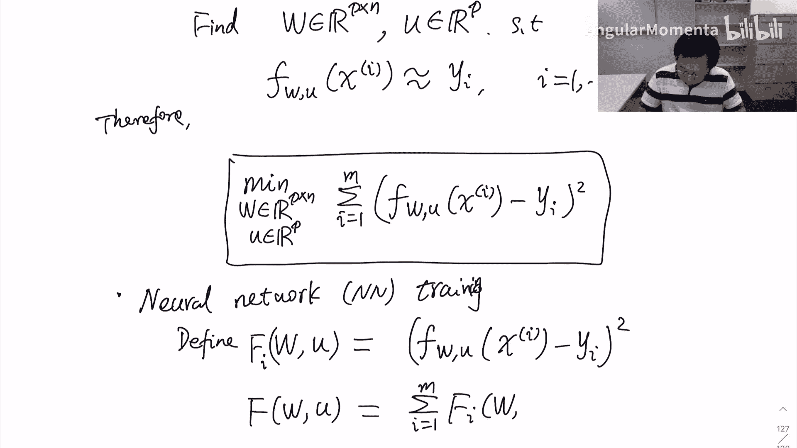

We need it to solve。The minimization of。F W。Or equivalent。

 we need to minimize sigma iPhone 1 to M F I W。Here， of course。

 the variable in these two minims are both W and U。And they are the same as here。 W is in R P by N。

 U is in R P。In order to solve this to minimization。We need to focus on the property of FW。

 or equivalently， F I W。First of all， this F。W U， this function is differentiable。Yve。Siggaite。I。

Here， sigma is the activation function。 If the activation function is differentiable。

 then this FW is differentiable because F W U is a composition of the square here。And。

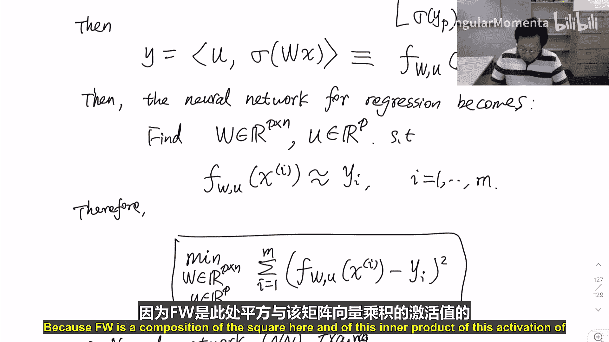

Of this inner the product， of this activation， of this matrix vector product。

All the operations involved in the composition of this FW U。Just smooth。 if sigma is。Therefore。

 F is differentiable if sigma is differentiable。Secondly， F W U。Its not convex。In general。Of course。

 the conity of this FWU depends on sigma。

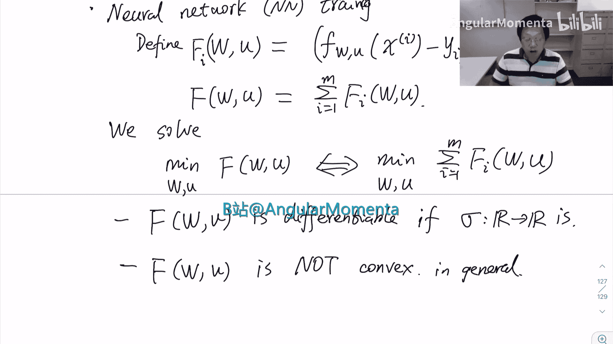

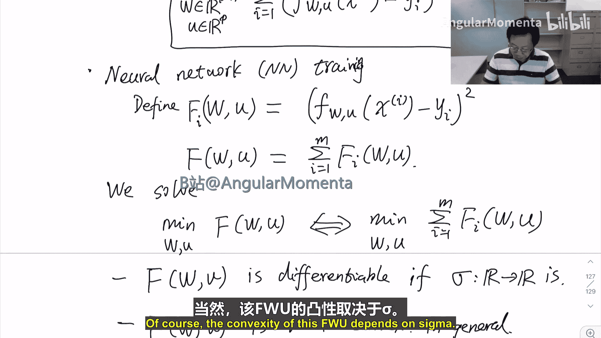

Actually， even we choose a convex sigma like the value function。

 you can check that this FW U is still non convex because it is too complicated。

 It's a composition in a very complicated way。

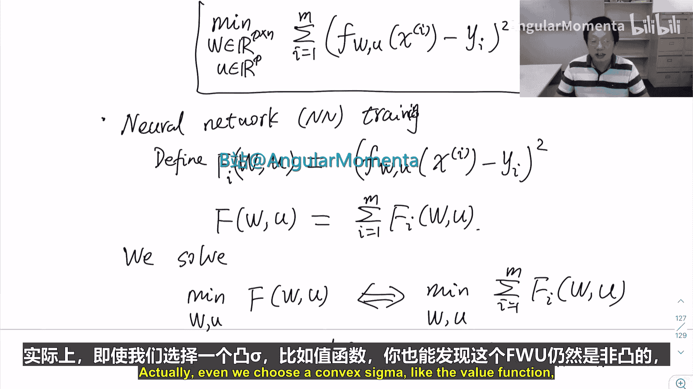

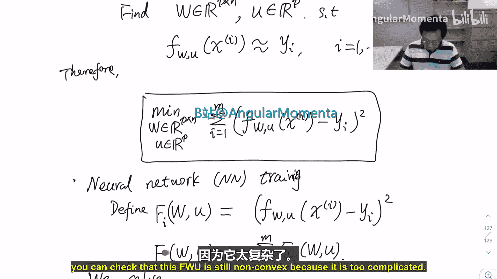

In general， even your sigma is convex， our capital F function cannot be convex still。

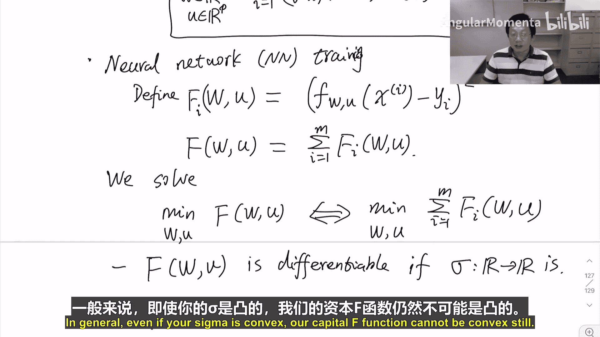

The non complexity of FW gave us some obstacle in the training of the neural network。

Because so far we have learned only the gradient decent algorithm for the gradient decent algorithm。

 we know that it will find zero gradient。But for non convex functions。

 zero gradient does not mean the global minimizer。0ero gradient can be a local minimum。

 can be a local max， can be a global max， can be a saddle point， can be nothing。Therefore。

 greeting the des。Orange。几迪。It's not a guarantee。To find。The global minimal。

For a non convex function。A surprising fact in deep learning is that gradient decent or isvariant stochastic gradient descent still gives us a very good solution to the optimization。

Though it is not a guarantee that we will get the global minimum。In practice。

 if we apply the gradient de or stochastic gradient decent directly to that problem。

Then we can still get a very good solution。 The solution is still very close to a global minimum。

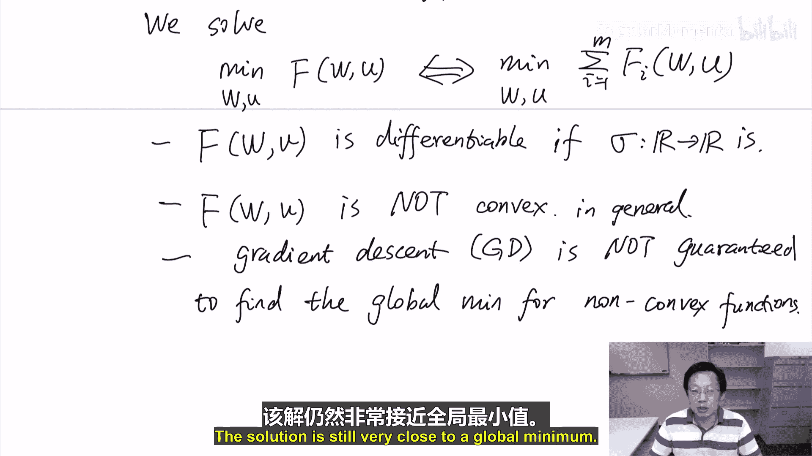

It is still unknown why gradient descent or stoastic gradient descent works so well for neural network training。

It is severe， and mysterious。Actually， many researchers are making effort to give an interpretation on this phenomenon。

It is still a very hot research topic in the theory of deep learning。 Of course。

 deep mathematics will be involved here。

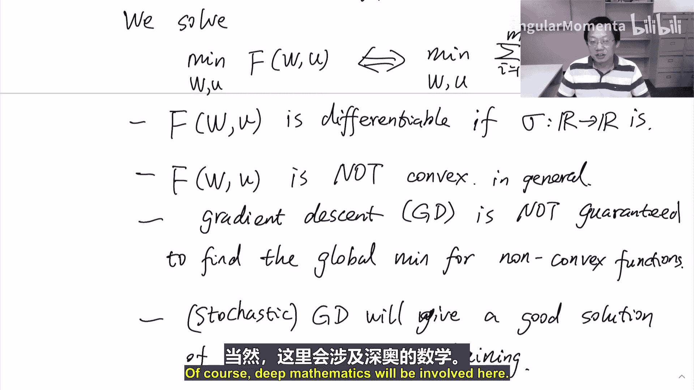

Anyway， we just apply。Griing de to train the neural network。

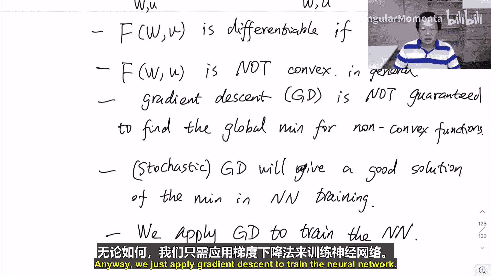

Therefore， we needed the gradient of。F。At a W you。Now， since this F contains two variables， W and U。

We can show that this gradient of F is just a combination of the gradient of F with respect to W and that with respect to U。

Here I used this notation to denote the gradient of F with respect to W only。And U is fixed here。

And similar to gradient you。

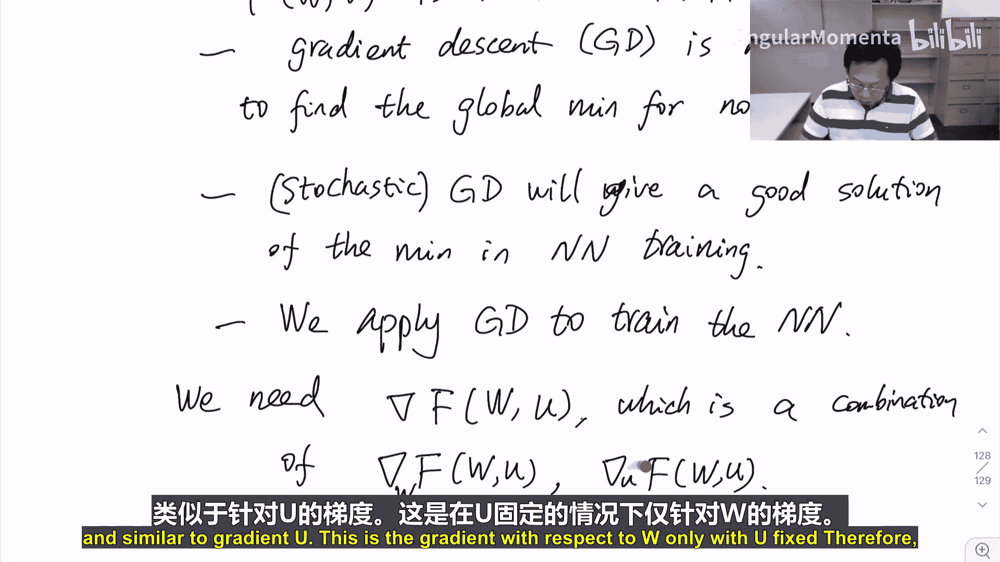

This is the gradient。With respect to W only with。You fixed。Therefore。

 in order to find out gradient of F， we only needed to find out gradient WF and gradient UF respectively。

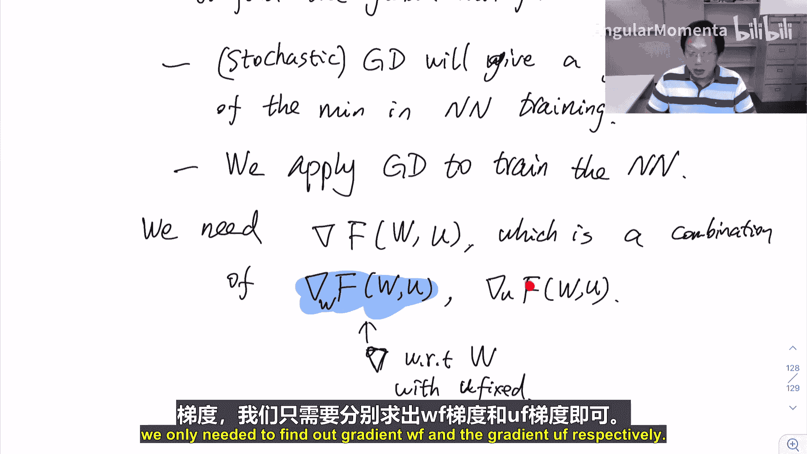

Furtherther。Because F。Is sigma I from1 to MFI。By the linearity of differentiation， we have。

Grient F or gradientient W F is only the sigma of I from 1 to M gradientient WFI。Similarly。

 gradient the U of F is just sigma iPhone 1 to M gradient the U of F。Thus。

 we only need to find that gradient W of FI and gradient U of FI。

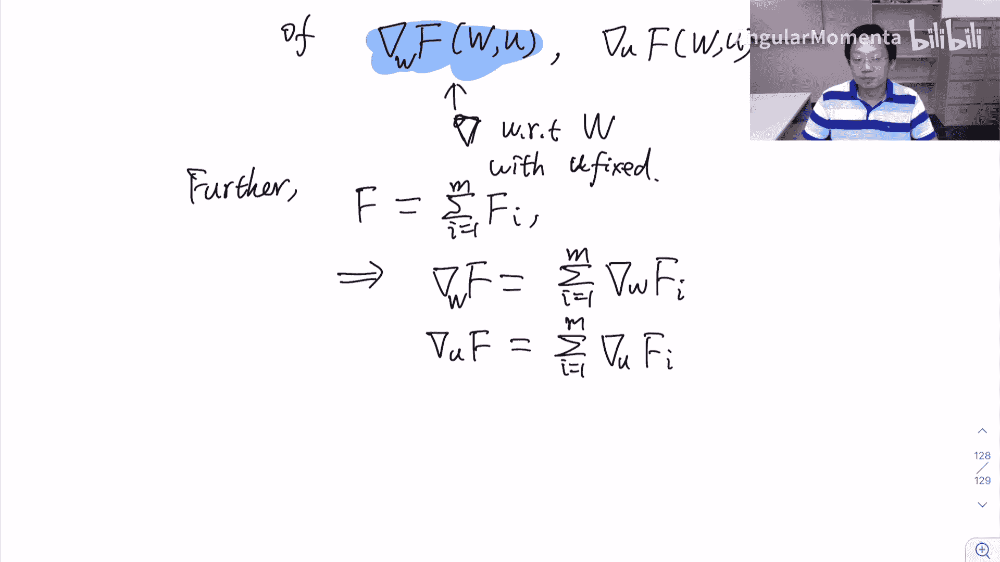