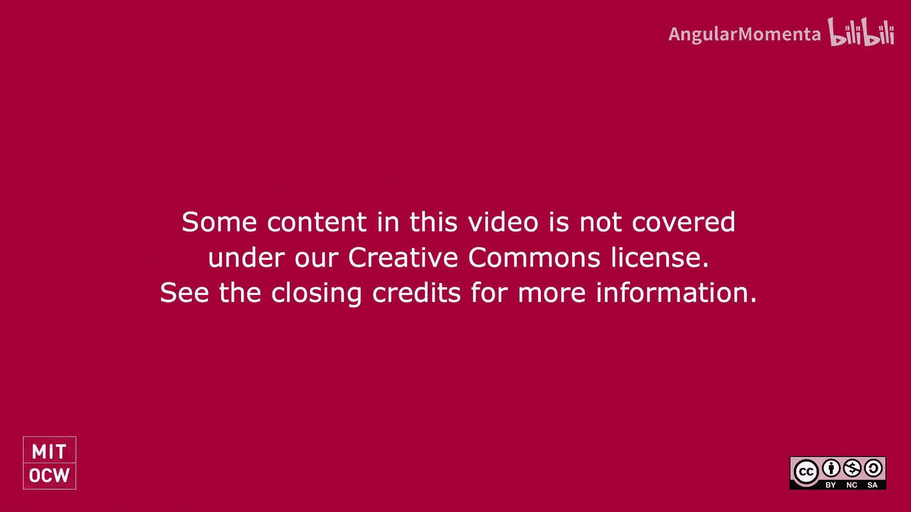
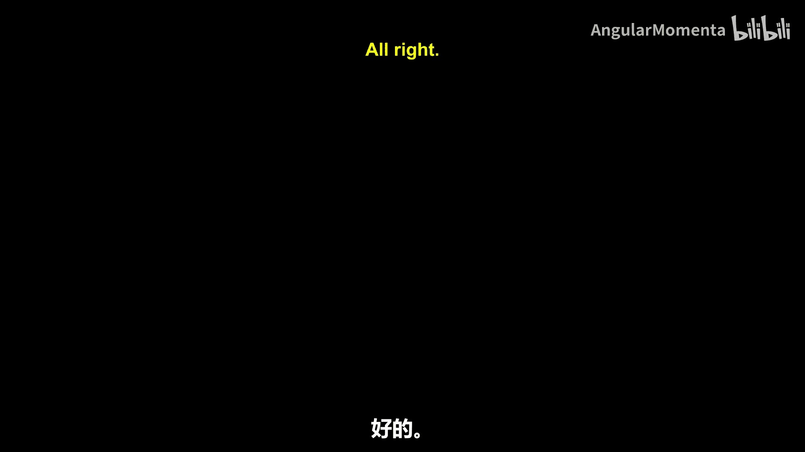
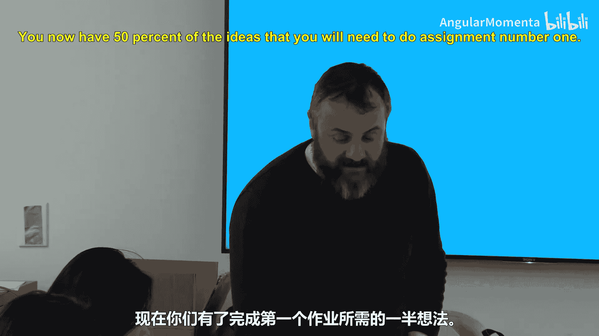
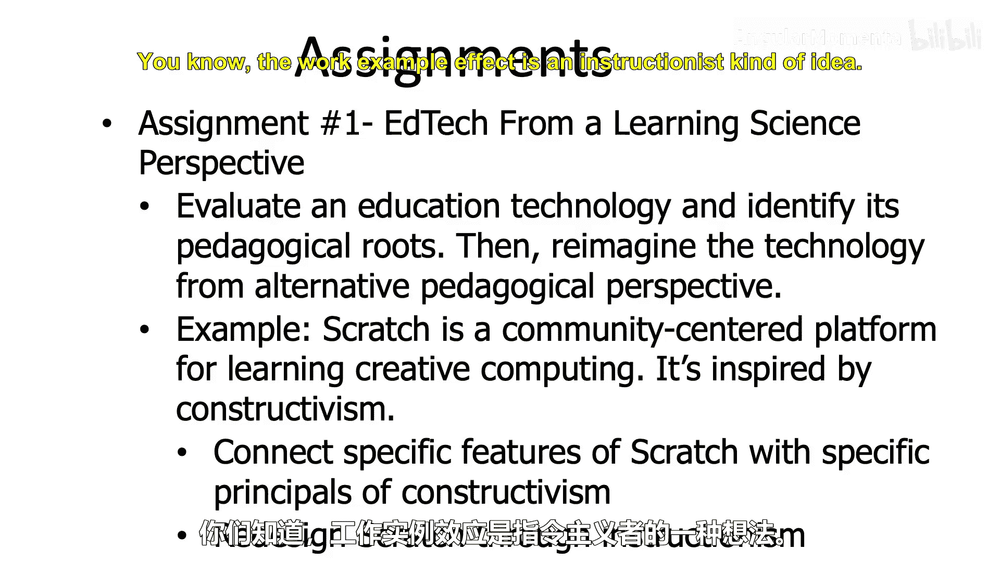

# 【麻省理工】学习、媒介与技术 ｜ MIT CMS.595 Learning, Media, and Technology, Spring 2024 p01 02. 人们如何学习——认知负荷理论 -BV1DKUSBGEvu_p1-

Why don't we get started。 Nice to see you all。 So the thing I asked you to do in your learning journals for today was to do a little reflection on your personal ed tech history。

 So what are tools， experiences， platform， systems that either had some like very positive effect on your learning trajectory。

 like discover love of something because you did that or were terrible and disastrous。

 they ruined your learning experience。 They made you feel bad。

 they inhibited your learning in some way or they were just interesting or engaging or useless or some other way distinctive。

 go ahead and now if you didn't do that assignment。

 you can probably still make up an answer to that question。

 So you'll be okay for today but turn to the person or two next to you get in small groups and just share a little bit with each other about this little snippet of your personal ed tech history。

 and we'll do that for five minutes or so and then， Does that make sense。 ready to go。😊。

Could they。Did did anybody happen to be in a group where multiple people in the group mentioned the same thing。

Were they all different。What what were the most similar ones。明明。

There was computer literacy class like similarity Okay good so there's like a class which is called like computer literacy。

 digital literacy is kind of like a pretty out like here's how to use PowerPoint here's a tie here's how to do like pretty simple things with computers good yeah that's a feature of a lot of different kinds of school systems。

😊，And was it successful in your environments or was it a drag？Yeah， good。 Yeah， yeah。 yeah。 you know。

 there， there can be there can be a bias that like， oh man。

 we gotta like put technology in the schools because the kids are gonna be really fired up about the technology in the school。

 no， actually， like， if you do boring things with technology。

 they're just as bored as sometimes even more so anybody have things that were like really positive experiences for them that somebody that you or somebody in your group talked about。

😊，like yeah， that was that was great that really made school better。 Well。

 I mean I talked about like the smart board and just like the implementation of it and like every classroom。

 I feel like especially as like our generation was growing up and like I don't know like I made like a little like sign story about how like that's the first time I felt like the student became the teacher because the old ladies at our schools like didn't know how to like recalibrated or like turn it all on so it was always the students like coming up and showing the teacher how to use it Yeah yeah yeah good is this sort of inversion of expertise。

 how many of you were in schools where smartboards just kind of appeared in the middle of your educational trajectory Yeah you all are like in this sweet spot how many of you would say that they were at schools where you felt like they were very effective where they substantially improve learning。

you thought yours good。 How many of you were at schools where like this is like no one is using these things。

 they could have just bought chalkboards or whiteboards or things like that。 Yeah。

 so overwhelming majority of that smartboards were like a totally fascinating case study a vast amount of money was spent on these tools that seemed to have essentially no positive impact at all on learning in lots of places they really weren't used as like interactive whiteboards they were just like like a whiteboard you know Kahalil and I were joking that。

That they actually didn't work very well in his school in particular because they require like slightly different lighting like。

 like， you need to dim the lights a little bit to be able to see them。 But you know。

 the classrooms they were built were not built for dim ofable lights。

 They were built for lights that would be shined on whiteboards or chalkboards。

 And so like the rest of the， there was a whole bunch of the rest of the infrastructure that didn't make smart boards work。

 Like maybe your classroom didn't work。 Maybe there was no training for your teacher。

 Maybe there were no curricular materials that were available to integrate with a smartboard。 Like。

 And yet， you know， like。😊，Like how is it the case that we could be in a room of people all across country。

 all across the world。 You all raise your hand are like we all bought smart boards and they all didn't work。

 Like why didn't the first people who bought smart boards be like team。 This is not a good idea。

 like spend your money on something else。 every dollar we spend on education technology has an opportunity cost。

 Every time you spend a dollar in a school， You're trying to make people's learning better And there are very few dollars that we spend to make learning worse。

 So they may feel like the smartboard like actively like made you dumber or learn slower or something like that。

 Probably not like probably it's probably the case that no one many of you were harmed by smart boards。

 I think that's pretty unlikely。 But every dollar your school spent on smart boards could have been spent on some other technology on some other curriculum material on art supplies on professional development for teachers on a zillion other things which could have improved your learning experience and not just been like a very expensive version。

😊，Of a whiteboard or something like that。 So there's a lot in that discussion of smart boards that I think is helpful for us to think about how you know not not just of the efficacy of any particular technology。

 the efficacy of any particular technology， How particular technology is sit in different kinds of places at least one example from Dana whos like。

 no， these things are great， like we bought them。 Our teachers got trained with them。

 students were able to help use them， like it worked in that one context， even if almost universally。

 it didn't work in these other contexts。 So those are all things we're gonna have to unpack and figure out。

 And then we're also going sort of answer this question， like if there's this thing。

 which like overwhelmingly doesn't work。 why did schools spend so much money on it。

 Like what were the incentives， What was the logic， who is spending this money。

 all these kinds of things or questions we can keep asking anybody have like like disastrous stories that's kind of like a banal like weird。

 that thing didn't work。 But anybody have like man。

 this was terrible kind of experience with technology。Toward Smartboard， in one case。

 students were able to install like so they can customize the brushes。诶。The student just shows like。

kindind of an awful picture of a teacher to put as a brush and as a kind of a prank on them。

 which is， you know， technology allows you to do more。Creative pranks。

Good yeah yeah so expanding our way of humiliating faculty actually one in seventh grade my school everyonero but in seventh grade like everyone is not really mature in class like everyone would game it was like a snake I game or a paint I and the entire class of the other game like the teacher was teaching so then they would have to block different websites but like a new website would appear every week they just to but yeah like blocking websites is a good way to teach young people how to use VPNs if you were like I want to teach young people how to use VPNs and like blocking websites is pretty good but I wrote notpa once years and years ago like just after I was teaching by 2006 or seven or something like that where I described them as Nehigh fences around the internet that adults trip over and young people just jump over good yeah so so here's this tool which actually now is like Kemberg are pretty ubiquitous in schools there are plenty of places。

where there's pushback against these kinds of technology people telling just the story that you described our devices are canonically designed to capture our attention as much as possible and particularly like capture our attention and ways that have us look at advertisements for people who are designing phones and computers and websites and things like that that is like a central focus like how do we get you looking at this thing as much as possible and in particular how do we then get advertisements to slide in front of these things so that people will pay you to look at this That is not a set of characteristics that are good for a learning environment but the other hand I'm sure some of you may amend them。

 but we can go to schools where Chromebooks are implemented and the kids are not playing snake I all day because they're doing like interesting learning activities that are well supervised that would not be possible without the Chromebook without the apps without the access to the internet and things like that so we could also think about what happened in your school that had this kind of purchase and then there was clearly not the rest of the infrastructure in place to have that purchase be meaningful Where the exact same。

V in other places was supported by professional learning and curriculum and like all the other things that might have potentially made that a valuable learning experience。

嗯。I was talking to herman and I think we had a bit of a different experience from most of the people in the class because who didn't do our basic learning in the US so be fun to do。

I think we use technology to much lesser expense extend than here so I remember there was like one significant experience for me in terms of using technology growing up which is going to the lab to do English classes and I think it comes to your point of like having a purpose to having technology and that was very clear like。

You can't really do the me and speaking exercises unless， you know。

 we actually have something to listen to and something to repeat and like each person would have time with their boot where they could practice by themselves so I think the fact that it was very purposeful and that it changed from the day today that I think also theres an aspect of like。

We're going into the computer lab， we're doing something different Yeah that's floor a different。

The fact that it's different made it much more interesting and when technology gets to this very common place。

 you don't even you take it for granted like you don't really value all that it can bring so yeah discuss I mean those kind of language classes are a great example you probably all have taken language classes where like the teacher goes around and you like each say hello to the teacher in the foreign language and it takes like 10 minutes to let everyone say hello once you all went to your individual booths and you could imagine designing technology where every person simultaneously says hello and some algorithm evaluates whether or not you say hello correctly and then it says something back to you and other kinds of things you' like wow wow we each are getting our own teacher and maybe isn't as good as the human teacher but all of us get one at the same time that's pretty cool。

I would say like adding， I think。To what you said of the purpose。

 it's also like you went there to do that。Practice it wasn't useful for any extraordinary reasons。

 something like' like Chromebooks like I have a younger sister who's in high school right now and all her homework has to be submitted on like campus or something and then she also just loves like watching YouTube and stuff and then my mom's problem is like I can't remove her technology or live her technology because that lives her schoolwork so what do you do like you can't control her like what she's doing not only that but the vast majority of how we learn to be parents is by observing our own parents and this you know you know parents are roughly my age。

 a little bit younger certainly the next generation coming along we can't turn to our own childhood examples to figure out how to navigate something like this it's very difficult to come up with like good parenting strategies from first principles like a professional parent or professional caregiver getting training and things like that like what are you supposed to do and it' I think a lot of school。

You know， schoolwide infrastructure has a bunch of unintended consequences。

 the idea that like at night we're gonna lock kids into their devices。

 you know like that you know and it can also different different by kids so for kids who have like really good executive function who can be like I'm gonna to do all my homework and then watch the YouTube videos like maybe there's cool different things that we could do with the computers but for kids who are like you know yeah its like do homework on the machine。

 which always has YouTube on it like literally you're one click away from really fun things all the time。

 but like you know do your quadratic equations really it's nuts right like like there must be millions of kids who cannot like are not good at that。

😊，I think kind of add on that fact I was also went an international school in Ethiopia and it was a really interesting experience of how rules around technology would change almost like on a weekly basis at some point it was like at some point likeney's any social media and phones werepan and then they're like I think's call your parents though you can call them and then it was like limited time and then like VPNs came and then it was like it's always so interesting of how like teachers and faculty would always try to make new rules and each time they would have to get broken or something that have to change and I think it was always almost like a comedy show of how much it changed throughout this time when internet filters were first widely introduced in schools one of the problems came up as the vice president at the time was a guy named Dick Cheney and there are a lot of searches that were filtering out Dick but you need to figure out about Dick Cheney so then like someone sets a rule。

 the rule isn't right for the context GP。Another set of things right now that people are doing with tons of rules about these are good things we're going keep talking about them。

 I'll take a break here so we can move on to some other things。

 but you all have valuable case study experiences from your time in schools that we can bring into our conversations together to think about what you know how new technologies operate to。

Do a good job of making sense of technologies。 We need to understand a little bit about how people learn。

 So we're going to spend two classes looking at two pretty well established contemporary philosophies。

 pedagogy sciences about learning Today， you read a bunch about cognitive load theory。

 I'm going to ask you to do another exercise， actually in the same groups that you were in would probably be fine for this one。

 I want you to draw of visual representation of what the authors of the cognitive learning of the cognitive learning theory。

 articles you read and other things called human cognitive architecture。

 Like what are the key sort of components of the brain of thinking of memory in order to have learning happen。

😊，Another thing that you could draw in this visual representation is based on this human cognitive architecture。

 there follows a series of instructional principles。

 There follows a series of like better and worse ways to teach people。

 And so you could also try to illustrate how this human cognitive architecture。

 leads to different kinds of instructional principles。

 So groups can either go and take a chunk of whiteboard and use some of those whiteboard markers or part of why I'm doing this is just I really like this paper。

 but it kind of got folded。 So I just want to get rid of it。

 but you can take one of these and sort of huddle around on one of the tables and draw。

 So if if you're a paper person， you can draw on these and then stick them up there in a few minutes。

 if you're a whiteboard person you can do that。 we still have all these markers here。

 I haven't given you totally clear instructions in part because what I want you to do is to figure out how to think through some of this on your own a bit。

 but get in your groups， talk with each other about what you think are sort of the key components。😊。

Cognitive load theory and the human cognitive architecture that sort of leads to cognitive load theory。

 And don't go more than like two minutes before starting to put pen to paper。 you know。

 you're not gonna be graded on whether or not you're right。

 But let's see if we can get a couple of different representations of of what these folks are talking about。

 how people learn and based on how people learn， how should we instruct them。

 Does that give me enough to start messing around for a little bit。 ready to go。Okay。All right。

 what you've seen a couple of these now， what are some like what are the main building blocks of this model of a brain。

 What are the key features of human cognitive architecture？

I feel like almost everyone had like working memory long term Okay。

 two big pieces here that are important working memory and long term memory。

 what are some of the characteristics of long term memory？It's cool long memory Okay。

 so we store stuff in blocks， when you want to talk some more about what these schemas are。

 that seems important。It's kind of limitless。 It's limitless。 That is bonkers。

 No one has discovered the boundaries of the amount of stuff you can store in the human brain。

 You like you have a finite amount of spaate， like you have a finite number of ounces。

 you have a finite number of neurons。 that there's a lot of them， but a finite number。

 And as far as we can tell， there are no， known limits to how much stuff you can store inside your brain。

 That's amazing。😊，That is an amazing feature of your brain。

 Anything else that seems important about long term memory， all the stuff can be there。 How cool。😊。

It also unconscious。You yeah， you cannot think about all those things at the same time。

 It is unconscious。How long does stuff stay in there。It falls out right， You forget stuff。

 Like if you're interested in learning。 the fact that you forget things is really important。

 So stuff goes into long termm memory。 It leaks out into longterm memory。

 Some of the very earliest experiments in psychology again by the guy named Ebbing house。

 We're about the forgetting curve。 It was a psychology experiments that were mostly， as I understand。

 he mostly did by himself。 He basically like tried to remember stuff and then test himself and then saw how often he forgot things and notice that there were sort of mathematical properties to the forgetting curve and things like that。

 All right， longterm memory。 It's it's functionally limitless。

 It's unconscious So we can't directly access it。 We can put things of different levels of complexity in there。

 What schemeches do is allow us to sort of aggregate information elements into more and more complex kind of things。

 What are some of the key features of working memory。😊，Very limited。

 about how many things can you hold in your working memory any given time， give or take？

In his article didn't emphasize it。 Most people know this。

 It's kind of like a fact that is out there in the world。 like 7 Yeah， for a long time。

 people thought it was 7， a better guess seems to be even less than that，3 to 5。

 but somewhere in the very， you know， So here's another beautiful thing about like。

 you all come from all different parts of the world。 You can look around this room。

 And you can see that you're different in all kinds of ways or different genders。

 you have different skin color， different hair color， eye color， all that kind。

 All of you have essentially the exact same working memory。😊。

All of you can hold3 to5 things in your head。 It doesn't seem to decline as you age。 like。

 there's other problems with aging， things like that。 But people of all different ages， everyone。

 every human you will ever meet the 8 billion people on this planet。

 They can all hold 3 to 5 things in their working memory at any given time。

 It is like a beautiful thing that unites all people on earth。

 is this common feature of cognitive architecture。😊，How do you， how do you， how you。Get or like。

 like， what are the， what are the things in working memory。

 How do you get them or access them or do something with them。

I was gonna say like as much as we can only hold like three to five things like those things you can say like like schemas and like they can be super complex and that's how you're able to like solve really hard problem so as much as like like the example of the restaurant like you have like the chairs and the tables that's like the basic things and like the food that you eat in the workers like all these things make up a restaurant which are like super confusing but your working memory just knows it as this like really large like one object and so in your working memory mind that's only one thing but's really a compilation of like hundreds of things Yeah good so we can organize sub thingss into larger things and schema the reason why we're using inrecise words I would say is in part like you know this is not the revealed you know word of the creator about your brain this is like the best models we can come up with and our models aren't perfectf like what exactly is a thing in working memory I think it's a little bit sketchy how much our understanding of that？

However， even with sketchy models like we can still do useful things on let's do a quick working memory exercise。

 do any of you speak Sanskrit？Oh wait， I can't do。 I can't show you this just yet。 Well。

 here's actually， I'll do these first， and then I'll show you this next thing。

 grab a piece of paper and a pen。 You can， if you don't have a piece of paper and a pen。

 you can pass that around here， too that I really like。😊，This one， I think。

 illustrates really nicely the idea that the working memory is the bottleneck。If you are an educator。

 one of the main things you're working against is people's limited working memory。

 If people had huge working memories， you could like tell them all kinds of complex things。

 Youd be like， let me just explain everything。 And they would be like， great。

 Now it's all in my longter memory。 But you actually can't do that。

 People can only attend to a small number of things at any given time and for novices。

 those things that they attend to are necessarily going to be simpler than for more complex people。

 So feel for the people in cognitive load theory as they think about instructional environments。

 the bottleneck of those instructional environments is the limits of your working memory。

 anybody read the swell article or anybody remember how how cognitive load theory got started to begin with。

 what was the sort of canonical experiment that got John Swer kicked off onto cognitive load theory。

😊，I feel like making a student do some kind of weird math。

 like adding and trackinging and multiplying things。 Yeah， yeah。

 So you saw the math from you're given a number A and number B。

 and there's only two operations you can do。 It's something like you can multiply by three or subtract 69。

 Those numbers aren't exactly right。 But those are the only two operations you can do。

 And somehow you have to get from number the first number he gives you to the second number you give you People do multiple forms of this problem。

 It turns out。That in every， every solution is always alternating between these two things。 Ad 69。

 multiply by 3， add 69， multiply by 3， add 69， multiply by 3。 Nobody notices this。

None of the people inhibit， maybe not none。 Very few people in the experiments notice this pattern。

 This is deeply troubling for John Swer， because John Swer is in a moment in math education where people are like really big on problem solving。

 really big on discovery， really big on intuition。 And he's like， my guys。

People are not they're not inducing the key principle that's here。

 like they're doing a kind of mathematical operation。

 but they're not figuring out the important thing here。 Like。

 think about how much consequences that has for math instruction。 you know。

 they're solving the problems correctly without understanding some key feature about how you solved them correctly。

 That's bad for mathematics instruction。 And then he comes up with this theory。

 Like why weren't they able to do that。 And he describes it as that people do this thing calls means and analysis。

 They're constantly looking where they are。 And thinking about what would get them to the next step。

 If you're constantly thinking about where you are。

 where you want to be and what might the next step is。

 those are like three things to block up your working memory。

 And so now you don't have a whole lot of working memory left。 And you know。

 his theory was that people like essentially filled up their working memory。

 Their working memory was like at capacity。 it had over there was too much cognitive load。

Too much cognitive load on the working memory。 And so they couldn't figure out this underlying principle。

 And so swellers， you know， and then he just gets fascinated for the rest of his life about thinking about what is the human cognitive architecture。

 like where is the cognitive load， Where are we overbured。

 Where are their bottlenecks and what would be instructional designs that would help us relieve those bottlenecks。

 work around those bottlenecks。In particular， really skeptical of this idea that you just like give a bunch of novicees stuff and they can kind of figure it out on their own。

 you know， with enough time， enough exploration， things like that。

 So that's a bottleneck here that I really like。 And I really like this picture that has this sort of infinite long term memory。

 I mean， in theory， you should just go up forever。 But it's big enough that works。

 A nice thing about this one on the side。 is it notes that。😊，The where does。

 where does stuff get into working memory kind of from two places。

 You can pull it out long term memory。 You can remember stuff。

 and then you can put it temporarily in a long termm memory， or you can attend to it。

 You can see things in your environment， you can watch stuff。 you can read things。

 you can listen to people and talk to people as I'm explaining things to you now。

 you're taking these constructs and to the extent that you're listening and attending to them。

 you're putting them in your working memory。 if we mess around with them enough。

 if we get you to apply them， Think about them。 if you write them down some other stuff like that。

 it will eventually get stored in your long term memory。

 And then there's this nice piece here that like stuff sort of not only goes from working memory to long termm memory。

 but things kind of fall out and get forgotten。 And， you know， I think pairing these words together。

 When stuff in working memory get stored in your long termm memory， They call that learning。😊。

When stuff in long term memory gets put into your working memory， when you become conscious of it。

 we call that remember。 That's kind of nice way of sort of summarizing that there are。😊。

One in this model。Everything that you learn essentially is kind of a fact that you remember。

 There's a great quote by Daniel Willingham， who's a psychologist that memory is the residue of thought。

When you think about stuff that you remember and in this model。

 people tend to think of the things you remember as discrete facts。

 you can probably think about and the accumulation of those discrete facts is what leads to expertise that understanding is in a sense of the accumulation of lots of these facts。

 There are probably some domains that you can think about where that model feels really good and makes sense like oh man。

 youre like man that person is a really good economist because they just like know a ton of stuff about e and they know a ton of facts about es and they remember lots of different calculations。

you know， like， would you say that Maya Angelou was a great poet because she had way more facts than other poets do。

 That seems like a sort of unsatisfying description of how people become great poets。

 But something to sort of wrestle with and think about a little bit。 Okay。

 you have your piece of paper with you。 I'm gonna show you a phrase。And I want you to copy down。

 I'm going show it to you for about 10 seconds。So hold your pens up in the air。

 You're going to look at this thing for 10 seconds， and then I'm going to take it off the screen。

 and I want you to copy it down。 Okay， ready。I want you to copy this down， look at it， memorize it。

Look at it， five， four， three， just this row， you don't do that one， just this row in the middle。

 two， one， copy down as much of that as you can。All right， and three。2，1。Every hold up what you did。

 show it to each other， how did you do。Oh man， these are these are a little bit disappoint。

 All right， let'， let's do a second one。 Let's do a second one。

 Let's see if you can do any better for this。 All right， I'll help you。

 you might feel better about this one。 I'm going give you a set of writing now that has roughly the same number of marks in it。

 It's not the exact same number of marks。 But one of the things we can do to calculate how difficult this is。

 is to just like count the number of marks on the screen。

 I'm going give you another thing like this with roughly the same number of marks。

 Let's see if you can do any better。😊，I want you to look at this and then get ready to copy it down。

This English phrase in the middle， ready， five， four， three，2， one， okay， copy it down。Oh。

 you fished already。We were really good at that， good。呃。Why were you so much better at this one？

Yeah yeah yeah。 though you have those squiggles are organized into schema。 When you were very。

 very young， you observed these English letters。 Actually。

 if you learned English in the middle of your life。

 whenever you started learning English like just now， you observe these Sanskrit letters。

 for those of you who are native English speakers， you can't remember the time probably in which like there would be no distinguish distinction between English letters in Sansriit letters。

 So when you were copying down Sanskrit， none of this has any meaning to you。

 So you're like literally memorizing the order in which these lines appear which is really hard because there are lots of those lines。

 there's about the same number of lines， I haven't actually measured this， close。

 But you know that that two combinations of line is an L。

 And you know that an L and E and a T is a word let that has some kind of meaning。

 And you can actually like let the entire world be happy。

 even sort of bundle that into kind of a phrase that you can memorize in your head。

 And so copying down that number of。😊，hI trivial because this is organized in your head in like a tightly bundled schema in a way that you have no schema for understanding these kinds of things。

 Probably like the first thing you started putting in your schema was like， well。

 there's a line that goes across there。 and then a bunch of things that drop down after that。

 I don't know anything anything about Sanskrit。 Does that give you I that an illustration of like how schema operates in your mind。

 This completely overwhelms your working memory efforts。

 because you have to recall the orientation of each individual line to be able to copy it。

 This does not at all do that because you've already bundled those lines into schema。

 Another famous example， which I think is written about is that chess masters。

 when chess masters look at a chessboard。They can like all of the pieces。

 they can remember easily all of the pieces in their arrangements。

 because if you know nothing about chess like me， you have to be like， okay。

 the pawn is in the second row， black square。 And the king is in the first row， white square。

 And the bishop kind of moved over here。 But that's not what chess masters are doing。

 Cheess masters are going like， oh， that's the， you know。

 the the Turkish armada gambit or something like that。

 And they've sort of bundled all of those positions together into one thing。

 So even though we can only attend to three to five things at any given time。

 Those three to five things can be enormously complex。

 And that's what lets us think about complex and difficult things。 Okay。

 that piece of schema makes sense for you。All right。

 so these are some pretty good fundamental models of human cognitive architecture kinds of things。

 anybody want to ask any questions or make any observations about some of these key elements？

How our brains work？I summer refer that there is like a read alphabet there's just like alternative to like writing in Latin in English so it just like one to word mapping between English or Latin to that alphabet and as a fun thing I just wanted to learn it so I did all of that like remember the mapping even though like hey if you showed me just like a glimpse of it yes I can tell you so it's not like a process of how long will it take me to remember but it was very hard to actually transcribe things fast from one thing to what I know it is but also as I did that more I started to like。

I started kind of like to remember how I learned English as well with some of like the scggs。

 for example， at the end like that says IG I started kind of internalizing that So whenever I saw like that kind of structure of whatever shape these characters and of oh yeah I know that's I I don't have to think individually about each character I started to like chunk them more and more into specific components that makes times cognitive things much easier Yeah ING is a great example of what it probably requires you know five different line strokes or something like that line do1G something like that and then eventually you bundle it as an in and just memorize those characters together and then eventually you realize it's a gand and it has a particular kind of modification to verbs and things like that and you're not even thinking about it now when you look at the word jumping but you went through a process of sort of learning all of those kinds of things Okay good So based on these models of human cognitive architecture。

Some of the key kind of instructional consequences that come out of this model？

If you overload the working memory， students cant store the necessary information long term memory Good so what teachers should be thinking about in summer in this model。

 which you usually been about all the time is like how much cognitive load。

 how much stuff is in people is like being like could potentially be overwhelming people's working memory what are some ways to conduct instruction that respects this bottleneck of working memory。

 what are what are some effective strategies for dealing with that guided practice is one of them that I saw or it's like a completion exercise because then it's not completely novel to you and you have more。

You can basically abstract order。Ideas into schemas that are kind of bigger and then execute them much faster instead' just focusing on the smaller。

That problem。Good， so， so guided one version of guided practice。

 know probably one of the most well known phenomenon in education psychology is called the worked example effect。

 And the idea is， if you show people，How to solve a problem for novices that is a more effective way to learn it。

 than have them just try to solve the problem。 that a pretty typical instructional sequence that works pretty well is first。

 you do a worked example。 You say this is how you solve this kind of problem。

 Then you would take parts of a problem。 and have students just do those parts。

 That might be a kind of guided practice kind of thing like， okay， you know。

 you just factored this polynomial and it took you four steps here And the first thing I did is I just showed you those four steps。

 The next thing I'm going to do is I'm going to show you three of those steps and have you do one of them。

 I just showed you a canonical way to write an introduction paragraph。

 Here is an introduction paragraph。 That's three quarters written。

 It doesn't really have a good hook。 write a sentence that would fit in this paragraph that would be a hook that engage the reader。

 You don't have to do everything else that an introduction has to do。

 You don't have to introduce the topic because we've already done that。

 You don't have to lay out an argument。 You don't have to establish your expertise。

 Just do this one thing。 And then。You can imagine like， all right。

 instead of if it's a fourstep process， then you'll do two of the steps。

 then you'll do three of the steps， then eventually you'll do all of the steps and you might alternate which of those know do a bunch of one step know missing problems where the one step that's missing in sort of different phases in there but we're gonna sort decrease the scing and the ideas is that you get people in their working memory just to attend to that particular thing they're trying to solve to store that thing in the long-term memory and as they have that more in their longter memory and access it as they start seeing the relationship between different steps as they start their schema for an introduction is not like wait what it's the hook and then the thesis and then my expertise is that you you start like recognize those things as an introduction and that sort of takes up less space within your working memory。

So they call this the completion problem effects， replace conventional problems with completion problems providing a partial solution that must be completed by learners。

This list came out of Ser 1998。 All of these things get constantly tested and improved。

 So one thing that people realized is in effect， which I think is not on this list called the expert reversal effect。

 But I think it shows up in some of the readings that you did which is that for novices。

 the work example effect seems to generally speaking hold true for experts in a domain。

 Openended problem solving does seem to work better then just going through work to examples。

 So once people get good enough at a thing It's a good idea to let them solve openended problems。

 presumably because their working memory is not overwhelmed。

 They're not overwhelmed by cognitive load figuring out what they're supposed to do。

 And so it's a chance for them to refine their abilities to apply things in different domains to get better particular portions of things。

 stuff like that。 Now what is a novice and what is an expert like know that is different in every domain。

 and you it would itll be different in nuclear engineering that it is in poetry or whatever else is。

 But like generally speaking， these are things that sort of seem to hold。😊，U。

How do these cognitive load theorists conduct their research？

How do you you if you're a cognitive load theorist。

 how do you establish that an effect like this is true。What kind of research methods would you use？

Well， you could do one where you just like directly ask the person so they like have their own just like understanding of like what they're able to handle or like you could like set up the problem so that you can just see directly from like the work that they're able to do like how well they're。

Like cognitive load is being held。Good， so one question that cognitive load theorists will be interested in is like when when do you feel overburdened by cognitive load。

 It's kind of interesting that people are actually quite lousy at selfassesing their learning in all kinds of ways。

 There's a classic study。 I don't think we'll read about it。

 where people assess their baseball knowledge and then take a test about baseball。

 And the results are like the most perfectly spread scatter plot you've ever seen There's basically like no relationship at all between your self-assesment of your knowledge and your actual knowledge of things。

 So this is one this is one of the real challenges in cognitive load theories that we're not really aware of our own cognitive load。

 We're not really aware when we're encountering desirable difficulty。

 which is like giving us a good amount of challenge versus undesirable where our cognitive load is our working memories overwhelmed and we campaign't building。

 So people have tried to do work along those lines。

 What are some other ways of assessing whether or not an instructional effect is better than another instructional effect。

😊，Yeah we think。In one of the papers it talked about。Like。

Physiologically measuring the cognitive load just by like using heart rate and things like that。

 skin conductance， other kinds of things that like。

Veryry unreliable like measure Yeah yeah yeah knowing knowing knowing when people are working memory over mean it's of funny this is like the heart of the theory。

 like how do we tell when you're working working memory are and it's like pretty hard actually to tell know we don't have a great grasp of like how many there's some kinds of exercise we do which especially like really simple problem solving or puzzle kinds of things where you can like really tightly control how many elements are in working memory。

 but if you're like actually trying to teach something someone in the real world like the Kreb cycle or something like that like how many things are in working memory they in time is a lot harder So a pretty common set of methods that they'll use are experimental designs in which you have one group be a control group and then you have another group be an experimental group you measure people's skill at some in both groups。

 you measure people's skill in some kind of baseline So you say you know we're we're gonna design you know we're gonna go into a math。

 a school where they。Typically use a lot of openend problem solving and we're going to instead have the teacher just do stuff using worked examples and we're gonna to see whether the worked example condition is better than the business as usual condition and in fact。

 to make sure that there's no difference between the kids who get the regular condition business as usual condition。

 the kids who get the work example condition， we're going to randomly assign the teachers we'll get 20 or 30 or 40 or 50 teachers sign up for the study half of them will do the old thing。

 half of them will do the new thing we'll measure all the kids skill at baseline and then we will measure the skill from the groups afterwards so you know if this kind of model works。

You know， like the two groups at baseline in any group， there's gonna be a distribute。

 I we're gonna to teach you how to factor polynomials or you know add single digits or conjugate Spanish verbs or whatever it is。

 But in any given classroom like， you know， there should be a distribution of skill， right。

 Some people are having hard time with it。 Most people are doing fine and some people are doing really good at baseline。

 these two groups should be identical， right， because we randomly assign your teachers to two different groups in random assignment is magical And people。

 you know like every once in a while， it doesn't work。 But for the most part。

 like the two groups should be the same。 What should happen afterwards。

 is that now here's something that makes learning research really hard。

 what kind of learning will like learning will happen in both conditions。😊。

Right almostmost everything we do makes people learn somewhat like there are very few things that we do that werere like。

 boy， that was completely ineffective。 Like even if we're not using the most optimal techniques。

 students still learn stuff。 So in the control condition， let's call orange control。

There's still at time two going to be improvement。 T1， T2。

 You're going to see this sort of distribution move。 What we want to see though。

 is something like this like， oh， we learned more in the experimental condition。

When we went from T1 to T2 and in particular， we're interested in like the way cognitive load therapists students this。

 they're particularly interested in averages。 like in general。

 are kids more or less better off having do this。 like this has 10 teachers。

 each of them has 20 kids has 200 kids。 This has 200 kids is one group you know。

 sort of better than the other。😊，Sometimes you can do some stuff。

 some of this stuff happens in the field， some of the stuff happens in laboratory kinds of experiments。

 one， let's see if。So this is a modality effect， which is kind of cool。

 replace a written explanatory text and another source of visual information such as a diagram with a spoken explanatory text and a visual source of information。

 It turns out again， we don't I would say we don't totally understand this。

 that your working memory seems to handle visual and auditory inputs differently。😊。

And so you have a little bit more working memory to work with if you're hearing stuff and looking at stuff。

 than if you're reading stuff and looking at stuff， why nobody knows。Evolution Hoos。

 that's kind of cool， right， So how might you study something like that？😊。

You take a textbook and you bring a bunch of students into the lab and you have them do some kind of textbook learning exercise。

 you measure them beforehand。 you measure them afterwards for some random half of the students who are walking into your lab。

 they probably are taking like a freshman site class and they have to do this for extra credit or something like that。

 And you give them the like auditory enhanced version of this。

 And if the people in the auditory enhanced condition in the modality effect condition， do better。

 Then you sort of like you didn't have to go all the way into the field。

 you didn't have to like recruit a bunch of teachers in real classrooms and things like that。

 you can sort study little bits of this in the lab。 But again。

 the thing that these folks are particularly interested in is changes in average effects。

 We sort of like in these models tend to assume that we're teaching stuff that everyone should learn It would be good if all the kids in my math class learn to factor polynomials。

 And we want strategies that on average have more of those kids learn more about factoring polynomials and other things。

 I'm sort of emphasizing this point because a bunch of stuff that you're gonna read for next class。😊。

Doesn't necessarily make those assumptions。 It's still about learning。

 but thinks about doing research differently and thinks about goals differently。Okay， here are oh。

 good。 We just did question number three here of things that I wanted to talk with you about。

Number one， we emphasize for cognitive load theorists。

 what is the bottleneck that they're most concerned with？Working memory。

 there's a limited number of stuff that you can operate with in working memory。

 so you've got to think about， especially for novices。

 how do you reduce the complexity of a learning environment。What is？And。

What are the goals of cognitive load theory， what are like the end states of proficiency？No。

But for a cognitive of low thest， what does it mean to be good at stuff？

Would it be to have built up a bank of schemas and be able to retreat them at any time？Use them to。

Work more quickly through a problem。It could it could be more quickly。 So definitely。

 I think the first part， I would say your spot on about that you have memorized a bunch of stuff。

 The stuff that you've memorized is organized into schemas of varying degrees of complexity。

 There' are some things that don't organize well into schemas。 But know。

 but we just memorize them anyway。 famous things that don't fit super well into more complex schemas are a bunch of Asian languages have characters that don't like have a lot of logic across them。

 Like you just have to memorize these things。 And there are a lot of them。

 And like like schemas will only get you so far。😊，But an important thing about there's no relation I think about this way。

 there's no relationship between sort of proficiency in the learning process like like what do cognitive load theorists think a really good surgeon is like a really good surgeon is both proficient at certain kinds of well- establishedablished techniques。

 but also flexible intuitive like a patient has cancer and you cut them open and it's some kind of know like set of physical problems they've never seen before。

 you know they don't want doctors who are like， oh。

 I must memorize the procedure and just do what I'm told， they want doctors who are flexible。

 They want poets and playwrights who are creative。 they want know teachers who are engaging and effective。

 like their vision of proficiency is the same as almost anybody else who studies teaching and learning just because they have methods that are sort of like it doesn't mean that they want people the rest of their lives trying to reduce the amount of working load load on their working memory。

 They want people who can do all of the things that we think expert should be able to do。

 but they say the way you get expertise。Is not to take a surgeon and be like。

 just get in there and start cutting people up and like， see what happens。

 Like you want to train them through a particular series of processes。 It has them， you know。

 memorize a particular series of facts。 Those facts can be assembled in knowledge or techniques or other kinds of things and then flexibly deploy those things they memorized to do good work in the world。

 So， so don't， don't confuse the way that cognitive load theorists want people to learn you know。

 which which can be like like pretty structured， have this devolving scaffolding。

 That doesn't mean that that's what expertise looks like when you get to the end of that process。

 We might teach people to be really good computer programmers through a set of work examples。

 but doesn't mean that we want computer programmers who just like copy things that they've seen in the world。

 We want those computer programmers to be flexible， creative， novel。

 inventive all those kinds of good things。😊，You read two other pieces that I didn't talk as much about。

 but we talked a little bit about Swer the story of a research program。

 that this research comes out of a particular historical context。

 which is people in math pretty fired up about problem solving。 And this guy。

 John Sweller being like， I think there are some real problems with openend problem solving。

 I think it doesn't do what we want to do。 And there might be better approaches to try。

what did you take away from the Michael Pershhan article。

 So Michael Perhan is a teacher in New York City， just teaches math to a bunch of different grades。

 and he's trying to make sense of all this research。

 What did you take away from the things he was trying to make sense of。

So the title of his piece is not a Theory of Everything。What did that allude to？

I could read the response I say， applying cognitive flu theory to cognitive flu theory and just like you know。

 restricting it to where it is， putting the boundaries。

 making sure we understand what it is and what is not。To make sure that when we're discussing that。

 we're not stepping beyond it and starting like confusing things together and not knowing what we're talking about。

 Good， So some of it is him saying like all right， like what like what exactly are these terms and how are they used have they mean no time When Mike Bn says not a theory of everything。

 What are some of the things that prominently， It is not a theory of。Yeah。

 why do you think so Michael Michael teaches math in a school in New York。

 why do you think motivation would be something that would be of pretty keen interest to Michael？

I think that could affect how likely people are to remember their content right。

 like if you're really interested， really motivated， that could affect。Yeah。

 I think I think you have a subtext of Michael's argument， which is like， my guy， you know。

 like your clogged working memory is not the problem I have。 my problem is my kids don't care。

 Like like if you're not actually interested and engaged and want to learn these things。

 who cares if you're， you know， like it's not a problem to be putting7 or 9 things in their working memory。

 The problem is they will put zero things in their working memory。 You know。

 the problem is not the bottleneck that appears here， the problem is you can't get them to do this。

 You can't get them to attend to anything。 I think there's part， you know。

 and and for him as a teacher， motivation is just a like a central problem of what he does every day。

 how am I going to convince these fourth graders in front of me， that it's worth learning this math。

 And that I think you know， reading between London。

 I think that's part of what feels really important。 Michael。

 And John Swer says this there he doesn't do that。😊。

This theory doesn't attend to issues of motivation。 you know， now， the good thing about doing that。

 And I think Michael comes to this conclusion in some respects is like， yeah。

 it's probably not a good idea for every theory to try to do everything。

 know it doesn't diminish the contributions of cognitive load theory to say it doesn't attend to motivation。

 but it probably should draw our attention to the fact。

 that working memoryary is not like the single bottleneck that exists in all learning environments and everywhere。

 They're all kinds of other bottlenecks that might be around。 Again。

 some of the stuff that we're gonna read about next week thinks of motivation as a very central issue as maybe like these central issue to teaching and learning。

 which doesn't mean that this other theory is better but that the theories that we have are just models。

 they help us sort of make sense， you know nobody actually understands how the brain works。

 Nobody actually understands how people learn that is sort of beyond on our。

 but there's a lot that we can know about it。 and we can build these models。

 which help us make good predictions， but they don't help us predict kind of everything。

The other thing that I think Michael's article is really good for highlighting is that these theories change。

 How many of you read in the original article about this thing called germaine load。Yeah。

 researchersers in cognitive theory have basically given up on germane load。

 like it was an idea they had for a while。 They were working on it。

 They thought it would predict some stuff。 They thought it was sping some stuff。

 And after they like I don't think this germane load idea is all that useful and people have more or less given up in it。

 So these theories are sort of constantly changing and evolving too， you know。

 the version of cognitive load theory I might teach this class 20 years now is't gonna to be the exact same as I would have。

 know in the 1980s when John Swer was just sort of putting these things together。

 some parts of it have sort of stood the test of time， I would say， particularly this idea。

 the idea of extraneous load seems to be enormously helpful。

 if you put too much stuff in front of novices， they won't attend to the right things and they won't remember the things you really want them to remember or they they won't be able to attend what you want them to do。

 But if you reduce some of that extraneous load and there are a bunch of like very specific strategies that we can use to reduce that extraneous load。

 some of which are very， very fine grained if there are multiple sources of information。😊。

Pictures and accompanying in text。 like， don't put the picture over here in the text over here。

 Put them in the same place。 And people will learn better。 That's great。 That's， you know。

 like think， think about how many people today in the United States。

 about 57 million kids in K 12 schools or 1s a million people in higher education。

 Like if all their textbooks got a little bit better by adhering to this principal like everyone would learn。

 you know， tiny， tiny bit more。 But， you know， amortized over 57 million kids going to school for 13 years。

 that could be a lot learning。 That's pretty cool。😊，All right， 220。

 what are the last things that I want to leave you with？You now have。

50% of the ideas that you will need to do assignment number one so again， assignment number one。

 which you should go to the syllabus and read is you're going to pick an educational technology you're going to explain it if that educational technology is more inspired by instructionists by people who are really fired up about direct teaching of things the cognitive load theorists or instructionists the work example effect is an instructionist kind of idea there are lots of education technologies which are instructionist in nature so like how are we going to tell people how to do this thing so they do it better there are other。

Pdagogies， education technologies， which are much more focused on experience。

 much more focused on apprenticeship。 How do we get into the world and mu about and do things。

 And that is what you will read about for Monday， which is you know sort of like and both of these ideas are ancient。

 I mean， I think I mentioned you before this quote from Plutarch that education is not the filling of a pale。

 but the lighting of a fire。 You know， the cognitive load theories are like no。

 pale filling is awesome。 This is like super effective。

 We can measure how much stuff goes into the pail。 We can measure much stuff leaks out of the pail。

 We can measure like the optimal flow rate into the pale Pa filling is cool。

 We're now going to find the sort of contemporary versions of the flame Kilerrs。

 People are trying to really get their minds around like how do you get people to learn and kind of naturalistic apprenticeship reactions。

 So you're gonna have to find a technology You have to explain whether it's more instructionist or constructionist more inspired by cognitive load theory or situated learning。

 De how the features of that technology Ref these pedagogical。😊。

Vals that's like the first couple pages of the assignment。 You have something like 1200 words。

 but you can include pictures， you can annotate things。 be like， look。

 this is like a little screenshot of the thing。 And like here's you know where instructionism is written all over it。

Then in the last part of the paper， you have to take the same technology and imagine that it was redesigned or designed originally by people from the opposite pedagogical perspective。

 So you might go find to technology and be like man， this is like straight cognitive load theory。

 What if the same technology with the same kind of goals was designed by situated learning constructionist kind of people。

 that is So you be thinking as you're doing all of these kinds of readings。

 What are some of the key principles that I could use。

 How would I apply these key principles to education technologies。

 which education technology am I most interested in。

 How am I going to learn about the other pedagogical philosophy so I can apply in the same way。

 that should give you some stuff to work with Okay225 we'll meet on Monday。

 you'll read stuff about situated learning， will' do similar kinds of exercises to make sense of it if you have questions come swing by take your books with them。

 write your names in them so that you don't get them confused with other peoples and you could expect another email for me hopefully in the next couple days。

 I remember almost every week。 I don't promise it comes out。😊，It's like a courtesy service。

 but it's like a little summary of what you need to do for next week。Okay。

 I'll stick around if anybody needs anything， otherwise have a wonderful weekend and I'll see you on Monday。

