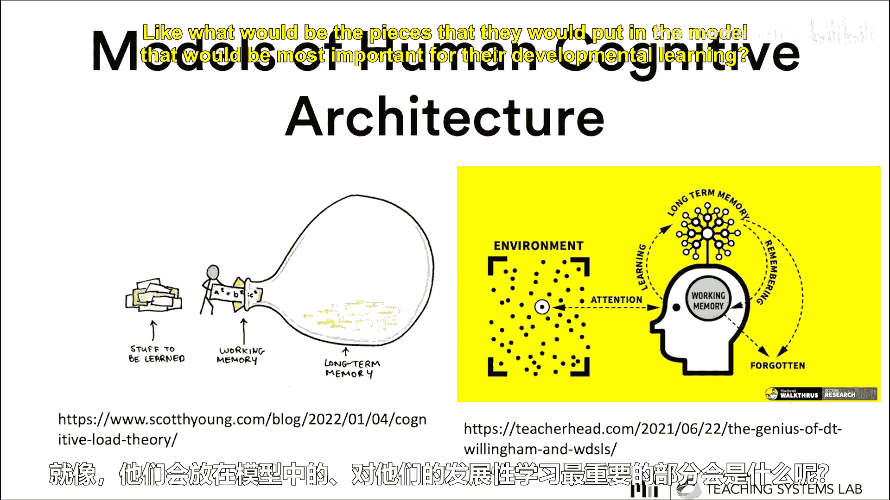
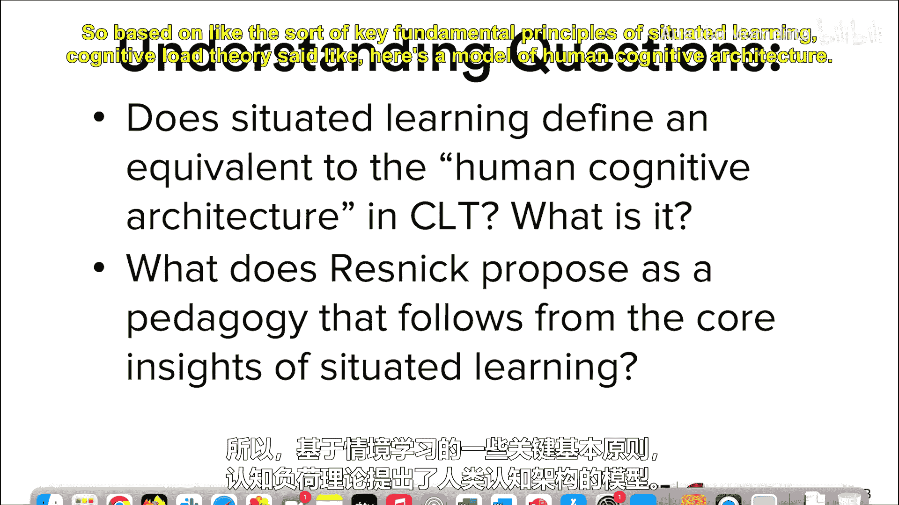
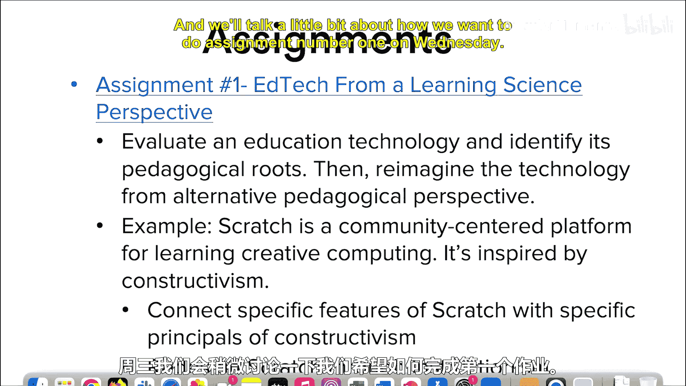
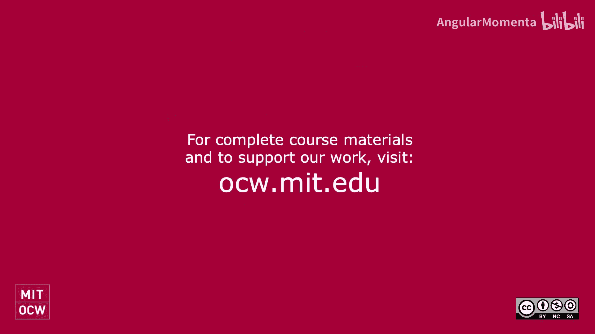

# 【麻省理工】学习、媒介与技术 ｜ MIT CMS.595 Learning, Media, and Technology, Spring 2024 p02 03. 人们如何学习 - 情境学习 -BV1DKUSBGEvu_p2-

Go ahead and turn to your neighbor and start one thing you can do is pull out the main reading that we did about situated learning because we'll do kind of a close read of that today。

 so pull that up on something and then in the minutes that we usually start  one of5 but in the minutes that we have turn to your turn to your neighbor and start thinking about why babies would give cognitive load theorist connections。

First。right just as one level setting thing， in case you haven't hung out with babies in a while。

 like in their first few years of life， how would you characterize the amount and rate of learning that babies do？

Insane， it is bonkers how much babies learn。 I mean。

 a very strong feeling I had when I was first father was like， like。

 I I do not improve at all in a week or in a month or really most years。

 I'm really like not that much better than I was in the beginning of the year。

 And you're just watching these infants who are totally transformed Because they are learning things at an amazing rate that you can see daily。

 weekly， monthly， you know， incredibly accelerated learning。

 So let's'll just use that to level set let's let's take it as given that babies learn an amazing amount in their early years。

 why now keep talking， why would that prove to be such。

 why would they give cognitive load theorists such a con。😊。

And you can think about how it connects to some of the stuff that you've been reading about situated low theory。

 keep talking。All right， good， what are some observations that people made？Yeah， what are， what are。

Bab are significant， so what are some of the observations that you made？

What were you guys talking about in the back？What was your group talking about Gloria I was saying that if like cognitive love theory was truew then that would say that babies probably can't learn like anything because everything is extraneous knowledge them and they don't have any longter memory they haven't formed All right so they're not drawing in they don't have a lot of long-ter memory drawn on they are like the canonical us looking at Sanskrit letters where everything is its own sort of discrete part like so you would think they're working memory I mean know this video I think is sort of helpful for that like everything on this screen is brand new to them there's nothing that they've ever seen before and it's filled like there's a slide and the dad and that other thing back there and all this stuff on the ground and people are talking and the sun is out and all these things are happening at once。

Good， what else did people talk about？It's also like the。

The speed with which they learn doesn't really connect with like the bottleneck theory and。

theory of like it takes a while for you to like compile all of this information。

 but it almost seems like a baby see's at one time and it's like able to retain it babies seem to do exactly the thing that Ser said people should not be able to do。

 which is to be， I mean would you like this baby learning stuff would you generally characterize their experiences sort of open-ended problem solving or like being carefully walked through a series of worked examples？

how would you describe it？Yeah， I mean， like I'm just like going on the slide going down， you know。

 it's not like dad's like， you know， I mean， I think I think you'd find more structure and stuff like that。

 But there's a lot of just like wow， I'm a baby I'm out there。 I'm doing my thing， you know。

 and the work example effect and the expert reversal effect suggest that that should not be very effective。

 know the most effective way to teach babies should be you know through like careful。

 know devolving scaffolding of language and things like that。 And that's not what we do。

 we just like throw babies in with people all the time。 And and they learn language。

 they learn movement， they learn a few other things that sort of an extraordinary rate So for how does how does what connections do you see between this set of ideas and situated learning。

😊，There's a lot of like trial and error in it like we were talking about like hey。

 when they see a block they want to go get， they start to figure out the different ways that they can go get that block like through trial and error。

 trying to stand up trying to crawl， trying to drag themselves all that kind of stuff Come on in say with me No。

 no delighted to have you Yeah， Yeah I mean this certainly looks a lot more like situated learning than it does look like a sort of carefully sculpted classroom and so for situated learning people you know I think we'll see this more in some stuff that we read the experience of babies seems like something that's pretty important to draw from how would how would you how would you characterize like the feelings that babies have as they learn language Like are they happy are they sad are they angry are they frustrated are they joyful are they playful Like what kind of feelings do babies seem to have as they're learning words。

Or you say Ja， I was going to say seem kind of fearless and there's no like social pressure to like try and pronounce this word correctly say the word just make noises come out of our mouths whenever yeah do you want to grab another chair no it doesn't seem like there there's a lot of fear behind trying to practice what they're learning？

But I think like in addition to that there can be like a lot of frustration as well Okay the consequences of like not knowing how to Yeah or if you watch babies when they're you know。

 I mean they cry when they can't articulate the thing that they want to be able to say or even Yeah in addition to frustration I think there's a bit of like happiness when they actually achieve what they're trying to they feel understood I think there's some sort of some sort of pride in that。

What were you to say Courtney？嗯。Same my daughter， we used to we used I guess it was my younger one。

 we used to just list vegetables and list things together supermarket she thought that was the funniest thing ever you just be like pearss back of the card just like saying stuff and she's giggling the whole time know I mean you watch a video like this like this is clearly a delightful know there's not a lot that sweller and colleagues have to say about like being delighted know I think if you were if you were to situate like the kind of like moral ethic of work around learning in cognitive load theory。

 it's very like learning is hard we persevere through a hard thing and we control the hardness of it so that we can scaffold it for people and for situated learning people' when these aren't like arguments sometimes explicit arguments sometimes there's just tones that you find in the way people talk about these things and'd be like。

You know learning is great learning is the thing that we do and get better at stuff。

 it's like nice and natural and things like that can everybody think of a thing that you've learned in which you like got better at the thing and it was just like playful。

 enjoyable， natural to get better at it。😊，Anybody can shout out one or two things that was like that for you。

When I first learned how to use like a power drill awesome right learning how to use power drill like very satisfying immediate feedback。

 things like that， yeah other things that people really enjoyed learning I think similar like tactical things like people learning how to do pottery Oh great yep。

 pottery seems like a good one。Learning how to swim learning how to swim was we're saying a lot of physical things Good video games video games video games are there is a whole science。

 we won't read。 There's a guy named James G who wrote a great book about learning video games It's a little bit like Tocqueville coming to America if that's a reference that you know but Tocqueville was this European who came to America and he saw America incredibly intimately in a way that sort of only an outsider could in part by becoming an insider。

 James G is an old guy who was like why do my kids like video games so much and he starts playing with。

's like these are amazing learning experiences think about someone learning a really hard game like civilization 6 or Stlaris or put in whatever game you've been playing recently that just has like incredibly complicated systems in them there aren't a lot of people who are likecraft Redstone building in Mincraft stuff like that there aren't people who are like God。

 it was such a drag that I had to take all those classes on Redstone to be able to。😊。

know these games have systems built within them， they're sort of almost all them canonically situated kinds of things where you're just immersed in the environment。

 you're encouraged to play， there's some peer structures around to help you learn and stuff like that but it's extremely pleasant even when you people might find it frustrating and things like that I think a lot of in families cooking is something that learning how to cook which has both tactileling scientific measurement。

 mathematical language components that people often find quite pleasurable。

And this connects a lot to like the material on learning and CMS 587 about assessments where like the different theories of intelligence and how if you believe that your intelligence isn't fixed and it can expand and you can learn a lot more and that's kind of like young children or babies because not really afraid of failure they're very resilient yeah they don't care what's going on just trying to figure things out how many of you have had experiences that you're really happy with where learning was hard where you like persevered through sort of a challenging set of learning experiences and got better at it and you're like yeah that's great。

 I'm super glad I did that what things come to mind for that for you I think for me learning like that I think from some people in the room didn't middle school were associated with it yeah you watched a bunch of lectures and dids and turned them in and I remember first very complex my program worked perfectly。

It's amazing it felt very satisfying even though some of the learning experience of doing that yeah yeah so that kind of you I think there's sort of a moral story that emerges around a lot of instructionist learning。

 which is like it was hard we put our nose to the grindstone we sacrificed but after that sacrifice we have this great feeling of relief and I think most of us have some kind of learning experience that goes like that and then situated learning people have more of this story of like we just naturally found ourselves in this space surrounded by opportunities to learn and it was playful and it felt easy and natural and that's what we're trying to sort of restore there so actually the cognitive load theorists have to me what I think is sort of a funny way of dealing with this there's just a guy who proposed that there's two categories of things that are learned called biologically primary and biologically secondary kinds of things and we're evolutionly wired to naturally learn biologically primary kinds of things and everything else is biologically secondary and is much harder so that you're sort of naturally wired to learn how to walk how to eat。

Some basic parts of socializing， recognizing faces。

 language ends up being a real problem for this because it's like。

 are you biologically primed to learn your first language to learn multiple languages。

 why would you be biologic like why was it easy for me to learn English when I was young but Spanish really hard when I was older like my brain changed and evolution like anyway I actually find this very totally unsatisying do I very familiar with the idea of epicycles like before the Coernican revolution everybody thought orbits were circles not ovals or whatever it is what is what's the shape of ellipses and there was a period of time when they realized like oh circle measurements don't work and so they added circles to the circles they believed that there had to be sort of perfect circles making the orbits and so they believed that somehow there were like orbits within the orbits and then I think it was Coernicus who came around was like actually it's just like this and that works a lot better。

To me， sort of biologically primary and biologically secondary things sort of operate like that seems a little bit like an epicycle to me like we haven't quite figured out what's going on there。

 but that is how canonically the cognitive load theory people just wave all this away and say but babies。

 whatever biologically primary we don't have to worry about them everything after you're four years old or something like that is cognitive load theory works but for the situation to learning people not exactly。

 but in a lot of ways they're trying to sort of recapture the learning experiences that we have when we're very young where learning is natural playful not always happy。

 but often sort of socially satisfying and extremely effective I mean what babies learn in a short period of time is just bonkerss one of the most fun things about being a parent or an aunt you uncle or all the other ways you get to spend a lot of time with kids okay。

😊，Let's just get oriented here。So again， we're in foundations。

 we're trying to get a hand of these two sort of contemporary learning theories。

 cognitive load theories， situated learning， that these two ideas about how people learn or ancient that you can find people like Plutarch for the mind does not require filling like a bottle but rather like wood it only requires kindling to create in it an impulse to think independently and an ardent desire for truth。

 That's the sort of like this is Plutarch making a case for situated learning and against cognitive load theory though he wouldn't have known those terms because it didn't show up for another 2000 years but you can hear the resonance of the debate in his mind。

 Here's a little chunk from a 2017 New Yorker article。For nearly a century。

 public education in America has been influenced by two opposing pedagogical approaches。

 Traism and progressivism， a thing that you got to catch is that there are these two ideas that each of them has 8000 different names。

 but anytime you sort of notice this dichotomy， broadly speaking in the traditional approach to education。

 a teacher in parts， knowledge to students through direct instruction and embodies a disciplinary culture in which obedience is both prized and rewarded that's a nice so she frames that here's a pedagogical piece。

 knowledge isn in part of their direct instruction and embodies a disciplinary culture in which obedience is prized and rewarded like obedience was not prized and rewarded amongst the baby on the playground。

 what was rewarded was screwing around the purpose of the classroom is to equip all students to meet measurable academic standards。

 a progressive institutions， a teacher develops a curriculum but urges students to treat it as a staging ground for their own intellectual discoveries often through handson activity and group work Allances are made for differences in the way individual students learn Progressivism was inspired in large part by the work of John Dewey。

 the American philosopher and education theory。Maybe I'll say that last night for Dewey。

 the classroom was not simply a place for acquiring academic credentials。

 it was also a venue in which students learned crucial values about being citizens in a democracy。

 so maybe maybe these things are laden not just with pedagogical ideas。

 beliefs about human architecture， cultural sort of values but even maybe the outcomes of education。

 maybe we believe differently about that， though not necessarily。

The person who's probably the best counterpoint to John Dewey is this guy Ed Thornddke who is very early educational psychologist。

 I often think him as a guy who is like， no， no no， Pafil is great。

 like a particularly great thing about pale filling is that we can measure palefil you can measure like the rate at which you bore things into people and the rate at which it falls out and how leaky people are and some of those kinds of things he was very involved in testing He actually played a really important role in developing ideas that educational progressives hold dearly one of the things he studied which will talk about the course goes on is this idea of transfer So you know in the 1819th century people in America。

 Europe believed that a great thing about learning Latin and Greek was it sort of strengthened these kind of like generic thinking muscles。

 like if you got really good at learning Latin and Greek。

 you would just be a good thinker and he was like that's dumb if you learn Latin and Greek。

 you're good at Latin and Greek but you're not actually。😊，and anything else。

 like the brain is not general purpose like that， but that kind of thinking， that kind of thinking。

 if I learn this thing， it'll help me like generically with these other things shows up all the time。

 the most contemporary version of this is have of you ever encountered the idea of computational thinking？

😊，What people mean by computational thinking almost all the time is like we're gonna to teach you computer programming and if you learn about computer programming。

 you're going to learn how to break ideas down into smaller parts and you're gonna to learn how to think algorithmically and do all these other sort of and like no you're gonna be programming computers you know if you want to be able to break ideas down in poetry learning computer programming will not help you do that anymore I mean it will help you about as much as learning Latin Greek will help you do that which is to say like not that much that a frustrating thing about teaching is the things we learn tend to only help us in like very near cognate areas so these are sort of the two kind of again I'm trying to give you the sense that these two big ideas are millennia old they have a scientific basis that's at least a century old and you're getting what I think are some of the best most recent contemporary formulations like the work of John Swer and some of these other folks like the little piece you read from Mitch Resn for today and then maybe just to give like a broader overview like overwhelming。

Thororndke is one。 If you were to walk through a typical American school in a typical American day。

 you would see very little education is life itself。

 and you would see a lot of direct instruction like the canonical experience of students in schools is very organized around direct instruction。

 However， if you were to ask teachers who their favorite educational philosopher is you would get a lot of answers that are Dewey。

 and you would not get a lot of answers that were thndyke So the Dewey is beloved in a way that Thornddke is not Thornddke is like actually the person who inspires more of our ideas。

 All right， let's do just a little bit of close reading together。

 which is mostly me telling you about some things that you should read closely。

 This is what we looked at yesterday here's one thing that's fun about the cognitive load theory people。

 is that they have their really good at stating clearly what their models of human cognitive architecture are。

 I think the situated learning people have cgnates。😊。

I think they have things that they believe are central about the brain， how learning works。

 but they would draw a different model， like this is not what they would doing and they're less explicit about it。

 which makes our job a little bit harder but a thing that you can be thinking about now is like what would be you know what is what is the situated learning cognitive this like what would be the pieces that they would put in the model that would be most important for their developmental learning。

 we'll play with that as we go along a little bit Okay。

 how many of you ever use the logo programming language？

Oh good， more than there， how many of you use scratch？Okay。

 then we got everybody so scratchtch is a descendant of logo logo is a programming language that was developed by Seymour Pet in the media lab。

 one of the first efforts to bring computer programming to kids in schools when I was in the fourth grade at a Montessori school in South N not far from here we had a little computer lab and logo was the language that I learned to do a little bit of programming anyways。

😊，You'll see that a lot of it is about shapes in geometry but what I really loved about it was choose your own adventures so you could essentially like like write a program or function。

 whatever it is in which someone types a word and that triggers the display of a set of text and so it wasn't that hard to make choose your own adventures you know like you're at the front of the house do you want to walk up to the type porch if you want to walk into porch type knock if you want to knock on the door and then knock is a program that releases another set of text and you can make it choose your own adventure that way how important is that for you to know。

 I don't know but here is a few minutes of Seymour Papper。Who was a student of Jean Piageert。

 who's another kind of major social constructivist sort of thinker。

 here's what a logo was supposed to look like in the classroom in the 1980s about when I was a kid。

The idea is quite simple。Let a child learn mathematics by speaking in mathematics about things that rarely matters。

So at MIT， we've given computers the power。Ping motive。Make sounds。然后 picture着。

And we found ways of giving children the power to control the computer。

So the child can make the computer do anything that you can describe。

Ctical mathematical language by typing on a keyboard like this。感。I P1 sense。Tpri to。一？え。あはい。

A computer controlled turtle is made to draw and dance by programs so simple that all children inventedvent them in the first days of the course。

 thus the child acquires a tasty math power that grows and grows as these projects become more original。

 more complex and more varied。So you have like the first one， then the second one。

Third one and the first one again for the end。然后 they put their little little tunes together。系喺度。

Right。Now I'm telling me to do it。Sometimes I get into bags like this and it'll。

When it was doing it in his mind。这拆了。都 little度 tryingangle thing。IWas on an angle， so。就 the picture呢。

変んか？算念阿哥。And having it dried in its mind again。Well。

 it's in the right position and so the child doesn't have to be told by a teacher whether he's right or wrong。

 he can see for himself whether it works。That's what science and knowledge is about。proceduresc name。

全し？And then you have an input， which means you can vary the size。I'm going make it 100。Right now。

 it's doing a procedure called。他。And each one of those little fins is called fin。

And that's another cell procedure in top。I was doing。

InsideThey are identifiable techniques for waiting on a problem one of these is known by these children as writing procedures as subproc。

Inside and top of the two main。Some procedures。And the other for one， the tail is made out of。あ、じね。

Just put together。The technique very well know。Subteride the problem。 splitlit the difficulties。

Make a a I'll just tell you one second about this little robot which again is like I telling my child that I had a commercialized version of this。

 but it takes the same commands and use the same language as the turtle that's on the screen so you can tell it like forward 10 and there's some equivalent to forward 10 that also shows on the screen it is a pen that's mounted in it that's controlled with pen up and pen down so you can like make varying kinds of shapes using that and then if you see the cable that the person is walking around with that was a serial cable which is the primary thing we used to use to connect computers to peripherals so that like before wireless or before USB or other things like that that was the cable that they're using to move things and on。

Out of some procedures make a hold out of pots， understand heat sympathy。 Everybody knows that。

That they can do。Now it's moving across the stream。The way I told you， it did it before。

But this time， this is like the way I taught myself to get it across the screen。

The first time I had done it， and so the way I have a little one to go is。

Every time it moves up a little， it subtracts。A little bit of a number。

 And then until it's a small number。 And when it's a certain number， I tell it that it should stop。

Mas is getting mathematical knowledge in a meaningful context for use now。Mo off the screen。

When I was at school。They tell me to learn long division vision because I would need it when I grew up。

And I think I knew it was a lie。TheWas to make me despise the teachers in the whole law。让我去抓你。

Acept procedure。The bar of the fish。Stephen is using the ideas of angle。

Of some procedure of all and of circle in a confident， purposeful way。

 The tail the triangle part made out of proc called try one。First， youve gotta do。Right。6。Over。

50 back， 50。That' 60，4， 50 back， 50。64， 50 back， 15 so。Now it's doing your firm。That's really so。

阿狗去哪。I made a big reinies。And then， I once。不。We'll go right over it and bring it back。

Then I made a smaller radius of。The same art。对不对？Yeah。There's even smaller one who will do that。やは。

Finish picture。I made a big song and I use that for part of it。I made an accompiment with it。

The drum。And that's。两个。🎼，Yeah。Yeah。Yeah。Agains tell me， that's a squ。

I think there was a new mathematical wood that was born then that's going to see。

I quote that real discount。Good don't spend time this Turn to people actually talking a little bit what are the things that you saw in there that cohere with ideas that you read about from other communities of situated learning what are some things that you saw in there that cohered with cognitive load theory do you see sort of evidence of direct instruction that was in there anywhere and then what kind of learning environments have you been like where you learned in this kind of way that was pleasurable and have people been in learning environments where you sort of learned in this way that you found very unplesurable and unlikable discussed that for a couple minutes where do you go？

Good， what are some connections that people made， What are some things where you saw examples of situated learning or cognitive load theory or things that seem pleasurable or。

Or frustrating。What did you talk about in your groups。We were talking about learning。

Programming in general， or it seems like you always need some base level of whether it's the instructions or knowing whatever commands there are in logo。

 and that most likely comes from more of an instructional place but then you can get into situations like we in it open world but it still seems like you need some base level where or some kind of direct instruction what evidence of direct instruction people people see like where were you that that on their own I just the term wouldn't just figure it doesn't seem like Stephen came up with the term procedure and sub like pretty sure somebody taught SAT down and said couple of definitions that will allow us communicate with us more clearly we were talking about when the two girls were talking to each the beginning was I very direct。

Yeah within the learning I mean yeah yeah it's a kind of worked example like oh。

 I'm going to show you how I you know I made a thing like I'm you we're gonna make this thing together right now by first of all play each of the pieces now we're going to play all the pieces together I've already learned how to do that you what makes it a kind of peer learning situated learning kind of thing is it's one young person teaching it to another person but does seem to be direct instruction for sure that kind of let us into a conversation about how like within learning。

😊，That there's like kind of two ways that it can be seen as like you have someone who's like an old timer the other girl like explaining to like the other girl about the situation that they were working with。

 but then there's also the instances when it was just like the student and the computer and that you kind of lost that social aspect that you have of like learning from another person and then we went into an interesting conversation about whether maybe the student was like having a social interaction from themselves and like learning with the computer as a tool or maybe they were having a social interaction with the computer itself and like they were learning from the computer and the computer was like。

Lning what they really wanted the outcome to be So Yeah yeah good that's definitely something we'll think about more as we go along like what kind of agent is the machine。

 what kind of relationship do we have to the machine， how does the machine motivate。

 how does the machine explain the thing that seems pretty rad here that seem more p the machine gives some great feedback Although lots of other things do hand drills give great feedback when you like go through the wall。

 you know it and when you like you know hit something metal or something like that。

 you know it and you get that kind of instant feedback there are other things that we teach people where it's just hard to imagine where that instant feedback might come from writing is often in that way。

 especially like writing other people， there's nothing that is sort of right and we haven't built things very well where a machine can tell you like oh that's a compelling way of expressing that idea in the same way that can be like oh my swan is on its side So sort of different different technologies or and different different things that we study。

😊，Different capacity to give us immediate feedback about what we're doing。

Ha anybody ever been in an environment like this where you' like，  oh my gosh， this is the worst。

Do students have experience in this kind of like open ended learning where you're like？

This is terrible。 Yeah， I remember this like one I guess recent MI experience where basically one of the classes like final project was very like open ended and they were like designed game and was likeow it would be to get of Yeah you please show me how to design this game I't like someone has figured this out before I don't want to explore this space forever and I' definitely have people who have taken this class and they watched this video they're like give me a break like just show me how to use the turtle would say in high school of computer science classes very into like learning but then like。

😊，In my is it was like just overloaded with people who just needed an electedive and they were like。

 you have to take this class and it becomes that like peer to peer interaction。

Becomes an issue where it's like okay you have three people who trying to teach like 30 other people how to do this specific thing because you're in the same like group and they have to pass and they don't really care anyway Good people have different motivations or I mean a huge problem that computer science education has that people unlike other subjects people come to it very different levels of background experience so like none of you probably ever took a geology class where like a third of the kids were like man I love geology like I do I do geology all the time in my spare time I'm way ahead of you guys but that is essentially what just about every computer science class we teach is like where a chunk of people are like way into it and know a bunch more already and in fact those open end environments can be。

It can be really great for those folks who have that extra expertise and they can be a real bummer for people who can't jump in as naturally。

 Harmon was you going to say？I think what this made me think of is how CLT and situated learning cannot be really separated from each other sometimes you need CT to give framework for students and then from that guess can fire the wood and Yeah I like I like are I think that's a great question ask what are the different sort of combination and permutations like the reason why these ideas have existed that we can find evidence of them for 2000 years is that they both seem pretty good they both seem useful in different ways here Seymour Pa is in ones talking about like his teachers lying to them and despising schools but you can also find sort of school things like we're gonna need some definitions that I teach you that are kind of woven even in this sort of extreme example let me give you a few pieces from the thing that you read from a guy named John Le who with another person named Eddie Weger really advanced some of these ideas and I want you to be thinking about like。

what are the methods that this person uses to study， what are the kind of arguments they make。

 what are the implications for pedagogy， what's their framework about human beings and how they learn and where do these things lap and overlap know it can often seem like when you're writing about you know if you read a bunch of stuff on cognitive load theory it seems like they're just talking about instruction and they mostly are but there are ways that talking about instruction that evoke their beliefs about culture that evoke their beliefs about values that evoke their beliefs around methods and outcomes even if they don't talk about those things as much in this chapter I propose to consider learning not as a process of socially shared cognition that results in the end in the internalization of knowledge by individuals but as a process of becoming a member of a sustained community of practice so anytime you read anything a thing that you are almost all probably trained to do is to try to figure out like what is the person's core argument like what is the thing they're arguing for an equally useful thing。

do almost any time you read anything is to try to figure out what is this person arguing against and people are often not that explicit you know he's not sort of saying like these jerks who are really like big on schools and direct instruction have totally missed this stuff but theres that's kind of what he's getting at in here and it's a radical statement Learn is not the internalization of knowledge you know last week I told you that for some of these kind of educational psychology people。

 memories is the residue of thought like the entire endpoint of cognitive load theories distort store memories。

 facts as memories in our longter memory not as the internalization of knowledge as individuals but as a process of becoming a member of a sustained community of practiceDevelop an identity as a member of a community and becoming knowledgeably skillful are part of the same process you cannot separate storing things in longterm memory from building relationships with other people with the former motivating one of the key things that we remember our。

😊，Like Michaelcha Phan， know not a theory of everything。

 where is the motivation with the former motivating shaping and giving meaning to the latter which it subsumes it is difficult to move from peripheral to full participation in today's world。

 including workplaces and schools thereby developing knowledgeably skilled identities This is because the processes by which we divide and sell labor which are ubiquitous in our way of producing goods and services including knowledge trunccate both the movement from peripheral to full participation and the scope of knowledgeable skill take into an extreme these processes separate identity from intended forms of knowledgeable practice this view implies that learning and failure to learn are aspects of the same social historical processes and points to relationships between knowledgeable and identity as important focus for research these jerks these education psychologists keep trying to convince you that what learning is is just shoving stuff in your brain it's not there are always people around when we're learning even when we're learning ourselves reading books and stuff like that they are people in our minds or communities that we see ourselves being part of。

You know， trying to understand how learning happens in schools or any other learning environment without thinking about the social environment that people learn is bonkers。

 is nuts， it denies a crucial part of our humanity。

Here is a blog post that you can look at later if you sort of follow this by a wonderful math educator named Dan Meyer who has been trying to explain to people why he thinks AI chatbots are a stupid idea and will not work。

 and and his core issue is like nobody wants to talk to a computer like maybe the computer can provide a sort of perfect direct instructional sequence。

 but like the kids who are in my eighthth grade algebra classroom。

 They don't want to be there They're not interested in algebra I love this framing a students attend school to answer two questions Who am I and how do I do this。

 those are the two things they are thinking about all the time。 Who am I and how do I do this。

 A chatbot cannot help you at all with the first question。

 But the other thing I want to bring up here and you can disagree with that and we'll talk about more when we talking about chatbots。

 but Who am I and how do I do this。 This is exactly what John Leve was discussinging that identity cannot be separated from the acquisition of knowledge。

😊，I think most of you probably， if you your classroom think of your own school experience but like I spent a lot of time in middle school at high school thinking to myself in one form or another。

 who am I， what do people think of me， what kinds of relationships do I have why am I here。

 what am I supposed to be doing？Jordan has carried out extensive field research in the Yucaan Maya Wiwi whose apprenticeship is quite different。

 more effective and less exploitative than the butchers of Marshall study。

 the apprentices are peripheral participants， legitimate peri and legitimate peripheral to the practice of mid。

 what do you allll take away from what you think like what is legitimate peripheral practice or periphery like what does that mean sort of in your own words？

What do you think， Dana like they're doing work that like matters but they're not like doing the main work like they're doing side tasks that are like helping them understand the main process。

 but like they themselves are not like giving birth to the child Good and there's a space there a space is held for those people it is expected that there are going to be some folks who are hanging around midwives who are not quite midwives yet and that's normal they're supposed to be there it's not a classroom of 20 people all lined up who are supposed to be doing the same thing all the time there're supposed to be some people in the middle and there're supposed to be some people in the outside I want to pose to think of the relationship between what about the midwives butcher in what's the difference between peripheral legitimately peripheral participants。

Do folks remember what they described about the butitchers？Yeah， was that the butchers。

 even though like they were doing peripheral work， they were separated in space from the like the。

Experts so they wouldn't really pick up on things as opposed to mids who still observe what the legitimate the expert was doing Yeah so what does that mean in terms of being a part of that community and then shaping the learning that they're able to acquire？

If I'm a butcher and I'm part of the community， if I'm standing over here cutting my meat。

 using my tool。 that's all I get to do。 and then Justin's over there。

 you know hanging out with the paper or whatever it is right what am I losing then。

The social aspect right， am I able to observe him， can I see what he's doing when he leaves。

 can I pick it up from wanting， totally miss that， but then what about the midwife。

 how is that different？How do they describe the midlifefe relationship。

 justess and I hope this is okay？Yeah so I think one of the main differences is beyond the fact that it wasn't supposed to be more efficient so there was no capitalist aspect to it there was a lot of culture embedded in it to like。

The daughter of the midwife would become midwife， meaning that at five years old。

 they would already kind of be present in that situation and start like picking up on。

What was going on and then progressively have a more like protagonist role to that experience。Yeah。

 so like although both could be argued as peripheral right we're in the same space we're hanging out like who's welcome in the community and then what type of knowledge are you to gain from that type of peripheral participation it's kind of cool subtle right all right that's all I got。

嗯。The previous paragraph， I had a lot of reflection about it and I don't it。Kind of。

That in some aspects I'm not sure how you feel about it。

 but I really like the point that he makes about like learning kind of makes forms your identity as part of this social group right and I think that really applies to kids for example。

 kind of like they come from this peripheral existence and develop their own identities and become like committed like functioning part of society but then it really made me think like oh how do we think about it like from an ableist perspective where people cannot acquire a certain knowledges or certain abilities and does that mean they have less of an identity。

 like I really what about that for a while and at the same time。

 there's like a criticism in the book about like commoditization of knowledge because before midwi et cea like okay it was this really specific group of people teaching this very kind of like expertise whereas today like we have universities and we have schools or you can kind of get whatever class and learn things。

But it's not necessarily all bad right because that would imply that if you're the daughter of the midwife。

 you don't really have a lot of say into becoming or not a midwife right like the way that society was structured back then luckily。

 you would kind of become one because that's what expected of you whereas like when you kind of can choose that you have some sort of agency and power。

 even if you won't have that exposure as a peripheral participant kid so it really made me think of good and none of them have to be resolved either。

 you know that it probably probably some important things to take away or like how Jean Leve assigns values to these different kinds of institutions like he thinks it's a big problem a big problem with schools or university is sort of ripping knowledge away from these broader social context that you go and take a physics class and in the vast majority of physics 101 classes。

 no one is trying to get you to be a physicist。trying to get you to develop the identity of a physicist。

 they're just trying to teach you the physics and what is lost sort of in that of course what's pretty rad about like walking into a campus full of people wholl be like yeah I'll teach you any of these atomized little things for you to learn like that seems kind of cool too。

It is worth noting that it would be difficult to find evidence that teaching is the mode of knowledge transmission amongst the midwives。

 He makes his claim that like you wouldn't find direct instruction amongst the midwives。 I mean。

 Jordan did the fieldwork and not me。 that seemed totally laughable to me。

 I've spent time with lots of people of lots of ages， learns lots of kinds of things。

 and people are always transmitting and explaining stuff。 It's always sort of nested in there。

 But there's a kind of politics of John Le Like we don't even need to explain these things。

 We don't even need to teach these people。 we can learn it just like babies learn it sort of in their natural environment。

 know， just like you have to surround babies with language and they'll learn language。

 you surround young girls with birth and pregnancy And they learn midwifery。😊。

Apprenticeship happens as a way and in the course of daily life。

 It may not be recognized as teaching effort at all again。

's sort of doubling down like there's no instruction here。

 their instruction the people are lying to you and you should despise themmaa girl who eventually became a midwife。

 most like as a mother， a grandmothers a midwife， girls and such families without being identified as apprentice midwives absorb the essence of midwiory practice as well as specific knowledge about many procedures simply in the process of growing up。

 They know what the life of a midwife is like what kinds of stories the women and men who come to consult or tell kind of herbs and other remedies might need needed to collect it as young children。

 they might be sitting quietly in their corner as their mother administers a prenatal massage。

 they would hear stories of difficult cases of miraculous outcomes and the like as they grow older they may be passing messages running errands getting needed supplies a young girl might be present as her mother stops for a postpartum visit after the daily shopping trip to the market Eventually after she has a child herself。

 she might come along to her birth， perhaps because her alien grandmother need someone to。

and thus finds herself doing for the woman in labor。

 What other women had done for her when she gave birth。

 That is she may take a turn at supporting the laboring woman。 Eventually。

 she may even administer prenatal massages to the selected clients。 At some point。

 she may decide she actually wants to do this kind of work。 She then pays more attention。

 But only rarely does she ask questions。 Her mentor sees their association primarily one that is of some use to her。

 Rose already knows how to do a massage。 So I can send her if I'm too busy。

 That is just a beautiful description of kind of legitimate peripheral participation moving from the periphery to the center。

 You just watch this thing for a while。 And then your mom's hands are a little sore。

 And so you do the massage this time。 and you know how to mood the massage because it happened to you。

 you've seen it is times。 Are anybody part of sort of clubs or groups at Mit that have learning that feels like this。

I guess we love theater clubs or people just like how do you become a stage manager at the other thing is like you start as a stagehand yeah you watch some theater just stand there and between the second and third act hand this prop to that person and you're probably never going take stage manager class。

 you're just gonna hand that prop once and then you're the prop master and then the stage manager get sick and you do it for the night and then you're the stage manager。

 Yeah I think theater has a ton of stuff like this that's a great example。

 We're gonnamar the what's shadow when we go for photo assignments it's a photography assignment or something out the field can always have someone shadowing they can be photos camera sometimes we will use their work as well they can also do legitimate I love it and you have intentionally sort of held space for that。

 you've kind designed like oh yeah come along hang out with us and you probably have parties and other kinds of things。

Like that where it's like know where like some of you' were just goofing around but some of it you're like the story that we got I'm them telling the stories of difficult cases and miraculous outcomes。

 I'm sure the tech has other similar kinds of difficult cases and miraculous outcomes I was gonna say on sports teams when people become captains not often is the coach sitting them down and being like this is how you be a captain this is how you leave people it's more they just naturally have this personality of doing that maybe they up their mom was a girl boss are just grew up seeing stuff like that so then you kind of have that natural progression into like just learning by doing' say this is kind of a dumb example I like really at I always get like the best player and then on a team against two other people who are also really good but this person is so good that they they carry but I'm kind of learning the and。

H off onto the side where I just kind of like try to like hold lives all day like destroy the other people and I think that's kind of peripheraly Oh yeah yeah yeah and in that particular community it's a space of legitimate peripheral participation which somewhat exists because of this like fairness balancing kinds of things and so you like every learning environment like the substance of super smashash brothers determines like where the legitimate you know and it determines spaces for peripheral partition that's different than journalism。

 the different than sports， the different but this theory is giving us commonality where you can talk about really different things it might arise in different circumstances but I think that's actually kind of the same thing and the kind of spaces that I'm finding for learning。

And。In short， when official channels offer only possibilities to participate in institutionally mandated forms of commoditized activity。

 genuine participation， membership and legitimate access to ongoing practice of a practice considered worthy of the name are rare practice is not to be found in schools and workplaces at the same time。

 schools and school like workplace educational enterprises。

 a core knowledge skill a reified existed turning it from into something to be acquired and its transmission into an institutional motive this process generates pressures towards the trivializing decomposing of forms or activity。

 The result is a widespread generation of negative identities of misrecognized or institutionally disapproved Institial communities of practice that some of the things that might feel most academic might feel less least identity oriented to you because there's not you know think about what degrees here we'd be like I'm not sure there's a way to be a legitimate peripheral participant there。

 Like there's a way to learn the stuff There's a way to be taught the discrete parts of this course are subject are major。

 but。I'm not learning how to be a part of this community。Okay。

Here are three things that I'll have you do together for。Five or  ten0 minutes。

 which might involve some drawing。So grab some paper or some board space what see if you could draw sort of the equivalent of human cognitive architecture。

 see if you could draw like just just like just like you drew these diagrams for。

Cognitive load theory， what is the diagram you would draw for situated learning What is based on that cognitive architecture what is the pedagogy that follows So based on like the sort of key fundamental principles of situated learning cognitive load theory said like here's a model of human cognitive architecture here are a series of like clearly defined effects situated learning people are not as good as like enumerating and bullet points all of their pieces but it's all in there what are some of the what are some of the like instructional practices that follow from this model think about those two things and then also say if you can sort of recreate some of your Venn diagrams what are the categories of things that seem separate from cognitive learning and situated learning and what are the things that they seem to be quite similar on or quite together on take10 minutes to again grab one person or two other people do some drawing。

 do some composing feel free to pull up your notes from your learning journal where you should have done some of this things and if any of these questions you don't have you don't have to spend。

Equal time on all three questions if you dive in on one that's fine。

 but those three should keep you busy for eight minutes or something like that makes sense。

 ready you go。So one thing I love about almost all these drawings is it's kind of impossible to draw these models without drawing other people。

That when you all developed a kind of human cognitive architecture in cognitive load theory you're sort of drawing like one brain and actually like actually most of your drawings you didn't even really represent the rest of the world。

 but in this model it's impossible not to represent the rest of world and in particular other people because learning fundamentally as social and your identity is fundamentally reflective of your connections with other people so these are good。

You read a little piece of give piece a chance， so four pieces from Mitch Resnk about projects。

 passion， play and peers， hopefully you can now start mapping some of these ideas to what we talked about the reason you know projects kind of open-end explorations。

 making music， making funny shape having a robot draw funny shape somewhere those are spaces for open-end exploration for doing multiple kinds of things projects have more space for peripheral participation。

 like multiple people can be making music， even if someone's a little bit better at making music than the other person they are that learning environments here are driven by interests you know there's very little reference in cognitive load theory to things like well yeah and sometimes the kids don't like learning math so they just don't although that's very real some of the young some of the daughters and midwives want to become midwives and some didn't and for the ones。

who did want to become midwives， they followed that interest and those who didn't went and did other things and in these kinds of models of learning。

 that's actually okay and really important。 we're not supposed to make everyone better at everything。

 we're supposed to let people follow their interest and get good at the things that they want to get good at that in environments in which there is a kind of lightness to the environment where know Lightness play create space for multiple forms of participation like like things don't have to be optimized to get to the fastest best trajectory for all people can be like room to play and mess around and try other things and then know doing it with other people is essential as you can see in kind of all of these kinds of things in part of what know in some ways the real genius Jean Le was a woman I've misrepresented her as a man before and and hopefully corrected me Eddie and Weangger。

 her partner is a co-writerder as a guy's it's not just like。People hanging out with each other。

 we can describe repeated patterns we see of legitimate peripheral participation of old timers and newcomers there's lots in Lave's work that you probably read that was about trying to find new language to get away from the experts and novices because not that's part of it。

 but it's not just that it's our time and it's a community it's our spacecing community those kinds of thingss so just like in cognitive load theory you could say here's human cognitive architecture。

 here's a set of pedagogical principles that follow from that Jean Lave can describe these social interactions you can abstract from them。

 some models of human cognitive architecture and say， well okay from those models。

 there are some instructional principles that follow if I were to draw one of these I think a thing that I would pay a bunch of attention to is that you know the thing in both learning models like you learn what you attend to seeing is really important a key insight。

of situation learning is that we attend to things that interest us and motivate us and where we find our identity and care about like you know if looking at something is essential to get people learn about it。

 then we ought to think very carefully about what motivates us to look at a thing。😊。

T ball for me is a。A canonical example of a kind of activity which it would be almost impossible to teach primarily through cognitive load theory like it's really hard to imagine teaching kids baseball where you're like all right。

 sit down everyone like we're all going watch a worked example of how you you know hit a ball or we have to learn the rule book of baseball like the way we teach kids baseball is where like what is the fastest way we can get young people with limited coordination and no knowledge of the rules to play something like baseball how do we get them baseballing as soon as we possibly can and some genius was like don't do the pitching like get rid of the pitching just put the ball in a stick and they can just hit the ball it has some kind of conate some relationship to sort of parthole practice to devolving scaffolding and things like that there's a researcher at Harvard we wrote a book called Making Learning whole where you said that one of the things that we can often do in curriculum that we underestimate is get people playing the whole game。

As early as possible we'll talk about this more but think about like what subjects have you taken at MIT that let you start playing the whole game as soon as possible and what require you to sort of build up lots of elementary pieces before you can do the thing that that whole discipline does but baseball instruction in the United States like very difficult to imagine in a cognitive load theory framework like very pleasant for millions of young people in a more experiential situated kind of way you did this a little bit which is good here is one thing that I would like to have in the center of your Venn diagrams of things that are similar this is a misconception that my students have had over the years and I want to correct。

There。The cognitive load theorists and the situated learning people agree on what expertise looks like。

 They agree on what high quality practice looks like。 I don't think you'd find these people。

 they would not disagree about what a great body ball player or great carpenter or great surgeon or a great lawyer looks like they would believe that sometimes people think that the cognitive load theorists want people who are experts to be really like rigid a disciplined and pattern repeating and that is not the case that is not what they want is the endpoint。

 they want your cancer surgeon to be dynamic and flexible when they cut open your belly and find cancerous tumors and are pulling them out of there。

 They want poets to be creative and imagine。 They just think that the way that you develop the knowledge base that lets you be creative and flexible and dynamic and strategic is through really disciplined instruction because if you don't go through a process of really disciplined instruction it's hard to get good at things because no one has showed you how to do fundamental。

Pces in clear ways I have a couple colleagues Jo Meta and Sarah Jo Still at Harvard Sarah was there for a while and was at high techch High Graduate School of Education for a while who studied schools a lot。

 studied very different schools with very different pedagogical philosophies and found that across all of them they tended to believe that expertise consisted of mastery。

 identity and creativity that you knew a bunch of stuff into a domain that you developed an identity in that domain and that you were able to do flexible creative work you know a bunch of physics equations and when to apply them。

 you feel like you're kind of a physicist and a scientist and when you need to do something novel like build a bridge or launch a rocket or something like that you're not just following steps but you're doing things that that are creative and expressive one way that I would I think the cognitive load theorists and situated learning people tend to imagine different pathways at getting at these。

GoalsSo the cognitive load theorists tend to think that mastery is like the starting point。

 If you know the stuff。 if you can do the pieces， then a we often most enjoy things that we're good at so like get you good at doing things there's lots of debates in the country and now we'll talk about them some about teaching kids to read and there's some folks who say like we just have to let kids explore books and find what they're interested in and there are other folks who like you know what's fun about reading is actually being able to read so like teach them a bunch of phonics and explain to the basics of how to construct words and that's what makes reading enjoyable that would make people feel like readers you know not when they have like a beautiful library of things to choose from whatever they want but when they can actually make sense of what's in there there's some sense in that you develop some kind of identity and then you get then you have the opportunity to do creative practice that builds in that mastery There are other people who say start。

With things like creativity start by getting people to play around in the space as much as possible so that they're motivated so that they say man。

 like I am I am a this I'm a baseball player like you know I swung on a ball on a stick a few times but now I am a baseball player and because I'm a baseball player like in my heart I'll memorize all the statistics and learn the rules and go to practice you know and eventually do like really boring learning kinds of things the sort of mastery oriented discipline kinds of things。

 but because I know how fun it is to play around in this space what do you think at MIT or are the subjects or courses that you would take that would be more canonically sort of mastery first oriented。

What are the subjects you would take that you would start with the smallest pieces or by contrast。

 if it's easier， what are the ones that seem to be more creativity first？

I think more like biohefty classes would definitely be like mastery first because don't understand the basic of cells like you're not getting anywhere like you can't go without understanding good so it seems to be you know so eventually you can do some like pretty rad computational biology。

 biological engineering here but there's not a lot in bio101 where they're like yeah let's like have cells start generating novel proteins or things like that I would say most of the general requirements like especially like the chemistry requirements and the biology requirements are like with the hopes that hey if you learn a little bit about this。

 maybe then you become interested and want to go further and want that to be your major but yeah so which ones do that through like giving you a bunch of facts and which ones do that by letting you sort of play the whole game。

I mean， my understanding is that a number of the engineering departments like in mechanical engineering you'd be more likely earlier in your career to be like we're gonna build a robot and like do you know how to build a robot。

 No are you going be good at building a robot， no you're gonna build a lousy robot we're gonna let you build a crummy robot and some T is gonna to put their armor on your shoulder and be like that robot's okay。

 that robot's only okay because you don't know anything about control systems but guess what guess what one of our junior classes is is control system you're like I can't wait to take control system。

 it's gonna be boring， it's going to be like bunch of equations and other pss and things like that but there's a robot that you want to drive the neat program I think an MIT is really about trying to create a bunch of these like experiential experiences。

 I mean historically if you were to look at our curriculum across MIT。

 many more things would be much more like this。 I mean our math curriculum I think is very much this way you're just gonna do math that other people have figured out for years and years and maybe by the time you get to the end of MIT but you might have to wait to graduate school that you can do some new math that someone else has never done before。

Tsing the materialter science department and some of the stuff with like the Ber labb that they just developed and things like that where like they did an early exercise in one of classes which is build products from the worst possible materials so like phone cases that were made of sponges and absorbed water or locks that were made of clear plastic where you could see all the tumbllers and things like basically play around with materials。

 do stuff with materials and then you're gonna to take like some super boring really hard classes but you're motivated to take those things so I think you can look across environments and see how they choose different pathways through these these different if you look at reading instruction in the United States there's a huge debate right now about do you start with mastery and facts and pieces and build up to readers or do you start by exposing people to books and letters and words and the things they love and lots of time in almost no course of study is the answer only one of those things like nobody believes you should just do creativity I think almost all of our subjects like have classes which are like okay。

Time to buckle down and learn this thing， but we can often think about like how we order these things differently to produce more motivation。

 their develop identity or other kinds of things like that。But again。

 across different pedagogical phosophies is almost always the case that people have a very shared idea about what expertise is。

 So I think even people who you know are situated learning folks you know they don't want you to invent midwifery and new。

 like they want the babies consistently delivered in safe， healthy ways。

So it's different beliefs about how you get there There are efforts to reconcile these things which I didn't make you read。

 but if you wanted to explore a little bit more I'll give you an introduction of one of them in the rabbit hole for this week Ken Kaatinger has a couple of things you can look at the lecture he gives is actually the easiest way of getting it there's a video in there it's quite good the knowledge learning instruction framework and he says one useful way to think about this is that there are more complex and less complex knowledge components in the things we learn so there are things like you know Chinese characters and there are things like you know anthropological principles about how society are organized and there are different levels of complexity there's also sort of learning processes and there's things like flashcards and then which is just for memorizing stuff and then there's things like talk and explaining and sense making and stuff like that。

I' there that basically you you should be matching instructional components to how complex the knowledge component learning processes to how complex the knowledge components are heres a nice sort of this is kind of like a giant science which is in process where here are a bunch of things that people were trying to learn Chinese vocab。

 French articles， chem models， pressure concept here are a bunch of instructional strategies。

 optimal scheduling feedback， worked examples， accountable talk collaboration and you find that you these are less complex to more complex teaching。

 this is less complex to more complex knowledge components and that like basically where you get studies with statistically significant effects on learning is when you kind of move through the middle of this space when you map the right knowledge component to the right learning process I don't know that Ken Kating and his colleagues have totally figured this out either but it's one way to start sort of reconciling some of these ideas。

Okay。The most important thing for Wednesday is that we're meeting at the MIT Museum please try to be at the MIT Museum like if you can get there by one and get checked in and put your bag in the locker。

 then we can start class at 105 so make every effort to get there as soon as you can there's a few pieces of reading the Stephen Wolfram thing is totally worth your time and it will require a little attention you'll have to sort of move your way through it。

 but he does just a beautiful job explaining the fundamentals of generative pretrained models a little bit about neural networks and things like that and then there's a bunch of other readings that are in there。

 some of which are about the exhibits you'll see at the museum and some or some other educational things that me and some other folks at MIT have written about G and then be sure you refresh yourself and you start thinking about working on the assignment because you now have two of the crucial building blocks that you'll need for the assignment which is some sense of direct instruction cognitive road theory and some sense of constructionism situated learning progressive learning kinds of things and you'll need both of those ideas to do assignment number one and we'll talk a little bit about。

How we want to do assignment number one on Wednesday。

Stay safe in the snow， have a wonderful next couple days and I'll see you at the museum on Wednesday。

