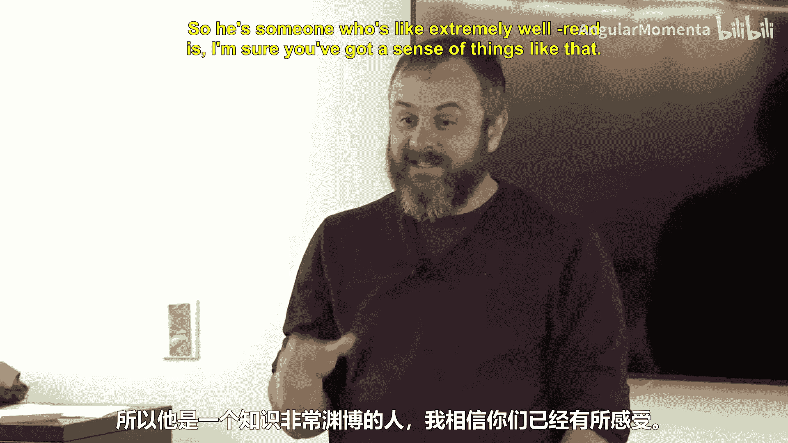
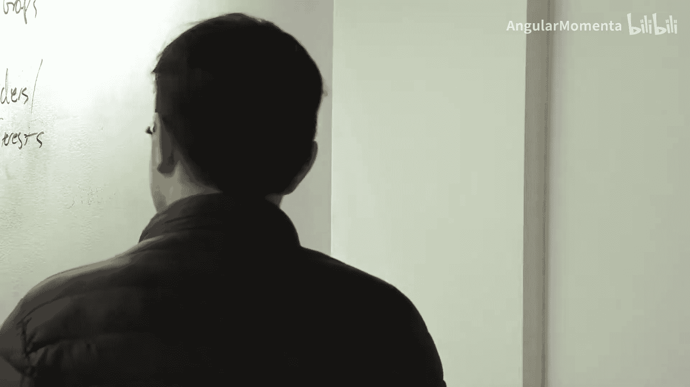
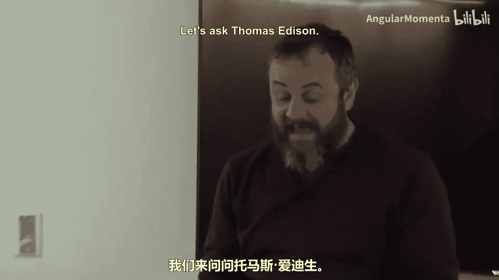

# 【麻省理工】学习、媒介与技术 ｜ MIT CMS.595 Learning, Media, and Technology, Spring 2024 p03 07. 互联网时代前的教育科技 -BV1DKUSBGEvu_p3-

To participate in this next exercise， you'll have to grab one of these index cards that are on the table that correspond to a particular technology。

 It looks like film， radio and television are amongst the remaining ones and you'll get in small groups and work on those。

 Here's what Id like you to do。Find the other people who have the same card as you discuss what you learned from the readings。

Anything that sort of stands out to you comes your mind but then I want you to make a chart which you can do on the whiteboard or on our blue pieces of paper there that capture sort of 3K ideas。

 first of all， who are all of the stakeholders who are involved in the implementation of this technology。

 One of the things that I think Larry Cuban is particularly wonderful at is giving you a sense of all of the different hands that touch a technology making its way into a school and all of the different hands that touch a technology when it's in the school this is incredibly important for understanding how technology actually get used in a lot of times in like canonical design。

 I think this comes up in sort of software engineering classes and things like this idea that there's a programmer and a user and the user is like one person who's sitting at a keyboard with their fingers on the keyboard and that's the person you need to pay attention to and that like two-part model of like designer and user totally breaks down in schools。

There are lots of people who are very different who could be considered users of technology in schools。

Another thing that that Larry Cuban does really well is he he helps us pay attention to how these people have what I'll call different interests by interests。

 I don't mean curiosities。 I mean， like incentives， stakes。

 sort of how a political scientist might use the word interest。

 All of these different stakeholders are rewarded for different kinds of things。

 They also have what we'll call disinterests or disincentives。

 they are also trying to avoid or will be punished for different kinds of things。

 So for the technology that you that you picked a Car of and are talking with your colleagues about。

 think of all of the different people who you think could be considered stakeholders in the implementation of this thing。

 and then for each of those stakeholders come up with like a couple of their interests and a couple of their disinterests or disincentives or things that punish them or those kinds of things。

 Does that as a general exercise make sense。 And the thing that we're trying to do together is we want to we want to try to recreate the world around these technologies。

 That's what。Think Larry Cuban is so fabulous at is saying like， yep。

 a television set is gonna roll into but it's gonna roll into a classroom and into a school and in a community。

 And there's all these people who are part of that。 That's what we really get here。

 I'll tell the last thing I'll tell you before I cut you loose。

 is Larry Cuban has a totally fascinating history himself。

 He was a social studies teacher in the 50s and 60s， then he was a school principal。

 then he was a superintendent， He was actually the superintendent in Arlington， Virginia。

 which is where my wife went to school。 So when my wife was an elementary school student。

 her superintendent of the time was Larry Cuban。 And Arlington， Virginia。 Fairfax close enough。

 Yeah yeah。😊，And it was only after he had like a pretty distinguished career as a teacher or principal and superintendent that he went to Stanford。

 got his dissertation， became historian of education。

 and then eventually a history of education professor out there。

 So he's someone who's like extremely well read， as I'm sure you got a sense of and things like that。

 But he also just deeply understands the kinds of things that make schools tick and make the people inside schools tick。

 Does this exercise make sense。 Find the people with your cards， move yourselves around。

 make this little chart either on the board or on these blue pieces of paper ready go。😊。

's especially those things are hugely important。 You know， like where does teaching actually happen。

 Like there's some human being， you know， who like needs to go the bathroom and needs to eat And I mean。

 here is that great core than there It's not about film。

 but television that they found that they're more likely to use television in the afternoon than in the mornings And it's all like biology and culture。

 like our brains work better in the morning， we're all a little flagging by the afternoon。

 those kinds of things。 And so yeah， I think like anybody who's building a technology has to think to themselves like you know。

 what are yeah， yeah， like what are the variations in a teacher's day。

 Like when they have more energy or less energy， how does it fit into those kinds of cycles and things like that。

 Like those are every bit as real as you know， the test score goals that we have or anything else。😊。

Miuse。' knowThis is really good， this is really good， take a few more minutes。

 take a few more minutes。啊就是。we're trying to think about his interests for schools and Sure。

 so so if you're a school， what would make you go。 and I'm not sure I want to do anything with films。

 it's 1913。 silentent films know started coming out in earnest around the turn of the century。

 there's a handful of people you know the most prominent of them is Thomas Edison。

 guyy invents the light bulb and he gets in front of Congress and he says， you know first in 1913。

 He says， I mean， I'll read the other quote。 He says in a decade。

 textbooks will be replaced by film strips。 that's how powerful this new technology is gonna be If you're a school principal。

 what would be some things that make you go。You're pretty smart， Thomas。

 but I'm not so sure about this one。That maybe they just put a bunch of money into textbook。 Sure。

 so yeah， they have an entire infrastructure built around the existing technologies。 They。

 they have shelves on the wall。 They have libraries full of books。

 Every one of their teachers has been trained to teach with textbooks and not a single one of their teachers in know when these things are first introduced has ever been in a class as a student learning from a film。

 So you have this huge， inherent conservatism in the system。 So that could be one。

 What would be what would be some others。😊，Oh， okay，か。こ key。Yeah，I mean， yeah， I。

 I guess kind of adding onto that but like integrating it into like a classroom setting like they even they're on how would they even integrate into for films。

 what would what would be some of the challenges of integration the technology that you would need to put into a classroom or to move specifically for films what some of the technology might be I mean I don't think the projectors back then classroom I mean。

 they're portable enough， but they're big big lumbering machines for which the rooms if you have a classroom let's say you had a big population growth。

 And so someone in the 1850s built a school and it was 12 kids per classroom and now you're putting 18 kids。

Classroom in there， like a totally legitimate reason we。

 There is not space in this room to physically move this machine。

 Like what are some other sort of what else do you need for films as a technology to be able to be implemented。

 So you need a giant projector。 You're gonna to put thing on wheels。 What else do you need。

place to actually project it onto Okay， good。 you're gonna to go to all your classrooms and you're gonna have to install screens at the front of the room。

 like not the hugest challenge， but also not free。 know not so who's gonna do these things films also came on these like huge reels wasn't just like pick your YouTube channel in play like where in your building are you gonna keep a library of film reels。

 who is going organize those libraries of film reels like you if you have four elementary schools four elementary classroom let's say four first grades。

 are you gonna buy four copies of this film so that everyone can watch it at the same time。

 if not how are you gonna like physically organize and move like this giant reel from one space to another you can imagine the principal being like how are are and all this stuff costs money So those are all kinds of Thomas Edison here。

that you're gonna get 100% efficient learning through this thing， which is the potential gains。

 which no one has any evidence for because it hasn't happened yet。

 But you've got to think to yourself like like what are all these costs。

 What are all these material changes。 Yeah， so think about how you can articulate some of those things。

 But like when you really get like to do this exercise Well。

 You have to like what exactly is this technology， Like even physically， what does it require。

 How many of these things do you need to buy， How much they cost， All that kind of stuff。

 How reusable are they。

あめて。不是么。Okay， this is really good。 Why don't we take a break here。

 Go ahead and you can sit back down to the seats that you were at。

 I think everyone's written kind of broadly enough that we'll be able to see from a distance。

But yeah， really good， really good。 I now I need to find a little spot for me to。Ram。

Everyone's last minute notes Yeah， yeah。 Now is your chance to put the final。

 the final few things up there。Good， so what was the minimum number of stakeholders people came up with these guys are the winners。

 with the longest list。 Let's just read it out loud。 the admin parents teachers students。

 corporations manufacturers， Ed tech investors， developers， policymakers。 Great。

 So just as a starting point， I mean， there are some other ones that showed up around here， studios。

 broadcasters， the FCC， that sort of different psychologs， Yeah。

 there are a lot of people who have something at stake in these decisions。

 They are complex multihuman kinds of decisions。 So that's a good start。

 let me just read So given how complex these things are， Why are folks so enthusiastic about it。

 Let's ask Thomas Edison。 What is Thomas Edison think about this。

 I believe that the motion picture is destined to revolutionize our educational system。

 And that in a few years， it will supplant largely， if not entirely the use of textbooks。

 I should say that on the average， we get about2%。😊。

Sent efficiency out of school books as they are written today。 You're laughing。

 Where are you laughing。Thomas Edison is just here making shit up。 He doesn't 2%。

 That doesn't mean a thing。 He was good at light bulbs。 He wasn't maybe as good at this。

 The education of the future is I see it will be conducted through the medium of the motion picture where it should be possible to obtain 100% efficiency。

 Thomas Edison 1922。 You'll read a couple of other quotes that I have from Thomas Ed。

 one of them in here in failure to disrupt when you read that。 But in 1913。

 he went in front of Congress and said in 10 years。

 the textbook will will be entirely replaced by film strips and then he went back 10 years later in 1923。

 and he said in 20 years， textbooks will be entirely replaced by film strips。

 I think you can find many similar kinds of arguments that are made today。

 I think you will not have a hard time finding people who tell you that the old fashioned techniques are only 2% efficient。

 But the new ones will be 100% efficient。 So that's the promise。

 The promise is that we could do substantially。😊，than we're doing right now if we think about implementing all of these different kinds of technologies。

So an intuition that you can develop is that this is a century old enterprise for the last hundred。

 hundred10 years， people have thought how could we take analog technologies and eventually digital technologies bring them into schools to improve learning There are millions of people who work on education。

 many of them are very， very smart。 from the early you know。

 you read a little bit about personal computers kind of from the 70s and 80s。

 the Apple 2 plus kind of the generation of computers that I grew up with But that's actually like 20 years into the game from the moment people built computers。

 the size of this room computer scientists， educators。

 learning scientists partnered together to try to figure out if there's some way to use computers to teach people。

 So so just compute not even all these other radio film other things。

 Computing alone is like a 70 year enterprise of trying to improve schools。

 there are lots of things that we've tried and learned in 70 years。

 So one intuition that I hope you'll take away from this class。😊。

that when you're thinking about an education technology problem of any form or type about a design problem。

 an implementationation problem， a policy problem， you should think to yourself。

 we probably have done something like this before， there is nothing that is so new。

 so utterly different that there aren't like cognate examples that could help us think through whatever these challenges are。

Let's think about a couple of these stakeholders， which stakeholders seem to appear pretty much in all of them。

 who seemed to be sort of universal stakeholders。Teachers。

 let's start with them because they're the best。 I， I love teachers。 I， I mean。

 definitely one of the reasons why I do what I do is I just think teachers are great。😊。

WhatWhat kinds of things get teachers excited。What， what， what， if， if you're if you're。

 if you want to get a teacher using education technology， what are the。

 what are the felt needs that they have that are gonna to be really important to them。

 This is one that I think will be pretty consistent across a bunch of these。

 But we can see if there are differences， too。 reducing their word。 Okay， good， I love it。

 reducinging workload。😊，Why is that so important to teachers？This they have so much to do。

 These are not people who spend a bunch of time like sitting around waiting for the phone during ring or something like that。

 Tea workloading in the United States is actually in certain ways。

 like much higher than other comparable OECD countries。

 So is the organization of economic cooperative development and something like that like rich countries。

30 or 40 rich countries。 American teachers compared to our colleagues in other countries。

 spend more time in front of students actually directly teaching than in many other places。

 So many other countries in the world， like a full time licensed teacher would have more collaborative planning time。

 more grading time， other kinds of things like that。

 So US teachers compared to their colleagues around the world are like behind the ball on having time anyway。

 reducing workload to something they care about。 what else they care about like it has to spark the So they don't want kids to be bored。

😊，That one of their， one of their core interests is， how am I going to keep these folks motivated。

 How am I going to keep them learning， What else do they care about。

 If you about being of actually good quality。 Okay， good， so like。

It's really important that learning goes up， that quality is high。

That you know that teachers take their professionalism very。

 very seriously know and they're held accountable in various kinds of ways and this could be different across different kinds of teachers so in the United States we primarily we test in certain kinds of ways we test like way more than every other country does there's no country that tests all of their students every year。

 third， eighth grade and both reading and math most other countries are like if you test them in the third grade you probably wait a couple years to like know I mean you give them like assessments or exams or whatever but you't give them like big national test and so if you are a teacher of reading or of math your test scores are scrutinized in a way that science teacher art teacher a health teacher。

 other kinds of teachers are not similarly scrutinized so within know there could be different kinds of incentives。

 one of the things I always enjoyed about being a history teacher is that there were never really tests that I were preparing my students for in the same way I。

😊，Private school， but even my math teacher colleagues like felt like they were preparing students for the SAT for the As。

 things like that。 That was never really my concern。 As a result。

 like I had to spend less time thinking to myself， this new thing I'm bringing in this classroom is this gonna prepare people for some kind of nearly universal testing experiences like my math teacher colleagues always had to be thinking about that。

 I could be like， well， you know， Tibetan Buddhism isn't on the test， but it's awesome。

 let's study it。 you know， so， so that's different。 Good other kinds of things。 Yeah。

 tie and then Sabrina accessibility and like inclusion。

 So that like no one's left out from your diverse group learns from any technology， yeah。😊。

And that would not be a universal concern across these decades that you know it would have been considered much more common to say like certain people have totally unsolvable learning disabilities and societies should tend to their welfare and some other kind of way in the 30s and 40s and 50s and then somewhere in the middle of the 20th century we passed the Americans with disabilities Act which totally transformed our thoughts and in fact。

 created a federal right for people to have a way of a fair and appropriate public education。

 and I would also just say educate like as society has gotten more interested in values of inclusion generally what people would have worried about with inclusion with personal computers in the 1980s is very different for what they would be worried about with the computers that are getting in front of their students right now。

 that's a great one。When is I being able to track student progress。Track progress。Assessment。Good。

 yeah， I actually interesting over this century， you know some of the earliest technologies had nothing to do with that radio and film。

 but one of the very earliest ones you read about physical teaching machines and hopefully you I mean you saw some pictures I was just actually looking today there was Sydney Prey as one of the people who Audrey Waters writes about and there's somebody on YouTube who had posted this like fabulous two- minute clip of him demonstrating one of his teacher machines and unfortunately that account was deleted before this year's class maybe I'll send you a version of it later。

 the only version of the video still exists is one in which a nonaugarwall's voice is superimposed of it So somebody took an audio clip of a nonaer wall talking about the capacities ofedX and played the audio over Si Presy demonstrating the teaching machine and it's a little too close for comfort even though it's a century apart but teaching machines they were kind of like typewriters they had these four keys that were on。

And so they would display one question at a time。 It was like pre scanron technology， you know。

 and then there would be one of four possible answers。It's one of the earliest versions。

 It had a little like bank of mints in the back of them。 And so when you press the right button。

 like a little candy or something would roll out and give you like a little behaviorist。

 positive reinforcement kinds of things。 But you know， one of the main virtues of it was like。

 oh man， if we could get enough people these things。

 Then we could like assess their progress almost constantly， we'd know exactly where they are。

 So this idea of track， you know， tracking student progress is something that's like particularly urgently concerned in our datadri world。

 but was still something that people were interested in a century ago。😊。

What are what are some of the I'll just put them under here。

 what are some of the the would be disincentives for teachers。

 what are some things that if you were trying to get teachers to adopt new technologies would be the sorts of things that would be barriers for them。

 complexity， why complexity。A lot ofThere's some teachers who are more able to adapt to new technologies and some teachers who just cannot understand how certain。

workYeah， so so I think I think that aptitude is right。 I also many like if you go into teaching。

 probably probably two things that really drive you one is you love the content that you teach。

 that's more true for secondary educators and for early elementary educators。

 but probably few forever of them。 And you probably love people。 very difficult to be a teacher。

 if you don't find people， especially young people pretty engaging。

 The kinds of folks who find people engaging， they might just find it's not 100 percent overlap。

 but theres just technology is less engaging。 like they didn't want to spend their life sitting in front of a computer typing。

 It's definitely they wanted to be interacting with people。😊。

But the other thing I would say is that there are many educators who spent a lot of time polishing their craft and are good at teaching the way they're teaching right now and have been teaching for the last decade。

 And so when they see a new piece of technology come in。

 they're thinking in themselves is this thing really gonna to be better than the thing that I've been doing and got good at for a while am what am I I'm going to have to lose something when I integrate this new thing any technology adoption involves loss。

 any change involves loss， you got to give something up。

 giving up it may be pretty good I think a lot of people think that older teachers because are less likely to adopt technology because they're not technology fluent but having worked with many。

 many teachers I'm really convinced that there's no relationship between age and technology adoption。

 They're young teachers that are super interested in they young teachers who hate it there are old teachers who are like I'm pretty good at what I do and there are old teachers who are old teachers because they've spent the last 20 years going it's really fun to try new things。

 It's really fun to try to get better。It was one of your disincentives， Sabrina， student distraction。

 great。And obviously some of these technologies are more akin to that than others。

 like if you're playing a film strip or something like that。

 like you probably have kids' attention or things like that， but certainly as we get into computers。

 anything in which the attention where each student is responsible for their own attention is something that can raise concerns for teachers because kids like to be attend all kinds of things。

What other things would be disincentives and like teacher displacement like they feel like they're being replaced？

嗯。So teachers are a profession。You know that that protects their job security with license and things like that。

 like lots of other professions do， like doctors and pharmacists and lawyers and all kinds of people。

 And yeah， and yeah， but most professionals are not super enthusiastic about technology。

 that has capacity to replace the functions that they're doing。Good。

 let's think about some of these other。So， so this is a good one。 So so again。

 we could think about anytime a new technology is being introduced。 I it going to reduce workload。

 Is it going to spark interest。 Will it spark interest in the first three weeks of this new technology being here。

 Will it spark interest two years after the technology has been introduced。

 Is it gonna be of high quality。 Do I have control over the quality， Access inclusion。

 Is it going to improve learning。 Will it be able to track assessment， Is it too complex。

 Will it like Dis my students， I it going displace essential functions that I am perform。

 like that is a good set of questions that you could Cuban does ask in some ways radio and film and television and teaching machines and computers。

 and you could ask them of AI and Khan Academy and Icivics and anything else that comes along。

 Like these are all still good questions to ask， Let's try to hit now a bunch of these other stakeholders。

 who are some of the stakeholders that surprised you， Who are the ones that you were like。

 I wouldn't have thought of this in terms of education technology。😊，Weird ones or unique ones。I mean。

 I thought like my group was the teacher machines and it was like the psychologists that like come up with the ideas that go into how these technologies are what they're based on。

Like I guess I never just really thought like oh you know it is the people who thought of constructivism and like situated learning that has then sparked his interest in everything else and so it's like people have ideas but all of that initially send from like 2000 learning so people have ideas about what good teaching and learning should be like those ideas are in some ways they seem pretty universal because we can find them going back through history but they're always being reinterpreted。

 updated things like that Si Prey is in this moment where behaviorism is an incredibly prominent set of set of ideas behaviorism you're probably all familiar with you know you punish people when they do things wrong and you reward them when you do things right and you condition their behavior that way and so he creates a physical machine that embodies those ideas you know and then you know Seymour Papper will come along and be like oh man。

 why can't we learn math the way that kids who go to visit France learn French why can't we make a thing which is math land？

that logo could be like Mathland he have a set of ideas about what good teaching and learning looks like and he incorporates those ideas and and people become partisans of these ideas know probably the most prominent partisan of education technology in the United States today is Salcon who someone who had a very particular idea like clear vision of what personalized learning would look like he had I don't know if you know about his personal experience but he was like a hedge fund person or something like that and his niece was having trouble with math and he started tutoring his niece in math and he like did it over videos and so he put the videos online people started watch them he go wow what if every person could have this little personalized tutor what if each person could sort of study math at their own individual pace and then he built this whole enterprise and continues to he's incredibly enthusiastic about AI right now because like oh man instead of just having me record a tutor for each person like what if the G can generate。

Personsonalized text related to each individual person or something like that。 and those ideas。

 you know it's not like they're just dropped in the world。

 they're advocated for that you all see the New York Time was a New York Times or Washington Post。

 somebody wrote an oped about about Salcon and AI。 It was either in the Washington Post and the New York Times。

 but it was basically something like this is the first AI that your kid will love or something like that。

 and it's basically just a sort of celebratory piece of Conmigo Good So so that's an unusual group you know in those groups I mean today they like you know like Salcon goes on the Today show and tells people what he thinks he goes to investor conferences and tells people what he thinks he goes to schools Harvard and MIT bringing him in every couple years and things like that。

 So these folks advocate for their ideas。're know the ideas the ideas there's fall from the sky。

 There's a stakeholder who is advancing those ideas。😊。

Who are some other stakeholders that seem important？

I thought it was weird that you could think about like manufacturers and the people we produce transist issues like PSMC and ASM because a bunch of schools across America all of a sudden thousands and thousands of iPads and have this big backlog requests ons or whatever is in them right now and then someone like PSMC the only people who really produceist has this huge and a lot of money that people know those folks then organize themselves into trade groups and they go to how do they advance their interests。

 they do things like give some of their materials away for schools demonstration。

 they create training programs for their materials and share them。

 they have sales and marketing people that go around and get people advanced about that。

 they like sponsor conferences， maybe they're not even directly advertising for they're just know their presence to try to encourage teachers and other sorts of groups to。

Be behind it we spend an enormous amount of money on education every year in the United States and the biggest chunk of that money goes to pay the salaries of the people who do stuff and another big chunk of that money goes to heating and air conditioning you for which there are people who are selling those things but you know basically the third biggest bucket after those too is the stuff we buy in schools to help people learn and so yeah。

 there are advocates who are you know the folks who are not neutral in these things way Apple Comp has been particularly prominent over the last bunch of years and trying to craft a vision of itself as a company that has a particular role inside colleges university schools。

 those kinds of things。I think something that surprised me but maybe it's not that surprising was like government government test all and like reason between governments because in the class we took class semester like in education。

 we talked a lot about Americanismm and how it's so linked to education and I know it' such a big thing to be like oh this country has like the biggest amount the highest I think score on average where like this maybe food con Academy or something like that so sometimes it really is just like governments competing against each other and trying to see like who's the best。

Great， and in the United States， when we talk about government actors。

 what are all the different possible government actors we might be thinking about？So there's a US。

 Department of Education。Who else is there。So there's local boards of education。

 So a very unusual thing about the United States Department of education is the United States education system is it's extremely decentralized they're 130000 schools and they're 13000 school districts。

 the modal elected official in the United States as a school board member there are more if if you're an elected official in the United States。

 the thing you are most likely to be is a school board member and you know school board members are interesting stakeholders。

 they are and they range from community communities and lots of communities。

 they're just like a community member who's particularly interested in education but they are also people who are looking to you know it's an entry point for people who are interested in political careers。

 lots of people school board members going to be on state reps and other kinds of things like that this is a particularly sort of feened moment for people who are politically who are politically ambitious to pursue those ambitious。

Through the school system， especially in the American right where reform of schools has become like a way to get kind of attention within the political party and things like that and and yeah there's there's all kinds of towns across the country where you know and I think you get some of this is like some school board is like you know it would be really great is film strips like let's go big on film strips you know it would be really great is like closed circuit television wouldnn't that be a useful thing to have you know and so it's not even like it's not the teachers it's not the superintendents it's not the people who are sort in the schools like some community members who are like let's do it。

Yeah know in the United States today， there are probably two versions of that is there are definitely school boards whose identity is sort of shaped around like being a cutting edge school like in a bunch of the affluent suburban towns around Boston know like Wellesley Newton like they want to be thought of as having like really great cutting edge forward thinking schools。

 you know Newton spend $200 million or something like that on the last high school that they build。

 And so it can be way to become a school board members like I'm going help the school system modernize and embrace technology and things like that。

 They're can also be the opposite。 there can also be people who come in。

 the most common is like people who work for the technology industry who are like you have no idea how much surveillance is built into this technology。

 all the time when I talk to know principals or superintendents or being like we're kind of having a hard time helping parents understand why these things will be useful。

 It's like someone who works for Google or Microsoft or something like that， know。

Who knows the surveillance capacity of these tools and is concerned about it。

Yeah I just kind of like an anecdote I used to work in and educational publishing I worked on mostly products of the state of Florida and really showed how much power some of these districts have because the school board would make a decision like it would several times or one or two districts in Florida something and that would change the entire roadmap for a product that see nationally so it's like you have a couple people in Florida who are like we really this thing's like kids in Arkansas also are learning differently so this is definitely still true it's breaking down a little bit because of the capacity for sort of a web publishing and custom publication but for a big chunk of what you might I don't know the latter third of the 20th century。

 the first 10 years of the 21st century like somebody publishers would publish a US history book how they decide what to make of a US history book you say well like what are the most important states to sell this history book in。

Florida is one of them。 What are the other ones。 You can name them， California。Texas， New York。

 California， Texas， New York， Florida， those are like four of the most important states just by population。

 So now you got to think about like the standards of every state has standards。

 the history standards of those four states are more important than the history standards of Maine and North Dakota and as like political things come up around history is where this happens pretty frequently it happens in math and reading and other things too yeah actually I used to do consulting for for publishers of history textbooks and once I saw the sort of matrix where it was like it was like all the possible topics along the columns and all of the states along the rows and like Xs of like where all the topics get I mean the other thing is like they'll be a huge you know group of Polish immigrants that come to some state and like they won't see Polish people representing their textbooks and so they'll be like we're only going to adopt books that like talk。

About the importance of Polish Americans in the history and the publishing companies are。 all right。

 I the Po but then the Italians do it and the Camboians do everybody else do it and the textbooks that's why when you picked up your 800 history textbook it was full of like all these like weird little bits and pieces and things like that。

 So yeah， these state level I mean， here's another like tiny feature of this but ends up being important。

 there are some states mostly in the south where material adoptions happen centrally or have some kind of centralized function So Texas。

 Florida， they have state level boards that say you can only adopt books that pass these boards。

 Massachusetts is a huge local control state。 the school districts in Massachusetts will go bonkers if the state tried to tell them which textbooks they could or could not use be like another revolution want to by land to by sea class Mercedes or whatever it is。

 and。😊，they just wouldn't allow out it， but it means that those states that have this sort of centralized function actually end up having more influence over the publishers because they say。

 look， you want to sell a book here。 know and now it's not just a book。

 now it's a web program or things like that Now the thing that sort of like is breaking away some of that monopoly although also causing kind of problems is you know states can say like okay we want to we're gonna to pass all these laws that have the effect of like way ramping down the teaching of black history and know publishers can be like all right。

 well， your web version of that we'll delete this and this and this and this。

 but you know over in New York or California and liberal states。

 you can have all that kind of stuff in there。 Yeah Yeah kind of going off of that like platforms play a large role in most of these places And us that's very much there as an example from my own country。

at every public school they have like a speaker system like at the start of the school specifically because they want to play the national anthem。

 that's something they really earlyly the kids have to do it。To like， oh。

 there's so much like technology。 that just one thing。 Why is this the only piece of。

 There is like some kind of incentive what to build with like， you know。

Kind of politicalAnd then does does the does that broadcast system be used at other parts of the day as well or only gets used as the start of the schoolwork。

 the National Asm have like some like some kids every like classroom does like where they just like。

Do like some village stuff。Some like Arabic poems， some like fun facts and didn't just mostly I love that。

 I think that's a fabulous example。 so whatever the state government is like the state is in nation the nation state government says every school must broadcast the national anthem every day every single school in the country then has to build a technology infrastructure that allows that to happen。

 And then once that technology infrastructure is there。

 it can be used in other kinds of ways as well or not used or other kinds of things like that。

 you can find national examples of this in other kinds of ways one of the most interesting countries right now for education policymakerrs to watch is Estonia about every decade like some country that people aren't really paying attention to gets really good international test scores So Singapore was it for a while Finland was it for a while people are obsessed with Finland for a while in Estonia is kind of last like who are you people why are you so good at reading and Estonia is very。

Famous for it sometimes it's called Estonia。 Their government has really embraced the Internet in a very centralized kind of way。

 And so people are looking at and thinking about how education technologies are adopted in Estonia and other kinds of ways。

 But but it wasn't a policy that was just for the schools they were like。

 we're gonna to put Estonia in the map by having really good digital government services。

 And that national policy decision ends up affecting the learning experiences of kids in schools in all kinds of places。

 Yeah， that's a great example。😊，Students， what are， what are， what are the interests and and。

 and disincentives of students。a piece of technology。 okay， so almost all of us like novelty。

 That is one of the advantages the technology has one of the although an amazing thing about novelty is how shockingly quickly it wears off。

 I was reading this on Red the other day。 someone a teacher was being like like I brought an Nintendo switch into class so we could play these mathematical logic games And my students were like。

 oh， please miss， can we just do worksheets。 And I was like fine， do worksheets then。

 But like play some online game。 there would have been some moment that this class would be like。

 what we could play a computer game in class is amazing。 But that is you know。

 it's a sort of it's an interesting feature of education technology adoption that like novelty can be extremely compelling for a short period of time and then wear off pretty quickly。

😊，Do you have any comment on like。Why students default is now back to that pen and paper like the way like because I mean people are always like education has been the same for decades and why does it always look this way even after we've reformed it。

 like why is the default that pen and paper Good。So well let's just highlight an important thing that you observed which we were talking about over here too。

 which is just schools are incredibly conservative institutions why would that small concern not right wing some of them are but the small C conservative they do things the same way over and over again what are some possible reasons for that One is if you when interviewed parents and said who are another stakeholder that a bunch of people brought up how much do you want us experimenting with your children the answer to that is going to be pretty low like the enthusiasm that people have for experimenting on children is low Second。

 everyone in the educational system who's an adult has what's been sometimes called the apprenticeship of observation you all have been in school somewhere between like 13 and 18 years and that shapes your experience and so people who have roughly the same educational level as you go into schools and become teachers and they bring that 13。

1820 years of educational experience with them and that shapes the way you think schools should unfold。

Parents can bring those expectations in。 I was I will never forget this。 I was once working。

 I was conversing with a school in Utah that was trying to switch to openly licensed materials。

 It was pretty I don 15 years ago， 18 years ago or something like that they're trying to get away from textbooks and to have people use digital materials。

 particularly digital materials that their teachers could edit so that they could make them tailor to their students and things like that and and they said but they still kept textbooks and classroom and I can't tell you whether or not there's true says the reason why we keep textbooks and classrooms is that there aren't textbooks and classrooms。

 parents will be upset like like parents when they go into a classroom expect to see textbooks that basically it was cheaper to keep buying enough textbooks to be in all of the classrooms than it was to like hire administrators to explain to parents why they weren't textbooks in the classroom anymore。

So all of these different stakeholders， this sort of conservative vision of education is kind of part of that。

 One possibility is that that's really bad that they're actually like way better ways of doing things that are out there。

 And it's a bummer that we so conservative and that's really holding us back。

 Another possibility is that the practices that exist in schools have been refined over decades and centuries and they are the way they are because they're pretty darn good that we keep doing certain kinds of things because they work。

 So you'll have to figure out for yourself as， you know。

 if you hear examples of students kind of adopting old practices or they adopting those practices because they work really well and because they like them because they're comfortable and familiar there's an argument that particularly in our age where students are sort of fixated on grades and performance in a way that they might have not been in decades past because not not because kids are like more materialistic or something because of economic uncertainty。

😊，Because as the gap between wealthy and poor people widens and the stakes of education become higher。

 people become more fixated on it and so those kids who are sort of adopting familiar matters。

 like do they really like the familiarity or do they know how to do well in the familiarity and things like that。

 but again like all the you know keep tying all the things we were talking about back to the decision of educators trying to implement new technologies。

Everyone in your system is going to have some kind of conservative impulse all the way down to students。

 That conservative impulse might be balanced by the novelty effect that we're talking about。

 but it's in there。 So if you want a new technology to really be adapt in some kind of meaningful way。

 One strategy you can have is to have it align with existing practices。

 You could say let's take technologies that do the kinds of things that are already happening in schools like that will be less upsetting thatll require less training that will require less upset。

 it probably also won't help that much。 I mean， the people selling the technology won't say。

 But if you're just like digitizing existing practices。

 how likely are you to have substantial gains from digitizing existing practices。

 or maybe you're like a big ambitious reform say， no， no， no， we could be doing so much better。

 We could go from 2% to 100% efficiency in schools。 We just have to make big changes in our practice。

 Well making big changes in practice requires convincing people to change all of these things。

 was I' read this book a zillion times now。 But I was just revisiting。LIn here that I loved。 It was。

 he said something towards the end that were like。Settings have plans for their inhabitants。

And remember who was talking about the physical layout of a classroom。

 but he was using a broader sociological principle。 Settings have plans for their inhabitants。

 People interact in a space in a certain way because the physical space is laid out and built in that way。

 So I was talking with these guys about one of the problems that film strips have to have a film strip in your classroom You have to take a giant projector on wheels and you have to roll it into the space。

 there would have been some classrooms filled with early 20th century。

 urban schools with tons of immigrants who were pouring in on America shores that don't have room in their classroom for a big thing。

 The other thing that film strips had that was a huge pain is these giant film reels。

 know the early film reels were really， really big where you gonna put these things。 You know。

 your town did not build a building that had like an archival film studio storage unit attached to it Let's say you have a big school and there four first grade classes and you want to buy a film。

😊，For all four of those first are you going are you going to buy four copies of the same film strip like is each classroom going to have its own film library if it has some centralized library you have to have some way of like tagging archiving。

 maintaining those things， bringing into classrooms their contemporary versions of all of these things Oh you want to give every kid a device how is that kids device going to get on the network how is they going to be able to log in who's going deal when they lose their password what's going to happen when their devices break are you going are you going to make families pay for the devices they break your kids are super poor they can't afford that so you're going to contract with insurance company who on your staff has experience contracting with insurance companies to ensure computing devices like you didn't learn that I mean we'll talk with the education school deans on Wednesday but I'm pretty sure they're not teaching their students how to manage insurance contracts and things like that。

All of those things become， you know， well， you know。

 they have a combination of incentives and disincentives that are associated with them， good。Any。

 any of these other people that it seems like is important for us to touch on before we。

Come to conclusion。 we talked about parents。 Yeah， I， I， I mean， I don't know that how much we talk。

 maybes one last thing that we could sort of talk about。

 We talked a little bit about school administrators， but。

Like a thing to be particularly attentive to in in schools is just how many different kinds of adults with different roles there are。

 So we talked about teachers。 There are people who are school principals。

 like if you're a school principal， what are the most urgent concerns that you have on any given day。

 what are the main incentives you have as a school principal Yep。

 you got to make sure you can pay for everything， a teachers not worried about that。

 teacher will buy as much know if the school pay for it。

 they'll take as much technology as they want。 you know some of them。

 but principals have to balance a budget I mean， the weird thing is in the United States。

 it may not at all be a principal's role to balance a budget it may be entirely a district role So there are some school districts where the district will make all the purchasing decisions。

 There are other districts where the districts will take big chunks of money。

 send it down to schools and say schools make all the purchasing decisions。嗯什么。

What what else is super important for principals I was going to say like just like maintaining the school building itself for like student safety。

 yep， student safety， maintaining the physical school building， you know。

 making sure things are running and operating and stuff like that。

And they're also managing a relationships like the district also parents like all these outside so and they are you know principals are sort of quintessential organizational behavior middle managers。

 they're like empowered to do some things but not others they're accountable to lots of different kinds of stakeholders there's all kinds of complexity in what they're doing a lot of them are pretty keyed evaluated based on test scores especially in places where people are where students are at risk of not passing tests and depending upon the policy infrastructure test scores really matter to them safety and the orderly operation of schools like know like every person in the building wants schools to be orderly but when schools are disorderly the person who has to deal with it the most is like an assistant principal or the principal it's just more work for them you know like let all the kids have phones and know fights breakout and all kinds of things happen it's teachers have to deal with it the principals really have to deal with it I just like really short comment when you ask us what does the principal。

I've been around them my entire life and I was like I can only think of like two or three things that I know what principal actually does and I just think it's really strange that like most people aren't sitting you down being like this is the person you go to for X Y and Z thing。

Yeah， around these organizations good good。 So there there are。

 I think there are a few things that you can grasp from that insight。 first of all， schools are just。

Unbelievably complicated， I've spent the last 20 years basically doing nothing but thinking about schools。

 And I still don't understand all the things that are going on in there。

 They are like if you want like just as an ecosystem in there unbelievably complex and fascinating。

 The second is as you transition if you decide to work being involved in education。

 you kind of have to like relearn all this stuff going from a student to being someone who's working in education。

 Like there's all kinds of things that were hidden from you mastery or just sort of weren't important to you。

 know like the odds that any of you were like real troublemakers is pretty low。

 given that you're at MIT。 but know there's a classroom full of people sitting somewhere that like new principles pretty intimately because they spent a bunch time in their office。

 because of things that they did and so forth。 So good， yeah。

 if part of what happens to you in this class is a lot of times in social science。

 we talk about making them familiar， unfamiliar。 a thing that you've looked at your whole life and being like。

 whoa， look at all these things there that wasn't sort of paying attention to or wasn't made aware of me。

😊，And those kinds of things。Maybe here's here's one very concrete thing。

 Let's think of something like a student information system or canvas。

 Let's think of something like a learning management system。 Who spends the most time using canvas。

Te me about other people who use Can。Students spend spend a lot of hours logged in。

 looking at stuff on canvas， who else looks at Can， teachers， teachers， who buys canvas？

Not students and teachers in business school， I think they would call this a third party payer problem。

 So if you are a company that's making a learning management system。Who's like of your stakeholders？

Who has the most power to determine whether or not your thing gets purchased。

Like some director of education technology or something like that， some I T person。 So if。

 if you' have ever wondered， like， why is this so terrible， It wasn't built for you。in some。

 in some important ways， it was literally not built for you。

 It was built to solve the problems of some middle level information technology manager who's going to buy one of those things。

 So third party payer problems are rife across I mean。

 the problem with third party payer problems from like a classical economics point of view is you just have misaligned incentives。

 you know， in， in some respects， you could say that improving the teaching and learning experience on canvas is a cost。

 It's something like reduces your probably obviously， you have to make it good enough so that。

 you know， if like enough teachers and stuff world。 once any you ever have to use blackboard。Okay。

 good。 I once。 I once met the guy who made Blackboard。

 and I was just standing there in line behind him or something I got being like。

 what would it be like to have made a piece of software that millions of people hate Like what would have been like to like introduce so much unhappiness in the world with what you've built like and I it was it would have been rude。

 I think in the buffet line to ask him to ask him that question。

 Here's another thing I want to say about who buys these things。 And this is really important too。

 especially any of you who are interested in either an education starting an education start or other kinds of things。

😊，呃。Who in a school can buy technology。 What are some possible titles of people who buy technology。

We've mentioned a few them a librarian could buy technology。Department chair。

 a department chair goodbye buy technology。TeacherA teacher， they are amongst the least likely。

 actually， one of sometimes people have made the argument that a problem in the education system is it's very difficult to have a real sort of bottom up marketplace kind of effect like teachers have in most places。

 teachers have very few discretionary dollars to decide I mean that's why they're like holding big sales and when you become parents like your teachers will ask you to bring in boxes of tissues and things like that and you'll be like what broken failed country do we live in where you cannot simply buy all the tissues that you need for the children paper two reams of paper semester for all your students so the teachers don't in some cases they do but a lot cases principals can buy things directors of instructional technology can buy things Assistant superintendents can buy things。

 Superintendents can buy things school boards in some places can directly authorize kinds of things although it's probably more rare。

 but they can push for it But the point is across the 13000 school districts in 13000 schools in this country。

The answer to the question who can buy something is different in all of those contexts。

 that makes starting an education technology company very， very difficult。When you go somewhere。

 you don't even know who can buy the thing。 Like， you don't even know who you're selling to。 Now。

 there are people who do know who buys all these things。

 The only people in the United States who know for every school in every district who has the power to buy stuff are giant publishers。

 Pearson， Houghton Mifflin， what was the company you work for。Mcgraw Hill。

 they have an army of salespeople， This army of salespeople have fanned out across the 13000 school districts。

 and once a month， once a quarter， all the people I just listed who can actually buy things。

 they take them out to lunch。 they bring them free supplies。

 they do all that stuff they probably don't have a master lists somewhere instead they have all these salespeople who know the answers to these question。

 So if you're a Silicon Valley startup and you're like I know I've got this new like A fig9 building。

 It's super cool you don't have this massive network of sales connections to help you figure this out。

 one of my favorite illustrations of this is at a bunch of education technology conferences how many you have been to a conference where they have like you have a badge and you can put stickers on your badges or other things like this。

 Basically one of the stickers， you can put on your badge， you put your pronouns。

 you can put some other things like that。 you can put buyer You basically like signal to people like I actually have the power to purchase things。

 And then when you when you walk through the exhibit。😊，Hall。

 they will pay more attention to the people who have a little buyer things on them than they will to like you know critical social science researcher badge put on your thing or something like that。

 So that is an incredible。 So here are some things that you should take away the systems are incredibly complicated。

 They are all kinds of stakeholders in them， but they they're not so infinite。

 they're not so complex that we can't like make a chart that sort of manages and starts to understand all these things。

 But as we move forward and as we look at more sort a thing that you can do in any kind of education technology problem。

 any education is be like all right， who are gonna to be the stakeholders for this problem。

 this thing。 and what are they going to be their interests。 the more。

 you know and not you know again， not just like their official interests。

 their official like state policy interests is to raise test scores or something like that。

 But one of my favorite examples we're talking about is。😊。

Televisions were more likely to be used at the end of the day because people were tired like your body's circadian rhythm indicates how technology be used in classroom that is just as real is just as real as the policy mandate to raise test scores or the school board's enthusiasm for technology or whatever it is and so we we can in any kind of system we can figure out who are the stakeholders in the system。

 what are the interests of this things， what are the disinterest。

 a thing is more likely to work if it attends to those real meaningful felt interests and if it avoids those real meaningful felt disinterest and of course we're doing this like in a very detailed way in education。

 but if you were to leave education and you were to go into health care if you were to go into legal technology if you're going to retail you can do the exact same exercise the technology that you're building for a hospital like it has to work for a doctor but has to work for a nurse and orderly and a patient and the patient's representative and the hospitals lawyers and all these different kinds of people。

And so， you know on the one hand， especially when people are designers of software。

 we can have this sense of like， oh I'm building things for a user。

 I'm building things for like this individual user who's got their fingers on their keyboard or their thumb on the screen or something like that。

 but I would encourage you as we're thinking through all these things to think about these networks of interests and stakeholders much more broadly。

Okay， we'll talk to some education school deans on Wednesday。

 we'll learn a little bit about implementation， how you overcome some of these kinds of challenges for me。

 we'll hear a little bit about the National Education Technology plan。

 and I will pair you up with each other to be able to do some peer editing of your essays and that will get us through the week Sound good Bno。

 let me know if I can help you with anything。 otherwise have a wonderful rest of your afternoon。

