# 【麻省理工】学习、媒介与技术 ｜ MIT CMS.595 Learning, Media, and Technology, Spring 2024 p04 09. 大规模开放在线课程（MOOCs） -BV1DKUSBGEvu_p4-

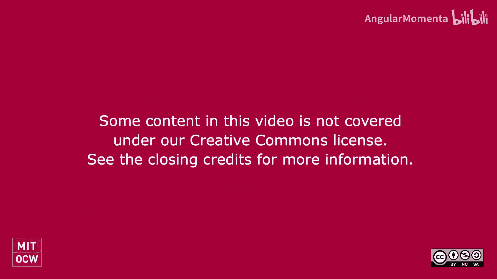

I'm very interested to know your experiences from last class。

 what your thoughts were on the NETP discussion in the small group conversations that you have。

 did anybody find themselves in conversations that were of interest？

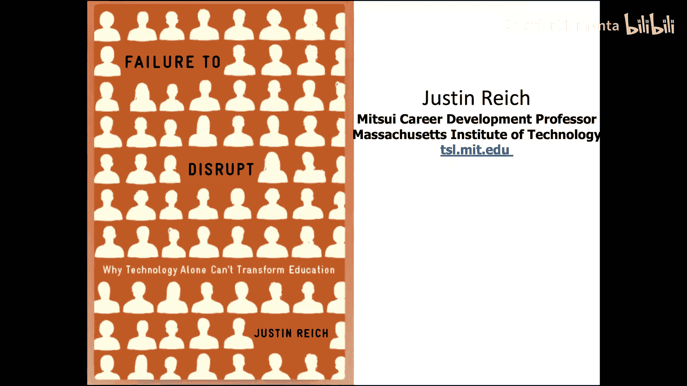

I think my group like。It was a lot of discussion on how they themselves are like trying to bring around these new innovations。

 but a lot of this like teacher lashback and some people are having a really hard time moving forwards and then some people are doing a good job all。

They need to get those who are proactive about LA like altogether together I thought it was interesting like I kind of proposed a question to the group。

About like how they see like all of these ideologies like playing a part。In higher education。

 a lot of the times， like specifically the research that you guys do。

2 but like how can this really be implemented in colleges and especially like at a university like MIT where you have professors being hired not because they're good teachers but because they're experts in the field and I think that it just kind prompted an interesting discussion about。

Like where schools need to prioritize。Whether they're research institutions or like educational facilities。

 cool。Other folks， what else did you end up talking about with your new education school colleagues or what else was interesting to you about the National education Tech plan discussion or anything else？

Thai and then Omar， Yeah it was interestingmar and I were in。Let see if this overlaps。

There wasn't a ton of conversation in our group， but they did They did ask me about my time as like software engineering and how we thought about like iteration and in the software development space and how then they tried to start making parallels to how they try to implement it in their own schools and we talked a little bit about some of the differences and where things might be more complex or harder。

 So it was like an interesting conversation to try to take my experience and reapplo it。 That's cool。

 That's great。Yeah， so again there wasn't that much just that you kind of went to what It see。

 so I guess I'll touch on I'll touch on the first part of the session a big。Conversation。

 I was reading in the chat and it was pretty cool to see like everybody like commenting on everything and seeing like a bunch of examples and seeing either frustrations or revelations that they never realized。

About like you know， the message of focusing on。Not the technology itself， but like。我。

What we can do and how technology can help and what we're trying to do first。

And pretty cool to see if yeah you get to watch human development in real time people encounter whether I didn't follow it that closely because I was talking did whether frustrations with anything on the frustration side that sort of stuck out to you or seem memorable not necessarily frustration but sort of like。

😊，Oh， that's what I like。This is happening here like why， okay now this is starting to make sense。

 so it's sort of like great frustration we're like here about so to。Great， good。Hi， everyone。

You got to come up here and hang out with me， that's what happens when you get towards the end yeah also Os and I were in the same group。

 we had a spicy one。Yeah， so like a lot of the discussion was about。

Like a lot of the people that group are like the people like。

Designing the structures that they were trying to implement and something that was interesting was this like repeated like。

 oh， like we design something。 we send it to like the administration。 They're like， no。

 that's not exactly what we were looking for Try again。

 And it's just kind of like constantly trying to get something that they're like， okay。

 like I like this as opposed to like。Then being able to like。

Like effectively communicate the points that they want included。

 This was very interesting Well part part of the way I read our group is that we had some people who were kind of middle level leaders and they were trying to convince more senior leaders to make change and the senior leaders were much slower and less interesting in that。

 which happens in basically every kind of institution like when you go and visit an institution。

 one way to think about it is it is。Designed exactly to do what it's doing right now that like it functions the way it functions because there's some set of actors who want it to function that way。

 Often those folks are sort of people with power and control。 And you know。

 it exists the way it does because that's what they want。 And then new people come along。

 New people live in that environment And they're like， well。

 this could be better And this could be better And this could be better。 And this could be better。

 And then more senior folks are like， but we like the way we've done it all the time。

 And so it's not uncommon for people coming out。 you know。

 I think really healthy organizations sort of recognize like， oh。

 we need to be constantly improving and constantly improving means like throwing away and destroying things that I have built over my career because that's the only way you sort of get better。

 But pretty understandable that people wouldn't feel that way。

 like I've spent my career building this thing。 Why don't we just keep doing this thing And so they were sort of struggling with you know in an interesting place where lots of people and lots of organizations find themselves is like。

 okay， we need to do something different。 But the people in charge aren't really supportive。😊。

Like how do we kind of do it anyway， Like how you know where change comes from。

 I don't know maybe I mentioned this I can I can't remember if I mention this particular story。

 but one of the people that I worked with on some of the content that's in iterate is this guy Peter Sge who's at the management school at Sloan and a neat thing about working with him is he's done a ton of stuff in education。

 but lots of stuff in many other sectors and comes up periodically like man teachers lots of people in education just don't feel empowered to make change they feel like look I got hired in this particular role I'm a math teacher。

 I'm a history teacher， I'm a chemistry professor it's not my job to fix the university and Peter once said so many of me along the lines of everyone in every industry feels that way。

 like CEOs don't feel like they're empowered to make change in the intitute。

 Nobody feels like they're empowered to make change in institutions but change still happens all the time because people who don't necessarily feel empowered still take it upon themselves to try new things new things in the world and I don't know it's a story。

like to retell educators because it's like this is not an education specific problem this is like a human problem Yeah I thought said from the University of Kentucky was really fascinating because I'm actually from Kentucky I worked an organization with her before called the Kentucky student voice and then when did they like impact changes by putting students in like stakeholder position instead of like influencing change through an effective put students at the forefront she's like a really big leader in driving I guess educational that's great I'm glad you had that connection that's did you so she at the university ran a sort of student voice thing that like high school students across Kentucky could participate and stuff so it was something called the committee but now it's like an independent organization and I guess organization has like adults and younger students as like co peers like they put them on like the same level the hierarchy to work together to I guess craft a bunch。

And for Kentucky schools there are all kinds of education technology tons of cool stuff like that in part because lots of young people can get interested and excited by technology and so bring them in into leadership role partnership roles cities had that too there's a group in Boston called the high square task force which does all kinds of they usually do more sort of like you know community organizing kind of like adversarial like why are you doing this to us why are you doing this way they they have a whole campaign they're doing right now against either Shaws or stop and shop which is separate from their education work but they've gone to a bunch of grocery stores in neighborhoods around Boston and bought the same thing in each store and basically found that in some you know sort of minoritized poverty impacted neighborhoods the groceries are more expensive than they are and Newton Wellesley or stuff like that and they're sort of holding stop and shop is not happy with these kids being thn in their side it's great Yeah yeah yeah yeah they're pretty getting pressed for what they do and things like that。

They'll probably have to respond at some point good Well I enjoyed letting you all connect with them it sounds like the meeting know every time you go into breakout rooms it's sort of uneven。

 but hopefully it's a good sense for you to meet some of the people who are in higher education who are trying to make the changes that we're going talk about you know in the past few weeks and for the rest of the semester so hopefully that was a neat opportunity why don't you take a couple minutes before I launch into things just to chat with each other and then we can surface some of these ideas but the learning journal prompt that had for you was to talk about like what role does technology play in your MIT education thus far and so talk to the person next to you。

 some of you might not be from MIT or some of you might be in graduate school and so you have some undergraduate connections to this as well those things are all fine sort of technology and higher education typically the things that are most useful to talk about are either either。

Systems are tools or things that you think are like particularly helpful or useful systemss are tools or things that are particularly damaging or harmful or pointless or a waste of your time and then also anything that like has started to seem really familiar to you。

 but actually you think has like interesting unfamiliar qualities or the things that sort of like feel standard and boring。

 but actually they're important， maybe in ways that we don't want to think about so turn to the two or three people next to you talk for a few minutes about like if you were to explain to someone not from your undergraduate institution like the role that technology plays there what would be the couple of stories that you would tell。

Ready go。Okay， come on back。be great to keep trying to hear from everybody。

 So would love to some folks who haven't shared yet， would love to hear what are。

 what are some what are some MI I T highlights or low lights or sort of distinctive parts of or or in your undergraduate program。

 distinctive parts of technologies。😊，Ptty yeah Ja my my group was discussing like MIT's use of Can and like pre COVD MIT had this weird sort of proprietary to everything where they had their own stellar Yeah so they had like each class had their own different stellar website and it wasn't standardized at all and it was kind of a mess it like had this weird outdated sort of 1990s internet era aesthetic to it it was pretty horrible。

And then they had this sort of proprietary thing called the learning module。

which was basically Can like MIT was just trying to make Can。

 but then during the pandemic I guess you know they decided to make Can and much more standard and so I found that to be very helpful for keeping everything organized and having assignments you done through Canvas as opposed to being like oh crap what's that website I have to go to search up stellar MIT and it was weird but I feel like。

Because of that， a lot of professors don't fully utilize all the different things that Canvas has to offer。

 especially when it comes to grades and putting grades。Professors and TAs。Don't care about。

Like inputting grades and like a lot of students would I feel would really like to see realtime feedback like on their grades and how that actively affects their final grade in the class but that just isn't professors don't do that and then I mean another thing sort of unusual we'll talk about this more as the semester goes on but it does seem a little weird that you would have the exact same canvas template for a graduate seminar on chemistry synthesis and an undergraduate seminar on Renaissance poetry and like you know if you're studying really different kinds of things does it really make sense to have the same structure for all of those different kinds of things like it seems like there should be some differences there what were you going say like we talked about MITX which is like。

Physics use it， and then a lot of math classes use it。 I like how it's like。

Even like it's sometimes like recordings of like a concept introducing you to a concept or it could be in writing but it's not as like dense as a textbook where you're kind of like oh I dont want to start reading this and then it's like right after when they introduce it you have like kind of check questions where it's kind of like checking for your understanding and immediately tells you if you're right or wrong which is really nice because like for math I feel like。

So like when you're told like oh， this is right answer you're more focused on the process of getting to it rather than the answer itself which is a lot more beneficial when you're doing math。

 like you care about the process of how to get to that answer and not the answer itself So I think it's really really nice to have that platform especially math and you could imagine for all of those auto graded problems you've ever done five years ago。

 you very likely would have done those PSsets on paper you have turned the PSsets into a TA T TA would have gotten hundreds of them it would have taken them a week。

10 days， two weeks to turn around or something like that and so by the time it gets handed back to you。

 you might get the answer key sooner but the time you get it can be days or weeks after doing a problem that you out whether you got it written and you just forgot how you did it or like what you were thinking about that time so you could definitely imagine some real advantages to that kind of instant it can change the way study groups operate to both for good and bad but you could imagine that like study groups previously would have been like。

Okay， let's all like write this piece set， they all write the piece it turn in they're like。

 hope that worked， but when you have the kind of auto grading， you know you can be like wait。

 half of us did not get this right， like why didn't we you know what can we learn from each other。

 you know there's all kinds of ways that that instant feedback can change the relationships that you have with that learning。

Good other thoughts，How you going to say something。Notability has really transformed the way I。

 for example， organize all of my classwork and the fact that everyone uses their iPads now instead of going to paper and pencil。

 I think。Yeah， I just the fact that we can have all of our lecture notes and then upload it to notability。

 we can annotate it and then do all of our homework on here too and be able to like compare screens and things like that and I think that's really like before I only ever really used paper and pencil and then searchinging the fact that MIT gave out iPads to everyone and then because we have the resources that have notability for free or。

And the fact that we like submit everything electronic right now has kind of been a little bit of a game changer。

Does notability have any social features like do you just have your own notability or other ways okay。

 they recently added some like share your notes kind of gallery search thing。

also a good old screenshot that iPads i you can just text good share it like you can dual screen on the iPad。

 which isn't necessarily an aspect also dual screen you pull up else's room。

Theres some very specific applications for。Some of those kinds of things， good other thoughts。

 if you have one more like same thought。😊，Catu has been kind of revolutionary and that like。

 I guess in a way that I've heard it this， but you got to tell us what it is again。

It is CattSo is an automatic tutor for 601 problems。

used to like an old introductory computer science course that are required for most six majors。

 but they placed them out like three years ago。啊。I don't remember what 601 specifically was。

 but that's what cap stands for， it's like a recurive。Acronym。

 but like I guess in a way like I've never I never got to use S。

 but in a way that sort of had become the new seller in the sense that like each class has a a little different website and each like upload problems on there and I have found it to be kind of nice because it all sounds of like a copygrator。

It lets you like submit stuff or recitation like in class and I find like it's pretty great。

 I like the interface， but I just hate the fact that I book every single different website or as I forget those。

Good some those things。 I mean， to add to that， like different course， I mean。

 Ive seen the most course 6 more Yeah， like different course 6。

Classes use it to different degrees and they there is a little fall forward there there are some classes for the entire classes on there and then you go to your class in the basement with 40 people and they're all trying to log in at the same time so that they're marked this present and they're starting their lab and everything just crashes that is so comforting to me because I run this system called teacher moments and we have similar problems but like I'm not an MIT computer science professor and the and the fact that their shit doesn't work either is very。

like that's very comforting to me I think that there's one thing that like we kind of discussed which is like an application of the MITX is like typically most freshmen at MIT take like the 801802 Tl series and I feel like that gives like this false advertisement of how education technologies used here at MIT where they like give you this like flipped classroom idea and like some kids like love it and then you switch into another class and you never see that type of learning again and you're like well I liked that so where is it and like for me who like struggled through it because I was like a student that was kind of behind going in like then I switch to like my course 16 classes where it's like a professor lecturing in front of you and all of a sudden I now understand the concept it's like why did I lose a whole year So it's like kind of like that back and forth between my。

Like， are you going to continue to implement this in other ways or are we just stagnant in this one idea behind it？

Yeah yeah， yeah that's really I mean TeL is an experience in a lot of you about if you're not from here。

 TL is a way that they do introductory physics teaching， it came about because of high failure rates。

 particularly from people who came from backgrounds where they were less well prepared in physics and so 801802 these introductory physics classes would be taught as lectures with problem sets and things like that it also actually there's a long a really we won't get into a really interesting tradition of research in physics education which I don't know three decades ago maybe discovered that when students even at really good universities take introductory physics historically they were actually less Newtonian in their thinking at the end of the class than at the beginning like they got good grades they could solve all the kinds of physics problems but then they gave them this this sort of assessment called the force concept inventory which was a bunch of conceptual questions about how forcework and students would actually do worse at the end of the class that they would do at the beginning。

So there is this sense that like you could spend a whole bunch of time teaching people the procedures of physics and they would actually come to like slightly more misunderstand the concepts as a result of that。

 which is bad and so active learning know learning environments where students are to not just listen and take notes and then do problem sets but to like engage during the conversations about the material were shown to improve that and then Tl stuck around because while people have individual experiences with it。

 there fewer students who failed 801 and 802 after Tl was implemented and given a few years to like ramp up and work right than there were beforehand however。

 just because on average Tl the Tl system is more likely to have more students persist doesn't mean that for any individual student like individual students can still not like it and it can sort of not serve them well and it can not serve them well because of their background preparation or because you know I mean lots of people who come to MIT end up here because they're pretty good at teaching。

themself stuff through lectures and so you know， alternate methods， you know。

 when the physics department is trying to think about what to do with that。

 these are all the kinds of trade offs that they're considering are you say slides。

 especially when you're taking classes course or math when professors use slides it affects learning because I like。

When they use important like walking slow them down the learning Yeah no I think it's really interesting they're probably they're less likely to have errors on the slides than they are when they're working things out by hand however。

 it's not totally clear whether or not errors are a bad thing in sometimes people note the errors in real time or they note them in real time in but definitely if you can only sort talk and move at the pace at which someone can write that can have different kind ofs。

 mean the slides are they get sort automatically sent to you， they can be to in advance。

 you can take notess directly on them is taking notes directly on them actually better or is it better to have to hand copy pay attention what's going on there。

 these are all great questions。 they're all questions that actually have research behind them。

 are folks who come up with experiments where they test all of these different。😊。

What do we do when we tell students to try to copy everything down。

 what do we do when we tell students to summarize what if they give them stuff in advance。

 what if we let them have computers， whatever they take away their computers actually some of the best places to do this research end up being military schools like West Point and the Naval Academy and stuff like that because they have a lot of required classes and because you can be pretty sure that the students will do what you tell them to do you assign them to either condition and they kind of like they do what they want to good maybe so an interesting thing about our own experiences is that our own experiences are really important sources of data for understanding education technology it's important for us to look through the lens of our own learning experiences and they can be very informative the other thing to remember is that if you're studying at MIT you're probably weird they're probably characteristics of you which are not typical if you generally find classroom learning pleasant you are unusual if you think to yourself man。

really like just kind of like learning stuff and figuring out on my own in academic material that is unusual。

 Most people are not good at those things and don't find them enjoyable so it could be helpful to bring your own experience。

 but it's also important to recognize the way I went to private schools my whole life I've had an extraordinarily privileged educational upbringing doesn' in lots of ways I have to recognize how that upbringing does not prepare me well to understand the learning experiences of most students who go to K12 schools and public schools in the United States and things like that。

 So be conscientious of that as we do some thinking but this stuff is good all the things you're talking about are things will keep trying to make sense of。

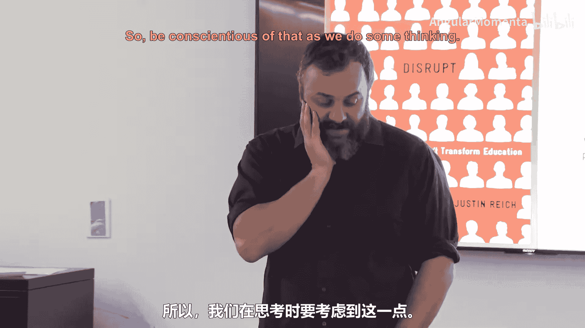

Failure to disrupt。This is a book about largescale learning， learning environments with many。

 many learners and few experts to guide them and I would say the heart of what I'm trying to do in this book is to is to demystify education technology for people and and to say you know with every generation of new technologies。

 there will be folks who come along that try to go to schools and say this thing is totally brand new。

 this is disruptive This is innovative。 this is a game changer this is going to transform education and my job is to be like probably not。

 it might be helpful but it's very， very unlikely that it will be any of those kinds of things one of the ways to demystify technologies is to show where they come from is to say these things have patterns。

 the patterns are recognizable They are patterns not just in how these things are designed but how they get implemented。

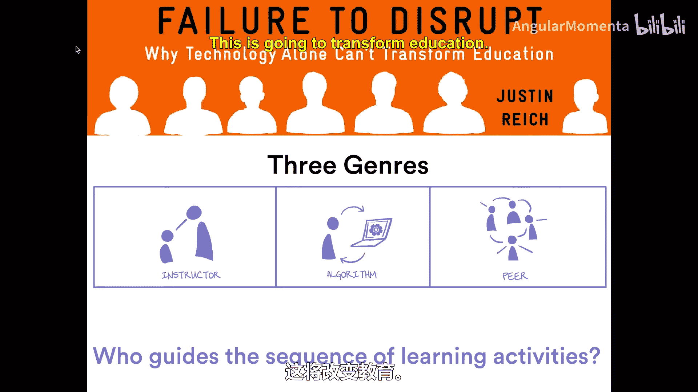

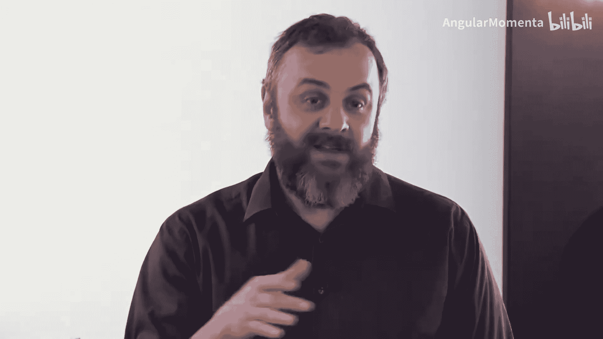

mentAnd what kind of effects they have when new technologies come along。

 we dont have to We don't have to guess out of the blue how well they might work。

 We know roughly how well education technology works in different kinds of argument。 Now， new things。

 there will be new things that are invented that are， in fact， different。

 but most new things are just a little bit new。 They make just small modifications， small advances。

 off of past things。And then the second half of the book says， sort of confronts the challenge， like。

 why is it so hard to make progress with education technology， Why why are things not disruptive。

 Why are they not transformative， Why are they not game changers。

 And I think there are answers to those questions。 I think there are there are challenges that we have as a field yet to figure out how to tackle。

 And if we study those challenges and make sense of them。

 then we could probably do a better job moving past them。

 So the first half of the book looks at these three genres of learning at scale。

 It says that most education technologies， especially the ones where you try to teach a lot of people with very few experts fall into one of three buckets。

 And you can figure out what bucket each thing is in by asking the question。

 who guides the sequence of learning activities。 when learners do stuff。

 they happen in an order one after the other after the other。

 And there are really kind of three sorts of ways that those orders unfold。

 The first is instructor guided learning at scale。 So there can be some expert or team of experts who says you should。

Learned things in this order。 Here's part 1， part 2， part3， part4， part 5。

 and maybe learners don't go in that order。 but overwhelmingly they will。

 And there's sort of some logical sequence that so that I call those things instructor guided learning at scale。

 a bunch of what you read about for today， massive open online courses。

 any kind of self- paceaced online learning sort of falls in that bucket。

 the second big genre is algorithm guided learning at scale。

 So that's when you a computer poses you a problem。

 you answer that problem and the computer evaluates your performance。

 And then based on that performance。 it gives you either more difficult problems or simpler problems or the same kind of problem or shunts you in some kind of different direction。

 but basically the computer evaluates your performance decides on the basis of that performance what the next item in a sequence of activity should be。

 and then you go do that forever。Lots of you are probably- I don't know when I taught this 10 years ago。

 maybe students would have dabbled with these things， but it's far。

 far more common now like if you in school ever used Dreambox or IXL or Khan Academy。

 almost all of those things or some version of algorithm guided learning at scale。

 a bunch of the testing that you've done， if you've taken the computerbased GREs。

 other things like that， they use similar technologies。

The third bucket of things we call peer guided learning at scale。

 so if any of you have ever played around with the Sc programming community。

 there's no instruction in scratch， there's no like scratch university or like scratch lesson one lesson two lesson3 and that's very intentional and by design instead you're immersed in this community of peers and if you go to the home page of the Sc website there are featured tutorials and featured projects and things like that and the way you figure out scratch is that you think about some things that you want to do and then you find some other people who've done that kind of thing and you copy them。

 you converse with them you take their project and you modify it but you basically sort of design your own pathway there are lots of other learning environments。

 stack overflow， other kinds of communities of practice the one that I talk about at the beginning of the book is Rabow loom any of you ever play with rainbow loom when you're kids yeah So you know when you bought I tell you the story when you bought a rainb loom。

 there are like 10 cards in the packet so you pull open the packet there's a bunch of these little rubber bands。

 little like。

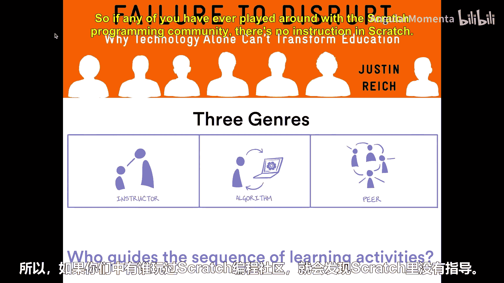

They call the thing frame to stitch the rubber bands on。

 And then there are 10 cards that show 10 different kinds of bracelets that you can make。

 If you get really into rainbowlo，10 different kinds of bracelets is not enough kinds of bracelets。

 Like you have to learn more different ways of doing it。

 And the main way you'll learn that is through YouTube。

 You'll go to this I mean and here's the thing that sort of boggled my mind about rainbowlo。

 So there's some dude who is in Michigan。 He was like an automotive engineer or something like that。

 who is like in my country。 This is the way we make bracelets。

 comes up with some cad designs and he sends them to China and China manufacturerss of these things。

 and they put them on shipping containers and they send them to his distribution center and eventually these packet these little like boxes of rainblo things gets sent all over the world。

 It's a total supply chain miracle。 The fact that know some dude in Michigan just has an idea and is like let's have all over the world by these things and they do is amazing。

 But simultaneously to that physical supply chain infrastructure。 This giant global community。😊。

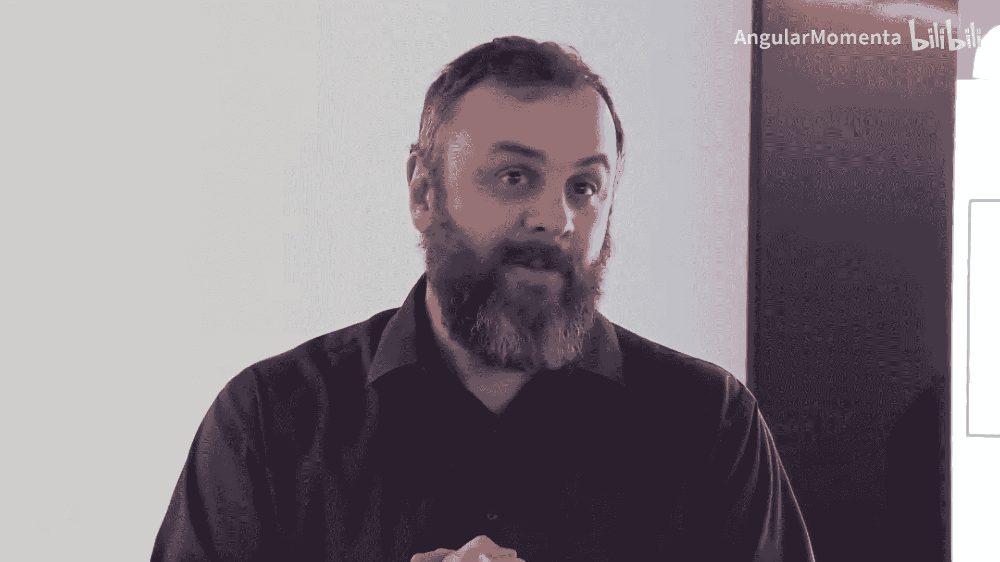

Of Rainbow loom learners emerges where there are people who are running little classes at art shops and they're posting videos online and they're sharing ideas with each other and they're creating little Facebook marketplaces and the only way rainbow loom could grow is if that learning network grows alongside it know that is miraculous that is like an amazing feature of online learning that people could invent a tool to do this kind of practice and and a community could develop to teach each other and themselves this practice I think there were oh the other thing I really liked about that which I think I mentioned is that there were these two girls I think their names were Ashley and Steph who made rainbowlom YouTube videos and they got millions of views and you could compare their videos to like the actual rainbow loom manufacturer videos and these girls were getting like 10x the number of views that the actual rainbow like basically kids would rather learn from these kind of two random girls。

They ended up being Philadelphia。 They're very good at protecting their anonymity。

 At least for a while， one of them eventually became a makeup influencer。

 and then they revealed herself， but。But I find these global networks incredibly fascinating and very。

 very difficult to integrate in schools for reasons that we'll explore as we go along。

So if you buy that there are these three big categories。

 a thing that we'll do over the next few weeks is we'll look at how there are similarities within these categories。

 So， for instance， in instructor guided learning at scale。

 there are typically are sort of two key technologies。

 There are two technologies that show up over and over and over again。

 One is a learning management system。 So learning management system， Canvas， Blackboard，edX， Moodle。

 stellar， re zllion and other things， there're sort of platforms that organize learning materials。

An unusual feature of learning management systems is that they have a feature that like product people who study products called feature convergence。

 essentially it's very difficult to like patent or have intellectual property around like components of a learning management system。

 So anytime anyone invent something good， everybody else copies it So they're all basically the exact same system。

 like you buy them from different vendors， but they're basically one learning management system and then the second kind of crucial feature of online learning management or instructor guide learning a scale or auto graders So you have to be able to give if you have lots and lots of learners if you want to be able to give them feedback if you want to be able to certify their learning in any way。

 you either have to spend zillions of dollars hiring people to grade their work or you find ways of having computers grade their work。

 Now computers can as we'll talk about this at length， computers can grade some things。

 but not others， computers are really good at answer at evaluating questions where the answer is well known。

And certain， they are much less good at evaluating anything which has a kind of subjective component to it。

 One way to think about this is auto graders are great in early language acquisition and very rapidly become useless and later language acquisition so they can tell whether you've spelled Ola correctly。

 We even have some pretty cool ones that can tell whether if you've pronounced Ola correctly we can give you a multiple choice question to see if you can recognize the audio recording of Ola。

 Eventually， however， what we want to know are like what are the key themes in Don Quixote and that we don't have very good auto graders to be able to evaluate and so forth。

😊，I would say in addition to this sort of technological infrastructure。

 these genres of learning at scale， they tend to align more closely either with direct instruction kind of folks or sort of apprenticeship constructivism kind of folks。

 the instructor guided learning at scale people。 they tend to be thnddyke， direct instruction。

 cognitive load theory kind of people。 They tend to be pale filling kind of folks。

Algorithm guided learning at scale has similarities but differences。

 so the sort of crucial technology behind algorithm guided learning at scale is a set of algorithms called item responseponse theoryory。

 this was developed in the 1980s by educational testing services the people who make what do they do the SAT or the GRE。

What tests does ETS make， I dont know。 They make tests。

like the basic toolkit of item response theory has proven really quite robust。

 All item response theory does basically is it lets you figure out how difficult an item is。

 It's a way of quantifying how difficult an item is。

 if you can quantify how difficult an item is if someone gets the item right。

 you can give them a more difficult item or less difficult item。

 It was actually originally developed so that you could give people tests of equivalent difficulty without giving them the same test This proved important like when we had national testing and we built communication networks because in theory。

 somebody could take a test in Portland， Maine。 and later that same day someone would take it in Honolulu。

 Hawaii。 and there's like just enough time in there for someone to call and send all the questions and answers and things like that。

 And so was it was part came about from sort of test security。

 you to you want to be able to make claims about people's ability and one way to do that is to give everyone the same test。

 another way to do that is to give everyone tests with different items， but of the same。😊。

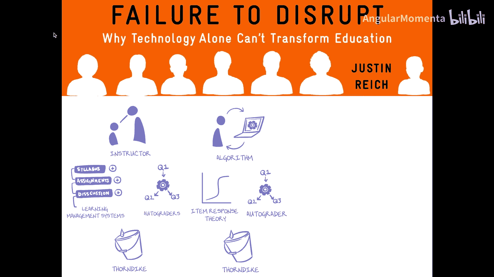

Difficulty， and so we had to come up with some statistical toolkit for doing that。

What we came up with in the 1980s and 1990s， like we've modified it a bit。

 but we still pretty much used today。 We sort of know a bunch about its strengths and weaknesses and how it works。

 Most of our auto graders like just now， maybe they're starting to improve a little bit。

 Most of them haven't improved that much in the last two or three decades in some specific areas。

 some parts of language acquisition， some parts of computer science， maybe they've improved better。

 But these technologies， for the most part are pretty stable。

 when someone has a new entrant I you'll read more of this story in chapter 2。

 But there was a company called Newton。 which said that they could take they could take any body of educational content and turn it into an intelligent tutor and they thought that their tutor was absolutely amazing。

 founder described it as something like a magical robot tutor in the sky。

 sort of knew exactly what you were thinking and so forth。

 So he was making all these like totally outlandish claims。

 And then his engineers were like had a blog about what their building and one of their blog posts was something like。

😊，Using two parameter item response theory to evaluate items。 they're basically like， you know。

 So the leader out there being like， these things is totally amazing。 And the engineers are like。

 like， here's the very well established technology that we're using to do the thing that we like are selling you to do。

😊。

The peer guided learning at scale looks pretty different from the other two。

 Pe guided learning environments tend to be more apprenticeship oriented。

 They tend to be more wrapped into situated learning things like that。

 They tend to have a different technical infrastructure instead of being based in some kind of content holding thing like a learning management system。

 They usually exist on the web And usually the killer app is not an autograder。

 But a thing that pulls content together， Like how do you figure out what the right sequence of rainbow loom learning materials is to look at and things like hashtags are really important for that。

 How do you in scratch。 like how do you pull together and come up with a set of featured projects or a way of tagging projects so that people can find their way through them。

 So these are sort of the three big buckets that will explore one bucket each over the over the next bunch of weeks。

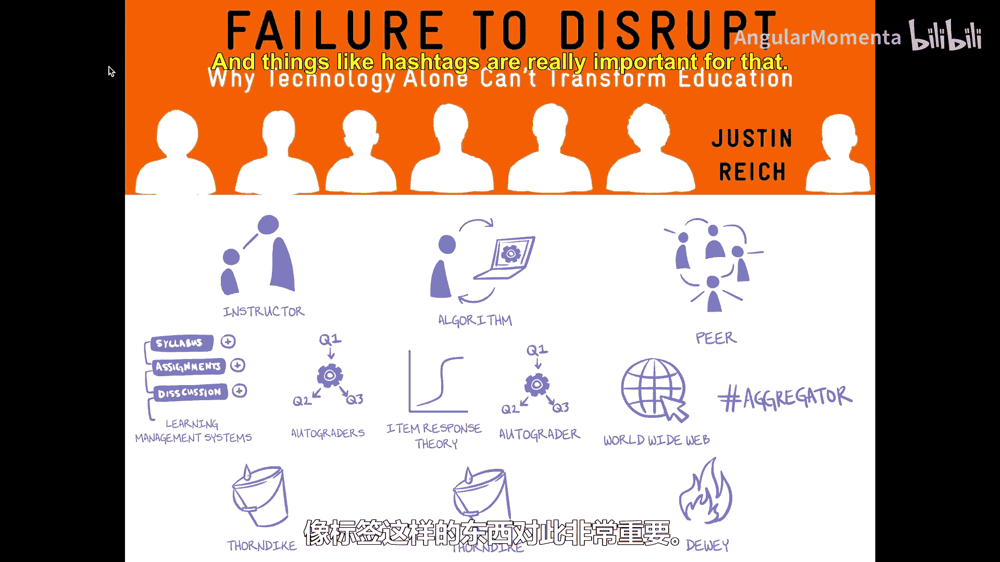

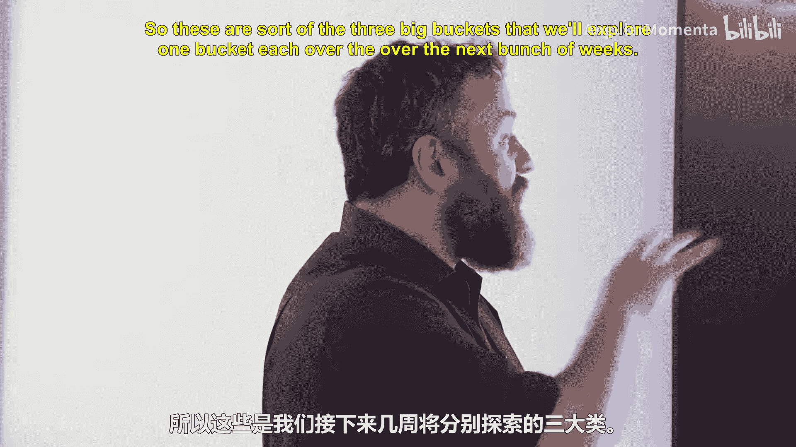

The second half of the book， which， I guess if this， if that， if that。

 if this project takes us a good chunk of March， this project will take us a good chunk of April are four problems that educators and education technology designers run into over and over again。

 which I'll enumerate quickly just to orient you。What's missing。 Anyway。

 the first one is the curse of the familiar。 The idea of the curse of the familiar is that it's pretty easy to make technologies that do things that educators already are doing and get them adopted。

 How many of you have ever used Quizlet。Okay， that's about his universal  Quizlet was founded by MI T dropout。

 Andy Sutherland， who took a bunch of education classes with us and he built it to I think study French for himself。

  Quizlet is flashcards。 if you went and you gathered a bunch of educational experts around the world and said like what do our kids really need to advance their learning。

 there is no one who would raise their hands and be like there's a huge dearth of flashcards Like we just don't have enough flashcards at school。

 we've run out index X cards， something like that。 And yet here's maybe I mean。

 they say things like half of all high schoolers every month use  Quizlet How much does quizlet improve teaching and learning。

 Well， if you're replacing regular flashcards with digital flashcards Like how much would you expect that to improve learning。

 Like maybe some， maybe there's a little efficiency there， something like that。

 You also might say something like actually one of the best things about flashcards。😊。

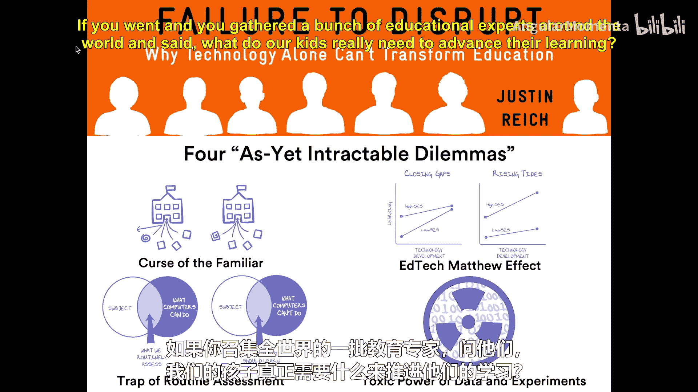

The creation of the flashcards like there's actually something important of learning about writing down the prompts on one ends。

 the answers on the end so maybe the paper ones are actually better and the quiz ones in different kinds of ways。

 But the point is there's probably no one who would make a bet that you human development would be profoundly transformed by digitizing flashcards。

 but if you look across many of the most successful education technology companies。

 they do something like quizling they take a thing which is already happening in schools and they digitize it。

 maybe make it a little bit more efficient。😊，There are a handful of projects that try to do something totally different。

 and many of them fail。 And the reason why they fail is it's really hard to convince people in schools to adopt totally new routines。

 So there are all kinds of， you know， there are all kinds of like visionary educators out there who think of like。

 man， wouldn't it be cool if we could teach math in this really different kind of way。

 If we can teach computer science in this really different kind of way。

 And then they build things that do that。 And people go， that's weird。

 I don't understand this really new different kind of way。

 So a bunch of the things which might potentially lead us to the biggest gains or changes in our teaching and learning are really hard to get people to adopt。

 That's the curse of the familiar。😊。

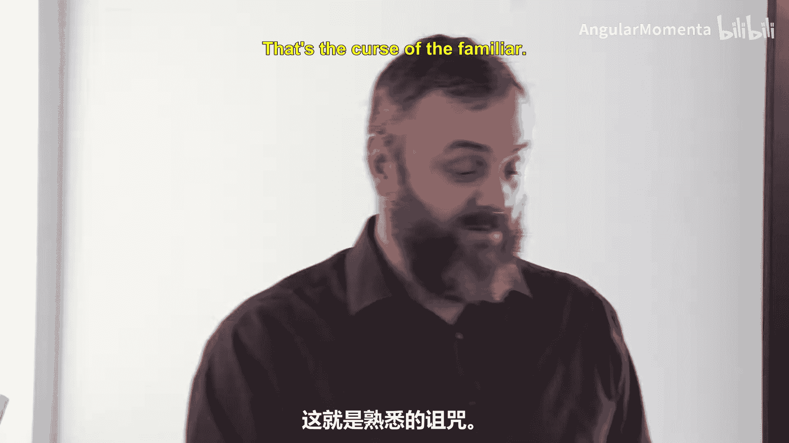

The Ech Matthew effect is that we very often hope that new technologies。

 especially free technologies， will be the term people often use is democratizing that they will will essentially what will happen like people generally speaking agreed that folks who have more resources have had more learning experiences and therefore have learned more than people with less experience but we hope that there are technologies that will disproportionately benefit the less affluent。

 that they will help poor folks sort of catch up to other people。

 they'll create new kinds of on ramps。 maybe they help everybody but they particularly help this group。

 what we almost always find is the figure on the right。

 which is that new technologies disproportionately benefit the affluent is that they're very likely to accelerate the learning of people who are already advantaged if many people go into education because they're trying to build a more equitable。

 just society and it can be quite frustrating you keep building stuff and it keeps helping the most affluent people in society secure their position better。

😊。

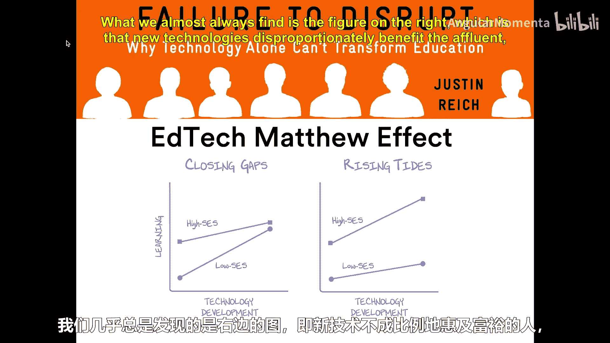

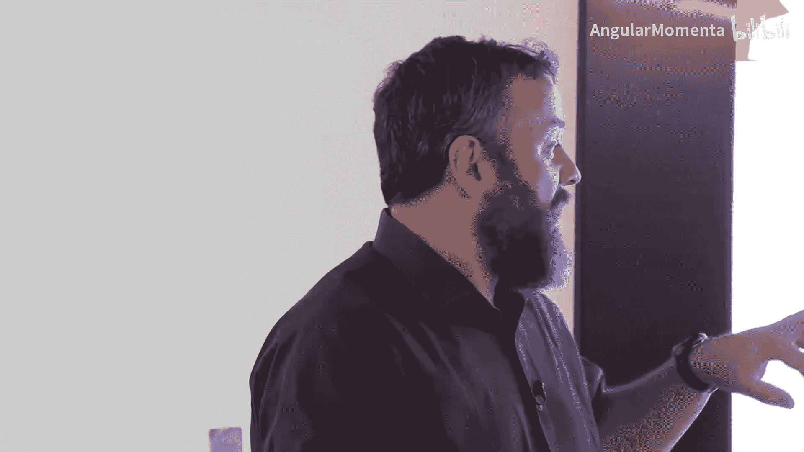

We can document this really well。 It's actually in a lot of cases hard to understand why it's happening。

 and we have very little science or research that helps us explain what alternatives would be。

 We know we'll give you some examples of some technologies that I think don't do that。

 that I think do disproportionately benefit people from further， further from opportunity。

 but it's really hard to figure out why they work。A third challenge that education technology folks come across all the time is that computers are good at evaluating certain kinds of things。

 The kinds of things that they're really good at evaluating are those that are routine that have common features to them that are highly structured computers are much less good at evaluating ill- structured kinds of things things where you know that don't have much form to them or we don't know what inputs need to go in them or what the final output should look like。

 For instance， one of the things that we don't have good auto graders for is people's ability to reason from evidence in natural language。

 you know， either written or auditory。 The main things that we teach you for 16 or 20 years in the education system is how to reason from evidence。

 like the most important things we're teaching you how to do， we don't have good auto graders for。

 Moreover， the kinds of things that computers can grade tend to overlap pretty closely with the kinds of things computers are good at if computers are good at things it's going to be very difficult to make a living doing those things。

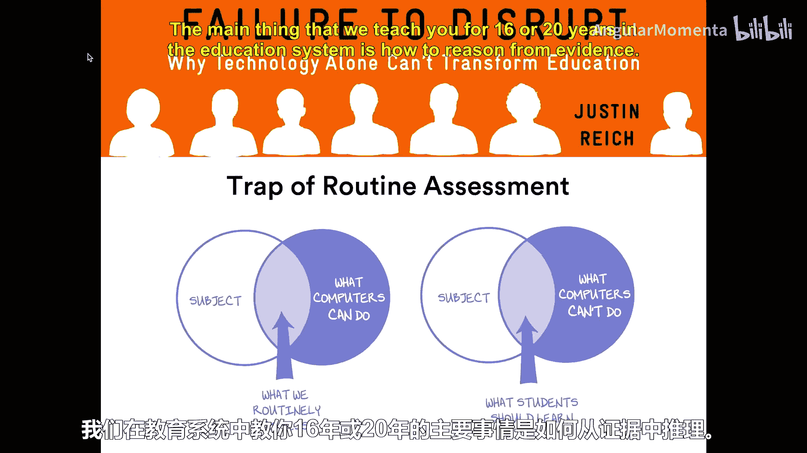

So we have like really good tests for the kinds of things that are probably not so important to teach people and we have not very good tests on the kinds of things that are really important to teach people。

 That is like a bad feature for educational system because auto grading of all kinds is way cheaper than human grading。

 So we essentially build all of these systems where conceivably we're like spending money to cheaply evaluate the least important parts of the system。

 and we're not evaluating the most important parts that people ought to be developing in those systems。

 So that is the trap of routine assessment。😊。

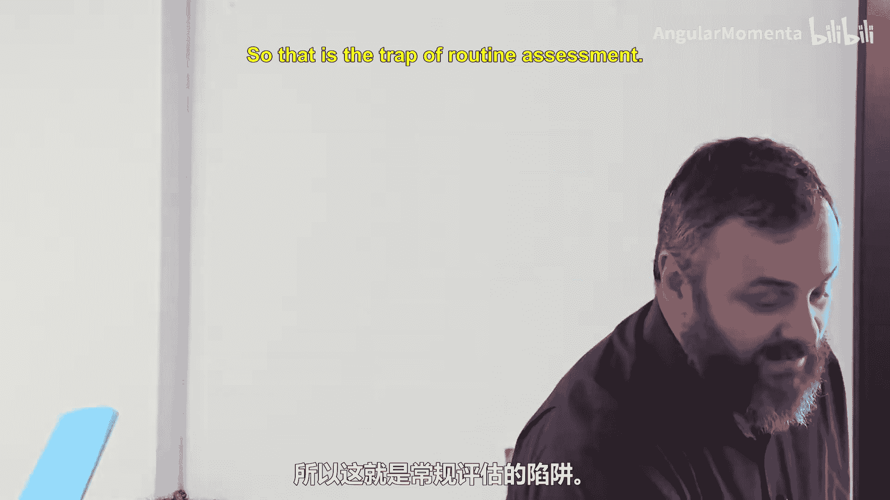

A really cool thing about computers is that they can collect enormous amounts of data about what folks do and that we can run experiments on people and improve those systems。

 So every time， not every time， but 1% of the time。

 you go to Google or Amazon or Facebook or whatever that。

 Like they're doing some little randomized control trial on you。 You know。

 the buy button is green instead of red。 And we figure out whether you buy more from green buttons and red buttons。

 And eventually， you know， Amazon， Facebook， they do millions。 I don't know。 they do many。

 many of those experiments every year and their system continuously gets better。😊。

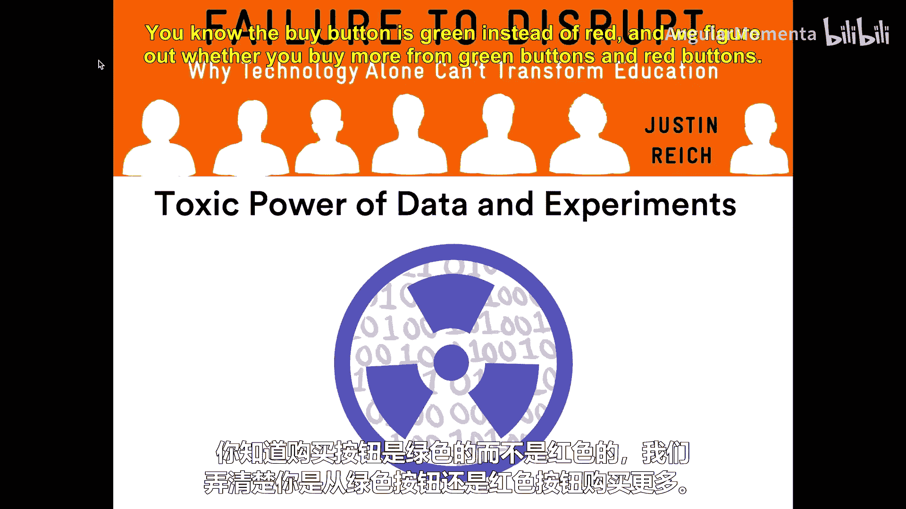

There are a couple of problems with doing that in education。

 The first problem is if you go to folks and you say that what you want to do is experiment with their children as we've joked before。

 like people are not that enthusiastic about that as an idea。

 It's also not clear that like surveilling people constantly in public schools is a good idea for civil society an exercise maybe we' do later on is start thinking about all of the data that MIT has about you And we might start thinking like。

 is it a good idea that MIT has all of this data about people is a good idea for an elementary school to have all of this data about where people are moving where they're logging in how they're learning their healthcare care。

 all these other kinds of things。 So it could be that collecting huge amounts of data lets us build really cool ed tech products。

 It also could be that it sort of inducts people into a surveillance society。

 which ultimately is not good for democracies or civil society。

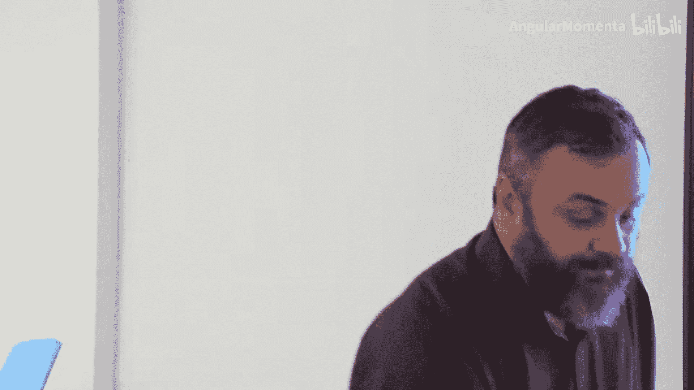

So in the second half of the class， those the second half of our reading of this book。

 those are the four dilemmas that we'll spend some time messing around with exploring That is an overview of the task of the reading together and then what we'll do for the last 20 minutes of class is to talk about massive open online courses in particular。

 but maybe I'll pause back here you know essentially on these kind of two slides。

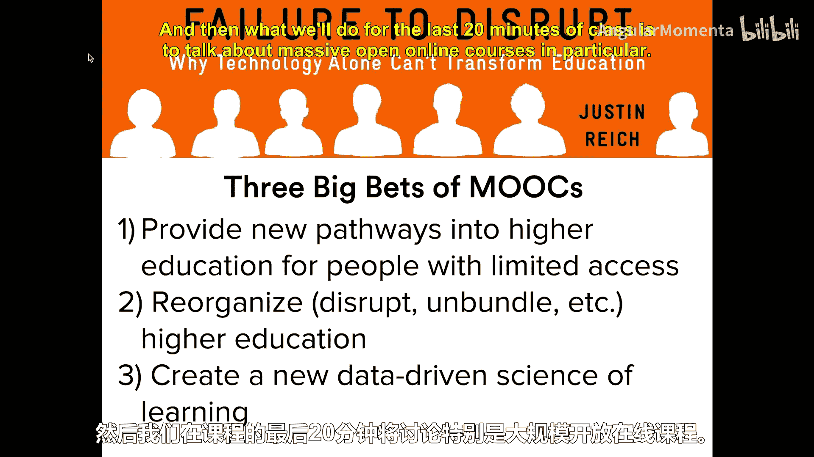

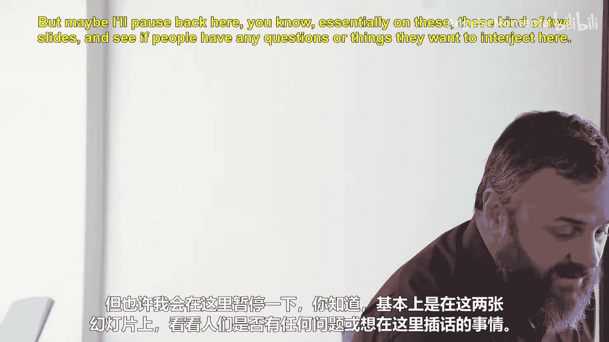

And see if people have any questions or things they want to interject here。For the next slide。

 when you mentioned like the four as yet in practicalal dilemmas。

 when you are studying technology and medication， have you found？

ssues that used to be dilemmas and that at some point we were actually able to solve and these are before they are like laugh so so I think there would be some there would be like access and distribution problems that you might have thought about as being like really central to lots of different places 20 years ago that be that would still you know if we're talking about subahar in Africa or other kinds of places in the world are still serious but refugee camp places of protracted conflicts。

 you know lots of places where access and hard but there's also lots of places would be like know in the United States like pretty much every school has highpe internet now and so whereas and we still have to think about how we do that and how we upgraded and things like that but but that is a dilemma which has you diminished quite a bit over time and you know for sure some of these dilemmas we've made progress on I mean I would particularly say the trap of routine assessment is one where you know in the last 10 or 15 years theyre definitely they're definitely。

Places where you could say， hey， we're doing better automated assessment now than we were before at different levels。

 So I mean， computer science is probably the place where we have the most robust suite of auto grading tools。

 It doesn't cover everything that's important in computer science。 but boy。

 like you can automatically evaluate people on a lot of stuff that matters。 I mean。

 there's an example in the book of auto grading spoken language for language learners know that you can talk out loud and duol ingo can tell whether or not you pronounce something correctly。

 that's pretty red。 and then I think you know it'll be interesting to see in the next few but my hunchches。

 large language models will play an increasingly large role and at least giving people meaningful feedback on their written products。

 whether or not we actually grade with them like that may be sort of a bridge too far I'm sure we'll use it in some circumstances。

 but I bet there'll be many， many circumstances know if you told me 10 years from now。

Every time a student turned into paper， they ran it through like an advanced version of something like graammar Lee。

 which gave them not only feedback about their syntax， but was like， hey。

 I don't think you have any evidence in this paragraph you might want to go back and look at that like that wouldn't surprise me at all and that could help students a lot know if there's someone who can know there's an automated bot that can like you know give you reasonable feedback generically about your writing that would be cool know I'd rather focus on other things in giving you feedback mentioning not good like。

Do you think that that's going to change？they will get better。 I think there is still。

 I think even some of our earliest evidence suggests that these are really thorny problems。

 So like I feel like we're starting to get some feedback about for instance。

 people using LLMs to help them in coding and there's a joke。

 which is something like you know using copilos and coding will reduce your initial coding time in half。

 and then it will double your quality assurance time you know basically because like not only will it maybe introduce errors。

 but also the people engineering things just won't understand what the bot is doing and the bot is much better at like very specific parts of building code than it is in engineering a whole system And so like it makes a bunch of decisions that make sense for a particular thing。

 but don't make sense for building a whole system and then somebody has to go back and repair those kinds of things。

 you know so so in terms of like I don't I'll get。😊，this morning we talk about Out graders later。

 but H Abelson， who's been on the CS faculty forever。

 has this wonderful quotation in one of his earliest books on computer science。

 which is something like。Computer programming is a language for for communicating between two people about methods that's only incidentally meant to be run by a machine。

 And the idea is that really good code is actually talking amongst people and not talking the machine our auto graders are really good at figuring out whether or not code like does things and machines understand and our auto graders for computer science are not very good at evaluating things like how well is this code designed for collaboration amongst people。

 How you know how sensibly are the functions named and other times of things like that。

 my hunchches will make progress on it， My other hunch is that it will remain like a pretty hard problem for a pretty long time。

😊，And also， it's a problem we solve in degrees。 like will we will we give better automatic like five years from now。

 will we give better automatic feedback to the typical middle school essay written in almost any topic。

 And will some of that feedback actually be useful。

 seem almost certain to me Will we be able to actually grade。

 Will be able actually say something like like this like this paper is better than this other paper with all the consequences that are attendant to that。

 we already do that to some extent in the education system。

 But I think we're still going to find that we're not confident in the assessment that these machines make。

 But fortunately， these are all testable hypotheses。

 So you know if your predictions were more optimistic than mine， you could very well be right。😊。

Let's talk about massive open online courses for a bit。

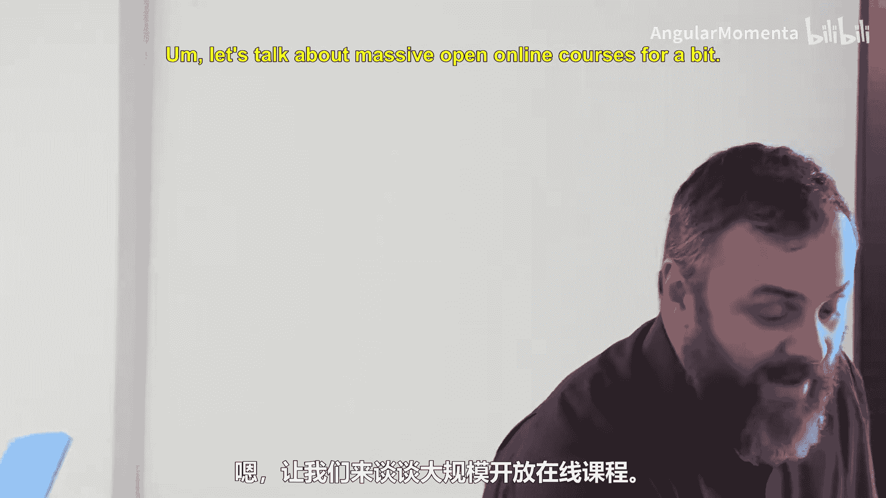

Mocs burst on the scene in particular， 2011，2012。 So almost 15 years ago now。

 how many of you have taken a massive open online course。 How many of you have signed up for a class。

 How many of you， How many of you have signed up for one and finished it all the way through。O。

 so people laugh because that is a much smaller number of folks。

 This is one of the sort of distinctive features of online learning。

Is that online learning is really hard。 It is if you were not alive or sort of paying attention to education in 2011。

2002 2013， it is hard to understand like。How much people assumed that these tools would completely change higher education like not be like a little bit useful maybe。

 but like utterly rearrange educational systems。 like people thought they were gonna be before Moocs and afterOocs。

 Part of the hyp of this， the first sort of really large scale class like this。

 Sebastian Thr and Peter Norviig who are computer science Sebastian Thr works on self-driving cars。

 He found a company called Juacity。 Peter Norviig worked at Google forever。

 They were both professors at Stanford。 They created a class called Intro to AI and they sent an email around to the iE mailing list。

 saying anybody want to take this intro to AI class。 They were particularly inspired by Salcon。

 I think who was talking about like the Mitx practice sets that you were going through。

 They were very taken by that model。 You watch a little bit of a video。

 You solve a couple of problems。 You watched a little bit more video。

 You solve a couple of problems sort of interleave them along They send this email around。

 They were thinking， maybe a few hundred， maybe a few thousand people show up 1 hundred thousand people sign up for this course。

100。😊，you know multiples more than Peter and Sebastian combined would have ever taught on Stanford campus in their entire career there。

 and there was a vision like wow， this could happen for everything everywhere。

 This could be all of higher education in the future。

 the amount of resources that ultimately people like Peter and Sebastian could put behind a course for 100000 people like you could easily spend  hundred those000 of building that course material And then the cost of every marginal student every additional student would be quite low。

 know so most people who are teaching a class。 you just like you know you hire someone。

 you pay them $60000 a year in a community college。

 maybe less you pay them 100000 a year lead college maybe a little more。

 and they spend some of that money making a course and 20 people take it and that's that But imagine if you could concentrate resources to make like the best possible instructional sequence。

 the best course ever I was my did my undergraduate at the University of Virginia and the University of Virginia very briefly fired their president in I think。

2013 because she was not sort of transitioning fast enough to this new online world and then the board of Governors sort of underestimated her popularity on campus and all the faculty and students came out on the lawn and protested and she got rehirired but you know like imagine if MIT's president UMass president got fired this week because they weren't moving fast enough on AI like that was sort of like the equivalent of what was happening in 2013 it was just Madness and I had just finished my PhD so I had just finished at Harvard in 2012。

 I spent a year working in an organization nearby called Faac hising ourselves and I got hired at Harvard as the first researcher whose responsibility was to sort of create a research infrastructure for Harvard X there were three big bets that when Harvard and MIT came together to create MOCs to create edX。

Oocs have been created in other places too， coursesere at Stanford mostably there are three things they're going to try to do。

 They're going to provide new pathways into higher education for people who have limited access that basically there are lots of places in the world where people can't get into higher education because they can't afford it because it's not nearby。

 the programs they want aren't there。 if all that is online that as soon as you can connect people to the Internet。

 everybody can participate and they're。People thought that it would sort of reorganize， disrupt。

 un bundleund， sort of profoundly change systems of higher education。

 So universities might still be around， but they could be organized in totally new ways。 You know。

 we were talking just in the beginning about how research universities often hire people who are not particularly good at teaching。

 Well， what if like all the teaching just got provided by these companies that like specialized in generating learning materials。

 And then， you know， your research professors could just go do their research。

 And all of you could take 6 double1，1 from an online course。

't very quote from the book that was like。

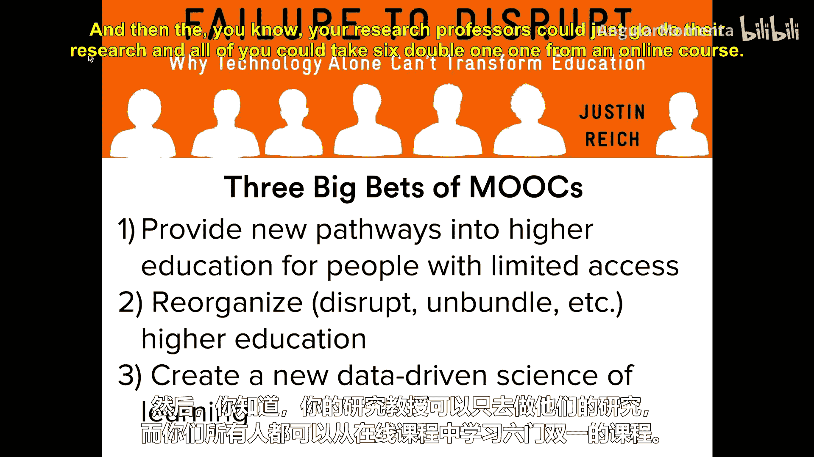

In like 30 years there would only be only 10 universities left in the country and Udacity could be one of them Yeah yeah。

 that was Sebastian through and the idea probably from that it's probably not quite as crazy it seemed it was probably not that there would not be institutions of higher education but you would go to UMass or Bunkker Hill Community college and all of the classes being taught there would have been made at you know Schingwaa University。

 Stanford， Harvard， MIT CMU and a handful of other Uudacity and a handful of other places and like going to something like UMass or Bunkker Hill Community College would mean taking online courses that were created by elite institutions elsewhere and you'd get a dorm room you and a fraternity and be able to have a human do receritations and extra help and things like that but it sounds ridiculous but people like absolutely believe that people thought for sure that higher education would be if we went back into20。

and so that higher education is basically the same except having more financial difficulties in 2024 than it was in 2012。

 there would be lots of people who would be very surprised by that。

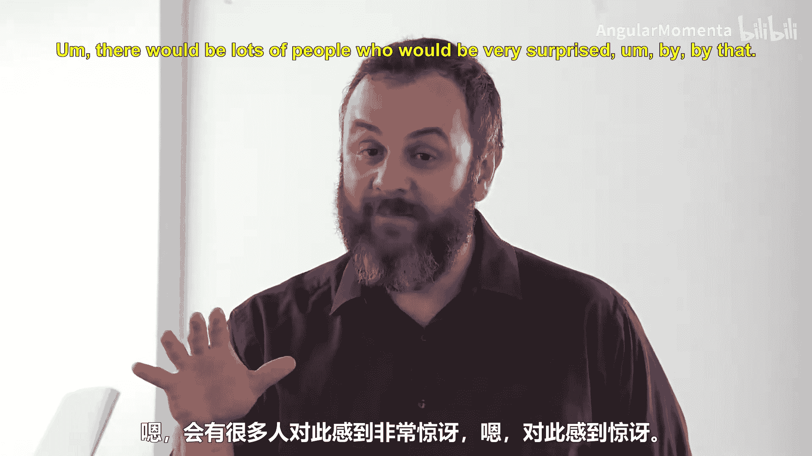

So， I guess this presentation， I don't know when I developed this was probably 2019 or something like that。

 But it was sort of at the moment where it was pretty clear that like none of these bets were gonna pan out we were not gonna accomplish these things。

 And I was sort of trying to help a community。 like sometimes you talking the people we talked to last time education deans and stuff like that or provost or funders peopleeduc education。

 like why didn't moOCs do the things that we wanted them to do Oh first of all。

 actually I don't have to spend too much because it sounds like everybody has taken a MOoc But the most important thing that you like like the two most important buttons in a MOoc are the previous button and the next button That's kind of like what makes an instructor guided learning at scale。

 like there's a bunch of stuff that we shove in the middle and then you click next。

 you do some stuff。 if you get it wrong or get confused。 You click previous。

 but sort linearly make your way through some instructor guided set of materials。

 a bunch of it is video or animations or text explanation or stuff like。😊，ThatAnd then periodically。

 there are some assessment questions that come along。

We realized as education researchers almost right away that folks who who were furthest from opportunity。

 were not the ones who were signing up for MOOCs first。

 this is a paper that was published in 2019 in nature by Ezekimanuel。

 who's actually mostly a medical researcher， but he was like， you know， in the United States。

 here's the population with a college degree。 Here's the MOs student population of the college degree。

 you know， in Brazil， Russia， India， China， South Africa， Here's the population the college degree。

 here's the percent of people from those countries taking MOC have a college degree。

 So basically we could tell almost right away that the people that we were recruiting into MOOCs were folks who were already educated。

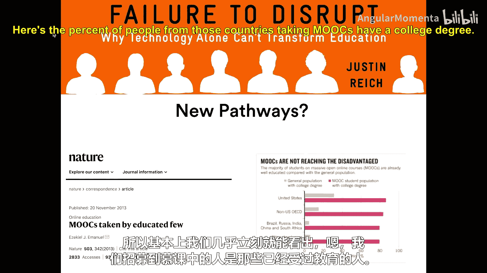

I today， I don't know that we know everything about why that's the case。

 People who have earned an education probably enjoy education is leisure time activities more than people who don't pursue in education。

 that would be sort of normal。 But I would say the one thing that we've discovered in various formats is that online self- pace learning is incredibly difficult for people like you all sort of laughingly joked about that when I said。

 how many of you have started a MOoc that you didn't finish。

 and you all are some of the best people in the world at self- pace learning。 And you found it hard。

 The entire population， the vast majority of people find online self- pace learning really。

 really difficult。 They have other priorities in their life。

 it's boring and actually an interesting thing about people is that when they're studying something they really care about they can be quite persistent learning So like you study young people who are like right now。

 if you ask young young twes teens to explore skinca routines online。 they will pursue that。😊。

With great passion， great determination， persist through lots of difficulties and be successful。

 They will not do the same with algebra。 You kind of wish as a society that they were better doing it algebra than skincare routines。

 but that's just not the way human beings seem to be wired。 So online now。

 who gets good at online self- pace learning。 Like how do you become good at being a good autodiact。

 I think the best guess we have is that you get an apprenticeship and the formal education system。

 the best way to be good at learning on your own is to learn with a bunch of other people。

 So that means the way to become really good at taking these online self- pace moocs is to go get a college degree。

 But if your goal was was to create new pathways into higher education for limited access。

 building a thing which you really have to spent a lot of time in education to be good at is maybe not the best strategy。

 But people didn't know that time。😊。

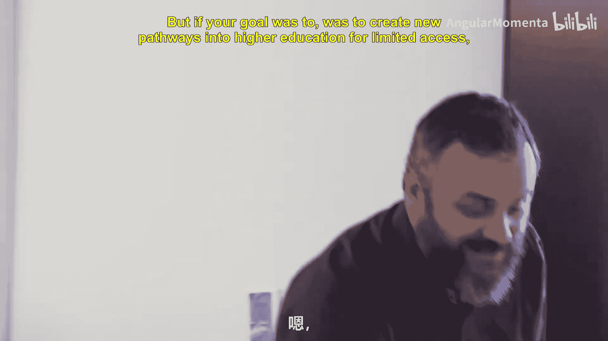

This is an article that I wrote with Maro's advise Jose that was where we were were trying to figure out like why MOs were not working。

 And one of the things that we observed is these are charts of enrollment。

 but there are charts of enrollment by sort of human development index category。

 So basically way more people were coming from the world's most affluent countries then we're coming from the world's least affluent countries。

 and we basically made no dent in it over the first eight years or so。

 you could imagine like oh we started with a pretty big gap。

 know if these three lines on the bottom had sort of continued to traverse up。

 then maybe you could say okay we're making progress towards our goals。

 The other thing that was kind of a problem is heading into the pandemic enrollments and sort like if you're trying to run a company or something like that。

 it's really not good to have this line go down。 You'd really like if this was Facebook's graph。

 it would just keep going up exponentially forever。

 That was another problem with MOs compared to sort other social media businesses like when you sign up for Facebook or Twitter or something like you're stuck in。

For， when you sign up for a class， the class ends， and then you leave and go do something else with your life。

So why didn't this work or actually， we'll talk about the second one next。

 but we're going to same right？I was just reflecting one thing that I realized as well recently that like everyone now creates their own course like every influencer has a course on something different right and I think that probably also affected this like ability of books to kind of spread because originally like five or six organizations we're creating content and nowadays this is very decentralized so even if it's still hard for people to complete this courses online et cetera。

 et cetera， like there's also a lot more competition right there's a lot of competition out there。

And traditional institutions proved to be very effective in that competition。

 So here's the thing which shocked even me at the beginning of pandemic。

 You all remember this from like March 2020， April 2020。

 like we sent you all home and here's something that could have happened。

 There could have like there were there were thousands of professors in the United States who were teaching introduction to microeconomics。

 And a bunch of them could have said， there is no way I can do a good job continuing to teach you introduction of economics。

 like my kids aren't in school。 they're running underneath my feet right now。

 I've never taught online before。 Just go toed X go go to John Hopkins， go to MIT。

 take their courses， and I'll give you a test at the end and help you out。

The alternative is that like I take my lectures， I put them online and we meet in Zoom once a week。

 and I still keep giving you your lectures。 Basically every learner and institution in the world preferred the latter option。

 all throughout the pandemic at all levels of the education around the world， we basically said。

 like would you rather have this really high production value class kind of offered anonymously from some institution that maybe you've heard of。

 but you have no connection with or with your own like harried professor who's taking care of his kids while teaching you who doesn't know anything about online learning and people overwhelmingly picked the ladder I don't know why we don't know I don't know why we don't know why they picked the ladder other than the fact that human like education is a profoundly social enterprise even the comment you made about about influencers having their own closest and things like that。

 like you have a parasocial relationship with those influencers in a way that you wouldn't you know from Josh Angris who teaches the economics class here or something like that。

All right， let me try to say two more things before we head out。 Oh， well。

 some of these things are on there that like the main advantage that MOOCs have is they reduce faculty labor。

 They pull faculty out of the equation， know they just make them sort of television stars instead of teachers。

 And if you there's basically no way to do the economics at MOCs except to dramatically reduce human contact。

 but like what helps people learn is human contact。

 like the way that you persist in most of your learning environments。

 especially when you're learning something you don't care about and are not that interested in。

 is like you care what your faculty thinks about it， you care what your peers are。

 you have all these sort of other human things that keep you connected。 and and because of that。

 most people are not good at self-regulated learning。

 if the vast majority people are not good at self-reulated learning。

 If the only way to get better at self-regulated learning is to go through the K12 system and go to college。

 then this is not gonna be a good system for helping folks further from opportunity get to college。

The primary way that MoOCs were going to disrupt higher education is there was a very for me。

 influencer article that said like the actual innovation， nothing was innovative in Mocs。

 a learning management system is not new，ed X was not new。 Coursera was not new。

 Canvas was doing the same thing， Moodle was doing the same thing。

 Blackboard was doing the same thing， Auto graders are not new。

 all kinds of auto graders and all kinds of systems that the actual innovation in moocs was putting a storefront on top of a learning management system that the thing that was actually different was that like in the past。

 if you wanted to buy a Harvard course， you had to buy8 a year and you had to rent an apartment and you had to buy all your meals from the institution。

 Like you had to buy this like giant bundle of stuff。

 And so the bet that Harvard Mit Stanford other folks made is like what if we sold just one course at a time。

 Like what if you could could come in and just take one intro to C S class。

 One introduction to economics class。 And that's an end millions of people were interested in that。

 I mean。😊，Number of signups that appeared in many of these courses were these astronomically large numbers。

 You know， CS， S 50 at Harvard had millions of people enrolled with just a couple of years。 A tiny。

 tiny fraction of them finish。 You know， something a 1% of them finish。 on average。

OOs about 5% of people who register about 10% of people who click into a course once will persist in a class。

 but pretty small numbers。However， it turned out that just like storefronts didn't solve all of the problems that universities stored。

 So people were excited to try out storefronts， but storefronts by themselves didn't confer legitimacy。

 like really traditional things like registrar offices confirm legitimacy。

 things that publish transcripts and degrees and diplomas confer legitimacy And so。😊。

And so this idea that MOOs could move forward just by selling one course at a time proved untrue。

 So then MOs did something which was surprising to people， which they said， well， all right。

 why don't we start offering whole degree programs。

 How about instead of taking just one MOC at a time。 you'll take8 MOCs and get an NBA。

 you'll take8 MOCs and get a data science degree， a computer science degree or something like that。

 there were companies that have been doing that for a long time。

 Those companies were called online program managers。

 They are some of the most sort of unreputable companies in the higher education space for a few reasons One is they tended to be pretty secretive。

 So you would sign up for an online degree from an organization and you like think you're getting this degree from the University of Chicago。

 but like you slowly realize that there's a company called2 you or M Bent or or Pearson Mbont services or something like that。

 which is actually providing a bunch of your educational experiences。

 The Wall Street Journal in the last couple。has had a bunch of exposes of boot camps that are branded by state universities。

 but they're actually just run by a company， you know it's called like the Oregon Computer Science bootot camp or whatever Comp programminging bootot camp。

 but nobody who teaches and it works for the University of Oregon， things like that。I mean。

 the other problem that universities faced was that like a key precept of businesses is that you do not outsource your core competencies。

 So if you're a university and you outsource your janitorial services， that is a great idea。

 If you outsource your accounting services， that is a great idea。

 If you outsource your teaching and learning， that is a bad idea。

 the teaching and learning is the thing that you do as a university。So I dont。

 I wrote this paper in 2019， which said something like， man， these massive open online courses。

 they sure seem to be behaving like online program runers。

's sort of partnering with these organizations part of the ways that they were compelling to organizations is that they would go to a university and say we will pay upfront for the development of these degree programs But then for the next 15 years will take 40%。

50%，60% of all the tuition revenue that comes in at the you know in year one。

 that might seem like a good idea because you didn't spend any money and you got this new tuition revenue。

 but like 10 years from now， you're like why am I paying you know to you Coursera edx， you know 6050。

40% of all the tuition revenue that's coming in when like what they're doing is in some respects。

 not that hard like they're running a learning management system and doing some online learning。

 we can figure out how to do those things。 This was a bit of a controversial paper when I published it and there was a whole bunch of people who said come on just in that。

It's really not fair， you can't say thatOOCs are turning into online program managers。

 but then two years later， to you， who was the largest online program manager boughtedX and even that was a convergence that I wouldn't have projected。

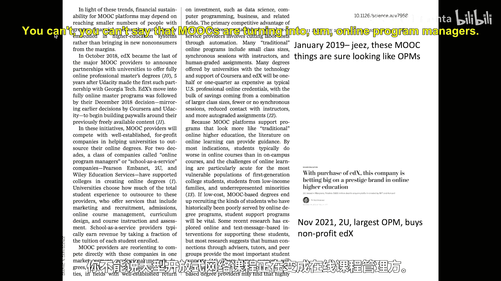

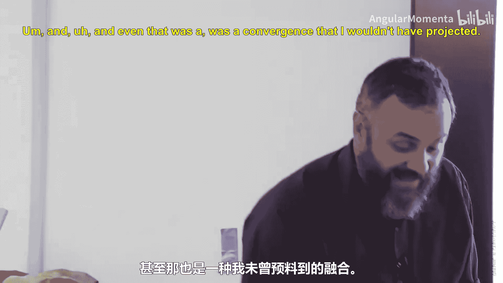

So I know some of you may know that all of the proceeds from。

From the sale of edX went to this nonprofit controlled by Harvard and MIT called Axom。

 So so to you paid $800 million foredx。 And that $800 million went to start a new nonprofit。

 like headlines like this were kind of funny to me。 know。

 Harvard and MIT LED nonprofit to tackle longstanding inequities in education。

 But like that's exactly what edx wasedx was a nonprofit design to tackle inequities in education。

 I was like， well， that didn't work。 So we're starting a new one。 And it's like。

 you know I just like how the big headline is like this is this brand new thing that we're doing。

 And by the way， it's because we sold the last version of this that we just did tiny font at the bottom。

😊，This was last year's sales price foredX for2U and yeah their stock has declined 90% over the last five years you can sort of see the pandemic bubble here。

 people did a bunch of online learning and then partly they were less enthusiastic about it but also as universities get better at offering online learning。

 they don't have to partner with groups like2U anymore this is actually today's stock quote where it is down 99。

36% over the last five years so you know to you paid for edX like substantially more than the entire company of2U is currently worth today。

😊。

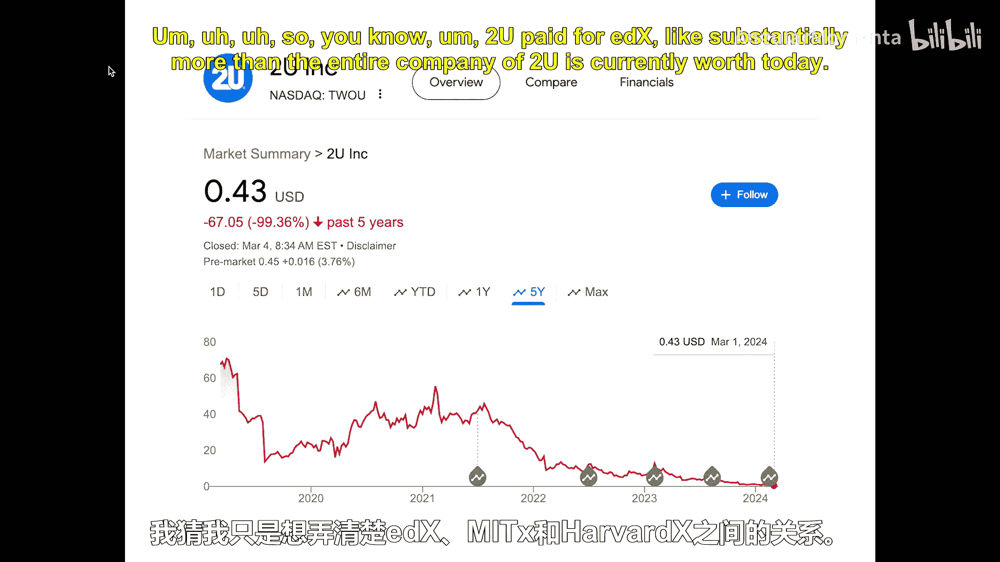

I guess I was just looking for like clarification on like edX and like MITX and like Harvard X like is that all the same thing like the MITX that we use now No so well all right so Harvard and MIT。

Each put $30 million。 They create units called HarvardX and MIT X。

 Those are like sort of independent brands， the shared infrastructure that those things used was this thing called edX。

edx was a company。 It also created an open source learning management system called Openedx。

 So like nonprofitedx was sold to you to become part of a company。

 but there still is an open source project called edX。

 which is a learning management system software， MI T X and if there's still a thing called Harvard X。

 to some extent in their products use this thing called OpenedX as what they're doing the infrastructure。

 But MI like the content that we look at when we go on MI T X as students is not。

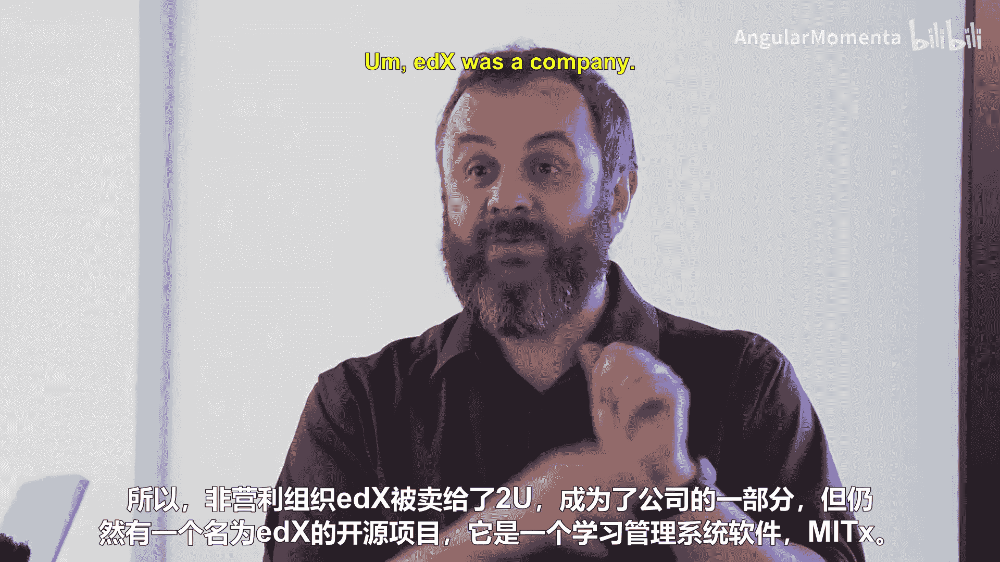

by this company yes， but although it's sort of slightly more complicated than that because I think like they definitely bought the right to display all or most maybe they could display anything that they had instructors permission to be able to display like I took all of my courses off ofedX when it was bought by to you because I don't want to support online program managers。

 I don't think they're good for higher education Some departments did that， things like that。

 they still might have some rights to display some of it。

 but they still sort of basically did what they wanted because if you look at it a lot of。

And like even open courseursewareare is also something like 2008 and its been out there。Yep。Yeah。

 you know， and in some ways， in theory， you know like a lot of the argument is that it shouldn't have to be right。

 like you know how much did multivariable calculus change since 2008， you know not that much。

 and part of the way that you gain the economy of scale is by sort of leaving these things alone。

 All right， we'll come back and I'll sort of finish this in here except to say that we try a whole lot of stuff to develop a new science of learning and probably the main thing that we learned is that like people who click a lot into things do better than people who click less into things。

 which you probably didn't need a $60 million investment to be able to figure out。

 but I'll finish with this next time， you'll turn in your papers by email and we'll talk a little bit more about intelligent tutors as well both on Wednesday and the following Monday。

 if I can help you at all with paper1 or anything else。

 let me know otherwise have a wonderful rest of your week。😊。

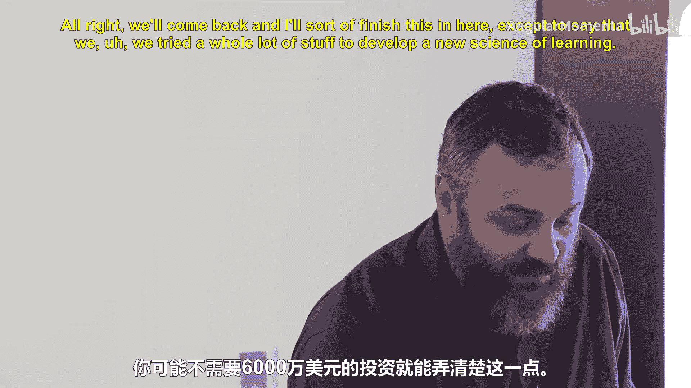

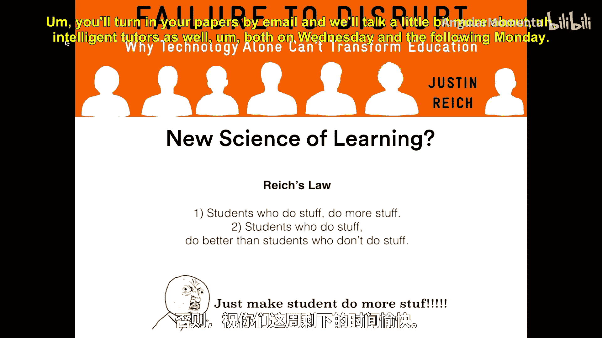

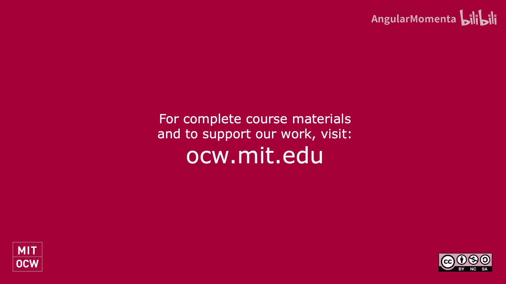