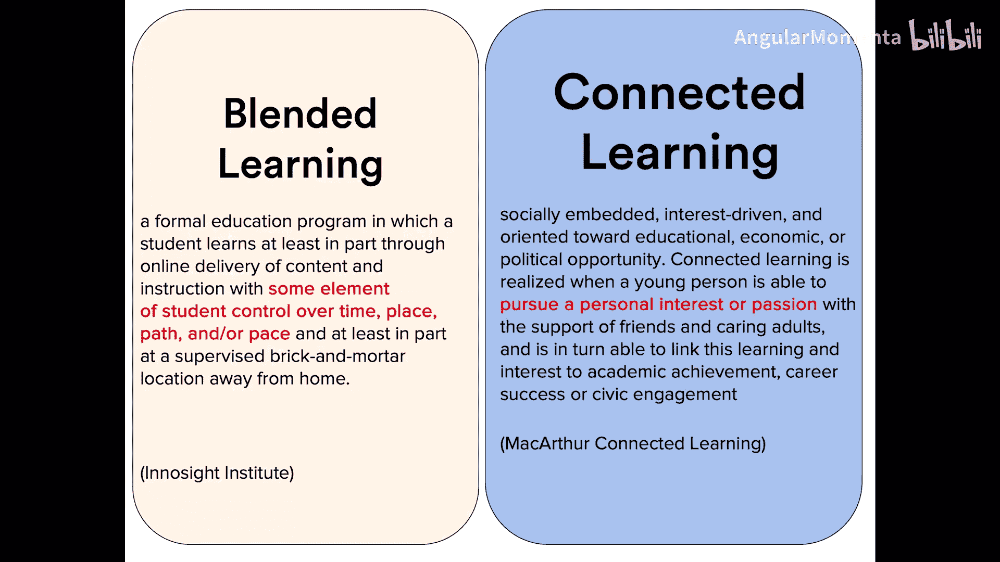
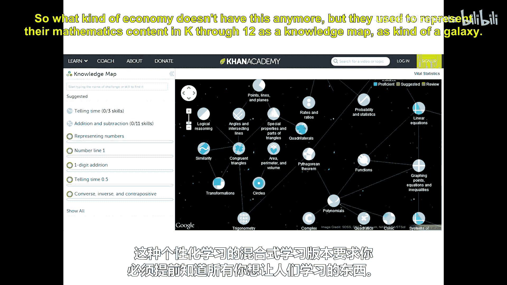
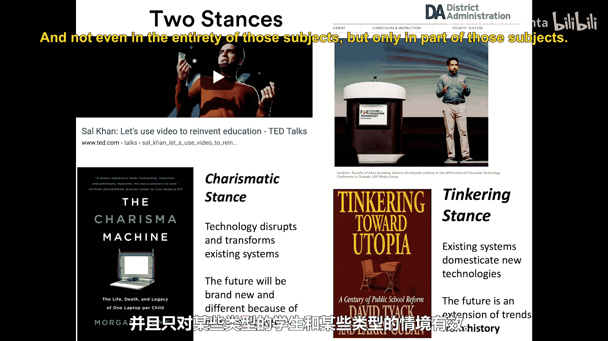
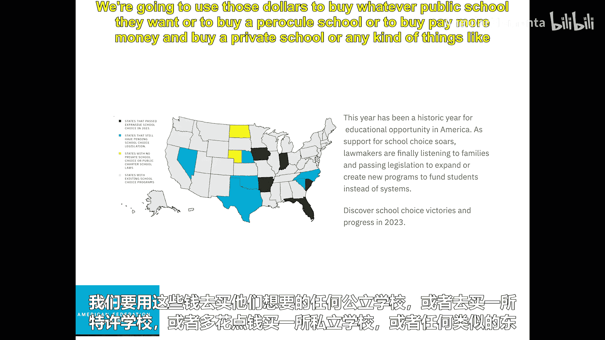
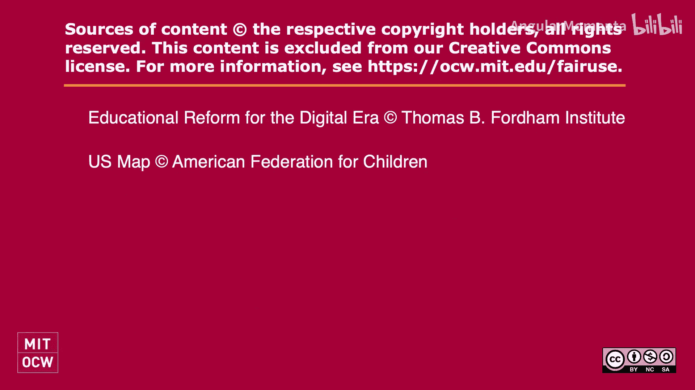

# 【麻省理工】学习、媒介与技术 ｜ MIT CMS.595 Learning, Media, and Technology, Spring 2024 p05 10. 智能导师 -BV1DKUSBGEvu_p5-

Let's get right into it。 there's a bunch that I want to try to catch up from me yesterday。

 you've just turned in paper number one， but I'm a big fan of trying to have people do work like do the daily work in the class thinking towards what the major assignments are。

 so now I have to tell you about paper number two for paper number two you are gonna identify a specific learning environment you're going to identify like the physics department at MIT。

 your middle school， your elementary school， your high school world languages department and after school program you work with a library。

 but something like very specific where you know not not you know like schools in general a place and you're gonna reflect upon a particular education technology and youre either going to recommend or not recommend that they adopt this particular technology So part of the argument that you'll read about in in hopefully through the first half a failure to disrupt is that。

While we can get a general sense of the efficacy of different technologies， we could say。

 you know this class of technologies seems to have better research evidence behind it than this class of technologies。

 there's really nothing that anyone has ever invented。

 which is like really every school or every department ought to be using X all those decisions have to do with particular times。

 particular places， particular people So what you'll have to do is identify some technology。

 kind of classify it like what genre is it from or what is it like what are its potential benefits。

 what are its affordances， what are its limitations and then what is the characteristic of the place that you're recommending it to and do the sort of benefits and needs and characteristics of a place all line up such that you recommend adoption or do they not line up such that you don't recommend adoption it should be a memo sort of directed to a particular stakeholder。

 a department head and assistant superintendent for curriculum instruction。The library director。

 the president of the Boys and Girls Club， whatever it is。

 I think I had one student who was building a program for Ukrainian refugees last year and he basically wrote a memo to himself which was fine。

 on pages 74 through 76 in failure which at least in the hardcover。

 I think it's the same in the paperback There's a section called what a department head should do。

 which is not exactly this assignment， but like a pretty closework example。

 it's sort of me like working through So whatever I think that specific example is about using intelligent tutors。

 So in math class So you should pick something other than that specific example for you to use but you you should think about doing things like you know assessing the claims that the developers of this technology make seeing what kind of research evidence there is around that。

 seeing under what sort of context seems to work or not。

 what kind of enabling conditions are required， whether or not those enabling conditions exist We'll talk about all these kinds of things over the next few weeks。

So that so you don't have to understand what you're going to do right now but I want you to have a sense of this assignment for some of you you will pick a context that you can work with that you actually know a ton about or like even if you didn't know something about it you would be able to like like oh you know the head of Areroastro is a good colleague of mine I'm going to just go ask him what do you think about this or like what capacity are and things like that there may be other things that you sort of need to fabricate which you would be allowed to fabricate。

 you just have to like somewhere stipulate along the way that you're fabricating them so I know I have to be like you know the characteristics of the world language teachers in my high school or this and you might not actually know who the new staff are and things like that but that would be okay。

There's pages written about what you're supposed to do in the syllabus。

 but does that give you like a general sense of the target that you should be thinking about over the I don't even remember the exact date its due。

 but it's like roughly a month from now， each assignment takes about a third of the class so that'll seem good。

Great。Anybody have any questions that they want to ask about that assignment？Okay， let's wrap upOOCs。

 so last time we were talking about MOs sort of made these three big bets that they could provide new pathways into higher education for people with limited access that they could reorganize disrupt unbundle higher education。

 they could create like new structures across higher education and then the one that I was most involved in is that they create a new data-driven science of learning maybe part of the second one。

 but maybe sort of know maybe was clearly a bet for some actors less so for nonprofitfis more so for for profits was that you could make a whole bunch of money doing this that has not panned out as well as some people had hoped So here's an announcement today that Accenture is purchasing Uudacity So Udacity was the company that was founded by Sebastian Throne。

 Sebastian Thr is one of the people who taught this Htro to AI class that like made the whole MOOC phenomenon start people are not Accenture is like a consulting firm in their。

ing to use it to do sort of AI training so this is not like transforming all of education this is doing like pretty well establishedablish executive education and there may be ways that you could do executive education better with aO platform that you could with other pre-existing technologies or strategy or things like this。

 but this is not going to profoundly changed the way executive education unfolds。

 this is just like somebody who sells executive education buying a potential provider of it in the notes here it says that their best guess is well is that a deal fell through with an asking price of about $80 million and so nobody knows for sure but they think that this deal was probably about that size but Udacity took in $300 million of investment so I don't go to the Sloan School of management like some of you do but I'm pretty sure that if you take $300 million and sell a thing for $80 million you didn't do it right or at least your investors don't think so。

嗯。But I think that's， you know， to me， it's a great indication of where these particular where like class of technologies have settled out。

 which like $80 million a lot of money。 if of if any of you were offered $80 million for a business。

 You' probably be like， yeah，'s pretty good， I'll take $ a million。 That seems great。

 But what it's accomplishing is like a very a very well established existing thing in the education system。

 You might say that or a way that I've phrased in the book is which which a colleague of mine me really came up with is that these technologies did not disrupt education systems。

 they were domesticated by education systems。 education system said like you fit there like you little company。

 you would be pretty good at doing executive education， Why don't you do that。

 that is not at all what Sebastian Thrn was envisioning when he said that there might be only 50 educational institutions in higher education in the world。

 But to me， this is like this is like very representative of how I think education。😊。

echnology often works。 We very rarely build things that are totally transformative。

 and we can often build things that are like useful in pretty specific contexts。呃。

I had I and lots of other people had really hoped that there would be very new kinds of science that would be possible。

 So we had never really in higher education had a system where you just had all of a sudden。

 millions and millions of people doing online learning and all of that was being recorded So when I got hired to help sort of build the research infrastructure for Harvard D and MiT X and edX。

 know， one of the most exciting things was like all of these people are signing up and they're all clicking and were recording everything。

 you know， you might think of like when you went to think of all of the things that you did in school。

 probably even better as example， like think about all of the things that I did in school。

 So I filled out zillions of worksheets， I typed all kinds of papers。

 like all that stuff just ended up in my mom's attic and was eventually thrown away。

 like the whole records of my learning were lost。 But young people today have their records of learning stored in all of these online platforms。

 If you saw what millions of learners。😊，We're doing in really granular detailed ways over days or months or years。

 shouldn't you be able to figure out all kinds of exciting things about the science of learning about like what are the most effective teaching techniques。

 How do people learn best all kinds of things might be help us and it proved to be much。

 much harder than people expected， I would say the core reason why it proved to be really hard is that you can have terabytes of data about what people click and still not really know what's going on in their heads what people click on on a screen or what they add as an answer to a problem。

 doesn't necessarily tell you all that much about the cognition that they went through to get there It doesn't tell you a whole lot about which parts of the instruction that they received to that point helped them do that？

 There was a whole for years， there was a whole class of papers that just sort of correlated everything to everything else Like how many times did you click。

 How many times did you log in How many units did you do。

 how far apart they were all these kinds of things。😊，Basically。

 like there was a whole a whole series of papers are all published that were all along the lines of people who do more stuff do better than people who do less stuff。

 like like people who clicked more often in the systems。

 people who like watched all the videos did better on the problems。

 People who did all the problems were more likely to pass the course。 People who logged in more time。

 People who spent more hours were more likely to pass the course。 Like none of that it's interesting。

 you didn't be the $60 million research enterprise to figure out that doing more stuff helps people learn。

 There are a few things that we did。That， and I'll talk about them more as the semester goes on that tried to go beyond that。

 There were a bunch of us who are really interested in this idea that like。

A bunch of people have done research that suggests that the attitudes that you bring to a learning experience really matter for your success in that learning experience。

 And maybe you ever heard of stereotype threat。So stereotype threat is this idea that if if we trigger stereotypes that people have as they enter a learning environment or is' in a learning environment。

 those stereotypes can negatively impact them so if you ask people to describe their gender before math test then people identify girls are more likely to do less well you could do the same thing in different racial configurations and other kinds of things like that and the way that you can inoculate people in theory against some of these kinds of things is by emphasizing how they belong is by saying like you belong in here like you have a space。

 you deserve to be here and so you could imagine that if people go into a learning environment and they're like I'm not sure if this is for me and you're sort of like you're paying attention to not feeling like this is for me and you're not paying attention to the learning and then a test comes along and you don't do as well on that test and then that makes you feel like you belong even less and then you're feeling kind of more unbelonging and then you don't do as well and you get a negative cycle you can imagine the opposite where you feel like oh I definitely belong in this。

ear environmentment like this is gonna be a good growth experience for me。

 and then you like are focused on learning and then you do better。

 And that makes you feel like you belong and on and on。

 So the we're really interested in these entry points and almost everyoc basically every class at Harvard MIT offered had a little precourse survey at the beginning any of you ever taken a class that has like a little survey at the beginning of it for yourO if you did it for Harvard MIT。

 I probably wrote it and especially if you did it a few years ago。😊。

And so we started randomly assigning people these little interventions。

 We would like you'd answer a bunch of questions about what you know about the topic。

 and then we'd say things like write a letter to a future student， one was a values affirmation。

 Pick from this list。 which of these values are really important to you。 And I don't know。

 they could be like loyalty personal growth， family， all kinds of things。

 write a short letter to yourself about why taking this class aligns with those values。

 So asking people to just like write for a few minutes about why we do other things about belonging。

 write write a short letter to a future student in this class about why they should feel like they belong。

 things like that。 And our hope was is it would have this kind of like trigger this positive cascade at the beginning of the class。

 You feel like you belong more。 You feel like you value it more。 you do better。

 you pay attention more。 you do better。 you learn all those kinds of things。

We started by trying these in just a couple of classes and even if we were picking a couple of classes。

 we were still doing like some of the large experiments that had ever been conducted in higher education。

 know we could pick like a couple of classes that might have 10000 people that were actively participating in it and doing our things and kind of a lot of folks So here four things that we tried one was plan making having people write down exactly how they planned to complete the class like when they were going to do it。

 who was going to help them， what they were going to do when get stuck those kinds of things。

 this value relevance things that you just described。

 and then mental contrasting with implementation intentions is basically like what are the kinds of things that might make you stuck and how would you get unstuck when you encounter these things when we did them in one or two classes at a time。

 they worked pretty well。 So I don't know how familiar are。Statistics。

 but the beta parameters are one you look at。 So this plan making things。

 people were were four percentage points more likely to finish the class if they got the intervention than they didn't。

 That's huge。s， you know， if you you asked people to do something for 5 minutes of the beginning of the class。

 and they're 4% more likely to finish it。 just like the cost benefit of that is off the charts。

 That's fabulous。 This one was getting people to do more activities。

 getting people to persist longer， getting people to complete better。

 all these kinds of things And some you know， in some of these studies were huge。

 you know5000 people 3000 people，2000 people， that's pretty good。😊。

We then were like we were we were pretty excited about ourselves。

 We like like we've come up with some stuff that like doesn't cost anything and really helps learners。

 Let's go ahead and take these things and use them in all of the classes。

 let's let Harvard and MIT let us test things in every class。

 And it is not uncommon in educational research that if something works in a little space that when you tried at much bigger scales。

 it doesn't work。 That is a very frustrating finding， but also very common finding。

 And that is exactly what happened to us。 So we took these things which you again。

 would have been considered like huge studies and education。

 randomly assigning 4000 people to treatment or not is enormous。

 And we did it with a quarter of a million people。 which like a lot of learners and and basically everything that we had tried and wrote a bunch of papers that said。

 hey， these are pretty good ideas， had to be like actually they don't really work that well and。😊，Oh。

Part of the problem was they appeared to work in some classes， but not others。

And we couldn't make any sense of why part of that is that it's hard for us to know a whole if we did it in about 250 classes。

 and it's hard to know the difference between those different kinds of things。

 But we like we listed characteristics of a lot of classes and we put them into big AI models to try to figure out why and all these I mean you can read the paper but it was sort of an enormous effort and at the end of it。

 a thing that we we had lots of people in there。 but we weren't able to identify things that worked particularly well。

 And this was pretty consistent across this enterprise。 In fact， to my knowledge。

 there's virtually no one who's doing research John Harvard or Mi Harvardx or MiT X classes anymore。

 And And so this was the sort of third of these big bets。

 the hypothesis with the vast know there were people like Peter Norviig ands Daphne Coller。

 who formed Coursera who thought that data drivenriven education we'd be very similar to data drivenrive。

medicineine like just like the Human Genome Project sort of revolutionized a data- drivenriven form of medicine that you know Coursera edX could revolutionize a data drivenrin form of the science of learning and we knew a lot about what people clicked but we never really got much more data about what was going on inside people's heads The other sort of huge issue is that if you really want to do educational research that studies like how to help people learn better you need variation in the course that's deeper than what we were attempting like you need to be able to do more than just change a little thing at the beginning of the course you have to be like well here's one good way of teaching a class Here's another good way of teaching the class let's try both of them it turns out that it was very difficult to go to faculty and be like。

 well you make two versions of this course so that we can test some of these different ideas in them because people had barely enough time and resources to make one version of the course and so forth。

So like the other two big bets of MOCs， they for the most part didn't pan out and I think if you go back 10 years from now and read the op eds that David Brooks and Thomas Friedman were writing in the New York Times about the totally transformative impact of online education。

 people would be pretty surprised 10 years later to find out that you know it's good for things like executive education or helping people earn a second master's degree。

 which are not bad things to do， but again they're sort of smaller components of it。

I've thought a lot over the last couple of years about like， okay。

 so if we're not gonna to totally reform the educational system with independent selfpaced online learning。

 what else might we do Well， you know， So for instance， I've told you that already affluent。

 already educated people are reasonably likely to persist in online courses。 Well。

 there are all kinds of already affluent， already educated people who work in the public interest。

 There are people who are teachers。 There are people who work in public health。

 There are people who work in nurses。 lots of them work in context where they don't have a lot of learning after their college degree or their advanced degree。

 So what if we created online courses that， you know。

 a good fraction of people would be able to persist in and finish。 that would be able to help them。

 there was one course that we built called launching innovation in schools， which relates to。

The stuff in iterate that you read a couple classes ago。 And in our course， we make them。

 we make all our not it to this。 We make all of our courses openly licensed。 So we， we。

 we make it so that it's creative commons。 anybody can take our things and do anything want with them。

 There were some folks in Ukraine before the war who had translated our courses into Ukrainian and put them on a Ukrainian platform。

 And for a while， the beginning of the war I know this is still true。

 teacherscher still had to like get recertified， do training and things like that。

 So some enormous fraction of the Ukrainian teaching force had at least you know signed up and plausibly taken one of these courses and things like that。

 So they're sort of， you know， for us， it was kind of a proof of concept that people can benefit from some of these kinds of things。

With Mariaa's advisor， Jose， we got really interested in what if the thing you want is not really big MOO providers。

 but very small local MOO providers。 So there's an organization called Edrock in Georgia。

 in Jordan run by the Queen Raia Foundation that makes MoOs and Arabic for people in the Arabic world。

 There are like lots of providers that offer courses in the local language of their environment that are tailored to the particular environments that they're in。

 and。These tables are unreadable， but except if you go in them and look at them。 But， you know。

 there's evidence that you could actually do a better job getting people from more diverse educational backgrounds。

 if you offer them in local languages with local providers with the。

With the topic area and content areas， that would be interesting to people in those local places。

 So what we needed was not sort of like， you know。giiant global elite driven online learning。

 but maybe maybe another pathway be with like lots of distributed local online learning that was particularly you know。

 tailored to people's cultural interests and labor markets and civic spheres and needs and things like that。

And there might be， you know， I mean， I always try to sort of remain open to the idea that that any of these technologies could have new people that come along and refresh the ideas around them。

 But we should， we should probably think of those claims with like a pretty high bar。 You know。

 if someone comes along and says they have like a new AI powered Moc platform or something like that。

 you know， now you could be like， well， let me tell you what the research suggests about the original MOO platform。

 What some of the limitations were， what it accomplished。

 why it tackled some big problems that turned out to be really hard。 and。😊，Why， you know， and。

 and then， you know what， what is it what is it that a new effort would be able to build on top of that。

Those are some of the things I want to tell you about MOOs。

 What other things struck you about them or what questions did you have or what what have we discussed in the last few classes that fit or don't fit with your experiences。

I mean I guess just a general question is like what is the real motivation for higher educational institutions to want MOCs considering that their entire business is based off of them not it's weird right Like people got super enthusiastic for a long time about digitizing faculty labor I would you know so what were some of the things people would have said at the time in 2013 people would have said something along the lines of for particularly for the last 40 or 50 years but maybe for 100 plus years there's a class of universities that brags every year about how many students they don't serve know around this time every year you know Stanford and MIT and Harvard will publish statistics about how many applicants they rejected but one of the things that they could do with MOCs is start bragging about how many people they served for the faculty who are especially early on who got who got millions of people to sign up for their courses。

It was exhilarating。 It was incredibly exciting to be able to say like， you know， I mean。

 a non Argo wall used to say， you know， if I if I taught 6 double one at at MI T for the next 40 years。

 you know， I， I still couldn't have as many students who showed up in the first round of this class that I offered in things like that。

 So that was exciting。 I do。 I have a hunch that。😊。

That when people were afraid that this might profoundly change the education landscape that elite universities wanted to be in front of it rather than behind it like as soon as there were some commercial offerings that were available。

 there were folks who said like man we really ought to have we have a nonprofit alternative。

 we ought to have universities are involved in this I mean another really important structural factor is that university revenue sources are constantly under threat and they're costs are constantly going up So healthcare costs are constantly going up technology costs are constantly going up and if you're a state university like across the United States。

 we've been dramatically reducing the amount that like the taxpay public support schools and asking students to pay more tuition and so forth or a higher percentage of their tuition And so a bunch of folks they could make money doing you know not like make money in the sense of putting their pocket but make money doing that So those are some of the kinds。

Of reasons that people got really excited about it。 But but yeah， in retrospect， in some ways。

 you're like， like what， you know why I mean， at the time。

 there were definitely plenty of people who are like。

 you want to take this thing that we sell to people for $80000 a year and give them to them for free like what kind of plan is that or you know。

 for $35 bucks or other kinds of things like that。One thing that I was thinking about with respect to like presenting books is like helping underserved communities and stuff。

Is like the issue of like space。Because to me I feel like like having been in a pretty under of like high school and I was like okay even like in a position of higher education。

 space is a very big issue for a lot of these spaces where it's like you simply can't just sit at home and even if you have access to a laptop or to do that and was like I just wanted to know if I mean this bike kind of also like just connect to the larger social aspect of it but I was wondering if they had if this even came up when they were talking about like the accessibility of these systems I mean I used to joke to something like anyone even the poorest peasant in the most remote African village who has high speeded internet and a basic understanding of matrix algebra can take the introduction aeronautics class and I was like。

 yeah therere actually not that many peasants who meet both of those criteria but it was always the case there was a very famous case。

There was the article in the New York Times about him was called the Boy Genius of Uan Batar。

 So there was a student who was in Mongolia who got a perfect score on the first MiTx class and was admitted to MIT。

 and this was sort of taken as proof that like anybody anywhere in the world can get access to our courses and werere going to be able to find the best high school students and bring them to MIT。

 Well， there was some more details of the story。 One is the principal of that school in Mongolia is as I understood at the time。

 the only person from Mongolia to have graduated from MIT。 So there was kind of a connection there。

 Second， there was like an advanced physics class that was offered that used the material。

 but there was a postdoc who I think was at Stanford or some elite school in California who went and like studied with these kids for a bunch of months。

 So one thing you can say is oh we just need to get moOocs into every school and then we'll help people find their way to MIT。

 the other thing you say is like we just need MIT grads being the principal of every school。

 and then we can get people coming to MIT。 But his name is。

He did a bunch of education classes in MIT， he was a remarkable kid。

 he used to watch two videos at the same time when he was doing these classes。

It doesn't make any sense， but there's a great news article that shows his little setup of him watching two videos at the same time。

 he's clearly a smart guy。 but it was really important to the narrative of MOOCs that look。

 look look at how far into the periphery that we've reached to sort of bring people into the core you know。

 And so folks like me who are writing papers that were like I'm not like that is that is neat。

 That is a true story Massachusetts is an awesome kid that is not representative of of the broader system that we've built here。

😊，And yeah， you know， people really want， it was interesting。

 people really wanted these things to be democratizing education。

But then when it was pretty obviously werent， they were still like， yeah， well， okay。

 we'll just use them anyway。 I helped support I did an evaluation of the supply chain management program。

 which was one of the first programs that said do half the program online。

 So you have to take and pass sort of proctored tests in four or five online classes。

 and then we'll give you half a degree credit and you come to campus and finish the other half of the degree。

 And was kind of know， there are a lot of good things about it。 actually。

 So one is supply chain management is a relatively new field。

 And so there aren't a lot of universities around the world that offer it And MIT is pretty good at it。

 So this was a good way of like having more people be able to do it。 It's a relatively small program。

 They don't have a ton of faculty。 So you get twice in theory。

 you could have twice as many people come through campus if they do half the stuff online and half the stuff here。

 And there were actually some really cool findings where the folks who the way they did it is they kept in inperson cohort and added a。

😊，An online cohort that showed up with the inperson cohort in January and we did some surveys about how both groups fell in terms of their connection to MIT and they both felt really strongly connected MIT actually sort of funny ways like the on campus people were like we've been here all year like this is our place and the online people were like we've been taking these classes together for three years like this is our place。

 So they both felt really connected in interesting kind of ways。

 the grades of the online folks were actually slightly better at the end of the first cohort。

 although who knows if that would have persisted in the time。

 but the only people who persisted through the online courses were people who already had the jobs and logistics industries were getting their second degree Were already affluent they're disproportionately guys。

 There's a whole line of research that really focuses on people's ability to conduct self-regulated learning people's ability to sort of like persist through difficulty and things like that。

 And so you talk to learners and they would talk about how they you took their。

Bres and they studied how they took weekends and studied。

 how they stayed up late at night and they studied in Per and especially if you think about it through like an individual sort of psychological perspective。

 you're like， yeah， those are all great qualities。another thing we realized， though， is like。

 like if you're studying like in the evenings， you're probably shirking family responsibilities and in lots of cultures across the world。

 it is way easier for guys to shirk family responsibilities is for women to shirk family responsibilities。

 So in some in some ways like self-reulated learning was the same thing as shirking family responsibilities。

 like thing that you'd study from a psychological perspective is self-reulated learning would be shirking family responsibilities from a sociological point of view。

 And so again， just giving us more ways to think about as we create learning environments who will benefit from them。

 what are the enabling conditions to help lots of people from lots of different kinds of backgrounds and places in society to be able to benefit from them。

 things like that。😊，I think something that stood out to me was the business model of the。

 I think I don't really understand it because I think for me as someone who went an international school in Africa and I would say it's what maybe like top five like in my country or something and pretty big like in Africa。

I've never heard of any MIT or in my none of made don't get into college what I did how to do algebra would MIs pop up't know you don't know what linear algebra was。

 how are you going to search for linear algebra course that's a terrific example I mean the business model。

 mean Daphne Col I think in one of her first talks refers to it as a blue ocean business model which is basically the potential addressable market is like 6 billion people in the world or something anybody who has gotten an internet connection if you can sell $35 certificates a couple of times to 6 billion people over and over again。

 you can make a lot of money doing that and there were。

Efforts to try to like create institutional connections。 So like CS 50。

 whos Harvard's computer science class has a whole program to help high schools adopt C adopt the online CS50 materials in their in-person instruction。

 So there's some fraction that you hanging out in Africa would have encountered this course and just decided to take it there's some sense that your school might have like made connected with one of these sort of formulas there was another great story of the guy who founded striptrie was from St。

 Louis。 and was like， I want to live in St Louis and was like I can't hire any developers in St。

 Louis I aren't enough developer， I'm pretty sure St。 Louis I might have a town run。

 So so whenOocs came out， he was like， oh， let's just offer let's offer CS50 in St。

 Louis and we start like building infrastructure for this and they started some pilot program and like completely filled the library。

 know there's just hundreds of people who with a little additional support。

 So ended they ended up like creating a community。😊。

Space for it so you use the online materials that was I think there were models like that to try to bridge the gap that you're describing that it's not realistic to just you like have kids and counter these classes and decided to get excited about them and things like that still almost all of those intermediate bridging layers require human capital and humans are super expensive and then you sort of erase the kind of financial advantages that the MOCs were sort of promoting in the beginning lots of online programs have found this like it's pretty cheaped off online classes but a lot of times people just drop out of them if you want them to not drop out of them you have to hire coaches and advisors and assistant instructors and things like that and then you just you sort of brought back all the costs that you got rid of from teaching。

I think as statistic on how often sat universities greatOocs versus slickies。

IVS schools because the thought occurs to me that maybe the reason why it doesn't matter if like Harvard or MIT or Stanford puts out of MOC is because you're not coming to Harvard or MIT or Stanford just for the information because obviously what's associated with that is kind of like this title and this class rat thing that isn't accessible through MOC so it doesn't matter if like the entire world has access to a course that's meant for learning because part of what you pay for part the real target audience of these universities is people who want the title Well there's an economists that Stanford who wrote kind of a cool paper that says the way you have to understand elite education funding models is that they like roughly offer their education for free in the hopes of having a very small percentage of people pay very large amounts of money for their education later like basically we subsidize people's tuition in all kinds of ways so at least we sub even。

If your tuition feels really high， your tuition is subsidized far beyond what it actually costs to educate you and then hopefully 1% of you will give tens of millions of dollars back to MIT later and so this person was trying to sort of think about like given that's actually how elite universities are funded why what effect will moOCs have on those kinds of relationships but there were plenty of public institutions one reason the public institutions has got really excited about it is their job is to serve as many people in the state as possible and if you're in you're in a geographically large state like Virginia and the University in Virginia in the middle of it like's pretty hard to help people in the tideidewater and in the south West area in the DC area and other things like that so Michigan made big investments。

 Texas made big investments there were lots of flagship public schools that probably the most distinctive one maybe not in MOs。

 but just in online learning generally Arizona State University which is really transform。

itself through online learning into a global institution。

 which they really see is as mission driven like how how do we just have as many people as possible in Arizona beyond Arizona get access to the learning opportunities we create and there there's something very noble that that I find about that I want to call up on your first question about the business model How have for property universities sort of reacted to Os since。

Their entire model is trying to serve as many underserved people as possible and just like charging them a lot and the fact is that a lot of them are also online Yeah the University of Phoenix I think yeah University of Phoenix。

 Kaplan Southern New Hampshire University， Western Governors University I mean。

 I think there were some like Southern New Hampshire University would have really welcomed。

in some of their reactions were like， hey team， this is not new。

 like this is exactly what we've been doing for a decade。

 So so a weird thing was that there was a status flip in online learning in 2010。

 online learning was a very low status activity It would have been primarily conducted community colleges。

 for profit colleges， state colleges and overnight instantly Stanford。

 MIT and Harvard made it an elite activity。 they instantly there's actually all kinds of sociological theory about this where the middle class people have to sort of like avoid the activities of lower class people and pursue the activities of upper class people and lower class people pursue the activities but upper class people can actually pursue the activities of lower class people because their status is safe like every once in a while though trends come along of people who like dress like trash or sort of like other kinds of of adopting adopting sort lower class activities。

 So there's some sociological theory that sort of is behind some of that。😊。

But it was it was one of the things that was sort of striking about that moment。

 So a bunch of these universities were like give me a break。 We've been doing this forever。

 I gave a talk at Oakland University， which is kind of a community college in Michigan and and they were like they'd be like why are using video like text is so much better。

 Like we've been doing this for years lots of people can't download the video like bandwidth is not that good and there's not really a benefit to watching someone say something versus reading what they would say what are you all doing like you might have a point there because because because they were doing But on the other hand。

 if you're really fired up about online learning and Harvard and MIT and Stanford and John Hopkins in Michigan or like no online learning is cool now there's ways that you can use that to raise your status to legitimize your activities and other things like that。

 So So existing players know they weren they weren't really pursuing similar kinds of markets for the most part。

 I mean。😊，There are a handful of MOO efforts that tried to help people earn bachelor's degrees and they were mostly totally unsuccessful and there weren't even really that many of them that were tried。

 which is that is kind of like the sweet spot of most forprofi colleges which in many respects。

 there's a lot of evidence that they're just a disaster for last people don't finish people finish with a lot of debt Trustee McMillan Kotham wrote a book called Lower Ed。

 where she described them as a negative social insurance program or on average people are worse after finding their Way into them than they were beforehand。

 her book Lower Ed is pretty fabulous。All right， let's make sure that we get a chance to talk a little bit about part 2。

 which is algorithm guided learning at scale。 So it sounds like a bunch of you。

This we're heading in a new territory for me， which is like， well， how might raise your hand。

 if in your K 12 experience， you did something that you think was algorithm guided learning at scale。

 Like you S in front everything。 Okay， like this by far。

 the highest percentage that I've had in this class thus far。 So it' not So So I think you。

 I don't know， five years ago， like a handful of people wouldn' have done it or were done a little bit as a curiosity。

 But like clearly， if you all know what I X L is and things like that。

 like this is becoming a sort of much more mainstream activity in in people classes。 what did you。😊。

What was your sense of them， So So Dana's sense was that they were like kind of pointless and she could just have her mom do them for her。

 What were， what were other peoples。Sentiments about them Emily oh well for me like in high school we use this thing called menbe where it was like you take an assessment and it would kind of like rank you like where you're reading and your voc cap skills are at and then like you kind of log in every week to do it and like learn and progress I guess and I thought it was like。

It was useful for us because like even though we had like regular classes or on honors。

 classes for English， like within that class， like everybody's vocab， like。

It was different varied a lot。 And it was like it was very hard for like the teachers to figure out like what kind of v caps to teach like what materials to provide for us because like everybody had different things And a lot of times we were just in class like I know this word and like you just stop paying attention。

 but then other kids are like， well， I have never heard of this word I needed like it for us。

 It was like it was cool but then。😊，Like one of my friend。

 she like assessed it and then was she started off in like highest like level ranking and then like after she finished they just bumped her back down to level one so then like she just like went back to like learning like blue green and like high school in a sophomore year that sounds like a flawed system。

I will tell you that when I was in the fourth grade， we had a similar version of that。

 There were called SRri reading cards。 It was like a file box。

 and it was a bunch of like short stories or nonfiction passages that were arranged in order of difficulty And you would just like go and read one and answer a bunch of questions about it。

 And if you got them all right， you'd go on to the next one or a couple later。

 And if you got them less well， then you like went back to earlier ones。

 your teacher helped you or something like that。 So were so that made something that will come up。

 But this notion that like， oh， what would it look like to like figure out what kinds of learning experiences people need in that moment and try to meet that need instead of teaching everybody the same thing at the same time。

 has been compelling for a long time。 It sounds like it was compelling for you at least until the system sort of freaked out and maybe you learn kindergarten words again。

😊，Yeah， we had something that like reading as well。

 but I think both of the issues was be it was not nearly as consistent because like， I mean。

 it was meant to be done like once week or twice a week like a lot of the examples we saw in class。

 but like it'd be like， oh， like whenever the teacher like。

Didn't want to be to kind of like bring in the car is like。

 So it was so inconsistent that I was like， okay， well， like。😊。

I don't exactly know I'm about improving or I say exact because like I haven't seen this program for two weeks good you've said two things there that I really want you to hang on to one is you said something which Larry Cuban would have said about television things or things like that which is that the designers of this program have a vision but the teachers have a different set of needs so the teachers are like I need to do some grading today or I don't feel well we're gonna to do this thing which it would have been the exact same thing is like rolling in a television and putting on a movie for people to watch and also that the systems have some kind of pedagogical model behind them and theyre effectiveness may have to do with how well that pedagogical model is implemented so so if a system is designed to be used with some consistency twice a week in sixweek chunks or something like that and you don't use it with with that program design in mind it might not accomplish what you wanted to do so it's not just a matter of like downloading the software onto kids' computers。

😊，It's a matter of getting whole systems to implement them。

 We're gonna to look at some research I'll show you on Monday， I don't know if I'm Mikekeyrie。

 but I think I'll just summarize it for you about some of these intelligent tutors that are really focused on letting people work on problems that are challenging for them。

 even if it's from material that is from earlier in the year of previous years and that system only works if teachers actually let their students do that if teachers force their students along。

 sort of against the will of the system then the system doesn't do what it's supposed to do。

I think I guess took a elaborate read a little bit why on my experience was the way it was was like not only were teachers like your experience just like doing it randomly like they weren't incorporating it into like their curriculum they were just like sing it on top of it and when students already overwhelmed with like aftercho activities and things like that then and it was like more of a mathbased thing and English where like you kind of see some of like the benefits early on it was like just kind of thrown in there but not incorporated in the curriculum and then it's just like such she became low priority and for a lot of people so if system so if a system depends on some hybridity if it depends on some things that are happening in class and some things are happening online like those two pieces are not fitting together it's not going accomplish what the system wants to accomplish I'll give you a funny little piece a little personal piece that is behind some of the technology explained some of this little bit but my father has more or less done one cool thing in his life which which was。

Get a fake person into Princeton he and his frat buddies invented a person named J David Osnott or Joe D。

 Osnott or Joe does not and they like found a friend of theirs to take the SAT forum they found some friends at a Frrat House in Michigan to make up a fake transcript they got one of them to go and do an interview and things like that and they got this fake guy into Princeton and they eventually had to admit it and and at some point somebody was taking one of them to the admissions office to go explain to the admissions officer that they had gotten a fake person into Princeton and this guy started asking them a whole bunch of questions about how they took the SAT and it turned out this guy worked for educational testing services which was also in Princeton。

 New Jersey and was trying to figure out some of the sort of test security things that were going on there So as I mentioned last。

One of the things about one of the ways that you can make tests more secure is that you can make it so that tests are of equal difficulty。

 but they use different questions。 So you know the students in Boston are not taking the exact same test that students in Hawaii will take six hours later or students in other parts of the world or things like that in order to be able to do that you have to be able to create a mathematical representation for any given item of how difficult that item is what people basically decided to do to solve that is to model the difficulty of items as logistic functions So on the X axis you have this thing which is sort of a proficiency score like roughly kind of how hard in any domain this would be and then the probability of a correct answer So these are sort of three different possible distributions of items So for instance。

 which of these items would be more would be the most difficult。

For individuals a proficiency score of one。咁系咯。So people on the blue have almost 100% probability of getting this one correct。

So it'll be the green one。 So this is the probability answer。 So for for this particular item。

 people with proficiity of one are about 50% likely to get it right。 These are people who are about。

 you know，90% to get it right， almost exactly likely to get it right。

 So that seems like a useful thing to know about an item， right？ Now you can figure out like， oh。

 let's give them the the blue item first and then the red item and then the green item or something like that。

😊，Not only that， but if you model it this way， you can also figure out how discriminating an item is。

 which is how likely is it that people around a given proficiency are are likely to get it wrong or not get it wrong like sort of how how how tightly clustered are the answers sources be or how spread out are the answers going to be。

 So you know， wherever you see， you know around one you would imagine for this one that like a whole bunch of people with scores sort of slightly less than one would do would be would be less likely to right and then more likely to get it right。

 where sort of around here because the lines are are more horizontal there。

 just about everybody who gets those items are going to be right。

 So it's not going to give you that much information about。About how old people do。

 Another way that you could do this is like draw a distribution of where you think a group of learners would be。

 you know， so this is like the various skill levels in a class and the sort of distribution to probabilities of people getting it right。

 And you can see that the item that sort of like traverses through the heart of that group is going to be the one that's best at efficiently measuring the proficiency of that group。

 You know the totally understand all the math or all the ideas about this。

 probably like the intuition that you need to develop is in the 1980s。

 a bunch of people came up with like a pretty good statistical toolkit for figuring out how difficult an item was。

 The first thing that they did was it was make different kinds of tests for sort of test security purposes。

 But almost the next thing they did with it was start developing systems that use computers to evaluate people's performance on an item and then figure out like what is the next good item to give them in a sequence and all the things that you're describing IXL Khan Academy。

 all the things like that。 They may not use this exact statistical。😊。

 but they all use something that's sort of similar to that。The reason you know， and one one piece。

 I mean， part of the reason why in the book that I take a couple of pages to describe item responsibility to people is again。

 to try to give the sense like it's not magic。 It's not like some impossibly difficult thing that computers and scientists like on the very cutting edge of mathematics have figured out like this is like a pretty well establishedab set of tools that we've studied for a long time。

 If people come up with new AI powered intelligent tutors。

 we should absolutely be able to ask the question like Well。

 how are they really different from the intelligent tutors that we've had for decades in various formats。

 How how different are they from the box of S reading cards that I had when I was in the fourth grade。

 And there may be some ways that they're different in which case we would expect much better outcomes。

 there may be some ways that they're quite similar in which case we might not expect that many differences But the heart of the reason why people wanted these kinds of tools to exist was personally。

😊，That that a goal that you can get a lot of people around is the idea that wouldn't it be great if every learner could have an experience that's tailored to to their own personal needs and interests and experiences and things like that I noticed。

 I don't know， around 2008，2009， 2010 that lots of people in education got interested in personalization。

 a thing that was weird to me is that they were people who are interested in personalization who disagreed about everything else。

 So there would be people who were like really into school choice and traditional instruction and sort of like conservative curriculum values you know who like typically were more associated with people on the political right。

 though not always in America who got really interested in personalization。

 there were also people who who were educational progressives。

 who were really interested in alternate projectbased school kinds of models。

 they also were talking about personalization。😊，I thought to myself， okay。

 if these groups who don't agree about anything are all using the word personalization。

 they can't possibly mean the same thing because they have really different values and so they probably don't agree about this either。

 Oh this was a slide that my colleague Dan Meyer put together of this is some technology from the 1970s know right at the dawn of personal computers where we were trying to like give kids math problems。

 evaluate them， give them harder problems。 This is a slide from 2012。

 But the thing that you can see is like there's 40 years between these pictures and they are strikingly similar in their setup in their outfit like this is this is one of the longest you know trying to personalize education with computers is one of the oldest enterprises in educational computing It is one of the main things that we've been trying to do for 40 or 50 years。

If there is any single paper that got people extremely excited about this。

 it was called the two Sigma problemble， the search for methods of group instruction as effective as one to one tutoring。

 where this guy， Benja， any of you have a Blooms taxonomy。

It's this little pyramid that has sort of different kinds of learning activities。

 instructional activities you could do。 It turns out that Benjamin Bloom did more than one thing in his life。

 he didn't just make this taxonomy， but he did other kind of studies he didn't actually do these studies。

 He was reporting on some doctoral students of his that we're studying tutoring。

 And in these tutoring studies that they did。 you just get like astronomically good results。

 you know， they said that they could get results， two standard deviations better than what what you typically fine。

 That's the two sigma problem a two standard avi improvement in education is impossibly good Most of the things that we do get a10th of a standard deviation or10 of a standard deviation improvement or something like that。

 We usually get really small gains。 But tutoring works really well。 I mean， to some extent。

 you could be like， I'm pretty sure like medieval lods knew that tutoring works pretty well。

 The reason why we don't do it is it's enormously expensive。

 But what if instead of medieval lods hiring governeses to。😊，their students。

 like what if computers could do that computers which are relatively inexpensive。

 could do this kind of tuuring。 So this has been a dream。 This was know DAC in college dream。

 Salcon's dream， lots of other people's dream as they're imagining sort of what's possible here。😊。

There were around 2010， there were probably two different groups of people who describe person who made personalized learning sort of central to their ideas and their philosophies。

 One group of people really interested in what they call blended learning。

 a formal educational program in which a student learns at least in part through online delivery with some element of student control over time。

 place place， path or pace some of it may be supervised and and then some of it at home The alternative view was called connected learning。

 socially embedded interest drivenve oriented towards educational economic political opportunity。

 connected learning is realized when a person is able to pursue a personal interest or passion with the support of friends and caring adults。

 So what are these what else do these two ideas sound like。

Yeah， yeah， good。 So so you could have said cognitive load theory and situated learning。

 You could have said Dewey and thdyke， you could have said instructionism and constructionism。

 This is like the reoccurrence of these two themes over like there's always two ideas。

 and then they're always being reformatted and're always going connect with each other。

 So this is like the Dewey and Tndke version of how we're going make personalization come to life in the world。

 We'll talk more about connected learning in a week。

 but mostly what we'll talk about today is what this blended learning might look like。

 Sohan Academy doesn't have this anymore。 but they used to represent their mathematics content in K through 12 is a knowledge map as kind of a galaxy。

😊。

One of the things that this blended learning version of personalization requires is you have to know all of the stuff that you want people to learn in advance。

 So if you want to create an algorithmically optimized pathway for people through a set of learning materials。

 You have to know what that what those learning materials are so that you can write the algorithms that drive them through it。

 That's very different from this connected learning view。

 which says we should figure out what kids are really interested in and help them create personal pathways through whatever it is they want。

😊，You know，So you can imagine that the goal of Khan Academy is to take some individual kid and figure out the fastest。

 most efficient way for them to traverse pathways through this kind of thing People were were very compelled by that model。

Partially， you know， it's interesting， they were sort of contrasting it。

 A lot of times people will will sort of critique what they call the factory model of schooling。

 which is that like students come in in cohorts。 They're sort of stamped at the same time。

 They're moved through the same materials。 despite other individual differences。

 It's not really true。 But there are a lot of folks who will say that schools were sort of organized around factories in order to generate factory labors and things like that。

 And there are certainly ideas about how we use time and other kinds of things like that。

 that go across institutions and society。 This is this is representation from a keynote。 Oh， Sir Ken。

I'm forgetting's the most popular keynote on on Ted the most I still think it's true the most popular Ted talk that was ever written。

 somebody will have to look up Ken and figure out who I mean by this。

 But I don't know if this is actually from that or sort of a followup representation of slide。

 So then the question is like does the does this sort of blended learning model have a kind of like truly individualized thing。

 or you just kind of like stamping each child with the same stuff in their own rate。 like they all。

 you know， they all still are gonna get kind of stamped with these materials。

 but maybe they'll get stamped through the factory at their own individual path。 Ken Robin， Robinson。

 Ken Robinson，People make all kinds of crazy claims about these systems。

 And sometimes I like to share these crazy claims 10 years later because they sound sort of silly afterwards。

 So in 2009， Cla Christensen， who was one of the people who who defined blended learning。

 wrote this book called disrupting class。 in the business school。

 do you study still the theory of disruptive innovation。Like， is that a thing that。

It was like crazy popular a while ago。 and I think it has sort of faded。

 but they applied this idea called the theory of disruptive innovation。 And they said in 2009。

 they made the prediction that by 2019，50% of all grades 6 to 12 courses would be online。

 that they would cost a third as much to deliver that your school system would cost like about as third as much to operate as it does right now and they would have better learning outcomes How many of you were in a school were 50% of all of your classes in secondary school were online。

Or predominantly online。 Yeah， zero， pretty much didn't work out that way。

 Sebastian Throne the quote that Danis saw was up there。

 Salcon had an extremely popular Ted talk called let's use video to reinvent education where he sort of describe this vision where kids would sit down in front of individual terminals They would learn at an algorithmically optimize rate through mathmatic content。

 They still might do things together。 like a teacher might come and collect students who are stuck in the same thing and remediate them together or take advanced students and do projects with them or things like that。

 But the heart of their mathematical learning would be individual。 Theres one guy who was actually。

 I think probably the most wrong of them who won the 2013 Ted Prize。

 He got a million dollars for this idea that you don't even need schools or educational systems if you just give kids laptops。

 They can teach anything by themselves。 And he had this whole program called the hole in the wall program where they put computers in public spaces in Southeast Asia。

😊，Anyway， there are millions of parents who lived through the pandemic that can confirm that kids with laptops cannot teach anything to themselves。

Soconhan is interesting to me because there are millions of people who have watched his 2011 Ted talk about this model。

 There are many， many fewer people who read an interview that he did in 2019 with district administration magazine So district administration is like a little trade magazine for superintendents in between starting Khan Academy in 2019。

 he built his own school called the Khan lab school。 It's a private school。 It's in the Bay Area。

 California it costs 20 or 30000 or something like that to go there for a year。

 but it's basically his laboratory。 like he can sort of implement any model he wanted。

 he can pick his own faculty， he can pick his own curriculum。

 he can recruit whatever students he wants。 and he does this for a few years and he says now that I run a school。

 I see that some of the stuff is not as easy to accomplish compared to how it sounds theoretically。

 It's taken me in the Khan Academy longer to realize this。

 but not everyone can easily move to a masterybased self- pace learning model overnight。

 That's hard to do。 a bunch of efficacy studies for that type of model and they're robust。

 but changes hard。 More recently， we're seeing that students put 3 minutes to。😊。

Hour per week or one class period per week towards softwarebased self- pace learning。

 schools will see a 20 to 30% greater than expected gain on state assessments。

 That's exciting because that's a dosage that's very doable mainstream classrooms。

 We tell schools to give students 30 to 60 minutes of Khan Academy per week with teachers doing traditional curriculum four days a week and you're gonna get dramatic improvement。

 you'll get the best of both worlds。 So this is like a pretty big step away from let's reinvent video with education。

 It's saying like instead of reinventing education with video。

 let's do practice problems one day week。 And again。

 you can think about like is this disrupting education or is education domesticating the system。

 But there's something which struck me about this argument。

 which is I I think I've heard this before And one of the earliest places you can find it is in 1994。

 So therere a group of folks at Carnegie Mellon who took a bunch of computers that had online digital。

 they wouldn't have been online network， they would have been digital practice problems。

 brought them into in the Pi Public schools and said to the teachers， hey。😊。

Teach regularly three days a week and do this two days a week。 And apparently， for most part。

 the teachers were like， we'll do it one day a week and they got， you know。

The experimental classes outperformed students in comparison classes by 15% on standardized tests and 100% on tests targeting these objectives。

 So like roughly the same order of magnitude kind of gains at Khan Academy slots。 So anyway。

 one of the ways that you could frame that is that with like 10 years and $150 million of philanthropic investment。

 Sacon learned what you could have learned with a trip to the library which is that like they're already existing models for how you can incorporate intelligent tutors and practice problems into what you're doing and they work pretty well。

I'm curious you know， we discussed that。This individualized tutoring has many benefits。

But I'm curious to know if there is any studies at true。Two weeks ridiculous subjects。

 they might be more effective or not。 That's great。 Yeah， yeah， Many。

 you it really mostly works in math the evidence for the current the current evidence for base for reading is very weak and we'll we'll show more examples of that and read some more papers about that for next class。

 But when when we try to so here's a trick。 we try to evaluate these tools。

 you don't want to look at any individual study。 A。

 because any individual study can be wrong and well maybe that's main reason。

 Any individual study can be wrong。 So what you do is you do what's called the meta analysis。

 you look at groups of studies。 you say like what are all the studies that have been done with intelligent tutors in math。

 What are all the studies that have been done with intelligent tutors in reading。

 And generally speaking， the only places that we find。😊，Consistently more positive things。

 which are not hugely positive is in math。 What complicates that a little bit is that some of some of the strongest studies and evidence for mathematics have been more recently Now one possibility that's a fluke。

 Another possibility is that we're figuring stuff out。

 So you sort have to decide to yourself do you want to average over the whole length of studies or do you want to sort reinforce your ideas based on more recent things。

 I'll make an argument next class like some of the recent studies in math seem to be pretty robust。

 people try this stuff in early language acquisition。 Duolingo， I think。

 has some evidence that they can teach you about as much in Duolingo as you learn in a firsty college class。

 although you should probably note that you really don't that much in a firsty college class in the language。

 Comp science uses tons of things like this。 Probably many of you who've done computer programming cat soup and things like that。

 they probably have sort of hinting and other sorts of things that are baked into that doesnt doesn't seem to be very involved in later language acquisition。

 people don't use it that。In science or in social studies， a little bit in chemistry， physics。

 some places have some practice problems， things like that。

 but not about the conceptual understanding more about the sort of procedural fluency kinds of things。

And so they， they definitely seem to， you know， they， they， what they require。

 in addition to these like item response theory models， which figure out how difficult an item is。

 is it has to be able to be auto graded。 And there's only certain kinds because it has to be able to instantly。

It has to be able to instantly assign you what the next item is。

 And so the only way we can do that is we choose items where we can be pretty confident that a machine can can ascertain whether or not you've done it correctly。

 You can do that in any field with multiple choice， but multiple choice， kind of。It's good for some。

 It's kind of boring。I was going ask like when you said that it's good with working with math like I guess you've sort of answered it later in your speech just now。

 but what do you mean by it's good with math because there's a difference a really strong one between procedural pregnancyency and like conceptual understanding and when I was thinking about IXL writing in this thing I actually loved diet itself and the reason was because like。

OurMy math teachers were trying really hard， but it was like boring and IL was like something I could use where you like don't have to do the same grade。

 you can like go past your grade and then you learn a bunch of proural stuff you feel like you're so smart。

But that's not true because procedural fluency is not。 I mean， it's definitely Yeah。

 it's not really I mean， a riff that I'll give you a little bit later in the semester。

 So in the common corere state standards for mathematics。

 describe mathematical modeling as five steps。 They' are five things mathematicians do。

 They find a problem in the real world。 They arrange that problem in some kind of structure。

 like an equation or a table or schematic。 They resolve the computation in that structure。

 they make a claim about how the answer relates to the real world。

 So it's like 47 board feet or 47 kittens or 47 acres and then they explain their reasoning。

 Our auto graders can only assess one of those five things。

 Our auto graders basically can only assess whether or not you like address the computational part of things。

 They basically don't work for the other four。 If you use mathematics professionally。😊。

Like the only value you have as a human being are in the four things the auto graders can't evaluate。

 Like if you use mathematics professionally， you probably have machines compute all the answers of the things that you're doing。

 The value that you as a human bring is in like figuring out what problems are interesting in setting them up and explaining them with other people and putting the answer into some kind of context。

 So I think you're absolutely right now， what do we mean what do when we say in improves math almost always what we mean is that in a randomized control trial。

 people in the control condition， get one get some average score usually on an annual state test and people in the experimental condition。

 get a higher average score again， on the same state test。

 That's what we usually mean by math that works。 by having a thing work in math or any other subject or things like that。

 We might not use a state test， we might use some other particular evaluation or things like that。

 But that's almost always the way these things are evaluated。 And if those tests。

 those tests are called math tests。 But they don't test you on everything that's important in math。

 and we'll get into that more as we go along to。 So you've identified as。

C let me try to give you a few other things to send you on on your way with。

 There is a wonderful book by Morgan Ames called the Charrisma machinechine。

 which studies the One laptop per Ch program and studies are particularly implementation in Paraguay。

 which is kind of a cool country to study because you basically can like know everything that's happening in Paraguay it's kind of a small place and Morgan was embedded there she argues that there are sort of two kinds of stances that people can take towards technology。

 One is the charismatic stance。 the idea like these technologies are going be new and different in transformative and that the future will be brand new and different because of these things and that's what Salcon sounds like in his TED talk and an alternative stances that tinkering stance which is what Salcon stands like sounds like in his district administrative interview that existing systems domesticate new technologies that a pretty good guide for the future of schooling and education technologies is the past and it's not that we can't make things better。

😊，But making things better is hard and it takes a lot of time and involves sort of building capac as community。

 you could think of failure to disrupt is basically a celebration of the tinkering stance which you don't have to agree with but but one of the hearts of the argument is that charismatics don't really help education systems making huge promises that we can't deliver on is not helpful。

 it diverts resources away for whether they could be most useful。

 a much more useful thing to do is to be real realistic with school systems about what's possible to accept the fact that usually the things we improve are only in sub subjectss。

 but not others and not even in the entirety of those subjects。

 but only in part of those subjects and only for certain kinds of students in certain kinds of context and it's still worth pursuing those things because the way you make education systems better is you just like relentlessly try to improve little bits of them by a little amount over and over and over again if you do that long enough they get better but if you want the underlying argument behind the whole book。

I like stop trying to disrupt things and instead takes accept the limits of what can be accomplished with education technology。

 but also recognize that even if the improvements we can make are small。

 small improvements compounded over lots of students over a long period of time really matters。嗯。

I want to say briefly， and maybe I won't finish this， but。Personalization was a pedagogical idea。

 but it's also connected to sort of broader political economies。

 I think I sort of first brought this up when we talked about instructionism and constructionism too。

 that these pedagogies can be aligned with values。 The instructionists say learning is hard。

 The constructionists say learning is natural and easy that therefore schools should be disciplined。

 rigorous， controlled schools should be free democracy inducing like there are values that get associated with these things and there were values that got associated with personalization in particular。

 the emphasis on the individual as like the main unit of analysis when thinking about how to improve schools。

 to me， it's not at all clear that that's right。 So one thing that people thought about a lot and this related to MOocs and intelligent tutors and things like that is folks have said like it's crazy how many different things we asked teachers to do they need to design assessments。

 design lessons， great assessments， give instruction。

 coach people provide what the British call pastoral care， which is like taking care of people。😊。

And making them feel good in helping them when they cry and put on bandaids and things like that。

 Why on earth would we expect an adult to be good at all those things。

 Like what if some people are just really good instructors like what if we just have these rock star teachers like Salalcon and Sebastian through who are just better at doing direct instruction。

 Why are we asking every teacher in the country to be able to explain math When Sao Khan is really good at explaining math And then。

 you know， we could unbundle that part of their work out And instead just have them focus on the things that Salcon can't do。

 which is putting bandais on kids and grading their feedback and talking to their parents and those kinds of things。

 So not not crazy at the start of it。😊，People have taken this idea even further。

 which is something like what if we just unbundled schools entirely。

 like why do we pack all these different functions in schools。

 Why don't we have schools do things that their why don't we let people gain learning experiences where they want to there is a great leftist thinker named Ivonne Ich。

 we're going to read some of his book the schoololing Society later。

 which was written at the dawn of personal computing as an incredible prediction about the future of learning online。

 To extraordinary but he was very taken by the ideas of this guy named Milton Friedman who's a very famous economist who believed really strongly in the power of markets the governments weren't really good at solving problems that markets were really good at solving problems like what if we got rid of schools and just had people and engage in a kind of marketplace of learning activities like what if we sort of unbundled the different functions of schools。

 like why do you have to take math and English and physical education and sex education from the same institution like。

Don't you just let people buy those learning experiences from wherever they want to the horseshoe is here because this is like part of the arguments where sort of people on the left。

 people on the right suddenly found themselves in this sort of strange convergence around personalization maybe I'll pass this just so the idea like the pedagogical ideas of personalization got connected to a broader political project。

 which is enormously successful in the United States。

 particularly in conservative states right now of trying to refashioned school systems with less of a focus on schools and much more of a focus on individual students。

A very popular idea among people who advocate for this sort of thing is to say like why do we give monies to schools to educate people What if we took those that money and gave it directly to students sometimes these systems were called vouchers like don don't send people a public school。

 give them a voucher to buy any school they want It turned out the word voucher was extremely unpopular and like evoked a voucher that you would get like in an airport when your flight is canceled that doesn't pay for your hotel and things like that for a while they experimented with this idea of like student backpacks like the money would go into a student backpack。

 but that evoked this idea of like backpacks full of cash。

 which was kind of unseemly so the term that studentsvos use right now is to fund students instead of systems give money to individual students。

 these are all the states in 2023 that passed or were considering legislation that would say we're gonna to take your property taxes were not going to give。

them to schools we're going to give them to individual kids and the individual kids can then use those dollars to buy whatever public school they want or to buy a parochial school or to buy pay more money and buy a private school or any kind of things like that We those funds given to all students。

Use there criteria the idea the ideal model is that everyone would get them like like if you believe in this sort of free market system。

 the only way public schools should exist is if they can compete against the market。

 compete in the market for other kinds of schools。 You can also imagine you don't even need schools。

 Like what if you bought your math from Khan Academy and your health class from CB S and your language class from Rosetta Stone and your sex ed class from the Big Valley creation science Museum and your English class from the National writing project and things like that。

And you know， this is like a broader political vision of what schooling could be in the future that online learning enabled。

 And to some extent， parts of it are enormously successful。

 I would say the pandemic because people basically hated online learning as a whole sort through cold water on a whole bunch of these things。

 But a thing I want us to keep coming back to as we talk about things like personalized learning is that they are they can be construed as pedagogies。

 but these pedagogies are almost always connected to like broader political movements about how we organize schools the most political question you could possibly ask is how should we raise our children in some ways it seems like an extremely technical question but it is a deeply moral valueladen question as well。

 we will continue this little bit and say some more things about it and look at some more we'll probably get pretty deep into the evidence in the paper that you read trying to get at some of the questions that Marray asked before what is the evidencebased for how well these things that work。

 some of Ail's like what does it mean to work We'll do a bunch of that with intelligent tutor。😊。

On Monday。Have a wonderful weekend I look forward to getting and reading all your papers and if I can help you with anything let me know thanks everybody。

