# 【麻省理工】学习、媒介与技术 ｜ MIT CMS.595 Learning, Media, and Technology, Spring 2024 p06 12. 兴趣驱动学习 -BV1DKUSBGEvu_p6-

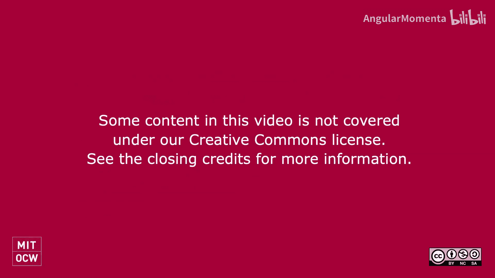

Today we're going to talk about peer guided learning at scale。

 The thing I asked you to do for today was to write a little bit in your learning journal about one of your hobbies that you use online resources to learn from So just get in groups of three and spend the first few minutes talking to each other about what kinds of hobbies you have and what kind of online learning you do in those hobbies。

 Does that makes sense ready you go。All right， come on back。So first of all。

 Omar should show us his camera。So I talked about photography。

 like I spent an unhealthy amount of time on YouTube like with photography tutorials。

So this camera is a 50 year old camera， and I had no idea。

How do you even begin looking for one and like these last three weeks I've been looking because I want to run a CPW event。

For admitdmints on how to use an SLR camera in that。

I don't know like this isn' a really great condition and I was like on eBay for hours。

 but I know watched YouTube tutorials， was reading on like Reddit forums， photography forums。

 D review， head up Excel like on what to look out for it and before that like learning how to actually take photos。

Was all done through YouTube， it was self taught， I started off with a phone and then I slowly built up my toolbox once I have knowledge。

Yeah now I'm like the photo editor for the tech I do stuff for yearbook and now I do a lot of stuff in photography and now I'm actually teaching others I recently actually just interviewed up very much this I interviewed for to teach a digital photography course。

 although due to time conflict I won't be able to do that but I did interview and I。

Was about to go on the other side of that。Learning experience。Camera's red。

 I just got it before my last class， so like I need to go to a camera shop just to make sure it works I'll be doing after to this class。

I want a photo a photo of Omar with his new camera。😊，Taken with a contemporary。Yeah。Yeah， I I I。

 I mean， those Polaroid cameras became much more widely accessible。

 probably when I was in grade school， like theyre pretty common。 And。

 and then there was sort of a revival in the last few years。

 So like my daughter has a Polaroid camera。 I don't think it's called we called them Polaroid cameras because they probably have some different term now of instant camera or something like that。

 anybody have a completely different hobby from Omar。

 where you could tell a very similar kind of story about learning。😊。

Or I guess like similar sort of sort of learning is like they're YouTube right。

I want to I'm like starting to learn how to play guitar and bass and stuff。

But the thing with YouTube is this like we talk about like algorithm guided learning or whatever。

 but like it kind of almost feels like YouTube sort of an algorithm kind of guided learning in a way or like。

I feel like that you do algorithm really sort of drives my interests or like diverts my interests into different things at different periods of time。

 like on a week by week faith。On a week by week basis。

 I can be interested in something completely different。What I was interested in last week。

 so it feels like I like am just sort of moving through a bunch of like。

Different hobbies and because I feel like I'm had the whim of the YouTube algorithm sometimes Oh yeah。

 yeah yeah。Yeah， yeah， yeah， no I think people feel that way with lots of kind of technologies that do some kind of aggregation。

 pinterest for people who do crafty kinds of things。

 TikTok for people who follow media and stuff like that。

 yeah good what other hobbies you talk about or what other sort of like informal learning strategies seem important and interesting or things that you were talking about in your groups。

Yeah， I'll say like on the list I guess hands on like level。

I like use like similar resources like YouTube and stuff like that for like。

A lot of like collecting knowledge for like things that I'm interested in like fashion， for example。

 because a lot of， a lot of it is like， you know， like， like in New York fashion， for example。

 it's like these very condensed times right and like it's all happening and often follow very closely。

 But if you're an MIT student you're following like can be feeling that。

 But like then you can like watch highlights from it and like actual like critics commentary on them and like kind of。

😊，See like what that's doing both socially and also like from an artistic side Yeah。

 do you use Pinterest or anything for sort of collecting your I had a social media problem。

So that I'm kind of just continuing into YouTube and stuff。

 but I do get to I guess reflect on it because I'm really costume designs and stuff cool my daughter is big into aesthetics of various kinds craft things or design things and Pinterest is like a big part of how she like she does the same kind of combing that you does but she's deliberate about taking things that she likes and storing them and categorizing them and trying to make sense of them and things like that。

Yeah， Dana then Ermo， I was just going to say like just like another medium outside of like watching videos is just like online like so mine is like cooking so like recipes of just like particles and then also like mine was like a little bit of TikTok just in like。

Video of like you can cook this and it isn't a professional chef showing you how to do it。

It cool to see that like， oh。I can relate to that person so I can do it。

what are your favorite sort of recipe， media or cooking media like how do you so I only perfected one singular dish and it's scallops？

Which is like's relatively hard thing， but like I'm scared to cook a chicken because I'm going I give myself sal manila and a scallops。

So my family jokes that are you only getting eat scs for this you like they're pretty good。

 they're healthy， there might be too many heavy metals if you do that your whole life or someone like that。

 but yeah yeah I don't know if bottom feeders are what you should do for your whole life but that seems like a good start。

How about you Ron？People be talking at lot of people related is number five stream blue one bro this video I just put them in what is this it's a math video they just tell you cool math stuff。

It's called number file。Okay。So sometimes you learn that there is fractional dimension and you just be watching what that means。

I watch this too。Yeah， who's the guy who came here a couple years ago for a graduation or a convocation or something？

嗯m。Mark Ror， yeah， yeah， he sort of science YouTuber guy named verassium does things like that too。

 Yeah， yeah， enormously popular and successful and things like that。

I play a lot of computer games and my life sort of overlaps。

 I know computer games are like a couple years older than me， but not by much。 I mean。

 definitely one of my earliest memories or games that would have been played off of like a cassette reel rather than any kind of rotary disk or something like that。

 but another distinctive memories that one of the first categories of games were these textbased games where you had to sort of enter prompts into a parser like open mailbox。

 go left， go right， walk in pick up key put key in lock those kinds of things。

 So a lot of where you're doing come on in was kind of guessing like was what was the right key term to put into to engage things。

 And so actually a lot of these games， Infocom was a company that sold a lot of them。

 the game companies would also publish a book and the book would have the answers to a whole bunch of things or like solution sets in invisible ink。

 And so you had like a little Penn that came with it。

 And so when you decided that you have given up trying for yourself， you would。

You would cover the invisible link with this pen that would reveal the sort of next clue and help you go on and so forth。

And but now， you know， essentially every video game。

 they almost instantly are created with a wiki that has， you know。

 every item in the game and what they do and where they go。

 Reddit form for conversation more recently Discord pages， You know， that you know。

 for smaller games can be kind of surprisingly intimate where。

 you really do feel like you're just like chatting with the guy who made the game。 even if you know。

 they may not be responding to you directly。 But they're certainly like responding to people or there around with you and things like that。

 YouTube channels or all these kinds of things。 Yeah， I think I think there's all kinds of ways。

're they' are very few people。😊，I think left in the networked world who don't have some kind of encounter with this sort of informal learning I think you know just an enormous number of people in a very short period of time。

 I mean， obviously， there have always been people who do DIY kinds of things and stuff like that。

 But the degree to which online resources has shaped those learning interactions is a profound change over the last decade or two。

 and I think I think it reminds us to do a few things that are useful。

 One is to is to conceptualize learning really broadly。

 know a lot of times that we think of learning， we sort of we pin it down in education。

 K12 education， college， things like that。 But's that's a relatively small part of people's lives。

 people are learning all throughout their lives all the time。

 people are developing new skills for work， they're developing new skills around their interests。

 there pursuing。Passions or doing whatever else。 And so I think it's very helpful when thinking about online learning to be really open to all these kinds of things。

 And then， you know， I would say if there's a core argument in peer guided learning at scale。

 it's that。😊，These technologies have been so profound in changing the ways that we pursue learning outside of school and schools have proven to be institutions that are just remarkably resistant to these forms of learning as well。

 my hunchches， most of you don't have an experience where you feel like， yeah。

 the kind of learning that I did in my eighth grade physics class was really just like the kind of learning that I did to learn photography or something like that。

 There's something about schools and the design and organization of schools that makes it really hard for these kinds of learning environments to make their way in。

 I think a lot of what I want to share with you today。Are some of the most substantial efforts。

 particularly in higher education， to figure out how some of these approaches to peer guided learning at scale could make their way into formal institutions the ideas that I am presenting to you and I know if I was talking about them 10 years ago。

 I would have positioned them more as these are very viable ways in which at least higher education。

 maybe a number of forms of education might substantially change in the next five or 10 years and I think I will more likely to present you them today as an interesting dead end as a set of things that people are trying putting a lot of effort behind。

 putting a lot of design behind and and really didn't have much impact in how especially higher education in how in how formal education of all kinds are organized you know studying things that flop is as good we're going to come back to this。

a few different times。 studying things a flapop is really important to figure out why things work。

 If you just study things that work。 you actually don't know why they work。 you know。

 the characteristics I have。 but， but there's lots of things that are in common between things that work and things that don't work。

 And so that's what will will delve into some today。

Maybe I'll talk for a little bit and then see what kind of thoughts you have。 All right。

 So I think we did the rainbow loom story。 We talked about this the the other day。 This is one。

 I think， iconic moment of the creation of a new craft generates these new kinds of communities This was from 2013 low tech but high in creativity。

 The rainbow loom has kids hooked spending hours after school and on weekends making bracelets weaving together small colorful rubber bands on a simple plastic loom。

 and all of the the narrative around rainbow loom was man， look。

 we finally got kids off their phones。 like we finally got kids in the real world connecting to one another this is I think 2013 that this is published right before Christmas。

 But of course， the kids were were on their phones the whole time that they were playing with Rabow loom。

 And so this is Ashley and Step who were these two girls who have quarter of a million people described is yeah how to make a rainbowlom Starburst bracelet。

😊，When whenever I recorded this， 30 million views， probably 10 times as many that were on the official rainbow loom Starburst page that somehow these these two kids had captivated。

 I don't know。 it's hard to say that it was millions of people because it actually could have been like a couple hundred thousand people each watch this like 10 or 20 times because it's super hard to make one of these bracelets but。

嗯。You know， I think a compelling example of how network learning was。

 know and something like this if you're my age， you know looking at this in 2013。

' it's really hard to imagine something similar happening in 1990 or something like that。

 like if someone had invented a new kind of craft， you would have like had to go to a craft story。

 you would have had to join a club， be able to go to classes。

 they had to be a college club or something like that。 there wouldn't you know I mean， you know。

 maybe PBS would put on a television show about it。

 you'd you know you could imagine like the Bob Ross of Rainbow loo or something like that。

 but you know very hard to imagine the same kind of highly decentralized mechanism by which learners connect themselves to each other。

 I think one of the things I'm going to ask you to read for an upcoming week。

 I can't remember is next week。 but this piece by Ivonne Iitchch called decentchooling society。

I think it's written in the 1960s and he he almost exactly like the very dawn of computing and he predicts learning networks that that emerge like this。

 he says， you know one day， I mean， its a funny way of describing。 he says well。

 you know one day there's gonna be a bunch of learners who write down the things they're interested in learning on punch cards because that's computers at the time And there's gonna be a bunch of experts who share their interests on punch cards and the computers are going connect these punch cards together and get people teaching and learning from one another。

 And it turned out we have YouTube rather than punch cards。

 but it was pretty similar kind of phenomenon。😊，There are you know， in in the 20 in the early 2010s。

 there were some people who were particularly enthusiastic about the fact， you know。

 So one thing about rainbowlo， you can say is something like， all right。

 So some kids figured out how to make plastic bracelets。 that's okay。

 But there are people who achieved like elite levels of performance in a variety of different disciplines and domains by following the same kinds of practices that the rainbow kids。

 Rainbowlo kids were using。 So there' is a guy named Julius Diegogo who as I what a silver medal in the Olympics。

 He was from Kenya and he was a javelin thrower， there are no field athletes in Kenya。

 there're all track runners。 And for whatever reason， Julius Diegogo got in in his head。

 like I'm going be a javelin thrower。 And you know， my coaches me in the YouTube videos。

 and he became an elite， you know globally recognized I mean there's a moment where this tips。

 There's a moment where he goes to track and field。😊，Petition you know。

 doesn't really have a coach and he throws javelin pretty far。

 And some people notice him and kind of take them under his wing and stuff like that。

 So it's it's not just YouTube videos that get you entirely to being the second best javelin thrower in the world。

 but but going quite a long way。 You know there there's echoes of this of the story that I told you before of Bato。

 the boy genius ofan Baar， the kid who sort of discovered in Mongolia through M techs and things like that。

 the idea that these could have these profound democratizing effects like you know。

 you don't have to be in a country that has a really big track and field infrastructure to be able to become a great athlete。

 you could do it anywhere because we have YouTube now。😊，So I was working for Harvard X in 2013。

Maybe you know， maybe I'll pause to tell this story too。 well。

 I don't know what the right order is now that I'm inspired by it。

 But there was this term massive open online courses。

 and it actually was not originally applied to the courses that came out of coursesera anded X and M T X and Udacity and things like that。

 There were a group of Canadian educators who 2008，2009，2010，2011。

 started building these networked courses。 of go more into the details of the network courses。

 But you would basically kind of create an online learning environment， have people create blogs。

 connect on Twitter， formed social network connections with one another and sort of all be studying the same thing at the same time。

 Sometimes some of the people would be getting credit from some institution and other people would not be getting credit。

 They were all kind of openly being involved。 know。

 a few thousand people probably the largest of these signing up。

 And so there was actually a reporter who when edX and course。😊。

Sah I got started was trying to figure out what these things should be called and somebody said。

 like well these Canadian guys have these things called massive open online courses and the name stuck。

 but it's stuck to describe something very， very different one of the things that we recognize early on is that is that in the early days of people doing the massive open online courses that came out of Harvard and MIT is many of them werere not just using the course materials that were being provided on these platforms。

 but they were using all kinds of other things so you'd ask people in there like you know yeah we're searching for all kinds of things that show up。

 we're reading like the Wikipedia entries about the things that show up in these classes we're buying additional books that are around them we're looking for those books on Google books we're joining Facebook groups of people who are studying these courses together and things like that and so the barriers between these sort of instructor guided learning at scale。

 these like highly structured learning management system kinds of things。

And the sort of informal world of people messing around on YouTube learning about stuff。

 sort of smed together。 probably a bunch of you have some kind of experience of that in your classes too。

 I mean， presumably all of you like are like when you don't understand something in class。

 you're looking up online videos about it or you don't like the lecture and probably mostly in your technical classes。

 you watch it from some other place or I't know any of you join groups or like find communities of people who are good at solving problems in the things that you're interested in。

One thing about being an MIT student is you can go on OCW if you miss a lecture or you don't understand the lecture。

 you want to explain a different way from a different professor。

Wat that which I've done before for some of my more technical classes so yeah。

 so you can rewatch sort of past things some professors are sort of pretty explicit about that you know they'll be like well this is my lecture。

 but like somebody else filmed you know roughly the same course four years ago and you can watch all those things How many of your classes still use piazza or some kind of discussion forum sort of things or the piazza forms ever insufficient then then you go to stack overflow or to some other kind of maybe if you're coding classes and things like that Piazza has like a weird social dynamic？

No that would tell me more。I think it's like， I mean like obviously you can both do like anonymous questions and non anonymous question。

 but usually it seems like。You know， it really depends on。

A little bit on like who's really using it and also how responsive the faculty and stuff are and how they choose to respond because I have been in quite a few classes where like I log on and then it's like yes I had that question and they're like oh sorry we boarded the question we but then I've also been quite a few classes where it's like they're asking this like super high level question about the lecture and then it kind of sets that expectation for the class especially if it's a larger class I like oh like my like Con code dumb questions like answered Yeah it's not going be kind of respected or things like that yeah you know I mean because these things are social in nature。

 I bet a lot of those things can be determined pretty early on by the actions of a couple of people when we were studying massive women in online courses one of the things we found in discussion forums。

The largest threads， the most upvoted kinds of things were almost always amongst the very first topics like posted。

 So so it wasn't like the forums were surfacing like it wasn't like there was lots of ideas and the most interesting or important of those ideas were surfacing at the top。

 It was like somebody jumped in there first。 And then people started talking about those things。

 know and you could imagine you could imagine an alternate timeline of the exact same course you're in where the first two people to post happened to just be people who were like I don't understand this really basic thing。

 Well someone explain it again。 And the forums have sort of a whole different character to them。

 I mean， to some extent， I think of computer programming particular is a field that depends upon this kind of informal learning that basically no one knows enough about programming languages and how they operate how they solve problems。

 And so you essentially can't do that profession。 if you can't figure out how to navigate all the online resources。

 all the online communities and like that。 And unusual you can。

You can be be promoted and thrive in those communities through your participation in some of these kind of informal learning networks。

 you know， you can be really active， I mean， in creating open source projects or just be a really active contributor to stack overflow or other kinds of communities like that get recognized for your contributions and have that translate into other kinds of opportunities so the boundaries between there are ways that I think these informal learning environments andal learning environments the boundaries can permeate even if as we'll keep talking about like just trying to take the whole informal peer guided learning infrastructure and bringing into schools seems not to work pretty well。

You know， I think one of the actually。One of the most compelling reasons for integrating technology into people's school learning at all is the idea that actually for most of your lives。

 the kind of learning that you do will look more like the learning around your hobbies than it does look like the learning in your classes in the next couple of years。

 some of you will keep taking classes for a long long time。

 but most of you will probably stop or take them only infrequently， you will probably however。

 continue to participate in these online learning communities to me it raises really interesting questions like you what responsibility does a school have for helping people become really good at learning。

 cooking through playing with recipes the way Dana described or learning photography through online forums or music through online videos in the way that Ja and Omar described like what would a K12 education look like if someone left school and they were like I'm totally prepared to teach myself stuff by engaging these online communities。

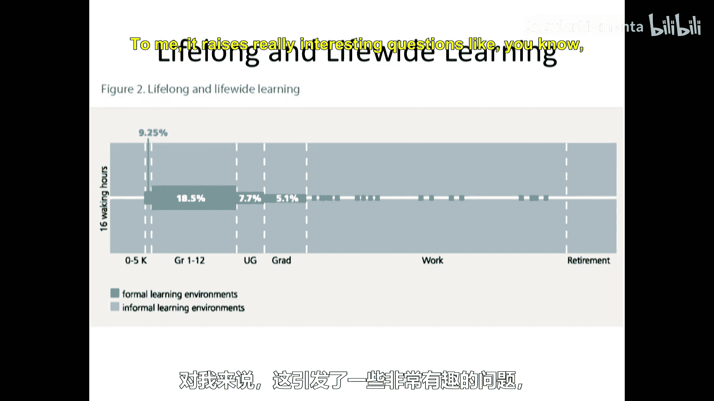

I've had a bunch of practice in those sorts of things what would what would a college education look like if it was good of that I feel like that's like such an interesting point because I like think back to a conversation I had with my mom where she like grew up and was out of or out of high school like right before the like really dawned like computer classes in high school and middle school and like in middle school so like rudimentary to us we like learn how to use in Excel she and like just learn how to like Google things and like a lot of just like the super basic skills of how to type on a a computer like keyboard that she doesn't know how to do it it almost seems like the next generation will like lead computer classes like knowing how to navigate these sites and like then all the stuff that I had to learn on my own like maybe I'm asking my kids like where did you learn that and we're just like in school？

There was a phrase that was used for a number of years that was called digital native， The idea。

 maybe maybe a more common a phrase that you'll hear probably in the next few years will be something like AI native。

 The idea what's the difference between having to learn something by having it come into you into your life versus like having it be something that you kind of grow up with all the time。

 there's actually a bunch of good evidence that in fact。

 that digital natives that young people are actually not that much better at using technology。

 especially learning things and older folks， young people in schools are usually pretty good at doing certain kinds of technologymediated things。

 but the things that are most helpful for learning。

 they're often no better at than sort of anybody else。

 although I've always liked the idea one of the things that comes along with the idea of immigration of digital natives and so digital immigrants and digital natives is that know second generationeration immigrants are always taking on new responsibilities for teaching their first generation parents about things you grow up in a country and learn the language you learn a culture or other kinds of things that you sort of have to explain to your。

So there's something kind of nice about that metaphor carrying over， bringing you somewhere。

Something that I know say Massachusetts is hearing is。

Completely agree with it blending computer science and computer literacy together。

 I do think that teaching computer literacy is of but most importance I credit a lot of my。

Computer literacy to my seventh grade seventh and eighth grade technology teacher。

 you know the LinkedIn I use now was creative back in seventh grade I use a very same account and he was the one who got me。

 I think I mentioned the typing lessons like the beginning of the class。

 that's where I learned how to type that's where I learned how to create a portfolio on website。

Do like individual kind of research and like create a project on something that I'm interested about。

 and I think creating projects on something that's。Like personal to someone。

Within the K through 12 lesson is really important for teaching them how to conduct research。

 take notes and come up with conclusions on what they up look for online and a constant challenge educators have is what new things are actually worth investing additional discretionary time in。

 I mean there plenty of folks 10 years ago who said man， it's incredibly important。

 Every high schooler should complete a MOocOs are going to be absolutely central to how people learn and finish higher education in the future if you can't do a MOoc you're really gonna to be left out and it' like wow。

 maybe not so much like a LinkedIn profile however many years later still seems like a pretty handy thing to have。

 There was no reason 10 years ago that it's very easy to imagine a world where LinkedIn got replaced by something else entirely MOCs were super important like in 2013。

 the success paths of those things were not at all predictable。

 educators are super anxious about I just gave it Er came to this concept me I gave a talk to a bunch of educators about AI and education on Monday and there's a ton of anxiety about。

Like how important are these things， what do we not need to make sense to teach kids the same way to search anymore AI agents are just gonna answer our questions for us or is it more important to be able to do that because the AI agents are gonna say nonsense to us all these kinds of things。

 Yeah in that regard like do you consider AI a form of like peer learning because it's been trained on peer like he that so my first thing about AI I was giving a talk with Jim Waldo who was the chief technical officer at Harvard。

 he's neat guy because he got a PhD in philosophy about 40 years ago and then went that oracle helped write Java if you have an Android phone。

 you're probably running his code on it and they came back now he does policy stuff and he sort of a philosopher again but he's like AI what AI is what we call computing technologies that are new and we don't understand very well and 10 years from now。

 they won't be called AI anymore And so like our generative pretrained transformer。Per communication。

 Well， you know， maybe， you know， if like what do I what do I think what do I think a peer guided network is。

 a learner enters a network where a wide range of learning resources that are generated by previously all human agents Could't you know。

 could have generative pretrained transformer generate a useful learning sequence seems plausible。

 you know， I remain not entirely convinced I actually somebody came up to me and was like like where we have a startup where we're creating online classes by having AI create the classes。

 And I was like， that just sounds like a terrible idea In part。

 because there's just such a huge surf of classes。 like there's so many things out there And they're really not unfortunately that expensive to develop。

 like what do you mean machine system。😊，呃。I have a， I have a colleague。Carolyn Roe。

 who worked with chatbots for decades and and she actually。

 she has convinced me to be very skeptical of interactions of individuals with chatbots。

 like I don't know。 How many of you in the last week spent more than hour are talking to a chatbot。0。

 maybe1。 I just don't think people like it that much。

 She really thought that where they could be powerful is jumping in in the conversations between two people that you just have peers talking to each other。

 So you're on this discussion forum and you're going back and forth or other things like that。

 And then a bot comes in and sort of helps you ask an interesting question。 like， look。

 somebody over here has a different perspective on that。 Let me connect you to that。

 And so you can talk and things like that。 Yeah， it totally I think I think it totally seems plausible that a peer guided learning environment could include。

 you know， artificial agents that are doing things that humans had previously been doing。😊，Yeah。

 I guess to like what your points of like a interaction， I would say。An interesting aspect of that。

 especially in terms of like what can be a credible source for learning and stuff like that。

 So I think in California， or at least the part of California， I was in for a while。

 we did have like a middle school little like a week long program that every kid had to do that was like。

 oh， you're 13 here， make an email。 and here's how you Google stuff。

 and like recently with the new Google AI feature that kind of summarizes answers for you now。

 I was like， think about like。😊，How does that change？

Kind of those levels of instructions because sometimes I look up things。

 and I see the summary and I'm like， I don't know what the answer is。

 but I know it's not that and and I go deeper but like let's say if I'm a middle schooler and it's like。

 well I' learn this or I'm a high schooler that took that class in those one like well now I not sure or I take Bars word for no a huge problem with G generated text is that it's probably much more useful for experts than for novices。

 So if you're you know you ask a G to make eight things and and two of them are cool and six of them are nonsense。

 or the opposite an expert can tell the difference。 and be like， oh。

 that was an idea didn't have before。 but a novice can't。 A novice just looks and be like okay。

 these are eight ideas， they all seem plausible and they're confidently stated in things like that。

 it's a huge problem that educators are gonna have to wrestle with in the years ahead。😊，You know。

 the kind of class that you're describing if it were to be taught 10 years ago。

 a big thing that educators were thinking about at the time was how are people going to navigate a social web。

 So when when the web was first developed。 We'll get into this little bit more。

 It was pretty hard for people to contribute to it。 You have to know a little bit about FTP。

 You know a little bit about HTMLl a couple other things like that。 They weren't like super hard。

 but there was a relatively small portion of the population that added content to the Internet。

 And there suite of technologies that got bundled and called Web 2。0， which said， okay。

 we're gonna make it much easier for anybody to type things online。 You can all start a blog。

 You can all start a microblog。 You can all make a simple website。

 You don't have to know how to code to do any of these things we're gonna we're gonna use user interfaces to take away all that sort of programming expertise that's necessary。

 And so people thought， wow， you know I bet our lives。Going to young people's lives。

 if you're teaching 11 year olds 12 year olds in 2013， you're thought man。

 a major thing they're gonna have to do is how to connect a network with each other。

 We have to have them create their LinkedIn page so that they know how to social network with each other。

 We have to have them participate in online dialogue。

 We have to have them think about what are responsible ways of representing themselves people taught a lot about their digital footprint and other kinds of things like that。

 know today a 13 year old is entering a web environment in which there are lots of parts of social media。

 which are collapsing that just as an example， actually I went to the guy who ran this conference on Monday And it was kind of so were usually this conference get10 or 1 hundred of people show up。

 It was about AI。 had 240 people show up and 70 folks are on the waitlist tons and tons of interest from educators and I went to the guy who runs at Tom Driscoll and says。

 what do you think these teachers are interested in what are you。😊。

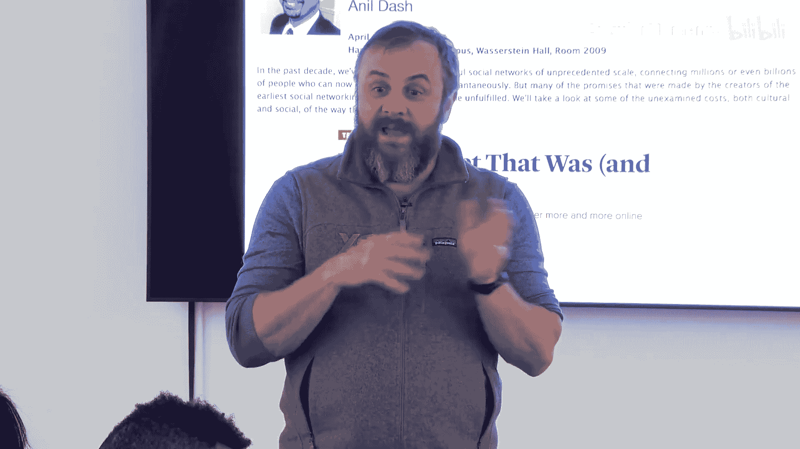

What do they want to know， Why are they here And he's like， you know what？ I don't know，10 years ago。

 they would have had blogs。 They would have participated in forums。

 they would have joined face group groups， they would have sort like had there were many。

 many more ways that educators were proactively contributing their ideas to the web maybe not all of them。

 maybe it was 10% of them or 20% of， but enough of them that you could kind of get the pulse of a whole community。

 which he felt like and I agree， you really can't do anymore。

 Some of that is that there was there was a moment in Web 2。

0 in which people believed that the infrastructure of the web might be really quite open and quite owned or controlled by individual people that there could be a world where people create their own websites。

 they create their own blogs， they host their own accounts and things like that and you know I don't know when some of these things starting around 2015。

people started describing the web we lost， a kind of moment in which social media took a turn。

You know， so these are the kinds of things that like。

 I don't know why I was playing around with in 2004，2007。 you have a live journal blog。

 That was one of the earliest sort of blogging sites that people like create their own space and hosting it。

 This was a Wordpress do co blog of my wife and I writing little stories about us going on adventures and things like that。

 posting pictures hosting it ourselves。 And essentially Facebook came and sort of demolished all this。

 and said， you know what like you don't need to host your own blog。 You don't need to you know。

 you don't need to like figure out a FTP server to upload your own pictures or use a picture interface。

 Like we're gonna create an interface。 people participate in a lot of the same kind of practices on Facebook of writing little stories on the trips they do and posting pictures and stuff like that。

 But all of a sudden it was all controlled by Mark Zuckerberg。

 This was a quote from David Weinberger in many ways， Facebook fulfilled the dream of blogging。

 But like not exactly like everybody was online。 but they weren't in spaces that they。😊。

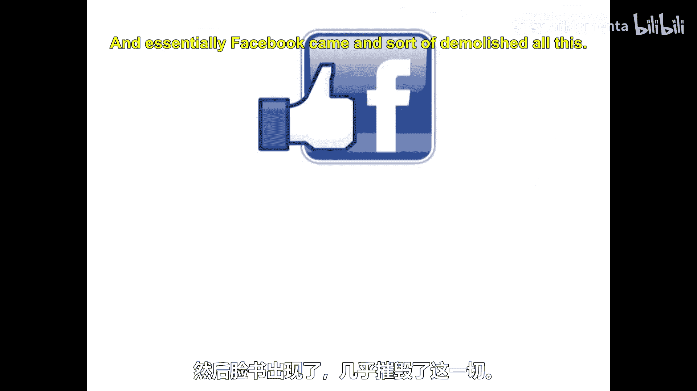

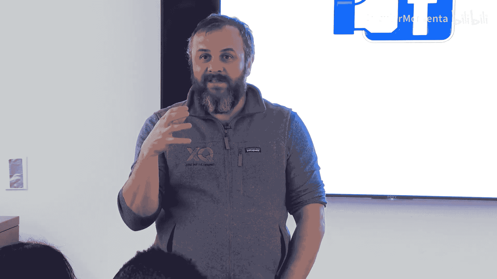

Owned， had control over， had some familiarity with。

 And then we'll talk about some of this that goes along。

 I think there was there was a moment in which participation in a broad online life felt much less toxic and draining and vulnerability inspiring as it does right now。

 you know， I mean， if if there if you're a teacher who's working in a state which is recently passed the divisive concepts law or other things like that。

 regulating the kinds of topics you can talk about and things like that。

 like all of that has a sort of chilling effect。 know， I mean。

 not to mention just the the ways in which you know， the social media services， Facebook。

 Twitter or other kinds of things we use have sort of degraded in their conversations over time。

You know， this is what David Weinberger said。 The blogsfield did not scale like like there， you know。

 some people created their own blogs， but not everyone。

 And then Facebook came in and many people who created blogs like， I'll just post to Facebook。

 A lot of those people have like moved over to subt now or other kinds of things like that。

 But but systems that they don't control。There is， I think。

 a parallel to that story that happened in higher education。 So in the early days。

 when the web was first made available broadly to schools， which also know。

 happens overlap with my life。 So I think in 1993， Dartmouth College is the first college to give every incoming student and email address。

 I think in 1994， very quickly， many， many other colleges had done that。

 And by the time I graduated high school， certainly by the time I was into college in 1996。

 I had an email address， everybody else would have had an email address。

 that would have been you know， pretty， pretty universal in standard。

 But this is what university Web pages looked like at the time。

 MI T still has some of these kinds of things， as anybody ever been to somebody's Tilda space。

 you know， WWw MT dot E D U slash Tilda J Reich or something like that。 Who do you。😊。

the 1806 professoror with。getting the one who just retired Gilstr， good， perfect。

 great Other that people can think of who have these things。 So。

 so some things that you'll notice about the。 Well， I don't know。

 What you just looking at these pictures。 What do you notice about these things。

 What strikes you about them， There are some giggles before， which I think is appropriate。😊，Like。

 everything is time。Okay， so you know， not a lot of font diversity。What else。😔。

There's no advertisements。Yeah， good。 No， these。 so these were not created like with Wix or something like that where in exchange for making a website。

 you have to put a bar of advertisement at the bottom or something like that。

 So somebody actually made these pages。 They're all personal homep pages。

Other things that strike you。The backgrounds what about the backgrounds？It's certainly of like。

 I don't know。 I feel like I I personally associate them with a very specific time here here。 Okay。

 good like they have， they have a 9s aesthetic to them。 Yeah， I would say maybe it is like。😊。

Partially， just like。The quality of like。来。Let's say a pattern or something you can put on or like now we have a lot of templates and make sure it's like aesthetically consistent。

 This is precanva。 We're not，'re not Kent， Where were you gonna observe。

 abouts like they're not all using the exacts They're not all using the exact same template in similar formatting。

 I think that that is actually quite important。 There are some good things that templates do of make things looking aesthetic but they standardize in a way。

 they put things in the same way。 People at universities do really， really different kinds of things。

 that might be important。 Other observations about these。😊，It's very sppheromorphic。

 like there's buttons on the bottom left one。Like icons that you don't see as often and I want to see the background。

 especially the bottom left， remind of a physical wallpaper。

 which is like that principle do a define skemorphism for us skemorphism is like。

The most famous example probably like I 6 where you have all these buttons and like reflections that sort of try to mimic real life。

 And that's like what skemorphism is trying to mimic real life。

 And then when we transition to I 7 you moved a lot of that dimension。

 and it became a lot more simplistic and symbolic A lot of the early note taking apps would have a background like a yellow legal pad or like a spiral binding on the side or something like that。

 and you're like， brother， we could put we don't need the lines like the cursor will do that for you。

 but people wanted to make some kind of connection between what they saw what they saw in the physical world and what this new digital thing was trying to do。

 skewmorphism shows up in that book somewhere I can't remember now where I wrote about it。 But yeah。

 I mean， obviously these pictures are just outstanding。Just like people had kind of like a cool。

 idiosyncratic。Personalized kind of a bane in the butt to organize sort of blogosphere that existed that Facebook just came and sort of demolished and homogenized and standardized and pulled out of the control of individual people's spaces and into this sort of corporate space。

 you could say that Blackboard did something very， very similar to campus web pages that learning management systems came along And they said we're going to standardize it all you don't have to create your own page anymore like Blackboard will create your own faculty page。

 create your own course page and that's going to come with some kind of benefits of standardization。

 it's going to make it a lot easier for people， but but it's also going get rid of some of the kind of wonderful idiosyncrasies of these things and it's going mean that there's a corporate entity who is not accountable who's accountable to their shareholders and not accountable to the same values that we might have as university which is deciding what those things look like much。

😊，Like when we move all of our blogs onto Facebook。

 you don't even you're not even accountable to shareholders。

 you're just accountable to whatever Mark thinks， you know people should be doing in Facebook Yeah。

 in many ways， Blackboard fulfilled the dream of the university。 Tilde spaces did not scale。

 I believe the problem could have been solved， but then Blackboard happened Why would Blackboard happen These are the instructions for Suny Oneonta about how you go about creating one of your tilde space pages。

 you know， log into Aca create a directory change to this directory create HTML documents。

 HTML developers jump stationation， you know， set Pro equals W Col R file name you can like you read about a page of this stuff and you're like。

 yeah， I can see why a lot of people you know like why launching a blackboard page be might be fine。

😊，This is what the was this blackboard。I don' I don't know remember what learning management system this was。

 Maybe it's canvas。 That's not canvas。 I don' I can't remember what it is now。

 This is this is the very first version of sort of a version of this course that I taught 10 years ago and this is this is the page that that the system generated for me when I first created the class。

 So it comes with a bunch of these sort of not this stuff I added。 but syllabus class sessions。

 other resources assignments， collaborate information reserves list， search this site lecture video。

 It makes a set of assumptions about what my course is。

 It says know this is what the standard format of this learning experience should be。

 but maybe that's not at all what I want。 It certainly doesn't make a lot know if if I had taught this class about this was in an education school。

 if Id made this class about education technology about the experience of indigenous kids learning on reservations about I don't know。

Global education policy， intermediate statistics。 It all would have been the exact same format。

 They would have given the same sort of standardized creation for this， which just in lots of。

 you know it makes sense in some kind of ways and it bonkers and other kinds of ways。

 our courses are super different。 Why should all of our courses have the same template。

 Why should we all be sort of subtly invisibly squished into teaching our courses the same way by these kinds of structures。

 And of course， there's all kinds of physical analogs to this too。

 the way we design environments shapes the learning experiences that in I just a beautiful sentence of this。

 which is something like it was something like buildings have agenda for their occupants。

 the way that spaces are created like it doesn't tell you what to do but it certainly guides you you walk into a room like this and you have some thoughts about the kind of learning that's going happen in that space。

 Like well， you're all gonna be facing in the same direction。 Probably not gonna。😊。

Talking to a each other a whole lot in that space there's you know you're gonna be writing with certain kinds of physical materials if you try to use a laptop on those you know square tables you'll have a hard time you know there's no room for power cords or other kinds of things like this this is actually one of the most famous examples in elite private education in the United States which is。

😊，There were donors to the Phillips Exeter School who were really concerned that essentially there's too much instructionism and not enough constructionism。

 they wouldn't have said it the exact same way， but they would have said something along those lines。

 too much sitting passive listening， not enough sort of engaged conversation And so a bunch of donors got together。

 and they said in every classroom， we're gonna to pull out all of the chairs that look like this。

 and we're gonna put in these tables called Harkness tables。

 Some of the features of Harkness tables are that you need to be able to fit everybody in the class sort of in an oval around the table。

 the tables are so large that they usually have to be like built in different pieces and then shipped into the room and then assembled inside the room。

 they're incredibly heavy， but they make it So there is no front of the room。

 and at Phils Exeter other kinds of independent schools。 they put these tables in every。Classroom。

 they put them in the English classrooms， they put them in the history classrooms。

 but they put them in the math classrooms。 They put them in the science classrooms。

 and the intention was to change the physical space in order to create certain kinds of learning environments and certain kinds of interactions there。

 Now， of course， you can give a math lecture in a room like this。

 but it's hard to lecture for 52 minutes， you know。

 if you're standing here and have the kids either have their backs to you or have to you know rotate around or other kinds of things like that。

s it's designed to make people do that So you can sort of think about like what are the you know what are you know what what agenda does this online space have for its occupants。

 What is it that sort of generic canvas classroom tells instructors and students that they're supposed to do。

😊，you can look at these links later。 But these are two of the folks who。

As as as Blackboard was sort of sweeping higher education where the monks the most active in trying to have these conversations。

 There was a book that was written about them and some other people called Epunks and trying to make connection between the punk movement and music you know。

 very sort of like countercultural do it yourself you know。

 kind of stand up to the man sort of thing and folks like the Reverend Jim Groom and Alan Cogdon。

 you know， they they have these monikers because if you were participating in social networks。

 you create handles for those kinds of things， but also Reverend Jim groomroom was a bit of a profit of such things。

So， what。What these systems really allow is a certain kind of coordination。 It becomes very。

 very easy to say all the faculty are going to have a page。

 you're all going to create at the same time， it's going to be automatically generated for you at the beginning of the semester。

 even if you don't like computers we're still going to be able to make you do it because it's not that hard。

But there are a couple of characteristics of it that I think are not so good。

 I've talked mostly about the sort of stamped piece of it。There's。

 there's a way in which the control of all of the learning artifacts is with the institution and not the people。

 So imagine， imagine in infrastructure for online learning in higher education where you didn't put all the stuff on someone else's webp page。

 you put it on your own webpage。 Like what if when you went to do homework。 you went to do writing。

 you went to ask questions。 it didn't show up on the school's canvas site。

 which you don't care about。 But it was on your site in some kind of way。

 It was in some sort of space that you controlled。 And the thing that was always craziest to me about these sites is that we delete them every 18 months。

 you know， it's a strange thing to go to students and be like， please pour in your best。

 most thoughtful， most interesting words， ideas。 by the way。

 nine months from now they're gonna be automatically deleted That's that's a sort of strange feature to me of of an online learning environment。

So， so me and other folks for a while were really interested in like， well。

 what would an alternative to this look like What would be。

 what would be something that was not blackboard， that was not canvassed that still could have coordination but it would let it would have some of these characteristics that the sort of web 2。

0 open web movement had。 Like it let students own their own stuff。

 It helped them develop some technology proficiency。

 It connected people to each other and to their work。 It didn't just like hoover up your stuff。

 churn it through grade it and delete it， But it would be like something that you owned and cared about for a while。

😊，Those are ice cream sandwiches。

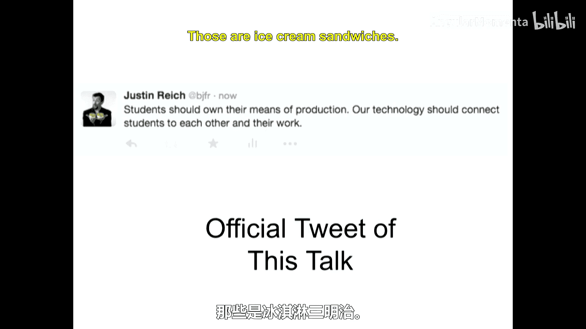

诶。Yeah， good。 yeah。It's a good， It's a good picture。 It， you know。

 it definitely evokes some of these kinds of pictures。

 like some of these kinds of pictures sort of ended up on like professor Twitter handles in 2013。

 I didn't make that picture。 I had one semester。 or I don't know。

 Some students just were like enjoying class， And they sent me a whole bunch of。 I don't know。

 How quickly can I find these things。😊，There's one of me。诶。呃，Are these going to be on here？嗯。

There's a few， there's like this one。那。This one。Oh no， that's a real one。Just as Lebron James。

 a little dicey to be doing this one these days， I don't I I wouldn't put white Justin into a black body anymore。

 but back in the day。 yeah， for one day for class， I think something terrible had happened in the world。

 and I made the ice cream sandwiches one day for class。 and so they they made that picture there。😊。

It was perfect。We're getting into the real issues now。

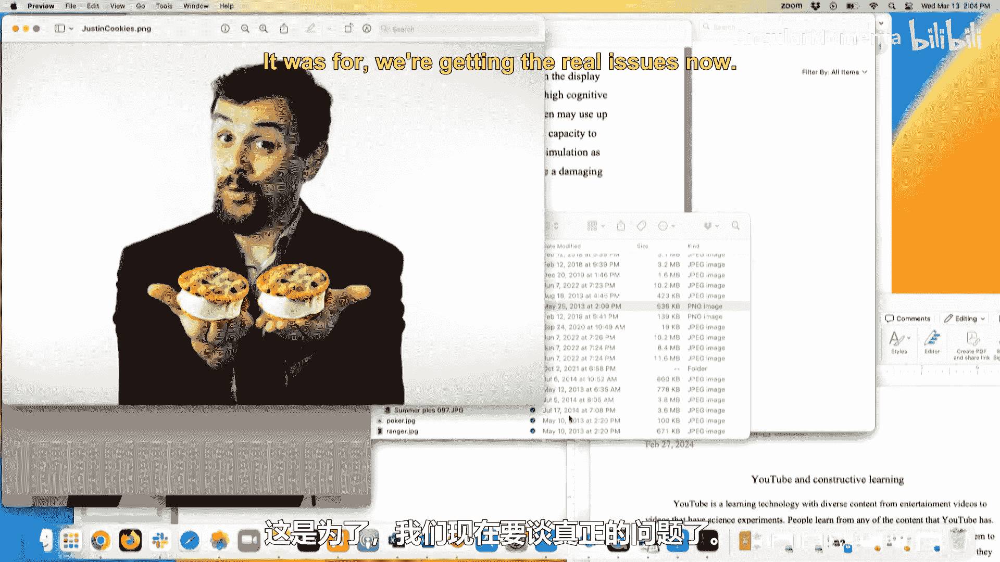

I think。That I went to the International Society and Technology and Education Conference。

And they basically grabbed a bunch of random people and took them to a photo shoot to generate their own stock photos。

 they wanted to have a whole set of stock photos that were from the membership of this organization。

 And so it was just like， I don't think I was holding anything。 I think I mean。

 like you could imagine this is like generic invitation to kind of thing but that's where all that came from。

Is this worth your learning time， hard to say， but it's pretty fun？Okay， this。

 you should remember a little bit。This is another this is another branch。Of。Of constructionism。

 you know all these ideas just repeat themselves。 they get reinvented over and over again。

 These two Canadian educators， people who sort of founded the 2007。

 2008 original massive of open online courses and they had this idea called connectivism。

 And they said， you know part of the problem with learning theory is that it thinks that learning happens and knowledge exists inside people's heads but learning and knowledge really exists between people more than exists within people there's a famous line。

 which is which you probably all would agree with in some way that the smartest person in the room is the room。

 that like the collective capacity of people is where kind of the heart of our intelligence like connectivism almost went further and said like maybe the only intelligence in the room is the room。

 maybe your knowledge your understanding like doesn't exist without social convention like language like culture。

 other kinds of things like that。 So。was at first in educational philosophy。

 maybe it was maybe it was an epistemology， maybe it was a philosophy of knowledge。

 but then it got translated into these pedagogical ideas and the pedagogical ideas were say。

 what if you defined courses where their primary value was creating connections between people and ideas one of the things Stephen Down said about this。

 which you'll find it very connected to situated learning he says。

 you know like if you become a physicist， what happens。 Well。

 like you read physics papers and you followed new ideas in physics and you figure out where physicists talk to each other And like where the physics lounge is and which physics conferences to go to。

 I don't know what music physicists like what television shows they find funny。

 all these kinds of things， like that is as much a part of becoming a physicist as learning formulas and theories and knowledge and things like that。

 What if we had educational systems that took that really seriously like。😊。

Job of a physics class is not just to have you be able to learn some formulas about Newton's three laws。

 but to connect to other physicists。 that's kind of a cool idea。

One of the most radical things Stephen Down ever said。

 he said something along the lines of in my class， the content is McGuffin。

 a McGuffin is the thing in a movie that's not really important that drives the plot forward。

 It's the briefcase that get switched in the beginning。

 which helps to people fall in love with each other or something like that。

 The McGuffin is the thing that you're sort of chasing to make the plot move forward。

 This is a radical statement for an educator。 The content is a McGuffin。

 The thing that I told you the classes about is a trick。

 The real part of the class is getting you connected to each other to things that you're interested in to other kinds of expertise。

 It is a very radical set of ideas。 And there are a lot of people who are sort of profoundly influenced by them。

 and people trying to say like， yeah， what what could some like genuine alternative architecture to canvas that embraced some of these ideas of the open web of Web 2。

0 of connectedism what might look like。 And so this。😊，No longer exists。

 I don't think either of those links are live anymore。

 but this is what the website for this class or an earlier version of this class used to look like。

Here's how the infrastructure of it worked at the beginning of class。

 folks were assigned to create spaces where they would do the work of this class。

 So you wouldn't have a learning journal。 you wouldn't have like a canvas discussion page or something like that。

 Go make your own blog。 Go make your own tumblela。 Go make your own Twitter feed。

 go make your own flickr page， make all kinds of other things like that。

 and do all of the work for this class in your own space。 Now。

 one problem with that is that nobody can find that stuff anymore now。

 it's all sort of on other people's things。 but that's a solvable problem。

 because we're gonna build this thing called the syndication bus。

 and the syndication bus is going depend on this technology。

 which how many of you are familiar with real simple syndication。

 I that something that you like you like vaguely know exist。 again，10 or 15 years ago。

 This was considered like an essential part of the web。

 And there are many people would have told you like this is the future of how people。😊，So before。

 you know， Ja was telling us before about the YouTube algorithm kind of controlling what he watches and what he finds and things like that。

 An alternative to that was you subscribed to a series of feeds。

 So you would like find all the bloggers that you like or all the video bloggers you like whatever else。

 you would choose their feeds。 And then you would have one really popular technologies called Google Read。

 which just gave you the things that came out of those feeds。

 So instead instead of being sort of like bounced around buying an algorithm to things that people think are popular interesting and things like that。

 you sort of have more control over that。 So basically what we did。😊。

Was everyone would create their own online space。 And then we would use this syndication bus to aggregate all those things。

 So effectively， we would， am。嗯。There's an animation there that's missing。

 We would make a copy of each of these pieces， and we would pull the copy into the syndication bus。

 So you owned your own thing， but we would use RSS to grab one copy of those things。

 And then we would aggregate them in different kinds of ways。

 So imagine if every time you wrote in your learning journal。

 you didn't just write in your own Google slides but you wrote on a blog anybody could subscribe to that blog。

 But the course subscribe to the blog。 and sort of hoover all of those things up into one space。

 you could also teach people other ways of aggregating things like any time in any of the spaces that you're working。

 you share something that we might be interested， tag it with T 50，9 massive。

 And then what gets populated in this sort of syndication bus Twitter channel is like all the tweets that people have。

 they're about T509 massive。😊。

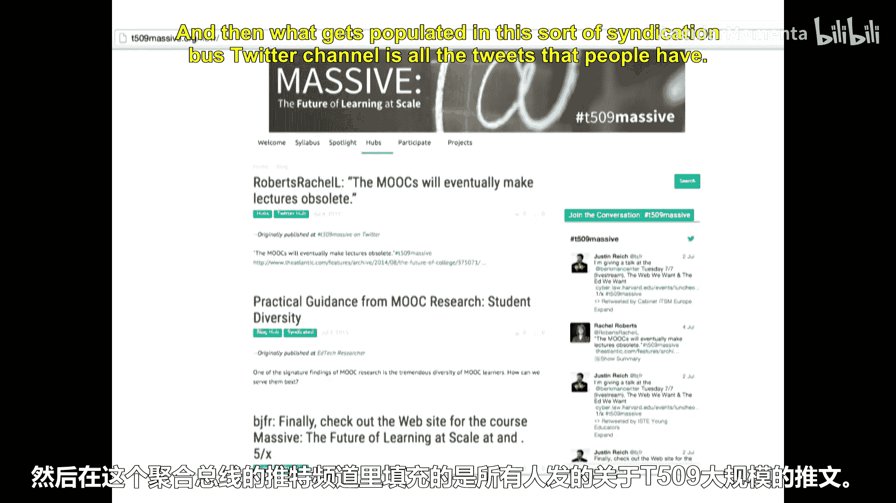

There were。

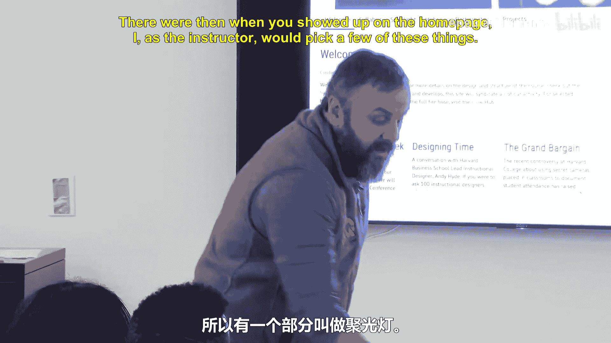

The then when you showed up on the home page， I， as the instructor， would pick a few of these things。

 So there was a section called the spotlight where I would sort of go through all the stuff that people were generating every week and pick a few things that I thought were like particularly interesting。

 particularly important， particularly funny stuff like that and sort of show them to people to feature them。

😊，And then that's probably kind of less important。But then there are other spaces you know。

 I could create spaces that were about a particular assignment。 You could say， okay。

 everybody is working on your， I want to tell you about how I graded the class。

 but I could say everybody create your rubric and then pull all of those things together。 You know。

 like have a kind of rubric hub that everybody could see those things。 And then had a space。

 I think it was called the fire hose or something like that。

 where it was everything that was coming in。😊，There are probably 50 or 60 people who took this version of the class。

 And so there was no way that everybody was going to read everything that everyone else did。

 But like a part of class every week was finding out who are you connected with。

 who are you finding interesting， Who are you learning from like。

 oh you4 were English teachers before you came in this class。

 Like you should be networked with each other。 Moreover。

 you should be networked to other English teachers。 the things that you're generating。

 like if you're putting a bunch of work into this class， why just have it sit in， you know。

 in a discussion form that no one's ever going to see again。

 like put it in this space where you can share with other people and stuff like that。诶。1。You know。

 if you， if you， if you， if you take this idea。Of letting people choose how they want to share who they want to connect with sort of seriously the more and more you get to this idea of like you know there's no right way to do this。

 you're all coming to this class with different goals。

 maybe some of you really want to connect with othered tech companies and are interested in being a founder or working for a startup。

 maybe some of you want to go into education research， maybe some of you want to teaching。

 why should you all have the same criteria for what you're writing about or what you're sharing。

 why don't you just tell me what it is that you want to learn about why don't you tell me what your goals are for this kind of communication。

And so people would create their own rubrics about， you know， essentially。

 like you tell me what your blog you're supposed to do is supposed to accomplish。

 I think at one point， you know， there was a part of the assignment， which you had to say， like。

 describe how your writing is going benefit you and your learning。

 how your writing is going benefit the other people in this class and how your writing might plausibly benefit some other community somewhere else that you're connected to in some kind of way。

 This was a professional。 I thought this that the Harvard Graduate School of Education。

 So people were sort of， for the most part， already coming in with some kind of professional communities from outside to network。

And。And there there were lots of other people who were doing this kind of thing。

 This was a course called connected courses， which was basically teaching people across higher education。

 how you would go about creating these courses but people built them in anthropology。

 you know probably one of the most famous ones， which I think still has a bunch of stuff which exists is called DSs 106 digital storytelling 106。

 which was a course offered at the University of Mary Washington。

 but like essentially syndicated to a bunch of other universities and also built in such a way。

 I still you can probably still go to DS106 org right now。

 and it was mostly about creative assignments they had they had a feature called the Daily Cre。

 where know if you took this class four days a week， you're supposed to do a daily create。

 It might be something like my favorite one was pull out your keychain and make a short video where you tell the story of your keychain。

 where does each key come from what does it mean to you other kinds of things like that。

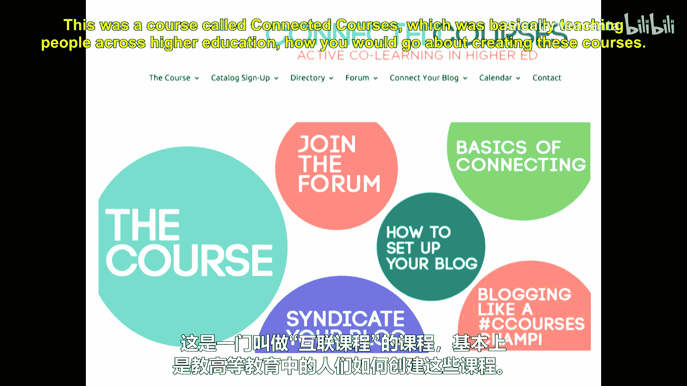

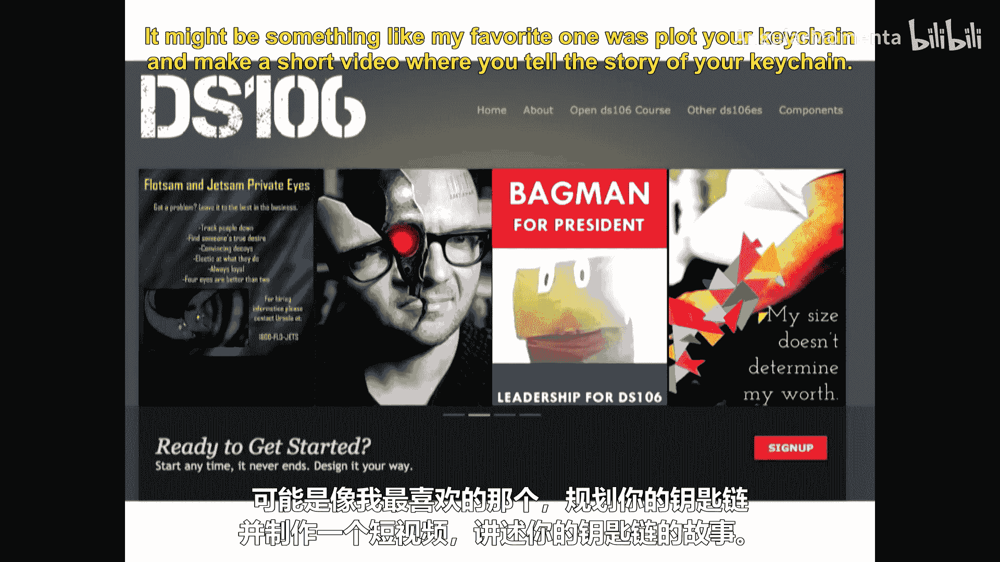

So figuring out how to make their way across the web。

So I told you this was a story essentially of a failed enterprise。 You won't clearly。

 I'm not teaching like this anymore。 You won't find many other classes。

 Youll you'll find the ideas kind of out there percolating in different spaces but like probably doesn't really exist why didn't fail。

 two big reasons one that will keep coming back to which I've turned the curse of the familiar。

 which is it's just weird it's different， it's unusual。

 it takes a bunch of time to learn on the one hand。

 I think people who participated in these classes were like man。

 I learned a lot of stuff about blogging about using Twitter about connecting with other people about social networking。

 but like my guy， you the class was intermediate statistics。

 that's not what you were supposed to be learning in this thing。

 that were a handful of universities that built a sort of collaborative infrastructure around this stuff in the hopes that you could drive down some of the complexity。

 So this guy， Jim Groom built a company called Reclaim。😊。

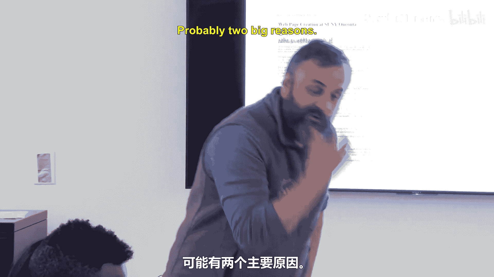

Hosing which tried to make it really like universities could sign up to make it really easy for every student in the school to start a blog and then you like teach them all about blogging a little bit and then maybe you could get away from discussion forums and have people do more so their short form writing on blogs。

 maybe there are some people out there that are still trying it but not that much。

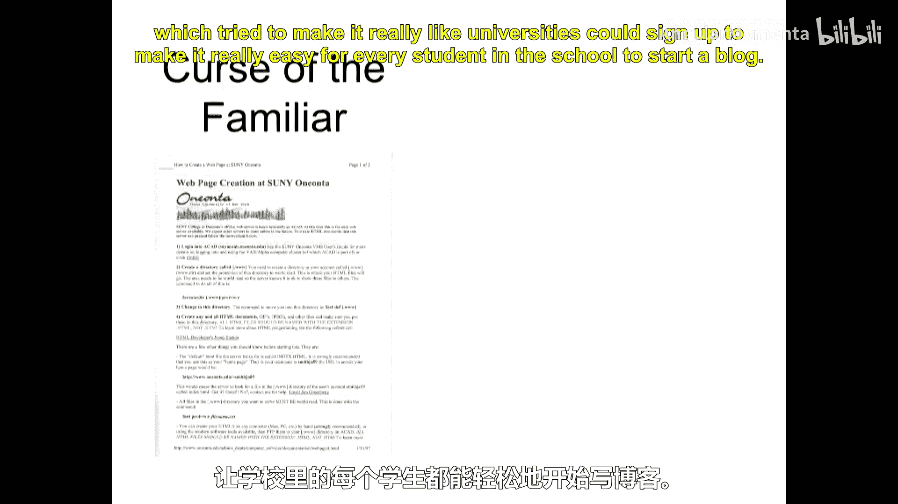

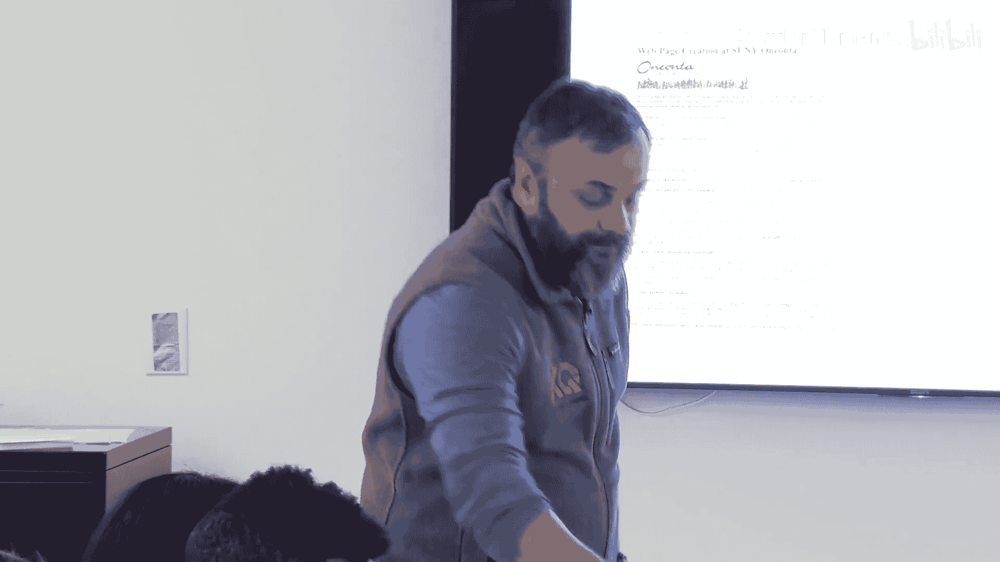

And then。Another huge challenge with asking people to write publicly is that we are not all equally vulnerable to the consequences of having our writing be read。

 Any recognize this person。She's a woman named Anita Saarassian。

 who had a website called Feminist Fr， which was sort of one one of the initial spaces that was related to what it became gamergate she made a bunch of videos basically about sort of anti feminist themes in video games like how how like you know。

 there's always a princess that needs to be saved and the princess doesn't actually have to like doesn't get to have her own character and things like that。

 And just piled on ruthlessly by by all kinds of people， you know。

 especially people who who saw gaming as a hobby who didn't want these tropes changed。

 and so you know。People get docked and swatted and all kinds of Are you all familiar with Gamr G。

 Is that a phrase， Okay， so I don't even remember what year this was now， but I don't know。

 in the media studies department， we should be teaching a class called Gamr G。

 It was It was kind of it seemed ludicrous at the time。 but it was it was a sort of way of you know。

 organizing groups of people to effectively suppress communication from sort of subalterern perspectives。

😊，For people who are trying to say different kinds of things。 So yeah， anyway。

 for me is like a pretty privileged white dude， like blogging my way for the world is relatively safe and relatively straightforward。

 But you know， if I have 50 or 60 students in my class。

 they're all gonna be coming from different perspectives and they're all gonna be sort of inequitably vulnerable to writing something which catches the attention and negative ways of big crowds or offend people or messes up their relationship or other kinds of things。

 I mean， what part of what you want to do in writing in a class is let people be experimental and try on ideas that they don't agree with the Ed or don't understand yet。

😊，You know and when I was doing this in 2013， that felt like a little bit risky maybe like， yeah。

 I could imagine someone might like take down a post that they you decide wasn't well worded or disagree with things like that in 2024。

 it seems substantially more risky not I would say not just because of heightened sensitivities but because you know。

 because actors in society have learned how to。How to broadcast messages that appear online in various kinds of places and to use them to generate outrage and drive traffic and those kinds of things。

Oh， this was the company Reclaim hosting and they somebody should Google Reclaim hosting and see if they're。

 they're still known for education was was a project that was basically。

 it was sort of trying to take like everything that I just described and figure out like。

 how do you make a really simple front end for it。 So it's not hard for people to build。

But it still lets people own stuff。 It still lets people sort of you know。

 be the being an owner of their own means of production。

But it's something that I think this was by far the most exciting part of teaching these courses was realizing that people were still using this infrastructure in various kinds of ways years after the course ended So I think I taught this course in 2013 and still in 2015。

 people were posting on their blogs connecting with like I don't know。

 the equivalent of that would be like if you're in 1806 now and it has a piazza forum what if three years from now you were inspired to like hop back in there and still at like good God。

 I would never do such a thing， but you wouldn't do such a thing because you don't own it and it's not yours and you can't take it in the direction that you're interested in。

 but in higher education if we gave you an infrastructure that you had some control over you might be substantially more I mean at least the students at the time where were interested in continuing to pursue these kinds of these kinds of learning experience。

This。But I would but I would say the sort of the degree to which people feel much more individual threat about sharing things online。

 especially in really sort of open spaces and just the like difficulty of the ramp up time of building all this infrastructure has made it like more or less an interesting dead end and something kind of fun to learn from and explore。

 It probably also illustrates more of what you'll read about this is like an effort in higher education that basically founded you'll read about other kinds of things that sort of founded in different ways in K12 or the challenge to make them not founder for next week like there's all this amazing learning that happens in people's informal learning experiences。

 how why is it so hard to bring those practices into school environments。

 What is the nature of school environments that makes it difficult for that to happen。

Good what question maybe I think that's where I get to the what questions do folks have or what my question is。

 what place kind of does like kind of online community building without the presence of like instructors have in this？

Yeah， if this worked。Because you owned your own piece of writing。

 you know I'm teaching this class at a professional school。

 you might find that actually what motivates you most to write these assignments is that you found a bunch of other sixth grade science teachers that are reading your blog posts and you sort of increasingly care less that you know just in the instructor of this class is reading your stuff and more like。

 hey， I'm getting my ideas out there and connecting more with other earth science teachers and that I think for a lot of。

 you know when it was most successful that for people just felt like work that was super real and urgent you know the other thing is most of the thing I don't know。

 when people got responses。

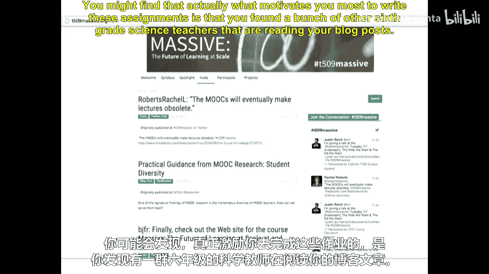

there there wasn't a whole lot of， there's probably some。

 but there wasn't a whole lot of like you are required to reply to at least two people kinds of things。

 there was a lot of you know， like people would write blog posts。

 but they would write blog posts that sort of tagged or posted back to someone else's post。

 that it was just kind of like a natural conversation that was， that was happening and unfolding。

 like where it was most successful what you felt like as an instructor is you were。

 you were just like putting putting some fuel for this fire to burn on its own。 You were just like。

 you know here， check out these things like， you know。

 but then people would take them in the directions that they were most interested and excited about。

 Does that answer your question。Other thoughts or things。How does this play into the Google Doc？

runss this coursehu。Yeah， so well， some of it is probably probably the main lingering piece is that it's a pain in the ass to show my canvas site to someone else。

 And one of the main things that I want to do I don't know in my career of teaching is be able to like quickly to explain to other people how I teach。

 So one of the best things about having the whole course live on a Google doc is any new professor who's just starting teaching ed tech in society。

 It's like here's a whole course， take they're taking it shoving it bit by bit into canvas which I've done periodically for some things that any of you know who want to sign up for future people are interested in this class。

 syllabus is there mean it's even got the revision history。 You can nobody does that。

 but you can notice what we mean I would also say earlier versions of that when the web was sort of more active in this way。

 I would over the summer， I would post like here。😊。

Chas that I made to my syllabus and like circulated around to hashtags or other networks of people that were active in those conversations。

 and people would definitely jump in to the syllabus and add comments and be like。

 oh this new book just came out or these new resources came out and things like that。 I mean。

 it existed as for a period of time， a much more sort of social document。 again when yeah。

 there were a lot of you know educators， especially people interested in online learning and education technology who were pretty active in those kinds of communities。

 And so you could do stuff like that。 Now it's mostly just a legacy of you know editing that thing is so much easier than editing canvas anytime I want to change something in canvas。

 I would do it in three places and click 15 buttons， I just edit。😊，Good。

 so that was a little bit in some of these ideas of peer guided learning in higher education。

 We'll see some more of them in K12。 I think you're going to read some stuff from Mimito and。😊，嗯。

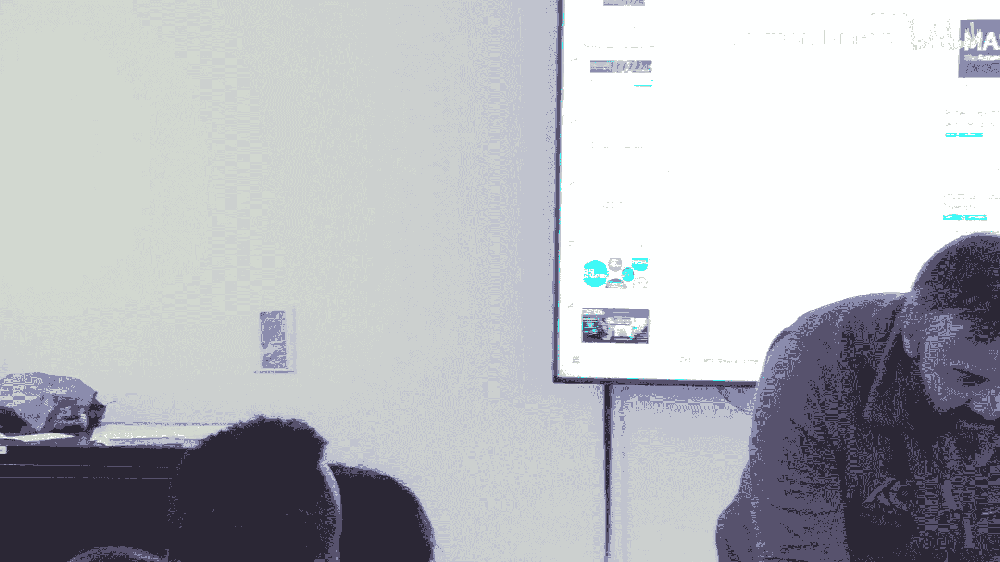

What else did I make you do for next time and and Mitch Resnk about Sc。

 which is Sctch is probably the most successful peer guided learning environment。

 which has made its way into K12 schools， although one of the things that we'll learn is that when it gets there it kind of gets schoolified in ways that are horrific to the people who made it。

 but more to follow when you discuss that on Monday， Great。

 have a wonderful rest of your week and weekend and I will see you next week。

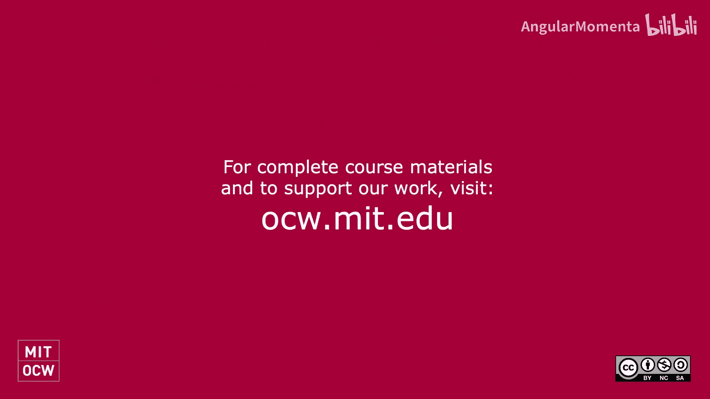