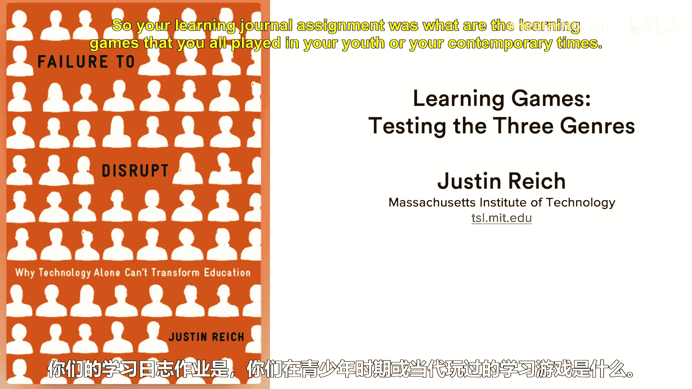
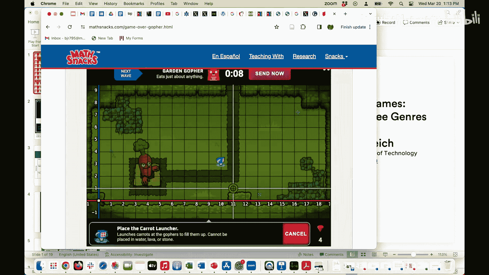
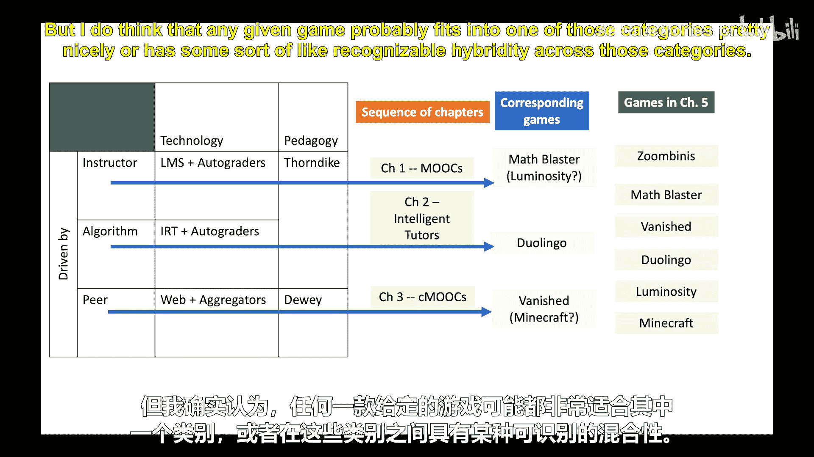
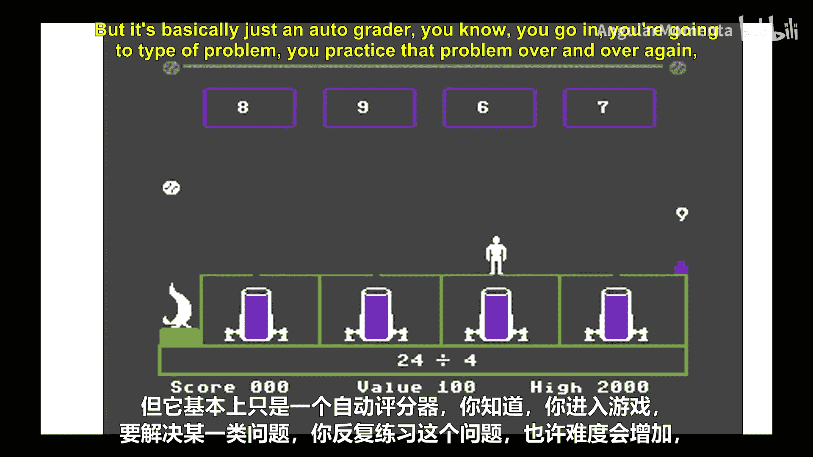
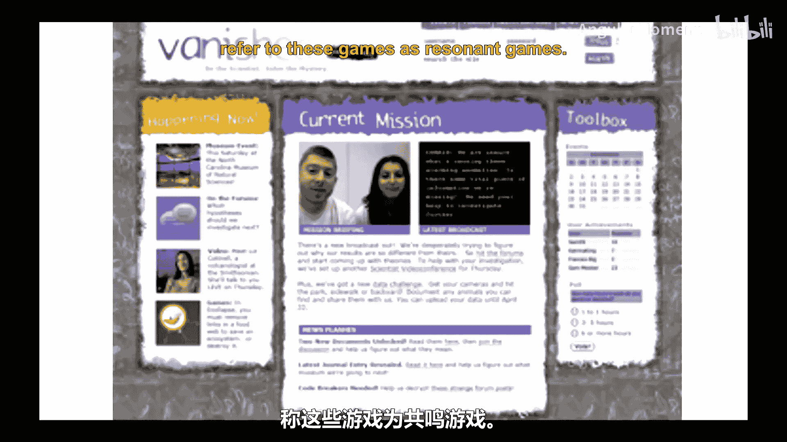
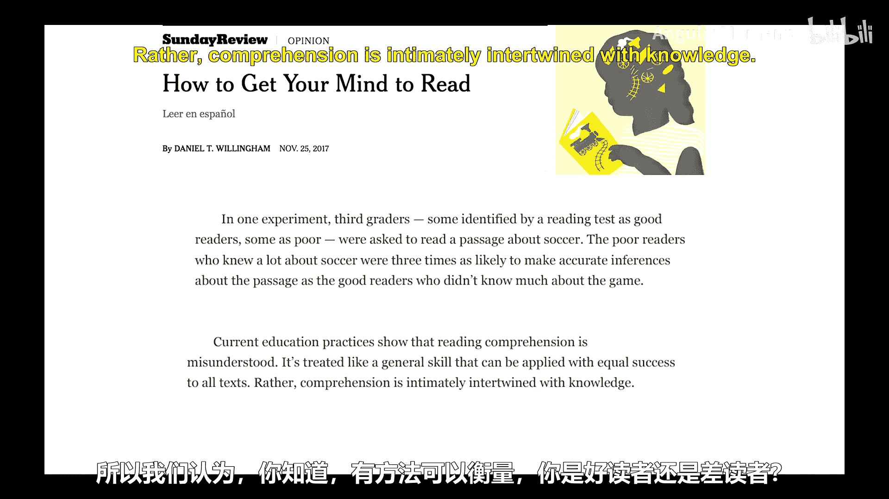
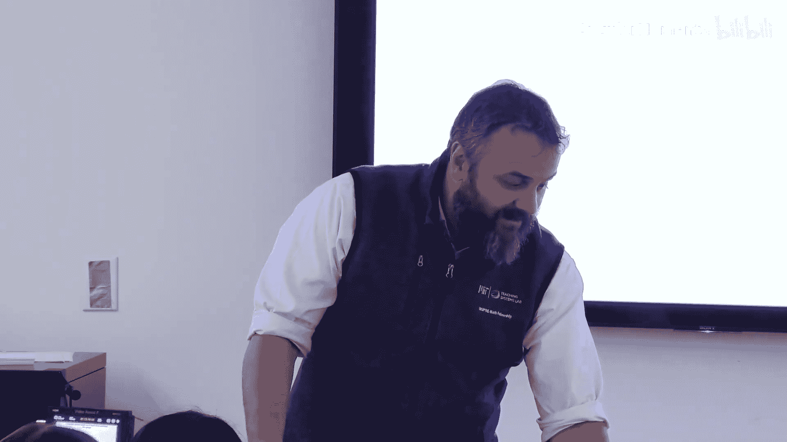
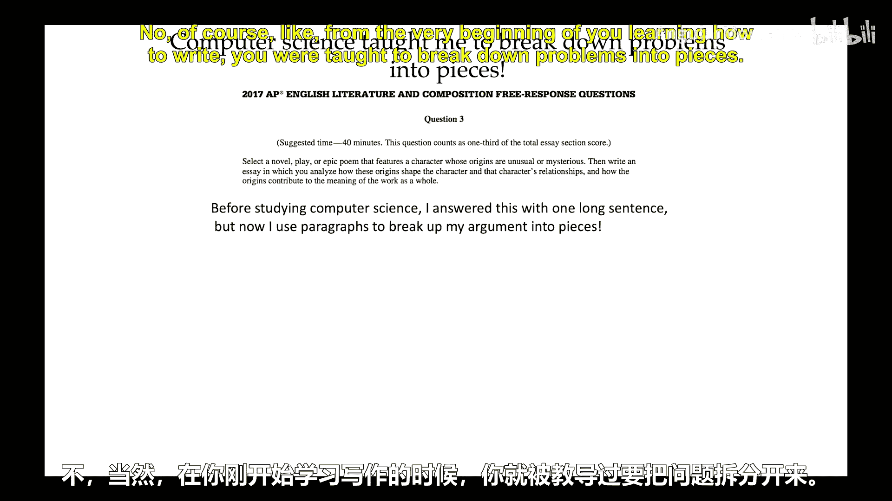
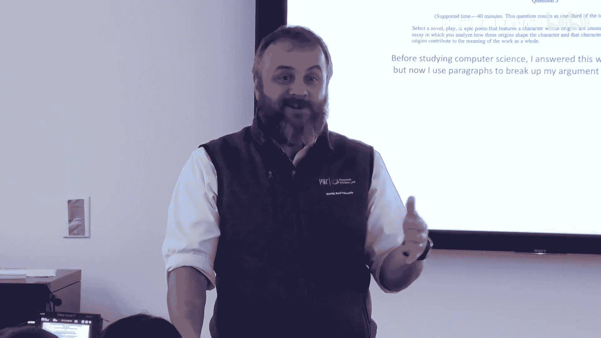
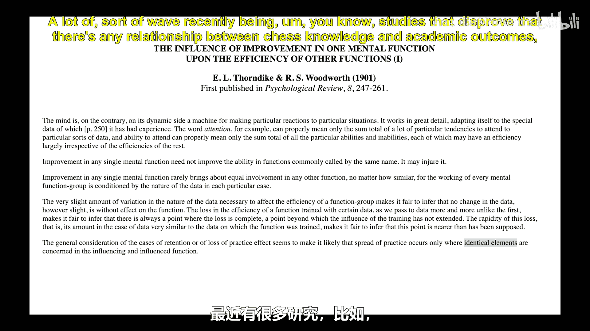

# 【麻省理工】学习、媒介与技术 ｜ MIT CMS.595 Learning, Media, and Technology, Spring 2024 p07 14. 学习游戏 -BV1DKUSBGEvu_p7-

All right， well， let's just talk about games a little bit。

 So your learning journal assignment was what are the。

What are the learning games that you all played in your youth or your contemporary times。

 we heard Omar has talked with us a couple of times about his passion for typing games and the importance of them in his middle school experience。

 but what other kinds of games are memorable to folks in they growing up for learning or otherwise。

 Yeah， Emily。

They're in this scale like game 24 or something It was like you'll have math 24 Oh Max 2 Yeah you have like four numbers on a card and then you're supposed to add subtract multiplier divide however you want to get to the number 24 Did you do it online or in the car in the cars Yeah I was in elementary school。

Alright。Cool， this is it。No， we don't know。 I don't know。 I use the Yeah， those cards card game。 Oh。

 alright， spinning these things around， cool。And where did this show up in elementary class Yeah。

 it was like they put it in like the indoor recess spot。😀Ha ha。😊，That's great。😊，That's great。

 What else， what other kinds of games did people play？房款。Sabrina， what was your。

What are these count is like， like you。educational but I used to play a lot of cool math games as a。

And they kind of are at first they weret。They teach you time management with。😀あははは。😊。

I' teaching all tab on computer。behindIs fruitruit Ninja a math game？

They also teach you like teamwork。Yeah， there is a pretty funny just naming convention of like let's call it cool math games and then like maybe parents won't notice。

 I mean， there's definitely a first glance of like， oh， you're playing cool math games。

 that's probably fine， you're like， oh those are not math games yeah。😊，Yeah。

 platformer block removal yeah it's it's I don't know。

 there are definitely some darts test dream and an online multiplier Okay。

 idll breakout maybe There see like the multiplication like penguin race games and you have to like answer the multiple education question as fast as you yep definitely definitely a oh math playground Yeah。

 that is another one that I've seen No this I think is a direct descendant of math blaster。

s playing now。陪咩。Like guess。Luke and Shamar are Luke and Shamar real。 We don't know。

 Let's just see how close this is to math。 Yeah， is， this is exactly mathth Blaer。

And we'll play a little math blaster later。Good yeah。Good job， everyone。 Nice， strong， strong。

 single digit multiplication skills in the M I T Ss。 I'm very proud of you。😊，Other things？

I was saying。Like my other question。I was really really pushing a boundary of what's considered like a learning game and one I grew up playing a lot of board gamess with my family and one that like I'm right now doing a project on that makes me really realize all the skills that I learned is a board game public resistance。

U and I was just thinking about like the skill that I've learned from that of like actually how to keep a poker face。

 but like how to formulate an argument to like back。

The claims that I made and like how to just like have。

constructed arguments about with between people， so like a lot of communication skills and just like life skills that I used to this day that was still just involved in some of those like almost like role playing communication games。

Have maybe we ever played mafia or werewolf the derivation offialf the guy who invented there is a guy who invented mafia。

 It's not just like like a sort of cultural。 not it's not like a century old game。

 It's a guy who now I think lives in Newton or Wellesley。 He applied it for a job in my lab once。

 He's a Russian immigrant。 he grew up in Russian and then came here， but I he was like， yeah。

 I invented mafia。 And I was like I played that at camp when I was a kid。

 like it came from a particular moment and things like that。 It's kind of cool。😊，嗯。

That's definitely a topic I want us to talk about today and is featured in the book this idea of Trans。

 What is it that you learned playing the resistance that we might plausibly think you would you would actually be able to deploy in other non-similar contexts and what does research tell us about about that which ends up being a sort of crucial question that the utility and value of learning games hinges around if you can get better at lots of things by playing Minecraft if you can get better at critical thinking。

 if you can get better at teamwork if you can get better at socialization than like oh Minecraft sounds pretty cool if actually playing a lot of Minecraft just makes you better at Minecraft than the social utility of Minecraft playing in schools or for learning experience that goes down quite a bit。

What other games have people played or other things， what was yours Kaia？

So generally know what I talked about。So theres lot of games that rely on coordinate systems as an integral part of the game and all of these。

 like you could easily draw the apparels of it towards like math education according to that the game that does the most closely simple that I remember this game over golfpher to just like a car zombie be like versus zombie the game but it relies on you placing like it tells you hey。

 place this at this coordinate that you have to figure out that quickly。

 so its have to like internalize idea of the coordinate system beyond just like a search slow search because that would just get you so far。

How quickly will we see the basics of this？明为没有。No plot， no plot。Oh， I see。 All right。うう。Yeah。

 essentially。Yeah， stupid gopher。没问没有对。没为 they don' do。

Ko。The coordinate， oh and now I turn the sound off on that， let's see if。

 let's see if we can find these。Apple trick。So。A。Apple Tk， yeah， originally released in 1971。

Also had， just lets get into it。This was the game that I played when I was a kid that had a sort of coordinate system in it where。

You just had to shoot photon torpedoes at bad guys， F。Thank you。Yeah， yeah。

 so you sort of you're sort of flying through the universe。

 and eventually if you want to shoot the photon on torpedo， you have to you know。

 figure out what the angle is and， you know， you know， fired at 90 degrees or 70 degrees or。

No， other kinds of things like that wasn't a very good gameplay video。 but。

 but it but is an example of a game with a coordinate system from 1971。

 So that certainly seems like a feature that that shows up repeatedly。 Could you look up Odll fish。

 That wasn't I be good。Sment of that。Odell F game。but yeah， it was no， there was an older version。

 there was one from the 9 1986 that it pretty much was just a fish and you had to not get eaten by the otter so all you had to do was like move up and down and it was riveting for third graders and the mid 90s or so。

我去。Yes。아도 맞。Yeah。🎼And I quite get bit it's not letting me。

This is the up to date graphics too guys we about that。That was good， all right。Are you all？

Too old how many of you had Kahoot as sort of a central part of your middle school or high school All right。

 even we won't out what's your what year did you graduate high school， Ja，20192019 still。It was。

He used it a lot， and I sold out like。Like 2015。Pretty， pretty substantial。

 How did it get integrated into。嗯。Classroom experience。

I think like eventually I a lot of program of like we had like Chromebooks。And so， then that， like。

Just sort of naturally led to， okay， like we already all have our Chbooks like we。

Do some sort of quiz or whatever and it gets real intense in the classroom could obviously。

if people are nodding， you generally think of Kahoot fondly like that was a good sort of。I mean。

 I built similar things in my class when I was a teacher in 2003。 I don't know。

 somehow I I I had a jeopardy setup that was with like a PowerPoint thing where I just deleted little like blocks to show the questions and then people guest answers and stuff like that。

 So the sort of quiz show format。 I mean， it's you know it really is not that is a classic example of sort of gamification or chocolate cover broccoli like there's nos there's no intrinsic game mechanic that's in there。

 there's like like competition over you know review questions or knowledge or things like that。

 But it ends up being pretty I mean， it's widely enjoyed by learners from lots of different backgrounds and things like that。

 I feel like it stem from like just being fed broccoli or whole life。😊。

Talkking bro like man is is great。 It's yeah yeah， I think that's right， it's like man。

 this is so much better than just doing a review， this is so much better than whatever the like typical routine of classes。

😊，Yeah like write your own name Yeah yeah， you know there those identity components。

 there's a sort of surprise components outside everyone gets to give an everybody gets to give an answer。

 Yeah， it does some good mechanics， doesn'thoot have things where on your own display like there's a class wide leader board。

 but there's sort of your own personal leader board So even even if you're getting demolished in class like it just shows you competing against the people who are nearest to you so that there'ss behind players yeah。

 so it's giving you relative I mean， like Peloton and other kinds of things do that right I don't know。

 I don't know a Peloton。 but you know I think the sort of leaderboard systems。

 across distributing computing environments are developed they like oh。

 you don't have to compete against if you have people competing against everyone and only one person can win if you have。

😊，Everybody competing against a small subset， which is not necessarily overlapping with anybody else in subset then like。

 everybody but one can beat somebody in some kind of way。

And then you make up some other people and they can beat the rest of them。

Good other games that people played that were。I guess like related to like expanding what the learning game is like。

Most of my youth I guess I was in Iran， so like didn't really have like the intern benefitss for like the like online learning games or anything and learning games in general were like not a thing that I was really aware of until I got in the US。

 but I guess like some stuff that I thought about was like。呃。

One specific one is like my parents got me a toy sewing machine that was like functional and I learned how to sew with that and then generally just like。

It was a gamification of arts and crafts a lot of time when my mom would give me a bunch of like stuff be like go make something with this and like my sister and I are very much a perfectionist so like。

We would always be like， oh， like， I wanted to be like dance。 And I want be like， okay。

 well if you want that， like， here's some like exploration of my how on you to do that。

 And I think like a lot of that was like one， like obviously like this skill itself of like I comes so with so between and stuff like that。

 but also like a lot of practice of like。😊，嗯。What we call it like spatial understanding and like how do you write letterss all the posters so that they're not like all a bunch stuff at one end and just like how to like plan like a certain space effectively and things like。

Yeah， what makes that a game to you as opposed to like a playful apprenticeship or？嗯。

I guess some of it might be just like the steaks just like and then like I guess it is。Oh。I mean。

 maybe it was also just a little bit influenced by like how it was presented， I guess， of like。

It was just like。Like either has like some pretend aspect or of like like if it's a composition of my sister or things like that Yeah famously you know there are philosophers who've tried to pin down the word game and some of them have included it's not possible and Witgenstein was one of the ones who said that that there really is no there's no way to accept to create a definition of game that correctly includes all the things that people think should be included and excludes all the things that people think should be excluded it's quite difficult to figure out what gameness is。

 you know how it relates to sports or play or you know the real life。

 other kinds of activities but that's great that those things sort of felt felt gameful to you they certainly have a bunch of what you describe immediately evokes sort of situated learning kinds of things of like my mom does this thing and so she gave me a little version of this thing and then we did some of that stuff she gave us some tasks and we played around of them。

And it is funny how。You know， across cultures， across history。

 young people really like playing at what adults do。

 I have a great photograph from Maai Land with this little three year old Mah dude dude who's got a long stick and a set of rocks in the sand and he's sort of whacking the rocks in the sand because Mah are all hearts And so he just watch his older brothers grow up herding goats and he knew that he was getting up hering goats and you know。

 like there's just like a lot of goat hurtding going on。

 but a thing that's fun for him is to grab a couple rocks。

 pretend they' goats and start hering them around in the sand。

 And I think it's funny because it's relatable， you know。

 whatever whatever culture you're in playing at being older is a big part of youth。

Good other other games that people played Yeah Omar this one my a couple memories but Sfall was a big part of my childhood no what's that it's I primarily played it during kindergarten in preschool in first grade Yes that first link they added a whole new section that I don't even remember like I don't ever recall seeing that so they significantly updated the website but that was where I really did a lot of。

Sort of like。Reading， intro to reading。And I mean， for me， it got pretty old， pretty fast。

 but it's very nostalgic nowadays。That was one of them and then also like leap frog toys。Short a。

We had like a computer lab and we'd all go there and we'd like watch these。

 and it was like really cool， especially because like。

We didn't have like a lot of like computing technology when I grew up at that time。

 so it was really cool to see this。kindin of kind of a special highlight for the day to be able to do these kind of things you know and I hope that as you think about these kinds of things。

 think about Kahoot and stuff like that that your mind drifts back to what you read in Larry Cuban and his description of kind of the material concerns of teachers。

 the schedule concerns of teachers of things like，Oh。

 it's pretty handy to be able to have a bunch of like digital books that people find extremely compelling to shove six year olds in front of for an hour during the day。

 so you can like finish your lunch or do some grading or do little planning and prep for other times of the day。

 I don't know if this is well studied， but I bet you know。

 Larry Cuban's finding that that television and film strips were more likely to be used at the end of the day in elementary schools。

 probably parallel findings that you might have today about when Kahoot games or other things like this get used in the in the rhythm of the day and so forth。

 So yeah， different different technologies。 But we can apply some of the similar sorts of analytic tools and frameworks to them。

😊，um。What are some things that I wanted to let me let me talk for you a little bit and then I'll give you a little bit of a chance to play some games and then we can talk a little bit about transfer。

 One thing that I just wanted to draw your attention to that's in the syllabus is for failure to disrupt in the rabbit hole readings that you're not required to do one of those links for every chapter is a podcast episode and I was thinking about them because some people who are missing class this week because of Sloan S week I was going recommend those to them is sort of supplementary kind of things but for this chapter in particular Scott Osterweil who developed the logical journey of the Zubins is one of the guests and then Constant Stanangcoer who actually had a job for a while in the US Department of Education and thinking about the role of games and education system is there probably one of the most fun things about the podcast episodes is that I really encourage the people who came to disagree with me and so。

In most episodes there are claims made about where the book is wrong by very well informedformed people on those topics so Constant Steincoler does not agree with me in this episode about the relationship between games and learning and transfer and it's fun to listen to that I think Mitch and Natalie had some disagreements with me in about what what the learning goals of scratch are in practice so those can be kind of fun so I don't know you're going for a run or something like that。

 you need some light podcasts listening to these can be fun episodes if' if you're not getting enough education technology and you're three hours a week with me there's more to be had。

So the way that this chapter is structured。And I call it sort of testing the theory of the genres of learning at scale。

 which is what you should be you know the reason a big reason for organizing the idea of three genres of learning at scale is I want people to be able to take new technologies and say。

 oh， that is kind of like this And if we can say oh that's kind of like this then we can say all right so we probably know something about its technology。

 we probably know something about the sort of pedagogical underpinnings。

 we can make some guess about research like a big thing that I would want someone who reads failure to disrupt to be able to do is to like look at new AI tools and be like okay you we did not have generative pretrain transformers that were pretty useful until November of 2022 but the things that we're trying to do them are going to be similar to other kind of stuff that we've done in the past and we should be able to slot the things that we're gonna do them into different kinds of categories games struck me as a good testing place for this because its。

It's not the case that I think games fit neatly into one of these three categories of instructor guided learning at scale or algorithm guided learning at scale or peer guided learning scale。

 but I do think that any given game probably fits into one of those categories pretty nicely or has some sort of like recognizable hybridity across those categories So something like math blaster you know is kind of an example of you know you could decide whether or not it sort of instructor guided learning at scale or algorithm guided learning at scale or something like that doesn't really have a lot of item response theory to it you know but but it's basically just an auto grader you know you go in。

 you're given a type of problem。 you practice that problem over and over again。

 maybe the difficulty goes up and you practice sort of another type of problem。

Had any of you ever heard of vanished before， maybe some of you in the games for learning classes did you read about vanished？

So vanished， which I write about a little bit in the book。

 was this really cool project that the MIT Education Arrcade did with the Smithsonian Museum。

 It was anybody watched the television show lost。😊，Okay， so a couple of nods。 I don't。

 have any of you ever participated， I mean， actually I don't know like。

Are you all aware what was going on with Kate Middleton right now where people are like trying to figure out why she's not showing up in public and sort of all these conspiries theories show up about it and people do these detective。

 a bunch of things like that or like I don't know when the Malaysian airline flight crashed and nobody really knew I't know there's something that human beings have that's like let's all kind of solve the mystery together and it gets kind of woven into conspiratorial thinking it overlaps nicely with fiction with things like lost or sort of other television shows that do that but but vanished was basically like an alternate reality game that was sort of played out on the web where there were codes to break。

 there were secret messages spread across websites or sort of scientific claims that were happening other sorts of thing their messages from the future being beamed back into the past and students signed up to like either as classes or individuals to sort of like get the kind of messages that went along。

 I think the game。Rned for a couple months or something like that。

 but very much a sort of peer guided learning at scale kind of example。

 like you know just like a series of puzzles put out there that you collaboratively tried to solve。

 you had to interact with other people to kind of find。A big。

 you know these two kinds of games illustrate some of the basic principles that we were just talking about a little bit。

 mathth Blaer， so what you did in mathth Blaer is you like took that little character and you ran it back and forth to get the correct answer。

 what was the penguin game that we just played， What was that called？Penguin race off or something。

Yeah， so sogu penguin Ra off is is an example of what sometimes good's called gamification。

 which is how do we take a mathematic， how do we take an intellectual exercise that we think is useful for people and put game elements on it to inspire people to do that activity what other kinds of software have you played with that takes like basically a worksheet activity and add sort of game elements on top of it？

😊，It's kind of like thinking about what the slide you presented earlier like Duolingo kind Yep。

 Duolingo has a ton of gamification built into it like in you know， I don't know， how many of you。

 how many of you use Duolingo or have used it。Oh， just a couple。 Okay。

 So maybe have more people play around with it。 But， you know。

 they have millions of people who are doing little language activities。

 But a big part of why they're doing like little language activities are not that inherently fun。

 But what are the features in Duolingo that try to like get people hooked to do it and keep doing it。

😊，Stres， streakres are a big one， yep， you know， which is just like a number that you try to increment every day。

 that's kind of a game。Viual design what kind of elements。Colorful design， interactive design。

 all of these like bubbs like feelings， everything you nuts Y， yep， so yeah。

 like creating it and turning into a playful space。

 some of the most important visual elements are when you get something right。

 there's usually like a little flash for sound， a little ding。

edx had these big green check marks for a while when you got answers correct。

 I think another thing that's been like a recent development has been their PR。

Recently like at least on TikTok like duolinggo like gone unhinged and like the birds like everywhere like comments on weird things and like every time it comments somewhere like there's like a million like like replies to it and I think like wanting to be like a part of that community or they say I've done that is also like a big thing in a society today Yeah good。

Marri， who's not here， wrote like to me Duolingo， when I think about it is sort of a classic example of kind of gamification you know sort of very instructionist kind of inspired like let's just put some game elements on stuff in Mario and essay was like no。

 actually this thing is like super motivated by situated learning the way that makes you like things like that are like oh。

 like the duo bird is out there and I can have a paraocial relationship with the duo bird and it will comment on my Tikt feeds and I can respond to it and things like that got me thinking a little bit differently about it maybe keep talking about that。

 Yeah the term of art for this kind of approach is chocolate covered broccoli that basically like this is super boring math to do and we're just gonna like poor chocolate on it to get you to try to do more of it and of course like the joke of chocolate covered broccoli is that like chocolate broccoli that actually not taste that good and math blaster is actually not that fun。

 Like it's fun。For a little while， and then you're like， oh， I'm just doing division。

Whereas vanished and other kinds of games like it， there's not an as well accepted name。

 but my colleagues at the education arcade refer to these games as resonant games and a key feature of resonant games is that instead of trying to add game elements on top of some kind of intellectual exercise。

 you're trying to find the playfulness in the intellectual exercise like it's not it's not how do we add game mechanics to math what is already fun and playful and interesting in math and then how do we have that fun and playfulness kind of surface and emerge so that we get learners to engage with that first in vanished like how do we teach scientific thinking scientific practices by having those practices emerge kind of naturally in this sort of conspiratorial mystery kind of story that happens Oh good this is a great example of what Kahalil was just。

😊。

About of。Yeah， the very， the very sort of playful environment like will give you some experience points。

 We'll tell you about your time。 We'll call you amazing。 We'll give you these funny little sticker。

 I mean， like this， this is， I don't know if any of you did your elementary。

 Tea like put stickers on successful assignments and stuff like that。

 Can you think like gold stars and stuff like that。 Yeah。

 this is just like a digital version of that。 It is the same kind of thing。

 Let's give you some kind of visual reward reminder to get you to keep playing and doing these things。

😊，This is one that I talk about in the Luosity， which maybe we'll talk about a little bit later when we talk about transfer and things like that。

 All right， so I would like to invite you to play two of these games。

 And you can find these links in the syllabus。 but I don't only take 15 minutes or so and let you pull out some computers。

 I'm going give you I'm give maybe before you pull about， let me just explain these four things。

 and then you can do whatever you want of them。 The first one is math blaster。

 I don't think I successfully found the 1983 version。 I think I found in 19961。

 but you should play a few rounds of math blaster and see what all the hype is about。

 The second game is the logical journey of of the zoom Beaies which was a key part of Aaron's childhood。

 And so now she'll get to go back to that it has a really long kind of intro story and stuff like that if that's what you're into you can do that。

 But if you want to play the game you'll have to skip a bunch of introductory stuff to get into some interesting sort of combinator kinds of things。

One thing， which is not a game， but if any of you are big Minecraft fans。

I gave you a link to what is essentially the Minecraft website for teachers。

 you won't be able to unless you have got Minecraft on your computer。

 you won't be able to jump in there and play with things。

 but a thing that you can do is go to like their lesson plan finder。

And that's probably the most useful。 Probably the thing you'd find most interesting is go to explore lessons and pick a topic you're interested in and。

 you know， see whether or not you think the you know， good going back to the coordinate system。

 Like how do you you know how would you use Minecraft to teach the coordinate system。

 and they've got all kinds of guiding actee is and student activities and you won't be able to see the world that's associated with them。

 But each one of these lessons has a kind of Mincraft space that's been built。

 you can at least get some screenshots from it。 And then if anybody hasn't played Duolingo it's not you could probably pretty quickly start creating an account and doing some things like that。

 If you want to do with the person next to you， you should feel free to do that。

 the easiest place to find all of these links。 you could just Google them。

 but they are on the syllabus bittly slash LMT syllabus and then。😊。

On the on the day for learning games I've put for these links there。 So it's 135。

 why don't we take until about 150 and just let you and feel free to do it with a partner or something like that。

 And if they've got sound， youd turn on the sound quietly and stuff like that so you can hear it without bothering people next to you。

 But they'， but they're pretty fun things to mess around。 Sound good。😊，Ready to go。当时。All right。

So having having who played around with Zoominies， looked like we had a lot of Zoominis player。

 what are your reactions， having spent some time with Zoominis。ItIt takes so long。I just。

 I won't like go hurry up。 then you get to see them walk up Yeah， yeah yeah。

 so you know the more it actually， you know most of you're playing with sound off。

 which might be a mistake because I think part of part of the stakes of Zoom Beaies are set like there's a narrator in the back who tells you about how the zoom Beaies were oppressed and you're saving them and things like that。

 and like you know， having you having you develop a kind of affinity for them is in the sort of storytelling world is part of the game。

 having them be cute， I think is important that you develop some care for them and want to engage with them and things like that sort of the more。

 in fact， the more you peel away those elements and the kind of narrative elements and social elements。

 the artistic elements and just get down to the math。

 the more like that that could risk some of the fun of the engagement rather okay。

 good Yeah which is just like a straight immersion into。😊。

And and those kinds of personal preferences raise some real challenges for teachers right like like you could imagine you if you were to take time in a math class to have people play the logical journey of the Zubins。

 there'd be some kids who are like this is the best day of class ever and there'll be other kids who are like。

 can we just go back to doing whatever we're doing before and it's like an expensive investment of time and other kinds of things to have a 30 year class be like this game is not that fun。

Emily， did it sell you eventually？Yeah。I would say I kind of like it。Good。I think it's just。

I don't know。 it could be like that tendency， like you said。

 of like create like having an affinity border or like it was like these like cute little creatures like a little across your screen and like。

How much you enjoy that or how much you might care for that and Im。

I'm very much out for a fun little game that's a little cute characters and identities and things like that。

I feel like it might the speed because like now， I'm so used to like things happen to happen like very quickly because like even like lectures。

 I tend to watch them like in two times speed instead of like the normal way。

 like the normal time so then it's like watching， playing these games they're so slow that I'm just like。

You've lost my attention I don't want to play it anymore Good Yeah。

 there there's a little kind of gap in there did you guys like skip the like transitions or were you sitting through though click out？

食 down here okay。Becauseuse the transitions are like I see like mean like the transitions are like。

 okay， like you're slowly highlighting the next place I'm going in a half for like a minute and it was like。

 okay I've seen it was fun to like。Figure out what the sort of traits were that they were selecting for。

 but then like you kind of I felt like I instantly found the traits and then I' was just like。

 oh okay， I'll just like there I didn't really have to like。

Completely you know do like a crazy search for the traits or whatever I was just like， oh okay。

 well maybe this hair is good and then all that hair turned out to be fine went。

I mean it might have been harder if you were 10 but actually to build those two together I'm like trying I don't remember like when I was going through this game as a young person if I recognized or was even looking for the traits like I think maybe I might have been more pulled to like the affity to the characters and like oh no。

 they got bounce back that's not good and just like I do it with my sisters and we just like drop them all over the place and see if that go in but I cannot remember if I like noticed that there were conditions and I just we cared we were okay with the slowness because we cared more about just getting them through it didn't matter like and I can't remember it let's killing little bit how many of you clicked the question mark button that has an explanation and how many didn't discover it's kind of an interesting design feature to be able to say that you can play you can play the game but out any instructions about how to play the game You're just like put in the world start clicking things around start moving things around If you had to put the logical journeys of the zubini。

As instructor guided learning at scale， algorithm guided learning at scale or peer guided learning at scale。

 what would you call it？I feel like instructor guided them。

 it's not like if I was able to solve all of。They like or get all the zoom bes through like one or two errors that it would automatically jump into like level five like there was very much like a sequence there。

And when it would place one and then it would try and go up and it almost felt like an auto grade there of like it' like this is either pass or fail。

Yeah， the auto grader is a lot more fun because like a thing crosses a bridge or gets kickback or somebody eats a pizza but doesn't eat a pizza but it's not really any different from a green check or a red jacket or other kinds of things like that the way that I argued that zoomins fit is that its instructor gotta learning at scale with an auto grader however almost everyOO is inspired by more instructivist kinds of approaches and this is very much more inspired by kind a situated learning apprenticeship kind of approach where it's almost trying trying to hide the auto grader。

 trying to hide the instructor I mean it's very much trying to hide the instructions know it says just like go into this world。

 immerse yourself into this world， play around， see what happens there's sort of winning and losing but it's it's actually fine to fail level。

 it's fine to have all your zoomin's kick back you can try again and rescue some other zoomins other sorts of things know there's no point in the game where it stops and is like okay kids like actually we're teaching you combinatorics。

Or you know probability or whatever else you think is the mathematics of the game it just lets that be a kind of you know natural learning that that happens throughout you know there are there are other you know so this this is an exercise that I think is the kind of thing that might be helpful if you were you know a department head a teacher trying to figure out whether or not you should adopt this technology in your classroom which is sort of for any new technology。

 three good questions to ask or who drives and control the pace and path learning what are the technologies here what are the pedagogies and then sort of what can I predict will happen in my educational system given a consequence of this design so like math blaster is pretty instructor guideds got an autogradeer I mean they're just worksheet problems there's no difference between that in a worksheet problem except like maybe I will slightly motivate some of my students to do more worksheet problems because like there's aliens and it's kind of fun and things like that but maybe not maybe there's some people are like。

I really don't want to have just give me the math of problems to answer。

I had often thought of how many of you played around with Duolingo for the first time as you're clicking around here and sort of new Duolingo people。

You know， it certainly is algorithm guided as it's trying to。

 you know there there's a lot of good writing the developers of Duolingo。

 keep blogs and other kinds of things where they talk about， you know， for instance。

 they have have maybe heard of the concept of the zone of proximal development sort of a classic educational concept that basically you want to try to as you're teaching people have there be a difficulty level where you feel sort of competent but also sort of stretched。

 know if things are too easy， it's boring， if things are too hard， it's boring。

 there's a zone of proximal sort of ideal development they measure that zone of proximal development by saying like you know we're trying to aim for people to have a certain kind of error rate。

 I don't know exactly what it is， but it might be like we want you to get about 20% of the things you're hitting wrong if you're getting more than 20% wrong。

 then we're probably making it too hard。 otherwise too easy。But what are the。

 I don't know what we talked a little bit， But what are some of the situated learning elements that you saw。

 If you were to say that there was not so instructionist。

 but it was more inspired by kind of constructionism situated learning。

 what kinds of things like that are in Duoingo。I like I found out D in there has a music video which is really cool because you've always wanted to learn music。

 I like f on with that but I don't understand it like I can't read notes or anything I just like think and then play。

But it's more interesting to see like they have this。

 they had this stupid simulation of playing hot cross funds and I saw her could play that if I try but doing it with their little app。

 it was like，You had to paste it and you had to recognize the notes and went back to that like 10 times and it's like simulating playing a piano it's pretty simple for like a computer game。

 but that was pretty engaging So so sort of immersed you in the feeling of playing a piano even though you're kind of on your phone that seems like a good quality of a situated apprenticeship kind of thing Now you had played hot cross buns before I feel like you could just play it like sitting in a piano without like if I。

Booked for the notes。Sound wise， like I can't read piano notes， but like I can figure out songs。

me did I hear them playing by here Yeah yeah so yeah and so you feel like this could be a pathway to doing I mean I'm sort of increasingly convinced now that Duolingo Duolingo came out of Carnegie Mellon University and they have some of the best sort of learning scientists learning engineers in the world and one of the things I like about them is that they they're sort of methodological pluralists they're like what are all the good ideas and how do we shove them all in there。

 So in some sense， Duolingo like is very much instructionist It's like taking big complex things and breaking it down into small pieces it'll show you examples then give you part tax practice and all those kinds of things。

 but it also has this way of like well let's give you an identity in this environment。

 let's have you build a parasocial relationship with an owl。

 Let's feel like you're sitting down with a piano， let's reward you let's help you go on a journey from being a newcomer to an old timer by having badges and streaks and these other sorts of things with it kind of a nice blend of those things。

😊，You know。We've talked a bunch in this class about how one of the signature challenges of selfpacd online learning is that people are typically bad at it like people typically quit Duolingo has probably been as successful。

 maybe more successful than any other education technology company in building a product that's just super sticky for people they really have put a lot of effort into trying to break down the challenges of self- paceed learning and you know through these gamifications through streaks through making it playful through having it feel like it be fun' have any of you tried to quit Duolingo。

Like they send you haranguing emails when you're not doing it enough and things like that。

 they've got all kinds of ways of trying to sort of continuously pull them in there。

 They're super scientific about all this stuff， too。

 So I'm sure all of those emails that you've ever gotten have been A B tested a zillion times。

 all different kinds of timing and language they use and other things like that to sort of rope you back in。

Good， how many of you looked around on the Minecraft website， What did you find there。

 Kahalil I like your game or like theyre trying to like teach kids good game like stuff。And it's。

They very like。Like there is much much to do is just like go there， do that， should you feed the dog。

You probably should see that off。So it felt like a little bit force in terms of the path that you could take but after like oh doing these chores it tells you hey。

 you have to write this like good game guide book and like oh what's or you should write like a certain instruction do you want an example oh what you did today was chores you should do your chores before playing games and then you get to write whatever you want。

 which case they don't really check what you write in there but after that you get to play like a little game where you should be I guess and then。

You were back into a new day。 So it felt a lot of like。

A lot of like let's simulate life in Minecraft， you have like even you have parents in the game。

They named them trusted adults。But yeah， it felt like a little bit too much like constrained in terms of what activity you could be doing and it felt like。

Very like。Very much like its clearly instructivist。 I mean， I'm very much like an adult。

 So it's not like。You're not the target audience would like they are telling me to do my chores before playing games。

 but they're just doing it in Minecraft。 I think that's I mean。

 how many of you are Minecraft players just like in your regular lives or were at some point know to me the sort of joy of Minecraft the thing that they discovered the joy of the boundlessness of just people inventing their own missions and structure and things like that there's a little bit of the overworld the game。

 but I mean for me it was always like right I'm in a new world。

 I will need a wizards tower had like a sort of construct in my mind of what I should live in and it was a wizards tower and know that just cuts it's very difficult to conduct educational activities。

 which are like everyone， go do whatever you want。 I usually when you have some instructional activity you're like let's all do X。

 you know And so to some extent the kind of lets all do go do X。😊。

like directly against the fabric of one of the main things that makes Minecraft so special is this open world where you can kind of do anything you want so there's a sort of those kinds of tensions show up all the time in I think you could I think Minecraft is incredibly sticky to young people it is incredibly compelling and so you go oh maybe we could take this really sticky。

 compelling world and have people doom learning in it。

 but as soon as you add this dimension of okay you all have to do X inside my Minecraft world it's often much。

 much less compelling for people you're sort you're sort of taking away one of the key features that made it sticky in the first place but even if you want to do that I think one of the central questions that games pose is。

If you spend a lot of time in Minecraft， are there things that you're learning that are useful for other things or are you just learning how to play Minecraft and that is a very old educational question It is an educational question that actually somebody we've talked about a bunch Edward Thornddke was one of the very earliest researchers in and it relates to a problem that's called transfer to what extent when you learn something can you take that learning and apply it into some other different kind of context that is one of the most important questions we could ask in education the more you believe that things learned in one context will help you do other kinds of things in some ways it sort of simplifies education system like let's just get you to be really good thinkers in one domain and then you'll be good at all kinds of stuff。

 the more that you believe that things don't transfer very well that people are really only good at doing the things that they're taught how to do the more difficult and complex education become in Thorndd。

TimeThe sort of thorny challenge that he was faced with was that people were still big fans of sort of classical curriculum。

 teaching people Latin and Greek， and the argument that I was out there was that if people got really good at learning Latin and Greek。

 they would learn sort of generically how to think well， they would learn how to think well。

 how to communicate well， I' know you all are giggling at this， why are you giggling at this。

What seems silly about that argument？I mean， learning Latin Greek， first of all。

 it seems like kind of theest and hilarious for that reason。Also。

 it's like any language or I guess any single task it's a lot of like pattern matching。

 I imagine I'm not a great language learner， but I can't imagine how you could apply the same underlying like。

If I just learned a lot of Polish， I would be really good at lots of other kinds of things and it it't doesn't stick quite well good what are things in our current educational system that we tell people if you learn this thing。

 you'll be good at lots of other kinds of things。Math， socially higher levels okay， good。

 Sos can people think of other kinds of things that have claims that are similar to that？

reading in general read okay， so that there's domain independent reading skills。

 that's a thing that comes out there that we can ask some more about。

I could argue that many academic stuff when not relating to academic stuff gets that playing like if you do this good academic you will do the good academic certain task whether that be like you know normal day to getting a job or something like that yeah。

 the schools help you with other things chess gets this a lot。

 you know learn to play chess you get strategic thinking if you classes you will be good at the job that they teach you。

my wife works on the faculty here and in material science。

 and she had somebody from who did material science in in an engineering company onces come and came to a faculty meeting and basically was telling the faculty like how little she thought of the training that they got in in lab。

 she was like I guess okay if you do Europe， It's like better than doing lifeguarding for summer or something like that。

 But it's really not very helpful which was funny of the time。 But the point being that like， yeah。

 like the things that people do in companies to like actually build products are quite different than the things that happened in academic research labs to imagine these kinds of things。

 All right， here's here are a couple of sort of striking examples。

 Oh and I'll point out this like I think computer programming gets this And have ever heard the afraid computational thinking。

😊，So computational thinking is like roughly the claim that if you teach people how to program computers。

 they will have a bunch of skills that are useful in other kinds of domains like you'll learn how to break problems down into smaller problems。

 you'll learn how to think through things with algorithms and stuff like that。

 It is actually that line of argument is very similar to the argument a century plus ago or a couple centuries ago that if you learn Latin and Greek。

 you will have these domain independent thinking skills that are good for reasoning and other kinds of domain。

Here's a remarkable study that a colleague of mine did recently that sort of illustrates this。

 and he was trying to figure out like how good are people at differentiating at sorting truth from fiction online So he shows them two websites。

 One of them is the American Academy of Pediatrics。

 the other is the American College of Peians Those sound pretty similar。

 the websites actually look pretty similar The American Academy of Petrics is a 40000 member organization that represents pediatricians across the United States The American College of Peians is like a four or5600 person splinter group that split off from the American Academy of Peians in opposition to same sexex adoption So like one is a very mainstream group。

 one is sort of a splinter group Professional fact checkers who work in newspapers and magazines and stuff like that could identify this the difference between these websites and organizations 100% of the time How well do you think historians did it this professional。

Trained historians did it this who spent their entire lives studying how to evaluate information。

 and how well do you think Stanford freshmen do at this task？

Like saying this group is not the same as this other group Yeah， I mean。

 it was slightly more detail than that was like which which which of these would have like， you know。

 better better substantiated claims， but even sort of recognizing the difference between them。

 like even identifying that the American College of Pediatricians is like not the same thing as the American Academy of Pediatricians。

嗯。They do shockingly， shockingly poorly， so 50% of trained awardwin tenured historians either wasn't I think the question they ask is which of these is sort of like a more reliable source of information And the fact checkers were like。

 yeah， the academy with all the people in the mainstream group and historians。

 about half of them did that and actually about 20% of Stanford freshmen。

 you know people who got into a university with a 3% acceptance rate or something like that。

Are fact checkers smarter than historians， tenured historians or Stanford students？

it doesn't stand to reason that they would have better generic like domain independent thinking skills or critical thinking skills or problem solving something like that。

 better a better way to think about it is like they must be doing something different and it turned out that when you observed them they were。

That when historians and Stanford freshmen go to a website to evaluate the website they scroll up and down and they look on the website for markers of credibility。

 know does like is it formatted correctly， doesn't seem to be from a reputable organization I it at org or a com does it have citation。

 stuff like that。 The American College of pediatricians has all of those markers of credibility like like all the bad guys have lists of how to make a credible looking website The fact checkers do something totally different as soon as they go to a website。

 they leave it So they would go to the American College of Peians and they would immediately just Google American College of Peians in which you very quickly learn。

 know that the 600 person splinter group and those sorts of things And so the you know people would like even you know the thing which is so striking here。

 actually the reason why this research group picked this tenured group of historians is they were hoping that they would be examples of experts would they would be like these people have trained their entire lives to study information and to sort truth from fiction and historical。

😊，DomentsAnd it turns out spending your entire life learning how to sort truth from fiction in the archives doesn't help you very much learning how to sort truth from fiction to the Internet。

 So this is one of the sort of key ideas of transfer that if you learn how to do something in one domain。

Even changing the context of that domain， not that much going from searching sorting truth for fiction in the archives is sufficiently different from sorting truth from fiction online that there's not like a generic set of critical thinking skills that helps you bridge that。

 you want to get if you want to get good at sorting truth from fiction online。

 you have to learn a specific set of skills that are related to learning to sort truth from fiction online。

 Here's another one of those examples。This is a classic experiment that gets replicated in various kinds of ways。

 In one experiment。 third graders， some identified by a reading test as good readers， some as poor。

 were asked to read a passage about soccer。 The poor readers who knew a lot about soccer where three times as likely to make accurate inferences about the passage as the good readers who didn't know much about the game。

 current education practices show that reading comprehension is misunderstood。

 It's treated like a general skill that can be applied with equal success to all texts， rather。

 comprehension is intimately intertwined with knowledge。

 So we think there's ways of measuring like are you a good reader or a bad reader。

 but it actually sort of sets aside the fact that if you know a bunch of stuff about soccer。

 you're a good soccer reader。 And if you don't know a lot of stuff about soccer。

 you're a bad soccer reader。 This is terrible for reading instruction。

 It would be much better for the world if we could just make you a good reader。

 but actually the way to be good at reading in a domain is to teach you a bunch of facts and knowledge and information in that specific domain。

 that， in fact， like the skill of reading。😊。

Doesn't transfer that well from reading about soccer to reading about softball。

 it's not that it doesn't transfer at all。 but， you know。

 and also being able to read well about soccer is sort of more like being able to read well about soft。

 you know， softball and less likely， you know， sort of less related to being able to read well about restaurants or something like that。

呃。

This， this is my way of making fun of the claim that computer science taught me to break down problems into pieces。

 This is sort of a classic kind of computational thinking argument that if you if you teach someone computer science。

 they'll be able to break down problems into pieces。 You know。

 like so here's an A literature question。 like before using computer science。

 I answered this with one long sentence。 But now I use paragraphs to break up my arguments into pieces。

 No， of course， like from the very beginning of you learning how to write。

 you were taught to break down problems into pieces。 Like that's what writing is。

 you break big ideas into paragraphs， you break paragraphs into sentences， sentences into phrases。

 you've been taught forever how to break ideas down into pieces。 But turning， you know。

 written words into breaking them down into pieces。

 doesn't really help you at all in taking computer programming problems and breaking them down into pieces。

 You know， before studying computer science， I wrote one equation to solve all these problems。

 But now I break problems down into pieces。😊。

Yeah， I could speak up on that from firsthand experience I've done computer sounds like problem solving very much since like middle school and in terms of domain knowledge like I't know when I'm encounter with a different domain I don't know where to even cut the pieces for the problem are sure I want to do that but where I't know what the work to into smaller pieces this is something I have to acquire just like anyone else that is the domain specific knowledge that you need to acquire in that particular domain to know what I mean it is probably slightly useful to have the intuition hey bigger problems can be broken down into smaller problems like that's probably a little bit helpful in a lot of cases but I like the way that you phrase that if you don't know anything about the domain you don't know what the sort of relevant division points for breaking something into pieces are。

one of the first people to study this was Edward Thornddke。 I was just rereading today。

 one of the studies that he did， which was to have people be really good at estimating the size of rectangles。

 So he would cut rectangles on pieces of paper and have people look at rectangles。

 estimate their area give them some feedback and you can actually know。

 there is 100 different rectangles of different sizes。 and you found pretty quickly。

 you can get people better at estimating rectangles。

 Then he would give them piles of circles and triangles and roombues and things like that。

 And they're no better at estimating the size of circles and triangles。

 having studied how to estimate rectangles again。 They are all kinds of studies that are done like this。

 A lot sort of wave recently being you know studies that disprove that there's any relationship between chess knowledge and academic outcomes between or chest proficiency in academic outcomes between music knowledge and academic outcomes。

 These things are sort of much more separate than we might have hoped。

About the reading compression thing。 Yeah， do the standardized tests like AAT T or AC T take that into an account or they don't。

 It's a， it's a huge， It's a huge problem。 So， I mean， in a sense， they。

 here's how they try to take it into account is they。

Try to indicate to educators what are the domains of knowledge that will be sampled by the SAT and have people read things that are related to those domains of knowledge one the one of the knocks about particularly early standardized tests I think standardized testing companies have done better about these kinds of things is you know there would be there would be all kinds of questions that are about like or where the examples take place in a country club or something like that。

 you know and 75 years or whatever， maybe it would have been pretty likely that just about everybody who's applying to college knows what a country club is but there are tons of Americans who have no idea what a country club is and so you know if you treat reading as a domain independent entity where everybody should be able to like recognize the words country club and then process the rest of the sentence。

 then that seems fair， but is the more you realize like no knowing something about a country club gives you an advantage on questions that are about country。

Clubs then you know， and I think we could all agree that like knowing about country clubs is not something that's particularly important to going to college or advancing higher education or other things like that。

 And they're like， oh， that is kind of unfair。 So I think there's more recognition of those things over time。

 Of course， you have the opposite problem， which is that。😊。

The more you tell people exactly what the domains are that might be tested。

 the more you have people like just studying and practicing those domains。

 and that's not like exactly the point of these testing systems either。

 ideally they would sort of give us some kind of indication of people's proficiency。

 like in a wide range of things that might help them be good at college， but it's a real problem。

I've heard like SAT kind of change their argument alphabe or like the way they phrase it into like。

It's not that this matters at all like the argument now like is more leaning towards。Like。

The performance in the test indicates the student's ability to prepare for the test。

 even although the test is meaningless。The ability to prepare for that is what's being tested。

And thats correlated well with other kind of things。

 which is not like completely outrageous to say like I give you like a completely stupid subject no one heard of and tell you to prepare for it the people who better prepare for it are probably better study years who will perform better at college where you will also do kind of that study but it's not perfect and it will lead to like disappportionate outcomes when like these people who do not fit into the need like nice like line where that like standards fit go I think that's right。

 I think I think an early early rhetoric of testing would have been something along the lines of like。

Intelligence is a universal human quality。 We can design tests that's not culturally specific。

 we can design tests that measure intelligence and using these accurate tests that measure intelligence。

 we can find the most intelligent people and then we can send them into college as soon as you recognize that some degree of intelligence tests are culturally biased because of all these sort of transfer problems that we've just been talking about that if you have a bunch of questions about ranching then you benefit young people who are in rural states where there's a lot of ranching going on but what does that that's sort of the equivalent of the country club kind of thing and then the other argument for them is that they are pretty good there are correlations between people's success on these tests and they're later success in college。

 It's not a perfect correlation， but it is one indicator that someone is struggling to do well on these tests there's reasonable reasons to believe that they might struggle to do well。

College settings and so forth anyway， you can imagine you know unraveling this kind of question has huge implications for how valuable it is for kids to spend zillions of hours on Minecraft so when kids play when kids play zillions of hours on Minecraft they learn a ton you know they learn how to collaborate with other people。

 they learn how to find information on the internet。

 you know the Mincraft a little bit like the logical journey of those zooins has no instructions on the screen you have to go to wkiis。

 you have to watch play through videos， you have to do other kinds of exercises to like figure out how to engage in Minecraft and some of those things seem like domain independent sorts of skills。

 you know how to find information from other places， how to set goals， how to pursue those goals。

 other kinds of things like that but but an enormous question about the value of playing games like that is something like well like if you know how to do all that in Minecraft does it help you do that somewhere else。

😊，There's a lot of educational psychology research that suggests that transfer is really hard that when you learn things in one domain。

 people are not that good at at passing it to another domain to me there are sort of two contrary arguments to that there's sort of a joking way of putting it but like I think one of the best arguments against humans ability one of the best arguments in favor of human' ability to transfer learning is civilization like it's pretty hard to imagine how you would develop civilization if people weren't pretty good at like learning some things and then applying them to new kinds of tasks so sort of a theme of counterar is that basically like educational researchers are not good at detecting and observing transfer or not good at conducting studies that measure people's abilities to take things from one domain and put them to another domain if you listen to that podcast episode with Constant Steincoler who's a huge advocate of the benefits of games for learning you'll hear。

her making an argument sort of along those lines， which is like。

 come on Justin like if you get really good at doing cool stuff in Minecraft。

 like that will help you with other things that you're doing in life。

 not that different from what Dana said in the Beacon at class about the things you learn playing in the resistance you know like I can learn how you know I learn how to keep a poker face there and how I can keep a poker face in other kinds of places so。

Unanswered questions to be sure， good225， you all should have a wonderful spring break。

 you should come there's a little bit of reading that you have to do。

 but mostly you should come with a draft， the strongest draft that you can put together for paper two on Monday a week from Monday and we'll have a chance to do some peer editing in that class。

 and we're going to sort of shift from genres of learning at scale to the as yet intractable dilemmas in the second half of failure to disrupt。

