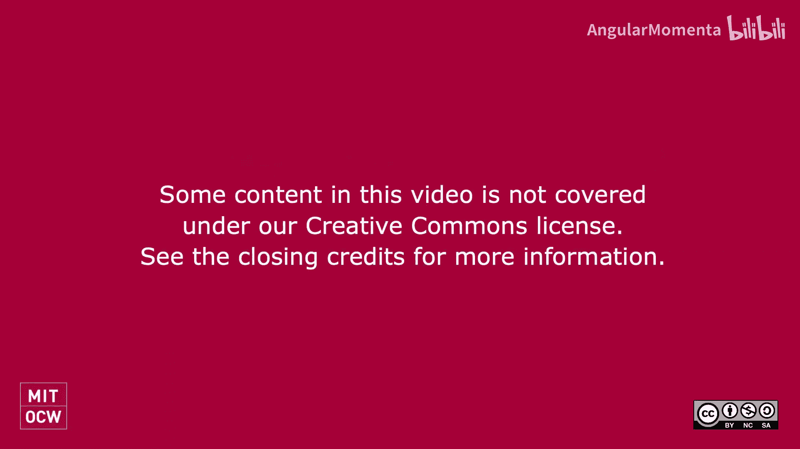
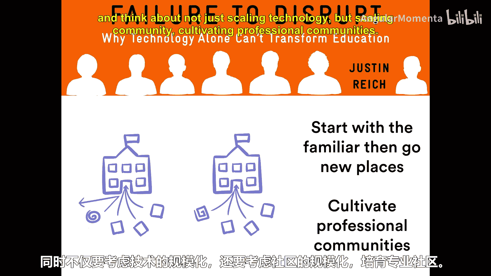
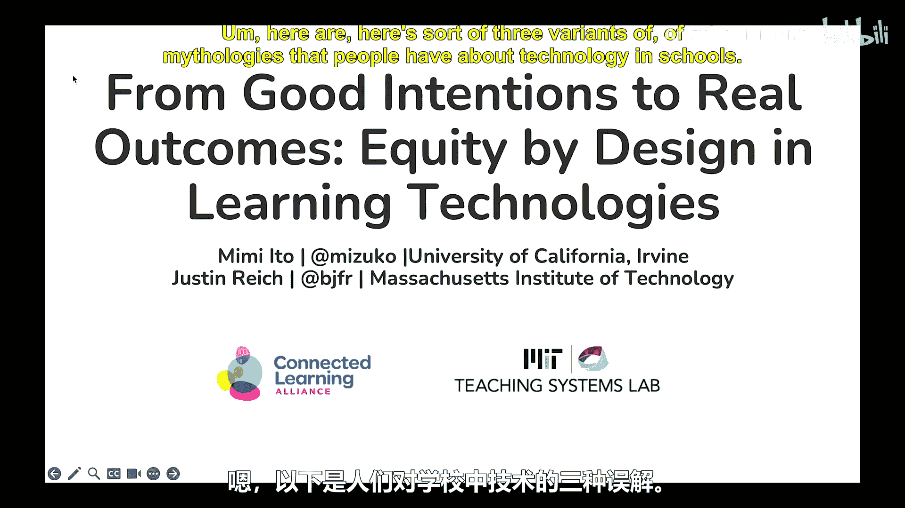
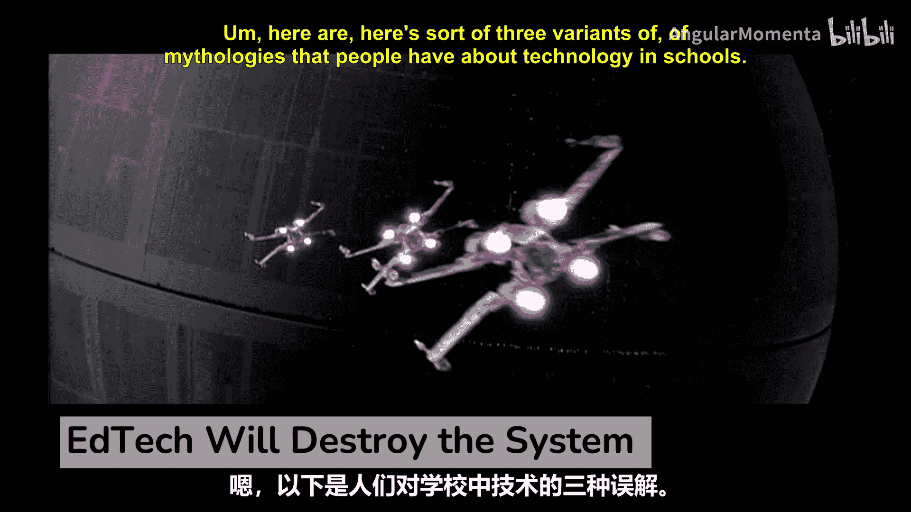
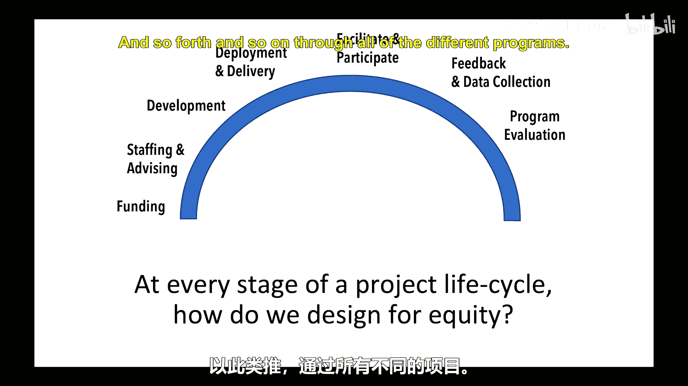
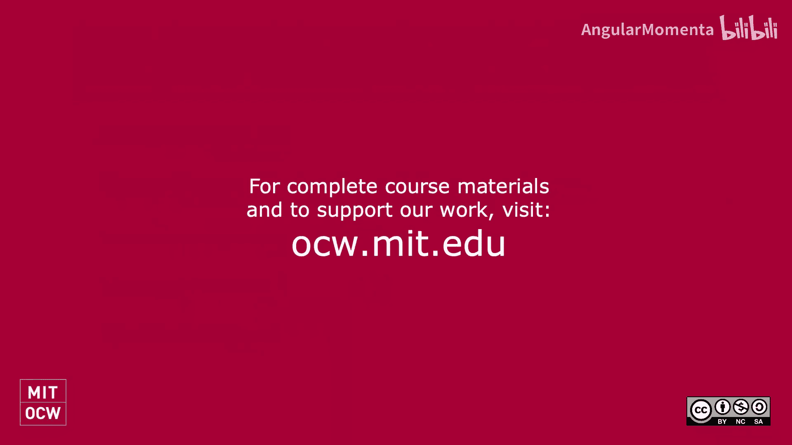

# 【麻省理工】学习、媒介与技术 ｜ MIT CMS.595 Learning, Media, and Technology, Spring 2024 p08 16. 初创公司与熟悉感的诅咒 -BV1DKUSBGEvu_p8-

Okay， congrats on turning in paper number two， for those of you who've turned in paper number two and for those who are wrapping things up。

 good luck。Your next assignment is very， very open ended。 paper 3。

 you just get to pick what you want to do。 if there's kind of the only restriction on it is like。

 you can't turn in。Like this assignment in another class the same paper in two classes。

 but other than that， there are very， very few guidelines on what you could do。

 I am particularly enthusiastic about anyone who picks an assignment that is connected to things they're already working on。

 So like Kent should totally do something about MaLeia I don't know what that is。

 but he like probably no one has ever asked him like you know write 8 or 10 pages about what it is you're trying to do there or do some more research that helps inform what you're doing or design your next steps or whatever it is。

 but that would be a great project for Kent And even if Kent is like even if his yourop is to like build MaLeia or whatever it's totally fine to have something that's very adjacent to that。

 I've had doctoral students who part who like did part of the literature review that they have to do like for writing a chapter of their dissertation or something that was great。

 So any I mean， you could also pick something that is completely unrelated to what you're working on just the thing that you're。

😊，Interested in exploring further， anything is fine。

 but part of the assignment is figuring out what it is that you want to do。

What we want to try to do then today is talk about two of these as yet intractable dilemmas that you've read about on the first half of the book and in of course we talked about these three genres of learning and scale。

 tried to emphasize to you that these genres have predictable characteristics。

 they have semipredictable impacts in school settings。

 in that their impacts are almost never transformative。

 they have the potential to be useful and to some extent there's a kind of like ongoing disappointment you know think of all of the amazing things that we've developed from radio。

 film strips， television videos， personal computers， the internet， instructional tutors。

 online communities， all these different things and like none of them have really like blown the walls off school like school is still kind of school and in a lot of cases doesn't educate people as well as。

ant what are some of the reasons why these technologies don't have the transformative impacts that we keep hoping that they will And that the for as yet intractable dilemmas the goal of this part of the book is to say we know a bunch about why they don't do all the things we want them to do like we know some of the challenges that occur across these different genres So you know a thing like scratch aOoc an instructional tutor Khan Academy。

 there's a whole they might be really different in some dimensions。

 but a lot of times they still stumble across these same problems some of this is me writing like making an argument to the field。

 hey， if if we want to do better in the future， we're gonna have to figure out how we deal with these four things。

 We're gonna have to understand these problems and how they operate and then we're going to have to do better with them。

 So today we'll talk about the curse of the familiar and the ed techch Matthew effect and then we'll talk about the。

Trap of routine assessment and the toxic power of data and experiments。

Why don't I give you a minute to chat amongst yourselves。 This was from a couple weeks ago。

 but turn to the person next to you， talk to this person about like what you remember of what the curse of the familiar is。

 why it would be a problem， what kinds of things get stuck in the curse of the familiar and what kinds of strategies seem to exist that might help us get past that。

 Turn to the person next to you and just externalize， what you remember about all this。 Read go。

All right， come on back。Who wants what。What are are some some what are some things you discussed that seemed core to the definition。

If you were to quickly summarize the curse of the familiar， what are some key ideas？

Like the idea of taking old idea and kind of repack data so that it appears to be something new。

 it really isn't like I think we talked about。The idea of Quizlet versus flashcards is basically the same。

you're just digAnd what's the virtue of doing that？

I guess people will think it's new and maybe we'll be excited by that there's no real change Good。

 What do people want to add to just that particular idea？

I was going to say like it kind of stems from this idea that these new like inventors just have a lack of knowledge of what's come before them and that's kind of like where it can stem from that can be a problem Sabrina were you're going to say and then Glorias going to say how to take like these new technologies instead of revolutionizing them they just bend it so that it' how continues I like that we take things and we make them fit in existing institutions Yeah education learning is very veryverse so people don't want their kids to be the ones experimented on so when things are repackaged it's still like oh we know this works because it's been done before but it's still new。

All right， so I'm sensing which might be appropriate。

 like a little bit of a negative vibe on the people who are doing these kinds of things。

 but if we wanted to celebrate folks who take technologies that digitize existing practices。

 like what's the virtue of that approach， what's good about it？

Hi can carry like a million flash cards。Yeah yeah， good。 And everyone knows what to do with them。

 Like Qui  Quizlet might be the most widely adopted piece of education technology software used in American secondary schools。

 That's awesome。ill like if you want the thing that people will use there's some good evidence that you have to give them something they're familiar with and also like you have a million different flashcards in your pocket。

 but you can also a million different flashcards from other people like sharing ideas globally Yeah。

 Yeah， so we can we can take this idea of a flashcard and we can like tweak a little bit。

 we can do some of the things that digital technologies are good at， we can make it scale。

 we can make it shared， we make all this kind of stuff you know。

 always running into the hard limitation of like how much can you improve schooling by improving flashcards Like like flashcards are I mean the joke I tell often is if like if you got all of the world's experts together and we're like what does education really need。

 like what do we really need to go to the next level， no one。😊。

wo would raise their hand and be like there's a huge dearth of flashcards like we need to dramatically improve flashcard technology like there's plenty of index cards there there's plenty of pencils you know flashcards are like it's not an obvious thing to revolutionize also I mean I think if you talk to Andrew he wouldn't be he wouldn't tell you this was a thing to revolutionize education It's like this was just like a useful thing for me to study French that other people found useful and that I could sell。

And， you know， but so so， you know， I mean， these kinds of technologies are like the the sort of square boxes。

 like it fits in the school。 That's a virtue。 Like we can like we can only benefit from technologies that fit in our institutions。

 Our institutions are risk averse， and they're conservative， and they have a bunch of constraints。

Yeah， Mar， I think one point also that the chapter made is that。

It's a phase where people use it in way they're familiar with。

 And then after a while they're able to use it in more like revolutionary ways。

 So the benefit of having something that they already know how it works is that they can use it long enough to get to that point where they might feel comfortable using it in a way that haven't been used Great。

 that is that is one of the two ideas that I've proposed with sort of not great research evidence behind them that might be a way of getting past the curse of the familiar that you introduce things in schools that have a kind of familiar structure to them but open them up in ways that go somewhere else。

 I don't think there's a lot of evidence that  Quizlet has been able to do that like Quizlet gives you flashcards。

 actually， I just took a screenshot of their website right now。

 Quizlet is more than flashcards like if you have to say that you're more than flashcards you're probably just flashcards。

 you know're sort of sort of special pleading there。 All right， you all have。😊。

Described this part of the curse of the familiar。 What would be some key ideas of the sort of flip side of the curse of the familiar。

 What are the challenges you run into if you make something that's really new and novel。

I feel like just going back to what was said earlier and like people don't want their kids to be experimented on like when something's new。

 it's not proven to be successful yet it's obviously replacing something else that maybe isn't the most successful but in some case it's there because it is teaching someone something so there's this idea that if you introduce something new you have no evidence to back up when they're not will actually be good so people are risk averse you use the phrase as like we know this thing in schools teaches someone something there might even be sort of a lower threshold of acceptability which is something like we know this thing works in schools like sometimes a thing works in schools because people learn something sometimes it works in schools because like kids are quiet and well behaved and busy and other things like that like not even really learning just just like you if you've kept a bunch of adolescent like if you've kept hundreds of adolescents in a building safe and for a day like。

ha made school work the you know at sort of the one of the baseline levels of it so there's practices that we would consider sort of sort of baseline not because they teach but because they work to do the other things that we ask schools to do Yeah I think we also talked a little bit about peer could you part of the risk of aspect not only from families but the students themselves the professor the teachers as well。

It was also an aspect of， I don't know， I would put it as credibility because even students。

 if something is too different， they're going to feel like， oh， this is not serious enough。

just have a lecture because this is something I've seen being done before so they don't and you know how to do it you know how to there's a bunch of people who go into school that sort of are like look there's a deal here you tell me to do things and I know how to do and I will do those things know sometimes in lower performing schools that can be expressed as like give me a set of tasks that I understand how to do and the day will be quiet and function or in high performing schools it can be something like give me a set of tasks that I know how to get an A on and I won't have my parents call you and sort of cause difficulties and things like that but it's the same kind of deal new routines break up that arrangement and students can be some of the most conservative stakeholders in these systems people can come in be like look at this new awesome thing we might have us try and they'll be like I don't know how to get。

How to get an A doing that。 Why don't we go back to the thing that I know how to get A doing。

 there were early on in the days of moOocs， there were like a handful of people that were trying different things。

 and there would always be learners that would show up in these like， you know。

 somewhat novel enterprise being like， this isn't real learning。 This isn't serious learning。

 Why don't we get back to what we were supposed to be。 It's like， my。

 it's optional one is making you be here like you know， like if you want something else， know。

 there's zillions of these courses being developed。

 I think there's something in that in the chapter on MOocs about that。 I think teachers could get。😊。

那我は。哇。Especially if that novel idea like what if you have to change the curriculum。

 What if you have to change the schedule， What if you have to change your grading arrangements。

 like a new technology can not like if it's actually changing the way teaching happens。

 it's probably trying to simultaneously change a whole bunch of things that are going on。

 which can be like which can be stressful， which can be difficult。

So a lot of teachers have to prepare students for certain exam。the school year， what is it？

Size assessments or AP。We afford to go off trail。now because that's what gets which means that different parts of school systems have different amounts of flexibility to try really new things。

 like one of the fun things about being a history teacher in Massachusetts is that until this year when we just launched an eighth grade civics assessment there was no standardized assessment you know I mean there has been some like SAT2s and history。

 A history and things like that， but they're usually not like the centerpiece of people's efforts And so history。

 social studies， electives for seniors and then anything in the sort of co-curricular domains。

 The are stands， physical education like a lot of times those are places where you can do really different kinds of things。

 the mathematics sequence is often a place where you're like， oh boy， like this really better work。

 not only that you know not only because people need to do all in math。

 but like if you don't get eighth grade math，9th grade math is really hard。

 know if you don't get earth science you might still be okay in physics or something like that because there just sort of sufficiently different and so forth。

 So the stakes in different。Parts of schools are different。

 There's there's an old saw in any kind of education development that the elementary school curriculum is pretty locked。

 There's just some reading and math and a handful of other things people need to do。

 The high school curriculum is pretty locked because of these tracks and exams and things like that in middle school is maybe the most openended space。

 So quite a few new products for education will find themselves in middle schools。

 not because like you know，12 year olds are particularly great group to embrace new ideas or something like that。

 It's just like that curriculum is more flexible in some ways than others are。😊。

So we have this example of  Quizlet， you know I feel like the connectivist MOOCs that we talked about before sort of the quintessential example of like here's some really cool ideas。

 some really cool technologies， potentially very different。

 solving some very meaningful problems that higher education had not figured out good ways of solving and you know were essentially rejected by the higher education system。

 a sort of spark of interest for a little while， and then people are like this is weird。

 this is different， what we're doing is fine and all this stuff kind of died。

So the question then is are there strategies that would get you past the curse of the familiar Are there things that you could do in developing products and services that would let you use technology to do really different kinds of teaching and learning。

 And I think there are two strategies that have some evidence behind them that they might work。

 One of them Mari alluded to before， which is build a technology that starts somewhere familiar and goes to a different place somehow Like you enter it and you're like。

 I know what that is。 and then you're like， who， I could do these other kinds of things too。

 The second sort of crucial idea is something around cultivating professional communities。

 The easy part of scaling online technologies is like getting people to download stuff。

 like it's not that difficult to get an app on people's machines on schools machines。

 It's not that difficult to get millions of YouTube views or other kinds of things like that。

 What's really hard。 is not scaling technology。Scaling community。

 how do you get groups of educators to share the ideas for new practices with other people。

 but there are a couple of organizations that have done a demonstrably good job of not only scaling their product。

 but scaling the ideas， the pedagogies， the new ideas underneath that so。

The two I like to talk about are Sc and Desmos。 They've probably made the most progress on this。

Scratch。Maybe has never achieved like a familiar place to start。

 but they have thought a lot about entry points about how you get people in for a while Seymour Peard had this famous line that you want technologies with low floors and high ceilings UefF referred to it a few times ago。

 you want something that like is's pretty easy to get people into and also things that they can really do awesome stuff later on。

Sometimes the scratch people have also talked about narrow entryway。

 you want people to kind of get into the software， like get into the platform。

 have some more clear ideas about what to do with a few things and then go other places for a while a scratch was experimenting with these micro worldds where you would get a smaller set of blocks。

 a smaller set of sprites and they would be connected to some to what they thought young people would be interested in so I think there was a stand-up comedy micro worldd。

 there was a fashion micro worldorld， there was a dance micro worldd it was like don't learn everything about scratch like just learn enough to make there be a little stand-up comedy routine or to make there be a little dance or things like that so you a set of sprites that are relevant to that you have a set of blocks that are relevant to that And once you learn that smaller part go into more complex things。

A thing that I think Sc has done a very good job of is scaling community is basically saying。

 you know， is acknowledging that if educators just download scratch and their machines。

 that is not enough to get over the curse of the familiar。

 like they know exactly what happens when people who don't sort of understand the pedagogy of scratch download scratch。

 And you heard you of talking about it， they just turn it into like a recipe book。

 So instead of having it be this place for computational creativity。

 you see all the students in lockstep， know all building the same greeting card or all building the same roller coaster or whatever it is。

 So they have you know all kinds of programs that are developed for educators。

 they have a world Sc day where people to get together。 they have scratch educator meetups。

 They had for a while， minutes with Mitch。 which were Mitch Resn like giving short talks about ideas and things。

 and Natalie's notes， they have other kinds of projects and tools and things like that。

 A big part of them is meant to get scratch educators connected with each other。😊。

if you in a few studies have done this， if you interview teachers about how they adopt new pedagogies。

 the number one answer they will give you is from other teachers the main reason why a teacher is willing to try a new practice is because they see that practice working in somebody else's classroom ideally someone who teaches in a place like them in a grade like them in a subject like them that's near them What that means is that any of these kinds of curriculum change。

 technology change problems are really peer learning problems you have to figure out how do you get teachers to share with one another that is just immensely more complicated than it is。

In to get software to be disseminated widely。 it's particularly difficult in most places in the world in education。

 definitely in the United States in education， because there are there are weak professional like the professional Or level of education is really weak。

 If you were like， man， I want all of the emergency room doctors to do something different and better。

 you'd be like， oh， let's go to whatever it's called the American Academy of Emerg Phyicians or something like that。

 If you wanted all the pediatricians to do something different。

 you go to the American Academy of Pediaians。 and you would convince some senior Steing Committee of the American Academy of Peians that were gonna do this new practice。

 and they would be like， yes， this is a good practice。 Let's all do that。

 And then that group has a journal pediatrics and all the pediatricians read it and you can and you can get people。

 even though theyre thousands and thousands of pediatricians in the country。

 you can get them to be like， okay， this is a new and better idea。

 Education does not have that professional organization level。 Theres there's no。😊。

Aitative body that says this is a good way to teach second graders or this is a good way to teach math or reading like know we have teachers。

 unions which organize teachers in a bunch of places in the US and they sometimes have a professional learning role。

 but usually not this kind of authoritative one， sometimes they're organizations like the National Council of Teachers of Maematics or the national Councils of Teacher of English and they sort of have some things that are like this。

 but they're very weak compared to other professionfessions and other kinds of things。

How many of you use Desmos in schools， So we're just okay， a lot more now。

 this is way more than you would have said five or six years ago。

Desmos was originally developed as a graphene calculator like its earliest functions were just we're gonna make a TI84 available on every machine for free and one of the brilliant things they did was they got instead of consumers to pay for it。

 they got testing companies and publishers to pay for it and what that meant was is that I mean。

 that was the way they could make a high quality project available for free。

 without ads without subscriptions without costs to the education system。And of course， you know。

 for anybody who's used a T84 before you look at something like this and you're like， yeah。

 I know what to do there。 Like I'm gonna to start teaching in equations and it's gonna start graphing them for me。

 And know I mean， for those of you who grew up in affluent environments like replacing a T84 might not be a big deal But there are lots of households and lots of families where like an $80 costs 120 costs。

 a big deal。 like a real obstacle to kids education schools。

 you know where they just have like T84s in boxes and they hand them out at beginning of class and put them back in the box and they end class and things like that。

 But you could give just this to lots of math teachers and lots of students and they would be like great I totally know what to do with this。

 And then on top of that， there was all kinds of other crazy things that you could do with Desmos know one of the things they do every year is have an art maybe they still don't do while they would have art competitions where you have people who create drawings using graphs and things like that。

 I don't know what were the kinds of things that you。😊。

did with Desmos that were very different from a graphing calculator and for those of you who raised your hands。

I think this is something you could do on a graphic cal。

 but that was made so much easier was just like。See just like different versions of the same graph like simultaneously or being able to like slide the coefficients and the variables Yep。

 and so modeling is a term that a lot of math teachers might use to describe that like you can look at the same equation。

 you know across a range of parameters and things like that。It was a sometimes we had like。TI是TIE。

So it's a lot easier to input stuff into decims。It one compared traditional。Yeah。

 so some of it it just made some efficiency gains like they just figured out some ways of doing some mathematical inputs that are like a little a bit easier if you learn them on a keyboard than on you know a number pad like finding intersections of two polynos。

 you just click on it as opposed to like let's go through the directions of how you find it on your graph and calculate left go right goes like it just like it's so much less bandwidth and just add on to that I think I heard somewhere I don't remember when but。

Some technologies are chanting with。Are like extremely bad for beginners because it distracts them。

In this case， I literally made this analogy the other day。

 I think was just see yesterday I was talking to somebody about this class。

 and I said a calculator sometimes that if you don't know how to use it。

 it'll be more distracting and helpful see you。And。For some people。

 that's most easier in my classrooms。traditional概。Yeah。

 that if you sort of lower the barrier to like learning the interface like learning the interface is not useful to anyone。

 what's useful is doing math and if if the barrier to learning interface is high。

 then you're spending a bunch of your math time not doing math。 you're doing like user interface on。

1980s era calculators I mean， they calculators or a remarkable piece of technology they cost like 50 cents to make or something like that。

 and they sell them for $100 because they have because they have like regulatory lockin because you get the testing companies to agree to mandate them and then the curriculum companies have to mandate them and then Texas instruments can charge $100 bucks for something that should be a lot less。

All right， so what are some things that Desmo did to try to get folks excited about some of the other capacities in。

In in Desmos is in addition to promoting the technology of Desmos。

 their leadership promoted alternative approaches to teaching mathematics。 So Dan Meyer。

 who was the chief academic officer of Dess。 He did a bunch of teaching in low- income schools in schools with a bunch of kids who would have been pretty turned off to math。

 thought a lot about like what kinds of pedagogies really engaged students and came up with this framework he called three act math。

 It was very media based。 So he would take a picture of himself shooting a basketball。

 So you'd watch a video of him shooting a free throw and about halfway through the shot。

 he would stop it。 And that's all the video that you would see。 actually。

 Ill give you my favorite example of it。 Like do you remember in geometry。

 you are always encountering like hexagonal fish tanks and things like that。

 always encountering like these shapes that like would never exist。 So he like。😊。

D a hexagonal fish tank and gets a hose and holds the hose on top of the fish tank and just makes a video of 30 seconds of just water filling up。

 And usually when he shows this video at some point。

 some kid is like how long is this gonna take And he goes exactly And then you sort of stop the video there But it kind of these videos inspire like a natural curiosity。

 How long does it take to fish tank to fill up， like will the basket go in。 And then what he does。

 that's the first act， sort of setting up some kind of problem。

 The second act is trying to figure out what's going on in the setting。

 So students have a chance to ask a bunch of questions。 How far away was this person from the basket。

 How high is the basket， how fast is the ball moving， What is the arc， How big is the fish tank。

 How wide is the fish tank。 How tall is the fish tank？

 What is the angle on each side of the fish tank。 How how wide is the hose。

 How much water is coming out of the hose？ All these kinds of things some of these details。

 Dan or other teachers will give to their students and some they won't And then they sort of agree on。

😊，Question or the teacher kind of imposes a question。 Okay。

 the question is gonna be how long is this gonna take to fill up。

 And I'm gonna give you these pieces of information。 Now， because it's a real world environment。

 it's like it's actually kind of mathematically impossible to determine the exact answer to these questions。

 know like the amount of water that's flowing through the hose through a municipal water system is not like a completely predictable amount and that's coming out every time。

 know he'll give some measurements of the tank。 but the tank probably wasn't measured to the hundredth of a millmeter or something like that。

 So students start creating models。 they say， all right， well。

 I think it's gonna be this know here's what I know and sometimes there's a little instruction there。

 like oh， so to figure this out， you're gonna have to calculate the area of a hexagonal solid。

 Okay heres the formula that you need to do that。 And here's why I work And then you sort of figure out these other things。

 So then the third act is Dan will show the video again。😊。

And the water will be pouring into the tank and the water will be filling up Usually。

 he sort of accelerates it。 So it goes a little bit faster。

 And he puts a clock in the corner of the video。 Now。

 all of the students have made some kind of prediction about when they think the tank will fill up。

 But it's pretty much impossible to predict exactly。

 And he's got great videos of kids watching these sort of third act videos where you sort of see like。

 like their time， they predict to go off。 And then at some point in the middle middle of the video。

 like， you know， a third of the class cheers。 Yeah because their time was like roughly write or something like that。

 And it's just a sort of great moment to be like like typically when you get an answer right in math class。

 you don't like stand up and cheer and stuff like that。 But。😊，You know。

 there's there's a few key features of the pedagogy。 first of all。

 one things he talks about is it dials up the math slowly。

 So an exercise like this starts at a level of intuition and questioning that even if you don't really understand polynomial functions or you know complex geometry of solids well。

 you can still ask basic questions about it。 you can still make observations about what's important and then you sort of ratchet the mathematics up slowly until you get to the point where you're like working with particular equations and functions and numbers and those kinds of things and that it's impossible to be right like everyone in the room is just trying to be the least wrong that they can and making a series of assumptions which are which you hopefully get more and more reasonable as kids get more and more proficient mathematically but will never be perfect。

😊，So Desmos is a tool hopefully you can see how a tool like the slider that Oel described before might be quite useful in building mathematical models of how long it takes to fill up a tank with a posese and other kinds of things like that。

 Dan Meyer has given talks at math conferences in all 50 states he goes around places all the time。

 not only probably even more important than Dan going to all 50 states to give talks is。

 you can still go to math conference。 probably this year。

 you could go to a math conference in all 50 states and someone will be giving a presentation on three act math tasks because not just Dan。

 but other mathematics educators have taken up the mantle of these ideas。

 probably in those talks they'll explain how you can use Desmos for doing these things。

 And so all of a sudden you have not just a new technology to do math。

 but you have a whole community of people that are sharing new practices of how to do it just like in scratch has a whole community of people who are trying to say。

 let's not just teach computer programming as。😊，Solving。

 let's teach it as computational creativity and things like that。

 I want to emphasize to you like I mean， these are like powerful。

 powerful strategies for changing teaching and learning and they're super hard and timeconing and energy consuming。

 They require charismatic leaders。 they require really good ideas。

 they require technologies that sort of fit with pedagogy。

 they require convincing educators you know these risk averse educators you described who are preparing their students for math tests like here's a better way of doing this。

 you know a part of your geometry solids units and try this new thing。

 So there's a whole lot that goes into it。 But those I think are sort of the two key strategies for how we might get past the cursor of familiar start with a familiar than go new places and think about not just scaling technology but scaling community。

 cultivating professional communities。😊。

What observations or thoughts or questions do you have about those ideas。Yeah。

Sort of like a spoiler to my essay， but I did mention that。

I'll be as big as possible the target that I was recommending my technology to actually have the infrastructure implemented。

Like five years before COVID and they started doing a lot of professional teaching within the entire district。

 by the time COVID came around。They were ready for distance learning without necessarily preparing for that and they just happened to have like the resource necessary because everybody was involved and I remember like there would be teachers like having separate meetings just to talk about like what went well didn't go well and then they I was one of the volunteers or the last accreditation selfsy and I was in there like listening to sort of what happened。

This is。Yeah。At the end of。COVID， and then they were recruiting for。That' self study。

 but I was able to listen in on that and it was really cool to see like the community that people。

Yeah， it is impossible to change teaching practice in schools without communities of educators teaching and learning with one another like every instructional improvement problem in a school is in some dimension a peer learning problem and know you could imagine like how many education technology startups have as one of their first five hire someone who's really good at facilitating peer learning amongst educators like no one right you need someone who can like you a frontend person and a backend person than someone who knows pedagogy and a marketing guy or finance guy or lady or something like that like they're just organizations that are not intuitively equipped for those kinds of things know when Andy is starting quizlet I mean he's a high school doesn't know anything just like knows how to like make flashcards online and part of what their organization needed to build over time was you know people who could interface with schools not just to sell the schools。

 but to help them think about like what could different look like here know where do we fit into practice how do we train。

Teachers or have students become better at using these things。I feel like。

This whole like talk is about how like difficult this can be and like even with these two ideas that you've brought up。

 like this still requires like a lot of people buy in and just like other people supporting it makes me think like about how difficult this can be for schools that like aren't out of public schools and like even like you have your charter schools that then have their own set of curriculum and if you're trying to really gain this type of support nationwide if you have like this whole subset of schools that are like avoiding your technology like it can make things really hard like thinking about like。

Like because I had written my papers said my high school， which was like。

Like Catholic high school in Philadelphia and like those schools don't do anything to try and improve schools because like they are just struggling to like keep kids in the schools so like thinking about trying to like improve a system that like can't even look that far as like really interesting to it like those teachers don't have time to like cultivate that professional community because they're just trying to cultivate like a school community or I mean almost every school has a certain amount of time to do professional learning amongst faculty like that's baked into most schools。

 but you have like there's only one block of that that is that is what you'll use to improve your assessment practices to address chronic absenteeism to deal with violence in schools to take on a new state initiative about sex education to do you know a dozen different things that might come along you know I mean Omar described the school that five years before COVID happened to decide that like online learning distance learning was like a good thing for them to work on。

But it might have been equally reasonable for them to work on phonics instruction or executive functioning or any one of a dozen other things that helps improve schools。

 so yeah thinking about what are the resources that institutions have to make themselves better and to make the kinds of changes that are needed for new practices to work。

We talked a lot about like cultivating national communities。 Do you think that。

Professional communities， so with teachers， for example。Putivating death is enough。

 or do we also need to cultivate life？The students communities as well。

 because I was surprised when reading the chapter that students themselves sometimes are also kind of like。

Afraid or concerned about using the technology。 Yeah so I mean。

 it's exciting to hear like what Omar talked about about bringing students in on these kinds of change initiatives。

 It would be you know there's almost every ed tech company has some kind of ambassador program。

 which is hiring a group of teachers to be like the folks who go to these conferences and share what they're doing other people。

 I don't know of any technology company that has a student ambassador program。 I mean。

 you know one reason is that like the teacher stay in the students leave， which is good。

 that's what the students are supposed to do。 like you probably have to be a certain age to be kind of useful doing like like like a first grade ambassador would probably do some interesting things。

 but like is not that helpful for for what they can accomplish。 But you know。

 but I do think that generally speaking。School systems change agents tend to underestimate students as potential partners because when you。

 you know， when you get them really engaged， they can be。

 they can be transformative in institutions when students get together and be like， oh。

 we should do this。Sometimes that's when faculty light bulbs go off and go， yeah。

 you're interested in that。 like， absolutely， like， let's do it。 I'm asking because I'm。😊，Girl。

 she's doing her master's  Ed。The privateraate School of Education in Harvard。In Brazil。

 a few years back， she was supposed to start。Giving an intership course to like me schoolers。

 she wanted to do sigma， like to do a very interactive you know experiential and professor the like teachers were completely closed off to the idea。

And then to simply bypass them and started reaching out to the students and they loved it。

And it worked so well that like。The excitement from the students convinced teachers themselves to actually give it a go because like if there's one thing they have in common they're really concerned and like they care about students right so she ended up even giving like a TEed talk about how she believes this cold of it。

Transformation is going to come from students。 that's why I was interested in know。

 do that last we could Yeah， the exact nature of the technology matters to the more the technology。

 the more like the business model， the technology has some kind of like freemium or introduction kind of model。

 like I don't know。 if you wanted to implement something like with robotics in a school and the robotics kits are expensive。

 It's pretty hard to be like hey kids like go get your own robotics kit and will like go around the system。

 like somebody needs to buy the robotics kids。 you know。

 part of what makes like the example you gave a Figma works is that Figma has a kind of built in freeium model as a consumer product that educators can sort of piggyback on to try those things out。

 But yeah， I would say anybody who has a change strategy in schools。

 if your students are part of that change strategy。

 it's pretty likely to be better than if they're not。Yeah， related to that。

 I know that Wolfram Technologies， which created Mathematica has a student ambassador program that I did in high school。

 So you like presented at their conference and like yeah， I don't know。

 talk about to all your friends and post webinars and things。 So yeah。

 that's one example of that No I had I had not known that。 but that's that's you know， and and again。

 like， yeah， Wolfram's in a pretty competitive space where of different kinds of mathematics software where where absolutely cultivating student preferences could totally make a difference。

 All right， let's talk about another。😊，Let's do another one of these challenges since I'm trying to double up this week。

 which is the Ed techch Matthew effect。Which is really supposed to be here somewhere。

This is what I used okay。嗯。Here are。Here's sort of three variants of。

Of mythologies that people have about technology in schools。

 One is thated tech will destroy the system。 We've talked about how that probably won't happen。

 And instead， new technologies domesticate education。 Actually， that article that Uef shared。

 I thought it was Mimi Eto and I who came up with this metaphor。

 particularly Mimi But that article that Youf shared of Seymour Pat responding to Tik and Cuban had a very similar kind of framing of what schools。

 I don't think I don't know they exactly use the word domesticate， but it's pretty close。

 like new technologies don't come in and blow up schools。 Instead。

 schools take new technologies that go okay， you fit here。

People are always hoping that new technologies， a word they really like is democratizing。

 I think people like the word democratizing because you're not exactly sure what it means。

 but it sounds pretty good。 like it would be better to have more democracy， but it's like。

 is that cheaper， is that more equal， is that more just， is that better。I'll show you a bit。

 We really have pretty good evidence that new technologies disproportionately benefit the advantage。

 They disproportionately benefit people with a financial。

 social and technical capital to take advantage of new innovations。 So people are always hoping like。

 oh， this new thing， it'll be distributed for free on the Internet。

 like the people who are good at finding free stuff on the Internet are affluent people with good Internet access。

 with discretionary leisure time， with parents who went to college， all of those kinds of things。😊，呃。

And and you know， so so this is a figure that I I use to describe the tech math effect。

 I' just say again that in educational systems， especially highly unequal ones like the United States。

 we assume that folks from higher socioeconomic backgrounds have better educational outcomes you know。

 generically than from then folks from low socioeconomic outcomes。

 And the hope is that through technology innovation， like everyone will learn。

 but maybe we can build things that particularly help this group。

 when people talk about democratizing education， this is basically like a graph of what they mean。

 What actually happens， though， is probably something like this。

 which is that new innovations disproportionately benefit people who are already affluent。

 And you know a thing which is sort of tricky about this， is they probably help everyone。

 There are not a lot of education technologies that we build that like really make things worse。

 maybe there are。 But typically they just help advantage people more than they help disadvantaged folks。

 Here's some。😊，So so when we studied massive open online courses。

 the democratizing rhetoric was very active Udacity for a while。

 like their tagline was democratizing education or something like that're like that's pretty unlikely to happen I think so for instance。

 so we did these kind of cool studies where all these studies were based on the fact that when edX was founded。

And you had to register for it。 Someone was like， let's get people's addresses。 So they would just。

 people would type free form their addresses into eds。 Why did anyone collect their addresses。

 Like I've never learned， like， were they going mail them something， I don't know。

 but we had their addresses。Through the magic of residential segregation。

 if you know someone's address， you can make a pretty good guess about how affluent they are。

 what their education level is or something like that。

 there are these units that are called census block tracks which are something like the 1。

200 homes that are nearest yours and wherever you live like like the average median income of your of the 1200 homes around you is like pretty close to your and we might not be exactly right but if you do it over hundreds of thousands of people it works out pretty well。

So this is a graph of people's average median income at different ages。

 This is all of the people in the United States。 and these are the people who sign up for Harvard X and MiTX。

 So for sure there were people from every possible income bracket that you imagined who had signed up for Harvard MITX courses。

 but at every age level they were you know a typical Harvard X or MiTX participant is going to be wealthier than a typical US residents。

 this is a kind of study called a case control study and it comes from epidemiology where you're comparing a particular group to a whole population and it's usually used for like people who get viruses。

 So for folks who hated MOOCs we were basically treating like MOC participants as if they had a virus and they thought that was pretty funny this is the amount of education that their parents had and so clearly the people who sign up for Harvard X and NX are more educated than the typical population。

What was a question you asked saying I love how there's someone who's under 20 with over $90。

000 in in their household in the income of the census block tracted？Yeah， yeah。

 it's not like it's not like there are a bunch of loaded 16 year olds who are taking our courses。 No。

 but if you were 15 or 16 or 17 and you were taking a Harvard X class。

 it was very likely that you were， we were much more likely to be from a census block track with a much higher average median income than comparable。

😊，Yeah， yeah， I mean， you can also feel like people leave like like it's not that people become poorer。

 They like move to crummy College neighborhoods， you know。

 and then their livelihood improves over time until they get old。A long boring subtitle。

 it did have a long boring subtitle， it meant something。😊，What was this。 This was the odds ratio。Of。

These these were the odds that you。We。Oh， if if you had a parent who graduated from college。

 this was the odds that you were more likely to complete a class。

 So for particularly people who are the youngest so actually once for old learners some of their socioeconomic characteristics seemed to be less predictive of whether or not they would be successful in a class。

 which you could you might assume to mean something like by the time people are 40 years old or something like that。

 you know your initial family upbringing maybe matters less for the people who are sign up for this class。

 but for really young folks， if your parents graduated from college you were way more likely to complete the class and if you signed up and your parents had not graduated from college not presumably because you lived in a household in which you both had more support at the time that you were taking the class and you had grown up with many more academic and financial supports than other kinds of people So you know it was I I mean。

You know likeOO organizations at this time were telling stories like we mentioned before。

 like the Boy geniusius of Luan Baatar about all these people who are farfung places who were taking courses of being successful。

 and all of that was true。 there were people from every walk of life from all corners of the world who were really successful。

 it was like MOOCs opened a door and a handful of people who definitely would have not have accessed higher education before walked through that door。

 but the vast majority of people who walked through the door were already educated already affluent people。

 So maybe there's a way that you could describe that this democratizing。

 but it didn't seem particularly democratizing to us。

What are some this was my doctoral research which I'll summarize quickly So you know just like in just like today there's all these ideas like man。

 AI is going to transform education and just like 10 years ago theres these man。

 MOCs are going to transform education in 2007，20082009。

 it was social media that was going to transform education。

 It was blogs and wiis and peer production that sounds silly now， but believe me at the time。

 people thought。So we did this kind of cool study where we like knocked on the door of a company that let you set up Wiis at the time It was called PBworks。

 and we were like maybe it was called PB Wiki and then changed to PBwork。 and were like。

 can we have a list of all of your education related wis And they're like， yeah， sure， in theory。

 something that we could have scraped from their website， but they just sort of handed it over。

 So that was pretty cool。 Now we had 200000 wis that someone had labeled as education related。

 And these weren't Wiiss like Wikipedia that like everyone would work on。

 they would be like a class or a school or something like that would foster these Wiis。

 So we took 1% of them。 And then I hired like a small army of research assistants to figure out what they all were。

 So we like coded we like labeled the characteristics of them。

 We did this like private investigation work to figure out like what school they were from。

 And then if you know something on a school， you know like what neighborhood it's in and how many of its students are eligible for free and reduced price lunch and what its racial divisions are。

 You can know all kinds of sort of。😊，characteristics one of the things that we focused on was whether or not they were Title I schools where certain percentage of students were eligible for free introduced by lunch and those who were not。

 And we basically sort of identified like four different types of wis that people created things that just like didn't work where there was like like someone created it and then like never updated it through the way whatever that's fine things that were teacher centered content delivery devices。

 So things that were basically just like simple websites。

 So in some respects like definitely what you did not want ws to be like the other one was sort of individual student assignment or portfolio。

 like something in individual student made and then a sort of collaborative multimedia assignment or workplace。

 So the first thing that we figured out is that like the vast major of wis either didn't work or were teacher centered content delivery devices This is a kind of curse of the familiar example like you can build if you give to people this never before。

😊，Sm tool to do collaborative writing， schools will use it to just broadcast things to students or to make students turn in their assignments with it they're very unlikely to do the thing that Wikiis were supposed to do。

But they were more likely to fail in Title I schools。

 and they were a little bit more likely to have some kind of student component in it in the non-po。

 more affluent schools。 So all of these things were free。 you know。

 they were freely accessible on the Internet， all kinds of things like that。

 But you could see from their like very beginning schools that had more resources。

 We going to be able to use them in more interesting， more student centered kinds of ways。

we'll skip that one。 Oh， this is one this is one of my sort of favorite pieces of research。

 That's an example of this。 So we make kids take this test that we've discussed before in the national assessment of education progress and when we make them take the test。

 we also make them take a survey And in 2011 kids took a math test and we ask them questions like do you use a computer for drill and practice in math Do you use computers for simulations and applications then you can like ascribe a few things from this we're more likely to have students do drill and practice kinds of things then we are to have them do simulations and applications and things like that。

 know I don't know this would be like IXel and this would be like geometer sketchpad or desmos we make black students do drill and practice things more than white students we make poor students do drill and practice things more than non-po students like when we give people access to new technologies even if they have equitable access to technologies。

 they often have inequitable。😊，Access to different kinds of opportunities with them。

 So one of the papers that I assigned to you， which one of my very favorites is by guy named Paul Atwell。

 called the first and second digital divide。 And his argument is that we the digital divide was originally conceived as an access divide。

 like who has computers and who doesn't， who has broadband and who doesn't。

 But even if you could snap your fingers and give everyone the exact same access。

 there would still be a digital divide of usage。 There's evidence that。😊。

People from low income backgrounds are more likely to use technology for drill and practice kinds of things rather than creative things。

 and they're more likely to use it with less adult mentorship and support than more affluent folks are。

But the funny thing when I read this 201 summary was I was like， man。

 it was it was like having the experience of reading a plagiarized paper。

 Youre like I swear I've read this exact same study before。

 this is what a Apple Macbook looked like in 1996， This is what it looked like in 2011。

 So like like 15 years of like pretty good technological progress。

 But these are the same findings from 1996。 And you can see like the numbers are exactly the same。

 Like we asked these kids these questions 15 years apart。

 if you see any difference in the numbers are probably statistically insignificant。

 It's just like a little bit of variation in in the sampling But essentially like I mean。

 this was like 1996 to 2011 was like a pretty big decade and a half for technology and math And we made almost no change in the fundamental ways that young people were being able to access and use technology。

 Does that argument make sense to you totally striking pair of findings there。😊。

But Urik Boser did not plagiarize from Winlinsky， they just had the same findings。Out of curiosity。

 is there a lot of difference between public schools and like charters？

Like private schools in the US and those things。That happened in real life。here's heres。Yeah。

 there there are there can be like those things have enormous different gradations in the United States。

 So Dana was talking about Catholic schools in Philadelphia。

 Those are like strictly speaking private schools， but they might be serving some of the most low- incomecome neighborhoods and families in Philadelphia where you know know a Catholic school in inner city Philadelphia might have more in common with its public neighbor than it does you know to Sidwell friends or something like that a super elite private school。

 which might also be in Philadelphia but might as well be in a whole different world。

 So so to some extent like it's sort of like tax status or organizational status。

Can be related to those kinds of things， but not necessarily， you know。

 because we have public schools that serve you know that like public school in extremely wealthy neighborhood might have more in common with a private school than it does with another public school and inner city neighborhood。

This was kind of a cool study that was done looking at three schools that had adopted a whole bunch of technology。

 so they like they they had roughly the same levels of access。

 They had bought the same kind of stuff。There was， they were all in the Bay Area。

 These aren't real names。 Heath Ciff Academy， which is a private。

 mostly wealthy and mostly white school， Sheldon Junior high， which is a public。

 mostly middle class and Asian American school， Caesar Chavez， Middle school， public。

 mostly working class and Latino。 And again， they had all bought like roughly the same amount of stuff。

 Like， I think like， like each kid had a laptop。 The laptop was connected to broadband。 Of course。

 they are gonna be differences。You know， some access differences in the really wealthy place in the more working class places。

 but not but trying to find not striking differences。

 But what Matt found was that the way people discussed technology was quite different。

 So at the mostly white Heath Cliff Academy playing around with technology was viewed as essential。

 So if there were kids who were like goofing around Minecraft and stuff like that was encouraged。

 you're playing around。 you're hacking， you're doing all these kind of neat things。😊。

Whereas in the mostly middleclass Asian American school。

 like sort of goofy hacking applications of technology were considered threatening。 It's like， oh。

 this is a risk to your education。 This is a risk to your progress。

 whereas in the mostly working class Latino school。

 there wasn't like encouragement or kind of just sort of considered irrelevant。

 people weren't really paying attention to what they were doing。 So again。

 the idea here being that like here three institutions that had roughly similar levels of technology access。

 but they had like the faculty and community gave very different cultural messages about what playing around with that technology meant。

 And for the kids who were already advantaged， they were encouraged to play and hacked and goof around and things like that。

 But for the kids who were not already advantage， they got different messages from their community about the values of those technology。

yeah， this is another sort of myth pair。 The idea that technical and economic barriers are what keep people out。

 that like， if we could just get people the stuff， they would have you know。

 great education with technology， whereas instead it's social and cultural exclusions。

 which can often be the hardest。 Some of the we've talked in the class before about connected learning。

 some of these ideas about like how do kids do informal learning in their own communities and other things like that。

 Some of the things that the the connected learning researchers are most worried about right now is that like。

😊，as America's polarization sort of increasingly is expressed on social media。

 more and more kids feel uncomfortable communicating and expressing themselves there and like white affluent dudes are the least likely to feel threatened in those spaces and kids with all kinds of different marginalized backgrounds are the ones who are more likely to withdraw from posting their fan fiction as sharing their art on devvit art on other kinds of things like that。

 like basically what they saw was you in recent years again across all kinds of ages and racial groups and backgrounds and things like that。

 a sort of withdrawing from public learning on social media。

 but a withdrawing which seem much more pronounced from people from marginalized backgrounds than they did from people from more affluent backgrounds that all of those kids have more access to technology than they've ever had before。

 but there are social and cultural exclusions that are keeping them from learning experiences。

In ways that are new。Okay， what can we do about this？

 This is one of the most frustrating problems to talk about， because I feel like。

 I feel like the problem is extremely well understood。

 This is one in which I feel like the evidence we can say for sure。

 Like if you build a newed tech thing， it is very likely to disproportionately benefit the affluent。

 especially if you're not attentive to all to how these issues operate。 like we should not， you know。

 we should not assume that new generative AI tools are going democratize education。

 They just are very unlikely to do that。 But then you might say， well， all right。

AThere are some things。 you read some studies of things like assessments in Carnegie learning that seem to disproportionately benefit people with low prior achievement in mathematics。

 like what are they doing right， like what are technologies that disproportionately benefit the learners who are further from opportunities and I would say that we don't know very well the research on like how to fix this problem is more novel is more nascent。

 but here are a few things that maybe would be promising directions to explore。So one。

 think about technologies that align home， school and community。

 if affluent kids automatically get kind of an educational support infrastructure from their homes and families from their college educated parents and stuff like that。

 How would you build technologies or technology infrastructures that like help all parents do more of this stuff。

 So family creative learning is a super cool project by a woman named Ricka Rose Ro who got a PhD here who basically was trying to figure out like。

😊，How would you help boys and girls clubs after schools support parents in doing a better job helping their kids use scratch like all right so we we know kids of software engineers are the most likely folks to use scratch but what if we just helped all of the parents support kids doing scratch so she would do these like multigenerational programs in afterscho play YMCs boys and girls clubs and stuff like that you bring parents and grandparents in you feed them dinner。

 you break the parents and the kids up， you each teach them something about computers。

 you put them back together and share their projects and stuff like that and that seems pretty cool。

How do you make it so that the kinds of things that you're working on with technology align with young people's interests。

 So this was a photo from a project that was done in Georgia Tech trying to help more African- Americanic males in the Atlanta area get involved in computer science computer programming and this was a researcher who found that a lot of these kids were really interested in video games and they were interested in the problems in the video games。

 bugs glitches and things like that。 she was like cool let's make a little QA testing company And so she got a bunch of kids。

 she helped them interface with companies to do QA testing they were called the glitch game testers because the language that they used for bugs in that part of the world was glitch and as kids got more engaged in this program she would then help them like take AP computer science and stuff like that and sort of translate into academic programming。

 But the idea was to like find out find out what kids entry。

Points look like into these issues and try to build up from there。嗯。Sor of similar。

 I think to connect this is like the heart of connected learning。

 like how do you connect to the interests and identities of young people， I mean。

 part of what Scch was doing with microords is being like who is intuitively interested in creative programming maybe not every kid so but like what kinds of kids could we get with hip hop dance。

 What kinds of kids could we get with fashion， What kinds of kids could we get with standup comedy。

 how could we offer a broad array of interests that could draw people in to what we're doing。嗯。

A study that I would love to do one day is to think about。Hot Lake what？

How do how doed tech companies reduce costs in ways that disproportionately benefit those who are furthest from opportunities Like a funny thing to think about is like what happens when you make something free。

 So moOs， for the most part for free。 Opencourseware for the most part is free。

 but those things probably disproportionately benefit the affluent like they're free things。

 but they're better for rich people。 there's actually a whole sociology of this like it connects to like swag bags at the Oscars and things like that。

 like people are always giving rich people free stuff。 which does seem like it makes sense。

 but there are certain kinds of things。 know Desmos is the bottom example here。

 The T 8384 was a real barrier to mathematics learning for families。

 and Desmos reduced that cost to zero。 now 120 calculator is not a huge burden for an upperclass family。

 not a huge burden for middleclass frame is a big burden for a working class family。

 And so like you're saving money for the families for whom that barrier is most relevant。

 another one。😊，My favorite projects， has anybody ever heard of OpensStax？

They do this cool thing where they realized all like something like half of all higher education enrollments are in 20 classes just about everybody who's taking a college class this semester across the entire United States is taking like sociology 101 pre macroeconomics。

 microlytics， chemistry， US history， psychology， economics。

 algebra like you know I mean there's a long tale of zillions and zillions of other classes that we offer in higher education but almost everyone is in these 20 classes。

 they were like let's just pay really smart people a bunch of money to write good textbooks and then give them away for free So for somebody who's coming to MIT and you're paying $50。

000 semester， whatever it is you're paying like $120 chemistry book is not a big deal If you go to a community college and the entire chemistry course costs you 120 to register for 120 textbook is a huge deal it's just double the cost of your credit hours of education in that class。

 So taking that 120 and bringing it that to zero。 that might really matter a lot that could save people。

😊，You know， a meaningful amount of money that will help them advance in their community college education or other sorts of things like that。

 So this idea that you could look across the education system and be like， you know。

 what are specific cost barriers to family that we use technology to drive down those costs in ways that like affluent people might benefit from。

 but probably won't notice， But community college learners， you know。

 lower income working class families might really benefit from。嗯。

A thing that we experimented with a lot was trying to target the needs of subgroups。

 Did I talk about these experiments when we talk about MOOs。

 how we put all these little interventions in at the beginning of MOO courses to get people to some nodding heads。

 It's in the books there。 We designed a whole series of interventions that were're trying to increase the sense of belonging or increase the sense of well-being from people who might perceive themselves of being from minority backgrounds。

And we thought they worked for a while。 And then we weren't sure that our interventions was working。

 but it's sort of an interesting thing to think about like what kind of you know， if you。

 if you're trying to serve people from a wide range of backgrounds and you know that some people from those backgrounds might not have the same level of support at home or might not have the same you might experience stereotype threat or other kinds of things like that。

 Like what kinds of interventions could you design to to address those needs。

Another thing to think about is like where could you target supports sort of across someone's educational trajectory。

 This is another sort of sad story of things that we thought worked for a little while and probably don't。

 but still the problem is real Ben Casle， Ben Casselman worked at this school in Providence called Met and they were charter school and they did a pretty good job getting kids into college。

 but one of the things they observed which totally broke their heart is that they would get kids into college。

Accepted to college， and then they wouldn't show up in the fall。like you're in part of you know。

 four year 12 year educational system， which is trying to get kids into postsecond education and you succeed。

 They have an application letter and some fraction of them don't arrive in the fall。

 They ended up calling that summer melt is you know and part of it is if you are the first person in your family to go to college。

 then figuring out FAFSA figuring out course enrollment。

 figuring out moving on campus like have you come from a family where you're not first generation。

 like your mom and your dad just explain all that stuff to you and f it out and you get through it But each of those obstacles。

 you know and there are a few of them to showing up what camptons。 Each of those was enough。

 So they designed these technologies that basically like sent little text message nudges to kids all throughout the summer know have you figured out your financial aid。

 have you registered， how you other kinds of things like that and for a little while。

 it looked like those nudges were working and then people reproduced at larger scales and this particular intervention doesn't seem like it' it's actually working。

😊，But it was at least this sort of good idea of being like。

 let's think about people's educational trajectory from you know for all the transition points you have between middle school and high school and college and postsecondary and lifelong learning and things like that。

 and where there might be transition points that affluent folks just kind of breeze through。

 but folks from working class families find more struggles with。

Proably the biggest challenge that education technology has is things that really work in education often are tailored to their particular context。

 But usually what software developers are trying to do is build a thing that works anywhere。 I mean。

 that's that's a real tension。 That's a real problem。 theres some cool examples of this， you know。

 I think you could think of like the open edx platform is something kind of working on that。

 So like there's one big software platform。 And there are a couple of， you know。

 there's like edx as a big organization that offersOOs everywhere。

 But there are dozens of local sort ofOO operators that offer in their particular country in their particular language in topics that they think local folks will be interested in。

😊，One of them is EdRck， which is run by the Queen Raia Foundation。

 which focuses on offering Arabic language classes to folks in Jordan and areas surrounding Jordan。

 and you could just imagine well okay， like so they can take edX。

 they can make sure it supports right to left reading in Arabic。

 they can you know do whatever else you need to make the Arabic interface work better offer courses in Arabic。

 find out what people in the Arabic world would want to be able to do and they're using the same kind of base software as everyone else。

 but that software is kind of customizable to serve particular notions and areas。And and the idea is。

 you might be able to apply all of these different kinds of thinking all across a project's life cycle。

 So as we were giving these talks to people who fund technologies， to venture capitalists。

 to philanthropists， to technologies， developers， to like， you know。

 the big fan kind of companies that have publishers who have a bunch of things underneath them。

 who are saying like。😊，You know， what are all the strategies you might try when you're funding a company to get to get the right people at the table。

 you know， lots of times when we， when we fund education technologies。

 the only people who make those choices are like affluent people who went to private school and stuff like that。

 Like， how would you make more people from more diverse backgrounds to be able to do that and so forth and so on through all of the different programs。

 So in some ways， it's sort of。

Disappointing that there aren't better answers。 like it would be nice to give a lecture like this and be like。

 we totally know what to do to make education more equitable。 but we don't have that。

 But we have some really clear， I mean， in my mind。

 just definitive evidence that when people build education technologies。

 if they don't center the needs of marginalized communities。

 it will disproportionately benefit the affluent like you can you can pretty much guarantee that as an outcome for almost anything that comes along And there's lots of interesting work to be done and things to explore to figure out like how could we learn more about being more intentional about building things that serve a diverse range of folks。

And then I so I won't see you， I will see you each individually next week to talk about your projects。

 And then the following week we'll talk about the next couple of， as yet intractable dilemmas。

 the trap of routine assessment and the toxic power of data and experiments。

 So very nice to see you this week。 And I look forward to seeing you individually next week。😊。

And enjoy your long weekend。

