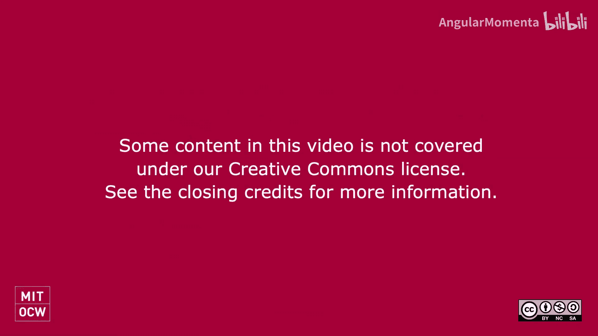
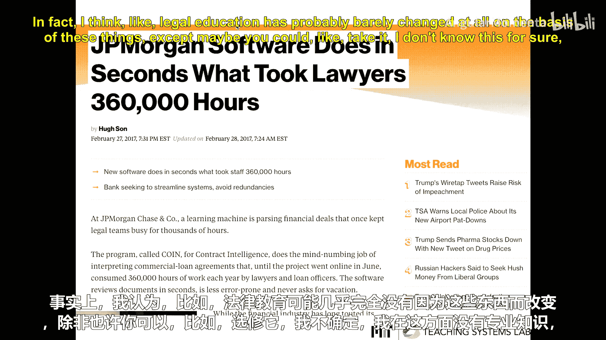
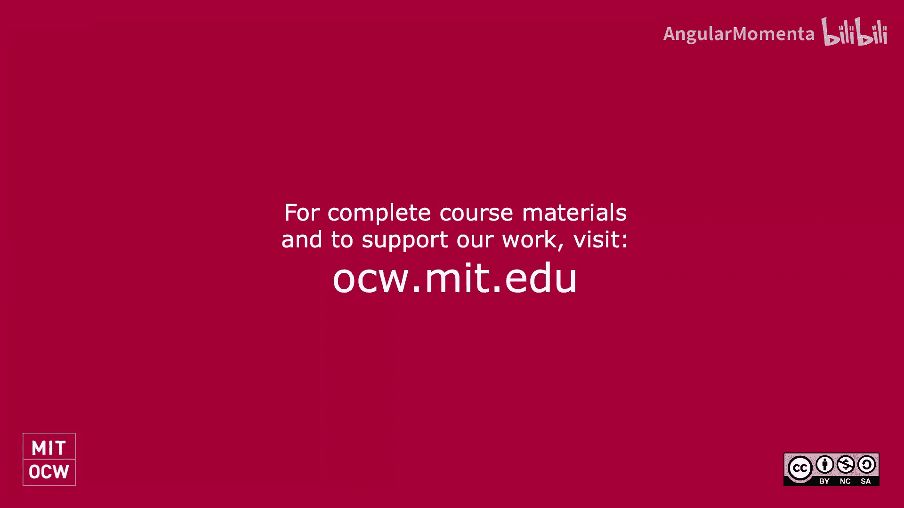

# 【麻省理工】学习、媒介与技术 ｜ MIT CMS.595 Learning, Media, and Technology, Spring 2024 p09 18. 常规评估的陷阱 -BV1DKUSBGEvu_p9-

We are trying to make our way through these four as yet intractable dilemmas the last time we met we talked about the curse of the familiar。

 the  Ed techch math effect， today we're going to be looking at the trap of routine assessment anybody want to try to articulate the sort of the core puzzle that's at the heart of the trap of routine assessment。

我 you got点呢？K of on the lines of。You know， teachers are teaching students a subject and the schools have like such an emphasis on。

Like final exams and what they're preparing for these standardized tests。

 but we're also fighting with the idea of like what a computer can grade so if you're trying to standardize some sort of way of grading something you can only really focus on teaching students things that computers can do but if a computer can already do it then why is that the emphasis of what we're teaching students so it's kind of the idea that like if you look at the Venn diagram is like other。

but the subject that ultimately we probably should be focusing on。

 but we are really only talking about that overlapping aspect of what students were saying should learn because we can assess it。

Good， that the technologies we have for assessment sort of constrain what it is that we can assess at any kind of scale。

 anybody want to add what else seems important to Dana's initial offering there？

I think something you brought up in the reading as well is that there's like connection to the labor markets right。

 so schools are supposed to help us prepare for the labor market。

 but we're learning these routine things that are being taken over by automation。

 how is that actually doing what the school is supposed to function for okay good so so schools operate in between a couple of different things one is like like what do we need kids to do changes over time as we develop new technologies there's like like none of you should teach your I mean you shouldn't teach your students to operate a loom on the basis that will be a source of gainful employment for them although there probably are a small number of people who are like very profitable small business loom operators and particular kind of thing but like generally speaking like not a good bet and so make sense that as technologies come along。

 we change the kinds of things that we teach to young people and and computers over various ways once a decade over the last 10 years like cause new kinds of problems for us as computers capacity。

ities expand what we think about teaching people changes at the same time as computers technologies expand。

 there's maybe newer different kinds of ways that we can use them for assessment。

 and so those two things are kind of interplaying with each other all the time。

We got some seats up here， there's plenty and plenty of room could do， it's nice to see you。

Other introductory things that seem important， Omar。今まです。Like we're not trying to say don't eat one。

and stuff like that where it's like stuff that's yes， computers can assess that。

 but stuff that students need fundamentally to build on。That they will learn them more。Good。

 that makes this even the whole conversation even more complicated because there's stuff that we need people to be able to do in their lives。

 There also might be a class of things that's called like stuff that you need to learn in order to be able to do those complex things。

 like even though computers can do those simpler things。

 so there's there's there's some class of things that computers can do that we just don't need humans to ever do anymore。

 I think I joked with you all that one of the first times I talked with my students at Mit about large language models。

 somebody said， I'm using large language models to do the latex formatting of of my papers。

 it's like great， never think about that again。 Like if no student ever thinks about that again。

 lowest of their lives werere probably fine as a civilization。

 But like single different singleit multiplication is not like that。

 single digit multiplication can be trivially done by computers。

 but it's actually quite important for human beings to learn。

 So there's sort of some complexity in those kinds of things。😊。

Anything else that people want to add to just the initial framing of the trap of routine assessment？

I guess just to add on even more， here is this aspect that our society values these routine assessments so that like even though you're trying to change this and branch out and expand what we teach students。

 they're still always constrained by the market itself and ultimately teachers how to fight against that。

So as much as we think。You knowYou can just do it。Good。

 so so I mean I think you go to almost any educator and say something along the lines of like are standardized tests a good mechanism for capturing all of the important things that students should know and the answer is like clearly not there's almost no educator in the world who believes that to be the case there's more debate over the question of do standardized tests capture some of the important things that we want students to know and then a sort of follow on problem that there's then this class of stuff which is like pretty important for students to know but we're not very good at assessing and it's hard to prioritize those things in education systems because it's hard to reward students and reward educators for teaching things that we don't know how to measure or don't know how to measure in some kind of systemic way we don't know how to measure with the kind of fairness that we would want to use for highs stakes assessments for things like graduation exams or college entrances exams or other kinds of things like that。

So all of these are parts of systems that get wrestled with every day by educators at all different kinds of levels in the United States teachers are unusually responsible for wrestling with these issues because we don't have something like a national curriculum。

 we don't even really have something like national in and exams or something like that where you know where like the whole system kind of has to work together to respond to some of these things。

 teachers in the United States have sort of unusual discretion for thinking about these kinds of challenges I thought the place that I would start with you all。

Is a little bit towards what Ti suggested and we're probably going back 20 years to the last to one of the last times computers really got educators and labor economists quite upset So we're in another one of these moments right now with LOMs where people are pretty stressed out like like how is this going to change the labor market。

 How is this going to change what we expect of our students。

 How should this change school systems and things like that And to me。

 it's always helpful to remember like oh， we've done this before。

 know like the introduction of personal computers into most households in the United States。

 That was a big deal， was a big change in the introduction introduction of personal computers into workplaces。

 That was a big deal the introduction of the Internet。

 know broadband Internet connection these space that was a big deal that evoked all of these questions in the past。

 And one of the best summary pieces to read from for probably what was like this sort of like。

2015 summary from this debate is a paper called Dancing with Robs by two economists。

 one who is here Frank Levy and another who is at Harvard who is actually my advisor， Richard Rein。

 this was based on another book they wrote called the New Division of Labor and the original research for the new Division of Labor is like kind of right when personal Comps are really starting to widely spread in Workplaces in People's Home and things like that an early bet that economists made。

 was something like one of the things economists think about all the time is like what do jobs require and education economists then start thinking about like okay what do jobs require and how do you teach people the things that the jobsbs that we actually have require。

you know computers are going to complement high wage workers and they're going to replace low wage workers that was like a pretty early bet that a bunch of economists had had and there was something about that to Frank Levy and Richard Rein that didn't smell right they're like I think it's going to end up being more complicated than that。

So they thought a lot about the specific kinds of things that people did in jobs and how those jobs were changing。

How many of you have ever checked in to get on a flight by talking directly to a human being？Okay。

 so it looks like people how many of you， the majority of times you get on a flight。

 you check in with a machine。Okay， so so look this actually surprising。

 I'm surprised almost everyone in the room who raised their hand said that at least once， you know。

 when I first put together this slide， like 15 years ago， something like that。

 like this was a pretty novel experience。 So when I was in college。

 you would not interact with a machine at all to get onto a flight you would have like called the airline or called travel agent to buy a ticket。

 you would have like a physical ticket， you would take that physical ticket。

 you would show it to a human being now the interesting thing about those conversations with human beings was that they were highly standardized。

 They were highly routine。 So post 911， it would be you know like who are you。

 This is my I like where are you going。 This is my ticket， do you have a ticket， this is my ticket。

 where are you going， This is where I'm going do you have any bags with you， Yes。

 did you pack your bags yourself， have they been in your possession the whole time， Yes。

 and then off you go So like。😊，Over you know the vast majority of times that a person went to a ticketing agent to have a conversation with them like highly structured。

 highly routine。 we know what kinds of questions we're going to get as passengers。

 we know what kind of inputs we need。 We have the conversation successfully。

 we move on And so as computers， as computing technology becomes more sophisticated as user interface becomes more sophisticated sophisticated as all these things can become less expensive。

 Someone's like， hey， we can just program those conversations into a machine。

 And so now overwhelmingly， you have that exact same conversation。

 you just push the buttons to say like yes， I have a ticket， yes， this is me。 Yes。

 my bags have been in my possession the whole time。 however。😊。

There you know for as long as we've had kiosks， there has always been a number of cases in which the kiosks can't respond to the demands of the moment。

 So there's something really weird about your ticket。

 There's some problem that's gone on with your booking that the machine hasn't anticipated or can't understand or you have some kind of communication issue for some reason a human being can't communicate with the kiosk。

 maybe their glasses are broken that day， maybe they are like trying to travel they don't speak the language that the kiosk is in know they're like so angry at the airline for what they've messed up。

 they go banging on the kiosk and then you know so you got to think like there's one person behind this row of kiosks whose job it is to have all the conversations that the kiosk can't have if you're a labor economist like that's a pretty interesting question like what is that human being doing that we couldn't program into all of those machines that was the kind of question that Frank Levy and Richard Mere were kind of asking。

Like in a world where there's lots of kind of work that we can put on computers。

 what is it that humans are still good at in economist term。

 like what is it that humans still have a comparative advantage over computers around？

Here is another funny example of which I think I wrote about in the book about how some of these things change。

 So in something like 1987， my parents bought a cabin in Vermont which had old boiler in it like a hot water heater that was attached to a tank and my mom passed away I inherited the house so sometime around 2007 about 20 years later this boiler dies and I'm responsible for it the original boiler was installed by this guy named Dan Masterson who lived on Masterson Lane in Bethel Vermont and I was like trying to find a plumber to replace this hot water heater and the guy found was Dan Masterson who lived on Masterson Lane in Bethel Vermont。

 So a guy had made a plumber for 20 years and we decided that instead of doing an old school hot water boiler we're going to install one of these ondemand systems So this is like a very beautiful picture to me because there's no hot water tank that can freeze like just like heats up the water exactly when you need it like you can see how nicely all these pipes saw the last building had pipes all all the place。

 things like that。So Dan installs this system， Dan， as you can imagine now。

 is like getting towards the end of his career as a plumber。And I say， great， Dan。

 like show me how to use this system， he's like when you walk in here and you open this little door。

 and when you look at the system， it should say good。all right Dan。

 what do I do if it doesn't say good， you guys can't see this well， He's like。

 see this little button that says R push that。 So that's the reset button。

 I was like all right I can push the reset button。 like what do I do if that doesn't work He's like you see this electrical outlet up here just like unplug it and plug it backing in。

 I was like all right recycled the power in my hot water heater if that doesn't work And I was like okay so it doesn't say good。

 I've hit R I've unpllugged it， it's still not working then what do he says there's one guy in the Upper River Valley of Vermont who has flown to Scandinavia to get the training on how to reprogram these systems And so if those two things don't work。

 go find that guy and I tried to imagine like Dan Masterson probably in like 1970，1975。

 something like that like going through his plumbing apprenticeship training and like he learned how to solder pipes together and how to do some basic electrical stuff and things like that like if he went to the same training now。

😊，Like you have to be an apprentice computer programmer to be a plumber。 and not only that。

 the systems are designed to solve all of the easy problems。 Like if a problem is easy。

 it'll just like solve it itself on reboot， the things that you have to be able to solve as a computer programming plumber are the ill structured problems like when the system can't figure out what's wrong with itself and can't correct itself and those kinds of things。

 so not I mean， the reason I'm trying to bring these two cases to your attention is we could say all right。

 there are some classes of jobs that are going to disappear and be replaced by computers。

 like there used to be I mean， the other thing about these people。

 if you're just thinking about this in a broader social continent there used to be six people behind this desk and they wore uniforms。

 maybe at a college degree， maybe that associate's degree。

 they probably made a middle class living like you could make a decent living as a person who checked people into airlines and most of those jobs are gone。

 and even in places where jobs remained， they're being transformed by what the。

apacities computer offer in these systems。So one of the cool things about the research in the new division of Labor is that they basically go。

 the Department of Labor collects all of these。nameames of jobs and the description of jobs and they do an analysis of those descriptions to see how they're changing over time and what they find is that you can break jobs down into maybe four categories one of those categories would be routine manual jobs so that involves jobs that are like lifting。

 moving things around stuff like that routine cognitive work so that would be things like filing and stuff like that that would be things like having standardized conversations to check people into an airline。

Two others are what they call ill structured problem solving so solving any kind of problem where like you don't know what inputs you need。

 you don't know what the outputs look like。 you don't know what the correct answer with。

 you're sort of solving that as you're figuring out the problem or complex communication tasks that require like figuring out like any kind of solving the problem requires talking to people。

 Some of that could be like marketing and sales kind of thing， figuring out what people want。

 but other that could be like a home health aid does a ton of complex communication and and their basic thesis was that things that are routine are disappearing from the American labor market。

 This is a huge problem if you want to have a stable society like in the 20th century there were many。

 many people who performed routine labor for a reasonable middle class wage and like had a perfectly suitable life doing it some of the kinds of jobs that are growing are like service jobs that don't really require。

Like they're a little bit of routine manual work， a little bit of routine cognitive work and they pay like the absolute minimum wage possible that's a little bit less concerning today where you can get jobs doing doing service work that paid you could work at someplace in McDonald's to make 15 an hour 17 an hour things like that but when there was a surplus in the labor market 10 years ago。

 12 years ago like all those people would have been paid 725 or whatever the federal minimum wage was at the time but the two kinds of jobs that were growing were things that required non-routine analytical skills and social skills some of this was updated by this guy David Otor who's an economist who's here now as well。

So if you're an educator， the thing you've got to be thinking is like， man。

We have we have a different job in front of us like it's not sufficient to prepare people to do jobs that require routine cognitive work or routine manual work because those jobs are disappearing as a part of the labor market。

 and even when the same job title exists， even when like there's still plumbers。

 but plumbers are increasingly called upon to do ill structured problem solving and to do complex communication。

This was an update of this， I guess from 2012 is's just another like you know here's a two by two where jobs that require social skills are here。

 jobs that require math skills are here， these are the the jobs that are in green are the ones that are growing。

 the jobs that are in red are the ones that are disappearing and you can see that they're sort of clustered in the things that require social skills are growing and the things that require fewer social skills are disappearing truck drivers is one that people are often particularly the time people were pretty this was like 2015。

 2017 you know 3。5 million truck drivers in the United States that's about one in every hundred0 Americans is a truck driver and。

Pro probablyably 10 years ago was， was some of like the headest time where computer scientists believe that like it was reasonably possible to replace all of those people that you would be able to develop artificially intelligent systems that would be able to drive truck。

 So like Uber went to Carnegie Mellon and bought their whole robotics department They didn't actually pay for the robotics department to just pay each individual faculty member to go leave and join your company。

 And and this didn't， you know， like there's still 3。

7 million truck drivers in the United States or however many there are because this turned out to be a much harder problem than we thought。

But this is the kind of angst that exists in society when these new systems are developed。

 Like what would， you know， what would it be like if you know， there's all like。

 what if every kid in school today who's destined become a truck driver。

 we have to find something else for them to do。 Like。

 that's a pretty challenging thing to think about。This was another 2017 example。 I don't know。

 I was glad to go back and revisit this because， you know。

 there's lots of things that are going on today about like， man。

 LLMs are gonna to like replace all this work that people are doing like。

 but for the last two decades， we've been building software that replaces the work that people is doing like there's all kinds of machine learningbased systems that can do what lawyers do and things like that。

 You don't necessarily need LLMs to do it， although maybe it will sort of accelerate some of these kinds of things。

😊，So when when I was giving this talk to educators seven or eight years ago or something like that。

 this would be the point where I would say like imagine you could go into your school today。

 imagine going to any of the Cambridge Public School， someville public schools。

 whatever is and grab every homework assignment that had been given out that day so go to all the classrooms。

 collect every single assignment that was given out and put them in a big pile and start going through them start classifying those homework assignments like how many of them require some kind of ill- structured problem solving or expert thinking how many of them require some kind of complex communication and how many of those homework assignments ask people to do the kinds of routine work that we no longer need human beings to do and most educators confronted with that question would be like I think we're doing a whole lot of the routine stuff。

And conceivably， those， you know， that's something that we should be revisiting as the world is changing。

 how many of you encountered the idea anywhere in your study of education of 21st century skills。

Is that a thing that people still discuss or Courtney， when you were ever working on products。

 did people talk about 21st century skills in your？No， I was mostly in like ELA in that medicaled。

Yeah， the only man Huson is， where did you encounter in the space in education？Okay。

And for centuries because it was a buzzword， it it a while。Yeah。

 once you're like 25 years into a century， the idea of 21st century skills becomes like it felt more urgent in 2004。

 2005， what are you going to say？Dem in general， I think， came out of that。

Yeah there was sort of this notion that like okay， now that we have computers saturating our workforce。

 there's some new set of skills that we're gonna to have to teach young people how to do and it was kind of interesting because if you like there I't know there were probably like a dozen different organizations that came up with lists of 21st century skills for a while there was this thing called the five Cs like communication。

 collaboration， creativity， critical thinking， there was a fifth one。

 maybe it was the four Cs maybe I know four Cs， five C's。the fours， something like that。

 almost it was interesting because actually if almost all of those lists at some point cite Merin and Levy's work。

 like the only people that did sort of like original empirical analysis where these two economists and then everyone else kind of freestd on top of that。

 But there was， you know I think there was something significant there。

 that you could kind of tell by， I mean， I think the new division of labor is 2005 or something like that。

 But like 20 years ago， you could have a sense that like man。

 we're gonna need know we're gonna need many， many more people with far more cognitive skills than we've ever needed before to fill our labor market。

 like we're just going need more people who can do expert thinking ill structured problem solving。

 complex communication than we've ever needed before in the history of the American education system。

 And that's a sort of stressful thing to contemplate。

 So that's like one set of fundamental ideas like like a way of thinking about what do we want people to know。

A kind of analysis that people will be doing in the labor market， you know education economists。

 labor market economists in the next five years is something like well okay。

 how do LLMs change this equation， How does generative AI change this equation。

 does it simply accelerate trends that have already been existing I there some kind of like new set of answers to these questions。

 know are there like are there further are there different classes of skills this。David Otur。

 who's one of the people I just mentioned just wrote out。I don't know what he I think he wrote。

 I think he wrote a working paper that was then quoted in the New York Times or something like that。

 Hes actually he's been a person who for decades has been saying like， oh。

 computers are like pretty bad for the middle class。 like a figure like this。

This is a bad figure for the middle class。 Like this is where the middle class existed。

 These people are disappearing。 These are like either rich folks getting rich or poor in the service line is poor folks getting poor。

 But he just recently came out with something which is like actually Lms are going be good for the middle class。

 Generative AI is going to be good for the middle class。

 because there's gonna be a whole class of jobs that people can do with AI support that they wouldn't have been able to do without like graduate training or something like that。

 And now they're going to be able to do it with these sort of systems that are helping them。

 and then there's another economist here。 Darrenaglu， who is like， I don't know， David。

 I think in the New York Times article。 He's like， oh， that's pretty optimistic。

 I'm not sure that's going to work out。 But these are the kinds of things that people are wrestling with now。

😊，The heart of the trap of the routine assessment。Is that the kinds of things that computers are good at assessing almost exactly overlap with the kinds of things that computers are good at doing and those are the kinds of things that we don't need people to do anymore。

 the kinds of things that we can build tools that are good at assessing human performance are almost always very closely overlapping with the kinds of things that computers are good at the kinds of things you don't need them to do anymore。

 So here are a couple of examples heres a framework for mathematical modeling。

 So one of the big changes in the Common corere state standards that came about 15 years ago or something like that was that we wanted to teach students not just to do procedural kinds of things in mathematics。

 but to be able to conduct exercise in mathematical modeling and that those exercise of mathematical modeling you can think of having kind of five steps。

 like first you have to find some problem in the world What is an interesting thing to view。

 then you have to set that up as a model know whether that's an  equation。😊。

Or a schematic or a table or whatever it is。 You have to take a problem。

 and they have to frame it in some kind of way。 Then probably once you've developed that model。

 you have to compute some kind of solution inside that model。

 Then you have to sort of explain your solution。In terms of the real world。

 so was it 27 board feet or was it 27 kittens or was it you 27 acres And then you have to be able to sort of explain why your solution makes sense。

 like why did you follow a series of reasonable mathematical steps to come up with that solution of those roughly five steps what do we have technologies to evaluate。

Of those five things， what have you ever been tested on？IYeah， computing the solution。

 the only thing， the only thing of those five steps that we can like reliably get computers to do is evaluate whether or not you can compute a solution if you use mathematics in your profession。

 which of those five steps will you almost never actually do？😊。

Computing the solution like a computer can't tell you which problems are interesting。

 A computer can't tell you like， oh， this would be a good problem to think about through this kind of equation or through this kind of formula or through this kind of framing A computer like is not that good at taking the outputs and being like。

 okay， this is what it means for the real world。 And computers are really not particularly good at explaining to you why what just happened mathematically make sense。

 But the one thing that you will assuredly do if you're a professional mathematician is have the computer do the math。

 The computers are like significantly more reliable than you are at those kinds of steps。😊。

So if you go and sit down for any mathematics exam that's given a standardized way at any level。

 you will spend the vast majority of your time computing if you're a mathematician。

 youll spend almost not really a mathematician， but if you're a person who uses mathematics in their work you will spend almost none of your time computing youll spend almost all of your time doing those other kinds of things that's a real problem that's a real problem a useful concept to that people who study psychometricians。

 people who study testing they have a term for how we misunderstand math tests and it's called or it tests in general。

 it's called the reification fallacy reification means sort of the naming of something if you call something a math test。

 people will think it's a math test， but calling something a math test doesn't make it a math test So for instance。

 every time you take a math test， you need to know something about language。

 you probably need to know something about testta strategiess probably。

whole bunch of other like cultural things that you need to know to function at a test and the test is effectively evaluating all those things。

 The other thing is a test can like there's no test that can say that。

 you know all of8th grade algebra。 the way that would take you forever instead what we do is we sample out of a domain。

 We say here's all the stuff that might fit in eighth grade algebra and like we're gonna to pick some of this stuff and some of this stuff and some of this stuff a way you could think about this problem is that we over sampleample computing and we under samplele all of these other kinds of things。

😊，Now， what， well， maybe let's do， let's do one more that's like this。 Here's。

 here's one of my very favorite paragraphs that's ever been written about computer programming by Hal Abelson。

 who's here and some of his colleagues。 This is from a。😊，Computer science textbook first。

 we want to establish the idea that computer language is not just a way of getting computer to perform operations。

 but rather that it is a novel， formal medium for expressing ideas about methodology。

 this is probably the key sentence Thus programs must be written for people to read and only incidentally for machines to execute。

 Second， we believe that the essential material to be addressed by a subject of this level is not the syntax of particular programming language constructs or clever algorithms for computing particular functions。

 nor even the mathematical analysis of algorithms and foundations of computing。

 but rather the techniques used to control the intellectual complexity of large software systems。

 Why would it be important for programs to be written for people to read and only incidentally for machines to run。

😊，People are the ones who are maintaining they people can't understand it and how are they going to maintain it People have to be able to maintain it else what might folks say。

Yeah， the way you add new features， the way you collaborate。

 the way you build large complex systems is you build a system that people can read and understand what it's doing when you can't read and can't understand what it's doing now when you all take introductory computing classes and you submit your homework assignments and they're automatically graded。

 what are the kind of characteristics of your programming that those systems are good at grading？

Through of the apple。Okay， so the， the assignment presupposes some kind of engineering test and figures out whether or not you pass that test like。

 but did your spell dictionary detect the misspelled words or not。

It fit past a series of randomized test cases from input output Okay good so similar kind of thing like we throw a bunch of possible inputs in this system。

 does it all come up with the outputs that it's supposed to come up with other kinds of engineering tests。

 Dana。Just going say right。Times left。A time like it does your code。Does your code run fast？Good。

 so there could be a， you know， that's one kind of efficiency metric。

 I think there are other kind of efficiency metrics that maybe have you ever done things where you like you only have a certain number of lines or a certain number of characters or something like that to try to。

generateerate some parsimony or something like that some classes here do have like these lifestyle style checkers I'm not too sure what they check。

They take for certain like stylistic choices you made in your coding。

 but a lot of them also depend on you to have like to have like correct computational code to then give the Yeah good you know and I think the style starts getting at the sort of programs must be written for people to read now they probably don't check things like did you name your variables and your function。

 something sensible that somebody else would be able to to understand later on or other kinds of things like that。

 but you could think of those style guides as like like initial you know like we have pretty good tests for the kind of incidentally for machines to execute。

 that's kind of our like our efficacy or efficiency evaluations。

 you know in some in some ways like the style checkers you're describing also they might be kind of silly。

 but like another way to think of them is as a reasonable first step towards these kinds of things like what are all the machine readable parts of style that we can get a computer to evaluate。

And how over time would we build increasingly sophisticated style checkers。

 computer assessors that would just do a better and better job year after year of evaluating more and more features of code that have to do with humans understanding and communicating with each other rather than just machines they designs？

So they're checking like are you writing good efficient loops are you writing the code。

 but even so I really feel that within this introductory programming space。

 they're mostly checking for how well the students are overfitting to be given problem space already like what they want to test for is problem solving but that's just really hard to do it。

Good， so that it's very difficult so a in the solution of any given problem。

 it's very difficult to detect for something that would be sort of like generalizable problem solving skills and even worse it's essentially like so far it's proven more or less impossible to design assessment machines that can detect something like generalized problem solving skills like to some extent like anytime we build these things our most sophisticated assessment tools sort of like work best on particular problems that you like fit them to work on and other kinds of things like that and they work less well on more generalizable kinds of things what are some other domains that we could think of that are sort of maybe I'll have you chat with each other for a minute talk about two things what are just other domains that you can think of that are like this where computers can sort of test something in the domain but they may not be able to capture like the most important。

like big important classes of things in that domain think about that for a few minutes that might be like sort of putting a pessimist hat on to think about that and then put on your optimist hat for a minute or two and say like in the next five years where do you think we're most likely to see the most progress in sort of thwarting the trap of routine assessment like where are we most likely to develop assessment tools that actually evaluate people on things that we really care about and want human beings to be able to do turn to the person next to you a couple people and talk about those two things for three or four minutes ready you go？

Let's do the first one first， what are some domains that you could think of where it seemed like。

 ah we really are having a hard time using computers to get at the important stuff here。

Like essay writing or short stories or anything to do with like writing literature。Great。

 and that's like that's probably one of the most studied most examined domains and again it's a place where like we have a like at least the baseline in that field is pretty well understood so some of the very worst assessment like it's like the most。

Disappointing kind of assessments we do is people's long form essay writing on standardized tests theres a guy here named Les Pearlman who used to joke about the quality of standardized writing assessment by noting that he could pretty reliably score essays from across the room because he just hold them up and see how long they are and just by glancing them he could be like oh that's two that's a three that's a five he also wrote pretty early on a pretty fun piece of software there are all these companies that were creating automated essay graders and so he got a group of MIT students to make software that generated nonsense text that did really well on these automated essay scorers which was it was pretty fun to read these things which just were like complete hallucinations of madness and then you know some system would be like five but。

We， we actually have developed software tools。 So you know。

 when like the GreE essays are scored or things like that。 So humans go and score them。

 it's incredibly disappointing how they do that。 they read them all very quickly。

 They score them holistically， the people who do the scoring are like not particularly well paid。

 not particularly well traineded， as you might imagine。

 like it's enormously boring to read essays over and over again about like you know。

 who is the person in your life that inspired you the most or， you know。

 whatever other ridiculous questions they ask。 but anyway。

 you can train those people to be reasonably similar and they're scoring to one another。

 And not only that， but for a given question。 Like if we ask people over and over again。

 who is the you know， person that inspired you the most， you have a bunch of humans evaluate it。

 you feed all of those essays into some kind of machine learning algorithm， we can build。

Machines that are roughly as reliable as those humans so we can create automated essay scoring tools that do a reasonably good job that predict what a human would score an essay about as reliably as two humans would predict what the other person would score the essay like about as reliable as two people are it doesn't those systems don't work for shorter answer things so you have to be in the realm of a few hundred words before these systems become reliable。

 they're also not very useful for novel questions if you invent a new essay question you want to give someone。

 you can't take one of these algorithms off the shelf and run it against the system and how it works。

 you have to which is why like I don't know， I don't know how to do it exactly with essays。

 but these standardized test companies like you some fraction of the test that you take every time you take it is not scored and it's just used for development for these kinds of things like that know so you're somehow like we've convinced you to pay $75 to do voluntary work for。

Giant test making companies and things like that。But yeah。

 that' that's you know that is a domain in which people will also disagree。 Some people will be like。

 man， it's great that we have these systems because if you have tools that can automatically score essays。

 then you can encourage people to write more essays like if we didn't have these machines that could score essays like we they wouldn't be on standardized tests and if they wouldn't be on standardized tests then teachers wouldn't assign them and then we would teach less writing And so like even as crappy as you know maybe there are some critiques about their concern there are some concerns about their quality。

 but they're still good for the system， but。😊，But yeah。

 clearly not everything that is important about writing is captured in those things feel like sort of closely related is like language learning you can very easily assess whether someone knows a lot of Oab or word conjugations or grammar or whatever via a computer。

 but like that's not really the point of language learning like language learning is a lot of it's about like speaking and listening。

And writing and stuff。And especially like the speaking and listening part。

 like you probably is probably going to take a long time for compete。Do that well。

 especially like when you have variability due to like accents and regional stuff。

It would be hard to assess whether or not someone really is flu in a language by simply interacting。

Good， and you know language learning is such an interesting subject in general because it shifts so much in the middle of it there aren't that many things that like like you know the kinds of things you do when you teach social studies to third graders is not that different from the kinds of things you do when you teach social studies the 12th graders it's more complicated but it's along the same lines but the initial learning of a language sort of more like a math or science and then the later parts of a language is more like a humanities or social science or something like that which is cool in the book I write a bunch about automated pronunciation detectors which to me I think are a great example of advances in language learning。

 especially when you think about the classroom context in which people learn to pronounce things。

 so like take yourself back to your middle school Spanish class or whatever and there's 26 kids in the room and there's one teacher and the teacher walks up to you and goes ohla Comosas and then you respond and maybe the teacher。

Give you some feedback about the pronunciation。 Maybe they're just whipping around the room。

 but you're getting it best like126th of that teacher's attention for that pronunciation evaluation exercise。

 It's extraordinarily inefficient I remember this a lot because both bad at language learning and bad at pronouncing things so teachers like I would say stuff the teacher would just like not at me like okay go on to the expert like clearly I'm not learning this but like you know I can open up a computer that has an automated pronunciation detection and I can just mispronounce poorvo over and over and over and over again。

 and this thing doesn't care。 it'll listen to me say it as many times as one they get better they might be able to they can at least give me examples of pronunciation they might be able to fine tune my pronunciation that seems like a place where computational assessment might really be a whole lot better than human assessment like in a domain that's pretty important。

 What was your example， Sabrina I was gonna say using computers to analyze art。😊。

Like it can tell you about the color compositions， time period that it's from what makes it objectively appealing to look at。

 but it doesn't necessarily go into the artist's background or like the emotional。

Message behind it or why it was created。In the way that it was， I think with art。

 there's like it's usually not like the surface level which I think that the computer is like really good at hitting。

 but maybe the overall meaning message is missed entirely Yeah it's it you know I mean there are AP studio art classes and things like that where you can submit a portfolio and I've never I've never thought about it before you brought it up but to my knowledge there's no application of software and evaluating a student's art portfolio but it's a kind of fun exercise start thinking about like what could you assign an AP studio art student that could be graded by a computer that people would generally think is fair now clearly like abstract painting or something like that like probably no one will think that's fair certain kinds of still life like where where the task is like like reproduce this bowl of fruit as closely as possible to what the bowl of fruit actually。

I would imagine I would trust a computer to do that as well or better than a human would but I'm not an artist。

 maybe there's something about still lives I don't understand。

 but the only application I can think of and I am very biased because I do a lot of photography is and even then it's difficult if something's been altered。

like Photoshop and I know Adobe's working on like their own。

What would be a thing that you would want a novice photographer to be able to do pretty well that a computer could tell whether or not they could do it well？

Whether or not a photo。I think the most fun not thing is like whether or not of photos。

Exposed properly without coming to do any digital alterations。 Yeah， yeah， no and again， you know。

 if you can get a computer that can do that evaluation。

 then you can then you can have all of the photography students get more formative feedback。

 Maybe you can get them to have more high stakes feedback。 Maybe you know。

 we could admit students into arts colleges based on their photography portfolio or we can just ask them more questions in their portfolio we to be like humans go see like whether their intimate portraits like evoke the character of the person and don't waste your time figuring out whether or not they can expose photos correctly because like we got machines that can do that。

 Yeah that's a neat example。😊，So where were you most optimistic。

 where do you feel like there's going to be the most improvement in the next five years and where are those improvements going to come from？

No。I thought of how。Oh sure， yeah yeah。I is thinking that if the photo's exposure level is detectable by a computer and then so you begin to。

Not have humans evaluate that on admission test anymore then soon you would have to drop that like that portion of values because students would then have access to these kinds of softwares as well。

 which means they would never submit a photo that was not that is a great description of the trap of routine assessment that if computers can detect performance。

 then computers can probably do that performance if we can build a machine which tells whether or not a photograph was taken with the correct exposure。

 then we can just build cameras that will only take photographs with the correct exposure and then we don't need to teach humans how to do correct exposures anymore。

 and so that is like part of this loop that educators are sort of constantly wrestling with constantly thinking about。

😊，And a thing that makes this so hard for educators is it's really hard to predict。

When your old high school friends are going to call you。It's really hard。I I won't say one。

It's really hard to predict。Like。In what ways these kinds of disciplines will change like how will photography change over the next five years is a really hard thing for photography educators to guess right now so was I've been thinking about this a lot because I shared this paper that we published with you that that was generative AI and K12 and MIT perspective I didn't share with you Ill shared it with my students and one of the claims that we making there is like we can be pretty sure that computer programming is going to change and that co-pilots are going to be a really sort of central part of computer programming and so computer science teachers should probably start thinking about how they're going to change their instruction but I was just that conference the other day or someone from Cornell text stood up and and the whole premise of the conference was what guidance we give to computer science teachers to change our instruction and this woman stood up and was like do not do that you have no idea how computer science how computer programminging and were going change there's no reason to give any new advice to teachers right now because we have no idea what that would be and I started thinking more and more。

Like well yet like in part because I've been hearing from people who teach introduction to computer programming that their early efforts to incorporate copilos in instruction were going pretty poorly that basically like like students were using them and then like week four week five would roll around and they're like these students are totally confused like they haven't learned fundamental things they need to learn and then I talk to other software engineers who are saying things like every hour you save programming with a copit will cost you an hour in quality assurance later that the things like you solve little problems but you end up creating bigger runs for some of the reasons that H hass on this screen right here and so then you start saying like man maybe we don't know it's pretty hard to think about how you should change you know like some people might say like why are we assessing computer programming at all anymore like the bots are just going to do it for us and then other people are like yeah I'm not so sure about that like we might actually need people doing this or doing parts of this you know。

The other thing I think about a lot is that historically educators are not very good at this。

 So if you read like in the 19th century， the 20th century like in the 19th century there are a whole bunch of people who are like fervent believers in diagraming sentences they anybody have to diagram sentences when youre in elementary school subject predicate all these I mean there are people who went to their graves believing that like if we didn't teach young people what the P perfect was like society was going to collapse and they were totally wrong and we laugh at them today but there's all kinds of stuff that you and I would sit down with a bunch of curriculum developers and be like man it's incredibly important that kids in 2024 learn X and some fraction of those things are absolutely going to be vital in2075 and some of those things that we would like passionately defend right now people in 275 would be like can you believe those folks 50 years ago thought that people needed to learn X like what kind of more those the knuckleheads who believed in the P perfect in the 19th century or something like that。

They're very difficult things to predict。All right， let's talk about more optimistic things。

 what are other things， Danna that？We had a really interesting conversation where we were saying if you go back to what you were talking about earlier in how AI can help teachers inspire or I get。

 AI can inspire teachers with new homework assignments。

 but then we brought up this weird like Edtech Matthew effect where AI only。

Plls like specifically like say ChaGBT is only pulling from existing literature on the subject other than the initial time that it like maybe accidentally puts in a random word and starts going off the walls and make something crazy it's really only pulling from what is already out there So in the idea of bringing up the middle class and the teachers with new inspiration。

 you almost have to pull ahead the elites to then produce the literature that is necessary to then inspire AI with new things that will then trigger trickle down to the middle class for them to use So it was almost like this interesting idea that AI can be useful but it needs to have the right。

like literature to back it up and there's like that interesting dilemma of like who is going to create that and how do you inspire people to push them ahead。

Yeah what kind of training data gets used is enormously important when we were talking about this with one of our guests from WPI who was saying that maybe whoever was doing that presentation can explain it better than I can but that as LLMs generate more code and that code has problems with it then future LLMs will pull in all that buggy code and suggest more bad code like do you want to say more about what the problem is there？

I use it。Anyway， so it was。That elements are trained on coppi on Github code。

 so they essentially get all of the badly written code that coppit generate so when students are generating that code they are essentially going to generate the same badd code and theyre not。

Going to fulfill the needs of what is required from the question， as in when you。

Give someone insight。The ways to test it is to give them some test cases。

 but those test cases essentially do not solve the entire problem。So teaching students。

How to build those test cases that covers the entire input space is more important than for them to be able to write code。

Good， yeah， and so that was I mean who knows if what should just said is's true。

 but that's a great kind of claim about the future。

 you know building certain kind of test cases is going to be more important to the future of computer science than you know being able to write certain lines of codes or knowing other programming principles or things like that like this is exactly what educators are wrestling with every time there's some new technological change you know do we still teach kids spelling in an age when we have spell check。

 do we still teach kids computation in age with their computers these kinds of things come up over and over again。

Or you say A something that maybe could be an optimistic outcome is that like software is a language oriented。

I mean discipline and that's kind of why like top TT language models are good at doing it。

 but there are things that aren't like analoger design is very visual and right now signal processing like training machine models with like images and things is a lot more difficult so for at least a few decades hopefully analoger design and other things that are related to hardware will be。

Good skills probably to teach kids and to build life。Decent fields to work in。

 also even though there are copi things for things like cadence like them。

Layout for like semiconductor tips or whatever I don't think they're period I also don't know how they work so。

A more strong emphasis on teaching kids kind of like the basics of how the things that they are。

 I guess。Caing to with E work， what I'm trying to say is that I hope that people like have this shift towards understanding how things work from the bottom instead of the top。

 which is good because then you can build things from groundup。Wow， great。 Yeah， I like that。

Where are you going say Eric I'm just I have a I have a disagreement with the animal on circuit design。

 but that's just purely because anything because it's still a visual software that's doing it。

 So there is some translation in fact could be consider it it's like。

Pro you know a couple of analog circuit design software that just translate down to XML and you can just stick that XML。

 which is a structured object oriented language in Sc EP， get new XML that validate that correct？

See it and itll probably produce。I serve it in some capacity。But you knew like， I mean。

 where are you starting， when you think about like designing the am or something？

it's starting from you have， well， the same thing when you started now。

 not nobody had COVID it first started， you would have whatever data set of people has all their amlfire filess that are all lined up。

 whatever it is。Then you would decide， okay， let's get the textual representation of this in some synatical language。

 which X andL is just on the hand in my head there it' would be anything that that can represent the image text form since that's all the software is doing since it's just sort of the inputs output that's where you can from R to RRD。

Wherever it is and that can usually be limited and then you take that tax， train theLLM on it。

 you run it through it， you get some out， you then say okay。

 generate me an amplifier and it will generate you an amplifier with that XML。

 you put it back into the visual software now look you now have an amplifier Okay my new hope is that all of this becomes proprietary and they don't。

はは。You and I think to me from an educator's point of view。

 what's so sort of challenging about these kinds of questions is like I know nothing about your domain and so both of the cases that you just made seem totally plausible to me and that it's really hard people seem to be really bad at predicting the kinds of things that AI are going to be useful for in the future like which of these problems are solvable and which are they not you can imagine somewhere out there there are people who like run the Abet engineering curriculum certification kinds of things or people who are department heads or people who are rank textbooks or things like that which of this stuff do we want to keep because human beings will still need human beings to from the three categories which of the stuff is like like in the future just AI will build'll just you'll tell some machine learning system AI system the kind of circuit that you want and it'll print it out and so you don't really know that you need know that much about it B yeah and AI will probably print out most of these things but it's still useful for humans to be able to。

Understand this thing because that gives you some kind of insight about how you would build other technology or things like that or no there's no way computers are going be good at this stuff。

 we still need human beings kind of primarily to do it like those are at least three categories of things and it's really hard to predict sort of which things move into which categories and it's very difficult to get education systems to be good at doing new kinds of things。

 which is why like most of the schools that you went to you know had very little computer science education and stuff like that you know because in the 19th century when we decide high schools there wasn't computer science and so we didn't put in the curriculum and we're a lot better at doing the kinds of things we've done before than doing new kinds of things。

All good。 We there other observations or thoughts about that。

 I think it can technology can bring about in the legal system。 So a lot of people。

Lawyers spend a lot of time reading stuff and building upon that for a specific case。

And that's what determines their career， how big you get and it depends on how much you've read。

 how much you've experienced， so if all this knowledge is really available to them for a specific test case。

 then probably it's going to make their lives much more。Yeah。

 you know I think some of the sort of framework that Levy and Merin offer also help us think about like what kinds of things will lawyers need to be good at in the future like to me it strikes me as very unlikely that computers will have much impact on the part of trial lawyer work which is convincing juries of things like like the people who actually like get in front of juries and try cases and things like that like it's very unlikely that will have you know AI machines that generate scripts for them or things like that because that kind of persuasive complex communication seems to be the domain in which human beings are most specializedize that we probably like you know expert thinking seems to be the domain in which。

You know I'm sure you know are people going to write AI software that detects tax loopholes absolutely like somebody is going to you know come up with all kinds of new ways that you they're much faster at humans at finding ways to defeat the tax code but there probably still be human beings who for instance recognize who are much better at machines at recognizing like oh well like this part might be like slightly strictly illegal but because of the way or its legality is not tested but I happen to know because of everything that I know about like the functioning of society that this is a particularly weak point in the tax code and we'd be a good place to you know shelter profits and those kinds of things and then there does seem to be some kind like the more a task veers into the routine category it's hey。

 we just need to you know know how many times。And these documents that these things are said or something like that。

 but it is I mean to me it's useful to recognize that I mean people were stressed about that in 2017 with the machine learning technology so there' are still lawyers in the United States。

 there' are still law schools like our legal system has not profoundly changed from what machine learning offered in fact I think like legal education is probably barely changed at all on the basis of these except maybe you could take it I don't know this for sure。

 I have no expertise in this but I assume you could like take an elective in computers in the law or something like that or machine learning in the law now that you wouldn't be able to do before。

Do you guess some of that？Yeah， in terms of the first。

 and terms of when you initially say back by lawyers and and not being a generate script， yeah。

 I would very much agree there was actually there was actually a case where I think two lawyers got heavily sanctioned but I think it was with the airport where they pretty much just tried to generate an entire script to purely。

I think it was a filing and I think the filing included like fake citations and stuff like that。

 which is really not the best Yeah and you could definitely see it where basically if you get it。

 you could basically make a much better search database using。

If you happen a mistake stick in all these thousands of cases where all the lawyers are where all these lawyers are pretty much having decisions that change and ones and maybe one that benefits your benefits your stance could have been ruled on on earlier on in that year。

 maybe it's for the specific county there's something different you can definitely I definitely see that in the future。

Even its within thatYeah being able to like being able to do scans of precedence for a case or something like that。

 maybe one other domain we should talk about before we head out is just you know one of the biggest places in which we will see pushes in the K12 education system with new tools will be in formative feedback for writing they're going be there are many。

 many people right now who are building systems so that like you assign students to write an essay。

 they turn in the essay to you or before they turn in the essay to you you offer a bunch of formative feedback and I'm very interested in the development of these systems I was talking with。

Someone who's building one at UC Irvine。 and I guess I was reading about some others too。

 It struck me that one of the things that these systems have the capacity of doing is saying something like here are 10 or 15 or 100 things that I want you to check for every essay does it you know。

 does does the paragraph start with topic sentence I there a transition sentence between does the paragraph seem like it as evidence。

 Does the introduction appear to have a thesis Does the conclusion you know。

 you can think about all the things that you've been ever been taught to write。

 thing that I'm really interested in。Is that my hunchches， I mean。

 I thought about these lot because a lot of what I do is grade writing give feedback on writing is that like some of this sort of seems intuitively helpful to me like oh it would be great if I could just tell students like。

 hey before you turn in your your assignment， like go run it through this thing and make sure that the beginning of every paragraph has a topic sentence。

 even better than a topic sentence， some kind of mini thesis。

 I mean that presents the argument of the paragraph。 But I was thinking too。

 like probably the most important thing that I do when I give feedback to someone is figure out of the dozens of things I could comment on which one I will choose to comment on like one of the things I've learned about as a writing teacher over the years is like。

 it is really not helpful to tell someone everything they've gotten they can prove their essay because that's just too much stuff to work on。

 I mean， you guys note that like I don I mean， I used to have people turn in printed essays。

 And I used to like make marks on them and things like that。

 But I found over the years like really what I want to do is be like。😊。

These are the two things that you want to work on and how do I decide what those two things are Like I sort of have in my head a model of people's developmental trajectory and some of that model is based on like all MIT students ever Like know when I see an essay that looks like this。

 I'm pretty sure the next thing they should work on is blank And then as soon as I've gotten like two pieces of writing from someone Then I can be like。

 well， the thing you were working on last time was this。

 Why don't you work on it more here's like the next thing after that to work on or something like that。

 that seems like the kind of discernment It seems way。

 way easier to me to program a machine that can like find every kind of problem than it is to program a machine that can figure out like what are the next two problems you should be working out as a learner based on know who you are or where I think you're heading or what's important from my class or other things like that。

 feel like that opens up the idea of breaking out of the Tri routine assessment。

Can do those type of things then maybe teachers can now focus more on what does revision look like so like a student you know goes through an essay or writes an essay and then puts it through this machine and the machine tells you like。

 oh and these introduction sentences like they could be stronger in X Y and Z ways and how do you develop those critical thinking skills to take something and feedback and。

Performment or like change it in some way。 like you' were always saying like anything that you published was never your first draft。

 or you said like on day one， one of your good skills was being able to just like get down a first draft。

 right， Cha Bt can do the same for you。 But how do we teach people in a world where AI can give you that baseline。

 How do we elevate it to a status that like is。Like。accceptable for like a human。

 like I feel like there's like AI I can give us a baseline。

 but humans take that imagination and creativity to that next step so you can kind of take the idea of like here's an essay。

 how would you change it to make it？Yeah， for these writing software developers， I mean a big。

 well when I talk to them， I think about like what is the whole system that you're constructing。

 like not every capacity that you build will end up being useful。

 not just because it doesn't work but because using it is not that helpful you start thinking things like all right。

 what if there are these sort of formative feedback systems or I as an the instructor can say like okay。

 you know start this package of machines or something like that or。

I select in advance that I want the machine to give to automatically give you formative feedback on these things and then on this other class of things I want you to show me the feedback that you would give to a student。

 but I will pick from those things and then there'll be some way for me to sort of add to it like some of those sort of human machine combinations seem pretty exciting to me。

Good， well， why don't we wrap there for the day？

