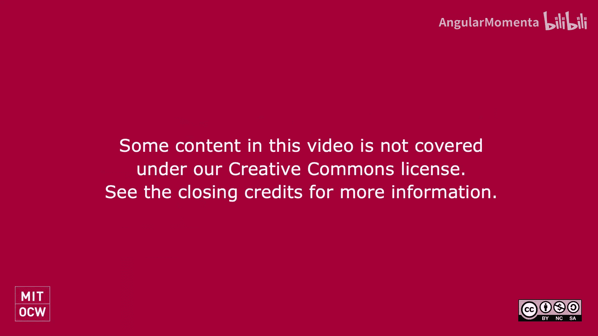
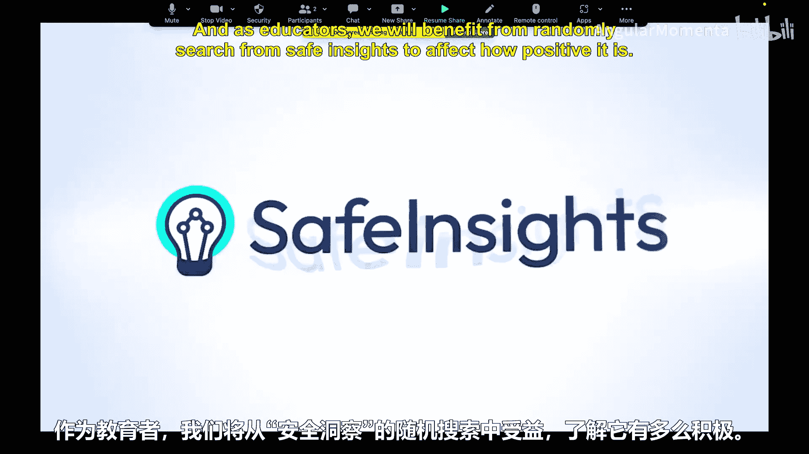
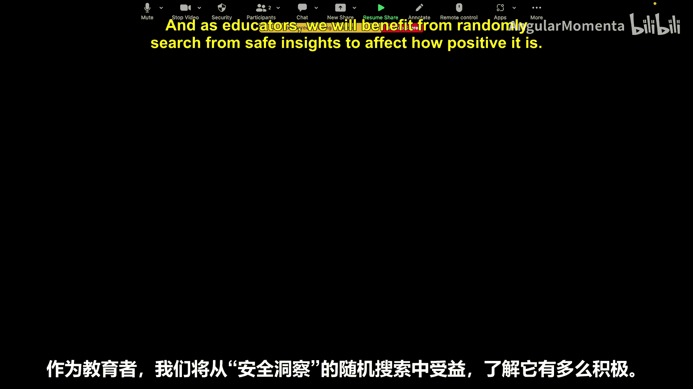
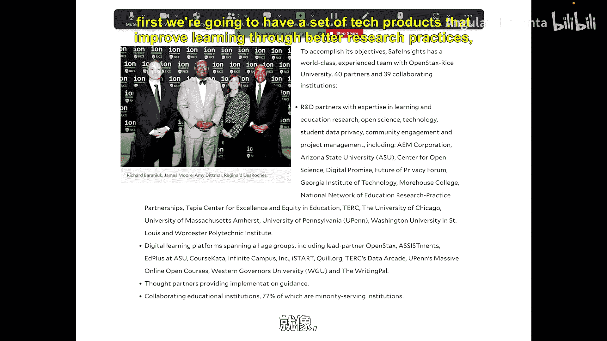
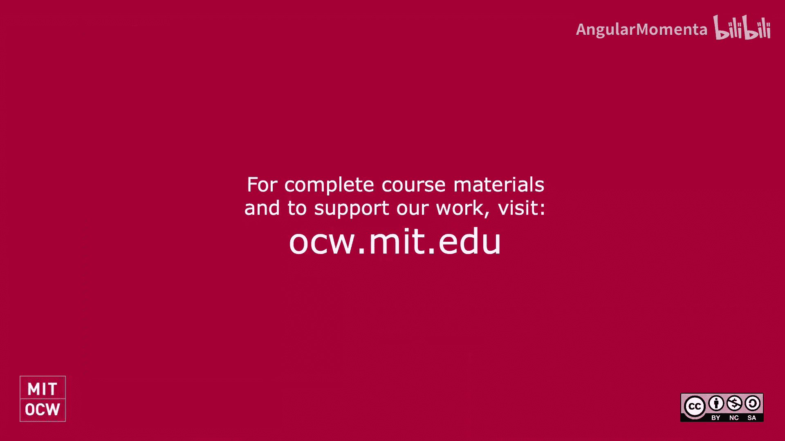

# 【麻省理工】学习、媒介与技术 ｜ MIT CMS.595 Learning, Media, and Technology, Spring 2024 p10 20. 数据与实验的毒性力量 -BV1DKUSBGEvu_p10-

Good。All right。So we're heading in to our。Our last。Of the。As yet intractable dilemmas。

 we talked about the curse familiar tech Ma effect， the Tra of routine assessment。

 and today the toxic power of data and experiment Let's do this as an exercise。

 grab one other person Your goal is to make a list as long as possible。嗯。

What is all the data that MI I T has about you。If you could go through every server。

That is somehow even tangentially under the control of MI I T。

What are all the different types and sources and nature and example of data that MIT has about you。

 Does that make sense？Make the list as long as you can， as fast as you can， ready go。All right。

 let's start aggregating some big categories of things。Financial information okay。

 so they have a lot of financial information， maybe just like what are a few examples of some of the most maybe sensitive or personal parts of that？

I know your parents' income， your income。啊？Bank account。

 they know your bank account number or like you give them literally。

 but they don't like have a screenshot if you're like， for example。

 right so they know a lot of financial things about you。What are some other categories？

What are some sensitive things in there？History。History。Vaccinations， vaccinations， prescriptions。

Allergies， allergies。Lenter health visits， insurance。这是。People are LGBT。A sexual。Orientation。

 activity。Okay， what else you got？Yeah， let's call it registrar information。

Social Security Social Security。哦。对。Oh might have her traveled late？Yeah， if you your travels。

 you have to register。like MIT knows Yeah， especially if you've been international if you。

Or if you're going to like a country that they have a warning score yet。I was there。What else we got。

Good。That's part of the academic records。What would that include these days？They know your grades。

 what else？Registrationations， like what classes are chosen for。

Test scores every click ever in Canada。Attendance。Yeah。

Academic records is a good example of one for which the granularity of data over the last 10 years is。

Transform dramatically like if if we had have this discussion in 1980， they would have been like。

 I guess they know what my grades were and what classes I signed up for。

 but the volume of data about every activity that you've ever taken online in any of your classes is substantially higher than it used to be。

Those records might not be maintained forever， maybe all those sites get deleted every 18 months or so something like that。

 but some of them might be kept for longer for research or other things like that other categories。哦。

😮，Lets let's make it even bigger。 Let's say location。So they know your residents。嗯。Home and campus。

tract your。Devices on Wi Fi。Card， swipes and buildings。We haveSo you know。

 essentially as you move around campus， it somewhere there are databases that record all those activities。

 how long they maintain those materials we don't necessarily know， but I mean。

 I'm sure they tell us what we asked but。What else they got？From that location。

 they can also tell like who you had your outfit。Yeah I just learned about this today what's what's the system of where you add people Okay so I guess if you live in a residence you create a guest list of people that are allowed to visit you like that's like you can just reconstitute the entire social network of MIT from the get list you know。

Yeah， there's all kinds of things you could learn from that。

It's like extracurricular activities so they know what sports teams。ItLike athletic。

Stats on that and then if you signed up for like club。Maybe all those kinds of things。Yeah， your gym。

Gim membership， swipes。Activity。Political affiliations how would they get your political affiliation if you're involved with the recent stuff that's been going on。

Yeah， or you know， and yeah， yeah。 Yeah， good。 So there are presume， you know。

 increasingly presumably lists of people who are affiliated with。Pro Palestinianest and pro， Israeli。

 any of those other kinds of things， but also people would have just been able to tell before if you remember。

 I assume there's a Democrat Republican club at MIT， I would imagine。Yeah。Yeah。

Someone somewhere emails， yes， they have the entirety of your email record even like broader just like online activity because like then you have like emails websites。

 anything you've registered for。😊，Yeah， they also offer like a VPN。So like。

It's secure to our own but。You also have your like， Google drive。If you sign up for the MIC。

对 how long your talking。Yeah， I had a congressional committee that wanted to find out more about my work。

 not necessarily in a generous way this past year and the Office of General Counel did like a whole search throughout my email to find terms that this congressional committee was interested in learning more about and we were going back and forth and I was sort of like you know what do you need for me and they were like。

 well， it's better if you help us with this but。Like either way， we're going to do it。 So yeah。

 you know， all the all the records that you generate。 and that's a good example of how even like。😊。

You knowI'm reasonably confident that in most circumstances。

 like MIT is not going through my email every day and like what's just enough to， you know。

 like they don't care， but simply having those records allows all kinds of things to happen when those records。

诶。Do you guys have automated laundry machines？Washing frequency。

like ans even app it's an app like you pay for your machine and and so I mean that I think also raises some questions of like it's possible actually that MIT doesn't have your laundry data。

 but that MIT just somehow mandates that a third party has all of your laundry data。

 which again a key to your room if you live on campus。Nam。What's good about them having keys？

so you know， I mean and you know like like if there's a day that you're locked out of your room。

 you're going to be like， it is so great that MIT knows exactly what key goes in my door to make another one of those they had like room inspections a few weeks ago where they went into every just like if they were abiding by the rules。

😊，Yeah， good what might be good about room inspections for everyone。

I think that safety you know if your neighbors are like having halogen lamps that can catch on fire and stuff like that like you would be glad that they knew about that but obviously also seems like a huge invasion of your privacy Yeah I would say like what also like kind of like made the room inspections like like better than like is also like you're trusting MIT to be responsible with this so like they they told everyone ahead of time and they made sure you know that is it like visual inspection obviously sudden they're not going through your stuff。

 but like that's not a thing for a lot of colleges a lot of colleges could just like come farge into room and look at anything。

Yeah， so you know， institutions make choices about， you know， so I mean， hopefully。

 I don't know what kind of feelings do you have when you start looking at this completed list？

The one that like Ive been thinking about lately， given like the Departmentative action itself is just general demographics。

And also something that was not mentioned in financial is like purchase history。

 so like if you buy anything on campus。They know you got sushi today。

Like kto and all like the coffee stores。食诞啲动 one先。Or。like that yeah。

 I mean particularly if those things somehow go like can you put money on your ID card and spend directly to your ID card so you know there's I mean like two two units that we should be thinking about anytime we think about school data is that schools have a bunch of data and then schools authorize third parties to get a bunch of data and sometimes only the third party has access sometimes both parties have access like both Can and MIT people have access to all of your canvas data you know the laundry app might be a good example of if no I mean if somebody told me that the maintenance department had access to all the laundry data or IT I wouldn't be surprised but if they were like yeah no we make you sign up with an email but you know only the laundry people know your laundry data that wouldn't surprise me either but those are sort of two useful salient categories that will come up as we keep talking about things。

Of your deliveries， too。Oh yeah没有 very意思。Oh， because things go through the mail room。So they。

They store all of your information in your。to like a tracker system and thens send new email。

It't good yeah and so there' you typically the data is exchanged for some kind of service want to know when your new headphones are coming or something like that。

 And so you're glad that they have that but in order for them to be able to know when your new headphones are coming in to do other kinds of things with it I mean the other thing it's like say over the past 10 years was it a good idea for MIT to track the changing volume of deliveries to individual students like yes like I'm sure MIT I said to build all kinds of infrastructure to make it possible for you all to get your stuff in a sensible way and it's probably a good idea that MIT has data about aggregate particularly in the aggregate。

 it's probably idea to know in 2014 the typical student got 2。3 packages a year and now they get 30。

6 packages per year and just requires the whole different infrastructure to support those two kinds of ways of people doing commerce and what other feelings do you have is you look at like the whole list of data that MIT might have about you。

I feel like ultimately I'm not really that surprised。

 I feel like we kind of grew up in a generation where like digital data has been collected for our entire lives like it was not something that was introduced。

 but always there。I feel like I've kind of grown up in this world knowing that all of this type of information can and is being collected on me。

Like I'm still going to like live the same way， but I just like it just is what it is。

In like a kind of sad way。 they's sort of s right。 know's you're clearly not comfortable with it because if you listen to like if you stop talking for saying well people make the listen。

 listen， there's like all kinds of awkward laughter that happens throughout the whole time。

 there's something about this， which is like oh， this doesn't feel good like like any individual category can make you not feel that great do you really want MIT's I department to be able to track where everyone can go that seems like it could go awry and then just like know the whole volume in aggregate。

 you realize you know how much you can make a very similar list for K12 schools as well。

 you can probably guess the places in which things are not exactly the same。

 But you know and the data collection that people can do can be really influenced by policy。

 know the states have different rules about how attendance is connected to funding who's there on a particular day。

 who's there for what periods of time， you can imagine that you want to make sure that if a kid moves schools three times in a school。

😊，or that not all three of those schools get like a full students tuition worth of or you know a student per pupil expenditure so but there are states that you know part of the reason why they issue ID cards to students and track their entrancerant and things like that is to pay really close attention to that attendance data just for that particular policy purpose was there Yeah adding on to like it being not surprising I would say like a lot of the information that like。

Like。They took while we were here like how like current residence or laundry and stuff like that it's I feel like it's kind of like much more unsurprising just because like it is something that is like novel when you come to like a college or like an assistant like this where it's like oh wow like they really do have this information but I think what's kind of。

😊，A little crazy is how much of this information they have before you even get here。So yeah。

 for applicants， for， for people who are admitted， if youre admitted into the school and things like that。

 Yeah， there's a lot that you need to tell MI T for them to be able to， to come here and get her。

 There's， there's a lot that you need to be able to。You know if to get in again， these days。

 you have to take the SAT， which means you you know you are required to give a bunch of information to the college board and you also like in the process of doing that you' probably asked to opt in to a bunch of things。

 I had a masters student。 I can't remember all the details now。

 but did their thesis on essentially the kinds of things that the college board did with information that they got which to some extent you could say something like if you opt in to flowers co or something like that you're like man I really want good information about what flowers are available and then flowers co sells your data。

 you're like， well， that's like maybe that's a terrible system to exist in but flowers co did ask me if I wanted to give them my data and I did agree to let them do anything with it。

 So like you know that was just my voluntary relationship。

 but you didn't really have a voluntary relationship with the college board。

 you had no choice but to interact with a college board to make it through this major life milestone。

 And so to the extent that the college board does things。

Your information that's a different relationship that you have with them than you have with flowers dot com or pets do com or your own favorite thing。

 Okay， so we just， we live in a world in which schools have enormous amounts of individual information about their individual students that there's probably pretty big generational shifts in that experience。

 You know， one of the main laws that governs these records is the。😊，Fed FERPpa。

 the Federal Education Records Protection Act， which I think was authored in the 1970s you know we basically we have a legal framework for supervising this data which was just built in an entirely different era you know FERPA refers to this thing called student records at the time it would have been it would have been very very clear what a student record was you would have like gone to the registrar's office and there would have been like big file drawers and you would have pulled out a file and been like that is the student record or your clicker questions part of your student record or your Koio assignments or your canvas entries or your piazza form things like are those part of your student records like there's much less clarity over those things than one might think。

The term the term toxic has a kind of negative connotation by borrow it from a security researcher named Bruceshirere and part of his argument was that like toxic things are powerful chotherapies are toxic and they save your life。

 They're great sometimes it's really good to interact with powerful。

 toxic things but toxic things are also dangerous in particular。

 I think most of us have an inclination that when something is toxic。

 you should not leave it lying around for a long period of time。

 that was kind of the heart of Bruce's argument was that companies were making a big mistake by having by having a very capacious approach to the collection and storage of data that actually what you should be doing is like just taking the data you need and getting rid of the rest of it because it's a toxic asset to have lying around。

 the more you have it lying around the more you're vulnerable to breaches to other kinds of actors doing various nefarious things with that data。

If you're an educational researcher。What kinds of thoughts might you have when you see this giant list of the data that schools collect about people？

Maybe like。Honestly， like the first thing that kind of came to my mind was like excitement in the sense of like if you're forming any type of research and trying to study how anything about a person can like affect whatever you're studying。

 like if you have all of this data，Then like， there's really no limit to what you're able to。

Kin of research this was an article from today two days ago。

 I'm going to give you a couple of cutting edges things Middle schools in Norway banned smartphones。

 the benefits were dramatic， a study shows a study published earlier this year from a Norwegian doctoral student。

Where there were hundreds of schools across Norway that it that in various ways banned smartphones。

 Some of the outcomes they look at are student outcomes like learning， but also mental health。Yeah。

I show that banning smartphone significantly decreases the healthcare take up for psychological symptoms and diseases among girls。

 Postband bullying among both genders decreases girls G improves and their likelihood of attending an academic high school track increases。

 these effects are larger from girls from low socioeconomic backgrounds。 So in Norway。

 they have vast information about students。 Here' are some things that you need to know to make the study work。

 you need to know all the students grades。 you need to know where all the students go to college。

 you need to know whenever the students visit the Norwegian healthcare system and what kinds of requests they're making from the Norwegian health care system。

 and you need to have them every year take a well-being survey that includes a bunch of questions about bullying。

 like that's a lot of information for the state to collect about those students。

 but it certainly seems to me like a pretty pro-ocial thing to be able to say， hey。

 you know if we know if we look at the schools that ban smartphone。

In middle school versus the ones that don't。 There seem to be all of these health outcomes。

 And we can even actually say that the the it's not just academic outcomes。

 It's also health outcomes， although the health outcomes are probably related in some way to the academic outcomes。

 But it's particularly for girls。 and it's particularly for students in low socioeconomic environments。

 like that seems like pretty useful stuff to know。 And so that is the kind of tradeoff that people would face as they're going back and forth between。

You know， these like the， the massive data that we collect about students is also what lets us do pretty sophisticated。

 complicated research about those students to be able to make claims about how well they're doing in various parts of their lives。

Toxic power data and experiment。 All right， I'll tell you about at least a couple of other things。

There was a study that you read about in the chapter last night。 This is a headline that came out。

 It was in 2018。 There's a headline that came out about it。 Pearson tested social。

 psychological messages in learning software with mixed results。 I don't。

 Did we talk about mindset in this class。 Maybe we did briefly growth mindset and fixed mindset。

Something， you're probably all familiar with it because teachers talk about all the time。

 but there were or education researchers other folks。

There are some soologists who have identified two kinds of mindsets that people often have towards learning or other kinds of things。

 One is a fixed mindset， which generally says like some people are smart and some people are not smart and a growth mindset suggests that people have fluid intelligence and you can make yourself more intelligent in other kinds of things seems to be a pretty good idea to help young people adopt the latter mindset rather than the former mindset better to have them think have a growth mindset rather than a fixed mindset。

 exactly how much it matters is a subject of enormous debate there were a number of early studies that suggested it could matter quite enormously to all kinds of people and some of the more recent larger studies suggests that like the best things that we can do that we know how to do to improve growth mindset only help some students and maybe only help them a little bit like a lot of things that we study。

So Pearson offers all kinds of software products。 And I think this was a line of computer science software products。

 And so you're like， you do a bunch of programming exercises of multiple choice questions or things like that。

 And the thing that they decided to add was not just right or wrong messages。

 but randomized some people getting growth mindset messages and some people not getting growth mindset messages。

 So I won't get this exactly right。 But the example of a growth mindset message， you know。

 might be something like， you know， that's not right， but keep trying and you can learn more or。

 you know other other things to suggest that if you keep working at this， you'll get better。

What seems good about implementing that kind of intervention in a system like this and what seems problematic about implementing an intervention in a system like this。

Well， problematic is that the control group is essentially like。Not necessarily being hurt。

 but not benefiting at all and light。Like if you're saying that a growth mindset that really does help people。

Choosing to essentially not help them by putting them in a control group。 Yeah， that's interesting。

 So I mean， Pearson， so Pearson goes and reads a bunch of research about growth mindset。

 And they're like， hey， this growth mindset stuff seems to work sometimes。

 but they don't decide to just add it to their product。

 They add it to their product in this kind of experimental paradigm where some people get it and some people don't。

 And so people in the same class are going to have a different experience。

 So Dan proposes that one problem with that is that the people who get the experimental intervention might benefit in the way that people in the control group don't。

 What are some other problems that kind of potentially could show up with this。

I guess you have to take into account like choosing the control group and using the experimental group。

 how good of a job do they do at filtering out those students to make sure it's roughly equal in terms of like socioeconomic background and your prior experience of the subject。

That's good。 So I would and I would say under most circumstances。

 especially in these kinds of digital systems， we can be really good at randomization。 You know。

 I mean， you could imagine that if you're like randomizing across whole schools or something like that。

 there might be people who are like， wow on my school to do it or you put me in a control group。

 but I just want to get the intervention anyway or something like that。

 these kind of digital systems can be like very strict about the implementation of randomization。

 and you can be pretty sure that there's not there's not gonna be any kind of bias and you can imagine ways for bias to show up。

 but for the most part， it's gonna to be something there's gonna be some computer code。

 which is like you if exercise for like assign someone to01 control is zero experiment is one and especially if you have hundreds or thousands of people who participating in experiment。

 you can be pretty sure that those two groups are the same。 not only that。

 but you can also verify that they're the same if you collect all。😊。

This information about them going into it。 So these things are going to be pretty good at that。嗯。

Well， I don't know if there was any consent given， but like。

And what I can gather is that this was just done without the student knowledge and so it's like I wouldn't necessarily like it if I like came out of MIT graduating and then someone's like like here's a paper of like what we analyzed during their four years here I'm like。

I don't necessarily want to know that people have been like watching my like every movement analyzing like certain things about me psychologically why not it feels a little creepy feels like you're being watched or it feels so creepy without any consent I can see why this is like。

Good， other observations that people have。Also calling it like a social psychological message kind of makes it feel like the experimental groups being like propagandized or something like that and so it's like oh they're being experimented with like these different genes to make those social psychological messages like it seems like that specific verbiage can like be kind of uncomfortable for people to。

Except as something that is potentially beneficial。Yeah， yeah。 So I mean。

 the reason why people are doing the social psychological messaging is because maybe it works。

 actually， you know， and it's not And in this particular case， it's not just like， hey。

 we got kind of a hunch。 This works。 These actually， you know， at this point。

 there is maybe like a decade of research that was was totally plausibly suggesting that this could genuinely help students learn and improve their。

 their life outcomes and other kinds of things like that。 And and the way you do that is through。

 you know， through a social psychological intervention， Although it's you know。

 not clear me what in schools is not social psychological。😊。

I was going to say another thing that as much as like we need the two populations to be like。

Just as representative。Are the experimental groups even representative of the general population Like you have to imagine that people aret being forced to participate in these things or maybe if they are like the schools that they chose or they actually representative of the entire population because like there are obviously studies where they get like outstanding results。

 but then the population used is not representative of the general populations and then once they apply those doesn't actually work Yeah yeah good you know and to some extent you might think that organizations like Pearson would have an advantage over much smaller companies because if you have products that are adopted very。

 very widely across the country in lots of different context I mean you might for practical purposes say like let's just pick these handful of schools to be able to test things in。

 but you could say like we're gonna to pick these handful of schools because like these are particularly representative schools or you know there might be systems that are adopted and laid out in such a way that you。

Like， well， you know， let's just pick1% of all students in any of the schools who are using our system to get。

 you know， participate in this randomized study or something like that I feel like we talked a lot about like。

All of the things that go into using like a software program because obviously that then entails that you have something to run the software program on so anything online already comes with its own set of like biases and。

Like things that affect the types of people that are using it Yeah， yeah， yeah。

 no I think that's where also another thing that I just realized in what Dana said was。

The population that。That they're testing this on is in college。

 So they've already probably developed a mindset。 and also they are in college。

 Like they probably have already a good enough mindset that got them to college。 Y， yeah。

 although you know， I mean， and one thing that I really love about this study， which I think。

 So so I wrote some after this article came out I wrote a bunch of things which which basically said。

 I think this is a pretty unfair article here， I'll give you the case for why I think what Pearson did here is admirable and needs to be done more。

 although you don't have to agree with me。 So number one。Generally speaking。

 there's a body of research that suggests these things are a good idea。We don't know， however。

 are they a good idea in this particular product for this particular population。

 So I think it makes more sense to run an experiment in this particular product for this particular population to test the thing rather than just roll it out。

 I mean， this is an important sort of counterfactual。

 If Pearson had simply added these messages to everyone in the product。

 there never would have been an article about it。 Nobody would have ever written， you know。

 like like like you know， encouraging messages show up in software product is like not an article that even the education press is going populate。

 number two， you know， like another counterfactual。

 there is no nons psychological response to like every mark your teacher has ever put on your paper to indicate whether you're right or wrong is a social psychological message。

 If you go onedx and get something right， you're gonna get a green check。

 if you're gonna to get something wrong， you're gonna get a redx。 like that is a set of messaging。

 If you've ever had。😊，You know， none of us would say that teachers who say try harder or that was great。

 I'm really proud of you。 Like， no one would be， you know。

 Miss Jenkins stop manipulating my children。 like， no， that's like exactly what we want them to do。😊。

Some people are concerned about consent。People who go to school。

Do not consent to their learning experiences。 One of the things that we do as a state is sayy。

 like you must learn stuff。 and in fact， you must learn stuff that the state just requires you to learn。

 you don't get， you know， these people didn't get to decide which Pearson product or which computer science project they chose why should they get to decide whether or not they get an experimental version or a controlled version。

 And in fact， the US government， for the most part， agrees with this principle。

 So there's a rule called the common rule， which dictates how research can be conducted。

 there's a bunch of policy guidance that's associated with that。

 And there's some categories of research that are exempt。

 The first category of research that's exempt is research about typical educational practices If you're studying the kinds of ways people teach and learn in the classroom。

 you are not held to the same standard if you're doing pharmaceutical research or something like that。

There are some there are some exception。 like， if you're doing things that you that like you could reasonably believe in advance。

 might harm people。Then you're not exempted in the same way。

 although you can still conceivably do the research。 you know。

 another thing that's important about the study is that like people people talk about the potential benefits of an experiment。

 but experiments can also harm people。 like it could be that even if on average。

 this growth messaging was great and worked in lots of studies。

 it could be that like in this particular context or other kinds of things。 it made things worse。

 and we should probably make sure that when we introduced things in the classroom。

 you make things worse。 how many people would have been concerned， let's say that in 2017。

 they had everyone use one Pearson product， maybe that doesn't have any growth messaging。

 And in 2018， everyone use a Pearson product that had the messaging associated with it。

 Do you think that would have raised people's concern or felt creepy。Like， why not？

 Why does that feel okay。Youre like， wait a minute。 It's the exact same thing。 this idea of blame。😊。

Potential discrimination。 like hey， why can't I be part of that Like see everybody the more an intervention is particularly powerful。

 the more you're like， feels kind of like if you know。

 control group like gets this intervention and gets an average grade of 89。

 an experimental group you know， gets the intervention and they have an average grade of 89。5。

 like that's there's something that seems unfair about that。 Although again， like， you know。

 if in 2018， we give you a software product that you get an average grade of an 89。

 And in the following year， we give you a software product with an average grade of 89。5。

 like your birth year was pretty random 2。 And so there's something about that。 I mean， you know。

 the case I want to make is that here's another way to think about it。😊。

Most people would be appalled by an education system that didn't have variation。 Like my hunchches。

 all of you believe that variation is an essential part of educational systems。

 like you believe that your teachers， your public your textbook publishers。

 your software developers should be trying to improve their products。

 They should be trying to improve their instruction。

 They should be trying to improve their lesson plans。 The only way you do that is through variation。

 you teach one lesson plan one year you teach a different lesson plan the next year。

 sometimes it's better， sometimes its worth my hunches。

 you all are totally comfortable with the idea that some of that variation will be bad。

 and that most of it on average will be good。 the main thing that randomized trials like this do is they take that variation and they make it systematic so we can learn from it。

 if we do one thing in 2017 and a different thing in 2018， it's actually it's actually much。

 much harder to figure out if the different thing worked or not because all the people in 2017。😊。

Might be in some systematic way different from the people in 2018。

 the best way to be sure that the difference between two groups is just because of the thing we're intervening about is a randomized trial。

 That is the magic of randomized trial。 So they are power like like everyone in the education system believes in variation。

 We all want things to improve。😊，It's actually not that hard to convince people that the best way to systematically vary things is through randomization。

 And almost all of us find that randomization creepy like even if you sort of explain all that。

 You're like， still doesn't feel right。 still doesn't feel there's there's been some cool studies I've done in the past It shows up in healthcare。

 shows up in other kinds of you know， things like you know， you ask patients like。

 do you want an unproven treatment that might work better And like， well， yeah， maybe。

 do you want to be randomized to an unproven treatment that might work out No。

 definitely it's like it's the same thing， except we can learn from the randomization。😊。

My question is in this case， like， how are these。Different from like when companies release betas。

That some people get。 and some people don't。 Oh， here's， I mean。

 every time you interact with a software product。 every time you interact with a webbased software product。

 there is a reasonable chance you're participate in an experiment just like this。

 the numbers won't be right。 One out of every hundred times you go to Amazon。

 The buy button is gonna be green instead of blue。 And someone is doing a test to figure out whether or not you pushing the green button is better。

 You know， one out of every hundred times or thousand times or 10 times you go to Google。

 They're gonna give you some variation of the search algorithm to see if you're happier or you linger longer or you're more likely to click ads on。

 you know， we interact every day with software platforms that are collecting vast amounts of information on us and conducting experiments on us all the time。

😊，嗯。The， the reason why those companies use those two approaches is because they are enormously powerful improving products。

 The reason why just about any query you have， you go into Google and ask it a question。

 and it tells you an accurate answer that's relevant to the question you asked is because。

They have conducted billions of experiments on millions or billions of people all throughout the last。

 you know，2025 years that they've been operating。 It is like an essential part of our software infrastructure。

 And I don't like。I don't know。 Does the idea that you are are participating in experiments all the time when you go Amazon shopping。

 like， does that， does， does that have the same level of creepiness to you。Like for some， it's like。

 yeah， Jeff Bezos， do whatever you want。 But， but like， but， you know， but。

 but we feel differently about Pearson for some reason。

I have a question about like beyond the like is this creepy or not creepy question。

 but like if I have decided to buy a product like I'm paying to use Amazon or I'm paying to use Pearson and with that is the assumption that like I understand the thing I am buying because you pitch it way and I will get it So then how does the question of like are you allowed or not allowed to do this go from there and it would be and it would be a huge difference from historical educational curriculum material purchases like it used to be you know like I bought you know Houghton Mifflin biology 8th edition and I just know exactly what's an 8 edition like and in fact。

 you know the salesperson is going to come back when 9 edition is going to come out and they're going be like here's what's different about 9th edition and why you could buy it and I might be like no I don't like what you did in 9th edition I'm going to switch to a different company's products because these improvements are not improvements。

Yeah， under what circumstances should companies be able to dynamically improve their educational products？

 What kind of information should they make accessible about that， Should they tell families。

 should they tell educators， should they tell， you my people could come up with different answers these questions。

 I think actually publishing a bunch of that information is probably enormously important。

 but not to parents and teachers and educators， parents and teachers and educators have no time to be like tracking how your Pearson computer science like practice problems are changing。

 There are specialized advocates across the country， who focus on education。

 who focus on student privacy or other kinds of things who might actually would have the time and expertise to follow those audit records。

 But like you know， if we started sending home a notice to parents every time you know。

 a company who use one of their products was conducting an experiment And people like it would just be you know it would be the terms and service conditions of。

Psably too， by the way， it's very unlikely that when whatever school bought this Pearson product。

 presumably like their lawyers are competent and they made them sign a purchase and sale agreement that included these kinds of conditions in them。

 although it's it's also the case that like you know。

 the researchers who did this thing didn't sit down with these schools and are like。

 let me tell you what we're doing in the next phase so that you know， I mean。

 they might I think in this case， they didn't give them much indication。嗯。Would it be like。

Like I guess back to the conversation， like if it's。

Like creepy or not do you think you might have anything to do with like the illusion of choice that you're given like for example。

 like if you're on Amazon or something you can or like if you're on an app。

 you have the choice like sometimes not to update the app and just stay on the previous setting or like if you have something like Amazon like you can not use Amazon or like you're perceiving it as like you're choosing to opt into that more like in a situation where like you have to use a certain technology in school like you could argue like this student doesn't have a choice to opt out of this if and and you can see that choice operating at different levels So a grade school student has zero choice about whether or not to go to grade school every college student chose to go to college Now sort of like once you've chosen to go to college it doesn't it doesn't feel like that should mean you have to accept everything that comes along。

with college， although again， like， you know， you don't like， like， you know， you could。

 you could choose some majors over other majors based on the technology。

 you could choose some classes over classes。 The moment in recently in which some of this most came in to focus was when schools started requiring students to adopt proctoring software。

 So probably none of you have any of you ever taken a remotely proctored test。At MIT。

Where did you take a remotely proctor test at MIT I believe was they see during during freshmen like starting year they used somewhere proctoring software for where you had to like take your web take your laptop or webcam show the rest of your room all these kinds of things So number of cases where for instance。

 universities implemented this kind of proctoring software midsmester and in fact。

 implemented midsster and required students to pay for it you can imagine that as a set of circumstances which like most draws the ire of people because I've already committed to this college I've already committed to this course now you're making me know essentially install spyware on my machine know and then like I don't know have some random person see what my dorm room looks like and other kinds of thing or my bedroom you know these sort of things seem creepy。

 arguably。Maybe they're less creepy the more that they're disclosed to people over time。

 although I also use the phrase illusion of choice because， in fact， for lots of things， you know。

 for instance， like every there are no cell service companies that compete on the basis of not selling your location data Like it is not really a choice to not have a mobile phone anymore in society And so you're not really like you know。

 in theory， that's a choice， but it's not really one， know。

 going to college like for some people is not really choice。

 Like you're gonna to have to go to a choice to have the life that you want and things like that。

 but I do but I do think K12 students in particular。

 now another sort of unusual feature of this is that and it goes back to this sort of data collection。

You know， K 12， many K 12 students across the country are mandated to create a Google account。

 And then Google has reams of data about all these kinds of things that they that they that they do with that data。

 And you know， and there might be various ways that again， you know。

 So should like to what extent these things are legitimate or not。

 it's probably much less of a debate these days。 But definitely when schools were first adopting Google for education。

 It was not uncommon to hear that school boards had really vigorous complaints from parents。

 And oftentimes the most vigorous complaints came from parents who worked in the software industry like do like I know who these people are。

 I work for these companies。 How are you gonna make my kid do these kinds of things。

 Let's talk about another one of these cases。So another story that you read about was in Bloom in 2013。

 So the Gates Foundation， along with a number of other organizations， wirelessless generations。

 some other people， sort of observed like， man， here's a weird thing， companies。

Who serve schools have tons of data about students。

 and sort of the only way we can make this system work。

 or the way the system currently works is like some company goes to a school district and says。

 we'll operate this service for you。 But here's all the data we need。 And the schools are like， yeah。

 okay， deal。 And if you make enough of those kinds of arrangements。 I mean。

 another exercise we could do here is like make a list of all of the educational software products that you've ever used in schools。

 And you all could probably come up with lists of like dozens or more software products that you've encountered in some kind of way。

 Those are all people that have some kind of data about you somewhere。

 that seems like a terrible infrastructure。 Like you require people to go to schools。

 The schools make contracts with third parties to provide services and all those third parties end up with sort of shards of data。

 So the idea of in bloomom was。Let's concentrate all of the data about students in one nonprofit organization。

 Let's get， let's you know it be something along the lines of trying to generate the kind of data set that the Norwegian study that I just showed you would require like let's get all their student records。

 let's get all let's get let's get all all their app usage， let's get all those kinds of things。

 And have a nonprofit entity， hold on that data And in particular。

 let's make it so that instead of companies making arrangements with individual school districts to get access to the data they need they just get in touch with this nonprofit。

 Now what could potentially be good about having a nonprofit intermediary between schools and third parties that want to provide services to schools but require data to do it。

I think public perception is that not profits are a lot more trustworthy than for profit companies。

 so people won't get as。Yeah， good。 So do you want like Pearson to have all of this data or do you want。

 you know， in bloomom you know， funded by a consortium of state Departments of it， I mean。

 it was funded by the Gates Foundation， but like sponsored by a set of state Departments of education to have this data。

 What else。I a question how it functions so like if they have the data and then like a company or some kind of researcher is trying to access it。

 do they have final say on like how it's being used or do they then go back to the schools so in Bloom failed and we can talk about why it failed so you don't have to worry about it in existing although I'll show you a new thing that showed up this past week which is remarkably similar。

But I think some of the key value some of the key value proposition was that the companies would go to in bloomom and get just the data they need。

 What do you think in bloomom would potentially be better at than schools might be。

Raw data processing Good， so first of all they're just like if if if you。

 if your job is not to like you know， teach kindergarten and Mandarin。

 but like just to process student data， you're probably going to be better at processing student data than this organization that has to like have a field hockey team and run buses and other kinds of things like that。

Feely security is better too if that's your main focus。

 Why would there are 13000 school districts in the United States of widely varying capacities in all kinds of IT things。

 It seems like an organization that is like just focused on IT things is going to be like don't in a lot of ways if you have a society where a school has to be good at IT things you may not be organizing that society correctly And so know if you go to other countries during the pandemic like we had schools provision laptops and hotspots to students insane There's no reason to think schools should be any good at that。

 like there should be other institutions in society that are good at IT procurement it should be your sometimes I would compare it to people like you know in the 19th century when we decided that every household in the United States should get or in the 20th century。

 we decided every household in the United States should get electricity we like didn't go to the local school principal and be like so how are you going to run wires up the holler we invented the TV。

Other kinds of organizations that was really good at electrification so that the schools didn't have to be good at electrification。

 like electrification is is closer to you know provisioning broadband and laptops than it is to other kinds of educational things。

 All right， so these institutions could conceivably develop a whole bunch of expertise around data around privacy things like that。

 Another thing that they could probably get pretty good at doing is only giving providers the exact data they need So schools have a tough time vetting like all of the data that they're making available to all their different providers and so presumably you know they make arrangements and people just collect whatever。

 if there's a sort of intermediary in that collection process。

 you could imagine that in Bom could be pretty good at being like， yeah， canvas。

 you just ask us for these 14 things。 but I'm pretty sure to operate your system you need these six。

 So why don't you start with these six and see how you do from there。

 and they might be able to do all kinds of know right now for canvas to operate。 it needs to have。😊。

You know， your actual email address and other kinds of things like that。

 you can imagine building all kinds of intermediary layers that only hash identifiers are passing on to these third parties and in bloomom collects all this。

Inm bloomom fails。 Oh， almost immediately。 Well， here's。

 here's a few things that were written about it when it started。

Nonprofit in Bom offers an Internet database service that allows schools to store track and analyze data on school tracking。

 If you think about it， that information is more than just test scores。

 It's whether kids receive free lunch， a telling indicator of the family's finance。

 time the school got to fight in the schoolyard。 It could be a child's prescription medicine。

 The upshot of storing all that data in one locations， it could be used to tailor cur to each child。

 If Johnny's data suggests he's a tactile learner， which is not true。 There are no learning styles。

 and he's failing math in bloomom's alytic action might suggest a particular teaching approach。

 This is all about building personalized learning environments for kids。

 But as more school districts team up within Bom， including New York。

 parents are becoming increasingly vocal critics of the data collection。 misinformation。

 I have no idea what it is。 I have no idea who's using it。 and I have no idea for what purpose。😊。

So part of what the existence of in bloomom did was to was to go to communities and be like， hey。

 you know what's happening right now， there's tons of data being collected about children。

 and we're gonna put it all in one place。 like you can imagine that。

 like for people like me they're like， yeah， that's a great idea。

 We're totally gonna be able to have all these benefits。

 But like there's tons of data being collected about children and it's all going be put in one place is like not actually as it turns out a very popular public pitch。

 in bloomom CEO is quick to point out that the company isn't collecting data isn't collecting data the school districts don't already have。

 It's just providing a one stop do to make the data accessible andable to teachers。

 although really a lot of what it was doing was making the data accessible and usable。

 the third parties， which might then benefit teachers。 schools and districts collect a lot of data。

 but it's all over the place。 Strbergder says it's different systems are disconnected。

 And so as a result， this data is not usable。 Can anybody think right So that was a very serious problem like。

😊，Schools are collecting tons of data。 It's fragmented across all these services。

 all these kinds of things。 And so you know， a sense， there's like constant ongoing privacy。

 like either privacy risk， privacy violations and not sensible ways to manage it。

 That's the problem in boomlooms trying to solve。 Can anybody think of around 2013。

 like major things that are happening in the United States related to people's perception of their data and security。

You all are a little young for this now。 Targ， I think， is not that far away from that。

 So we start seeing some of the like major data security breaches Cambridge Analy I think。

I think Cambridge a little bit afterwards because that is around the 2016 election。 Yeah， Snowden。

 This is the sort of Edward the Edward Snowden era recognizing the federal government collecting much more data about people than was previously thought。

 So so in 2013， first of all， people are far less accustomed to surveillance than you all described yourself as accustomed to surveillance and therere just been this major national sort of an interesting thing about the in bloomloom story is so eventually what happens is there are sort of 11 states that signed on initially and the hope was is that like then 13 and 14 and 1820 that eventually lots and lots of states would come on almost immediately states started withdrawing from it。

 in particular over in part because of the concentrated objection from local advocates。

 local advocacy groups， including student privacy groups that were just formed around this time。

 New York was like one of the lead ones。 It was one of the last ones。

OutBut it also had one of the most sort of vociferous determined community of student privacy advocates opting。

 you。State started like one one of the main outcomes of in bloom was not its existence， actually。

 but like a bunch of state laws about student privacy。

 in part that would make it more difficult for things like in bloom to exist。

 a common problem that shows up when trying to fix data and privacy problems。

 And I'm giving you an example from schools。 But this is a thing that you can find in almost any in any other sector。

 like the pre in bloom counterfactual is really， really bad。

 It is not a good system to like force kids to go to public schools and then have a bunch of third party for profit companies get their data from schools。

 The schools are bad at managing。 They don't have the expertise， all these kinds of things。However。

 by trying to fix the problem。In bloomom draws attention to the problem。 You know， like， man。

 this data is such a mess。 And we're gonna collect it all。

 Like in some like there are all kinds of circumstances in which you like。

 if you draw attention to data and experiments， even if the sort of like like the status quo is really terrible。

 People are not going to be enthusiastic about the fix。

 Because nobody thinks day to day about the status quo。

 But they think really intensely about this crazy in bloomom thing that you're doing。

 that is an idea makes sense， Like this essentially。

 there's all like other studies come out along the lines of， hey。

 we've come up with this really good way to protect your privacy Will you opt into it， People like。

 whoa， why， why would I have to protect my privacy， Why would I opt into this thing， It's dangerous。

 Like they would prefer the status quo where their privacy is not protected towards this thing in which you raise their concerns about。

Yeah呃。So this is an organization that just came into life last week。 It's called Safe Insights。

 It was funded by $90 million from the National Science Foundation。 It is out of Rice University。

 out of the same people that developed Openstax。 We talked about openstax the other day。

 They're the company that creates free and open source textbooks for community college folks。

They have。Wai， we have enough time。 I'll show you the one。Let's see if we can find the。

The Sa Insights welcomee video。As a longtime college instructor。

 every day of my career has been dedicated to helping my students reach their academic goals。

I'm always looking to bear support their learning in ways that are proven to work best there's so much we have to understand about how people learn every mind is beautiful and special that means we all learn in different ways。

We all have our own definitions of what success looks like。

If researchers are able to uncover new and better ways of learning。

 that will have a profound impact on how educators approach teaching。To do this。

 we need a way to securely connect with a wide variety of students as they study over time in real classroom。

Student needs are changing， but more often than happening online。

 it gets harder and harder to understand what each student needs and how best to help them at the moment when they really needed the most education research is essential for advancing teaching and learning so that every student can succeed。

We know that research informed teaching works， but it's still too hard to conduct large scale。

 reliable research and then apply the results to it。

Safe insightss brings together learning researchers， educators。

 schools and colleges in a secure environment to get the answers we need while strongly protecting students of their interests Every student deserves a chance to succeed in the classroom and beyond Sa insights will give researchers。

 educators and students what they need to take learning to them。And as educators。

 we will benefit from better research from safe and science to effectively。🎼OfAll our students。

Great sound。It is a little dramatic for a database。But I mean， I don't know， I like database， okay。

 what are your first instincts having spent a whole bunch of time having spent an hour and 20 minutes talking about the toxic power of data experiments and how do you think like a typical American parent or typical American college student would react to that video？

I think that would change like based on different generations because I think our generation。

Is now like using TikTok when we openly know like the user our data like listen does us is completely different from like our parents who are like oh my God like don't have a profile picture don't this that so I think our generation will be way more accepting of this and I think as like in 10。

 20 years down the line I think people and parents will be so accustomed to the children's data to speak。

Good。 So you know， so conceivably， even you know， in Bom launched today might have had a very different experience than in Bom launched in 2013。

 not because of anything different that they did， but because of the context that they operate。

 And I think there's evidence of that， I was just talking to somebody who runs a video repository for child development studies And one of their conditions is that the videos can only be used for noncommercial purposes。

 And I was like， you know， why did you that。 And were like， well， we made it 10 years ago。

 and people were really worried about stuff。 And that sort of help calm them down。

 But if we did it again today， you know， I don't think the same level of concern exists not only among people generally。

 but like institutionally as well。Where do you say Courtney？

I think it was really smart that they've attached themselves to R because I think especially like our parent generation。

 maybe less so now through's a lot of goodwill given to universities and so like and bloom came out today and it was like oh in partnership with MIT。

 I do you think people would have received it a lot differently and people have a lot of trust that like oh。

 it's connected to R how that it。Yeah， and you know say I would say the Gates Foundation related conspiracy theories were not quite as strong in 2013。

 but the Gates Foundation is not a trusted organization in the same way that I think， yeah， Rice。

 universities in general， like state schools are still some of the most trusted institutions in society。

I think like maybe actually a little connected to that trustworthingness， I think。

 is that if you say like oh my God， look all your datas in one place。

 like to someone who finds like education research and things like that really important and it's like much more aware of like how that might help that might sound good。

 but I think to the average person first and foremost what's gonna pop out when you just tell them。

 oh we have everything in one place and we promise it's safe is like one like you're not giving me any information about how you're keeping a data safe and two like I think like it's always been like set of like don't put all your data in one place So it's like well how why are you like saying this is a good thing because then this means that like someone can have all my data as opposed to like let's say if it is split up even if it's there I can be like okay like。

My teacher might have this piece of data on me but they might not have this other piece of data and actually probably the main technical I mean they'll probably bunch。

 and we don't know exactly there'll be that。 but one of the earliest proposed technical innovations of safe insights is not to bring all the data together so it doesn't propose that all of it gets collected one of the main things that they want to be able to do is to be able to conduct research queries across data without having people have to directly access those data So there'ss a whole field of study called things like differential privacy and stuff like that which basically says how do how do I tell you the kinds of things that are in a data let you run a query over that data but never actually encounter that data and in this kind of environment there might be how would you run a query that connects peoples student behavior in a learning platform with their registrar information with their state test scores without having to like make one giant data out of all those。

Ts but instead to like you know have the query just you know run over the data it needs。

 know like have the main the people who own that data still hold on that data。

 but have the results of that query go to technology developers， researchers。

 things like that without having to have them collect all of the data So in some ways it's like explicitly trying to be the opposite of inblem like don't bring all the data in one place like try to get the benefits of aggregated data without having to share it with either trusted third party or everyone or something like that。

I was just going to say， I feel like you kind of answered it。Right there with what you were saying。

 but like in your opinion， do you think like the people who are creating this new the safe insights。

 do you think they like really understood what went wrong and in bloom and do you think like ultimately doesn't lead back boy。

 it sure sex？Sure sounds like it to me， like powerful privacy preserving learning research。

 So like the very first concept they want to ingrain in your head is safe。

 the second concept I think they're doing rhetorically is leaning into insight rather than data So I think if you asked people what in bloom was they would have described it as some kind of data repository My hunch is that the safe insights people are going to describe themselves as an insight generator as a research producer。

 Now it's the exact same thing right， because in order to get the insights you have to have the data somewhere and in in Bloom's purpose was never just to like hoard data it was to make learning better for kids but I think I think there are like I guarantee you that all of the people many of the people who worked on safe insights have done plenty of studies。

😊，Being of what went wrong with in Bom and are designing this enterprise， you know。

 so that it's you know， it's with a trusted university。

 it's founded by the National Science Foundation， which I assume also has very high trust。

 but like all this language。It definitely strikes me as people who read up on the inVloom case study and are trying a different tack。

I think another good thing that they did was associate themselves with a previous product that was successful。

 which was openStax， which in itself。Open stacks， I mean they are open what is open source like free use textbooks and that in itself has proven to be like okay。

 we are transparent， quite literally transparent of what we're doing and we've already provided a useful successful product for the masses。

And they。They have a ton， you， they have 40 partners。

39 collaborating institutions of their collaborating institutions。

7 to7% or minority serving institutions。 So they're trying to start from the beginning saying。

 you know， we're not just going to do this to improve Columbia and rice。

 We're going to do this to improve， you know， lots of different kinds of organizations。It， it also。

 you know， instead of being a consortium of states。

 it's really mostly a consortium of digital learning platforms probably matters to， like。

's clear emphasis on college like assessments doesn't do anything for college。

 so they definitely have some things that are not I'm not it's literally true。

 but assessments 99% of what they do is serve K12 students but I think it maybe does make a difference to like college students or adults。

 college students opt in to go to college， the state doesn't force anyone to go to college and so you're just operating maybe a luxuryory choice。

 but you're operating in a space where you feel like people have more agency to begin with to operate know unlike unlike in Bom which said these 11 states are the organization like these state education agencies are sort the key people we're interacting with they don't mention higher education accreors or state boards of higher education or they basically have like left government out except for the national Science Foundation of this development。

 maybe people are more trustworthy of these organizations。

Or maybe they're just like even if they're not more trustworthy of these organizations。

 people are kind of drawn， critics are potentially drawn to things like New York State approves X。

 you know， versus this kind of like arbitrary group of universities。

 some of whom might be in New York approve X。So it'll be super interesting to watch this is the grant that they got was from the same $90 million is probably the largest federal grant to an educational research project ever。

 although there's a couple of educational research projects if you totaled up all the grants they got over a period of time。

Might be sort of at least within that ballpark， it came from the same grant funding that supports like telescopes and ecological plots。

 it's called midscale research infrastructure， things that are like where you know no one university can build like a giant radio telescope and you don't want one university to。

 you want to build a thing that like the entire field of astronomy can all collectively use together And so this grant stream is meant to build enormous things that everyone can use together。

 so it'll be sort of interesting to see what they do in the in the decades ahead。

 but I think I mean you know， in some ways， especially coming about 10 years after the collapse of in bloomom。

s to me it's sort of neat you know people still have optimism that if you pull together a bunch of student learning data and data about students and you conduct a bunch of experiments you can build things and help them learn better。

But there are you know there are there are enormous。

 real risks and there may be even more enormous kind of reputational risks that go into this work。

 One thing that I've tried to communicate which it sounds like these folks are adopting to many different groups is like because I'm basically part of the community of people that would like to collect lots of data about students and I've done I've handled data files that have like way more information about people than I feel comfortable having access to and part of the job is doing things responsibly。

 but the other part of the job is like constantly talking to the public about what we're doing know the only way people will not be creeped out by doing experiments is if a we conduct a bunch of experiments that meaningfully improve learning a huge challenge that education has is we don't have the equivalent of the human genome project。

 We don't have a thing that you could point to being like， well， yeah。

 we took a whole lot of your data， but like we Karen and cancer。

Here are people you know I mean if safe insights came up with something that made students learn math 33% faster。

 it would totally change the way people think about the collection of data your cost benefit data would transform quite dramatically but even in the absence of that like it's incredibly important to be engaged with these student privacy groups engage with families trying to explain to people like there's always going to be variation in education what we probably could benefit the most from is systematic variation where we can tell which parts of the variation work and which parts don't and the only way that we can do that is through some of these approaches that include data collection and randomization and things like that。

You just like made the statement that like safe insights comes up with like some solution so is safe insights。

Kind of like that。Is it like a third party that is It is less of a third party than in bloomloom。

 Yes， clearly， some of the things that that Rice is going to do with this money is build systems and study Openstax with it like part like much more so than in bloom in bloomom didn't have a in Bom never。

 to my knowledge， never had a list of partners that looked like this list。

 they never said from the beginning， Oh， look， like Kahoot。

 And Google Classroom and all these other people are our lead partners and are going to use this to figure out stuff。

 they like really saw themselves solving an infrastructural problem more that you know， like。

 I think these folks are positioning themselves more like。First。

 we're going to have a set of tech products that improve learning through better research practices。

 including better forms of data management and data sharing and data privacy。

 but if it's a real infrastructure product， like part of what know I'm sure rich's goal is to say we're going to develop these research。

 these privacy protecting research enclaves。 and we're going to develop them in an open source way that like whatever futureed tech companies come along are going to be able to benefit from this infrastructure。

 like they're going be able to do all the same kinds of things that openstackax is doing to conduct cool experimental research with lots of data while protecting people's privacy。

Great， it's 225。 so I should let you go。 We'll come in on Wednesday and you have a little bit of reading about implementation in schools。

 but mostly what you should be working on is getting some words on paper for your final project project and thinking a little bit about oh。

 a thing that we'll do probably by email this week。

 but maybe a bit in class on Wednesdays I need you to sign up to either present on Monday or Wednesday。

 Maybe I'll send you something pretty soon that invites you to sign up for one of those two slots。😊。

