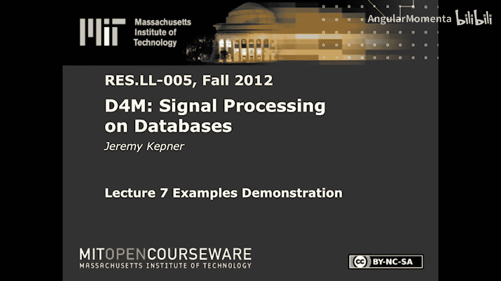
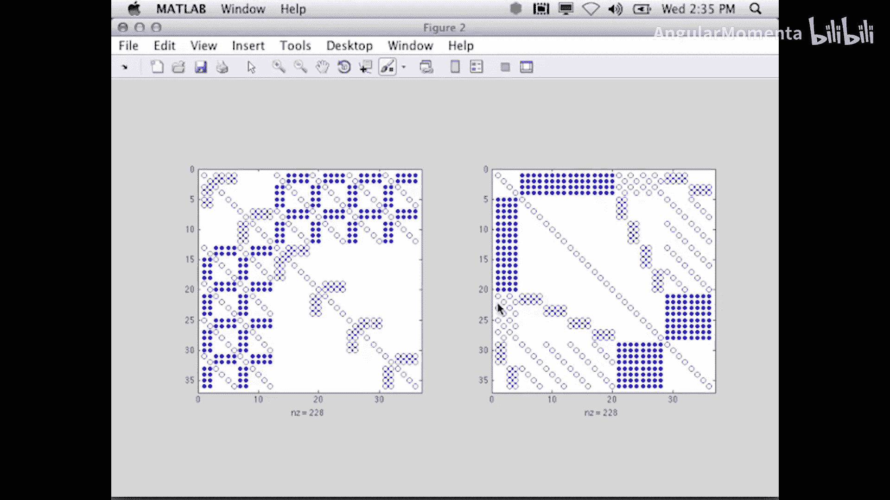
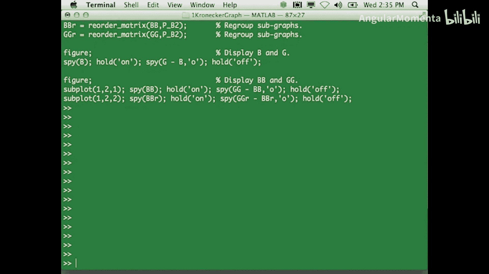
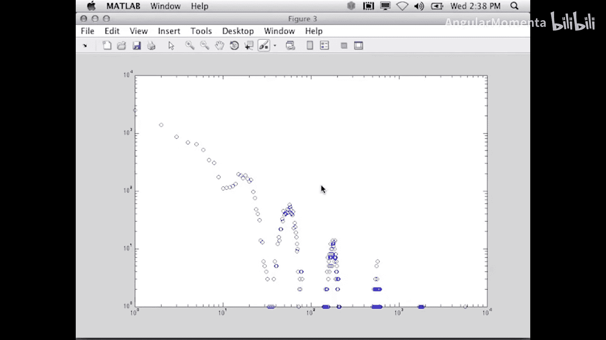
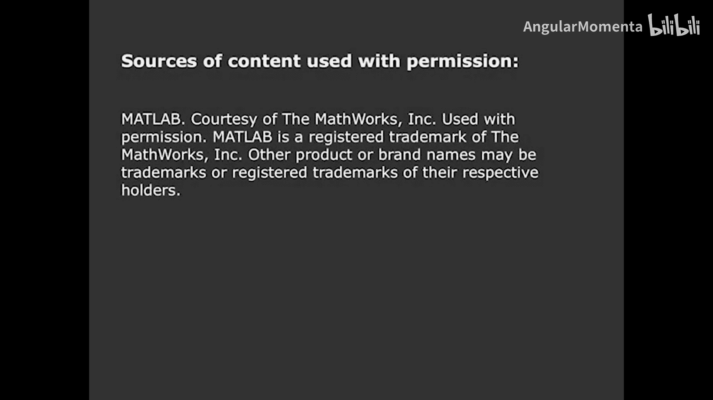

# 【麻省理工】数据库信号处理 ｜ MIT D4M： Signal Processing on Databases, Fall 2012 p18 18 7. 示例演示 -BV1Shq2BME86_p18-

The following content is provided under a Cative Commons license。

 Your support will help Mi T Opencourseourseware continue to offer high quality educational resources for free to make a donation or to view additional materials from hundreds of Mit courses。

 Visit Mit Opencourseseware at Ocw。 Mt Eduu。

