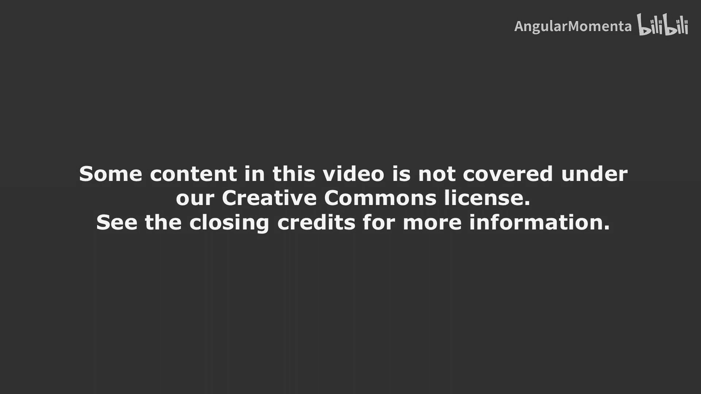
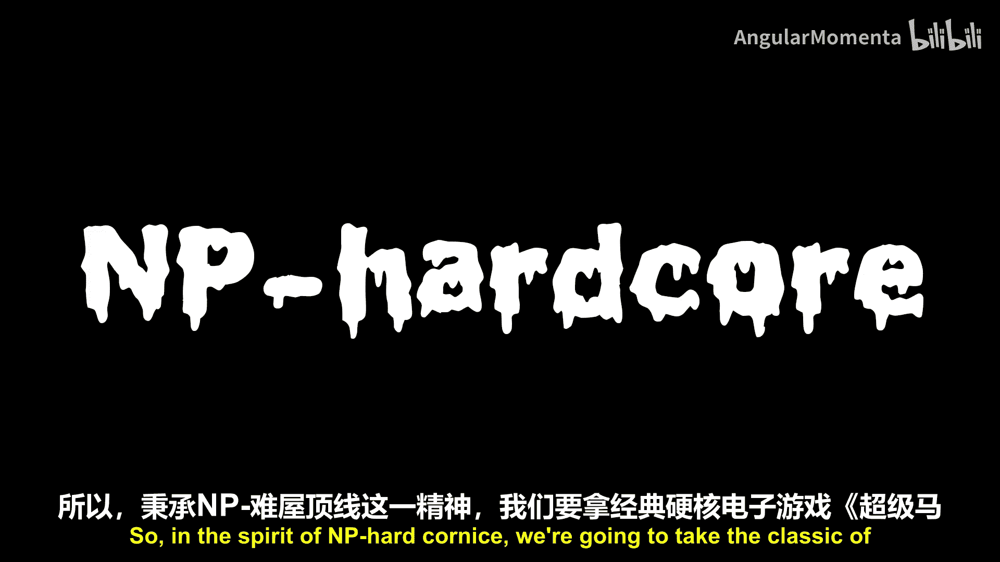
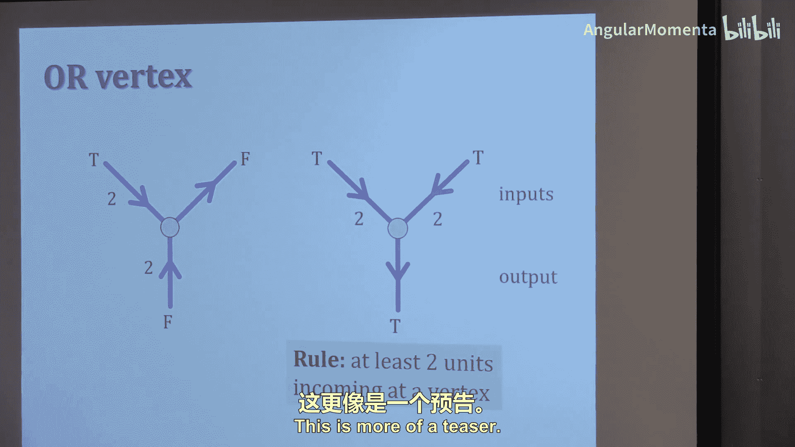
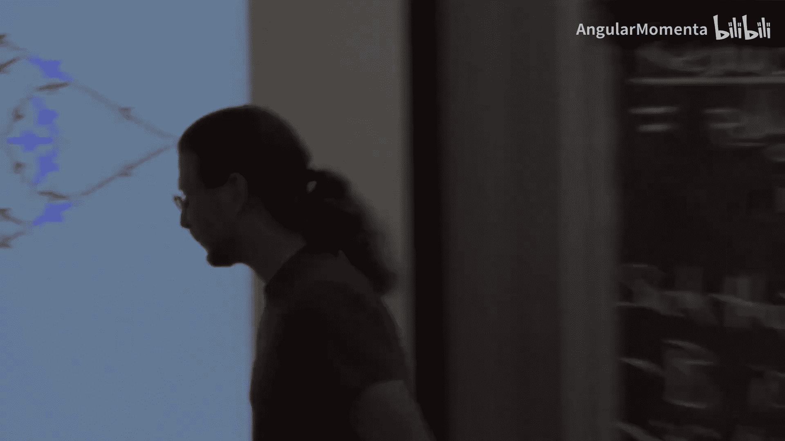
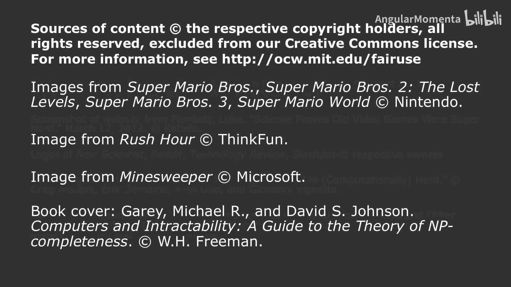
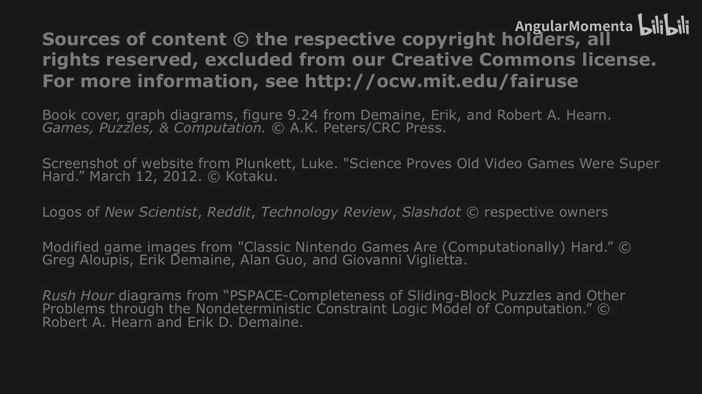

# 【麻省理工】算法下界 ｜ MIT 6.890 Algorithmic Lower Bounds, Fall 2014 p01 1. 概述 -BV1dPYpz9E4V_p1-

The following content is provided under a Cative Commons license。

 Your support will help Mi T OpenCourseware continue to offer high quality educational resources for free to make a donation or to view additional materials from hundreds of Mit courses。

 Visit Mitopcourseseware at Ocw。mt。 Eduu。

Alright， welcome to 6，8，90 Almic lower bounds， Fun with hardness proofs。 I am your host， Eric Demain。

 We have on the left my left， Jason Lynch and Sarah Eisentadt。😊，Your Ts。 first question is。

 what is this class about， The tagline is hardness made easy。 In general。

 we're interested in proving problems hard， proving that there's no fast algorithms to solve problems under certain assumptions and。

The goal is to give you a practical guide and give you lots of experience on how to prove problems hard。

 to make that an easy process。 There's a lot of technique involved。

 And the more experience you get improving hardness。

It becomes relatively straightforward to take whatever problem you're interested in and prove it hard。

 So three of us are pretty good at it。 And our goal is to share with you that expertise so that everyone's good at it。

😊，This is not a complexity class because there are lots of complexity computational complexity classes at MIT。

 so we're not going talk about lots of beautiful， deep mathematics about relations between complexity classes。

 we're just going use a lot of those results wholesale without proving them。

 and you can take one of the many computational complexity classes to get that background。

 I will tell you everything you need to know about complexity。 So if you've taken a complexity class。

 there will be a small amount of repetition。 Most of it will be contained in today's lecture。

 So but very little repetition， but also no background required。

 I do expect you to have a background in algorithms。

 because we take a kind of algorithmic perspective。 I can call it an anti algorithmic perspective。

 if you like。And。So yeah， so that's what this class is。 Why would you want to take this class。

 Why proof hardness， Well， the main reason is to show that you can't design algorithms in whatever model you're interested in that encourages you either to change the problem。

 I like to look for approximation algorithms or fixed parameter algorithms。 That's， of course。

 the topics of an algorithms class are goals to prove when these things are not possible in this class。

 we're gonna master a lot of techniques， you'll see a lot of key problems to reduce from to your problem get a lot of proof styles that are quite common in the literature。

 But unless you've done them and experience them， it's hard to know what to look for。

 and one of the the big ideas in this class is gadgets。 and you may have seen gadgets before。

 but we're gonna explore gadgets to their fullest。 The idea of taking lots of small components and combining them together。

Even if you don't care about hardness， I think this class is a lot of fun for two reasons。 maybe3。

 One is that you see lots of cool connections between different problems that you might not think are related at first glance。

 Most of the problems in this class are equivalent to each other。 And it's all about proving that。

 That's the， the goal。😊，We'll also study lots of fun problems like Super Marier Brothers will prove and be complete today。

 Teettriris will do in a lecture or two。 There are also serious problems。 So if you don't like fun。

 don't worry， And in general， proving problems hard is really like solving a puzzle。

 and it's a lot of fun。 And this is one of the rare areas where you can basically play with puzzles all day and in the end have publishable papers。

 So we're gonna do that in particular through an open problem session。

 which is optional if you want to solve open problems that no one knows the answer to。

 we will try to do it once a week。 we'll be sending email with a call for times when that's ideal for everybody。

😊，We talked about background so。And requirements。 So first requirement in the class is to fill out the survey。

 which is circulating， Does anyone not have a survey。Good， everyone has one。

 So fill that out so we know who you are。 You should also join the mailing list by filling out that survey。

 you should auto join the mailing list。 but just in case if you haven't。

 the mailing list is on the course website。嗯。Yeah。Good。

There another requirement is to attend lectures。 You're doing good on that so far。

 and you'll have toscribe， I would guess， at this scale。We'llscribe once probably in a team。

 but we will figure that out as time goes on。 again。

 there will be email about signing up for  sccribing。

 so scriibing is you know taking notes in the lecture So we have another form of notes。

 There will be something like five PS setss every two to three weeks。

 First one will go out Tuesday is the plan。And then the big part of the class is the project and presentation。

 so a final project， you could do it on almost anything related to the content of the class。

 typical projects are do something new theoretically， prove a problem hard。

 find some nice open problems， survey existing material， something is not covered in class。

 you can code something I think in this context the most natural thing to do is to visualize cool proofs that we cover in class in a new way。

 you can contribute to Wikipedia or you can make some art piece like a sculpture or performance or whatever you want related to hardness proofs。

嗯。That's。Your project possibilities。 So what is in this class， I will look at。

What specific topics are covered？This is on the website。

 So a lot of the class will be about NP completeness， which I will define in a bit。

 but we'll also look at even harder。 These are all notions of no polynomial time algorithm。

 We'll do even harder notions than NP like P space and X time and so on in particular。

 we'll be studying those in the context of games and puzzles。

 And there's a whole theory called games， puzzles and computation。 The topic of this book。

 which we will talk about at length。 Then we will go to。In app， this is not necessarily an order。

 So I shouldn't say then， but we'll talk about when you cannot find good approximation algorithms and what good means depends on what sort of problem you're looking at。

 And when you cannot find fixed parameter algorithms。

 which are fast algorithms when the optimal solutions happens to be small。

 So that's all about not polynomial， then there's a small amount of work on understanding the polynomial aspect in for small polynomials distinguishing almost linear time from n squared time or n cube time。

 and that sort of thing。 Then there are other sorts of problems。

 we can think about less common types of problems like where you want to count the number of solutions instead of just find one or tell whether the solution is unique。

 there's some economic game theory stuff。 this existential theory。

 the reels comes up in some geometric settings。 And if there's time we'll talk a little bit about undecidability。

 although that's pretty pretty different world。 That's where there's no algorithm given well given any finite time bound。

So that's in a nutshell what the entire class is。 Today， we're going to do。

A sort of crash course on computational complexity。

 Most of what you should need for the entire course， I think。

 will fit in about 40 minutes and maybe 50 minutes， something。 And that will serve as a guideline。

 If you have any， if anything's not clear if I go too fast， feel free to stop。

 Ask questions during class or after class。嗯。And let's see。 So we have some。

There's no real textbook for the class， but there are two recommended reading books。

 They are Gar and Johnson。 Computers and intractability is the title。

 Most people call it Gar Johnson。 This is an old book from pretty much in early on in the world of MP completeness。

 but it's still a really good book。 So that's。Good to check out。

 And then there's my book with Bob Hn。 This is Bob Hen's PhD thesis at MIT Games puzzleles and Computation。

 This is available electronically for free online to all MIT people。

 So if you look it up in MI T libraries， it's actually linked right here。😊，CC net base。

 you can get an electronic copy if you want to buy one， talk to me or you know， order it。呃。

There's a couple other links on the website。 There was some follow up to the Gary Johnson book by Johnson and some other cool websites。

Right。So I think that is the administrative part， now we can start the fun part of the class。

Let's do our crash course on complexity。 So if you've seen complexity before。

 some of this will be review。 We start with。Our favorite class of。

Problems that can be solved in polynomial time。Say on a Ram。

 I should specify a model of computation and exactly what a problem is。

 but it'll be a little bit informal here。 polynomial time means and to some constant。

Where n is the size of the。Problem instance。 And we will talk a little bit more about subtleties in defining N。

 But usually polynomial time is pretty clear。 This is what we consider good algorithms。

 An example of something we consider bad is exponential time。

 So X is going be all the problems that can be solved in exponential time。

And exponential is a little less uniquely defined， but I'll define it this way。

 I think this is the usual definition for X。 So2 to a polynomial。Of course， it could be 3。

 if you prefer any constant will be the same here。 This constant dwarfs， any constant there。

So that is， this is a huge class。 Any problem you can solve in exponential time。

 Most problems can be solved in exponential time， though not all。Most problems we encounter。

 I should say。And then I'll define one more just for Ks。

 R is recursively innumerable problems or recursive problems。

 These are all the problems that can be solved in finite time。Always。

 and these are all worst case bounds，So I'm going to have a running picture。This is my。

Favorite picture to draw。 We have on the X axis a。呃。

Somewhat vague notion of computational difficulty。What you might call hardness colloquially。

This is a bit informal， but still a useful way to think about things。

 So this initial chunk here is gonna be P。I'm going to leave some space to fill in some other things and probably go to here。

And。That's part。Is going to be X。And then。Everything。

To the left of this line are the problems that are solvable in finite time。

 Everything to the right of that line is not solvable by algorithms。 that would be undecidable。Okay。

 so obviously， anything can be solved in exponential in polynomial time can also be solved in exponential time。

 That's all that this is saying。Cool， so I have。Well。Examples give you some examples to think about。

 for example。N by N， chess。So this is， I give you a chess configuration on an N by N board。

 And I want to know， let's say， white to move can white force a win。

This turns out to be solvable in exponential time。嗯。And。Is。Not solvable in polynomial time。

So that's a nice result， something we will get to。嗯。Another example。Is Teris suitably generalized。

 So we're thinking about problems where you have all the information。 Usually in Tetriris。

 you don't know all the pieces that are going to come。 But supposing you knew the future。

 I give you the entire sequence of pieces that are going to come。 So of a Teris puzzle。

 They used to publish these in Nintendo Power magazine， And you want to know。

 can I survive from this board position。 Can I survive this sequence of pieces。 This is also in X。

 you can solve this in exponential time。 That's a little more obvious。嗯。But we。

Don't know whether it's in P。Probably it's not。 And we'll say why in a moment。

If you you've taken an algorithmist class so you know tons of examples of problems that are in P。

 like shorts pads or lots of good things。 halting problem。Probably heard of。Kind of a classic。

Halting problem is given an algorithm， does it terminate or given some computer code。

 does it terminate， This is not recursive， meaning there's no algorithm to solve it in finite time。

 in the worst case， there's a more depressing result， which is that， in fact， most problems。

 let's say most decision problems。Are not in our。Most problems cannot be solved by an algorithm。

 If you haven't seen that， it's a cool result。 Basically， the proof is that the number of problems。

Is in the universe is about 2 to the n。And the number of algorithms is only about n。

So if you know set theory great， otherwise， ignore this sentence。Yeah。So， you know。

 you can think of an algorithm as a number。 It's like you'd write。

 take the string converted to giant number。 So that's integers over here。

 You can think of problems as a mapping from inputs to yes or no。

 That's yes or no as the two inputs as the N。 This is the same as real numbers。 This is the integers。

 and there are a lot more real numbers than integers you probably heard of that。

 So this means most problems have no algorithm。 If anal can only solve one problem。

That's the sad news of life。Luckily， most of the problems we tend to pose do have an algorithm。

 and it's more about P versus X that this class is about。😔，So。Let's go to more interesting things。诶。

I'm going to define a class。NP。Which is in between here， in between P and X。So as I said。

 decision problems are problems where the answer is yes or no。

There are lots of possible definitions of NP I will cover two。

I would like there to be an algorithm to solve the problem in polynomial time。

 but not in a regular model of computation。But with something I call a lucky algorithm。

Lucky algorithm comes to a decision and it always makes the right one。Without， it's just lucky。

 doesn't have any reason to believe that's the right one。 It just always makes the right choice。

 given a choice between two options， let's say。So this is the， you make lucky guesses。

 You always guess the right one where you're， it's a little bit biased in a way that I should say。

 So let me be a little more precise。 This is called。A non deterterministic model。And the N in NP。Is。

Non deterterministic。So the idea is that the algorithm makes a series of guesses。

 could do it at the beginning or could do it in the middle of the computation。

 and eventually it outputs an answer。So it's going say either， yes。Or no。

And what we guarantee in this weird， non deterterministic， lucky model of computation is that。

You will be LED to a yes answer， if it's possible。So guess this is asymmetric。

So what this means is say you run your magical lucky algorithm and outputs no。

 that means you know that no matter what set of guesses。

 no matter what set of choices you made for each guest， you would always get to a no。

If you get a yes answer， you just know there's some set of yeses that lead to a yes answer。

 So it's one is an existential quantifier one's universal。 So this is asymmetric。

 There is a notion of co N P， which is exactly the reverse。 Co N P， you， let's say flip。Yes with no。

 So Co and P， you prefer no answers if you can get them。All right。So what。

Let me give another definition of MP。Another way to think of the same definition， really。

So you can also think of NP problems as problems that have solutions that are relatively succinct and can be checked in polynomial time。

 I guess really， they need to be checkable efficiently so。What you can think of this as saying is。

 well， every time I make a guess， I'll write down whether I went left or went right in my。

 in my maze， I guess， and so that you can think of as a certificate。

 if you know what the right sequence of guesses are， of course。

 you can run the algorithm because it's a polynomial time algorithm。Conversely。

If I don't have the solution to the problem， yet I'm told that it exists at the top of my algorithm。

 I could just guess what that solution is and then check it。So if I'm given such an algorithm。

 I can convert it into a lucky algorithm。 If I've given a lucky algorithm。

 I can convert it into one of these checking algorithms。Okay。啊。So， let's。Do an example。Let's say。

 Tes。Is in N。So， if I。Give you a board， and I give you a sequence of pieces that are going to come。

 How would I prove to you that I can survive those sequence of pieces。Just say where they go。

 say what sequence of moves I press what and at what times to say just where should I drop each piece。

 So then all you need to do for this definition is check that that's a valid solution that you can actually。

 you never have to push a piece up， for example， to get it into the right position。

Or you can think of the same thing as an algorithm that says， okay。

 every time I have to press left or right or wait a second or push down。

 I'll just guess which one to do and then do that。So these are the same。Same algorithm， essentially。

And that's why Teettriris is in N， in general。Let's see every。

 every problem that I can solve in polynomial time。 Of course。

 I can solve in nondeterministic polynomial time。 So that's that containment。 if I want。

 if I have an MP problem， I want to solve it in exponential time。 Well。

 I could just simulate all the possible guessing paths because I run for only polynomial time。

 And so for each one， maybe I have two choices， I'll just try both。

 I'll do sort of depth first search。 And。Yeah， I have exponential is exactly2 to that polynomial。

 so I can afford to branch in both directions。 So I guess my guesses here are just binary。

 I can afford to branch in both directions and eventually see whether any of them leads to a yes。

 I could also figure out whether any of them leads to a no。 But in general， MP is contained in X。

Cool。Still not to。Interesting。Where it gets interesting is when we start talking about hardness。

 which is next I should mention。Big open question is whether there's any problem in here in N P minus P。

 This is the famous P equals N P Open problem。 Most people。

 most sane people in the universe believe P does not equal N P。 what this。Means intuitively。

 is that you can't engineer luck。Luck shouldn't exist in the real world。 You can't just like。

 you know， go one way or the other and always make the right choice。 You could make a random choice。

 You could make， You could try both choices， but you shouldn't be able to always make the right choice for all problems。

 That seems insane。 So if you believe that， you believe P is not equal in P And you believe there' are some things in between those two lines。

 But we don't know。Unfortunately。So。Let me talk about hardness。So if I have some complexity class X。

 X could be NP or。X at this point， P， we won't talk about P hardness is a little weird。

And I'm not gonna form define this formally until a little bit later in today's class。

So problem is X hard。 if it's sort of the hardest problem in the class X。

 if it's as hard as every other problem in X。Actually， this problem may not be N X。 So it's。

 I should say it's as hard as every problem in X。 So what that means in this picture。

Is the following。So every problem from here onward is X hard。And every problem from here。Onward。

Is NP Har。Whoops。From here。We won't talk about pe hardness。 That's a notion in parallel computing。

I mean， maybe we'll have time to talk about it， but it's not currently on the plan so。

This is the lower bound side， right， You're proving that you're at least as hard as the very hardest problem in MP。

 or you're at least as hard as very the problem in X。The reason。

 the only reason I know that chess is not in P。Is because I know that chess is actually X hard。

 I know it's at least as hard as all problem solvable in exponential time。

 And there's a great theorem called time hierarchy theorem that tells you that P does not equal X in particular。

 So we know there are some problems in X that are not in P。

 Some problems that require exponential time can't be done in polynomial time。

And we know the chest is as hard as all of them。 So in particular。

 it can also can't be solved in polynomial time。Okay， modulo。

 I haven't defined what as hard as means yet。But I will get there。Another good。

Term to no is x completeness。 This is just the and of two things being x hard and being in X。So。

In my picture。This dot right here。Is NP complete？And this dot right here。Is。Okay one。Is x complete。

Okay， I already mentioned that chess is in X。 So， in fact， chess is X X complete。

 It means there's an upper bound saying that you can solve it in exponential time。

 There's a lower bound saying that it's at least as hard as everything in X。 And both are true。

 So you know， you're kind of right here from the resolution of this picture。

 That's all you could hope to know about chess。嗯。So。Good。One more class。Problems， Good to know about。

 and it will come up a lot in games。Is the notion of peace space。So so far。

 we've only thought about time， but usually we measure algorithms in terms of time and space。

 How much memory does your algorithm use。And。So peace space is going to be， I guess。

Let's say problems。As you might guess， this is problem sovable in polynomial space。In general。

 if you can solve a problem in polynomial space， you can solve it in exponential time because there are only exponentially many states of your machine。

 if you only have polynomial space。So， peace space fits。Here。In between NP P and X。And， of course。

 there's piece based hard。And piece space complete。If you don't remember anything from today。

 except one blackboard， Remember this blackboard。 That's like the cheatee sheet， too。

Everything we've defined。 You just have to remember what all the letters mean。But not too hard。

So that's pretty much all the classes we'll be using。 There are a few others。

 oh sorry I'll give you one example to go with our other examples。

The problem we'll look at today is rush hour。This is a one player puzzle where you're trying to move the cars and they can only go vertically or horizontally。

 This is in peace space。Which is maybe not so obvious。And actually， it's， it's piece based complete。

So。This is呃。From the diagram， P space complete is harder than MP P complete。 Now， of course。

 we don't actually know whether these two points are the same。It's kind of annoying。

 We don't know whether these two points are the same。

We don't know whether these two points are the same。 This whole thing could collapse。

 We do know these two points are different。 So somewhere here or here or here。

 we have a positive range。 Most people believe all of these have problems in them。

So none of these things are the same could be MP complete， the same as piece space complete。

 But again， most people believe these are different。 So in some sense， rush hour， which is here。

 is harder than Teris， which is here。嗯。Kong。And if you believe that。Either one of these is not empty。

 Then we know that rushsh hour does not have a polynomial time algorithm。 So to。

 to show that rush hour is not in P， you you have a choice。

 You could prove either one of these is not empty for Teris。 you have to prove this one。

So you'd be less famous if you approve this one， It's still pretty famous。

 but you wouldn't win the million dollar bounty that's on P versus N P。All right。

 there are bigger classes you can talk about， we talked about exponential time。 you can。

 of course talk about exponential space in general， these interleave， you go polynomial time。

 polynomial space， exponential time， exponential space， doubly exponential time。

 doubly exponential space and so on。 that's the order in which they occur。

The only things we know is that。Polynomial time is different from exponential time is different from W exponential time or any function of time。

 really。 And we know that polynomial space is different from exponential space is different from w exponential space。

 But we don't know about the interrelation between time and space。 That's sort of the big。

One of the big questions， The other big question is non determinism。

 One fun fact you should know is that P space equals N P space。This is a， a useful fact。

NP space is nondeterministic polynomial space。 you take a lucky algorithm and you don't guarantee how much time it takes。

 It will be at most exponential time。 You only guarantee the amount of space it uses is at most polynomial。

 This is a theorem called savages theorem。 and it works for any space bound in general。

 a space bound， I think grows to the square of its original。

 if you want to convert nondeterministic to deterministic。

 This is useful for rush hour because to play a rush hour game in general。

 the number of moves you might have to make is exponential So it's not in it's not obviously in N because N would have to have a short polynomial length solution that you can check in polynomial time。

嗯。But rush hour， you can solve in polynomial space if you're really lucky because you just say， well。

 what move should I make， I'll guess one， Then I'll make that move。 Gu another move， Make the move。

 And just maintaining the state of the board only takes polynomial space。 So then if you solve it。

 you're happy。 if there's no way to solve it， you will return no。 I guess you can。

 you have a timer after you've made exponentially in moves。 If you still haven't solved the puzzle。

 you can return no。 And in the lucky world， that means you will find a solution if there is one conveniently。

 lucky algorithmms can be turned into regular algorithms when you're only worried about space bounds。

 And so that's how you prove rush hour is in peace space。😊，So that's a good fact to know。嗯。True。

Alright， there's one key thing we haven't defined yet， which is as hard as。 So let's get to that。

 This is really the heart of。The class。I think there。So the。

 this class is really all about one notion， and that notion is reductions。 So if I have two problems。

 A and B。Then there's this notion of a reduction from A to B。

 This will be an algorithm for us almost all the time， it will be a polynomial time algorithm。

 although you could。Put in a different adjective here than polynomial time。 Most of the time。

 that is what we want。And it's going to convert。An instance of the A problem。

 So instance just means input。And it will convert it into an instance of the B problem。

And it's gonna do so。In a way。Such that。The solution to a equals the solution to B。I mean。

 the solution of that instance of a is， has is the same as a solution of the instance to B。

So this is think decision problems， right， the answers either yes or no。

 So we want to convert a into an equivalent instance of B equivalent meaning that it has the same answer。

Why do we care because？Let's suppose。We knew we had an algorithm to solve B。That would be this arrow。

 so let's say if。We can solve B。Then， we can solve a。By this diagram。Take an instance of A。

 convert it into equivalent instance of B， solve B。

 and then that solution is equal to the solution to A。 so we've solved a。This is as hard as。

 So what we say is。B。Is as hard as a。That's a definition of his hardest。Okay， in general。

 depending on your definition of reduction， you get a different notion of as hard as。

 but we will stick primarily to polynomial time。Reductions， this is what you。

 what you might call a one call reduction。This is kind of a technicality。

Also called a carp style reduction becauseuse carp gave a whole bunch of them in。70s，80s。

 And so the idea is you， you only get to call your solution to be once in general。

 you could imagine an algorithm that calls your solution to be many times。

 That would also be a notion of as hard as for the problems。 we'll look at basically。

 these two notions are。It it don't seem very helpful。 Let's say。

 So we'll stick to one call reductionsca they seem sufficient for everything that we will cover in this class。

 Probably， maybe some very late lecture。 we'll talk about multicol reductions。

 but they're not so prominent。 One call reductions are the bread and butter of hardness。

So as you might imagine， this is how you prove a problem heart。 Basically。

 all hardness proofs in the universe。In the known universe are based on a reduction。

 You start from a problem which you know is hard in whatever class you care about。

 and you reduce from that problem， the known hard problem to your problem that you're not sure about。

 If you can do that， then you prove that your problem is as hard as the original problem。

 If you know that one is hard， then this one is hard。Don't get this backwards。You will anyway。

 But try not to get it backwards。 You're always reducing from the known heart problem to your problem。

Okay， so usually say our proof is based on a reduction from pick your favorite problem。 Okay。

 never two。Easy to get wrong because it's， you know， easy easy to make a sign error， but that's life。

 So good。Anyhing else。Now， if you've taken an algorithms class， you've seen lots of reductions。

 reductions are a powerful tool in algorithms too， for example， some， some lame examples。

 like if you have an unweighted shortest path problem。

 you can reduce that to a weighted shortest path problem。How do you do that。

 You said all the way to one， ya。Why would you do that well， never mind。这。

What that it kind of illustrates what's going on here。

 what we're showing is that a is a special case of B。

 unweighted shortest paths is a special case of weighted shortest paths。 In some sense。

 all reductions are that。 but they're usually much less obvious than unweighted shortest paths to weighted shortest paths。

 And the reason we can say B is as hard as A is because， you know， modular this conversion algorithm。

😊，A is a special case of B。 So， of course， if B has more cases than A or， maybe the same。

 but it has at least as many cases as A， then， of course， B is at least as hard to solve as a。

In this formal sense。Okay， cool。There are more interesting examples you've probably seen in problem sets like if you want in the。

 the arbitrage problem， you want to find a path that has the minimum product of all of the values to convert products into them in some problem。

 You just take logs of all the values。 So the reduction is compute logs on all the weights。

 So you've probably seen lots of， lots of things like that。 Some are more complicated than others。

What we're going to do in this class is reduce instead of so for algorithms。

 you want to reduce to something you know how to solve。

 we're going to reduce from something we know we can't solve under a certain assumption So assuming p does not equal NP P。

 if A is NP hard， and we reduce from A to B， then we know that B is NP hard。Okay， that's a theorem。

 So in， in this situation， if we have a reduction， let's say if a reduces to B， I'll be explicit and。

呃。诶。Better get this right。 It'd be pretty embarrassing if I got it wrong。

 I probably will get it wrong at some point in this class。Hopefully not today， then。B is X high。Okay。

 that's actually kind of a trivial theorem。 If you read all the definitions。

 what did X hard mean it meant as hard as every problem in X。 So， and as hard as meant。

 there was a reduction。So that means， get this right。

 There's a reduction from every problem in X to your problem。So if a is empty hard。

 there's a reduction from every problem to a。 And we're saying now what if there's also a reduction from A to B。

 well， then we can just chain those two reductions together， convert any problem in X to a。

 then convert it to B。 And so we've shown every problem in X can be reduced to B。

 therefore B is X hard。 these are this easy theorem。The converse would be， if B。

Can be solved in class X and X contains polynomial time。Then you can also solve a。In。

 in the same complexity class。 So， for example， if B is in P space。

 then we learn that A is in P space， something like that。Cool。Any questions at this point？Yeah。

So if you've talked a lot about this MP thing， why don't we ever talk about nondeterministic exponential properties？

Okay， yeah， I didn't define nondeterministic exponential problems， but that's a valid thing。

 I think it's usually written N X。 And I believe there is a class of games that naturally fits into N X。

 It's mainly an issue of which classes commonly arise in problems that we care about。

 This is a pretty rare one， but I think there might be one instance where we might touch on this。

 Yeah， we definitely can。 it's the same open problem where there X equals N X。 I mean。

 it's another open problem。 I shouldn't say it's the same。

 I think you could solve one without the other。E， again， everyone believes you can't do it。

 if you believe you can't engineer your luckiness， then， of course， N X doesn't equal X。

 but that would fit right after。Right after X， you get N X， and then you get X space。

 according to the things we've written down and cared about， that would be the order of things。 So。

 of course， there are classes in between these。 But those are。

 these are the ones that appear normally。 Yeah， do we know how to use assumptions for， for example。

 equal to MP to say whether theyre just problems that are not NP nor NP。Yeah。

 that's another big open question。 Let's say P does not equal NP。 are there problems here。

 which is to say strictly in between being in。 So they're still not NP P。 They're right of this line。

 but they're also easier than MP complete problems。

 There are a couple problems that are famously conjectured to live there like。

Factoring integers and graph somemorphism。 But I'm not aware of any。Nice complexity class there。

 You can， of course， say。You can talk about a class of problems that are as hard as graphomorphism in a certain sense that if you believe。

 if you have like a graphomorphism oracle， what can you do And so there's a little bit of work trying to try that space。

 but I'd say in general， it's been not super successful。 don't quote me on that。

 though I also don't know the literature super well there。So that's a big uncharted territory。

 let's say。Could be a good project， Probably lots of open problems there。Other questions。

 But I think most people believe there are things there。

 One thing you could prove is there's a thing called exponential time hypothesis。

 which would say that SaAT has no sub exponential algorithm。NoNothing too to the little O N。

 If you believe that then it's known theres things in between。

 You can pick your favorite function like n to the log log N。 that's bigger than polynomial。

 but smaller than exponential。 And there are， there are problems that are in that class and not in P。

 So definitely with E TH， you can do it。 Yeah， So regarding that question。

 I think it it has been proven that。 If P not equal in P。 then there is stuff in there。

Because you can kind of do a diagonalization。Other questions。Yeah， what's the problem。

Decision problem for factoring。I think one version is， I， I give you a number， the decision。

 and I give you a bit position。 And I want to know whether there is a factor that has a0 or one in that position。

 So if you can solve that problem， then by repeated calls。

 you could actually find a factor that's not one。I don't know if there's a better。

Better version than that。 You have to be careful， of course， if you say， well， is the number prime。

 then that's in polynomial time。 That was a big result a bunch of years ago， so。Yeah。

Most of the time， it's easy to go from your problem， optimization problem to decision problem， but。

Factoring is one where it's less clear。More questions。That was a lot in a small amount of time。

 But that's all you should need from complexity theory， yeah。

I guess I have a question about the way you defined NP there with monkey algorithms。

 so the definition that I've seen before is in terms of nottistic。T machines correct。

 and there it specifically constrains every branch of the computation to run following in time。

 whereas you can imagine a lucky algorithm that avoids like infinite looping just because it's lucky。

Oh， okay。 yeah。 I was a little vague here。 I said for the definition of NP。

 I said polynomial time in the worst case， probably I need to say it's polynomial time。

 no matter what branch you take。Not sure it matterscause maybe if you know you're algorithm supposed to run a polynomial time。

 you could have a timer。 And if it ever exceeds that time， just return no。

So you might be able to convert the weaker notion of polynomial time to the stronger one， but。Yeah。

 it won't matter too much。 I mean， in all the algorithms we'll think about you。

 every branch you could possibly think of even the nonluck ones or polynomial time。

 So we will stick to that。 We won't spend much time in general。

 proving that problems are in NPP or in peace space only to check that this is the right class we're supposed to be working in we'll spend most of our time proving the the hardness cases。

 the lower bounds， yeah。You mentioned that if you use different notions of a reduction。

 different limits basically on the competition you get different measures of as hard as so as your classes get bigger。

 does it matter if you start using more than polynomial time year reduction， does it actually change？

I'm sure it matters， but again， it's beyond。The the classes that are usually considered from an algorithmic standpoint。

 the bigger， bigger than these classes don't seem to matter much。 And in these。

 maybe once I've seen like a polynomial space reduction to prove X parness。

 So it's a slightly weaker notion than if you do a polynomial time reduction。

But if you believe P space is not equal X， but still a separation。

 So sometimes things like that happen。 I think the。

 the most common is just switching to a space measure over a time measure。

 I don't think it will matter anything we see here， but it does， it does arise in the literature。

 definitely。I think P space or log space are the two common ones。And of course。

 when you're doing peace completeness， it's another other setting。

Curious how that how you could do that because for any。For any instance of the problem。

 you can't say that I've used exponential time。It could just be that there's a bigger constant out。

 Okay， yeah， so you need to know what the polynomial is for it to have a timer。 That's a small catch。

Yeah， I don't see an easy way to avoid that。Yeah， there's， there's some。

 a few subtle constructive issues there。 If you don't know what the bound is。

 then things get more annoying， none of those things will happen in reality。 So remember。

 this is not a complexity class。 We're looking at algorithms here， so。Well， it this。

 this part is actually easy。 It's all about the reductions。

 That's where the meat of this class will be。 And for that， we need to get N hard corere。啊。

I think all of you soon will be N hardcorus and will'll be able to prove really hard problems。

 really hard。😊，So in the spirit of NP hard Corice， we're gonna take the classic of hardcore video games。

 Super Mario Brothers。 And our first proof will be that Mario Brothers is N hard。

 This got lots of press。 Like here's Kaakku saying science proves old video games were super hard。😊。

This is a。This is， you know， proving the obvious， I guess， But anyway。

So let me tell you a little bit about how this proof goes and then we will see it。Alright， so。

We need a problem to reduce from The problem is threeatAT。

 and this is probably the most common problem to reduce from。

 We will spend a bunch of lectures on it。 It won't be our next very next class。

 but we will get to it pretty soon。 This is also known as three satisfiability。

If you're ever trying to prove MP hardness and you don't know where to start from。

 the answer is three set， almost always， but not always。嗯。Okay， whatever。

So what's the problem you're given？A three CNNF formula。 This means something like x5。

Or I'll be nice and right。English or x3 or。Not X 1。And。Another thing like that， x7 or。Not x 2。Or。X 5。

 whatever。And so on。So some keywords you should know。X's， those are called variables。X I or not X。

 those are called literals。You have two choices。 you can either have a positive variable or a negative variable。

Then you always have three literals per clauses。 These things are called Each row of this thing that I drew is called a clause。

Okay， the whole things called the formula。And the question is， can you make this formula true。

So that's what you want to know。Do there exist Xs？Such that。The formula is true。

That's a decision problem。And it's amP complete。It is almost the first problem proved MP completele。

嗯。It's like the second problem to be complete。 The， the first one was without the。

 this particular formula， this particular style。 It was just a bunch of ans andres and knots in any combination。

 But this is also hard。 And it's usually easier to start from this situation。

 So what we want to do is reduce from three sat to Super Mario brothers。 Okay， so。Let's do it。嗯。

So I should mention our proof holds Super Mario Brothers1， two and or one lost levels and three。

Super Mario Brothers 2 is another world。 also Super Mario worlds。 I think one and2。

 but most of the pictures will be Super Mario Brothers original。

 So what we're going to do are build gadgets。 gadgets are， in this case。

 little pieces of levels that we're going join together to make the actual reduction。So it's usually。

 it's not typical that you look at the instance of A and then just think really hard and then just output an instance of B from。

 from nowhere。 you just say， well， okay， instance of A has lots of little pieces。 You know。

 it's got variables and literals and clauses in the formula。

I'm just going to take each of those little pieces and convert them into a little piece in my output and then just string them all together。

 It usually a fairly obvious way。 though sometimes there's some subtleties there。

Almost all of our proofs will follow the structure。 This is the gadget structure。

 And this is the thing you're here to learn。 is super cool becauseuse if you。

 once you know that you want to do three set， you're like， okay， I need variables in clauses。

 So here's the variable。😊，Got Mary on the top。Mario has to decide， should he go left or right。I mean。

 you could go back。 But if you wanna sort of go。Through this gadget。

 you can either fall left or fall right。 And all of these heights are so large that once you make that decision。

 you can't come back up because you have a limited jump height。Okay， here's the clause gadget。

So the idea of variables is we're choosing。 do I set x 5 to be true or false。

 Let's say the left branch corresponds to true， the right branch corresponds to false how that happens。

 We'll see in a moment。 That's about how the gadgets fit together。Cllas gadget has two parts。

 On the one hand， you have these three entry points where your goal is to hit cos and bounce them around。

 And then the other part is down here is a bunch of bricks。 And at the end of the level。

 we're going to set it up。 So Mario has to go through this part。

 and this will be traversible if and only if these bricks have been broken。So how would you do that。

 This brick and well， various things are in the way here， so。What you need to do。interestingtering。

 we're gonna change the schedule in a second。 I already see some issues with it， but。

This was our original， original proof。 Didn't get published when we ended up fixing it before we submitted it。

 So what you， the idea is what we want Marray to do is come down here。

 hit the coopa and then knock the shall out here。 And it will bounce and eventually break all these bricks。

 Right？ Well， no， that would be Super Mario Brothers 3 where turtles actually break bricks and Super Mario Brothers  won。

 They don't。 so。We will use a different gadget， with fire bars。

And question blocks with invincibility stars in them。Okay， so same idea。

 There are three entrances down here。 If you hit any one of them。

 then the star will just float around here forever。 We test it。

 It goes there for as long as the level can last。Then later， if you come here。

 lots of testing involves。 Of course， Later， if you come into here and you can get the star。

 you have just enough time to run through all these fire barss。 If you don't， you will die。Okay， so。

That's the clause gadget。 So if you visit in at least one of these three places。

 you can visit in all of them doesn't help to have three stars versus one in this case。

ca they don't stack or anything then， and only then can you go through the top part。Okay。

 this is what we might call traversal。 And this is， I don't know。

 You can call it setting the gadget to true。How does this all fit together。

 This is sort of the bigger issue。 So we're gonna take this three set instance。

It's got variables and clauses。And let's ignore the negations For now。 Am I gonna to ignore them。No。

 I'm not gonna ignore them， but。On the one hand， we have variables。 The other hand， we have clauses。

 and we're gonna connect each variable to the clauses that contains it。

So this is an actual set of four clauses here， and you can trace them all。

 So the claim is that x in the positive form appears in the first clause and the second clause。

 You can see there's an x here and an x here。 It appears in the negative form。

 This is not x in clause 3 and clause 4 because here's not x and not x。Okay， and so on。

 So that's what all these connections in the middle are。 In general， it's kind of a bipartite graph。

 You've got variables on the one side， clauses on the other side。

 And we happen to have coalesced things in these groups。

 what these edges are now going to be converted into are paths for Mario to follow。

 So this is the variable gadget。 It's this thing。 We're just gonna plug that in here。

 So the idea is you enter from here。 And then you have two ways that you can go。😊，Okay。

 either the true way or the false way。If you set the variable to true。

 you can then go and visit the corresponding clauses that contain it。And get one of the stars。Okay。

 now， if for each variable， you only get to make one of those choices。

 then you satisfy all the clauses that contain that literal。At the end， and then when you're done。

 you can walk to the next variable。Okay。So there's actually two entrances to the variable。

 It doesn't。 I guess that kind of matters What we want in the variable。

 So if you came from the true setting or you came from the false setting。

 you don't want to be able to like run and jump over to the other side and then satisfy the previous variable。

 both true and false。 You only get to make one choice。 Lots of things to check here。Then in the end。

 at the very end， after youve set the last variable。

 you have to traverse all of these clauses through the fire bars。

 And that's going to be possible if and only if every one of the clauses has a star in it。

In other words， the variables satisfied all the clauses。 In other words。

 the formula is true because the clauses are combined with an and。Okay， that is in a nutshell。

 the proof。 once you've made this construction。That the。

solutionlution to3at is equal to the solution to Mario in general， you want to prove on the one hand。

 if the answer is yes to3at， if there is a valid setting for the variables。

 then there is a solution to this Mario instance， you can actually solve the level this decision question here is can I make it to the end of the level。

 there's a flag over there， and conversely if there is an actual solution to this puzzle。

 you want to show that you can convert it into a valid setting for3at that satisfies the formula You need to check both and that gives you the equality here。

Question。Good question。 This graph is not planar。 And so there are these crossings。

 So there's one more gadget。The crossover gadget And this is on the poster。

 So if you were analyzing it。 there are many ways to do crossover。 And this one is kind of overkill。

 unless I tell you that Super Mario Brothers has tons of hacks and cheats so you can play and run through walls and crazy things。

 But never mind that。 The idea here is you are a big Mariio at the beginning of the level。

 There's a mushroom。 And you better not lose it Otherwise you' in trouble。 So on the one hand。

 I can go from left to right。 It's a directional crossover。

 Or I can go from this is sort of the bottom to the top。 But I can't go from bottom to right。

 I can't go from bottom to left。 all these sorts of things。Why， okay。

 let's do the positive case first。 Sam'm from the bottom。 I fall here， can't go back。 I can jump。

 If I'm big Mario， I can break through a couple bricks， and then I can escape。Okay， but if I tried。

 I could run under here。 for example， if you're good， you can crouch slide and then jump， jump， jump。

 jump， jump。 you get to here， but you cannot get through this。

 or maybe I need to add one more wiggle a little easier to see over here。

 maybe I can get here and move over。 But if if you're in this position。

 you have no momentum you can gain。 And so you can't crouch slide into there。

So if you're here coming from the bottom， you can't get out。Alternatively。If you come from the left。

 instead of， you know， it's so tempting to kill the guba。 But instead of killing him。

 you take damage， become small Mario， then you can traverse through here because you don't need to crouch slide。

 you just jump。 And then there's another mushroom for you to become restore big Mario and restore the invariant Then you can。

 and you better take it because otherwise， you can't get out through here。

 so you are it' almost forced to go left to right or bottom to top。 Now。

 if you traverse both of these gadgets， then every both directions， then everything L bets are off。

 then you can go from anywhere to anywhere。That's okay because what we're worried about。

In this reduction is whether you can reach certain things。 If you can reach something。

 I don't care whether you reach it now or later。It's just。

 you don't want to be able to reach unreachable things。 When you set the variable to true。

 I don't want to be able to visit this false vertex ever。 And if you check all the crossovers。

 it's enough。To build this kind of thing， which either you traverse left to right or bottom to top。

 Or you can reach both the left and the bottom。 and then you can reach anything。Okay。

 and you never have to go right the left。 You never have to go top to bottomcause we always know the order in which we're traversing things and so on。

 Okay， I think I've waved my hands enough。There are details to check。 But if you're interested。

 you can wait till this part of the class， where we'll cover。Legend of Zelda， Pokemon。

 Meroid and a missing one。 Donkey Kong country。 Donkey Kong country is peace based complete。 That's。

 that's a hard proof。 No pun intended。So。That was Super Mario brothers any more questions。

 You asked the right  one。 I would have gone to it otherwise， yeah。

 our re sure will never have to go say left to rate twice。啊。Yes， that's a good question。

 What about in this gadget， we are not able to go left to right twice， but that's okay。What's。

Not really drawn here， but should be is we're really taking an oiluler tour of this star。

 So we're going to go sort of on the left path。 There's actually two paths down here。

 maybe we're going to go down here。 then we'll come back the other way。 go here。

 here here there are actual crossovers。 And when we come back， there are different crossover gadgets。

 Yeah， so you could say there's two crossover gadgets for each of these， one for going one direction。

 one for coming back。Yeah，2，2 cross，4 crossovers for each intersection。 Yeah。

 for both directions in both guys。 Yeah， you can actually all these things fit。 Okay。

 so there is a top level a question， which is in general， it's the gadget assembly problem。

 If I have all these gadgets。 Can I actually put them together。 And it's important。

 the output instance should have polynomial size。 I probably should mention that here。

 It's important。Pno没a。Oh， it's polynomial time algorithm。 good， good， good。Yes。

 so this is in parentheses。Because it's a polynomial time algorithm。

 you will generate a polynomial size output because our outputs have to be represented explicitly for reduction。

So the main issue is， can you draw this in a grid of polynomial size。

 And the short answer to your question is， use standard graph drawing algorithms。

 If I give you a planar graph。I can draw it with n vertices。

 I can draw it in a grid that is order n by order N。

 I think I forget what the best bound is maybe 6 n by 6 n doesn't matter here。 Now。

 this graph is not plainar。 But if you just add a vertex for every intersection。

 there's at most n squared intersections， then I will have a planar graph。

 then I apply that algorithm， It draws everything into a grid。

 I explode that grid by a factor of 100， whatever the largest size of this gadget is。

 plunk them in and then I route the tunnels。 So the only thing I haven't really filled in is how do you route the tunnels to make them traverible because if you go up。

 you've got to have enough stairs along the way。 But it's an exercise for the reader。

 They are definitely details there。 And in some cases they are subtle。

 I'll tell you the most annoying issue that can happen is a parody issue。 Sometimes these gadgets。

 I mean you can make them slightly wider， slightly taller， it doesn't matter。

 Sometimes they have to be even size or odd size。 And then things don't always fit up well。

 and that's pain。To do。 and I had a proof last month where I had， I think。

 three separate parody issues in a row。 I fixed one。 And it's like， yes。

 I got the proof and it's like， oh oh， there's another parody problem。 Then I fix that one。

 And then oh， there's another pary problem。 And finally， the proof is hopefully correct。

 And we might go through that as an example。 So there're definitely issues that can come up in gadget assembly。

 But this 1 I'm not worried about。 Let's say。Yeah， did the original Super Mario brothers allow you to go left？

No， in the original Supermao Brothers， you cannot scroll the screen left。 Mario can go left。

 So this is all one screen。You always have to generalize something in your problem。 And if you don't。

 if you say the size of your screen， you know， it's 3，20 by 2。

40 or whatever in the original is constant， then you can solve Mario and polynomial time bydynamic programming。

 So that's not as interesting。 Mario1， of course， any other Mario。

 you can go left except sometimes it forgets the status of， of your monsters。 So。You can't， if you。

 again， if you have that， you can solve it in polynomial time by dynamic programming。

 So we're in the， the sort of， it will say as intended model， which is you have a big。

 you can have a big level。 Imagine the future， you know，4K is already happening。

 Imagine the future you have a giant screen and you play a giant level。は。Other questions。Now。

 one question is， is Mario Brothers N NP P， I conjecture no， I think by now。

 we might have a proof that it's piece space complete。

 but that's not published yet or even written yet。 So certainly not guaranteed， but we think so。Okay。

 last proof。Is rush hour Before I get to rush hour， I'm gonna tell you about a。

Another source problem。 So threeat is。The most common problem for。You might call them short puzzles。

 Mario Brothers is maybe a short puzzle。 If you have a time limit in Mario Brothers。

 then you're guaranteed， you can make it most。 let's say an moves。 And then the game is over。

 you either die or you finish。 and three satisfiability is a good representation of that for longer games another model called constraint logic or constraint graphs is useful。

 So let me tell you this problem。 in some sense， simpler than three setss on a graph。

 you have red edges and blue edges。 Now the blue edges are thicker。

 That means they're twice as heavy。 So that you think of this as your machine。 Now。

 a state of the machine is going to be an orientation of the graph。

 So every edge is just going to be oriented one way or the other。And the constraint in general。

 this is called a constraint graph。 And the constraint you have to satisfy is that at every vertex。

 you have at least two units of flow pointed into the vertex。

 So here there's actually three units of flow pointed in。 There's the red single unit and the blue。

 double unit。 Blue is always two。 red is always one。So if， don't。

 if you get the kindndle edition of this book， don't read it on a black and white display。Or the PF。

 whatever。 So what you're allowed to do in this game。

 the move you're allowed to do is reverse an edge。 As long as you always satisfy this invariant that at least two units are in。

 then you're okay， So I think here we're gonna reverse this one first。

 So now we have three units of flow pointed in， you have to check that the other vertices satisfied。

 But this one's certainly okay。 Now， because there are two red units， we can reverse the blue1。

 And if we cannot reverse the red ones right now。 because theres that would leave only one unit of flow inwards。

 It's always two。So， in fact， this vertex that I've drawn is， in some sense， an and gate。

 We call it an and vertex， because it's not， it's not a regular gate。Over here， we're gonna think of。

Is a little bit asymmetric。 we're going to think of these as the inputs to the gate and as the output of the gate。

 And if the inputs are pointing out， that's a false that they're pointing in， that's a true。

 And the output is reversed。 If it's pointing in， that's a false。 If it's pointing out， it's a true。

 So here's one state， false， false。 And so the and of false and false it is false。

 here's another state where both inputs are true。 And then the output can be true。Doesn't have to be。

 though。 So in this example， let's say we reverse this edge。 So now we have false and true。

 still we can't reverse this because false and true is false。

 And because there's only there would only be one unit of incoming flow before we can reverse this if I could reverse it back。

 I could reverse the other one。 only once I reverse both of the inputs， can I。

 am I allowed to reverse the output， but I don't have to， I could just， let it sit there。

 So it's not a gate in the sense that it doesn't compute the answer。 But what you know is that if。

 if you have an output of true， you know that the inputs must be true。 So it's kind of it and。Ahhu。

We call it a constraint logic。 And now here， this， I claim is an or。 Now。

 if you look at this in a graph， it's totally symmetric， right， It's three blue edges。

 But if you think of these two as inputs and these two outputs， it's an or。啊。And。So what's the point。

 Well， if I reverse any of the edges， the incoming edges， the input edges， I should say。

 then I can reverse the bottom edge。 I don't have to。 And I could。 I could also do both true。

 This couldnt still be true and so on。um。So how how you， if it'ssymmetric。

 how do you constrain of them inputs the inputs and output distinction is only in your head。 The。

 the way that I used it is I said， well， an input is true if it's pointing in， an output is true。

 if it's pointing out。Okay， so that's asymmetric。 And it's just a way of interpreting what's happening in the graph。

 The graph knows no difference。 This is useful， of course。

 because your output is the next verex's input， probably if you're building a bunch of ans and ors。

If you're building a regular circuit， So you， you want that definition to be asymmetric。

 It gets a little bit confusing。 But we will spend a lot more time on constraint logic。

 This is more of a teaser。Okay， but that's。

That's just in the in the naming of things。 naming of true and false。 Okay， so constraint logic。

 let's say the， what's the decision problem， I give you such a graph。

 This notice every vertex is either an and，2 red and a blue or an or3 blues。 And I want to know。

 can I reverse that edge。This is actually a crossover gadget， if you're curious， in this world。

 crossover gadgets you can just build using ansons。There's no knots in this world。

 Nots don't even make sense becauseuse you can't force anything。

 But turns out this problem is peace based complete。So even harder than three set。

Assuming NP does not equal p space。And the cool thing is。

 once you have developed all that infrastructure， if you want to take a puzzle like rush hour。

 So these are cars， each car can slide in the direction of the car。 No turns allowed。

 And your goal is to get some car out or move some car at all。 let's say I need to do two things。

 I need to construct an and gate and construct an or gate。

 And then I need to check that they fit together。 So let me convince you this is an and with this kind of orientation。

 And。😊，嗯Yeah。So this is gonna be a little bit feel a little backwards。

 Inward pointing means that the block is out。 and outward pointing means the block is in。

 ignore this picture for the moment。What happens here is if you want to push C into this gadget。

 imagine the dark gray blocks are rigid。 They can't。 They can never move。 That's gonna be true。

 We'll see why in a moment。 So then it's just about these inner guys moving。

 If you want to move C in one unit， that will be possible if and only if A moves out and B moves out by one unit。

 A moves out by one unit， B moves out by one unit， then this block can slide here。

 This block can slide here。This block can slide1， this block can slide two。

 and then C you can move in one。On the other hand， this is an or gate or vertex if a moves out one。

Or B moves out one。Then either E can move down or this guy can move down Once either of those moves down。

 D can move all the way to the right or all the way to the left。 and then C can move down one。Okay。

 this is called a protected or small， subtle detail。 If A and B move out。

 then everything can fall apart。 So there's。Basically。

 there's a proof in this book that says you don't need to worry about that。

 We can guarantee that we'll never have both A And B move out。 Only one of them will happen。

That's the protected part。 So that's basically the proof of peacebased completeness in two pictures。

 This is the cool thing about constraint logic。 You don't need a crossover gadget because those always happen for free。

 you just need to check that you can fit the gadgets together。

 And this is the intended tiling to fit them together。

 And you can check that if as long as blocks only move at most one unit in any time。

 Then these gray regions are solid all the way through。 I think I need to add some more filler here。

 And therefore， the gray blocks can never move。😊，And so then you can analyze each gadget one at a time and。

Construct any constraint logic graph。In this way。呃。Questions， yeah。

So for that graph orientation right， So like I， I dot fully understand it。

 So if you have a you're given a graph you're given a graph and an orientation。 And you wan to know。

 can I reverse this one edge。So in this world， it means you're given an initial placement of all the blocks and you know whether each thing is in or out because you know whether the edge in or is pointed to the left or pointed to the right。

 and you want to know， can I move this one block？Okay， and and then for this graph。

 you have satisfy you' satisfied the property that eacht has at least two units offlow。 Yes， the。

 the input oriented graph should already satisfy the invariant and then， and then at every move you。

 you do， you have to also satisfy the environment of graph which。Small example， like this one。

This is not a single graph。 but if I connect this edge to here and this edge to here。

 that will satisfy the。Property。And it's one graph。I don't have a small example off hand。

 but I think you could make one。😊，I don't know how it's the interesting question。

 What's the smallest satisfied graph。Probably 10 vertices or something should suffice。

Should put on the problem set。 But later， we'll talk about constraint logic more later。Yeah。

 more questions。So we did a lot。 We proved Mario is MP complete。 I mean， some hand waving involved。

 We proved that rush hour is piece based complete。 If you believe that constraint logic is peace based complete。

 in general， this whole class is about reductions about taking a known， hard problem。

 converting it into your problem。 We will see a ton of them。 and each。

Each kind of type of problem has a different， different flavor。 There's the。

 there's a whole range of different threeat proofs。 This is not the only form of threeatAT。

 There are probably a dozen of them， but they all follow the same pattern。

 which is come up with a clause gadget， come up with a variable gadget。

 come up with ways to connect them together。 That's a very useful way of thinking about things。

 for some problems。 And then for other problems， there will be you might use things like constraint logic。

 constraint logic is most relevances designed around games and puzzles。

 but it comes up in other scenarios， too。 I think in graph labeling。

 there's there have been proofs of piecebased completeness， using constraint logic。Their next class。

 we'll talk about a problem called three partition。

 which is really useful for problems that involve numbers and adding up numbers。

Where3 satin isn't really。Useful， but。3 partition turns out to be the right thing。

 So that will be next。And that's all for today。啊。かです。

