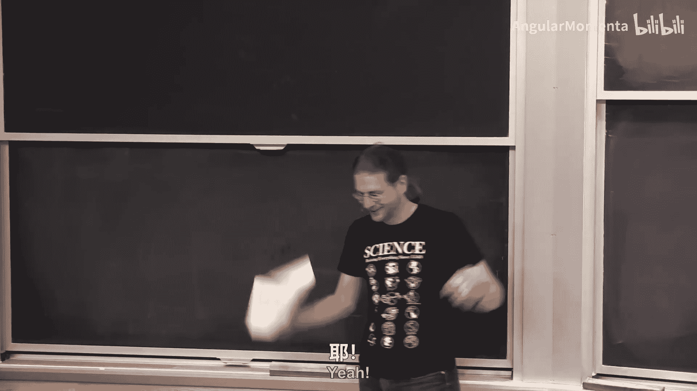
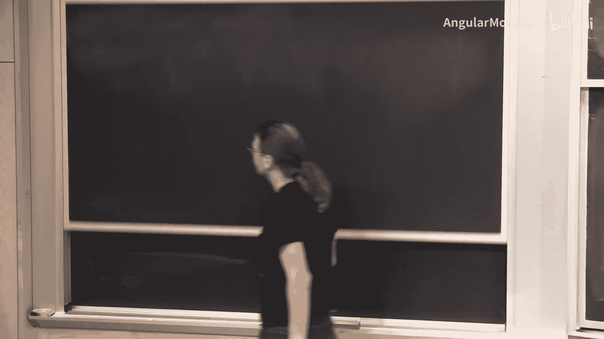
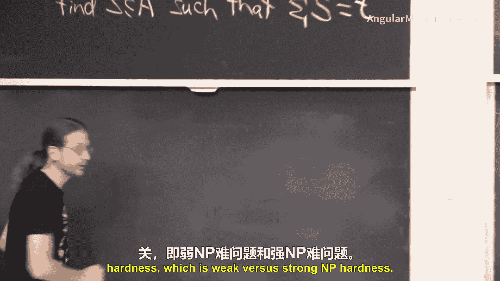
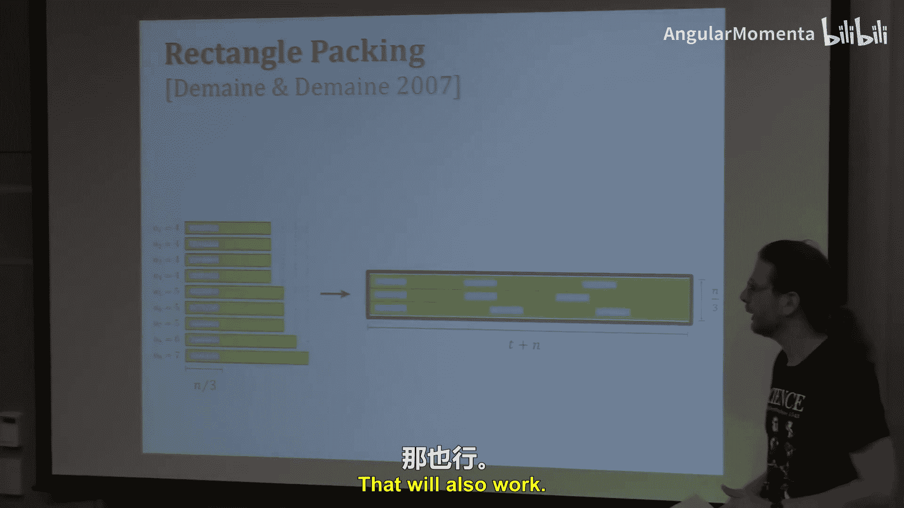
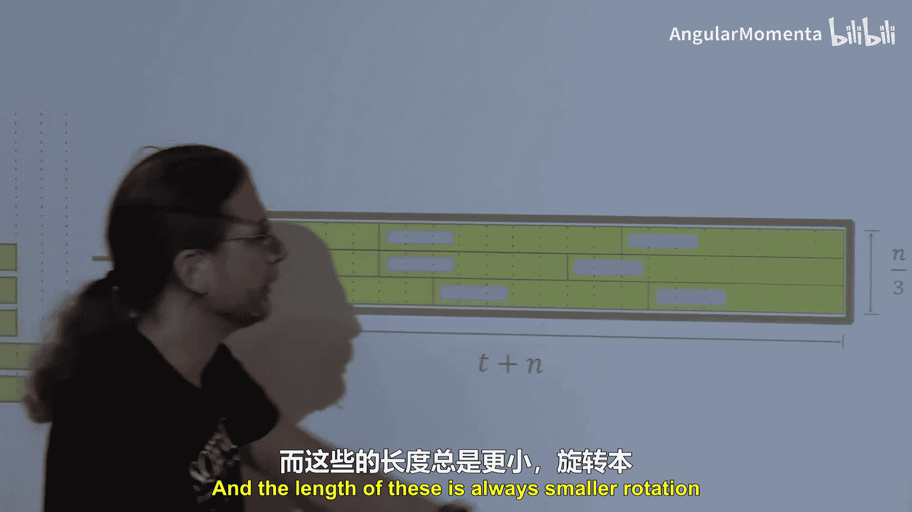
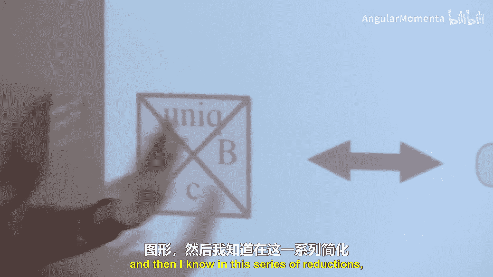
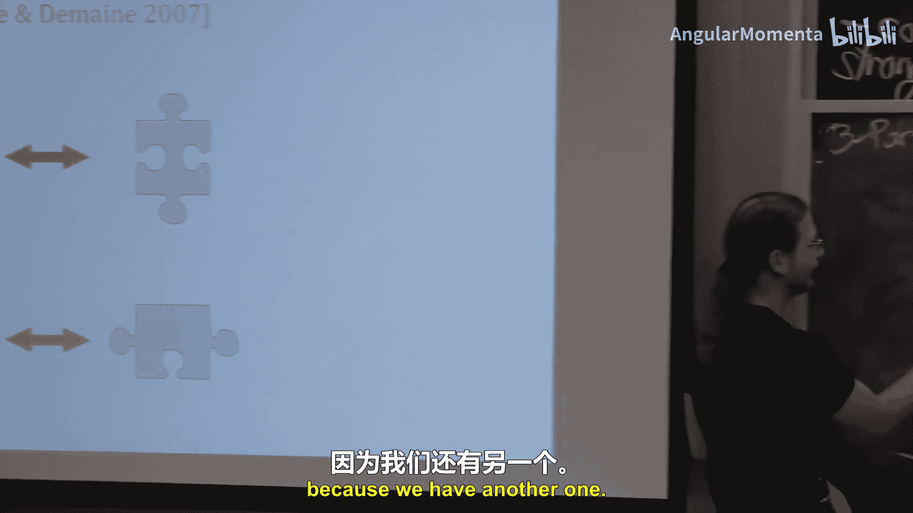
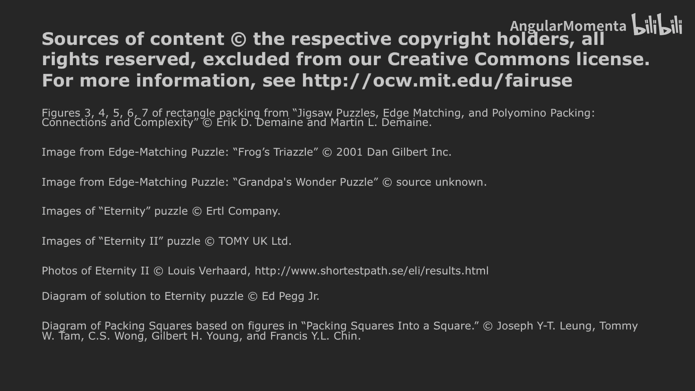

# 【麻省理工】算法下界 ｜ MIT 6.890 Algorithmic Lower Bounds, Fall 2014 p02 2. 三分割问题 I -BV1dPYpz9E4V_p2-

The following content is provided under a Cative Commons license。

 Your support will help Mi T OpenCourseware continue to offer high quality educational resources for free to make a donation or to view additional materials from hundreds of Mit courses。

 Visit Mitopcourseseware at Ocw。mt。 Eduu。

All right， you guys ready for some more hardness proofs。

Let's do it。 So today we start the universe of three partition。And in general。

 we're going to see today。2 plus problems， which are useful for dealing with numbers。For。Reducing to。

Number problems， numbers here。Are going to be integers。For the most part。Usually in complexity。

 it's a lot easier to think of all your numbers being integers。

 So around integers use fixed point or rationals。 and then they're basically integers。

 So we're gonna talk。 my favorite is three partition。

 and that will be pretty much all the proofs will do in the number context will be a reduction from three partition。

 This is all about NP hardness， I should say。But before we get to three partition。

 I'm gonna talk about another problem， which is called two partition。

So two partition。First， I'll just have to define all these problems， which will take a little while。

 Then we'll get to all the fun reductions。 So in two partition， you're given and integers。

We'll call the set of them， capital A。And we'll call the integers themselves little a sub I。

I from one to n， let's say。And what we'd like to do is partition them into2。Groups。Let'sSa a1 and A2。

Eals a of equals sum。We want the sum of the integers in A1 to equal the sum of the integers in A2。

 and therefore， they will equal one half the total sum。Okay。

 so we just want to decide binary choice for each number， should it go in a1 or a2。

So this problem is NP hard。And it's one of the original carp problems。

 There's this famous paper by Carp in 1972 that had before that。

 there was a paper by Cook that proved satAT is MP complete。

 And then Kp wrote a paper with a zillion。 not literally。

 but dozens of MP hardness proofs from sat to things like to partition。

 I will not cover the proof here。 If you're interested in it。 read Gar Johnson。

 There's a nice coverage of it of this problem and all the problems we'll be talking about today。

Okay， as a sideline， I'll mention there's a generalization。This problem。 So it's also n hard。

 Any generalization is gonna be even harder。But it's useful to know about。 It's called subset sum。

 Occa， it's easier to think about subset sum instead of partition， although it's a generalization。

 So if you can reduce from subset sum， you can also reduce from partition。And here。

 the setup is similar。 You're given。And integers， again， just like before。

And you're given a target sum。 This is one other integer。We'll call the target sum T。

I'll also call this T。And what we'd like to do is find a subset S of a。Whose sum is T。Okay。

 this is a strict generalization here。 You're not given a number T。

 but you're essentially choosing a subset a 1。Whose sum equals the sum of a over 2。

 So this is really just a particular choice of T。 This is the general case where you're given T。

So this is harder than that。 but it's worth knowing about in particular。

 there's a problem set problem with the problem set will be out in a couple of hours。

 and it's a little easier to think about subset some We think you don't have to。Alright。

 so let's go to。3 part。My favorite MP complete problem。So。Start is the same。Given integers。

A1 up to A N。We're not given a target sum。What we'd like to do。Is partition them。

Partracition that set， a。Into how many pieces？3， nope， and over3。Its kind of like，3。😊，Not quite。

 let's say sets a 1。A and over three equals a。 I'm using a union with a dot to indicate it's a disjoint union。

 So these， it's， that's what a partition means。 That's redone it。 This is old fashioned notation。

 You probably haven't seen it。 But when I was growing up， that was the notation of the day。

 Then we have。Right。To end over three sets。Cool， yeah， assume n is divisible by three。 Otherwise。

 the answer is no。Okay， and then which is the easy case of equal sum。

So we want the sum of each AI to be equal to T， which is to the same thing。

 which is going to be the sum of the A's divided by n over 3。Okay。

 if this problem were about partitioning to three sets， it would not be very interesting。

 It would be basically identical to two partition with n over three sets。

 things are quite a bit different and we will get to that difference in a moment。 But first。

 let me tell you about some fun facts about three partition。

 So we're partitioning into n over three sets。 So you would expect on average。

 most of the sets will have size 3。 In fact， you can make all of the sets have size exactly three。

 because if you look at the reduction for this problem you can。Assume。That each AI。Is。

Between T over 4， strictly between T over 4 and T over 2。Okay， if you have。

 if you're gonna have a set of numbers that sum to exactly T。

And each of them is strictly bigger than t over four then that means you can't have four of them because you would sum to too much and they're strictly less than t over two than you can't just have two of them and hope to get to T。

 so you have to have exactly three in every set。You don't have to assume that in some situations。

 it's useful to just say， well， the AI is are some sets that sum to the right thing。

 Sometimes it's useful to assume that they're triples。 It's up to you。

 What you consider that part of the problem statement to ask for the AI to have size 3 or not。

 and it's useful to have both。 In fact， you can， once you have this， you can make all the AI is very。

 very close to T over 3。Using a trick， which we'll see a bunch of times today。

 So let's say you could。Add。I'll call it infinity。To each AI。In that case， of course。

 any solution that you had before is still a solution。

Just think of T as infinity as a really large number。

 something like n to the 100 times the maximum is。Item in a， something like that。 That's a really。

 maybe to the 100 power if you want。 But really big number。

 this will preserve all solutions because all solutions， every set has size exactly 3。

 So if you had three times infinity， they'll still have the same sums。 And when you do that。

 then most all the AIs are basically equal to each other。

 which means they're roughly equal to T over 3。The， the big。

 the leading term is the same for everybody。 And then there's this little noise。

 which was the original integer that you're adding on to。That infinity。Anyway。

 so then all the ads' are roughly t over  three， cool。

Let me tell you about a couple related problems with three partition。 And then I'll tell you why。

 why we're talking， even bothering to talk about two problems instead of。Just one。

So next problem has a funny name， especially when you don't know what three dimensional matching is。

 but we will get to that second。 Don't worry about the name for the moment。

 This is a closely related problem。 It's really。A specialization of three partition。But okay。

 so we've got。In this case， we're going to be given three sets of integers。

And what we'd like to do is， I mean， it's basically the same problem。

 Just think of taking the union of those sets。 But each of these sets that we're choosing。

 the AIs should consist of one element from A，1 element from B，1 element from C。

So how did I formalize that。Let'sSa say partition。呃。The union。As the destroy union into。And。Tris。S。

 I。呃。And cross product ABC。So you're choosing one from each of these guys in each SI。

 and they should be of equal sum。And so the sum will be sum of a plus the sum of B plus sum of C divided by。

And， I think。Cause there's three of them。Cool。Okay， so almost the same problem。

 I just changed what n was by a factor of 3。 That's why there's n over three here and then here。

But here we're specializing in a sense to say that we， we can。

 we're giving different types of numbers the red integers， the green integers and the blue integers。

 You have to choose one of each color。Okay， for fun。Let me show you。Why this problem is。

In some sense， simpler。Okay。It also give you a useful kind of technique for playing with these number problems。

 So I want to reduce from this numerical three dimensional matching problem。

 which you might also call the ABC version of three partition。

 I'm going to reduce it to three partitions。 So I'm given an instance these numbers。

 And I want to somehow force。So the basic idea is to take these numbers and just throw them into one big set a prime。

But I want to force this ABC property that I choose one from each。Maybe any suggestions yeah。

I just have a question。 If Def these all as sets， you can't have duplicates of I didn't say the word set。

 I actually meant multis。Yeah， so。This is a multi set。 Good question。All of them are multi sets。

 So it makes the notion of destroying a little bit weird。 But you know what I mean。What yeah add。

Okay， add a， I hadn't thought about this。 So add a really big number to all the bees。

 And then twice that big number to all the C's。And then the target sum would be three times the big number。

Plus， sorry can' do。Yeah， right。 So you don't want， you don't want to take2，2 Bs。

 And then that looks like a C。So maybe you want。Three times a big number here and six times a big nine times a big number here。

 something like that。 I think actually， one times a big number and three times a big number would do it。

 Yeah， cool。So the way I did it， the notes was adding a small number， but either way it works。 Let's。

 let's do with the big numbercause that's fun。 So we're going to take。😊，Okay。

 so we will construct I'll call it a prime。To consist of。A。We all little A in big A。

 And then we'll say a plus usually big number I write with a capital B。

 but that's not very good'cause we already have a couple B。 So call it X。

Or I should call it infinity for consistency， right。So for each B and B， I will。Add infinity to it。

 and then see。Is going to be say three times。This do four times infinity。

 It makes me feel a little safer somehow because， but we're constructing a set of size 3。

 So if you take three of these， I worry that looks like a C， It's not enough， but it'll be safe。

Why not。We can choose pretty big numbers here。Happy。No。

You might be able to do multiple As in a single set。

And if they're sufficiently small because they don't have to get their。Okay， okay， A's are a problem。

 You could maybe do more than three total。 So let's do one infinity。Then。Get a proper eraser。

It's a good thing we have Sarah here to correct our proofs。嗯。3 infinity。9。ですね。

6 would be badca then two of these would be one of those。Yeah。Right。

 so this means the new target sum。Should be。The old target sum。

 which was the sum of these de met band。Plus。13 infinity。Okay， infinity， a function of the end。

 Infinity， I should define。 let's make it。I think just like 10 times max of a ought to do it。You。

 you could be it as a function of n。 I don't think that's necessary here because all of our sets are size 3。

 But if you're doing something like this for part two partition。

 you'd want to multiply by n or n squared。 So this is a common trick to do this kind of scaling or offsets or things like that instead of infinity here。

 you could write epsilon where epsilon is much smaller than1。 I think that would also work。

 And that's what's done the a opposed prime。Oops， this should probably be max of ABC。Yeah。

 you can't make it max of a prime。 That would be cyclic。 Then infinity would actually be infinite。

Yeah。Good， so I think that works。 there are things to check here。 Obviously。

 we need to check that whenever we have a solution to the original instance。

 we have a solution to this instance。 That's pretty clear。 You just take the same choices of the AIs。

 Bs and Cs and。The infinities will always add up to 13。

 The tricky part is to show that if you have a solution to this three partition instance。

 you can convert that back into a solution to the numerical three dimensional matching instance。

And that's where you essentially want to show that the infffinities can be treated algebraically because they're so huge。

 you can never construct an infinity in another way。啊。So。

 but I'll leave that as an exercise to actually proveca we're not really gonna use this problem too much。

 You're welcome to， maybe on problem sets， maybe in open problems， it would be good。

 But most of the time， I would say we use three partition。

 I want you to know about this in particular，' because it's related to another problem。

 which is called three dimensional matching。Yes， is the assumption that the AI is solid a Carality 3 built into the problem specification here。

 You get a choice。 You can either make this part of the problem specification or not。

 it won't matter。 Okay， Well， I think in this case。

 if you don't build it into the can you take 12 As。

something and then you get 12finities and then they add up to anotherfin。 Yes。

 we definitely want to take this as part of the specification for this reduction， y。Good point。Okay。

 so。Here's a problem。 You've probably heard of the matching problem， matching problem。

 let's say the perfect matching problem is you're given a graph。

 and you want to find a set of edges which are disjoint。

 meaning no two edges share a vertex that covers all the vertices。

 So if you have n vertices you'd like to find n over two edges that are disjoint from each other。

 That's perfect matching You might call it two dimensional matching because an edge has two ends。

 three dimensional matching takes place in a hypergraph。And in this case， it's gonna be a hype。

A tripartite hypergraph。You may not have seen hypergraphs before。 they're just like graphs。

 but edges can have more than two endpoints， in this case， they willll have exactly three。

So let's say， the vertices。A a Detroit union， B， Detroit Union， C。

And let's say they all have length size n。And the。Hyper edges。异。Okay。Okay， so this is。

 maybe it's worth drawing a picture。So， you have。Se A， set B。I they're all the same size。Se C。

And an edge might look like this or like this。Or so on。Okay， those are， you take one from each。

 And then your goal is to find an over3。sorryrry， and。Djoint edges。If find that many。

 and they're disjoined。 That means they will cover all of the vertices。

 Every vertex will be hit by exactly one edge。Hypered。Okay。

 so this is the three dimensional version of bipartite matching。

 I guess there's also a non bipartite version。For。Extra completeness。

 There's something called exact cover by three sets。3 meaning the cardinality。 This is called X 3 C。

 You do see 3DM and X 3，3 frequently in the literature， and especially in Gary Johnson。

 So they're good problems to know about。Here。It's sort of the generalized version。

 where you're given。Non tripartite， just a three uniform。

Hypergraph 3 uniform just means every edge has Carinality 3。And your goal is to find。啊。

Let's say it has n vertices。Find。And over three disjoining hyper edges。Okay。

 many times the almost same problem。 How do these relate？ Well， certainly。

 if you take a numerical three dimensional matching problem。

 that is a three dimensional matching problem， you can convert it into a graph like this。

 You're just forgetting the fact that there's numbers。 But then when you draw the edge。

 you draw one of these hyper edges exactly when AI plus B I plus C I equals the target sum。😊，Okay。

 so。numericalummerical three dimensional matching is a special case of three dimensional matching。

 Occaionally， it's useful to start from three dimensional matching， not for number problems， though。

If you have a number problem， you' like the numerical version。Personally， I prefer three partition。

 but these two are pretty close。 We saw one connection between them。Exact cover by three sets is。

 in some sense， even more general than three dimensional matching。呃。Yeah， it is more general。

Because tripartite hypergraph like this is three uniform。So this is a strict generalization of that。

 but they all appear somewhat。 So thought it'd be good for you to know about them。Again。

 three partition is where where the action is。All right。Let me go back to this issue of。2 partition。

Versus three partition。 These are the two main problems I want to talk about。And。

They relate to an important distinction。In NP hardness， which is weak versus strong NP hardness。

So there are two。Types of NP hardness。For number problems。If your input is a graph。

 these two notions are the same。 so you don't need to worry about it。

But when your problem has integers is input。诶。Then there are two types。Weekly MP hard is。

 in some sense， the type you already know。 if you think about it in the right way in the intended way。

 we haven't been super formal about how numbers getting coded。

 but usually we think of NP hardness as。In terms of the。

 how hard your problem is in terms of the encoding size， which we usually call n。

 the encoding of your input。Okay， so in the usual form。呃。What this means is that you allow numbers。呃。

To have exponential value。Because even when their value is exponential。

 the encoding of that value is polynomial。Coding length of such a number is know if you write in binary。

 that's log base 2 of the number。 If the number is 2 to the end to the C。

 which is our definition of exponential， that's going to be n to the C and that's polynomial。

OkayFor here， I'm going to let n be the number of numbers to avoid this to avoid circular definitions or something。

 So I'm saying they're n different numbers。 if each of them is at most two to the n to the C in value and they're integers。

 then I can encode them in this many bits and that's a polynomial number bits。

 so I consider that a reasonable encoding。Okay， and sometimes that's just fine。

But there's a stronger notion， which is really useful。

 especially for a lot of problems we will see today and next class。Which is called strongly NPhard。

And this is。NP hard。Even when。呃。Your problem is restricted。Two numbers。Of polynomial value。

So polynomial here is with with respect to N。 N is the number of integers， number of numbers。Okay。

 so strongly NP hard is stronger than weekly NP hard。 If you have， if your NP hard。

 even when your numbers are only polynomial size， then， of course， your NP hard。

 when you allow the numbers to be as large as exponential。

 This is a weaker constraint on the problem。So to cut to the chase， two partition up here。

And subset sum are weekly n hard。And if you believe that P does not equal in P。

 then it's not strongly NP hard。That's the best you can hope for。

 whereasas three partition and every other problem we talked about is strongly N P hard。

I haven do you mean exactly by。Numbers having exponential value。So again。

 exponential like 2 to the n to the c N is the number of numbers in your input， yeah。So， that's。嗯。

That's what I allow。 I mean， this is what would be allowed if you didn't say anything。

 if you interpret complexity theory in a way that I haven't necessarily told you， but generally。

 you want to assume that all your inputs are reasonably encoded in an efficient way that most possible input strings are valid inputs。

 And so if you're encoding your then in particular。

 usually encode your numbers in binary or turnernary or quaernary or hexsMO。

 anything bigger than one is good。Okay， and you should know， if you're writing got a number。

 don't use unary。But today， we're going use Eary a lot。

So this is the same thing as saying encode and unary， strong and be hardness。Is like saying， well。

 my problem is so hard。That even if I encode my numbers in unary。

 it's still hard in the resulting input size。The input size would be if you write down every numberary at。

 so add up all the numbers that's your input size。3 partition is that hard。To partition is not。Okay。

 so if you can prove strong MP hardness， you should。 It's better。

If you can only prove we can be hardness， it's okay。's still hard。Now， you should know。

Corresponding notions on the algorithm side。So let's talk about that a little bit。嗯。

So corresponding algorithmic notions are， there's actually three of them。

The main ones are pseudopolynomial and weekly polynomial。Sorry。

 the weeklies are unrelated to each other， but that's。That's life。

There's also a notion called strongly polynomial， unrelated to strongly NP hard。Here you go。Okay。

So weekly polynomial is the usual notion of polynomial。I should mention。

When I say I have a polynomial time algorithm， what you mean is weekly， meaning that let's say。

 all right， it's polynomial in and the number of integers。And let's say， log。Of the largest integer。

largestrgest number in the input。Okay， that's a reasonable encoding size。 You write them in binary。

 You add them all up。 So you multiply that by an or whatever。 polynomial and that。

Value is weekly polynomial。 pseudoponomial。 You omit the log。Okay。

 so I want polynom n and the largest number。And strongly， polynomial， you emit that term altogether。

 So you're just polynomial in the number of numbers。Okay， so there's a different world of algorithms。

 which we're not gonna talk about here， which is weekly polynomial algorithms versus strongly polynomial algorithms。

 I'm not aware of any lower bounds about that， But there's famous open questions like。

 can you solve linear programming in strongly polynomial time， We don't know。

There's no hardness notion there。 So we're not going to talk about it any more than that。

 What we care about more is this distinction between pseudoponomial。 This is polynomial。

 when the numbers are written in urinary and this is polynomial。

 when the numbers are written in binary。So these two notions correspond to these two notions。

So in particular， if you believe P does not equal in P。

 then weekly NP P hard means there is no weekly polynomial。Algorithm。

But there might be a pseudopolynomial algorithm。Strongly。

 NP hard means there's no pseudoponomial algorithm。 And therefore。

 there's no weekly polynomial algorithm。 So the difference between weekly polynomial and polynomial is that we don't even necessarily give ourselves time to read all the numbers。

 Okay， I should binary I didn't want to get too much into models of computation。

 But the model of computation here is that you're allowed to read an entire number in one time step。

 So if you've taken 6，8，5，1 advanced data structure， this is like word Ram。

So that's the only reason this would be reasonable。 otherwise you couldn't read the input。

 That would be pretty hard。 So the model is you can do you can take a constant number of your numbers。

 do something with them， output another number of the same type。

 roughly in constant time and you want to do a polynomial number of such steps。

 usually arithmetic operations here， you don't have to be so careful about the model because。

Any reasonable encoding， you can read it and do whatever you want with it。

If you don't care about the expo in the polynomial。

 all models are equivalent if you believe the strong church tier thesis anyway。This one。

 you have to be a little more careful what the model is。Good， so let me draw my favorite diagram。

With the difficulty axis。So， but now， instead of P， I'm gonna distinguish between weekly polynomial。

 pseudoponomial and strongly polynomial。 So these things are。Sudo polyli。

These things are weekly polyly。And these things。Stly， Poly， this is on the algorithm side。

 upper bounds。Being left of a particular position。 And then on the hardness side， we have。呃。

Let me use red， more dramatic。This thing is。Weekly NP hard。This is if p does not equal in P。

Then you are strictly to the right of pseudoply。 So there's no pseudopli problem。

 There's also weekly NP heart。Okay， and then strong。Strongly MP hard。

Excludes even a weekly polynomial al。Okay， so strictly to the right of that position。So obviously。

 strongly MP hard is a better result because it's smaller than this class。嗯。But for example。

 two partition， which is only weekly NP hard， has a pseudo polylynomial algorithm。

 You've probably even seen one in your algorithms class。

 if you've ever done anything like Napsack as a dynamic program。That is a dynamic program。

 probably originally done for two partition。Okay， so that problem is somewhere in here。

Weekly NPp hard， oops。I think the diagram is backward if the problem is strongly polynomial events also weekly。

So the middle ones， right。Thank you。That seemed funny。 right， Strly。

 polynomial is the tightest class。 That's the best result。 And pseudopoly is the worst result。

Did I get my arrows in the right place。We've got a shift over。Shift over one。Right。

 strongly NPp hard。hoops。So weekly NP hard is here， strong MP hard is there。Okay。Cool。

 so let's check。 So two partition should be pseudo polyly。 So left of this line。

 but weekly and be hard。 So right of that line。 that looks good。😊，So this is two partition。

3 partition is out here。I mean， I draw this as a region。

 but it's more like a point in my old diagram because two partition is actually in NP。

 so it's strongly NPP complete， so it's like right at the edge there anyway。

Theres no pseudopolynomial algorithm for three partition， unlike two partition。Point of all that。

Let's do some reduction， shall we。MP hardcore time。So maybe over here。Okay。

 the first reduction is going to be pretty。So。Why is there no corresponding notion for problems that are not numeric。

 Like why isnt， why can't for a graph problem， We say， well。

 we're going to examine this graph problem， assuming we're using an inefficient encoding of our graph to see how hard it is。

 I guess you could try to define this in terms for graphs， but I don't think there's such an obvious。

 inefficient notion of graphs。I mean， the obvious inefficient notion is like use a matrix instead of an atency list。

 but that's polynomly equivalent。If， I mean， there certainly are other notions you could imagine。

 but。But there aren't any in the literature。Alright。So just to warn you。

 the first reduction we do is gonna be a little bit trivial。 So don't get too excited yet。

 But this is where3 partition comes from。Then we'll do lots of cool。Coance。

So multi processor scheduling。Let's say， I have and jobs。And they have。Completion times。

And that's it。You can start them whenever you want。And then on the other hand， I have P processors。

To run those jobs。Each processor is sequential and identical。

So the model is you assign jobs to processors。 Jo can only be on one processor。

 and it runs to completion。 Then it can run another job and so on。My goal。

I'll state the decision version is to。Finish。All jobs。And time。Leless than equal to T。Okay。

 so I claim this problem is NP P hard。Some variety， let's start with a reduction。From partition。

Sorry， partition is a synonym for two partition。Usually， we emit the two。Oh。

So reduction from partition。This problem over here。 So I'm nowm given some integers。

 I wanna split them in half， basically。Any suggestions on what I could do to turn that into a multi processor scheduling problem？

不。Two processors， yeah。P equals 2。 That is the reduction。 I guess technically。

 I also have to specify what T is， but it's over there， so。

You set T to be the sum of the A' is over 2， and you don't change A， you just leave it alone。

So you just feed in the same AIs into this problem， and that is two partition。Okay。

 let's do a reduction from。 So now we know the problem is at least weekly NP hard， but in fact。

 it is strongly NP hard。Because we can reduce from3 partition。 What do you do。P equals n over 3。

That's it。 You said T accordingly。 Some of the A is over P。Done。Okay。

 so this problem comes from the paper that introduces three partition， which is by Gary Johnson。

 same people who wrote the book so。This is， I mean， this basically is three partition。

 That's why they cared about it。 But here's a practical motivation for it。嗯。Cool。

Let's do something more interesting and I'm going to want a projector。Any questions about？

I think you've asked enough questions。About pseudoud Poly， Week with Poly， strongly Poly。

 as I raised them。Don't forget， then。But I think for the rest of today。

 we're just going to be doing strong polynomial reductions from three partition。IThink next class。

 you might do some weak ones， but。Today， we're gonna really use the fact that it use the strongness。

 And you'll see why， because we， we really want to encode some numbers in unary。Okay。

 well let's start with a problem。ectTangle packing and this is going to lead us to a whole bunch of other types of packing problems。

So this is what you might call packing rectangles into a rectangle， so I'm given。And rectangles。

And I'm given a target rectangle。So when I say I'm given a rectangle。

 what I really mean is I'm given the dimensions， the width and the height as integers。

 We're usually gonna assume all our numbers are integers， as I said。Do they fit？

So what I like in a solution is to rotate and translate the the given rectangles so that they're disjoint from each other。

 They can't overlap， and they all fit inside the target rectangle。Right， so。

This might be the target rectangle。 And then I don't know。 Maybe this is my set of rectangles。

 appropriately packed。So here， maybe the answer is yes。

 if they don't fit inside the target rectangle， the answer is no。This problem is strongly NP P hard。

 but I'm pretty sure we don't know whether it's N N。So there are， there are lots of open problems。

 I don't mean to indicate everything's known。 This is I should double check that this is definitely not known。

 but pretty sure it's open。 because of this rotation issue。

 there's kind of a lot of things to worry about。 So it's not clear how efficiently you can encode a solution。

 Maybe you need a ton of bits of precision to say how things are rotated here。

 they're all rotate at the same angle。 They may not be。 Who knows。So we will consider a special case。

Which is。Exact panicking。This also makes for a stronger hardness result。

So exact packing means there are no gaps。None of this stuff。That's forbidden。

So if you have no gaps and you look at a corner of the rectangle。

 that makes me there's a rectangle right there filling the corner， which means there's no rotation。

 Well， you could rotate by multiples of 90。But so there's four rotations。

 but I guess two for rectangles。um。Intger times 90 degrees。

So then the problem is in NP because also that you can show at that pointca you have integer rectangles packing to an integer rectangle by induction。

 the translations are integers。 Therefore， there are succinct coatings of them。Okay。

 we don't have to do this， but this is just to point out this is one way to make the problem in NP。

Now， they're assisting solutions。 So we're gonna prove both of these problems are strongly and be hard。

呃。I think I'll skip the weekend be hard inness proof because it's not really any harder。Pun intended。

 so let's go。There。So basic idea。 Again， we're reducing from three partition。

So that means we're given an instance of three partition。 We're given an integers。

 We want to represent those integers as rectangles。

 So kind of the obvious way to do that is we take each AI and we convert it into a rectangle。

 Let's say it's AI by one。 That seems pretty obvious。 This is what you might call the AI gadget。

 This we're gonna map this feature of our given instance to this feature of our constructed instance。

啊。All that would be left at this point is what is the target rectangle。Which I didn't give a name。So。

Let me call the。Target rectangle B。It's what I use in my notes yeah。So， let's say， B。Is gonna be。

What's a rectangle？What is the height of the rectangle？And over3。Yes， right。 And then the width。

The sound about a bike around。The targets on there T。Cool， so the intent is， if I。

The rectangles will look something like this。And always， however， if I fit3 in here。

 or maybe I could do more than3。 But we know that won't happen with the actual three partition instances we get。

Becauseuse we can assume there's always three of them， but anyway， we're not constraining。

 There's only three。 You put in however many rectangles that add up to exactly the target sum boom。

 we've got the target sum。 and there's just enough space for all of them if you pack them this way question we specify that the AIangle is AI to make sure that we can't。

 Yeah， so part of my confusion in drawing this。 And I worry is you can take one of these rectangles and rotate it。

 And then this reduction is wrong。So this reduction is wrong。So I will cheat and make this epsilon。

And then multiply this by epsilon。 This is one way to fix it。Of course。

 now I have to scale everything up by one over Epsilon to tell you what Epsilon is。

 You are suggesting some multiple n。 which is a good， good suggestion。

 I think as long as we make this like much smaller than one。

Then it's not possible to rotate because these guys are at length at least one because they're integers。

 So if I tried to rotate， it has to be a multiple of 90 degrees。

 I think as long as this is strictly less than one， we are okay。

I didn't change the intended solution。I just made everything now。

And so I just need to set Epsilon less than3 over n。Would be that。Inequality。But I want integers。

 so I should scale everything up by n over 3。 So just multiply all the numbers by n over 3 and you're done。

In fact， you can be a little simpler and I drew this diagram long ago。

 so I might as well show it to you。 You can just add n over  three to all your integers。

 That will also work under the assumption that you only have you can only take three numbers and add them up。

 then you' will always be adding three times n over 3 horizontally。

 And so so the AIs here are this the yellow part of these rectangles。

 and then we're just adding this fixed n over 3 to all of them。 So is a 4，4，4，45，5，5，6，7。

And that happens to be a positive instance of three partition。 There is a solution。

 This is one way to do it。 So we're just adding n overall here because we have three times n over three。

And that guarantee， and。You， the length of these is always。Smaller。

Yeah。Rotation should not be possible， right， because。

Each of these guys is gonna be length strictly larger than n over 3。

 becauseuse we add an integer to n over 3， a positive integer。 And the height here is n over 3。

 So that just barely works。Same thing， more or less， just。

 this is scaling by a multiplicative factor here。 We're doing an additive thing because we have this luxury of knowing there are three items in every triple。

Cool， rectangle packing question。 Yes， sorry。 All the integers are positive。😊，Yeah。

 you don't have to， but we can， so we will。Makes our life a lot easier。Other questions？Okay。

Time for some puzzles。So I think I'll show you some real life puzzles First。

 There's this notion of an edge matching puzzle， which goes back to the 1890s。

 I believe this one is from。late 1 teen90s or early 190s。 So it's one of the older ones you' probe。

 at least when I was growing up， we had these puzzles all over the place。

 So what's going on here is you have physical triangles and these half frogs are drawn on the edges of the triangles。

 And your goal is to pack all these triangles into the big triangle。 That's easy。

 It's a regular triangle。Tranangulation， but。You need the half frogs to match up。The but the， the。

 I don't know the， the hind end of the white， sorry。

 yellow speckled frog matches the front end of the yellow black speckled frog。 as drawn here。

 this is a valid solution。 But if I like rotated this tile，1 hundred 20 degrees。

 that's not a valid solution。Even though it's all hinds， matching to fronts and so on。Okay。

 rules clear。 So these are edge matching puzzles。 This is formulated in a different way。

 This is not a valid solution。 The goal is to get these colors don all match up。 So in general。

 you can think of there being a color on an edge。 And here it happens to be composed of these two colors。

 And it have to match both of the colors on the other side。

 So this essentially like having a colour on each edge。 here， we also have a color on each edge。

 but we also have a sign， which is the front or the hind part of the frog。 you know， the yellow frog。

 the red frog， the green frog， the orange frog。 So in general， we're gonna formulate this。😊。

Over here。Okay， there are many types of these puzzles。 I'll try to capture。

That's not exactly either one of those。If you've ever studied something called Wang tiles。

 this is exactly that model。Just throwinghrow the word there， but。What we have are n unit squares。

Those are called the tiles。Each one。Has four colors。ABCD。So。呃。One color per inch。And。

You're also given a target rectangle。It's going to be integer because these are unit squares。

And you want to。Pack。Probably exactly packed。 It's not gonna be any gaps the squares into the rectangle。

With。Colors matching。So whenever I have two squares。That share an edge。

 the color that's written here， better be the same color that's written there。That's the rules。

 If you're on the boundary， no restriction。 but if you're an interior edge， you restrict in that way。

This actually closely matches what is currently maybe the most famous edge matching puzzle called Eernity 2。

 This one is still unsolved。 Well， the creator has a solution。

 And if you ever find it or one of the many other solutions who knows。

 you will win 2 million US dollars so。Time to get rich。 Well， yeah， I guess that's。😊。

The way to make the most money is first solve P equals NP p， then solve eternity，2， I guess。

 But you could easily solve this puzzle without P equals NP P。

 There are actually a lot of almost solutions out there。 I believe this is one of the leaders。

 this guy， Louis Verhad。😊，Got so this is a complete solution with all the pieces。

 but not all the edges match。 So that's hard to find them。 But here's one， for example。

 that mismatches。 So I didn't explain。 But there everything is a square tile here。

 and there's a different shape and color。 but it's basically a color from a mathematical perspective。

 Gotta match them all up。 Here， we got 467 matches out of the $480 edges。

 And that won him already $10000。 And I believe it's found with a computer aided search。

It's got software on I I。I don't know for sure。 I would guess that it's Lewis's daughter。

 Here's a different， almost solution where there's some missing tiles， but everything matches。

And then at the bottom of his web page， you should check it out。 It's funny。 He says。

 and here's a solution to in Trinity  too。 And I looked at this for a long time， like。

 I don't see any edge matches。 but you guys are smart。

 So you probably know there's one other cheat you could possibly do。😊，puzzleuzz。嗯。And a different。

Add different tiles。 Maybe， although these are nicely printed tiles。

 So I would guess he bought two sets and he's mixed some parts。 I wrote a program to check。 Yes。

 indeed， Some tiles are repeated here。 I forget exactly how many，10 or 20 or something。

 It's still pretty cool。 It looks like it's done。 But there' is no complete actual solution using each piece exactly once。

 It's probably clear here， but you only get one version of each square。😊，Okay。

 so there's your motivation for solving edge matching。 So you might wonder。

 can I solve it in polynomial time And the answer is no unless P equals NP P。

 And here we're going to use essentially rectangle packing。😊，And this reduction。So how could I。

 how could I， again， we're going to reduce from three partition。

 How could I convert a number AI into something like a rectangle using edge matching。嗯。

I should probably copy over the one that we had in the end， which was AI goes to。

And over3 plus AI by one because we want integers。Yeah so。

You may get so that there's sort of one color that's for joining most things。

That's when were kind of on the outside of each rectangle。

Pick together each your rectangle if you need like if the rectangle is like A of I by one then you're going to need AI squares such that there's like one color for that rectangle that is。

お。よろしくですね。Good， so we're gonna convert this something by one rectangle into that's into something different squares。

 That's， and we're just gonna subdivide like that。 And we're gonna surround all these edges with the same color。

😊，That will work。And the interior address。The interior edges， areright， so we're gonna take AI。

 and we're gonna convert it into。嗯。Okay don't make me draw all of them。The width here。

 let's say it will be n over3 plus AI。And we're gonna use a special color。

 I'll call it black on the outside。 And this color， I'm gonna call these red suits。Slightly visible。

 I'm gonna call I。This is gonna be a different colour for。Each AI。

Thiss this will require a little bit more work。 You could also use a different。 you could use I1， I2。

 I3。 that would really force this to go together in this way。 if I'm a little。

 if I'm trying to be conservative on colors， I'll only use n of them， then we'll put those all I。

 And then as long as none of these match to the boundary。I'm okay。I guess even if I use the I1， I2。

 I 3， it's possible。 some of those match the boundary and then。Weird stuff could happen。

 But as long as all these eye colours match up with each other。

 you have to build this rectangle once and then we don't care about how the rectangles are assembled with respect to each other。

 So we're basically simulating this reduction， rectangle packing。Okay。

 the 1 I have drawn here is slightly different。 I don't remember why we did it this way。

 This is joint work with Marty domainma， the。Cameraman。And。Here we made the just I guess。

 to be as simple as possible， we made the width of each of the rectangles， just AI。

That has the problem that you could rotate。 But to prevent rotation， we use a different color。

 horizontal and vertical。 So the top edges and the bottom edges all have the color percent sign。

 I think this is a limitation of the drawing program I was using at the time。

 Xva and dollar signs on the left and right side。 And then we're going build frame。

 This is what you might call infrastructure for the proof。 This is one gadget happens。

 You just execute at once。 This we execute for each of the AIs。

 We're just going to have one copy of this big frame。 The goal of the frame is to hide the boundary。

So that none of these tiles could match the boundary because when they match the boundary。

 then you're breaking a rectangle in half and bad things could happen。So instead。

 what we're going do， all these capital letters on the outside。 And I ran out of letters。

 used a couple symbols。 Those appear exactly once in the reduction。 So they can't match with anyone。

 which means they have to be on the boundary。OkaySo those guys have to be on the boundary and then all these other colors appear exactly twice。

 so you have to join these tiles together in exactly this way。And now the boundarys gone。

And we have set up dollar signs on the left side on the right side and percent signs on the top and the bottom sides。

 In reality， these would be。Whatever T。Wide and and over three tall。This is some different notation。

 And that's it。 Now you're simulating rectangle packing question。

 you need two rows bottom So this two rows is to indicate for whatever reason。

cause edge matching puzzles usually the target shape is not a rectangle， but a square。

 And we wanted the stronger result that packing unit squares into a square with edge matching results is NP hard。

 So just the point here is you just add， however many rows or columns you need to make a square。

 Yeah， good question。 Jason， different。 we'll get there at this。 yeah。

 So I have different symbols here and here in order to prevent rotation。 That's right。

 Instead of making them longer， I could have instead made these longer like we had with the rectangle thing。

 But I guess at the time， I wasn't thinking of teaching in class about this。

 So I didn't reuse my previous reduction for this one。 but oh， well，Yeah。But yeah， the。

 the reason there are dollar signs in that like red or some actual colour is because， yeah。

 probably black and white printing was more common then。O。Cool， that was one puzzle。 and now。

Key point。What if we did this reduction from partition。So with partition。

 instead of having n over three groups here， we just have two groups。And same thing， why not do that？

That would be a weekend be hard reduction now。This problem here。

 edge matching puzzle N unit squares of four colors。 Are there any numbers in this problem。

Other than four。And and are there any numbers that are inputs。

 The colours do have to be represented as numbers。 But so this is sort of a sideline。

 Usually we when we're talking about colours， all we care about is whether the colours are equal or not。

 so。You don't normally think of those as numbers that you can think of them as vertices and graph or something。

 I mean， they're more like combinatorial objects。 You're not。

 you're never adding two colors together。Yes， the other point that the of colour can get four times and number of colours is at most four times。

 And yeah， you could write down a colour as two to the two to the n。 but why。

Itposed to be in efficient encoding。 So there are really no numbers here。

 So it doesn't even make sense to say this problem is strongly n P hard。But even worse。

 if I started with two partition and I did this reduction exactly as was drawn， but not as tall。

I could still make it a square， but。Everything would break。Because for two partition to be hard。

 those numbers， the AIs have to be exponential in value。 If I have an exponential value AI。

 when I convert it into a rectangle， or actually， I convert it into a bunch of tiles。

 I will have exponentially， many tiles。 This construction will be of exponential size。

 So I will get exponentially， many different colors on the boundary。 So that's very bad。

Even if you're clever and you say， oh， well， these tiles are all the same。

 So maybe I'll encode them efficiently and say there's exponentially many of this one tile。

 The ones in the boundary are all different。 So it's not a valid reduction。

 you should always take a problem。 supposed to run in polynomial time and produce a result of polynomial size。

 So if I start with something where the input is polynomial size， but it has exponentially large AIs。

 I do this， I get an exponential size puzzle， which is。Tough to born to solve。 I don't know。

 It's not a valid MP hardness reduction。 This is why we want to start from3 partition。

 because then I know even if what I'm doing here is representing the AIs and unary。 I take AI。 I say。

 okay， I'm gonna have that many square tiles。 That is exactly unary representation。

 And we know with three partition。 that will have polynomial size。 And so we're good。

This is why we care about strong N hardness so much， because a lot of puzzles。

 you can only represent numbers in unary。 Then you， you're forced to work with repartition。Okay。

Next puzzle。Is signed edge matching puzzles like the lizards。 S same setup。

 But now the colors aren't supposed to be equal。 They're supposed to be opposites。

So I'm just gonna modify this diagram， and I will use capital letters to denote tails of lizards and lowercase letters to represent heads of lizards。

 And little B only matches。 capital B does not match little B。 You can't put two heads together。

 Two tails together。 Well， you can reduce。these things。

 which I'll call unsigned edge matching puzzles to these things。

 which I'll call signed edge matching puzzles。Yeah with this。Easy gadget。If you have a tile with。

 let's just say colors A， B， C， D， some of them might be equal。

I'm going to replace that one tile with these four tiles。And scale everything up by a factor of  two。

 scale the target shape by a factor of 2。These colors appear exactly。Once with each sign。

 And so you're forced， again， because there's a frame and all the boundary is eaten up。

You're forced to match these guys to each other。 therefore。

 you're forced to make this two by two tile。And so that two by two tile is supposed to represent this one by one tile。

 And the claim is signs no longer matter because we put little A， big， A， little B， big， B， little C。

 big， C， and so on。 So if I took another tile like over here。And it has something like capital D。

 lowercase D。 that's going match with this lowercase B， lowercase B， if and only if B equals D。

So if the original colors are equal， the resulting colors will be equal and opposite。

 So it'll be the same letter of the alphabet。 but with opposite signs。

 And so everything will match up because this capital later will match here。

 It lowercase letter will match there。s clear。 So it's really becomes the same puzzle And you know。

 this one's gonna be solvable filming If this one is。 So we get strong N。 Well。

 just N hardness of signed edge matching puzzles。 Co。😊，Next puzzle。These are all in the same paper。

 It was a fun paper。 It even older。 jigsaw puzzles。 This is not the oldest jigsaw puzzle。

 It's one of the newest。 It's our course poster turned into a jigsaw puzzle。

 If you want to make your own jigsaw puzzles go there。

 They go back to the 1760s when they were made with jigsaws。 hence the name。 But basically。

 we have square pieces。 And each side of this， I'll assume that's a special kind of jigsaw puzzle。

 Most common。 Each edge can either be straight。 That means it's on the boundary。

 It can be a pocket or a tab。😊，And each pocket and tab is slightly differently shaped。

 although maybe not in this picture， usually they are。

 I'm going to allow that some of the pockets in the tabs have the same shape。

That's what you might call ambiguous mates。 Most chiigsaw puzzles sold in the world do not have ambiguous mates。

 but let's say they do。 And to make it N P hardcore， there's no image on the pieces。

 just a white puzzle。 Now， those are salts。 You can buy why all white or all single color puzzles and。

But usually， they don't have ambiguous mates。 That's like the ultimate combo。

 If you don't assume either those things， then the problem is easy。 So we don't care about that。

 There are papers about how to solve jsaw puzzles in the。Practical case。 But in our situation。

 we can just， I mean， that's basically is edge matching puzzles with signs。

 This is actually probably why I care about signed puzzles the most。 I have lowercase letters。

 Those are going to correspond to pockets。 I have uppercase letters。

 Those are going to correspond to tabs。 And， of course， a tab must meet a pocket。

 Sam as the lowercase letter must be an uppercase letter。And so that is the same thing。

 I would like my target shape to be a square because that's clean。 So whenever I have a unique color。

 which is one that I know has to be on the boundary， I'm gonna make it a flat thing。

 And then I know in thiss series of reductions。 I should draw the series of reductions because it's kind of fun。

😊。

So far。Kind of started with。Rectangle packing， I guess technically， we started with three partition。

I'll try it like this。We reduce that to。Edge matching。Puzzles。Then we reduce that to。

Signed edge matching puzzles。Then we reduce that to jigsaw puzzles。

And if you follow this series of reductions and see what you get。

 we know that the boundary shape will be a square because that frame gadget is a square。

 And if we make all the unique things flat， then the shape will actually be square。

Thiss the reason I'm drawing it this way because we have another one。

So， next puzzle。So you might ask， well， eternity 2 was an edge matching puzzle。 What was eternity 1。

 Well， it's something called a polyform packing puzzle。 These are。

 if you take an equilateal triangle and cut it in half like that， That's a shape。

 If you take K copies of that shape。 joinin them edge to edge along matching edge lengths。 you get。

 you can get all these shapes。 It's like Teris。 But instead of with squares。

 you start with that shape and you join a bunch more of them together。 I don't know exactly how many。

 they may not even be all the same area。And your goal is to fit inside this big dodecaagon or something。

This was solved。Million pounds were acquired。By two people， I think they were mathematicians。

Alex and Oliver in 2000。 So actually quite soon after the puzzle was posed， I think within a year。

 less than a year。 So there was， you know， articles about how the insurance company was not happy。

 that's why you get insured against a puzzle being solved， I guess， but an eternity too。

 is a consequence is much harder。 And so no one has solved it yet。 but it will happen someday。

 I'm sure。So this gives you a clear sense of what the shapes look like。

 So I want to prove these puzzles are NP hard also。By a reduction from jigsaw puzzles。

So let's just bring up to the picture。So we just， we just did this reduction。

 It actually works in both ways。 They're really the same puzzle。

 This does not work so easily in both ways。 but I'm going to take a jigsaw piece。

 I'm going to turn it into roughly a square made up of little squares。

 I'm not going to work on the half triangles， although I think it wouldn't be any harder。

 It's a lot easier to think about square puzzles more like Teris， these are polymonos。

 So polyo packing。 this type of puzzle。They also exist。

 but that no one has won 2 million a million from them。 Sos I showed eternity。 So almost a square。

 But then in the middle of the edge， we're gonna write in binary what the shape was here。 I mean。

 So there was， you know a color over here and we can and a shape here。

 all we care about is whether there's the same or different。 So there's only， you know。

4 and different colors out there。 And so we're gonna take log of4 and bits and write them in this way。

 And if it was indented whenever we have a one， we're gonna indent here。 And if it's。

A tab instead of a pocket， wherever we have a one， we're gonna outdentt。Okay， so。

These are all different codes。 And so none of them fit together。For example， and。

Let's see anything match up。This one matches with this one。YeahBecauseuse if I rotate it around。

 stick it on， it will match up。 So you have to make sure you get the orientations of the codes all right。

 but you can do this。 And two things will fit together and make a nice。

 clean seam if and only if the original color is matched。 And so this represents that puzzle。

Where we've increased the， we've blown everything up by like a logarithmic factor in each dimension。

But the number of pieces is staying the same。In a sense。

And then so that was this reduction to polyopacking。For fun， we closed the loop。

And reduce from polymonno packing to edge matching。In this way。 so we're going to take our polyo。

 carve it up into little squares， turn them into edge matching puzzle。

 And here I actually want to allow rotation。 So I'm going change these colors to all percent signs。

 and now。Just there's the same puzzle。 again。 So we have to use the frame again。 And so if you want。

 you can just keep following these reductions over and over and over。 I think every time you do it。

 you increase the scale factor by like a log factor。 But it's kind of fun。 I mean。

 it really shows these puzzles are very。😊，Close to identical in that we didn't have to blow up the puzzle size by very much to go from one puzzle to the next。

 So usually we're just thinking about polynomial blow up here。

 We have a very small notion of blow up， which some tight sense in which these puzzles are almost the same。

Okay。End of paper。Fun open problem。Is。This reduction used log n by log n。

 order log n by log n pieces。 What if your pieces only have area log n。

So maybe they're root log n by root log n or something like that。

 I'm sure it should still be NP hard。But never know。 if， for example， their constant size。Actually。

 well， let's say if they're size 2， it's easy。 Leave it at that。 Even if the shape is very messy。

 But if they're also two by two blocks， it's easy。 So they're clearly small shapes are too easy。

 But probably logarithmic areas where it starts to get interesting。 I don't know。

 What about log log area。 That's probably neither NP hard nor polynomial， but。😊，Oh， well， cool。

So I w to talk about one more problem。One more hardness proof。In the similar vein。It's about packing。

I already erased packing rectangles into rectangles or rectangles into a square。

 What about squares into a square。If you can tell that's a square not a rectangle。Okay。

 this is a nice paper。 We've used it for other hardness vers。

 which we'll probably talk about next class。 So I'm given a bunch of squares。

 and I'm given a target square。 Do these squares fit in there。And again， we。

 willll probably use exact。 initially， we won't be exact packing。

 But let's say that the squares can't can only rotate by a multiple of 90。 In other words。

 they can't rotate。We will fix that by making it exact packing。Whenhy don't I jump to。The reduction。

The heart of the reduction is this idea。We're just going to add a big number here。

 I am going to use capital B for the big number。 this is what's in the paper。

 This is a paper from 1990。 motivation here is you have a big grid supercomputer which are popular in the 80s and 90s and you have a job which is a square grid of processors。

 let's say， and you want to execute them all in parallel but they're not allowed to overlap because that would slow your supercomputing down。

 but you are allowed gaps， let's say。So。I'm just going to take each of my AI numbers。

 add this huge number to it。So they're all roughly the same size。

 This is the trick we did at the beginning of class with three partition。Right， all these numbers。

 all these sizes are almost the same。 I've drawn them quite different。

 But imagine they're just like tiny fluctuations。And then I make the height of this rectangle for whatever reason I transpose my image。

 That's probably why I was confused earlier。 I just make the height three times the big number because I want three pieces to come together。

 plus T。 my target sum of the AIs。 So this is a huge thing， plus a super tiny thing。

 But what it's saying is what you have sp。 They're all almost the same sizes。

 There's that little bit of extra。 And that little bit extra has to add up to exactly T。

 So this is one triple with the desired target sum。 And then I want to get and over three of them。😊。

Now， here's where things get a little dicey。 Okay， let's just say I， I take the largest1。

 or actually， I'll go all the way up to B plus T。 I know that every number I have is smaller than T because theres some of three of them is T。

 So I'm always gonna have a gap here。 And let's say I just pack the next three there。

 And then the next three there。 And So I'll leave enough room that even with the slo。

 I can fit everything in。 So each one is B plus T， and the number of them is in over3。

 So that will be the width of my rectangle。 Look like a lot of slop。

 But that's cause I drew this with the square is very different in size。😊。

If we compute the amount of slop。Let's see。The maximum， like if you look at this distance。

It's at most tea。Certainly， even if， if AI were 0， which is not allowed。

 then this distance would be T。 So it's going to be even smaller than that。

 But the gaps here are always at most T。So， we can take。So this is a total slop。Is T。Times。

The height。So that was like the width of one sliver of slop。 and then the height is 3 b plus T。

And then times n over 3， because there's n over three of those things。And hopefully， this works。

I want to say this is less than b squared。Yes。B is。Bigger than。Cool， T times n，3 is cancel。

 So if B is， I think this term won't matter because B is gonna be bigger than T。 So well。Yeah。

 I don't。 maybe put a two there for extra safety。 and you're totally dwarfed。

 So we're just dividing both sides by B。 We're getting three times t times n over 3。

 That's T times n， okay。Cool， so the point is the total area of slo that I have here is less than a single square。

 single square is even bigger than this。So you're not gonna to be able to pack any more squares。

 And that's a vague argument。 But enough hand waving later。 And you prove that， in fact。

 any packing of these squares will give you three partition。 That requires more work。

 but this is some intuition why it is true。嗯。Okay， so this was actually packing squares into a rectangle。

 But that wasn't the problem I started with。 I wanted to pack squares into a square。 So for that。

 you need an infrastructure gadget， like the frame that we made before。

 And this is kind of a cute number theory ish trick。I'm going to take some integer X。

 We'll choose it later。 It's just going to be big enough， something like n。

And we have one giant square， which is x times x plus 1-1 by， they're all squares。

 So by the same amount。 And then we're gonna take these medium size squares of size x plus1 and these small squares。

 so much smaller of size x。And because this is just one smaller than what it's supposed to be。

 I mean， if it was x times x plus1， it would sort of come to here。

 And so when you pack these guys up， you go just one too far there。

 but there's exactly enough room for one more。 If I put x plus one extra。 This is x， that's the one。

And so on。So this leaves as a gap， a rectangle。Now， this is not the only solution。

 these guys could slide down， but you can show that will only make your life harder。

 And the paper does that。 That's sort of the easy part of the proof。

 And so now you're left with a rectangle， which is one by this thing。You multiply everything by。

The3B plus T。Because that was what we wanted one of our dimensions to be， the smaller one。

 so that scale up the rectangle。 and then the horizontal， the width may not match exactly。

 but if if there's too much space here， just set X to be large enough。

 then there'll be extra space and just throw in a bunch of B by B blocks there to fill up the extra space。

 and you can figure out how much extra space there is and fill it in So there you go。

 packing squares into a square， and this is strong and be hardness。

 So this even when the squares are only of polynomial area， this problem is hard。

 which is actually the case you care about when each of these one by one squares is a processor。Now。

 this was not exact packing。 And so you might worry， oh。

 what if I rotate the squares and then crazy things can happen， Probably not。

 But you could also just compute how much extra sp there is because you know the area of the input squares and you know the area of the target square and just add a whole bunch of one by one。

A little chips。 And that will fill in exactly the space。 Then you have exact packing。

 Then you don't even have to worry about rotation。 So that makes proof even cleaner。

 I think that wasn't in the original paper， but it's a nice little addition。

 And that is our packing through three partition。 Next class， we'll do more。

More through partition for different types of problems。

So in case you lose lots of pieces in your jigsaw puzzle， we have the one piece jigsaw puzzle。

This is all the pieces are in one giant connected mess， and。Still， it is。Not so trivial to solve。W。

All right， this is the one piece chiigsaw puzzle in solve state。It's Simpson's edition。So you get it。

对的你不带人。差了。

