# 【麻省理工】算法下界 ｜ MIT 6.890 Algorithmic Lower Bounds, Fall 2014 p03 3. 三分割 II -BV1dPYpz9E4V_p3-

The following content is provided under a Cative Commons license。

 Your support will help Mi T OpenCourseware continue to offer high quality educational resources for free to make a donation or to view additional materials from hundreds of Mit courses。

 Visit Mitopcourseseware at Ocw。mt。 Eduu。

Al right， welcome back to 6，8，90。 Today， we continue our theme of reductions。

 N hardness reductions from three partition。 Yesday。

 we saw a couple of different reductions from three partition。

 and then a bunch of reductions from those problems。 various puzzles。

 The last one we covered was packing squares into a square。

 This is just a reminder visually what it looks like。

 But we're going to just take this result is given。

 And first MP hardness reduction will be from packing squares into a square。

 And then we will see a bunch of possibly as many as8 reductions from three partition。

 So without further ado， Let's get started。 the first problem， we're going to talk about。😊。

Is edge unfolding polyhedra。 This is a geometric folding problem。 So if you're interested in more。

 you can take 6，8，4，9。 but here's a simple， if you've ever made a cube out of paper。

 probably you cut out a cross shape and then folded it into the cube but if you want to know how should I what shape should I cut out to make cube。

 then you want to know where should I cut which edges of the cube should I cut。

 they're drawn in red here so that when I unfold it， I get one connected piece without overlap。

So for surfaces that are topologically as sphere， you want to cut along a spanning tree of the edges。

 And for a cube that will always work。 But for some polyhedra， like these two， when you unfold。

 you get overlap。 And in fact， no matter which spanning tree of the edges you take for either these two polyhedra。

 you are guaranteed to fail， you cannot make these out of one piece of paper。

By folding and get an exact cover。 So that's bad news。

 And these are older Celsiusels are back in 1998， but it remained an open problem。

 Are there how many other examples are there。 If I give you a polyhedron， I want to know。

 is there an edge unfolding， We only cut along the edges， What's the complexity of that。

And the answer is， it's MP complete。Strongly NP complete， slightly stronger。

 This is not obviously a number problem， but in geometry。

 you have this issue of what are the coordinates of the vertices。

 So the coordinates could be exponentially large， or they could just be polynomly large here。

 they only need to be polynomly large。 So strongly MP complete。 This is a complicated proof。

 So I'm just going sketch the idea of how it works。 At the beginning。 Like most proof。

 there's some kind of like overall infrastructure that holds all the pieces together。

 This is one part of that。 Well， this is the main infrastructure in this reduction。

 There's some stuff around the side。 This is mainly to make the surface topologically as sphere。 The。

 the focus。Is on a square face here with has a little slit in it。 And there's a tower coming out。

 It's drawn edge on here。 This is the part we actually care about。 I think actually。

 it will be redrawn here。 So we'll really just be thinking about this。

 And then there's some stuff that wraps it around and makes it a fear without changing unfoldings。

 So don't worry too much about that。

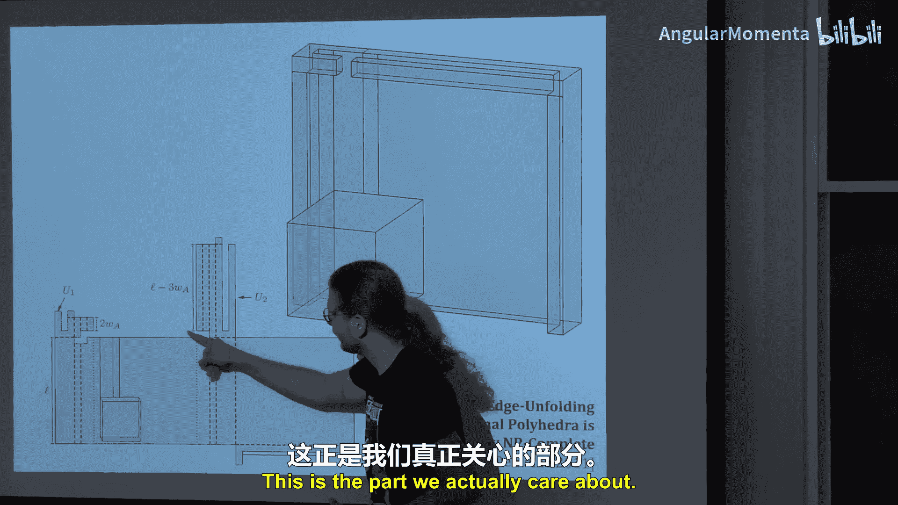

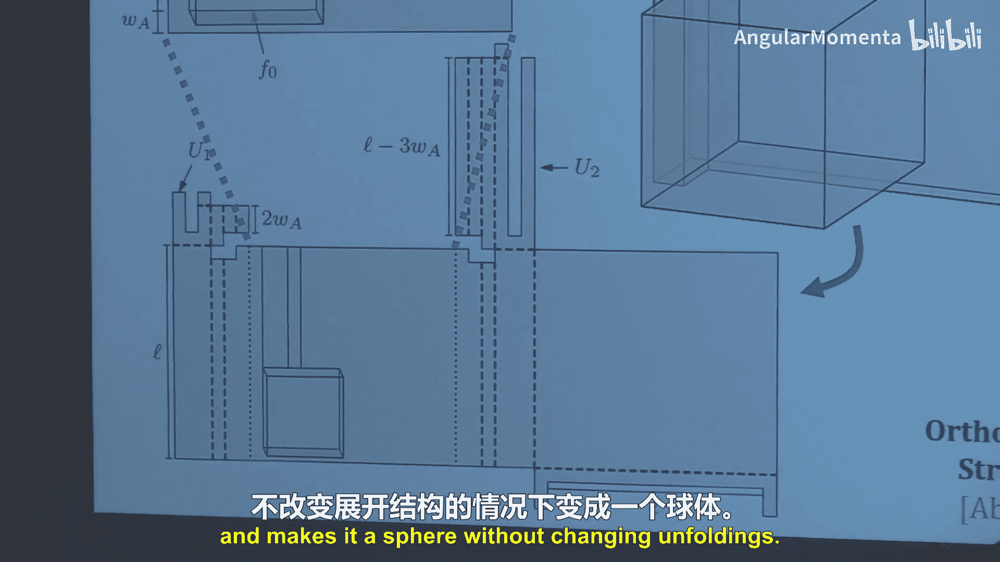

Manly， we have this giant。 Think of it as an obstacle because we're not allowed to overlap when we unfold this thing。

 So this shape can't be cut up because it has no edges except for here。 So this part can move around。

 it turns out it will stay in there， but it might just move up so we can make a little bit of space here。

's there's this whole of this face。 And then there's this tower that's sticking out into the third dimension。

 And we need to somehow unfold that thing and fit it in here。

 doesn't look possible because this is not quite drawn to scale。 So is gonna be super long。

 So a lot of the stuff here is just gonna be stuffed up the chimney。 so to speak。

 But also on the surface， there's more stuff going on。 So let's zoom into this thing。

 if we unfold that tower into a plus sign。 Most of it is lots of tiny stuff called atoms。

 which we will get to。 And then the kind of the interesting part from a three partition standpoint or sorry from a square packing standpoint。

😊，is there some square faces。 And because we're edge cutting our surface。

 those squares will remain squares。 There's no edges on them。

 So those guys somehow have to move around when you unfold， and it's not drawn this way。

 but the squares are large enough that they can't fit up the chimney。

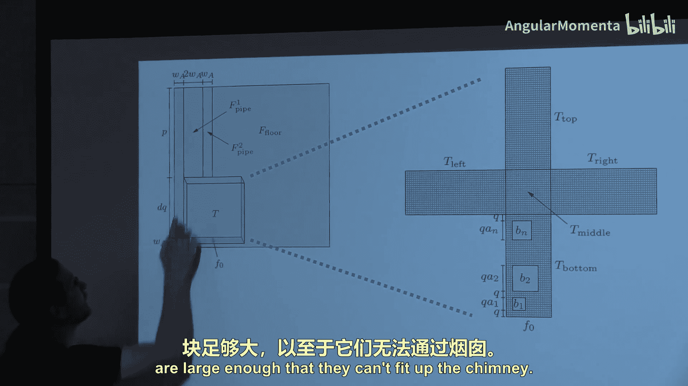

Okay， this chimney is actually pretty narrow， constant width。And those guys are all really big。

So this other stuff can move up the chimney， but the squares will have to stay in this square。

 And that's how we're going to get packing squares into squares。 Now。

 the challenge is what we want to be able to do is move the squares around freely。 But in reality。

 we need to make a connected 2D shape。So somehow we need to connect together these squares by some。

Stuff， that's the mystery atoms so that basically， we for any square packing。

 we can arrange to have those faces in that rough arrangement。

 And then the other stuff somehow connects everything together。

 And whatever doesn't fit in here goes up the chimney。So that's the plan。 If we zoom in， right。

 So this is sort of the the diagram of that plan。 Imagine you have some placement of the squares。

 and we're going to try to connect all the pieces together。

Maybe to some common root in the lower left corner。 first。

 we're just going to draw some Ls conceptually to connect them all to here those cross。

 which is not allowed。 but then we're going to reroute the Ls to go around the so to get up to this box。

 we're going to go around all of the other boxes below it And in this way we get a non-crossing arrangement。

 if we zoom in even closer these are drawn as lines， but really the little strips of paper。

 And they may do weird things like zigzag back and forth。

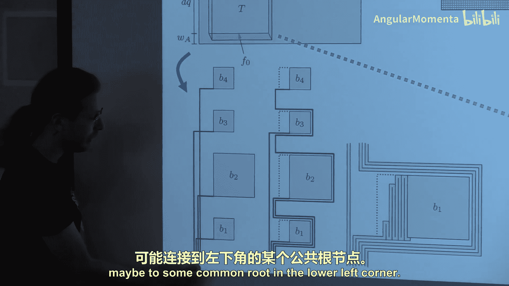

How that happens， we'll see in a moment。 But this is to convince you that at least if we could play squares and they're not like right touching each other。

 So we're gonna shrink each square a tiny bit， which I I won't get into the details。 But if， if the。

If they're integer squares， let's say， then we'll shrink them maybe by minus1 over n or something polynomally small。

And then that， that gives us a little bit of room to route all of these paths if we make them like one over n squared or one over n cubed in thickness。

 still polynomial， so still strongly n hard。嗯。So if we have a square packing。

 we can connect them all up in this way。 if we have these magical atoms that can do whatever we want。

😊，Freely。 and that's the， so in a little more detail in this picture， the。

 we imagine the atoms is somehow being connected together in a chain。 potentially。

 And then when they unfold， this is the fun part， so。😊，We maybe for connectivity purposes。

 maybe first we want to visit B1， then we want to visit B2 and so on。And。

That corresponds to some traversal on the surface of this plus sign or the tower that's sticking out。

And then in 2D， when we unfold it， we have a different thing in mind of whether we want it to go left or right。

 So there's moving left or right intrinsically on the surface。

 And then there's moving left and right in the unfolding。 So two separate things。 And conveniently。

 this one structure is one of these boxes。 This is what we call the atom can do all of those things。

Certainly not obvious from the picture。 It's just a little bumpy square。

 but you just trial the cases。 These are three of the cases not obvious。

 but they turn out to be 10 if after you remove reflections and rotations。

 there's a few things going on。 but the main thing going on is whether you're going left or right in the。

Get get this straight。 whether you're going left or right in intrinsically on the surface and whether you're going left or right or straight in the unfolding。

 So here you can see you're turning left in the unfolding。

 you're going straight in the unfolding and you're turning left in the unfolding。

 So the second corner is L S and L， what's less obvious is if you fold this up and you。

 you get the atom structure。 But the thing that you attach to here is on and the folded structure either to the left or to the left or to the right。

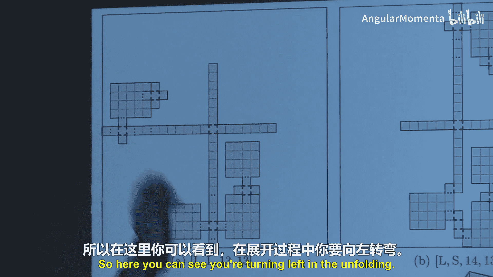

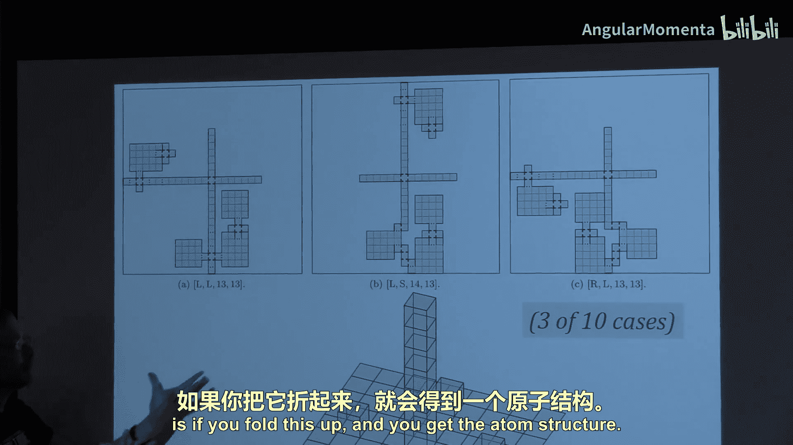

So you just check all these things and then this is like a universal glue that can connect together the squares however you want。

 both on the surface， where they have to be connected originally and in the unfolding where you want to match some square packing。

So we'll have a little bit of hand waving there。 Lots of hand waving。 But in the end。

 you get MP strong MP completeness of edge unfolding polyhedra。诶。Any questions？Alright。

 perfectly clear。 Then。 let's move to another puzzle。

 This is called the snake cube puzzle or the Kubbra puzzle。 Here is one instantiation of it。

 So we have。😊，It's a chain of blocks。好。Try to unfold in a way that I can put it back together because it's actually quite tricky to solve。

 It's a chain of blocks。 and there's an elastic through the centers going through the center of the faces。

 And so the result is you can't really pull the squares apart。 It's a pretty tight elastic。

 but you can spin because from the elastic point of view， these are all equally happy。😊。

So you're basically told that and I， I could also spin here。

 but it doesn't do anything if I stop at a 90 degree angle。 So I'm forced to be straight here。

 and then I'm forced to have a 90 degree turn。And then a force to go straight and then have a 90 degree turn and then go straight and then have a 90 degree turn here I have a few 990 degree turns in a row。

And that's the general structure。 And can I still solve it， Maybe the goal is to get into a cube。

Okay， and there are a bunch of different versions， plastic wood， whatever。 This one is not solved。

 And so I will not do so well。 But you get an idea of what it looks like in its sort of。Flat state。

Can make it into a kind of staircase。 So in general， this。

This puzzle is specified by sequence of lengths of straights。

 And then in between those lengths are the 90 degree turns。 Okay， so that's the puzzle。

 pretty simple specification。 And your goal is to fold it into cube。

 You know how big the cube is you just take the number of little cubes and take the cube root so。呃。

This puzzle maybe goes is at least 1990 but could be older， we don't know exactly。

And this puzzle is also MP complete。 And this proof is also complicated。

 So we won't see all the details， but this one will probably see a little bit clearer。

 This is a proof by， in particular， the three of us and， and Marty and the V So all four of us。

And let's see。So this doesn't look like a cube。 So let's。

 before we try to solve the problem of folding into a cube shape。

 let's suppose I I give you one of these chains。 And I wantan to can it fold into this shape。

 Let's say this is the target。 So it's a big box down here。I think we call the hub。

 And then there are these spokes or just big boxes， long boxes sticking out of the hub。 There's a。

 there's a hole here。 There's they're connected to the main structure。 And you want to fold that。And。

Let's see。 So the， the， the big idea。 we're reducing from three partition here。

 We're gonna represent a number AI as a zigzag。 Well， not sorry， shouldn't call it a zigzag。

 But we have a really long bar， then a length1 bar， and then a really long bar and a length1 bar。

 I'm drawing sort of the thinned version。 This is really a little cube。 This is little cube。

 These are lots of cubes。 huge number of cubes。 Okay， So that's really， really big。

 so big that the only place it could fit is down one of these spokes。So of course。

 the idea is that these represent our triples whose sum is equal to T。

And so we have to take these things。 And because these are so short。

 you can't like go out of one hub and like jump to the next one because there's a non a gap there is bigger than one。

 So once you commit to having one of these long bars into one of these pockets。

 then all of them have to go into the pockets。 So this is， in general。

 a big issue with three partition proofs is you want to represent the number AI in some way that cannot be。

It's not divisible。If you could take I AI and split it into two parts。

 then the packing problem becomes trivial。 You split everything into units or something。

 So we have to make sure AI remains a single chunk。 We are， of course。

 encoding AI in unary here because we have one long bar per each AI。

 But for three partition unary is okay。There's some things going on here， a little bit weird。

You see this thing is occupying the full length， and the length here is going to be eight times the target sum instead of just the target sum。

 And we're multiplying this by 8。 So those are equal。 We're fine。 There， there's a reason for the 8。

 which we will get to。Okay， now， like the previous proof， the edge unfold folding polyhedra。

We have these great units， and we just like them to be free floating。 And if you。

 if you generalize this puzzle a little bit and say， well， actually， I don't just have one chain。

 I have two chains and or I have n chains。 And together collectively。

 they have to fold into this shape， then we're done except you would remove the box。

 the big the box over here。😊，Because then these guys just somehow have to be assigned to these little pockets and we're happy。

Okay， all of these numbers， although， again， not drawn to scale。

 all of these numbers are much smaller than huge。 So you can't like， take this guy and put it here。

 even though in this picture， it looks like you might be able to。Allright。

 so the issue is now we want to connect this together into one big chain。

 We have these units for each eye。 We have one of these units。 That's cool。

 and we want to attach them together in a way that is super flexible。

 just like the atoms we had before。 Now we're going to use something which we call the zigzag。

's why I didn't want to call this is zigzag。 This is all unit segments。 So you have 90 degree turn。

90 degree turn，90 degree turn 90 degree turn， No straights。😊。

This turns out to be universal in a strong sense， it can fold into anything。

And so we can use it to connect these parts together。 So what we're gonna do is have the。

 the a1 gadget。Then we're gonna have a whole bunch of zigzag so you can go wherever you need to go。

 and then we'll have the a2 gadget， and then we'll have the universal zigzag gadget for a long length of it。

 And then the a 3 and then alternating between zigzags and the AI。 And at the end。

 we'll have enough zigzag that we can fill all this sort of extra garbage space。

 But we will use this garbage space in order to route around。 So maybe a one's gonna go here。

 And so we do the this thing this。Yeah， looks like some kind of cooker。

 We go back and forth like that。 Then we'll have the zigzaang going say， okay。

 I want to go over here next， and then we'll do a2 there。 And then we'll route over here。

 And because this is in 3D， crossings are not an issue。 I can just go out into the third dimension。

 We don't need much of a third dimension 8 is enough。 You can just enough to go over each other。Okay。

 and then at the end， we're gonna fill in all this space with this zigzag。

 So let's talk about this zigzag。What we claim is a couple of different senses in which it's universal。

 but the， the key idea are these sets of gadgets。 So we're drawing here at  two by two by2。

Cube made up out of， you know，8 little cubes。And if you look at the what we've drawn here is the elastic that goes through the centers of the cubes and notice it turns 90 degrees at every。

 at every voxel at every little cube。 So thats this is part of these are zigzag constructions。So。

What we want to say is that if you sort of。So one sense of universality is that the zigzag structure can fold into any polycube structure。

 Polycube is the 3D generalization of polymons that we saw last time。From polymo packing。

That's not true。But if you take any polycube structure and you just scale it by a factor of 2。

 So you place every cube with a two by2 by 2 grid like this picture， then。It's still not true。

 but it's better。 So what's true at that point is if you take any path of two by  two by two cubes。

 this is what we would call a Hamiltonian shape because there's one path that visits everything with no collision。

 So it has to be a path that doesn't not hit itself in 3D。

 Then you can follow these gadgets in order to make any turns you need to do， or you can go straight。

 everything is possible。I will talk a little bit more about that in a moment。

 So 2 by  two by2 refinement， meaning scaling everything by a factor of  two allows the zigzag to make any Hamiltonian shape。

Scaled by two。嗯。But that's Hamiltonian shapes。 Now， conveniently。

 there's this theorem which is used a lot in computational geometry。

 and we use it in this hardness proof that if you take any shape and you refine it by two by two by two。

 you scale by a factor of two， then it becomes Hamiltonian。By a similar kind of gadget construction。

 although it's easier。 if you just want Hamiltonian paths。

 you don't care about where where you're turning and where you're not turning。

 So that's a pretty easy proof。 left as an exercise to you。

 and sort of an aside from this this issue。 So we take any shape。 We2 by2 by 2 refine it。

 We make it Hamiltonian。 Then we 2 by 2 refine it again， in total 4 by 4 by4 refine it。

 And then zigzag path can make that polycube shape。 this is for any poly cubebe。So that's cool。Now。

 I'll mention here in this proof one of the issues， which we'll see a bunch of times。

 I'm just gonna sort of mention it here is we have a parodity issue because the， the cubicle grid is。

Too colorable。 right， You can check orboard the， the 3D grid of squares。

 And so what that means is every time you go from one cube on the grid to another cube on the grid。

 you're switching parodity。 So， if you checkerboard the 3D space， black and white。

 it was going from white to black， then black to white， then black to white， then or sorry。

 alternating black and white。 and easier to do than to say。And so that's a constraint。 So。

 for example， it is impossible。To。In a two by two by two thing。To， let's see。Enter from this cube。

 the front cube， and exit from this one。Just by counting argument。 So you start。

 let's say this is a black cube。 This one also black cube。 And so you start black。

 and then you alternate black， white， black white。 and there's eight things to visit。

 and you want to end black。 That's not possible。 you have to end white。

 So if you enter on a black cube， you will leave on a white cube。 And if you enter on a white cube。

 you leave on a black cube。 So that's a constraint doesn't really get in the way here。

 but it's something you have to keep track of。 And the theorem wouldn't be what you'd like to say as well。

 I can enter from any cube and leave from any cube。 And you could actually prove that by induction。

 except the base case would be wrong。 So this is something to be careful about。

 This is the base case。 This is one cube。 Can I enter from anywhere。1 two by two by two super cube。

 Can I enter anywhere。 Leave anywhere。 And the answer is no。

 But I can enter and exit anywhere that have the right parity。

 So if the entrance cube and the exit cubes have opposite parity。

 then this is actually all of the cases。 these four where the entrance and exit cube are adjacent to each other and these two cases。

Or where they're opposite from each other， not touching。

And that's all the cases with with all the rotations and reflections。

 So once you prove that the base case is actually really easy to do by induction。

 you just are essentially pasting all of these things together to make any path。

And then we can make any Hamiltonian shape and then for refinement。

 we can any shape becomes Hamiltonian。 So that's how we prove zigzags a universal。

 And this connects together all of these gadgets。 So there's really two gadgets in this proof。

 The AI gadgets。 There's n of n copies of that and the zigzag gadget。

 There's n copies of that as well that。😊，Now there are some details to check here， of course。

 that the zigzag gadgets can actually navigate around and not cross each other with height 8 and that at the end you can fill all the blank space if you just organized about how you traverse each of the AIs and where you put the blank space I think we just leave some headroom so you can just go up。

 walk over to where all the blank space is just sort to do a scanline traversal wherever there's blank space you eat it up with your zigzag at the end so what this does is it lets the AIs move around completely freely there shouldn't be any constraints on how the AIs are assigned to these pockets because we want every solution to the three partition instance to work here。

And the zigzags let us do that because they're so universal。可。So， I think that's。

What I wanted to say about this proof， double check my notes。

There was one other thing which I found a little funny reading this papers， Y 8。

Cause we know everything has to scale up by a factor of 4。 But， and that's。

 that's all we're doing in some sense。 But we do make these， we scale all the AIs by a factor of 8。

 Not a big deal。 But there's a reason for 8。 if we just did 4。And say。Yeah。So。We want to go。

 So this thing gets mapped onto here and we go out and back and out and back。

 we just did it four times。 we would be arriving at basically the same position in the4 by four by four block。

 sorry， we would be arriving at the same four by4 by four block that we started from。

 That's not good because we can only visit a block once。

 So this is sort of an interface issue between the zigzag， which is nice and universal。

 you can always paste two of these chains together。 No problem whereas with this thing。

 which is not universal。 It folds into basically the shape。 That's it。

 So we need to make sure that I mean， we can universally do whatever we want in here。

 but we need to make sure that when we connect between the zigzag structure。

 and then we paste in one of these， and then we come back that we do that in a valid way from the perspective of this big chunk。

 So the factor of8， make sure that we leave from one4 by4 by four chunk。

 We come back on a different one， and then it's easy to paste all the paths together。So。That is。

Hm passs， yeah。I don't quite see that this proves that snake cube is right。 Yeah。

 there's one more issue， which is this was folding this shape， but we wan to fold a cube。 Yeah。

 this is， this is the。An annoying part of the proof is very hard to draw。

 This isn't my attempt at drawing it and。Yeah so。I will sketch the idea。

 I'll tell you the the first part is conceptually easy， again， Hard to draw。

 The issue is forcing this chain of blocks to do anything。 And one key idea is if you want to fold。

 let's say， a K by K by K box。If you have a straight path of length K。

There aren't very many places you can put that。 I mean， therere。

 I guess there are a still case orders case squared of them。 but you， you。

 you have to start and end at the beginning and end of the， of the overall cube。

 if you have a full length of straight。So the first step we do is take your sorry。

 this is the first step。 It's upside down because we're doing things in reverse order。

 So first thing we do is we take a target cube， and we're basically going have a lot of really long guys。

 will force you to in a row。 And you see that in these kinds of puzzles。

 You tend to have straights of length 3 like this。 This These are three，3s in a row。

And we're making a 3 by 3 by3 cubes。 So that sort of has， that has to live in。 well。

 can do weird things。 But it's relatively restricted。 Maybe you can do something like this。

 But then these must be the edges of the cube in that case。 So we have a bunch of those。

 and lots of care。And we end up reducing the cube to a box， meaning we cover all of the cube。

 We're forced to cover all the cube and leave exactly a box behind。

 sort of like what we did when we were doing squares into square。

 we'd put a bunch of big boxes that were relatively constrained， and it just left a empty space。

 which is a box here。 It's actually forced exactly。Then once we have a box。

 so the box will be this wide and it will go over this way。

 and but it won't have this sort of fine feature stuff。 This will just all be filled in as a box。

Then this step that's drawn is to carve out this。Hub and spoke shape。

 And that's based on a structure like this where you have a huge thing。

 and then relatively short thing of length about 8 T。

 And then we go down and then immediately back up and then over and down and up and and so on and。

You that roughly carves out this structure。 Now， you have to be careful that this is actually unique。

 but we have some。 This is why we only want the height of this box to be 8 because then you can't go out a plane very much。

 And this， while this is short， it's longer than 8。 if T is bigger than one， so。

You can't have this spoke go up。 So it does have to live in a plane。唉。Sounds right。

 And this is much smaller than huge。 So you can't fold it some other way。

 So that's pretty much forced。 And then we have to get rid of the other7 planes。

 which we do with really long guys。 So unfortunately， we don't have all of that drawn。

 So it's especially hard to see。 But this is a rough idea of how you start with a box。

 And you do these sort of infrastructure gadgets to just carve out the shape you want。

 And then it's then you go into the interesting part of the chain。

 This is all at the beginning of the chain。 And it's you show it's forced to do all this。

 And then we start， say here。 with some zigzag and then an AI gadget and so on。Mhh。😊，Easy， right。

So you do see here， I would say， a very algorithmic approach。 I mean。

 this idea of showing that zigzags are universal， they can make any shape。

 This is something we do in computational geometry all the time。

 We proved that these folding structures fold into whatever we want。 So we were。

 and we hadn't proved this one before。 But we were armed with a lot of algorithmic tools to do this。

 And that LED us do this reduction。 So lower bounds， in our case。

 is really all about designing the right algorithms。😊，To give you powerful gadgets like this。

That's why this is the class of Calal algorithmic lower bounds。Other questions。About snake cubes。

 Adam。使てくせ。I think we want it to be a multiple of four。So that it's compatible with the grid 6。 Yeah。

 that seems cleaner。That way we can predict if we leave on this four by four by four thing。

 we know which one will come back on， whereas if it could be in a half grid position。

 that would be messy。Other questions。I you might be able to make that to work。

 But the advantage of hardness proof， because it's not a real algorithm。 I mean。

 it's not an algorithm you want to run。 The point is to show this problem is hard。

 You can be inefficient in lots of places as long as it's still polynomial， It doesn't really matter。

 except for drawing the pictures。 That's one place where it matters。Alright， that's snake cubes。

'm gonna go on to another packing problem。 So we've seen rectangles into squares。

 squares into squares。 How about circles into squares。

So this is a real life puzzle where you have these I think they're water jet cut or laser cut metal discs and you have to fit them into this box。

 So these are real life puzzles。 That's one motivation。

 there's a stronger motivation for studying this problem because it's related to computational origami。

 There's this method called the tree method of origami design。 if you're interested in it。

 you can take 6849 or read Robert Lang's book origami design secrets。

 And basically it lets you fold things like this。That's at a high level。

 and a key key component of it is to pack disks into a square。 The square is your piece of paper。

 The discs correspond to sort of the limbs of your creature。

And you can't use the same piece of paper to represent this limb and this limb。

 So the discs have to be disjoint。 So it's all about packing those disks into given square。 And yeah。

 so that's at a high level why we care about disc packing。

 and people have thought about dis packing a lot。 But surprisingly。

 it hadn't been proved hard until four years ago。So。

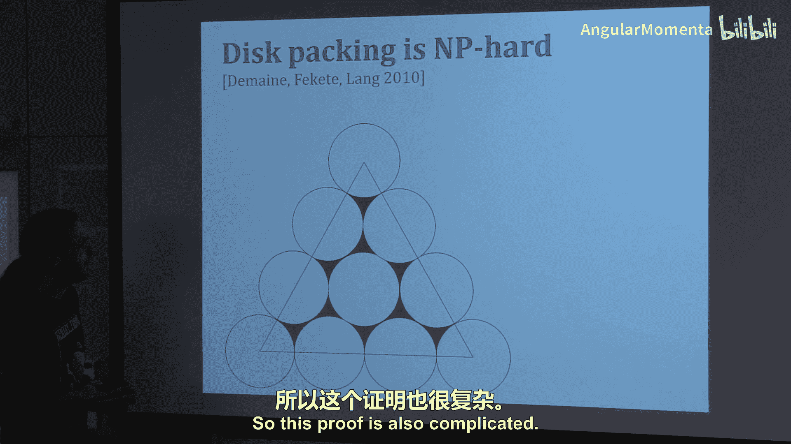

This proof is also complicated and it involves a lot of geometry and trigonome and some calculus and fun stuff。

 So I'm going to give you a sketch of it。 you should be believable that this works。

 But the details again， are messy for starters， let's say that we're packing discs into an equilateral triangle。

 This is much easier to work with。 I'll go to a square in a second。

 So if I have this equilateral triangle。 what I'm gonna do is first。

 I'm gonna give you a bunch of disks that are forced to pack in this nice triangular grid arrangement。

 leaving these dark holes。😊。

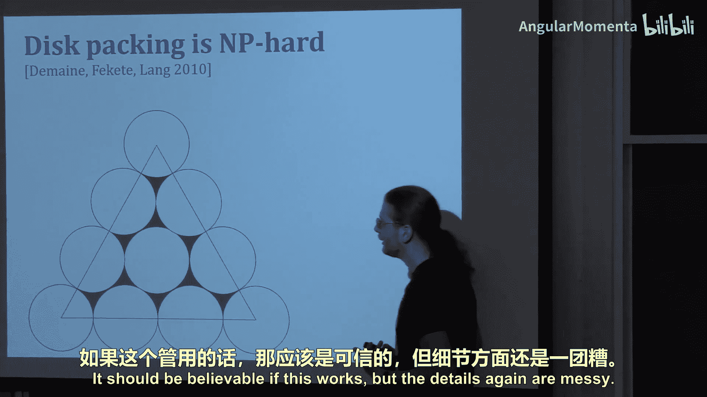

And I'm gonna give you more disks。 And so the more disks have to go into those holes。

 And these are actually kissing disks they're touching。

 so you can only put every disk you put from now on will be in one of these holes。

 And I'm just going do this big enough so that I have at least an over three holes。

 Each hole is going to represent a bin that I'm trying to put a triple of numbers into。

 And then here is the。Construction for， I guess this would be a three partition gadget。

 We wna get that's like type of the AI plus A J plus A K is less than equal to T。

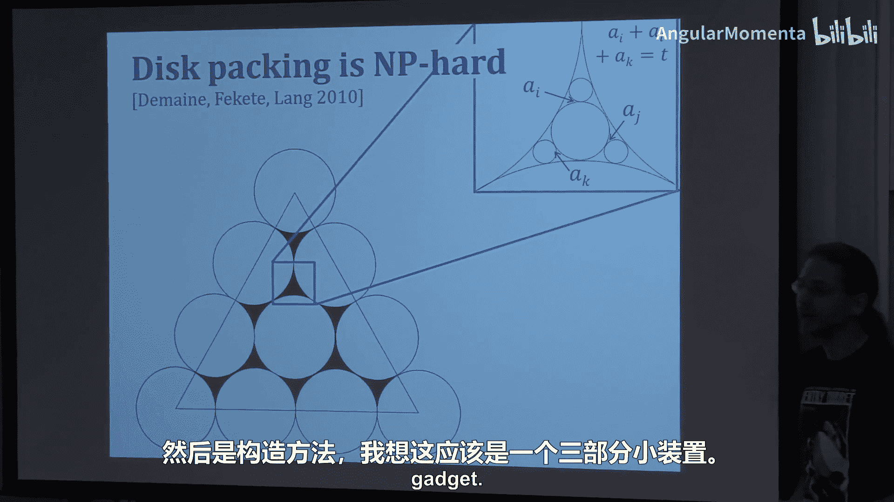

And so these are the three discs representing AI， AJ， and AK。And there's an extra disk in the center。

And what's drawn here is everything is maybe tight， almost as touching。

 But we're gonna shrink these discs a little bit。

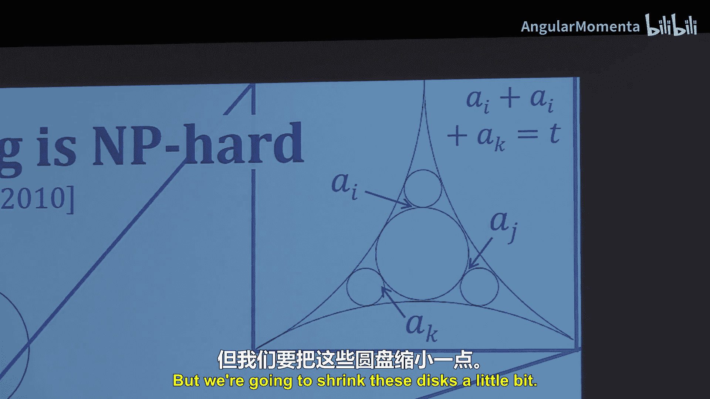

Or rather， I'm gonna shrink。 Yeah， I guess I'll shrink。 Well， I get this right。

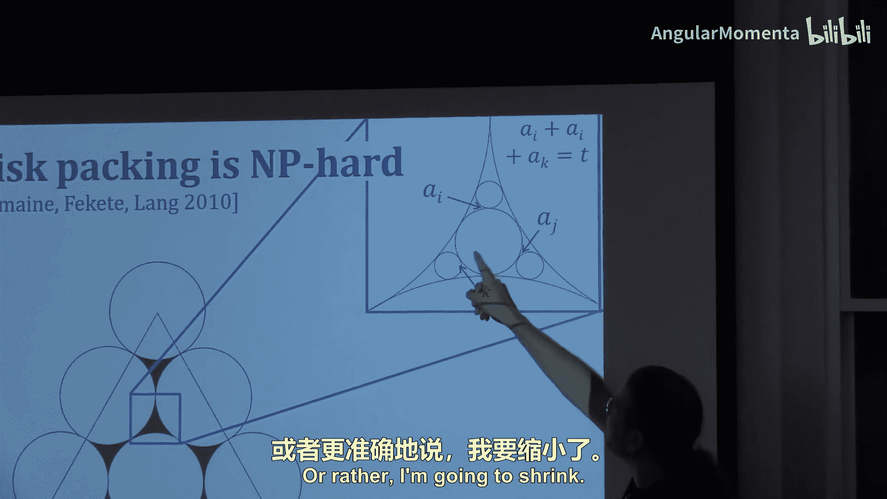

I'm going to shrink this disc a little bit。And I'm gonna make these ones a little bit bigger。

According to the AI values。 So this one will be proportional to A K larger than the disk that would perfectly fit here。

 if this one was maximally sized。 And so that's going to force this guy to。Move away。 Well。

 he's a little bit shrunk。 So maybe he doesn't have to move away。 But the center disc。

 when it's shrunk down， it has a little bit of flexibility。 It can move more this way。

 If this disk is smaller， it will move more this way。 It can move more this way， more this way。

 And in general， you show that these， So these guys are sort of placing demands by being a little bit bigger。

 they need to push out。

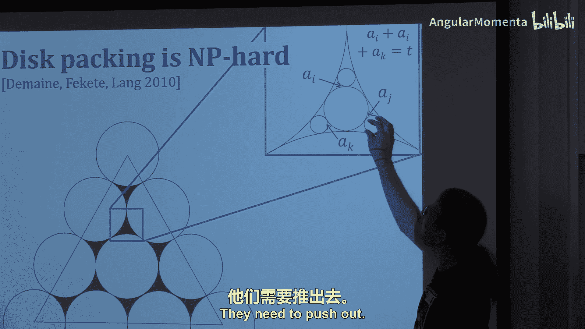

And。This one is a little bit smaller， and its size is just a function of T。

And so it's gonna move around。 And the claim is it has a valid position。

 If and only if AI plus A J plus A K is less equal to T。

 I have written down a little bit of the details。嗯。So we're gonna choose some big number capital。 N。

 maybe it's like n to the hundred， little n to the hundred， something like that。

 And we'll shrink the big disk by that amount。 I'm going to scale everything so that T equals 1。

That will simplify things a little bit。 so just shrink everything。All the values is down。

 divide everything by t。AI is in the T。And then。I think we're going to。shrink。The AI disk。By。

Minus1 over。And squared plus。AI over N。 This is a funny notion of shrink。

 I'm gonna first make it smaller by one over n squared。 and then I'm gonna grow it by AI over N。

This term， I believe， is to。Get rid of smaller things in the Taylor expansion， so。

Dis are annoying because they're circular。 because they're quadratic curves。 And so you get。

 you know， it's， it's an awkward shape to deal with。

 And you're worried about how how I move the center relative to how I move the other centers and whether they're hitting each other and whetherre hitting each other as a quadratic constraint。

 You have to measure the distance between these two points。

 It should be greater than equal to the sum of the radi eye。So that's tough to work with。

 So to simplify things， we take first derivatives and say， well， to the first order。

 what's happening when I move these disks around。 And when you take first derivatives。

 you get an approximation to the truth。 And the second derivative it tells you a little bit more of the truth。

 And if you've ever done Taylor series， you know， you get something like one over n something times one over n plus something times one over n squared and so on。

 And so if， if we just subtract off this term， make these disks a little bit smaller than they need to be。

 that lets you deal with all those terms all at once。 So it lets us focus on the lead term。

And to the first order， the claim is， what happens is， well， we made this disk smaller by one。

 Remember one is T。 and we made the other guys larger by AI。

So that's going to work out exactly when the sum of the three eyes is less than equal to one。

 Then this will all have room。 And that's true to the first order。

 And you have to do this ugly business to make it true， exactly。So， I think。

Without going into vector algebra， this is the。Intuition of what's going on。And。That's that proof。

Any questions？The point here is to expose you to lots of different ways to represent numbers and three partition。

 And a lot of the times it comes up in geometric settings。

 But so far we've seen rather different ways to represent it。 We'll see graph theory in a moment。

 probably next up is games and puzzles。 So let's play some games。Oh， I have a right。

 There was one more part of this proof。 I forgot。 What if you're packing into a square。

 This is particularly important for origami， This paper appeared in an origami conference。

 So we needed to solve the case of square packing， this is more awkward The idea because you can't make a nice regular grid on you know。

 square grid packing is not very efficient for disks。 But if you have these four really big disks。

 I should mention here， the goal is for the disk to fit the centers of the disk to fit inside the square。

 That turns out to be the right constraint from the origami perspective。So make these four big disk。

 They have to be at the corners。 Then we make this big disk。 It has to be in the center。

 These are all perfectly touching。 Then we add these four disks。

 and it forces a particular arrangement here， which is a little awkward to compute， but you can。And。

Yes， and we do that four times。 Then for each of these constructions， this is the shape that we want。

 We want these kind of equilateral triangle ish gaps。I say ish because they're not straight sides。

 They're arc sides， but it is the centers form an glotal triangle perfectly。 Then we recurse。

 So wherever we have a gap like that， which is this thing。

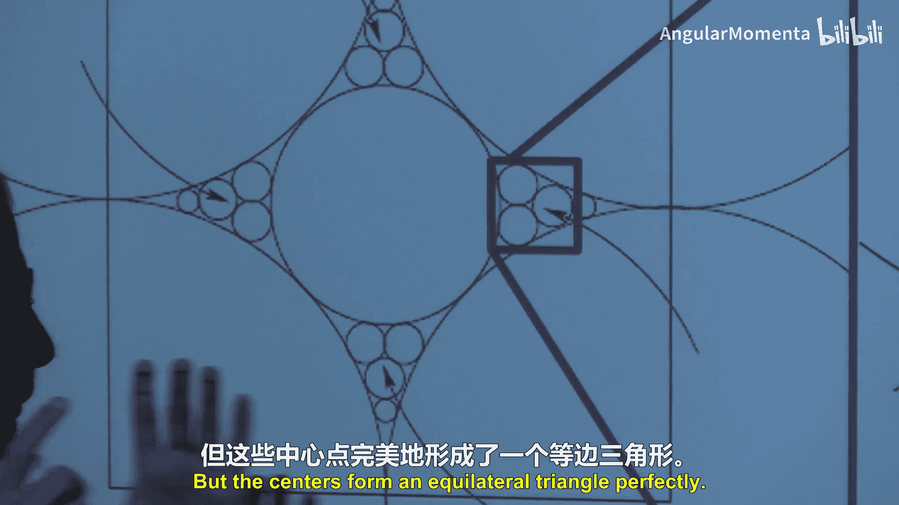

Then we add this center guy， and then we add these four disks again， just like over here。

 three times now。Now， of course， we can't force the disk to go here。But。They will。

This is a very symmetric construction。 So we're going to do this symmetrically and all the things。

The other challenges is we left these rather large gaps here。 I mean， relative to these tiny disks。

 which are all fit inside that gap， this is pretty big gap。

 So we also have to make these gaps unusable by adding a maximal disk and then adding maximal disk and just recursively adding maximal disk until the gaps that are left are tinier than all the ones that we're going to produce in this recursion。

 This recursion has depth like log n。 So we get in the end。

 we get roughly n of these things are n over three。If we have extras。

 we'll just throw in maximal disks and make them unusable。So， that's it。

So this is a lot harder because you have to fill in all of these gaps and make sure everything is going to be happy and no disk can go in the wrong place。

 But if you sort of do it in the right order， you can be convinced at every stage your disk has to go where you're putting it。

Except at the very end where you have freedom， The freedom you have is where the AIs go。

 which pocket they belong to。That's the only freedom we have。

 It's the only freedom we want you to have。O。So that was dispacking。 Next is clickammania。

 How many people have played clickammania。A fewew good。It's not completely obscure yet。

 So here here I have the real thing。 I think this is called click Iamine in next generation。

 And I want to start a new game so I don't have a really bad score。

 So the idea is you're gonna click on a group， a connected group of one color。

 that group is destroyed， and then things fall vertically。So。Column by column。Rlls clear。

Your goal is to remove。All of the blocks。呃。Which I probably won't succeed in doing。

 I haven't played in a long time。But， let's。I would like to show you one other rule。

 but I may fail to do so。's progress。This kind of checkerboarding， not so good。

Don't do that when you play。 Also very bad。 Okay， the one rule。

 which I won't demonstrate here is if you clear a column。

 then these guys just sort of eat the column。 They just move closer to each other。

 And I think usually the right moves to left1，1 step。Okay， so that's here。

 here's a successful execution。From the clickammania website。 but I have done it a few times。

 just haven't in a long time。 The only rule is you the group that you click on the connected color chunk has to be a size greater than one。

 Otherwise， you could just keep clicking on everything。 So that's why the checkerboarding is bad。

'Cause there you have single， singleingleton guys。So you may have some singleton guys。

 but if you're careful， you sometimes can get rid of them。 The question is， when can you。

 And the answer is， it's empty be complete。So this was actually。My first MP P hardness proof。

 I think ever， definitely of a game。 I think ever。 So there's a few results here。

 One is that if you have a single column， that case we can solve a single row。

Single row actually behaves the same as a single column because even though they're asymmetric in general for when it's one。

 they're the same。 and if you happen to know contextfr grammars。

 then here is the answer It's not obvious that this is the answer。

 but this is saying something like well， it could be you already solved the game。

 That's the empty string or it could be you have a solvable game followed by solvable game。

 you could just sort of do them separately And if you're careful they won't mess each other up and then you solve the overall game or it could be you have a solvable game and you have the same color one block of the same color on either side。

 that would also be solvable because you could just solve the center thing。

 then these two guys come together and then you click that group of size2。😊。

Or this could also happen when you solve two things and then three blocks come together。

 and you could also imagine other rules， but it turns out these are enough rules to capture all solvable puzzles。

For one row column， but that's not a hardness proof。 So we won't talk about it。

 We have two MP hardness results。 One is for two columns and five colors。

 And the other one is a hardness proof for five columns and three colorss。And these are the proofs。

 This one is three partition。 This one is three sat。

 So we might talk about that in the three sat section of the class。

 but I'm gonna focus here on the three partition， two columns，5 colors。

 open problem is whether two colors you can get any hardness question。That is。No。

 it's not obvious that S to SS is valid because you worry that when you saw one of them。

 you might eat a group from the right hand side， but you can prove it's always possible I don't remember how that proof works。

 but you can check the paper。Yeah。If you look at the。

 if you ever go to the course website and look watch this lecture or click around the slides of this lecture。

 it has links to all the papers that I'm talking about。 So if you ever wantna know more details。

 just go there。 linknk is right there。 You don't have to type in all these names and Google for it。

Cool， so this is my attempt at drawing the hardness proof。 This， this was challenging。😊。

And I should say it's not drawn to scale。 So it's not exactly right。

 but it gives you a flavor of what happens。 And I believe all the braces are correct。

 but it just wouldn't fit on the screen if we drew everything properly to scale。😊，So。

It reduction from three partition。 We have n numbers， A1 through A N integers。

 We're going to scale everything up。 We're going scale the AIs and T by a factor of B。

 B is four third N。 I don't totally know Y button， you know， it's， it's N plus the number of groups。

Im guessing a larger number would also work， but that's definitely enough。Okay， so basically the。

 there's two columns。 remember， always gonna stay in two columns that never increases。

 There are some clickable blocks， clickable groups which correspond to the AI。 So for every AI。

 we're gonna have exactly one block， which is B times AI by one。

These don't draw the lines when they're in the same connected component。But technically。

 these are separate squares。There's also some clickable things up here that those are not too essential。

 They're basically to spread out these red blocks。There are n over three red blocks here。

 and there are n over three red blocks here。You will never win the game unless you destroy these red blocks。

 So， for example， you could click all these blue things， make the red together。

 and then destroy the red。 But that's not a good idea because these， these are only。

 this is a very small space。 This is relatively large gap。 I know it doesn't look like it。

 But this is only n over three total。 The gap between these two things is B times t。

 which is way bigger than n over 3。Okay， so there's big gaps between these red guys。

 So what you're basically going to do is make this column fall down until the first red guy aligns with this one。

 Then you delete those two。Then you're going to make it fall down farther until this red guy hits this one。

 and then you can delete those two， just two at a time。

 And we're going to bring it down till the third guy hits the third guy。

 and then the fourth guy hits the fourth guy。 Then the reds are gone。

Before I get to how that happens， let me tell you what happens when the reds are gone。

 when the reds are gone， I mean， if there are any purple left turns out there won't be。

 but you could click them all， then you could click all the blue。

 then you're done on the right column。 So right column was finishable。

 no problem once you've gotten rid of the red。Now the left column is mostly checkerboard。

And if you remove the red。Pixels， you're left with exactly a checkerboard， except here。

The topmost red guy， there's it's white on either side。And in general。

 everything below this point is the same as everything above this point upside down。

 And so then you can always just click on the center， center， center center。

 I guess you have to move your mouse down as that happens。

 but you will then destroy the black and white part。Total is five colors。 We've got red， purple。

 blue， black and white。Okay， now this is my attempt at showing you how we get the red things to align。

 But the， the idea is simple。These， the initial gap from this guy to this guy。

 and then the gap henceforth from this one to this one to this one is always B times t plus some constant。

 The constants are just annoying。 So they're not essential。 The idea is， well。

 I've got to bring this down B times t。 So in order to do that。

 I'm going to click on some purple things whose total sizes B times T。 In other words。

 the sum of the AIs that I'm clicking on should be equal to T。

And we happen to know that will be three things， but that's not essential here。

 We can just use the simple version of three partition where you're asking for sets that happen to sum to T。

And because everything is scaled up so big by these factors of B。 I mean， these gaps， you have to。

 even to get in in the right proximity， you have to choose AIs that sum to exactly T。A。Yes。

So the constants are annoying because you want to make sure so here here's an example here are in this particular picture。

 the height of one of these things is six and so I click on one purple thing of size4 and one purple thing of size2 in reality these numbers would be much bigger but for the picture that works then things fall and we get this picture。

And these red things are almost aligned， but they're off by two。

 So I click on this little one by two block。 and then they're aligned。

 Then I can click on the red thing。 I also click on this blue thing to sort of advance to the next red thing。

 And then these guys fall， and I get this picture。 I could click on the white， but it won't matter。

 That's just， I can do that all at the end later。 Now， my goal is to get this red thing to here。

Again， the gap is exactly 5。So I click on， let's say 2 or sorry，6。

 Let's say I click on two things of size 3。And so then everything falls， then the reds a align。

 then I delete it。 I also delete the blue thing to advance。And I think that that works。 Yeah。

 question it's always the leading red block that has to go with the。Fri red block right。

 So it could be you take some other block， other red block and align it with this one。

That is mostly a worry， from a construction standpoint。If you did that， you might get stuck。

 But I claim if I do that， it it's never a problem to do that because this length is this total extent of these red guys is relatively small。

 The whole length here is N。Sorry， it's it's 3 times n over3。Whole length is n。

 whereas all these AIs are scaled by a factor of much bigger than n。Well， not a huge amount bigger。

 but bigger than n。 So even to get in vaguely the， this is what I was saying what。

 to get this red block or any of these red blocks near this one。

 because these things are scale so huge， you to get one close is the same as getting all of them close。

So if you happen to succeed in a way that gets the reds to align in out of order。

 that would still give a valid solution to three partition。

 That's the point because we scaled everything so huge。The to do the other direction to say。

 if you have a solution in three partition， then there's a solution to this instance there we do it in order so that we're in control and make sure every all the constants add up right。

And that's， that's sort of the annoying part of this proof。 But this is a relatively easy proof。

 except for these little additive constants to make sure everything lines up。

 It would be great if I could just put these reds on top of each other。

 But then there're one group and you delete them all at once。

 So I have to put these things in between。 They have to be length too。

 so I can destroy them when I need whenever I want to。

 And so all these additive constants kind of get in the way。 But it's not too bad。😊。

Other questions about this proof。That's clickcomania。Cool。Next is Tes。Has advertised in the original。

First lecture。So if you haven't played Tetriris。Here is the。I hope you've played Teettriris。

 I played a lot as a kid。 You have these  ttraminal blocks。

 you can rotate them and then you can force drop them or you can slowly drop them and do weird things like that。

 you know， sort of last minute moves's see。I don't think that's， yeah。

 the rotation centers are always a bit funny so you can do cool things。 So let's。

 let's have some fun。😊，To to do to do。I'll just play Teers for the rest of the class。

So important rule is when you complete a line， then that line disappears。

 although in the proof we will prevent that from happening， it is a rule of the game。 Thats annoying。

Also annoying。Okay， well， you get the idea。 You're super impressed by myteer skills。ははは。😊，Right。

 so cool。 I used to play it on Game Boy， but， and then any yes。

 you can play it on the green building。😊，This happened in 2012， Finally。

 after it was dreamed for many years。I am a Teetris master， according to the Harvard Teris Society。

 This was for provinging。 And I didn't have to play a game to as， as you can tell。

For proving and the completeness and maximization of lies Teris's pieces played or minimization of square height。

 We masters of the Harvard Teeter Society hereby confer the title of Teris Macher opponent E D on the 16 day。

 the 12th month in the year 17 An Tetri， which is since the invention of Teettriris。😊，Okay。

This is a proof done early in my career at MIT with two MIT students。

 David Livinll and Susan Hoenberger now professors at other schools。

 This was a first attempt at a proof。 We had many attempts at a proof many of which all of which were wrong。

 except the last one yeah， anyway， you could try to see what's wrong with that proof。

 but here is a working proof。 This is actually not the first working proof we had。

 so there's me David and Susan， and then we published a much harder version of the proof with like 500 cases。

 and then these three guys read our paper and said hey， I think we can simplify it like this。

 and then we wrote joint journal version。 So reduction is from three partition surprise this is so I should say what does Te mean from a computational complexity standpoint。

 there are multiple interpretations。 Our interpretation is I give you an initial board because you've already been playing for a while。

 Here's what what you have。 And then I give you the entire。Sequence of pieces that's going to come。

 And I want to know， can you survive， maximize a number of lines。

 This is not yet the appxiability part of the class。

 but we get some really easy inapproxiability results。

 So I will mention them for now is just can you survive the the ceiling is like here。

 a couple couple rows above this initial picture。 So you're almost dead。

 So it's like every second counts。 Allright， your goal is to fill up these chambers。😊，These bins。

Exactly with no holes。 if you can do it at the end。

 I'm going to give you a T and then a whole bunch of straights。 and then you you can win the game。

Alright， so， so we have n over three of these buckets。Each one is roughly T tall。

There's some additive constant to deal with some stuff， but there's T notches。

 each of these is basically counting one unit of an integer。Okay。啊。Yeah， the point is。

 if you don't open this thing。Where are the eyes gonna go。

And you will only be able to open this thing if this is full and this is full and this is full and this is full。

 So you've got to get these perfect so that at the top， you can open this and。

 and then clear everything。😊，Okay， so。Here are the gadgets from the peace perspective。

 that was the initial configuration， of course there are no AIs yet。

 so the peace sequence has to encode the AIs。In urary。

 because there are only a constant number of different teettramino pieces so。You have to encode。

 Well， I guess you could try to encode in binary。 It's very hard to add when you're working with ttramins。

 unless you do it in unary， so。Here's the idea。 We have an initial setup like this。

 It will always have this little thing in the corner。 And so to say， hey， new AI is starting。

 we're gonna give you， we might call this a right word pointing L。 if you look from the。

Brel of the gun。 Then it goes to the right。 So that makes a nice flat face here because I。

 the next piece that's coming is a two by two square。

 So what you're going to do is let it drop all the way。 And then at the very last second。

 you slide it to the right。And in general， we're going to represent AI by this pattern square left L square to the power AI。

 like we're going to repeat that AI times。 So here I repeated it twice and then dot dot dot。Okay。

 that is encoding AI and unary。 Or I don't know if there's something smaller than unary。

 where you use three objects to represent one，1 unit。 But there you go。 And then at the end。

 the at the end of the AI， we're gonna sort of finish things off and reset to this original kind of configuration by saying square and straight。

So the square nestles in there， we get a straight and if all goes according to plan。

 what you've done is filled up basically AI units of this thing。And maybe plus one。

 But we know there's only three AI is going into each bucket so we can deal with a plus add of 3。

 That's no big deal and。That's good。 So now you have a choice。

 You have this long sequence of pieces representing AI。 in general。

 the p sequence is the P sequence for A A1， P sequence for A2， P sequence for A3。

 The intent is you put all of these pieces into one column， one of these buckets。

The claim is you can't， again this's a divisibility issue。

 the big issue is can we divide AI into two parts， put part of it in one bucket。

 part of it in another bucket that would not give us a solution to three partition。But the claim is。

 you can't。And the proof of this claim is not too hard for this proof。

 It was much more tedious for the original proof。 But basically。

 you try everything else and show that you are doomed。So every other possible move。

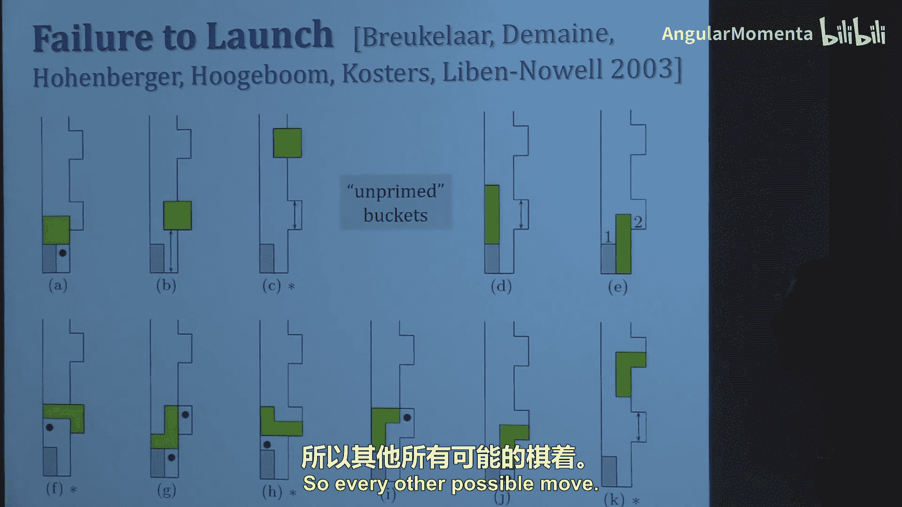

So one type of bad move。 So we when you。

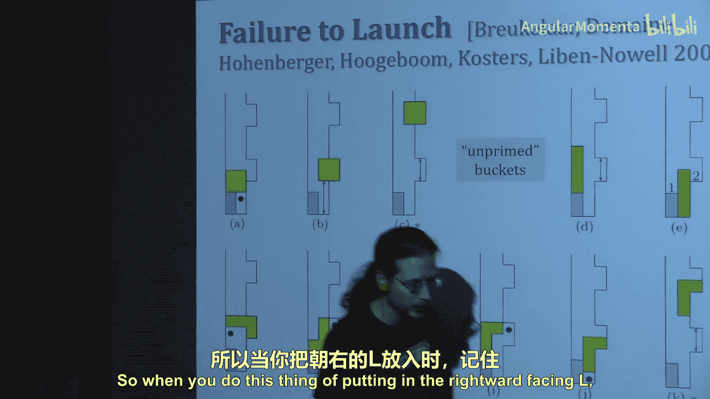

When you do。This thing of putting in the right word facing L。 Remember。

 there's only right word facing Ls。 There's only n of them， one per AI。

So that's the only sort of nice piece we call this priming a bucket。

Because now it has a nice flat bottom， and so these pieces fit nicely， especially the squares。

So one issue is， what if you have an unpried bucket。

 It still has this stuff over on the left and you try to just insert into it because first a1 comes。

 you prime one of the buckets。 What if you switch midstream and try to move the rest into an unpried bucket。

 claim as you die。 You look at the squares。 You say， well， it could go here or here or higher。

 and they're all bad。 This one's means you'll never fill this stuff。

 So you're basically going run out of area。 something's going have to go into the sky。

 If you put this here， you'll never get anything here。 put that there。

 you'll never get anything here。

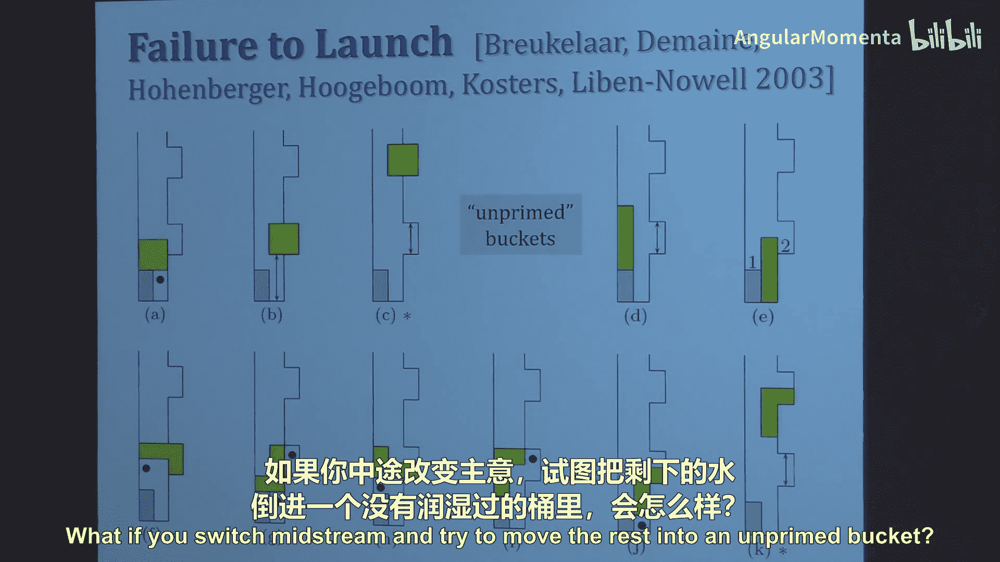

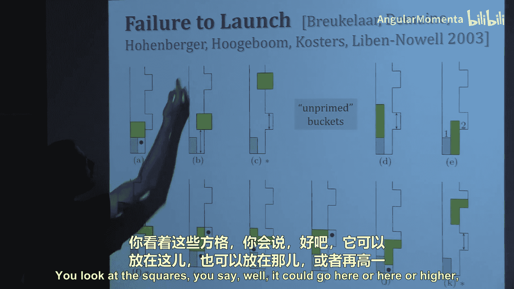

Because squares won't fit anymore and so on。Es can't go pass through that thing。Okay， similarly。

 if you try to put a straight away in something bad happens。

 I don't quite remember what the bad thing is here。 but that looks。Right， can once you cover one。

 you can't cover the other。

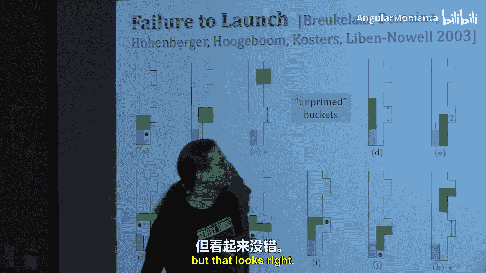

Yeah， it's not even obvious you can cover this one， but I think with some clever rotation you can。

Tetris is a little weird in that respect。 And then with the leftward facing Ls。

 you can try all the things。 And again， your toast。Okay。

 so that's one type of bad thing where you switch midstream from one of you you start putting an AI into a bucket and then you try to put it into a bucket that's currently unprimed the so。

What's left is if you stick to one bucket。Do you have to play like we want to play？

And so in the sequence of pieces， after you' when you haven't placed anything， well。

 maybe you try to prime it in a different way， and then that opens up something else because then you'd have to go through that entire analysis from the last side again for however the unprime bucket might look。

 but it turns out， however you do it your toast， you've hidden some square。

 which you won't be able to open up。Unless you do it the right way and once you've done that piece。

 you check that the next piece has only one place to go， obviously if it's to the left。

 then those are not good and then the next piece and so on So you check all these things and you conclude there's really only one way to play the sequence。

Except for the flexibility of when a new AI stream comes， which bucket do I put it in。

 We're assuming here infinite dexterity。 So you can slide to the left and right。

 pick the bucket you want， and then let it fall。

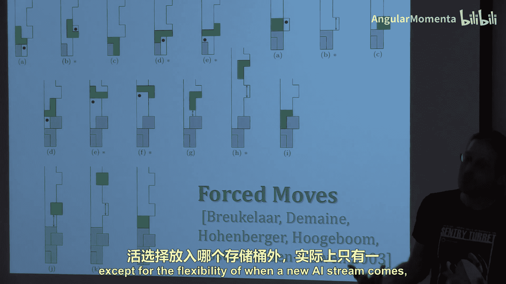

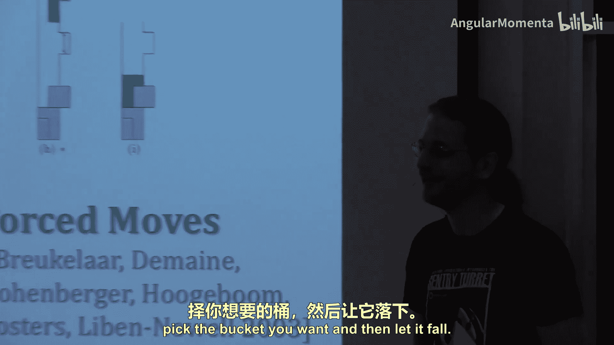

Questions， yeah。So you you sit up the infrastructure infrastructure。

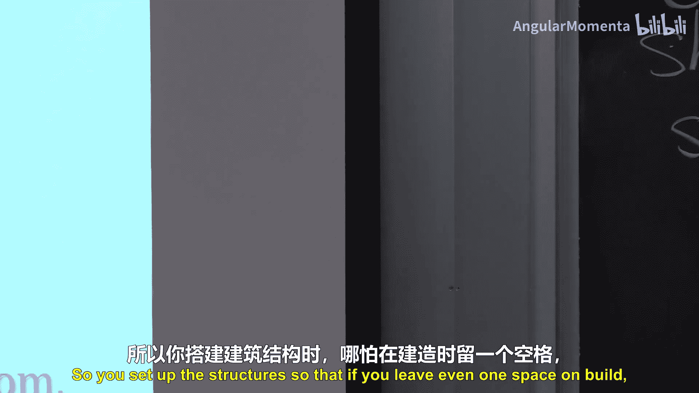

You even one space unfilled and you're going to dive with。

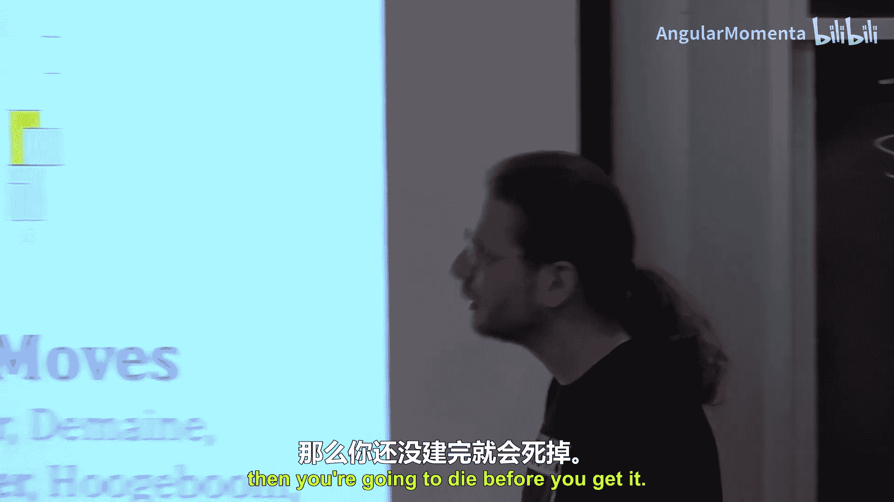

Yes。So。

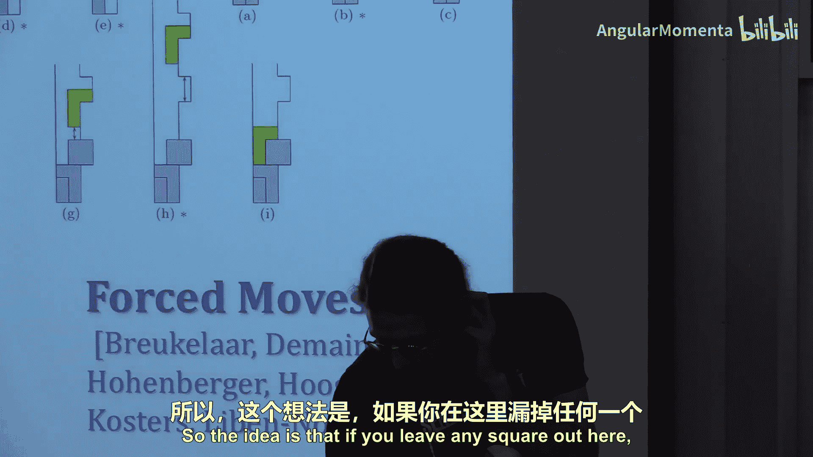

The idea is that if you leave any square out here。You will be in trouble。And。

IThere are probably many ways to do this， and I forget exactly what we do in the paper。

 I think the easy one would be that if you put any square up here， you die。

 So you're right at the limit of the game。 if anything doesn't go into a bucket you're in trouble and then it's just a volume argument。

 So you've got all these pieces， the total volume of them is exactly the sum of the bucket sizes。

 So if you leave any blank space， that means that the material that was there is going to somehow end up on the top row and then you're dead。

Yeah， I don't remember fig that's exactly what we did， but that certainly seems to work Adam。

If you place something too high， but at the same time， finish a line， Do you die and。

Could we force our way through the lock early？I believe in real Tetriris。

 if you clear a line that happens before you potentially die。 I don't think that's an issue here。

 because。You won't be able to clear anything until the tea piece。 So I think you use the argument。

 I said。Up to here， if there are no other T's in the construction。

 So any other piece you try to put in here， I think will get you above this row and then you die。

 So you， so that's essentially unusable space until the tea。 And then up until that point。

 you have to exactly fill all this stuff。 Yeah， So if we ignore filling the lower stuff in the main gadgets and just。

Stick something up high and try to fill just the tops of each of them so that with。

An L or something we can clear one space of the Oh。

 I see you could try to put an L like that or like this。嗯。Yeah， but if the row clears first， alright。

 then now I have to look up the rules， I guess。Yeah。

I think it might be okay because then there's no way ever to fill the next pro。

Let's talk about this offline。 I think there's something to check here。

 which hopefully we did in the paper， but I've by now forgotten， yeah。Just for fun。

 if you succeed at the end， you get all of these right word facing Ls， then you get the T。

 those lines clear。 and then you get all the eyes。 And it's so satisfying all those tetrices。😊，😀Yeah。

😊，And then if you're so A Tetriris is when you get four rows in one，1 move。

 which can only be done with the straightits。So this is， if you survive。

 then you clear a whole bunch of columns。 But if you want to make it really embarrassing。

 then you put this entire construction over a nice big wall or but big， empty space。

 And you put a whole bunch of pieces at the end， like。

Let's say L's all of the same orientation or something。 Those are really easy to pack。

 So if you want to maximize your score and you don't solve this thing。

 then you're really going to lose bad because if you do solve this thing。

 you're gonna get tons of points by just playing in here forever。

 So n to the one minus epsilon of the game is down here。

 and if you can't solve this thing at the top， then you're getting a score basically zero。

 when you do place a few pieces， but very small compared to the number of things down here。

 you place like end to the epsilon pieces， whereas if you do succeed。

 then you get to place all n pieces。对。This is just the initial configuration or which floating square。

This thing。Oh， this one。That is possible to construct， I believe。This is a challenge。

 Just a whole industry of making cool initial patterns by playing a lot of things。

 I agree that's not obvious， but I think it can be built。And so what we get is to approximate。Tris。

Let's say the number of pieces that you play。诶。Less than an n to the one minus epsilon。Factor。

Is MP hard。That's what we just showed or sketched。 So this is an example of an interapproxiability result。

 This is a relatively easy one。 We just need to assume P is not a equal NP P。

 and we get that you really can't approximate within a very good factor。

 sort of all or nothing in this game later in the class we'll see much more subtle。

Inapproxiability results。Okay。Other questions， hopefully， no more issues。

 There are a lot of other open problems about Tetriris。 You mentioned construction。

 What if the board is initially empty， It seems like quite a challenging problem。

 Constant number ofs or columns here。 We assume that both dimensions are arbitrarily large。

 part of the input but these seem very annoying。 interesting， if you just have straights。

 I imagine Teettriris is pretty easy， So how many of the Teetris pieces do you need to get a hardness proof or can are there certain small combinations that are easy。

 we need this ability to slide at the last minute， be nice if you could just always be hitting space bar and always drop your pieces from positive infinity。

 We don't know whether that problem is empty complete， that might be the most tractable。

 but it's proof would have to be a little different。

 Two player tetris online tettriris where you don't know the pieces in advance。

 That's something we might get to later in the class。But these are all open。O。

So next topic is in graph theory。 So suppose you have a graph。V these edges。

 you want to draw it in the plane。OfNo2 vertices touching。 No verta text on an edge。

 That's regular notion of drawing。 But edges are allowed to cross。 If you're lucky， graph is planar。

 don't need any crossings。 There's this notion of one planarity， which goes back to the 80s。

 where every edge can cross at most one other edge。So this is an example of a one planar drawing。

 Some edges don't cross anything， but any edge that has a crossing only has one。Okay， so。This is。

 and be complete。a notion of strong here， there's no numbers。

 this is from 2007 and a reduction from three partition。So here are two gadgets。

 This is a double well， okay， we'll get to this one in a moment。Here's a gadget。

 which is the complete graph on6 vertices， K6。 and the idea is that we're going to plug this in instead of a single bold edge。

 So wherever there's a bold edge here， what it really means is this gadget。

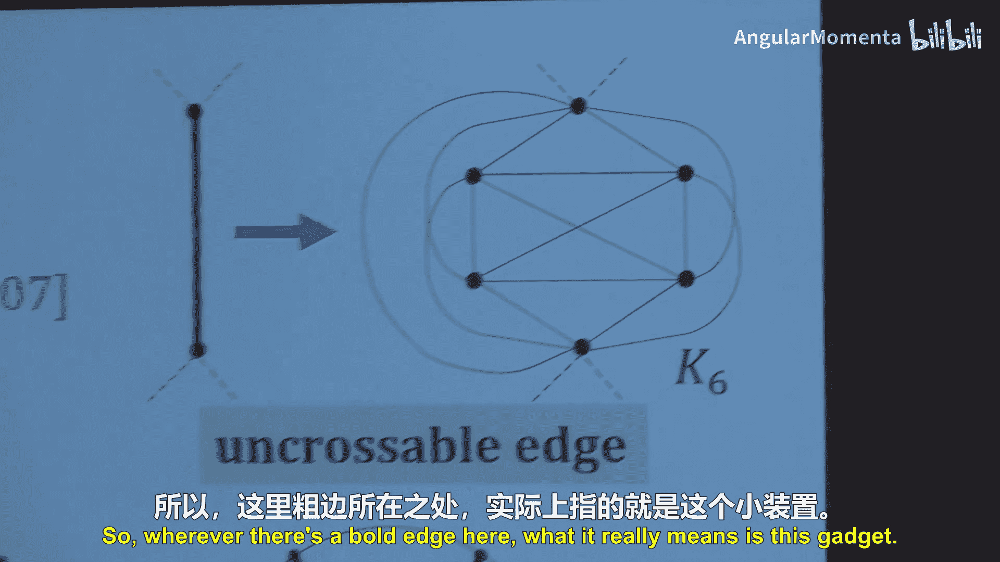

，This is meant to be an uncrossible edge because usually an edge can take up to one crossing。

 What we're going to replace this edge with this thing， which has a bunch of crossings in it。

 no matter how you draw， K6 is very symmetric， so it's not too hard to argue about the different drawings。

 but you see a crossing there， a crossing there and a crossing there And in general。

 if you look at any path from this vertex to this vertex。 you visit a crossing。It's no way to get。

Wait， what about this one， What do I mean if I， if I attempt to draw an edge through here。

 I will hit an edge that has a crossing on it。 That's what I want。 So in other words。

 it's not possible to draw an edge across here and still be one planer。

 So this effectively becomes an uncrossible edge。 This is notation。 This is super useful。

 when you have a complicated construction， if you do， if you use the right notation。

 it's not necessarily so complicated。 If we drew this everywhere。 in these pictures。

 it would be really hard to see what's going on。 So we use this。

 this visual idea that this is a symbol for that。 And then we can draw really simple pictures。

 relatively simple pictures。 This is what's called a double wheel。

 it's got a lot of spokes in the center and a cycle around there。

 and then just another one around there。And we're gonna have two of them。

 It's gonna be exactly two of these gadgets， one of size。Some of the A's， the other of size。An。Okay。

 so in this picture， we have six AIs and the sum of all of them is however many spokes are around that wheel。

 Okay and then this is the actual construction。 So these are this is the AI gadget。

So let's look at this one， this is when AI equals3， we're going to have a vertex of degree 3 plus1。

This path is a path of length2， and it goes to this vertex， the center of the smaller wheel。

 of the end wheel。And then the other three paths， again are of length too。

 and they connect to the center of sum of the AIs。Gdget。

 so this is intended to represent the number three。Now， there's a little bit more going on。

 which is we added a bold edge here and a bold edge here。 in this case， here's a。

 in case you're curious。 in this case n over three is2。 So in general。

 we have the sum of we have all the AI is basically laid out here in some order。

 And what we're trying to do is partition them into groups of size T。

 So here t is whatever this number is。 And so we add these uncrossible edges to say， well。

 an AI cannot go partly in this bin and partly in this bin。

 It's got to choose which side of all of these bold lines it's on。 And so for each AI， you choose。

 in this case， there's only two bins， but in general。

 there will be several bins each delineated by a bold edge from the end of the thing to。

The end of the thing over there。I mean， this looks a little bit weird Like， okay。

 how do the AIs choose which side they're on here， Well， they just choose whichever side they're on。

 If they're on the bo in the bottom chunk over here。

 then they'll just connect to the bottom chunk over here。 So in the top chunk over here。

 they'll connect to the corresponding chunk over there。

This is basically to force the AIs to start on the outside of this construction。

 So you there's a lot of， again， there's a lot of cases here to worry about about other ways you might draw this。

 Maybe you take this entire picture and stuff it into this little triangle。

 but they all end up with lots of crossings on a single edge。 If you do that， then you have to go。

 you have to cross this edge many times。 For example。

I think we convinced ourselves that with a single wheel， without this extra thing， the construction。

I think we're not certain about one the construction works。

 There's definitely more cases to consider。 So at the very least simplifies things by adding the second wheel。

 It would also mean you'd have to have multiple edges here between the same two vertices。

 So maybe that's why they did the， the double wheel so that you have this paths of length to。

 connecting the same thing instead of。The exact same edge anyway。 So again。

 you have to prove there's essentially only one planar bedding for the each of these wheels and for these things to connect them together。

 And so the AIs have the freedom of which bucket they go into。

 But because each of these edges can only be crossed once。

 each unit of each AI can only only one unit can occupy each of these cells。

 So you get three partition。Cool。Yet another way to represent numbers in unary。Question。

Understand that。お父さん。So， okay， so the these， these are the AIs。 A 1 is 2。 A2 is 3。 A3 is 3。 A 4 is 3。

 A 5 is 4， and a 6 is 5， and they are represented by。This thing is a two。This thing is a3。

 This thing is a3。 This thing is a4， and this is a。5。And that should be the same sequence。

I think I missed this three。Yeahep。Good。Okay， that was one parity。Ha贵。Four minutes。

 which proofs to cover。I will wave my hands at this one。

 This is a chain of blocks with hinges on them， and it has colors on it。

 and your goal is to form a particular pattern of colors。 I find it interesting。

 This is our hardness proof。 It's interesting in that a lot of the proofs you've seen。

 It's all about making the AIs being a straight line here。

 that's not a big deal We've sort of drawn out this is， again。

 a kind of universal construction you can build any polymono with it。 It's all about the colors。

 And so the idea is that the As are represented by how long of a blue segment you have here in the overall chain of pieces。

 And these are the buckets And so you just come in at some point。

 and fill in however big your AI is and then leaf。And there's just enough blue to cover all the blue。

 So you better not waste it。 But the other other stuff you have a lot of flexibility。

 So it's all about just kind of filling these amorphous blobs that have exactly the right area to fill all these blue regions。

 And there's three times you're allowed to visit。 and that gives you three partitions。

 So I want it's hard especially that physical model to understand what the rules are of this game。

 but gives you some idea of another way to represent three partition。嗯。Next。

You may have seen this kind of object。 It is called the carpenter's ruler or rule。It's got hinges。

 It's got rigid bars。 And usually when you're not using it。 one， I mean， you can measure lengths。

 That's's the ruler part。 And when you're not using it， it folds into this nice compact form。

 It's great。 And everyone use these until the invention of the retractable one。

 though they still use these a lot in Europe， So has unit length in this case。

 But what if you have a really annoying carpenter's rule。 And the lengths are not all equal。😊。

And you have this nice box， which is unit length or， you know， some length。

 You'd like to fit your rule ruler into that one dimensional box。 Let's ignore the thickness here。

OkayThen this problem is hard。 It is weekly NP hard。 You can solve it in pseudopolynomial time。

 So this is this is like one of the very few problems we'll see of this type。 and this is the proof。

 It's one of the simplest proofs from reduction from partition， which is two partition。

 which is divide your numbers into two groups and I apologize here in this book of ours。

 we use X instead of a。 So those are As。 So you're given some AI。 And the idea is， well。

 if I would like to partition the AIs into two groups of equal sums like so that's the same as saying。

 well， some of the AIs or the Xs are going to go left， some of them are going to go right。

 and whether I fold something， I could either leave it at 180 degrees or I could fold it to zero degrees。

 that's sort of my binary choice。 if I'm going to go into a onedimenal box。 if I fold it。

 I change direction。 if I don't fold it， I stay in the same direction。

 but what that really means is by some running some Asian thing。

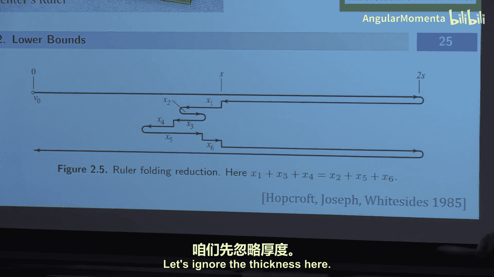

I can choose for each AI whether it goes left or right。And then this is gonna if this happens。

 what it means is my starting point is equal to my ending point。 Now， it could be in between。

 I go left and right。 and who knows what happens。 But the point is if they sum up to the left equal the right。

 then my starting point will be horizontally aligned with my ending point。So that's not the problem。

 The problem is to fit into a box of a given size。 So this says nothing about the box。

 But if you do this very simple construction， which is add a super long length and then add half of that。

At the beginning。 and then at the end， you add half of the long length and then the super long length。

Then and your goal is to fit it in a box of equal to the super long length。

 That will be possible if and only if these are aligned。 if they're not aligned。

 then if you go halfway left or right and then add the super long length。

 If it's not aligned with this one， then you'll be a little bit too big and you won't fit in the box。

Okay， so that represents two partition。Cool。20 seconds， one more proof。So here's another problem。

 map folding。You've probably done this before。 easiest way to re a roadm is differently， but。

Generally， what we're interested in here is just very simple fold It fold along one line。

 then fold along another line and so on。 Okay， so。This is N P hard。 If I give you a crease pattern。

 This doesn't look much like a map， but we can talk about that。

 if I give you a map a polygon and some creases on it， and I want to fold all of these creases。

 this is possible。 If and only if two partition is solvable。 Notice these lengths。 here we used A's。

 That's smart of us。 So these are the AIs down the distances between these creases。

 consecutive creases。 And again， that is well I could fold each one or not。

 And just like the carpenter's rule， I can fold or not。

 And if I'm clever and I do it with the right choice。 then this endpoint will be vertically aligned。

 have the same y coordinate as this end point。😊。

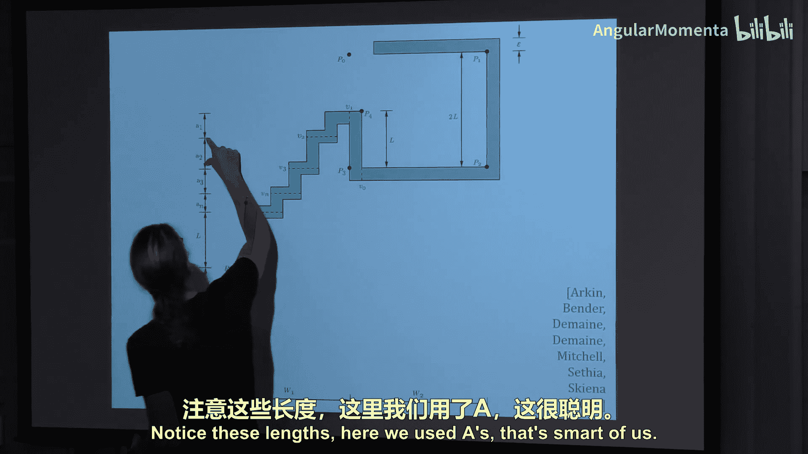

Okay，And if I do that， then and again， we've added half of the super long length and then the super long length here。

 There's also this half of the super long length and the super long length there。

 And now I can fold these two folds。 So when I fold one。

 it's going go here and it won't hit anything if and only if I solve to partition。Right， if， again。

 this， this is the box that I'm trying to fit everything into。

 And this is the thing that I'm trying to shift up and down to be perfectly aligned with that。

 If I can perfectly align it， then I fold this。Miss， then fold this， and it's out again。

 And then I can finish these other creases that I haven't folded yet。Okay， so it's all about。

 when do you execute these two faults。And so I'm gonna do some of the horizontal folds so that things fit nicely。

 Then I'll do the two vertical folds。 Then I'll do the rest of the horizontal folds。

 And that will work if and only if two partition is solvable。 Now， this may look like a weird map。

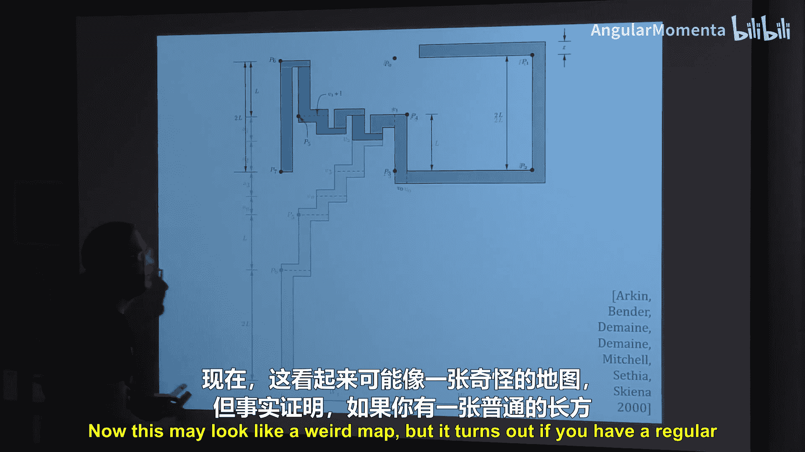

But it turns out if you have a regular rectangular map。not maybe a regular one， but。

 and you have some diagonal folds。45 degree。 Then that will basically force you to fold， oops。

Totm myself in the frame。That will force you to fold。Something like。This。Oops。Again。to。And then。

 here。So you can put in diagonal folds to force you to fold into this initial structure and then add folds on top of that。

 So this is like composing two gadgets， then you add horizontal and vertical folds just like that picture。

 and then you have a rectangular map with horizontal vertical and diagonal creases that you can fold all the creases by simple folds if and only if two partition is solvable。

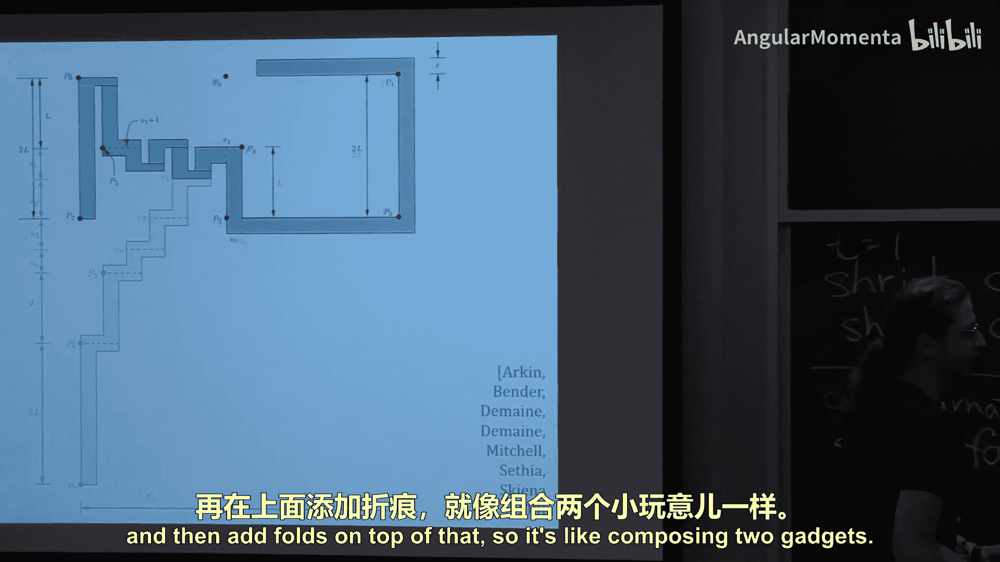

Open problem is this strongly NPR。 We don't know。 Is there a pseudo polynomial algorithm， Obviously。

 we don't know。 It's quite tantalizing。 but this is basically why maps don't have diagonal faults。

And that's it for today。

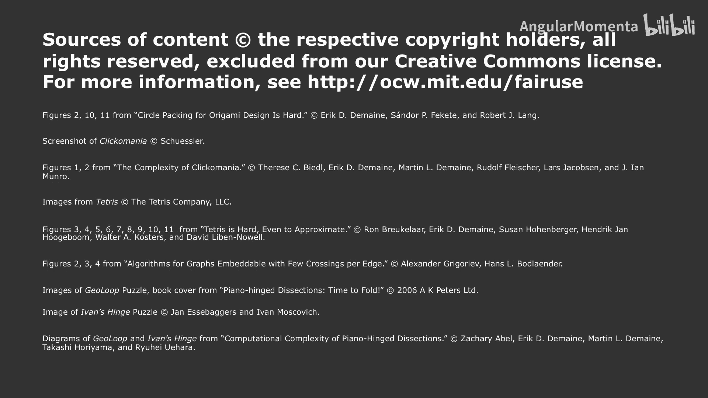