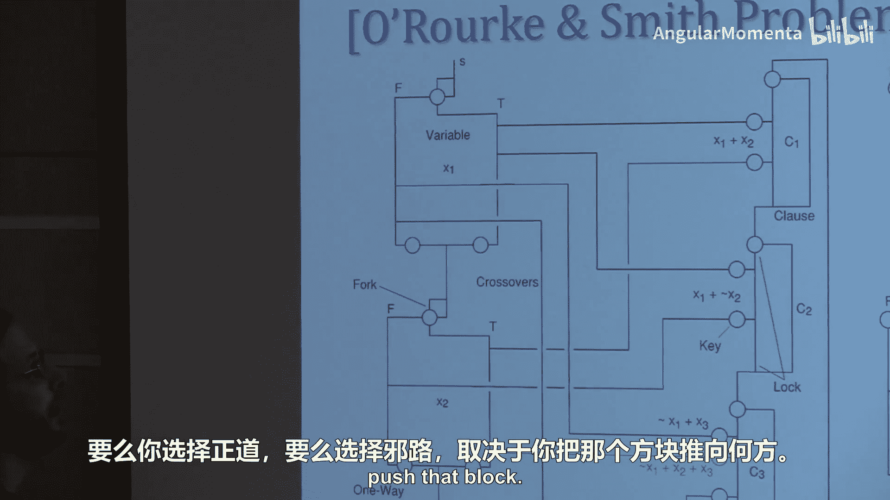
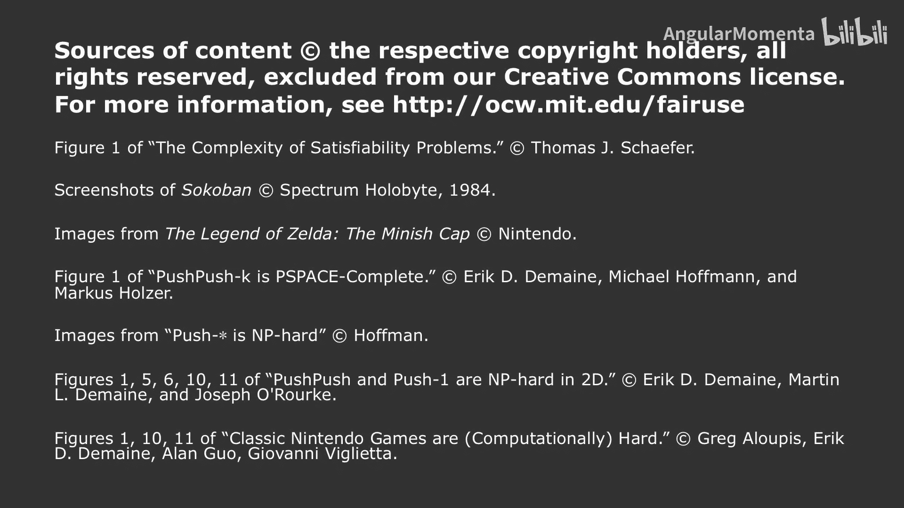

# 【麻省理工】算法下界 ｜ MIT 6.890 Algorithmic Lower Bounds, Fall 2014 p04 4. 学术能力评估测试（SAT I） -BV1dPYpz9E4V_p4-

The following content is provided under a Cative Commons license。

 Your support will help Mi T OpenCourseware continue to offer high quality educational resources for free to make a donation or to view additional materials from hundreds of Mit courses。

 Visit Mitopcourseseware at Ocw。mt。 Eduu。

All right， welcome back to 6890。 Today we start a series of lectures on satisfiability。

 we saw a little bit about satisfiability in the first lecture This now we're going to do it right and do it more intensely and see a lot of examples Today。

 we'll just see a few examples of using S to prove NP completeness or NP hardness but for the next lecture too。

 we will see many more examples。😊，And sat is really the most common problem that everyone uses to prove NP hardness。

 So this is the moment you've all been waiting for。

 I suppose this is one of the motivations for organizing this whole class so we can tell you all about Sa。

 It's many variations。 So you get to learn them all and then see lots of different ways you can use sat to represent your problems。

😊，So without further ado， let's get started。嗯。Today， I'm going to。

Give you a whole bunch of problems and definitions。 And then we will do reductions afterwards。

 So there's gonna to be a lot of problems here。 You probably will have trouble remembering them all。

 There's so many。 But in particular， the nuts serve as a useful reference。

 Like here's all the versions you might care about。 Here's which ones are hard， Which ones are easy。

 So with that in mind， get ready for the ride。 So the original satAT problem is you're given a boolean formula。

啊。Which is like over。The operators and， or and not。 And in case you look at the literature。

 usually and is the wedge or is the V and not is。The eggg， I don't know the name of that symbol。

 and it's over。And variables。X1， x 2。X， N。 so usually you're not given true or false。

 although you can construct them by saying X 1 and not X1。 That's never true。 So that's false。

 for example， then you can negate that get true。 And the question is。

 can you set the variables to make the formula true。So that's the general problem。

 This is the very first problem proved to bemp complete by cook and then by Levin。

 So it's usually called the cook 11 theorem the satisfiability ismp complete and I was looking at the paper the other day。

 it doesn't actually mention the notion of NP in that paper， I think that came later。

 but the notion is there。So。Give you another version of the same problem essentially called circuitsat。

 This is a useful perspective， which we will see probably not till next class。

 but another way to think about it also makes the MP completeness a little bit more intuitive。Oh。

OkayThis is kind of the algebraic way of thinking about things。

 You have variables and you write operators and use parentheses and that sort of thing。

 But if you're more graphically inclined， you could imagine you have your X's as wires。

 They're connected to gates。 This is an and gate。This is an or gate。This is in negation。So。

You can imagine something like this。 so you can generally copy your data。And do various things。

 And then this is sort of the output。 And so this is what you might call the formula。

It is the and of the negation of the or of x 3 and the and of x1 and x2。And then pop off。

 It's also ended with this thing again。 So the， the one advantage of circuit set is you can reuse complex computations just by copying the signal。

 Normally， in a formula， you'd have to。Copy and paste that chunk of the formula。

 So you could imagine this lets you write formulas slightly more efficiently。 I think it doesn't。

 You can， if you reuse things， you can always use， you can always write them as a variable over here。

 But question。Feedback is forbidden， so this should be a directed acyclical graph。 Yeah。

 good question。So。It's an acyclic circuit。That would be another problem， which is harder than an NP。

 So circuitat is NP complete when it's a cyclic and you can convert between one and the other。

 And it's a little bit more intuitive that you can write arbitrary computations as a circuit。

And then this is a question of whether you can the existence of some setting of the AIs is the same thing as saying。

 is there some set of guesses that will lead me to a yes answer。

 so that is intuitively like NP and that's roughly how you prove these problems are NP complete you write the computation。

 the checking computation to see whether you your certificate as a valid certificate as a circuit or as a formula and then the。

Existential quantifiers on the X Is let you do all the guessing to see whether they're。

 And this is biased， right， It's trying to find a true。 And that's exactly what NP does。

 It's trying to find a true path that ends up answering yes。So yes and true are。Asymmetric here。

That's。The extent of complexity theory we'll do today， I'm going to give you more versions of sat。

 Next one is CNF sat。CNF stands for conjunctive Normal Form。

I hope you all know propositional logic because we're gonna be doing a bunch today。

 So ans are also called conjunctions。 ors are called disjunctions。 This is old terminology。

 So conjunctive normal form。Means that your formula。Is an and of clauses。What's a clause。

 a clause is going to be an ore of literals。What's aiteral。Literal is going to be。X I or not X。

So these are variables。 So variables are possible literals and miations of variables， literals。

 And that's it。 And that is CNF set。 So it's a special case of set where your formula formula happens to have this。

Picture。And in general， you can convert arbitrary formulas into conjuncive normal form。

 It's a normal form， meaning it's essentially unique and a minimal CF formula is unique。

 so there's a known transformation to do that polynomial time， that's how you prove this is hard。

Another view in this picture we'll use， we'll use CNFat a lot， usually in even more specialized form。

 but already one useful view， which we saw a little bit in lecture 1， and we'll see it。Again， today。

As you can view such an input as a bipartite graph。You have。呃。Let's say， variables。On the one side。

And clauses on the other side。And then you have two types of connections， a clause。 in general。

 a clause is going to have degree 3。And I don't know。

 let's say the dashed edges are negated and the solid edges are not negated。

 So this is a clause that involves x1 or x2 or not x3。And in general。

 each of these clauses is going to involve some number of variables over here。I said three。

 but I haven't actually gotten to three yet。 That is three sat。

So the most common form of CNF set we use is called3 set。Where。

It's CNF sat in this special case where the clause is an ore of three literals。

And you can assume it's exactly three or at most three。

So that's like saying the degree of each of the clause nodes here is exactly three。

And that's the problem that we used for proving Super Mario Brothers was hard in the first lecture。

So in my notes， I have things nicely indented。 So we have CNF S， which is a special case of sat。

 and then3 SAT， which is a special case of CF S， a special case of three S that's also hard is called3 S dash 5。

 I don't know that this is super standard， but I found at least one paper that gives it this name。

 This says that each variable。😊，啊。Occurs。And。Less or equal to five clauses。

Either in its positive or a negated form。So this， this is sometimes called max 5 occurrence three set。

And I think you can even make them exactly five occurrences if you want。

 but most five occurrences is usually what you want question it's a good question，3 set 4。

I don't know。 I would guess。It's tight， but。Becauseuse there are a lot of people that mention five。

 but I haven't seen it mentioned that 4 is polynomial。 Alright， so we should figure that out。

Other questions， was probably the same one。All right， here's another special case of threeat。

Monione 3 set。This is where。Each clause。Is all positive。Or all negative。So， of course。

 if every clause is all positive， then。You can set all the variables to true and you'll satisfy if all the clauses are negative。

 you set all the variables to false and you satisfy。 But if some half the clauses are all positive。

 half the clauses are all negative， then that's hard。 That's called monotone 3 set。

 I've actually not seen this used， but I imagine is helpful in a few situations。嗯。

This is definitely the most common。 Almost every proof starts with three S。

 but it's really good to know all the extra things you can assume about your three S problem。

 and still be hard。I have more hard versions， but before we get there。

 I'm gonna tell you about some easy versions and question Another good question。 Montone 3 S 5。

 iss that in complete。 I don't know。 Partly， these were done at different times。

Monione3atAT is mentioning Gary and Johnson is done in 1978。

 presumably for a particular hardness proof，3at5 is probably a very old idea。

 probably this idea of reducing occurrences goes to some logic thing。

 but the earliest reference I found was 1998。And most people have forgotten about Montonone 3 S by then。

It probably just hasn't been considered， but it might be easy， yeah。

Five variables for construction to limit to five variables。Should I believe。I work with the monitor。

Okay， conjecture。 Yes， it's hard。Thats。Okay。呃。So， but stay tuned for。Certain answer。

 So let me tell you some polynomial time versions of sat。The three is tight。

If you have the clause being an ore of two literals。But otherwise。

 you're just like threeat or just like CFat， I guess， then this is polynomial time。嗯。

And let me give you rough sketch why。So。If you have an or of two literals。

 that's something like X or Y。And the little bit of propositional logic。

 you should know is the meaning of， let's say， A implies B。

Saying that this should hold is an A And B are either true or false。

 This is the same as saying not A or B。Okay， because if a is false。

 then the implication tells you nothing。 If A is true， then it better be the case that B is true。

 So either a is false in which cases， you don't have to worry about something or A is true and then B better be true as well。

 So these are the same。Maybe write triple equals for these are equivalent logical statements。

So we can apply that here and say x or y is the same thing as not x implies y。

Or not Y implies X It symmetric。 but this is now just a simple implication。

 If we ever set x to be false， then y must be true。

And every clause can be converted into such an implication。

 You can build a graph of all such implications。 and then turns out to solve to set。

 you can just pick your favorite variable X I， set it true。 followll all implications。

 see whether you get a contradiction。 If you don't。

 then the claim is there is a satisfying assignment where X I equals true。

 So you can try that with X I true。 X I false， if there's any hope。

 then one of them should say no contradiction。 and then just run with that。

 and you can prove by induction that won't get stuck。 won't make any。Impossible assignments。

Unless there was no assignment to begin with。So that's why twoa is easy。

 And one of the situations you should be careful about， on the other hand。Max2at。It's hard。

So max 2at is you're given a twoat formula， you're given a two cNF formula。

 and normally we ask for an assignment to the variables that satisfies all the clauses。

 but if you just want to satisfy k of them，So satisfy。Okay， of the clauses。

So usually you want to maximize K， but let's say for a decision problem。

 I'll give you K and I want to know， can you satisfy K of the clauses， that problem is NP hard。

So that can be useful if you can only represent twoat classes。

 but you can somehow get a maximization thing in then your golden again。

 But twoat alone is not enough。There's some other。Easy to solve。Versions。

 this is essentially generalization of twoat is H set。

Its maybe a little bit more surprising First time you see it。Again， it's a special case of CNF set。

Which you can tell by my indentation。Each clause has at most one negative literal。

So that means a clause is going to look something like。What one negative。Sorry， sorry。

 horn is the other way around。 We will get that problem is also solvable。

 but the one that's called Hat is， there's at most one positive literal。

 So that means your formula is gonna look something like not X or not Y。Or not the。Or W。

 So there's one positive。 The rest are all ne gateated。And we can do some more propositional logic。

 so use de Morgangan theorem。This is the same thing as the negation of the and。Okay。

 and then we can apply this helpful overall。And say this is the same thing as if X and Y and Z are true。

 then。W， better be true。And so you can use essentially the same algorithm。Now you're， you， I mean。

 slightly harder to check if， if all three of these things are true， then this one better be true。

 But it's always a guarantee， you know， this thing must happen。Just like in twoat。

 if X happen to be set to false， then you know y must be true。

 So you can just follow these implication chains。 if you get a contradiction。

 you know you're in trouble。 If you don't get a contradiction， again。

 you can improve by induction that all will be well。

 And so you just make sure every time you assign a variable。

 you don't get a contradiction and you can satisfy any horn formula。So， that's cool。

So I didn't write it on the board， but this is polynomally solvable。There's。A symmetric version。

Which is called dualhorn sat。So this is the same thing。

 but at most one negative literal in each clause。And this is also solvable in polynomial time because you can just negate all the variables。

In your formula， and then when you get an answer， you can negate all the variables again to get the solution to the original problem。

Because you can solve hornet， you can solve dual horn set。Cool。One more。Bad case。I mention now。

 is DNF set， you might say， well。Why do we make things ans of oars， What about oars of ans。

 So DNF is disjunctive normal form， meaning the disjunctions are on the outside。So let me formula。

Is an and。Of。Or sorry。By the way。Or of ans。Of literals。

Uses some shorthand not to find clauses here because we don't really use this problem because it's polynomial time。

Why is it polynomial time？Just evaluate one of the ans。

 If you it's true if any one of these is possible。 So you can just check for obvious contradictions like X I and not X I。

 If that happens， then that clause is impossible， throw it away。

 If any clause has no internal contradictions， then just satisfy the clause。Okay。

 so it's basically the answer is yes， whenever there is a clause could be you have the empty formula。

 No clause in this。 So writing， you can also write any formula into DNF。

 It's like an enumeration of all the true。Possibilities， but it takes exponential time to do so。

So it's a funny asymmetry between and andor。That's life。Yeah， I just one to say for a horn set。

 even if you don't have horns set or dual horn set， you might have a formula or summary renaming。

 not necessarily all of the literals。But renaming just some of the literals were put in cornet。

 and that's also that's oh， just negating some of them， yeah。

Like for each each time a variable occurs， you have to negate all the instances of that variable。

 but these are called renameable horn formulas and it's also do it finding the renaming is linear time so okay。

 so some kind of。Renameablehor。And by renaming， you just mean negating right。

 the term used in the literature is renameable。 So they exist in negation。Of let's say。

 some subset of the variables x。Such that。诶。Al right。Okay， that's a very concise version。

 So you get to choose some of the variables to the gate and make it a horn cause that's also polynomial time。

 cool。😊，Thank you。You might be wondering at this point， how am I I mean。

 do I have to remember all of these。 In some sense， the answer is yes， but。

There is actually a dichotomy theorem that will tell you which versions of S are polynoial time and which versions are NP P hard。

 And we'll cover that in one more page。 but I'm。Well。

 all of these are involved in the statement of that dichotomy， not quite all， but most of them。

So that's not exactly a shortcut。I would say a lot of the time。

 the problem you're working with does not naturally map onto ans and ors。

 It sort of involves bits of some sort。 There's a0 and a1 notion。

 but they may not really correspond to logical notions left true or false。

 and they may not the operations you can do on them may not correspond to and or or or anything nice like that。

 So the next two versions of sat are in that spirit。So this is usually these days。

 called one and three set， but originally， it' was called exactly  one，3 set。

So this is going be a little bit weirder to write down。 But like CNNF S。

 the formula is the end of a bunch of clauses。 So that part's the same。

 But now we're going to make a clause。To be a relation on three variables， which is that exactly。

One of let's say， X， I， X， J and X， K。Is true。So this means it could be true， false， false。

 X I is true， but the other two are false。 It could be X J is true。 The other two are false。

 or it could be that X K is true and the other two are false。

But those are the only happy assignments question。Good question。

The original statement is its variables。 So that's how I wrote it。 This is usually called monotone。

 These days， It's usually called monotone 1 and three set。I don't know how usually exactly。

 sometimes it's called all positive one and three set。So， let's say。呃。Literal equal variables。

You could， of course， if you want， consider a more general version where you can have negations。

 but you don't need to。 so why bother。Just that fact is usually forgotten in most proofs。

 So you'll see in the literature a reduction for one and three sat with negations and they have a negation gadgets like。

 you know， you don't need to have a negation gadget。 So why not skip it。But there you go。

 Now I just mentioned， I'm not a fan of the word monotone here because here we have monotone to mean all positive or all negative here。

 We mean it mean all positive。Not ideal reuse of terminology。

 I think that's why sometimes this is all positive 1 and 3 cent anyway。 It's a bit of a mess。

 but that is the state of the literature。 So you get it all。All right。Here's another problem。Monoone。

 not exactly 1，3 cent。I should not add have any suspense here。 This is in P。Okay。This is MP complete。

 This is also MP complete， but not exactly one3 sat is polynomial。So I think you know what it means。

A clause。Specifies that again， we take an end of clauses and we want 0。

2 or 3 of three variables are true。In other words， exactly one of them is false。No。I don't mean that。

Exactly one of them being false would be one and three sad again。Just by negating everything。

Which we're allowed to do if we want to。But this is different。 This is saying it could be。

Everything's false or it could be one thing is false， or it could be0 things are false。But， yeah。

 but not two things are false。Okay， this turns out to be polynomial。And。Do I have。Oh， there's。

 there's one。Funny thing here， which is in if this is， if all your clauses look like this。

 you can set all your variables to false。 So this is sort of a trivial problem。

 But to make it more interesting， you can say x1 equals true。Just to get you started。

 So there's no trivial solution then。 And it turns still turns out this is easy。

Because if you think about this long enough， as I did yesterday， this will look something like。

If you have three variables， either they're all false， then fine， or if one of them is true。

 then you better have another one true。 That's the way of saying if there's at least one of them。

 there better be at least two。 That's what we want。 This has to be true for all shifts of IJK。

 So for each of IJK。 if one of them is true， you want to imply the or of the other。

And this is the same as not X， I。Or X J or X， K。 don't need the parentheses， because it's。

Asciative commutative。 And that is a。Dual horn cloths。 And that's why this is polynomial。

I think I'm confused about the definition， why can't they just all be true though？Could。Question。

 let's say X 2 is false。 I'm I should double check。

 I don't remember that in the statement of the problem， so。

We do not allow negations here Once you allow negations， this trick won't work。

 but when if these appear all in positive form， then we can convert into the single negative and get dual horn question allowed to and or be be all clauses look like all clauses say 0。

2 or three of these three variables must be true。You can have a clause that says zero of these are true and two of these are true。

 No， but if you if you have two of these clauses that give you all those choices。

 can you make choose one to be0 and then have another one be two or whatever for each clause。

 it's an independent choice， whether you have 0，2 or three of the variables true， yeah。

So this or is local to the class。Other questions。So it's still an end of things that it's just we have a weirder relation instead of just taking the o of a bunch of things。

 which would be saying at least one of them is true。

 Now we allow zero or two or three of them to be true。Okay。One more version。Then we'll get two。Well。

1 and a half more versions。Then we'll get to the dichotomy theorem。

So next one is not all equal three set。I feel like that's about all I need to write down other than the fact that it is empty complete。

But just in case。What this means is a clause。Is something like not all equal of three variables again。

And this is what I'm defining is going to be the monotone。Not all equal3 sat， which is also hard。

Where these are variables。Not just literal， so no nes。And monotone， not all equal three set。 again。

 that the original proof already had monoicity in there。 so there's no work to be done。Cool。

 so not all equal just means that they're not all the same values。

 So that means not all true and not all false not。提提七。And not。FFF。

I really like this version of three S because it's completely symmetric between true and false。

I mean， not at the clause level。 Every clause has to be satisfied。

 Those are ended together in the logical level， but the X Is are treated completely symmetrically between true and false。

 You could just call them red and blue。 It's no reason to think one is true。 One is false。

 You just can't have them all be the same color within a clause。Okay。

 so you can think of it as a problem on hypergraphs，3 uniform hypergraphs。

 you have all these triples of things。 You just want them to not all be colored the same。

So it means two of one， one of the other two trues and one false， two reds and one blue， two falses。

 one true。re all those are all good cases， and these are the bad cases。嗯。Cool。

So this is one or two in three set。Yeah， you can think of this exactly one or two in three set。

 if you wanna phrase it in this style。Okay， so。Ideally， you should remember all of these。

 But I'll tell you， the most important ones are regular three set。

 That's at least one of each thing is true。 Ex one，3 set or one and three set。

 where exactly one of the things is true。 And adding more things breaks it and not all equal 3 set。

 Those are the three important ones to know from a lower bound perspective。

 These others are to like be careful that you don't fall into one of these things that is。Polynomial。

So occasionally max2 set is the one other that would be useful here but。Remember these guys。

 They're super handy becauseuse what will happen when you're proving hardness is you。

 you fool around and you try to find， you build a gadget that has two truth。

 two possible ways to satisfy it。 Call one red and one blue or one true and one false。

 And then you figure， you try different ways to combine three of them。

And you're trying to get you need some other things， but you're trying to get clause gadgets。

 trying to get them to that when you combine your wires in when you combine three of wires into a little gadget。

 you want them to be constrained somehow that in order to be globally okay。

 something must hold locally at those three things。

 and it might end up being a not all equal constraint。

 it might end up being exactly one constraint or it might end up being a three sackac constraint。

With some negations to make it happy， I should be one of those to be hard。

If you fall into something like this， then that's not good。开始。So let's say。

 since this not all beautiful whole thing， let's say call it from blue， what if your eyes was green？

And would there be like？would not all equal。3 set the。And be harder when you likees something。 Yeah。

 so what about turnernary truth。呃I。There might be a problem on that in the Pet。 But in general。

 you'd have to go through the work to check what which problems。 I think those are pretty uncommon。

 So usually what you do is if you have a gadget that can be solved not two ways， but like four ways。

 is you call two of them true and two of them false and hope they behave more or less identically。

 So that's the most common answer practically to what we do。

 But certainly it's plausible with three different values， some of these are gonna be hard。

 But I don't know which ones。Yeah。Hopefully， all of them， but。You have to be careful。

 And definitely the next theorem I'm gonna talk about。

 the dichotomy theorem would get more complicated with three colour。嗯。Actually。Nice question。So。

Let's do。Schaefffer's dichotomy theorem。This is about which。

Which versions of S are polynomial and which versions are MP complete with the right setup。

 They are all Every problem you can think of is either polynomial or MP complete。 There's no。

Things in between， these are called N intermediate problems。

 So it's always gonna be one extreme or the other。As I'm about to set it up。

And there by this theorem is by Schaffer。 And in the very same paper。

 he proves not all equal3 set and one and three set are hard。 Those are the original proofs。

 So it's a great paper。I've looked at it。Many times that's from 1978。 so a long time ago。

It's still quite readable。So I don't know how many all the last problems we've stated have this property。

 but I'll make it explicit again。 that's your formula is going to be an and of clauses and now we're going to allow general kinds of clauses。

 a clause is just going to be any relation on some number of variables。

So there won't be any notion of literal here， because you can。Put that in the relation。

I'll call this a general clause。Let's say。Relation on。Some variables。So relation is something I。

 I give you set of truth values for those variables。 and will say yes or no。 That's valid。

 or it's invalid。 You can think of a relation as the set of all assignments with the variables that make it true。

 But you don't have to specify that， per se。 You just sort of know what it is。Okay， so， I mean。

 in particular， if this， it could be the or of three variables， then we get three set。

 or it could be the not all equal constraint on three variables。

 then it's not all equal three set and so on。嗯。Okay， we are going to。So the， I guess， sorry。

 the relation should be given to you as a Boolean formula。So it could be an or。

 or you can write one and three S as a bullolean formula。 Its just a little tedious。 You could say。

 well， it could be this or it could be this or it could be this。 In general。

 I'm going to assume that there。Given to you in CF form。Sorry， that's redundant。 CF has form in it。

And because any formula can be made into CF。So now， CF is an and of ors。

 So this is going to be an and of what we might normally call clauses， but we're already in a clause。

 So I'm going to call this sub clauses。Start to sound like legalese， but。That's， I made up this word。

 It's not in the literature。 So in general， your formula is an end of clauses。

 Each one is just sum relation， which we're gonna think of as an end of sub clauses。 Of course。

 it's really just an end of all the things。 But this is trying to be general。

Because we're going to have constraints in the clauses in particular。So then claim is。Sat。

On these types of formulas。 so here here's the difference， I guess。To define the problem。

You specify what kind of relations that you allow。 So in three SAT， we say， okay。

 it's or of three things in CNF S， it's or of K things for any K in not equal3 S。

 It's not equal of three things。 and so on。 So we give that up front。

 And then the decision problem is， well， I have n variables。

 And I can combine them with these clauses however I want。

Right so thats so we need some kind of infinity， right if I gave you a specific problem。

 then it's not going to be and be hard like with these 10 variables。

 that's never going to be interesting。 So I give you the notion of what clauses are allowed。

 what relations are permitted。 and then I want to consider the class of all possible formulas you can build with clauses of that type So you can think of this as really more of a clause type like not equal just to be precise here。

And then we get a version of sat。And。It's going to be polynomial。If。One of。Four cases happen。

At least one， Any one of these will make it easy。 We have seen almost all of these。 So first one。

Is setting。All variables true。Satifies the formula。Well， not just the formula。

 but all formulas of this type。 So， or all variables false。Satisfies。All。Cluses。

OkayThis is a statement over all formulas with this clause type。

 right It's a statement about the clause types。 And it's one of the issues we were having with not exactly one three set because there。

 the clause type allowed everything to be false And it also allow everything to be true。

 So it is doubly bad。 of course， if if you have clauses where this is true for all you could allow different types of clauses。

 you could have not all equal plus one and three set。 that will also be hard。 of course。

 But if all of your clauses have this property， then， of course。

 you just globally set the variables and you're done。哎。That was the first case。嗯。So next one is that。

It could be。The sub clauses。Are all horn。Or。All dual horn。So those are two happy cases we saw before。

 I mean， we can think of the overall problem as an and of。The clauses， which are ans of sub clauses。

 So if everything is a horn or dual horn thing， then we are happy。And。Next case is。

The relations are all。To cF。So this would be the twoat case。

 If all the relations you're working with are to into cNF， then when you add them together。

 you still have a two cNF formula so you can solve it by two set。

And so these are all things we've seen。 There's one more case。 we haven't seen。So there a question。

Is it too sad just to subcase of the horn and Duhorn？you're always going have。It's true。

 Too sand is a special case of horn。So。Yeah。Right， right， right。 So I see。 So 2 C AndF。

 some of the clauses are going to be horn and some of them are dual horn。 I think so you。

 it doesn't fall into this because it's not all one or the other。 In general。

 those combinations are bad。But too too sad is always okay。Good question。Okay， last case。

Is some linear algebra？This is one other easy case of sat， which doesn't come up very often。

 so I didn't write it as a separate one。So imagine equations like this。

 I take some number of variables， I X or them together。

 and I say that should be0 or similar thing I said it equal to1。

 Those are what I would call linear equation over Z mod2。Because in Zman 2。

 the finite field and two elements addition becomes Xor。 and there's no multiplication here。

 So'ca it's a linear system。So。We can solve these things because Z2 is a finite field。

 We can use Gaussian elimination。 If even if I have a whole bunch of these equations。

 I can solve them all using Gaussian elimination。 So or determine that they're unsolvable。

 So that's another easy case for， for S to be careful about。And。

Theorem is if you have one of these situations。 so you can't mix these。

 if you have one clause of this type and another clause of this type。

 your problem will be and be hard。So。generally say， otherwise。SAT is NP hard。

I guess it will actually be MP complete here the way we've set it up。Well。

 assuming the relations are checkable。So these are the only cases。 This is an easy case。

 This is an easy case。 This is an easy case。 It could be that multiple of these things are true。

 Maybe you're two CNNF and you're all horn。That will also be polynomial， of course。

 But if none of these individually hold， then your problem is npy hard question Yeah。

 so we can go back to your question about three colours。 And the answer is， I don't know。

 As far as I know， there's no theorem of that type。 but there might be one。 It's been 30 years。

 So wouldn't be surprising。 Certainly， you can some of these positive results will generalize。

 But I think even this one would be a little tricky。The next two set， doesn't。FRight， So in here。

 the goal is always to satisfy all of the clauses。 It's always an end of all the clauses。

 You could imagine a max 2 S like theorem。 My guess is most problems will be hard， but。

As far as I know， there's no such theorem。 Yeah， is there any way to understand this theorem as making a geometric statement about the relation being like comp conx and the hyper cubee or something like。

 is there any sort of convexity property encode in the。I don't know。 I would guess know。

 I know there is a more modern take on this that is more algebraic。

 So it's more like if you start with these things and you can build up in this way。

 anything you can build up in this way are the polynomial solvable versions of sat。

 anything you can't build up in this way is is empty hard。 So if you're interested in that。

 check the Wikipedia page for Schffer's dichotomy theorem。

But I don't think this is a geometric interpretation。

 This one obviously has a geometric interpretation。 But I think the otherss not would be my guess。

Yeah。So does this say something about the complexity of recognizing the clauses if you interpret them as a language。

If I give you the formula that specifies the types of clauses。

 can you determine which of these is whether any of these is the case， I would guess， yes。

 but I don't know of such a theorem。It's another good question。 Wow， so many。

 so many questions to think about here。 definitely not。

Bliitly mentioned that I saw in the Schffer paper， but。It's been around for a while。

 so people may have thought about that more。It definitely can be a little tricky to check which things are of this type practically。

 so be nice if there's algorithm。I would say。So again， practically speaking。

 there was one hardness proof I was trying to generate gadgets computationally。

 So just enumerate all possible gadgets of a certain size for my problem and then see what formula they were representing。

And then we would take that formula， do a carno map if you've ever done digital logic stuff。

 and then sort of get from that， you get a sort of nice minimal form。

 And then we would usually we could just look at the map and say， oh。

 that's just equals or that's not equals or something we were hoping for。

 we're dreaming for one of these things or threeatAT， we never got the gadget we wanted。

 So I think with like a carno map， you could do this。 But that's exponential time。Yeah。

 so I don't know， for sure。I should probably check the algebraic view that might。Right。

 that's a clever approach。 though。 Yeah， to do things computationally。

 It's definitely helpfulcause of course， computationally， you can only look at small gadgets。

 but hopefully there is a small gadget and then a nice proof。

 So why do the hard work of generating them yourself when the computer could do it for you。

 doesn't work for all problems。 It needs your problems need to be sort of locally isoltable to not worry about the big picture。

Other questions？Cool。Well， that's all the versions of set you need to know。

Becauseuse here we have a universality theorem。 there maybe will be another one or two that we bump into。

 but these are the the things you should all know。 It's really helpful when doing a proof to not have to worry about which version of  three set you even are gonna to use and just know that these are all out here so that when you find a gadget that happens to match one of them you say。

 oh， well， I meant to do a reduction from not all equal threeat that。

That's why I wanted to tell you all these， although I know it's a lot to take in all at once。

Let's do some reductions， finally。And be hardcore time。So。诶。The first one。

I actually never seen before， but it's in Schffer's paper。 So I thought it would be fun too。Cover。

Here's a problem， which is MP hard。 And we will actually prove this one。 MP hard to colorable。

 perfect matching。Let's say you're given。A planer。A3 regular graph， every vertex says degree 3。

And what you'd like to do is to color the vertices， red and blue。Such that。

Every vertex has exactly one。Neighbor of the same color。Okay。

 so if you look at a vertex and it has three neighbors。

Then let's say we color it this guy red should be exactly one neighbor that's red。

 And so you can think of this edge as being red。 And then the red edges will form a perfect matching in the graph。

 every， every vertex will be instant to exactly one edge。

So that's the two colourable perfect matching。 It's kind of， well， sorry。

 the red edges form of perfect matching on the red notes and the black。Or the wide edges， I guess。

 form a perfect matching on the。White notes， black notes， whatever。

So it's like two perfect matchings， one of each。W in each color class。So that's a nice problem。

 You can think of it as sat， in a sense。 It's， again， just a local constraint on the notes。

And so you can think of this as being a clause involving those four guys。I think if I。

 unless I did something wrong， you can think of it as。诶。To enforce that。

Or special version of2 and4 set because。Alright， yeah。So this one， if this note。

 let's say red is true。 So what we're saying is if this guy is true。Among these four nodes。

 there should be exactly one other one that is read。On the other hand， if this is black。

 there should be exactly one of them that is black。 And so the other two should be red。

 So in all cases， it's exactly2 and four of them are red。And it's symmetric between red and black。

 So that seems good。 So this is a special case of two and four that。

 in case you're wondering whether two and four that is hard。 Here it is。 And I have a。

The original reduction by Schchaffer here。 I have any notes。 No， that would be too easy， so。

Here's a gadget。 here's another gadget， And then they're pasted together。 So， and I should mention。

So Schchaeffer claims that if you have a planar 3 regular graph， this problem is hard。

 but he doesn't prove it。 He just should prove it for general graphs。

 So I'm only gonna prove it for general graphs。 Maybe we can think about the planar 3 regular case。

 but not right here。 So this will not， this will just make a graph instance to that problem。

So this gadget， this is a K4 on， and we're only distinguishing X， Y and z。And it has to form。

 there's going be one red edge and one black edge。 So maybe like this and like this like this or like this。

 is's going to be a rotation of one of those assignments。So I believe the claim is X， Y and Z。

 just looking at those two vertices should be not all equal。Okay， if。

 if two of them are red by symmetry， lots of rotational symmetry here。

 So maybe two of them are red and one is black， then this guy can be set black and you're happy。

 It's actually forced for that guy to be black。If two of them are black， and。

 then these two must be red。And if all three of these are black， you're toast。

 because you should have two of each。 And if all three of them are。Are red， you're in trouble。

 So this is a not all equal clause gadget。For this problem。

 So we're gonna reduce from not all equal 3 set。2， to colorable， perfect matching。

 So we're representing an o equal clause like this。 And now。What we need is to。

 the ability to copy data。Right， so these are three variables that at the moment， Yeah。

 they can be red or blue。 But what we need is that the same X I can appear in multiple clausesca we have a bipartite graph If every variable appeared in only one clause。

 problem would be really easy。So that's what this gadget does。

 The claim is this gadget copies of value。And this， I think， required。

 So it says these two guys must have the same color。

And so what you do is you just have for each clause， you have one of these not， for each。

 not all equal clauses。 You have one of these not all equal gadgets。

And then whenever you have two variables that are supposed to be the same thing here's X and X and our terminology。

 X I and X I， then you're just going to connect them with this gadget。

 and that will force them to be equal over here， we have Y and y。 So here's R here is not all equal。

 and our terminology be NAe， X， X， Y and Y， Z U， this would represent that formula。

So the thing to check， which I will leave is an exerciseca it seems at least I couldn't find a clean way to do it。

 It seems a little bit tedious that this forces equality between the two ends with not providing any other constraints。

So that was a simple proof。I want a few simple proofs， still some cases to check but yeah。

 this is general graphs。So you might say， what about planar3 regular graphs。Plainar。

 not all equal3cent。 When this graph is planar， when the bipartite graph is planar is actually easy to solve。

Polynomial， so you can't can't reduce from planar not equal3at because it's easy but I would guess that in this situation。

 and we just prove this is a more general problem than not all equal3at。

 what we would need at this point is a crossover gadget so that when in this thing is going to end up with crossings。

 if there's a gadget that just communicates the information across the crossover without any other constraints。

 Then we can just plug that in and get rid of all crossings。 Then we have a planar graph。

 And that would prove this part。And then the other part is that we have high degree nodes here。

 And so I'm guessing Shaffer had in mind a gadget that takes a high degree node and splits it up into lots of little lower degree nodes。

 degree 3 nodes that simulates the same effect。 But I don't know either gadget。

 But that would be my guess and how to。 That's what you that would be the obvious approach of how to proceed to get that theorem。

other gadget is just 1 B。Split a note into degree3 copies connected by。dgeOkay， good，1 gadget down。

 Now we just need a crossover。Other questions。All right。

 I want to talk about two families of problems， proof hardness for two families of problems Next。

 one is called pushing blocks。 These come up in lots of different video games One of the first I think。

 is called Sokabon this goes back to 1984 and this is I believe the original CG graphics for Sokaan And so you may have played Soabbon。

 I think it's in emax and it's all over the place， tons of implementations on it。

 you are a warehouseman that is what Soaban means literally in Japanese and you have these boxes。

 they're all one by one boxes。 you are one by one。 there are some bricks which cannot be moved you have some target locations and your poor job is to move all these boxes into the target locations。

 or rather every target location must be covered by exactly one box boxes can overlap each other。

 you can push a box， but you can only push one at a time because you're not that strong So you could not。

 for example， push left here。Genally， your inputs are up down， left and right。

Up up down down left right， left right。 and you can't， you can only push one block at a time。

 So if you push a block into a corner， it's never gonna move again。 So often you have to hit reset。

 There's a lot of ways to get stuck。 But this is a solvable instance。

 I think it's level 5 in the original game。So this got started a huge family of problems。

 There are tons of other video games that have pushing blocks problems。

 This is one in legend of Zelda Minish cap， which I think is a game boy advance game。

 It's been a while since I played this one。 But here is a level where you have it's。😊。

It's in perspective a little bit。 But these are， this is really a 2D problem。

 Everything is one by one。 believe me， you have one by one blocks。 You're on ice。

 So if you ever push a block， it will slide off to infinity unless it hits something else like a block。

And your goal is to get a block here。Anyone see how to do it？this is not like ricochet robots。 Yeah。

 you can walk wherever you want that there is no block。So there's lots of free space in this case。

 so you can push this guy down。And then push it over and then push it up。

 It's actually not that hard。 At some point I was thinking， well。

 maybe I should stack up three years So it ends up， but no。It's just three pushes and you're done。So。

 and if you watch the YouTube video that's linked from this。

 you'll see him spend like 30 minutes until he finds the right solution。 It's in the game。

 it's frustrating becauseuse once you push them off。

 they disappear and you have to leave and come back。Anyway， so out of all these games。

 we've defined a bunch of models， here's one aspect of the model。

 So we have the fixed blocks which are in red， the movable blocks which are in can here and the robot is blue。

 everythings one by one and in one model which we call push when you push a block。 it moves one step。

 that's the normal model and that's like socobon and I'll talk about the two in a second。

 in push push。 this is like the on ice version。 So you're not on ice。

 you can still kind of move and then kind of counteract physics and just move one step。

 but the blocks， they'll just fly off until they hit something。

 So here this block will fly until it goes there in push push push everything is so slippery that if you hit a block and it hits another block that's movable they will all just keep going。

😊，Until they hit an immovable block。But you don't。You still don't slip in any of these models。

 So there's another version where you slip， which has not been considered so much。

 The ricochet robots has been considered。 And that's in that genre。

 Yeah I there a model where the block， first push stops and transfers its momentum to the other。 Oh。

 cool。 Yeah， conservation momentum。 So this one hits the next one does。

 That's probably push that push。 I would guess that's also hard because this ends up being the same proof。

 guessing that works， but we would need to check。 That's a good。 Yeah， the push push ricochet push。

 Okay， one other thing here is the number two。 you'll notice only two blocks are moving。

 And in general， normally here， two is the strength of the robot， meaning you。

 if they're up to two in a row， you can push two blocks。 But once theyre three in a row。

 you can't push it all。 The idea here is the same thing happens。

 So they're just too heavy after you get up to three of them， then they'll stop sliding。😊，Okay。

 and same with push bush bush。 So Sucoban is actually push one。 Sucoban is like push1。

 It's a little bit more complicated， as illustrated in this table。 Sucoban is here。 and there， it's。

 you can only push one block at a time。 There are fixed blocks。 And in general。

 the models that have fixed blocks are highlighted in pink here。😊。

This slide thing is trying to capture whether it just moves one step or all the way until it can't anymore。

 that's the max so there's only a couple of slide versions I haven't put push push push here because that would be the only difference is what max means。

 but everything else you just move one step。Then the the other issue is what is the goal。

 I mentioned in Sucoan， you have to cover every storage space with a box。

 That is the only problem with that flavor in this list。 anyway， All the ones that are called push。

 The goal is just to get the robot to a destination， like in。Mario or Zelda or something。

 So that's the difference between Socobon and push1。 Well， push1 F， I suppose。

 is pushing one thing at a time with fixed blocks that's identical to Socobon except for this issue of what the goal is。

 either just to get from S to T， the robot or to get all the blocks into a particular configuration。

啊。Okay， well there are some other things here that that's we've talked about push K。

 push star is when K is infinity。 So you can， when you push you your arbitrary strength。

 you can push as many blocks in the row as you want。 push push K， push， push star then。

 we've talked about F F is when you have fixed blocks， push 1 F， push K F。 and push star F。

And then there's one other variation here that's been considered， which is the X。

 This is when the path that the robot takes must not cross itself， must not revisit a square。

 This is although there are a lot of video games where after you leave a square。

 that square disappears。 like it falls down to into the abyss。 And so you're scared。

 So to represent those games。 there's another reason we did that。 But I'll get to that in a moment。

 there's push K X and push star X。 Okay， now let's talk about complexity。

 that's this the right two columns here。 The reference。 and the。Complexity， so。

All of these problems are NP hard。Okay， but there's this issue。

 Are they in NP or are they P space complete question block fixed block is a block that cannot be pushed。

So it's just like glued to the ground。 is whether or not there are some right in this。

 these problems。 This is a more general version than this game here。

 you allow some blocks to be specified as fixed here， everything is potentially movable。

 Although if you have more than can in a row， it's like a fixed block。

 Like if you have a K plus1 by K plus1 block， that's fixed effectively。 But it。

 you have a resolution issue that you can't make tiny fixed blocks in this model。 And this model。

 there are no fixed blocks whatsoever。 But here you can specify some of them are fixed。Okay， yeah。

 a lot of versions。Push star does live in a rectangular box。 Yeah， that is the one。

 You could think of that as fixed blocks or not， yeah。If nothing is fixed。

 then you can just walk off to infinity， move all the blocks away and then come back and find your destination。

Right， so they're all MP hard。 There's a few that are known to be piece based complete， P， push。

With a fixed strength， is piece space complete。Or with fixed blocks。

 I think should also be piece based complete。 That's not written here。 But push per star。

 all we know is NP hardness。Push K， F， where K' is at least2 is known to be P space complete。

 but push 1 f or push 2 without the F are both open。um。

And the reason we were interested in a non crossssing path is that forces the problem to be an NP because then。

 you know the solution path that has polynomial length can visit each square at most once。

 So the hard part here was to prove that it's still MP hard， even with non- crossssing paths。

 We won't try to prove that today。 But so those we actually have tight bounds of MP complete。

 And Socobon， there's a relatively old result， 1998 that it's piece space complete。Okay， let's。

 let's do some reductions。 So this first reduction is。Amazingly cool。

 This is by Michael Hoff in 2000。 This is P star with a rectangular box。😊， so you're here。

 the outlined regions are the blank space。 Everything else is filled with a block。

 but every block is movable。And you can push arbitrarily strongly。

 So what this is going to be variables。 You're going to make some choices here。

 These are the connections between variables and clauses。

 This is a bipartite graph encoded in binary In the obvious way。 There's variables here。

 clauses here。 There's a hole exactly when that literal appears in that clause。Okay。

 there's actually two rows per variable that true and the false。

And then there's this gadget here to connect the things。

 And then these are the clauses where we're gonna check that they were all set correctly。

 So let's go through it。This is the schematic diagram of what I just said。

 We're going to start here in the variable block， walk through each of the variables。

 Here's what the variables look like。You have two rows， the Xi row and the Xi complement row。

 that's another way to write not Xi。And you're gonna count how many times does X I appear in any clauses in a positive form。

 negative form。 that's called N I and N I bar。And you're going to measure out these lengths。

 You can negate variables to make sure that N is always bigger than NI bar。So do that。

So in this case， N I is this big， N I bar is this big， measured out。 this is your blank space。

 And what what youre allowed， what we will show you are allowed to do is either move up here and move all the way over to here and then up。

Or to move here and all the way over and then up。 And this stars so that for the one block that's here could fit。

 And then you can go over to this X。 in general， in these gadgets， the X is your target。

 X marks the spot。For the gadget。 And then there's a global X。

 which will be at the end of the clauses。So what does this do， Well。

 if you think about this connection block， this is the the bipartite graph encoded as a matrix。

 There's the number of blank spaces over here is exactly an I。

So this is why after you push N steps or N bar steps。

 youll have to stop because there are no blank spaces to the right of you。

 Then the only thing you can do is go up because there are no blank spaces below you。 So in general。

 these gadgets are super tight。 as above you， there's nothing。

 It's all blocks and below you and left of you。 It's all blocks。 There's nothing you can do。

 You put the next variable gadget here， so that that remains true。

 immediately to the in your row and in your columns， you're completely packed。

 So there's the only choice you have is to do this or to do this。 And you will fill。

The row that you choose。Exactly， okay， so that's the variable dash。

 What prevents you from choosing both。You could choose both。

Or you could do a little bit of one and then do the other。That's true， but as we'll see。

 that only makes your life worse。 Yeah， good question。Alright， so next we enter the bridge gadget。

 which is these two pictures。 and it looks like this。 This is basically a locking mechanism。

 So you start here。 I'll just tell you what you're supposed to do。

 You walk over through this blank space。 Then you push all of these things down to here。

So this basically prevents you from going back to where you were。 so you push all that down。

 and then you go over here。And you tunnel down。 So I think you're moving these blocks over to here。

 It's another kind of lock。 And then you're pushing this stuff down to here， and then you get there。

So when all is said and done， this will be down here。 This will be down here。 This will be over here。

 And so when you're in the clause block， again， you have full rows to your left。

 full columns above you。So there's nothing。 You can't go up and you can't go left。

 That's the purpose of this gadget。 is to connect this thing to this thing。 If there's a teleporter。

 be much easier， you could just leave these all filled。 But we want to get up to here。And then。

 but make sure this is all filled at the end。 So that's the sole purpose of this gadget。Okay。

 now a clause。we do a clause again， So you have there's three spaces here because this is threeat。

 you can move down one here and then move over2。 these two blocks go here and then you can get to the X。

 or you can go down here and over and get to the X or you can go here down over and this is possible if there's a hole below you。

 this is possible if's a hole below you and this is possible there' a hole below you。

 these are aligned with these things。 so。With exactly， I didn't quite align them。

 But these three columns are these three columns。And。If one of these is unfilled。

 you'll be able to get from here to here。 If they're all filled， you won't。

Because it will be full columns all the way down。啊。

So that's a clause gadget because things were filled。When you chose that thing。To be。

Maybe did I get it backwards， So you're really choosing the， the opposite， right， You're choosing。

 you're， you're choosing the thing to be not true and leaving the other one to be as true as possible by not pushing it So it leaves the holes so that later you can。

 That's why you wouldn want to choose both。 right， If you chose both。

 it would be like making them both of them not true。 And so you don't get any of the benefits。Okay。

That's push star。Cool。Okay， let's do push， push 1 in 3D。 This is really easy。

 This is almost like the Super Mario Brothers proof。 So it's just old drawing style， so。

And we've drawn sort of the dual graph。 So these paths are a little width one tunnels that you can walk down。

So you start up here and you can either push this thing this way or this way。

 And so you're choosing which way you'll be able to traverse。

 either you can go the true way or the false way。 the opposite of wherever you push that block。

 And so that cuts off one of the things。 then that path is going to be connected to all of the clauses that it satisfies that that literal choice satisfies。

 then there's this gadget to prevent you from wrapping around to the other side。

 whichever one you come down， you will block off the other path。

And then you do that again for an next variable， next variable and so on。

 at the end of the last variable， you run through all the clauses。

 So how do the clauses work Very simple If any of the literals that satisfy the clauses were visible。

 then you could push this block over。 And then later， when you visit the clauses at the end。

 when you visit the clause and try to traverse it， if there's nothing here when you push this block down。

 it will go all the way to the bottom and you're trapped never to get to the finish line down here。

But if at least one of these was in， then it will be。 it will block this guy。 And you can。

 if that's true for all of the clauses， then you can get to the destination。

 So these are just clause checking。 And that's very straightforward，3 sat proof。In fact。

 the previous proof is based on this one， and the next proof is based on this one。

And the Nintendo proofs are all based on this one。 This is sort of the prototype。Yeah。

 crossover gadge。 So this is 3D。 So there's no crossover。 But in 2D， we want to get a crossover。

 So here's how we do 2D。 And this will work for both push and push1。 that push and push push。

 The only place we're using push push was this clause gadget。 So let's first get rid of that。

 that aspect。 So here's something called a lock。 And you're gonna have to believe a little bit here。

 but。😊，Your goal， let's say， is to get from A to B。

 And this is what happens if you try to go from A to B directly。There isn't much that you can move。

 Well， you can maybe move I down J left and like this。But。Yes， you can move J down I down J left。

E down， F left， B down。But not C left Ca D is in the way。Okay。But so you can't get from A to B。

 but if you visit from you。And you push this block out of the way。Yeah， then you come back through a。

 then you can do， you can do these things， push them all over， and then you have room to push C over。

 and then a can go all the way down and you're through。

 So this unlocks the lock and then then allowing A to B traversal later。

 and going backwards from V to U would lock it again。No， this is not a reversible gadget。

 It only works once。いしら。You can't unlock once L is down， it's permanently there。

So now we're going to use this in a clause as follows。 So here's the lock。

 and then there's this schematic above it。 So we have three possible entries。

 This is X I or not Xj or X K。 and we're going to use this gadget to say， well。

 if you come down the true path from here， you're going to have to push this block down。

 which prevents you from using the other half of the gadget。 So either you move Y or you move X。

 you can then you can only from then on， you can only do west south reversal or only north to east reversal。

So it blocks the other path。 So this is because I don't want to come down here。

 unlock the lock and then go back on a different path because that's not something that's necessarily true。

 So as you come down one of these， you force these gadgets to be in a particular state that will only let you come back the way you came。

Go back the way you came， and then you can unlock the lock， and then this just connects back。Okay。

 then later， when we're checking the clauses， when we come through all the clauses and make sure that they're true。

 we're gonna route those from A to B to A to B to A to B for all the locks。

 And if they're all unlocked， then we'll be able to traverse them and otherwise not。 That's the idea。

Okay， then we have the issue of a crossover if we want to go into 2D。So we have。

 here is a basic crossover in the push 1 model or push push1。 If we're gonna go from north to south。

Then we will go， okay， we can push this down， but we won't be able to go to the east then。

And we're not able to go to the west because if we push this block， it gets stuck。

 So we can go north to south， that's fine。 We can also go west to east by symmetry， essentially。

 but you can't go from west to north or west to south or any of the other combinations。

 This works as long as you do one or the other。If you do if once you do west to east。

 you can't even do north to south。So that' is why we call an over x or crossover。

 it's not what we want， but。If we combine things in this way， we get a uni directional crossover。

 This is one where I better check my notes。You can do one of three things。You can do。North to south。

 if you want， and then you can do west to east。So you could just do west east。

 or you could do north to south， then west east， or you could just do north to south。

 Those are all possible here。 So when we do north to south。

 we prevent this particular thing from being traversed， But we unlock this gate。

 which later when we go west east， will allow us to do it。 So we go here and then。These are called。

No reverse gadgets。 So once you push this block back， you can never go。

 then this this gadget becomes untroversible。 So you come here， you push this， push that， push that。

 And now you can never use this gadget again。 So it's like a single use thing。 So you can come here。

 if you try to do that， you would get stuck because this is a lock。And it hasn't been unlocked yet。

 So instead， you've got to go over here， go through this thing， permanently destroy it。

 and then unlock this gadget， and then you exit。 So that was north to south traversal。

 We unlock this gate and we unlock this gate。 So if you're coming west to east。 could be。

 this has been done or not。 So going west to east。 Maybe you haven't visited this gadget。

 then you can just go through here， block off a later north north to south traversal。 That's okay。

 Then come over here and leave。And if you try to go here， nothing happens。Okay。

 or it could be this has already been done north to south。 And then when you're coming from the west。

 this has been unlocked。 And so you can open this gate and come through here。

 This has already been used so you can't go that way。 So instead， you use this one。

This has already been unlocked so you can get through。And then you get up。

So with just a little bit of checking， those are the only things you can do。

So when we have this diagram， I think I have one here， variables and clauses。

 and you connect all the variables to all the clauses they're involved in。

 this is a slide from lecture 1。 but it's the same outline。 You can。

 you know the order in which these crossings happen becauseuse you know Im I'm going to visit variable I before I visit variable J greater than I。

So I know how to order。 And these each of these paths is really two paths， one and then the other。

 And so I know whether I'm going to do north south before west to east。 If not。

 transpose the gadget exchange north south with west east。

 And then I don't need that they're both visited。 I don't know which ones are going to be visited。

 but can do one or the other。 Or if I do both， I know one will come before the other。

 So that kind of crossover gadget is enough for。The pushush one and push push one。And exactly。

 it's exactly mimicking what we did with Super Marier Brothers。

 We just had a different variable choice and a different clause and。Different crossover gadget。

 But other than that， it was exactly the same。 The gadgets were different。

 but the proof structure was the same。 And that's our beginning of 3 set reductions。

 We will do many more next class。

