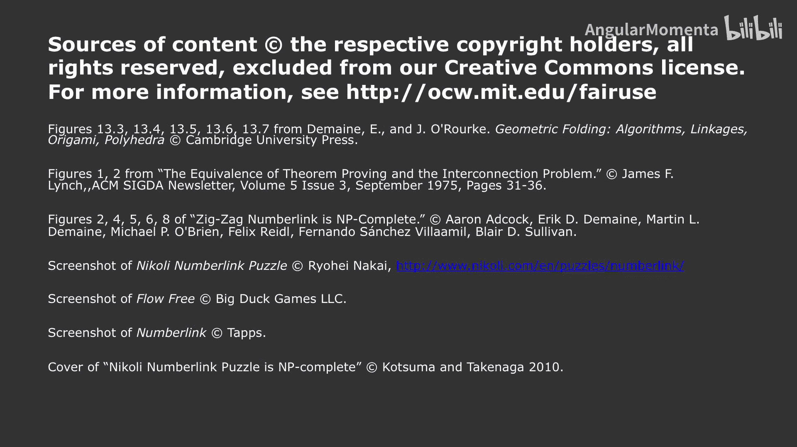

# 【麻省理工】算法下界 ｜ MIT 6.890 Algorithmic Lower Bounds, Fall 2014 p05 5. SAT简化 -BV1dPYpz9E4V_p5-

The following content is provided under a Cative Commons license。

 Your support will help Mi T OpenCourseware continue to offer high quality educational resources for free to make a donation or to view additional materials from hundreds of Mit courses。

 Visit Mitopcourseseware at Ocw。mt。 Eduu。

Welcome back to 6890。 Today we will do many more hardness proofs。

 mostly of games and puzzles and some graph theoretic problems all reducing from threeatAT。

 We're going to continue where we left off last time， which was with this picture。

Which also comes from lecture1， which is how to prove Super Mario Brothers is NP hard。

 we had two main gadgets， the variable gadget， which forces your player to choose going left or right and the claw gadget which could be visited in three different ways in order to enable it。

 these each contained an invincibility star so that if later you come through to traverse the gadget you can get through all these fire barss if and only if there was at least one star there。

So that was a regular three set clause。 And then there's the connectivity in between。

 And so in particular， you need a crossover gadget with this setup。

 But the general idea is you visit variable， This is all the clauses that are in it that include that literal。

 the one you get to choose only one then you go to the next variable。

 next variable and then you traverse all the clauses and you can get to finish if and only if。

The three staff formula is satisfiable。 This is a general construction or approach for platform video games。

 That's what we were presenting it as in a recent paper。

 I thought I'd show you a few other Nintendo games you can prove hard with this technique This is the clause gadget for Super Mario world。

 So in Super Mario world， there are these great question mark blocks and in particular power blocks。

 which go back to the original Mario Brothers without the super how many people played Mario Brothers kind of really old school pre super Mario and anyway it doesn't matter exactly where it comes from。

 it does something completely different in Super Mario world which is turns all coins into walkable things you can walk on for like 10 seconds。

But you can't normally hit a question mark block except from the bottom。

 there's no way to do that here， but if you can visit one of these three places。

 you can send one of these turtle shells flying and it will hit this and bring the power block off and then disappear so that later when you try to traverse this clause gadget if there's a power block you can turn these into solid things for long enough you can get across but no longer than that so in the next gadget you need another power block and so on。

That's clause gadget for Super Mayo world。 The other gadgets are pretty similar。

 So I'll just show you that one Does the starrek。I guess you could also do the star Trek。

 but I think we drew this figure before we did the star Tre。 So we thought， oh， this is cooler， yeah。

😊，Now， one thing I thought I'd mention briefly is some fun glitches you can do in real Super Mario brothers as implemented on the roms。

 you can do these crazy things like jump off of walls。

 So you're not supposed to be able to do this and this level would be unsolvable in the way you normally think about super Mario brothers。

 but there happens to be this fun subpixel resolution。

 I think this is usually done very hard to do with a real controller。

 but much easier to do when you can slow things down 100 times。

 and every frame you have a choice of whether to push a particular button。

 That's called tool assisted speed runs， usually And so you might I don't know if you consider this real super Mario brothers or not。

 It depends on your notion of reality whether you're more of a mathematician or gamer。

 I guess but you can try to modify the gadgets so that wall jumping doesn't help you so you could imagine trying to jump up these walls。

But if there's things in the way， prevents it。 So if you just add that to every vertical tunnel that will prevent going back up the tunnels。

 which is important for the variable gadgets。 We don't wantan to be able to reverse our decision and later choose the opposite variable setting。

 Here's another fun set of。Cheets where you jump through the walls。

 This one is apparently somewhat doable on a real controller， but still quite challenging。

I think the one of the general ideas is。The collision detection is not super good in the game as implemented。

 So if you time， if you get just the right geometry， you can walk through the walls。

 There's instructions。 So this is obviously problematic because all of our gadgets involve walls。

 So if you can walk through them， not very interesting。

 So general approach is to just add lots of monsters。Into the walls。

 So even if you could walk through， you become small Mario。 And then that's not an option。

 I should say these have not been thoroughly tested。 So it's plausible。

 You can walk through the wall in such a way that maybe you kill a monster or there may be other glitches that we don't know about。

 And so you might consider this a work in progress。 But generally。

 I would believe you can modify the proof to work on real super Mario brothers as implemented in real physics。

 Of course， generalized to an end by end screen and so on。 so。😊。

What exactly you call real is challenging there。But that's Super Mario Brothers。

 just some more fun stuff in the paper。Let me talk a little bit about legend of Zelda。

 This is what it looks like。 In case we've never seen it。 And this is the original legend of Zelda。

 your little character， you can walk around。 And this is what I would say is a typical block pushing puzzle in legend of Z which is trial all the blocks and hope that one of them pushes and。

I I have to say， I watched an entire， I don't know how long it was 5 hours of walk through。

 legend as all1 to find whether there are any more complicated block pushing puzzles。 I swear。

 I remember a slightly more complicated one， but I could not find it。

 It's possible skipped in this particular walk through。 This， well， okay， it just takes a long time。

 But you get it， alright， we're almost done。 You get an idea of how of what the game is like。

 You've got a sword or whatever。 that won't be particularly relevant to our reductions。

 There would be no monsters in our reductions。 In this case。

 I think you just have to wait a really long time or possibly kill the the hand that comes out。

 then you can push that block。 You actually tried to push in the beginning， but it wouldn't move。😊。

Anyway， that's legend of Zelda the the。Here's a slightly more interesting one。

 This is what I remember。 Normally， you push 1，2，3。 and then you push this to the side。

 In this particular case， blocks are not pushable sideways， which is really annoying。

 So you actually have to solve it a different way。 If you watch this video at this point， he's like。

 oh my God， this is the simplest blocking push block pushing puzzle ever。 And I solved it。 Yeah。

 It's like after half an hour of trying other things。

 That's the joy of legend Zelda very fun puzzles。 so to speak。😊，So the point is。

 you have block pushing puzzles。 We already know。 Oh sorry， here's one more。

 I guess these are in legend of Zelda linked to the past。 So it has a slightly more。

 there's an actual slightly nontrivial block pushing puzzle。 But in general。

 we know push one is hard most versions of legend of Zder are slightly more restrictive than push1。

 I would call them push once blocks where you can only push one at a time。 that's your strength。

 but also you can only push a block once。 you can never push it a second time or push it back or do anything like that。

 And with some slight， this is the gadget we saw before with some slight tweaks。

 you can make the lock still work when you are only allowed to push each block once。

 So that proves that most versions of legends of Zelder at least MP hard because they include block pushing。

 But it would be nice to。😊，Understand other senses in which these kinds of games are hard without using block pushing。

 So here's another feature called the。The hook shot。So you select it。

 and then if there's an object on the other side， you can hook shot to that side。

 so you can't walk over the cavern， but you can hookshot across here here it is again as long as there's an object over there。

 you can also pick up objects and destroy them。So does that make it hard with no pushing blocks。

 Well， a little bit of pushing blocks。 here's a simple proof using that structure。

 So here's a variable。 you go from top to bottom。 So you're over here。

 treasure chest or something that you can hook shot onto to go over the cavern。

 And here you have a choice。 you can go left or you can go right， But then you can't back up。

Because there's no object here to hookshot onto you can only do it orthogonically。Here's a clause。

 if you come down any one of these paths， then you can push this block one step。

 and then you'll be able to hookshot from the right to get onto this platform and then continue to the left。

And a crossover is really easy in this world。 So this there's you could come up with lots of different N hardness proofs。

 So this was a fun one for a link to the past。Which is the first one。

 first game that has that hook shot。 This is Metroroid。 If you've never played。

 most of the time you spend going up and down elevator shafts。 And there are these monsters。

 which you can shoot。 And then there's also this ability to become a one by one block instead of a two by one block and roll through small things when you're in that position in a certain part of the game you're not allowed to shoot。

😊，Okay so that's the situation we're going to imagine。So here is a clause and a crossover， I mean。

 the variable gadge is the same as Mario， you fall after or fall right， you can't go back up。

Becauseuse you have a limited jump height。 So let's do the clause first。

 There are three different ways to visit it when you're setting your variables， if you can get here。

 you can aim upwards and just shoot all of these things。 It would take a few minutes。

 but you get rid of all these guys。 These guys just walk around constantly。And then to traverse。

 you're going to be coming through here in Balmo， there's no way to。

 I guess here you could briefly stand up， but you can't shoot down an original meroid。

 so you want to roll over here， but you would take too much damage maybe you only have one hit point left so if there's any of these guys left。

 you have to visit at least one of these to kill all the monsters and then get through。Okay。

 that's clause crossover is a little more challenging。 In this case， we set things up。

 The idea is you come in here and you want to leave out there。 So it's unidirectional。

 You can't go up in this gadget。And the idea is there's a little gap and it's moving this way as the monsters move around。

 So you wait for the gap to come here， then you go down。

 and then you' basically force in timing when you fall down this cavern。

And it's set up so that by the time half time this thing gets to here。

 these guys will have come to the other side， and then you have to roll to the right in order to avoid taking damage from these guys who are going around the other way and similarly in the other direction。

So you have to get the timing right， and we haven't exactly tested this yet。

 but it should be approximately correct， and that will force a crossover。It should be a simpler way。

 but this is the best crossover we have currently。So Metroroid is NP。

 here we actually claim MP completeness because there isn't too much state to the game。

So the issue here is the length of a solution polynomial length if it is then we know it's NP then it's in N and NP complete and here you can kill each monster only once。

 so that's the idea for and the amount of state you have is just your position and what items you currently have so you should be able to solve this in NP and that sort of settles the complexity。

 most of these other problems could potentially be harder than NP and we have some other results like that which we may get to when we're talking about P space but today is about NP。

Here's Donkey Kong countryry。 If you haven't played。 I this is a speed run。

 and you can kill monsters by rolling。 Most of the time you're jumping and collecting bananas。

 There are these bees that if you touch them， you die。😊，Or you sort of have two hit points。

 And then there are these barrels you can pick up。 That's a giant bee。

 You can pick up some certain barrels and then throw them at a monster。 and， and， in this case。

 damage usually kill them。 Then there are these other types of barrels that when you touch them。

 they shoot you in a predefined direction and let you collect lots of bananas。Okay。

 so that's those are the rules of donkey Kong in nutshe in a banana show。 don So in a banana peelel。

 Thank you。 So here's a simple crossover with that set up。

 you just have these barrels that shoot you in a predefined direction and force you to go through this intersection without any choice。

 when you're in， when you're being shot， you cannot move， so。😊，That's easy。 Again。

 variable is the same as Mario。 fall left or fall right。 And a clause。

 it's a little hard to see with the background here。 But there's a little ledge here。

 and you can come down this way， Pick up this barrel and throw it。Over here。

 and it will eventually hit this B so that later you can traverse this gadget without dying from the be。

 So not drawn is a platform that you need to， or maybe you're falling all the way through these things。

 if you set up all the clauses vertically。 if there's any be left， you will die。 otherwise not。

 And so you have to visit at least one of these three barrels to kill the be。So。

 and I think this is a mechanism to prevent you from carrying this barrel anywhere else。

 like climbing up or something。Anyway， that's Donkey Kong country。 I think there's one more Pokemon。

I'm kind of embarrassed。 I've never actually played a Pokemon game。

 I don't know if I should admit this， but I need to sit down and play them all some， some weekend。

I did watch Twitch play it for a while。 going back to the previous slide in。

 in some of the other gadgets。If we satisfied a clause， there was no way to。

There was a barrier between setting the clause and going through the rest of that thing so potentially you could get to the last clause here。

 kill the bee and just walk forward without。Do we。Good question。 Okay， yeah。

 I think probably the right way to set this up。 I'm not quite sure how to do it directly from the drawing。

 but an easy way to do it would be there's， there's no floor below here。And at the end。

 when you solved all the things， there is one of these barrels that shoots you straight to the left until you get to the finish。

So you， if you tried to exit the clause early， you would just fall to your death because there's only one barrel shooting way over in the right。

 That would be one solution。 I forget exactly what's in the paper， but。

Wouldn't surprise me if it's that。 Yeah， good question。

 You definitely don't wanna be able to just visit the last clause， killll the guy and then exit。

 That would be。That would be cheating。But in these proofs。

 that's always what you have to worry about is this type of cheating。Other questions。Cool。

Pokemon time。呃。Pokekemon is a somewhat complicated game。 It's a lot of different abilities and so on。

 So we had to abstract things away。 And in these pictures， there are two types of。

 I haven't defined any of the rules yet。 You are a little。Person walking around here。

 you're carrying Pokemon， whatever。 And there are these characters called trainers and the red trainers are called weak trainers。

 These are people that when you visit they just sort of deactivate。 you beat them。

 And then there's blue trainers who will call them strong trainers。

 those are ones that no matter how no matter when or how you try to play them， you always die。

 And so you fail。 So you never want to visit blue trainer。

 now trainers have two kinds of let's talk about variables， maybe this is an easy situation。

 So variable you want to come in the in and either leave in the false or leave on the true。

 And there are two ways to activate a trainer。 one is to walk into their field of view。

 So when you which are drawn with these rectangles。 if you walk to this position。

 the trainer will walk to you and then you fight the trainer。and because it's red， you'll win。

And so in that case， the trainer has moved here。 trainers are obstacles。 so you can。

 you can't get to the true anymore。 You have to go around to false。

The other way you can visit a trainer is to talk to them from the side or from behind so you can walk here。

 talk to the trainer， beat them， then they deactivate， then you can walk this way。

And you can only fight them once。 then they won't move anymore。

 So that forces you to do true or false and then commit to that decision。Okay。

 and these are obviously obstacles that're immovable。Alright， so the idea with a clause is。

The following， you're， when you're traversing the clauses at the end。

 you want to walk through here and leave。And the worry is this position。

 if this trainer can come to you， you will die。Okay， so。

That will be possible exactly when all of these guys are out of the way When will they come out of the way。

 when you walk through them and none of them have been activated yet。

 so then they will walk one base to you， you'll win， but it's temporary。You win the battle。

 lose the war because when you get here， then this guy can walk through。

 But these serve as obstacles otherwise。 So if you can come down one of these paths and visit the trainer early。

 then later， when you come through， they will not move towards you。

 they will stay an obstacle for this guy。 And so this guy cannot walk to you。

 This is just to make a barrier。 And then。Then you can get through， Okay， crossover。

You get the idea right。 We could try to walk through it， but it's definitely complicated。 In general。

 we want to go from x to X prime or y to y prime。 again， it's directional。

 And now that I know the right colour assignment red is weak。 I would guess。Yeah。

 this guy has an obstacle。But as soon as you go this way， this guy moves out of the way。

 So it kind of closes off trying to return this way。 So once you come through here。

 this would be a problem to come back。 So that kind of cuts you off from going back。

 And it's kind of like the crossover we saw with push1。2D， I believe。Then you probably go here。

 similar thing happens。You go this guy will approach come to you。And then， you can。

Escape when you get here， this guy will come all the way down。 Oh， that looks bad。Yeah。

 so probably we should have talked to them early so then we can come through here without any trouble。

 succeeded in getting down to Y prime。 You have to check that you can't get to X prime。

 This looks like an impossible nexus to get through。 But these guys can walk through。

 That's the reason they're there。 Instead of just being obstacles。Left。

 left to right should be sorry， they can only see you like5 or。 This is a generalized Pokemon。Yeah。

 it would be nice。 I mean， obviously， this is。Bounded visibility。 It would be nice to get it。

 to get that bound smaller。 But at least this shows constant visibility is enough。

These gas are all local。It would maybe also be nice。 are they all the same。

 So it would be nice if they were also all the same。That。Does not。Currently whole。

 but it wouldn't surprise me if that well， yeah。Tricky。Alright。

 I'll just mention for a little bit of Pokemon Craig。 This is one paragraph of our paper， where we。

Construct。Construct the weak and the strong trainers to use using exactly the setup that's available in various Pokemon games。

I， I believe in every single game， there are enough abilities that you can set up so that you either force the bad guy to all you can do is self destruct or。

 all you can do is kill you and you lose that sort of thing。

But it requires some Pokemon expertise with which Alan Goyle had in this case。

 he's a PhD student in CL here。Okay。Any other questions about Nintendo games before we move on。 Yeah。

😊，は。Se' self it just self die think self the doesn't actually the No， it does really。不行。

We have to go play。Alright， the next game I'm gonna talk about is a sort of physical game that you play on usually go board with go stones。

 So there are white stones and black stones。 it is invented by this guy， John Conway。

 And if you've ever played Conway's game of life。 not that's a zero player game。

 This is an actual two player game。 and quite challenging。 Here's the the general idea。

 there's the right player trying to get the white ball。 That's the football。

 This is philosopher's football， if you will。 You're trying to get this ball over to that goal and the left player trying to get the ball to the right goal。

 And then there are these black pieces， which are called men。 Those are the players of the game。

 so to speak。 And there are two types of move in this game。

 One move you can do is just place a black stone anywhere on the board that's currently empty。😊。

And the other type of move is the more complicated one。 This is called kicking the ball。

 You can take the white piece and you can jump it over a string of consecutive black pieces。

 Those pieces are immediately removed。 So these gray shading means they've been removed from the board。

 But in the same move， you can do several such jumps so I can jump here， then I can jump here。

 then I can jump here。 then I can jump here。 and everything I jump over in this case I won if I'm the right player I got to that position。

 So this is why the right player from the original position， maybe they wanted to place this stone。

 because that would enable in their next move。 you can't place a black stone and then jump。

 you can do one or the other。 So you could try to place this position。

 place this stone hoping that in your next turn， you'll be able to do this jump and win。

 But instead from this position， the left player could say， oh， I'll just add this stone。

 And then in my next move， I'll be able to jump。😊，To the right side， that's， I think， unblockable。

Left wins。嗯。So that's， that's a setup。 Now， this is a fairly complicated game。

 You can get to the same position multiple times。 And so it's actually open how hard this game is。

 I think there's an upper bound of it being solvable in exponential time。 So it's in X。

So you given a position， you wanna know whether left or right will win from this position。

It could be Ti is the right answer， yep。So that's tricky。

 There is a peace based hardness result relatively recent。

 but an old result of ours with David Epstein is that just determining whether you can win in one move is n be complete。

 So that that's a relatively clean thing。 You don't have to worry about nontermination or that sort of thing is just one player's move here。

 everything is。R reverseverse， we had the black。The ball is black。 in this case。

 I'm not sure if there's a consistent notion anyway。

 And this is actually our reduction all in one slide。 It's pretty simple。

 So this is what we call the maten one problem。And you can take lots of different games and make them really clean。

 well defined puzzles if you just ask， can I win in one move。

 even games that involve cards and randomness and weird stuff in one move。

 usually it doesn't involve those at all。Anyway， here。

 we're getting rid of the loopiness of the game and not having to worry about that。

So there's sort of two parts to this proof， the variable traversal and the clause traversal。

 But here we have a kind of very different way of connecting things together。 We have a giant matrix。

 if you will。 We're starting up here， and we have a choice whether we if we want to set x1 to true。

 we're just going go to the right by a sequence of jumps， we jump here。

 then here then here every time we stop， we have no choice。 if we want to keep going。

 our goal is to get to somewhere。One of the edges of the board， I think the bottom edge。 Yeah。

 bottom edge is the one that's hard to get to。So every time we jump to the right here。

 we don't have a choice。 we have to keep jumping to the right。But over here we have a choice。

 we could go down and then jump to the right。And get over here。

 and that will do different things in the middle。 In general， that is our setting of x1。

 Then we're going to do the same thing coming back for x2 of two choices。

 then the same thing going back for x3。 and then we get to this corner。

So that's forced other than these choices， binary choices。Now we have our first clause。

 let's say x1 negated or x2 negated or x3 negated， we want one of those things to be true and so the idea is we're going to choose whichever one has been set correctly and then we will go up that channel and get to the top again。

 it's pretty much symmetric so every time we jump over a bunch of pieces whenever we stop we can't go left to right we have to keep going up so we have to make it all the way。

In fact， each of these columns will be completely filled， except for one intersection。

 which is the thing that makes it false。So here we want x2 to be false。

 So if we happen to follow the true path where x2 is true。

We won't make it because this piece will already have been removed when we came through here。

 And so if we try to take this path， we'll get stuck here。 There won't be any piece above us。

As long as that didn't happen。As long as this this row was not chosen。

 then we can take this column and just make it all the way up to the top。

So we're going to be able to take one of these three paths。

 if and only if at least one of these things is true， that's the first clause。

 then we do the same thing for the second clause。 And if all the clauses are true。

 we will be able to get here and then we can jump down and get to the finish line。

And win in one move。One move。Okay， so that's Main1 is NP complete。

 I have one other example of a Maton1 result。 It's actually not a hardness result。

 but it's kind of fun。 So I thought I would talk about a nonhardness result for once。

 which is checkers Checkers is another game where in one move， you can do a lot of jumps。

 especially if you have a king then you can potentially win and by killing a lot of pieces all at once。

 And this is considered back in 1978。 This is the same paper that proves checkers is X time complete。

 which we will get to at some point。 But for now， let's think about the Maton one problem。

 This turns out to be easy unlike football。So。Checkers， I assume you've all played checkers。

 you can only move diagonally on the black squares。 so you can。

Recast that into an orthogonal problem where the pieces can only move orthogonally up or right or vice versa。

 except king pieces。 they can just move orthogonally。

 And the interesting part is when you can jump over a piece of another color。

 So if there is a black piece here， this one can jump over。And in general。

 if you have a sequence of jumps you can make， then you can do all of them at once。

 So the problem looks something like this。 if you have a black piece let's say black to move。

 if there are a bunch of white pieces， you can jump over them。 And the key thing to notice， again。

 as soon as you jump over a piece that disappear。 So you can't reuse it in the same move or I guess you can't use it in general。

 the key thing is that the jumps preserve the parity。

 the even or oddness of of both your x coordinate and your y coordinate。

 So you're moving around on this reduced grid， And so you can take a picture like this and turn it into a graph where the potential positions for you which are drawn this kind of pattern。

 same parity of rows and columns。You can make those the vertices of your graph。

 and then there's an edge between them if there's a white stone in between that you could jump over。

So then given this graph， the question is， can you visit all of the edges the graph with a single path and that is the Ouler tour problem or the Ouler path problem。

 and it's easy to solve that in polynomial time you look for odd degree vertices there should be at most two of them and you better be at one of them。

Or if there's zero of them， then you're happy。So that's how to solve Man one and checkers in case you ever get to those difficult checkers end games。

 Then now you can decide how to win or not。In one move， two moves is left to。All right。

 so next topic is called crypto rhythms。 This comes from the recreational math world and they're kind of fun。

 You've probably seen this。 you may have seen this one if you've seen any crypptto rhythmm。

 it's a classic that goes back to 1979 from this book by Madiki and the idea is this is an arithmetic formula。

 send plus more equals money。😊，And each of these letters represents a digit，0 through 9。

 And so this two Ms represent the same digit。And so on。 the two ns represent the same digit。

 the two o's represent the same digit。 And furthermore， M is different from O is different from R。

 So its it's a bijection between the letters that appear in this puzzle and some subset of 03，9。

And actually has a unique solution。 This is it。 You could verify it， but I'll leave it as a puzzle。

 so you don't look at that too long in case you want to solve it。 It is doable， but you know。

 the tricky part of things like the carries in the addition， which make it not just a simple。

 linear system to solve。 And in fact， these puzzles generalized to an arbitrary base are and be complete。

 If you do it in base 10， then there's only at most 10 factorial possible solution。

 So that's constant。 that's considered fast。 And indeed in real computers。

 you can solve 10 factorial。Reson。So for generalized base， here is a proof。

 This is actually David Epstein， who was a co author in the previous result。

 This is his first theory paper， Sac News。And prove that it's strongly MP complete meaning。

 even if the base is polynomial， the problem is MP hard。 And it looks really messy。 but actually。

 it's fairly simple， so。Let me start with this gadget。 This is an easy one。

 So there's no notion of 0 or one in this gadget， but0 is just a letter and one is just a letter。

 But with this gadget in place，0 is 0， and 1 is 1。Because zero is the only possible digit when you add it with yourself if you get it again。

It is the identity in additive ring， so that forces 0 to be 0。And then here。We're adding P with P。

 P are just arbitrary things。 sort of don't care what they are。 We get something Q。 And over here。

 we add 0 to 0， and we get 1。That's only going to be possible if there is a carry in this column and carriess can be only one。

 They can be 0 or1。 So that forces， we know it's not 0 because one is different from 0。 Therefore。

1 is 1。Okay， symbol 1 is the value 1， the number one。Alright， so that gives us some infrastructure。

 And the zeroes are really helpful becauseuse it lets us space out gadgets and guarantee that there's no carry between them。

 This is supposed to be a variable gadget。 There's V I。And there's V I bar。

So let's see what what happens。 Let's do the VI part first。

 So this this formula says that B equals twice AI， and there's guaranteed to be no carry because of this。

 Now this is a little tricky。 We add Y I to Y I。 do we get Z I。 So there may be a carry or not。Here。

 then we add B I to B I， and we get V I。 So V I is going to be two times B I plus either 0 or 1。

That's going to be our binary choice。 We can set up the Y eyes to either carry or not。

 And we'll call that C， C in this formulation， C is the carry in that operation。诶。Okay。And B。

 I is two times AI。 So this is four times AI plus C。Which is 0，1。

 And what we're gonna think about is modo 4。This is congruty。

So we're gonna treat all of our variable assignments moduleular 4， and there're always gonna be 001。

The claim is V I became this， and the claim is that this part makes VI bar the opposite。

And you can work through the arithmetic， as I did in the notes。

 you end up VI bar has to be four times something， which is C。

 so we don't sort of don't care what that is。 We'll set it at the very end。Plus 3 C plus  one。

NowIf C is1， this is4 and this becomes zero， if c is0， this becomes 1 mod 4。So in general。

 it's1 minus C is the opposite choice from what VI was。 that becomes V bar。 So that's cool。

 We've got VI。 we've got VI bar。 We can duplicate our variables for free because we can just use that same letter VI in many different places。

 and then we just need a clause gadget。And。So the work is kind of similar， similar kind of tricks。

 We add V I FI to itself。 We get G I。 We add G I to itself。 We get H。 So at this point。

 we have four times F I。Plus， possibly one carry this WI might carry or not。So we get H。

Is four times F I。Plus。0，1。Then。We add H to1， and we get TI。

 plus there might be a carry from this column。So， that's TI。

Is going to be H plus1 plus a potential carry。HI is this thing。 So we end up with four times F I。

Plus，1 plus。0 or  one or 2， depending on how many carries we've had total。

 which is four times F I plus。1 or2， or3。And modular 4， that is  one or2 or 3。

 This is going to be the number of true variables in our clauses becauseuse in the end。

 we just add V I plus V B。 We get this thing。 We add V C for our three variables， V A A B and C。

 We get T I。And TI was that thing。So。If we just think about things modular 4。

 that means VA plus VB plus VC should be 1，2 or3 mod 4。Okay。

 now the reason we have this junk and the junks。Well， okay。

 there's there's the not modular four part， the part when you divide by4。 that's sort of tricky。

 But at this point， at least you should be convinced that if there's a solution to this problem。

 then there must be a solution to the original threeat instance。 The reverse is less clear。

 If you have a solution to the threeat instance， you have to be able to set all these variables to make everything work out。

That's a little more tedious for fun。 this is an old proof of 1987。

 and I was just looking at it again today， I think， or I think this is yesterday。

 I think I can simplify it a little bit instead of using regular threeat。

 where you have all these choices， one， two or three things are true。 If you use exactly one threeat。

 one in three sat， it should be a lot easier。😊，So gadgets are smaller with one and three set。

 we don't need negation， so I just need the VI part， which we did explicitly over here。

So that's kind of nifty。 And for exactly one three S， we， we don't need to have all those carries。

 We just need to build four times something。 Sorry， that should be F I here。 We add FI to itself。

 We add G I to itself。 So we here we have four times F I。 And then we add one。

So this will be this TI will be1 mod 4， and then we add the variables up and we should get exactly1 mod 4。

 Now， admittedly， I haven't checked the second half of the proof with this construction。

 but seems plausible。 this would be a somewhat simpler proof。

So shows you the power of all the different versions of threeat we saw last class。And。Now。

 I can tell you a little bit about the。Other direction。嗯。

I have some of the details written down here。 So the other direction is we need to check that if there's a satisfying assignment to  three sat or one and  three sat that we can actually construct these numbers。

 that the base is only polynomial。The trickiest part is to get all of these numbers to be distinct from each other。

U。我 basically。The base will be something like N cubed。It turns out。

 and I'll tell you one trick is we have all these A， B Is and C Is。

 We can guarantee they are all different from each other that all the A's are different from all the B's are different from all the C's by distinguishing。

 by saying all A's。All A's will be 2，34， 66 or 98 mod 128。And in general。

 those are particular numbers set up to make this construction work out。 I didn't check them all。

 but I believe them。In general， we're going to distinguish all the letters by how they be how what they are mod 128。

 So given a number between 0 and 1，27， there's a unique letter of the regular English letter alphabet the A's。

 the B's， the Y， the Z and so on。 that it is assigned to。 And I'll tell you， in particular， the V Is。

And the V I bars are going to be， I think，8 or 9。Mod 128。And the8 is， if it's。False。

And the 9 is if it's true， because remember modular 4， we want this to be 0。

 and we want this to be 1。 So there's a bunch of choices like that。 Some of them are unique。

 We can always guarantee， I forget which ones the C is are all something mod128。

 So the mod 128 will tell you sort of what letter of the English alphabet it is。

 And then it's a matter of deciding the high order bits。

 your number divided by 128 and take the floor。 What that is， we set to make everybody distinct。

And the heart of the proof， I will say， is to make sure that the。The eyess are all different。嗯。

Or let's say that the T I are different。 So we have， we have the variables here。

 We're adding them up。And we get T I。And we need those， all of the T Is。 There's one T I per clause。

 We need them all to be different， which means no matter which triple of Vs we get。

 we should get a different sum of the triples。 So this is a problem of set。VI and。

The I prime divided by 128。So， that。VI plus VJ plus V， K。呃。Are all distinct。And at this point。

 Epstein says， oh， there's a result by Bse and Chaalla from 1959 that says you can always choose these guys。

 if there's n of them that you need to choose， then N cubed different integer suffice to make this true。

That's if you know the literature super well。 But there's an easy proof that polynomial is enough here。

And those of you who are in 6851。Should be able to construct one because this is essentially fusion trees。

 But in general， imagine that you've chosen。By induction。I'll call them V less than I。

And let's ignore the primes。 Let's just say。 We've constructed all the things up to V I -1。

 And now we want to choose。V I。And it needs to avoid。Certain values。

 I think if it avoids VJ plus V K minus V， L minus VM minus VP。For all。JK L M。P less than I。

Then no triple should sum to any other triple。Because if we add。I think I。

 maybe I have those signs slightly off。So I wanted to。Do this。Yeah， so it's one more plus。Okay。

 so suppose I had an equation like this。 I claim that's bad because if I move these guys over to the left hand side。

 that's a triple of vs that sums to another triple of v's。So as long as I choose my new value V。

 sorry， this should be V I。It's the one I'm choosing。As long as I choose VI to be different。

From all all such sums。 and they're only like less than n to the fifth such sums。

Because there are only n of these different things， then I'm okay。 And so if I pigeonhole principle。

 as long as I have a range that is at least n to the fifth in size， then I can always choose VI。

To avoid all those conflicts。 Okay， so that's a really easy proof that N to the fifth is enough。

 In fact， N cubed is enough。 But this is a hardness proof。 All we need is strong hardness。

 We just need N cubed。 That's just fine。Or into the fifth， any polynomial would be okay。

So that's a sketch of the reverse direction for this proof。

 There are some more details to make sure everything adds up right mod 1，28。

 and that you can make all the AI is different and so on。 But the hard part is the V Is， seems。

Believable。Questions about cryptto rhythms。Okay。Cool。Next is an origami proof。

So here's sort of the motivating problem。 I give you some crease pattern。

 which is just a graph drawn in the plane， no crossings and all the edges are straight segments。

And you want to fold it into a flat origami。Or flat foldeded state would be the more technical terms。

 So this is an example of what's called an origami tessellation。 But in general。

 what you're allowed to do。 the red lines here mean that you fold as a mountain by 1 hundred80180 degrees。

 And the blue lines mean you fold a valley 180 degrees。

 So they're specifying the relative orientation。 But in flat folding。

 you're only allowed to go plus or -1，80。And then it has to exist。 Now。

 the rules for paper are twofold。 one is that it doesn't stretch。

 It's an isometric mapping of the piece of paper。 Each of these little polygons is just rotated。

 translated， reflected possibly over here。They fit together， so you don't tear the paper。

 they fit together at all the creases， and there are no crossings because paper can't intersect itself。

So the geometry is basically determined if you， if you say， okay。

 I'm going to view this panel as being fixed， it doesn't move。

 then this one is just going be a reflection through this line flipped over。 And in general。

 all of these other polygons just have to be reflections because every time you fold on a line and the rules of the game here is you have to fold everywhere there is a crease。

You can figure out this polygon will end up here。relativeelative to some original polygon。

 So you can figure out pretty much what this looks like as an x- ray diagram and the hard part becomes how are how are layer stacked。

 iss this one on top of this one or is this one on top of that one。

That's why the problem is empty completelete。 It's that last step deciding which layers are on top of the other。

 in general， whenever two layers of paper partially overlap。

 you have to decide which is on top of the other。 And then there's some obvious constraints like。

My hands oriented。 This is okay， but this is not okay， right。

 If there's one crease of paper here and another crease of paper here， then these locally intersect。

 So this is okay。 This is okay。 This is not okay。That's the rules。

 We don't need to know those rules super precisely to understand this proof fairly intuitively because everything is gonna be small and quite local。

The basic idea is the following， you take。嗯。A piece of paper。

And you fold it along two parallel lines。So fold along this line， and then along。This line。Okay。

 and this is called a pleat。 And there are two ways to do it。 You could do one mountain， one valley。

 or you could do the other one mountain and the other one valley。

You can't make them both mountains because then you'd locally intersect yourself。

So it could be this way， or it could be the other way I just had it。little tedious。

And so you have to make that choice， which one is a mountain， which one is a valley。

That's gonna be our true signal。1， we're gonna consider one option true， the other option false。

And as a point of notation。We're going to have an arrow in every one of these we call them wire gadgets in general wires are how we have truth segments。

 truth settings and so relative to the orientation of this arrow， if it's valley on the left。

 blue is valley because I guess rivers are in valleys then we'll consider it true。

 if there's blue on the right， we'll consider it false question setup like once you draw all the red and blue lines if there's just one unique answer。

No， the answer is not necessarily unique， but there will be a unique yes or no answer。

Either it will be flat foldable or not， but there actually may be many flat foldings consistent with a given Mountain Valley assignment。

In general， so we're not worrying about that too much here。

 We're just worrying about whether it is feasible， whether there's some ordering that makes things work out。

Okay， so the idea is this could be your variable。 Some reductions have variable gadgets。 Some don't。

 This one is just going to have a wire。 The idea is， if you say， well。

 there's a plea over here in the paper， then it could be pleadted one way or the other and。

That serves as a variable。 as you choose， make one choice the other。 What we'd like is to make。

 take that truth value and duplicate it。 make many copies。 But that's not the next gadget。

 The next gadget is a not all equal clause gadget。 So this is going to be a reduction from not all equal three set。

And I have the gadget。Prefolded here。So this is what in orami world is called a triangular twist。

 It's a slightly weird triangular twist in that this is 35 degrees， instead of。30。Be the usual one。

 And that it so it's just a little bit larger。 And that causes a problem。

 So this is an example of a valid flat folding of that gadget。And if you look at the three plea。

 the three pleats that are coming in， notice the arrows are all pointing in。

 So it's sort of symmetric。 It's gonna be one of the valid ones。

 So I guess it's actually written on the diagram here。

 This one is considered true because there's a valley on your right。 This one is considered。

False because there's a valley on your， Oh， I'm so confused。 on your right。 Yep。

 and this one is considered true because there's a valley on your left， Oh， sorry。

 falseca there's a valley on your right。 if you're walking down the arrow。

 then the right hand side as the valley。 And so this happens to fold because theyre not all the same。

 If you try to make them all the same， which should be re like reversing the true。嗯。

It's going to look。Something like this。Okay， which it's actually easier to see back here。

 So now they're all trying to fold the same way。But the problem is on this side。

 these guys will all come and intersect in the center。 And it's， I think we have a diagram here。

 and sort of in x-ray， this is what must happen。 And there's this little area of intersection where you cannot resolve which of these three things are on top of each other because this one wants to be on top of this one。

 we wants to be on top of this one wants to be on top of this one。 So's a cycle of constraints。

 no one can be on top of each other。 in this little region。 in the regular triangle twist。

 this is a point and everything's fine。 But the way these angles are set up。

 there's this area of overlap。 And in that one situation， your're toast。 So if they're all true。

 But of course， everything symmetric。 if you flip it over， then it's the same if they're all false。

 So you forbid all true， you forbid all false， everything else will work。 So this is not all equal。

This will be flat foldable locally， if and only if those variable assignments are not all equal。Okay。

 now we need a couple more gadgets for this to work。 One is the ability to duplicate a signal。

 and the other is a crossover。So here is， this is a proof by Bnon Hayes， by the way， this is。

I think the first or second paper in computational origami。 So got things off to an exciting start。

 This is a splitter slash negation gadget。 This is what it folds like。 It looks a little bit weird。

 becauseuse my paper is。😊，Attle bit small。 But the point is。

 there's essentially only one way to fold this。 And if you take 6，8，4，9。

 you'll know this little local analysis that forces different mountains and valleys to be the same。

 For example， these two have to be opposite， which forces， if this is a true。

 this one must be a false。So that's your negation and also from a local analysis at this vertex。

 if this one is true， this one must be true。And it works and also works in the inverse setup。

 That's always going be true。 a natural reason for us to be using not all equal3 S here is there's really no preference between true and false。

 There is sort of， they're not really a logical notion。 It's more like red and blue。

 literally red and blue。 So not all equal is the one that's nice and symmetric。

 It has no preference between red and blue。 And so we're seeing that here because everything's invertible。

 We want that  symmetry between red and blue。 So that would be one reason to guess not all equal3 S is a good choice here。

At least for that wire。 So cool。 if we have a signal， we can make a copy， we also。

 while we sort of get two copies。 one of them happens to be negated with this particular choice of error orientation。

 If we oriented the arrow the other way， you could call that a copy。

 but we don't want to take a wire that's pointing backwards。

 So because we need to attach this to something else。😊，These all have very particular angles。

 but it turns out that will be okay。 One more gadget is a crossover gadget。This is very simple。

 It is just one。 Oh this is not the prefold one。 You do one pleat， and then you do the other pleat。

 And you can see from the crease pattern， you have to do this pleat and then do this pleat。

 But it's completely independent。 I could do each pleat either way。 It doesn't affect the other one。

 So that's a crossover。 done， easy。This works with pretty much any angles。

And then it's just a matter of checking that you can fit all the gadgets together。

 This is something we did in our book to get a picture of how everything works。 But in general。

 the idea is on the left side of the page。 we have all of our variables。

 Those are just wires so they can go one way or the other。 So the idea is here is X 2。

 We just I just want to bend it。 So it's pointing downwards。

 So I'm going use the splitter slash negation gadgets。 So we get this copy of x2 just going off。

 It's going go up to the top of the page。 no big deal。 just throw it away。

 Then we're gonna go over here。 something happens to cross us。 but we don't care。

 Now what I would like to do looks like this clause involves x2。

 So I'm going do this funny kind of turn around thingy。😊。

Which will end up making a copy of this variable pointing straight up。

And also we'll make a copy of the variable pointing in this direction。 And so in general。

 I'm going to keep doing that。 And whenever I need a copy。

 I'll just use an appropriate parody of turns to get a positive copy。

 So this is negated and then this is a copy of the negation and then we flip it  one，2 three times。

 So in the end it should be positive。 This is the tricky part to check。

 here we have not only equal three S clauses where three things come together and that's going to be foldable if and only if the three variables that we' combining have a reasonable assignment and then we just have to copy all these things and get them to meet all at those nexusees at the top。

 So definitely tricky to make sure this works to guarantee all of the coordinates can be encoded with a polynomial number of bits。

 and therefore this is a strongly NP hard proof。But I'm going to wave my hands at those details。

Questions。If it's any consolation， the original proof also weighs its hand at these details If you have a full pattern like this。

 can you tell what There's no such thing as order of the folds here。

 all of the folds would be folded simultaneously more or less。

 instantaneous to make it even more precise。 So here was really a question of whether there is a flat folded state。

 We're not worried about the motion to get there。 That's another topic， which you should take8 4，9。

 if you're curious about， But these kinds of patterns there that you can't do one thing because there is no pleat that goes all the way。

So that's life。 unlike the folding problem we saw two classes ago。

 the map folding where we were doing one and the other。 there in the notion of simple folds。

 there's an ordering。 but in general， origami， there is no ordering。Cool。Good， that is origami stuff。

The next topic is a more kind of graph theoretic basic question， but it will also relate to a puzzle。

And this is the idea of vertex's disjoint path。 This is in Jason Lynch's early work before he was born。

I assume no relation。1975， so early days of MP completeness。 this problem。

 vertex disjoint paths in a graph as proved MP complete。

 So the problem is I give you a bunch of terminal pairs， V V1， V1 prime， V2， V2 prime and so on。 C1。

 C1 prime， a bunch of pairs of vertices。 And I want to connect the pairs by paths。

 So I want to find a path from V1 to V1 prime and so on。 So that those paths are all vertex disjoint。

😊，Here's the hardness proof。 Super simple。 This is like one of the easiest three set reductions。

 This is not the end of their paper。 They do more interesting things， which I will get to。 But first。

 let's understand this one。So this is a graph， and I've drawn it in a funny way。 These are vertices。

 These are vertices。 These are not vertices。 Those are just in the plane。 they happen to cross。

 but there's no vertex there。 So there's just a straight path all the way through。嗯。

Kind of similar to what we did with football。The idea is that if from V1 to V1 prime。

 there are two paths。At least stay here。 you could try to go into a clause path and w wreckreak havoc。

 but I think you will be doomed。I hope so the idea is V1。

 maybe you choose the blue path that will prevent C3 from using that path because there's an intersection here。

 It won't prevent anybody else because there's no other vertices here。So I use the blue path。

 C3 cannot use that path。 If I use the red path， C 1 can't use this one。 C 2 can't use this one。So。

 again， we are blocking the thing that it would be setting false。 So that means let's say red。

 I forget in this picture。 Let's say red is true。Then C1 has a V1 bar in it。

C1 is happy if you choose the blue path， but is not happy if you choose the red path。 Now。

 C1 to C1 prime only has to be happy。 If one of these three things are happy， that's three set。

 At least one of the things should be set correctly。 Then there is a path C1 to C1 prime。 Otherwise。

 there'll be vertex intersections。 You won't have vertex destroy paths。Okay， so in a graph。Done。

 now let's make it a planar graph。Where thingss get fun。 So this is the original gadget。

 I've stared it for many hours， but it's， it's actually pretty simple after you stare at it。😊。

For enough hours， let me try to convince you of that。 So we're gonna follow。

 I'm gonna follow the same kind of outline here。But we have to get rid of these。 These are fine。

 Those are intersections。 Okay， but these crossovers， we need to build a crossover gadget。

So the idea is， instead of V1 to V1 prime being a single path， that's， that's going to be a problem。

Instead of that， I'm going to have it be several paths， and they are going to be nested brackets。

Sharrk。😔，呃。Okay，This is the kind of thing we're imagining。

 We have some vertex pairs which can connect like this。

And there are two ways to connect them in this， in what will end up being the diagram。

 We could connect them。Like this。Notice I'm still connecting the same pairs if I do it right。

And the whites do not intersect each other。 Their vertex disjo。 The reds do not intersect each other。

 They vertex dis jointt。 But if you try to switch from white to red， you'd get intersections。

So with the same， there's exactly two settings here。 So this is a wire。Once I choose over here。

 white or red， all the others are forced to alternate。Sorry， once I choose up or down。

 the rest are forced to alternate up or down。 If I choose white here， they're all white。

 I choose red， they're all red。This is independent for each variable。 So independent for each wire。

 So that's what's going on here。 And if you look closely at the bold lines。

 you've got a bracket here。From V1 to x1， then you've got a bracket here， from x2 to x3。

 then a bracket here from x4。 But in general， there will be lots of those brackets。

Going all the way down the， the picture。And the cool thing about this is you get the ability to cross over because now。

 if I just restrict this picture， it's hard to see， if I just restrict to the white part。

You can go from top to bottom， you just need an appropriate kind of zigzag。

That will let you go from up here to down there without intersections。

 And that's what's happening with this line。 It's going over around the brackets and down。

And so the C1 to C1 prime can remain a single path。It can always get through if you have this gadget。

 then you can have an intersection with no trouble。

But V1 is still communicating information down the line of one setting or the other， 001。Okay。

 that's， there's some details to check there。 but that's the idea。Okay。

 and that's the end of the lynch paper。Now， we were looking at this earlier this year。

And we can prove an even stronger result， which is what you might call planar vertex disjo pads in a rectangle。

 but。It's not So the idea is you have a rectangle of。1 by one squares。

 each one by one square could be a terminal and a terminal pair。

 or it could just be a blank space so you can route paths through。And my goal。

Is to find vertex destroy paths connecting all the terminal pairs。 But furthermore。

 I want every square of the grid to be occupied by a path。So it's sort of。

 it's not quite Hamiltonian path。 It's like you have a bunch of paths where they collectively fill the entire grid。

Why it's motivated by a puzzle。 But this's natural enough。 This is this more specialized version。

 So this is also NP hard， and we're going to mimic the same proof。 And this， for example。

 is a gadget to do， say， this little picture。Where you have two choices。

 So maybe the V1 dot is actually here。 And the idea is you could either follow this path or you could follow this path。

And what's also drawn here are lots of other terminal pairs。

 These are what you might call adjacent terminal pairs， what you might also call obstacles。

 because the paths has to be vertexas joint。 No path can go through a terminal。

Any of these dots serve as obstacles。 So we effectively simulate this blank space that you're not allowed to touch。

Okay。Now， the fun part is， now， maybe those terminal pairs are connected by the single edge that joins them and so doesn't get in the way。

 But there are other possibilities drawn with these blue lines。 So instead of going here。

 I could do this。 instead of going here， I could do this and this。

 And then if you look at this picture， every pixel has a path。😊，Through it。In this case。

 and then here's the other case again， and now I'll fill this these two pixels with this pair。

 and now every pixel has a path through it。That's my goal is to make sure every pixel has a path through it。

 So we're just trying to preserve all of the solutions we have here。

 but with the additional constraint that all of the because we already know this is simulating three sets。

 we already know it's hard。 We just now want to have this extra constraint that every pixel has a path through it。

And that we live in a rectangle。So， this looks good。As you might imagine。

 there's a little bit of finesse to make these canvass work。 You know。

 some of these guys are oriented horizontally， some of them are oriented vertically。

 that's to make it work。 But this was easy。 What you're about to see is less easy。

So let's do the crossover gadget， because that's like the heart of everything。

 And when we were starting on this， I think this is in May。

I was very happy when I could finally draw this picture。😊，So， this is actually the final gadget。

 which works。 but you can see the same kind of picture。

 we've got a bracket here that corresponds to this bracket here as another bracket here。

 I've just sort of rounded it to integer coordinates and made sure that everything else can be filled in。

Easy， right。As， to， in the sake of education， let me show you all the things that went wrong in this proof。

ca it was only a few months ago。 I mostly remember everything that went wrong。Which was a lot。

So this was an early version of the gadget， not actually the first one， but it serves its purpose。

 So here we have the two settings's corresponding to these two settings， the up and the down setting。

 the true and the false setting。We've got this path coming through in both cases。

 It takes a slightly different path over here。 but the， and the brackets are flipped。

So the first thing I want to point out are these circled nodes。

 The obvious way to draw this picture is with all of the terminals in the center row。

That would be reasonable。 They're not drawn that way here， because imagine at this point。

 we're down here。And we have this big path over here。 Then there will be three pixels here。

 which somehow have to be filled。And that is trouble because3 is odd。

So this is what you might call issue1， the empty space， wherever you have empty space。

 any group should have even area because if you look at two guys that say are adjacent and you replace them with some other path together that forms a polygon and in the square grid。

 every polygon has even area。So you will never fill exactly three spaces。 So the。

 the major revolution， which I spent many hours figuring out is that I just move these points up one spot。

 Everything just works。 so happy。 So I figure， okay， proof's done。

 I drew these two figures and forgot about it。 Then a couple months later。

 we went to write the paper。😊，And then we get the issue 2。 So issue 2 is， well， this was great。 This。

 this works fine if。The clause path is present。 If the clause chooses this vertical path。

 this will fill everything。 This will fill everything。 But what if the clause path is absent。

 clause has three choices， It may not choose this vertical path。

So then somehow this stuff has to be covered using all the extra filler stuff。

And here I couldn't quite figure out how to fill these things like， well。

 maybe I should add a couple more rows in the middle， that didn't seem to help。

 I thought this one was okay， it looks fine until I notice that well either I connect these two dots by a length to path or I connected by this path。

 but in that case this pixel is uncovered by paths。So。

 and this is bad because there's exactly one such pixel。

 which means I have another parodity problem again。So I think what we ended up doing。And， you know。

 when you're really doing it， you don't immediately realize it's a parody problem。 You have to like。

 I've tried trying to fix this many， many times。 And every single time。

 I have like one pixel on cover like， but there's a theorem here。 And then I proved， oh， yeah。

 it's gotta change parody。 So what we ended up doing was adding a row down here。😊。

Make this pass slightly longer that that adds exactly one uncovered pixel。

 so it should fix the parity problem many hours later， we came up with this。So this is good。

 Every pixel is covered in all four cases。 So we have the bottom row is that the top。

 the clause path is in。And the top rows， the clause path is out。And as you can see。

 lots of careful orientations of these little terminal pairs to make sure in all cases。

 you can cover everything。 This was frustrating because you fix one and then you switch to the other layer and say。

 oh， I broke this other one。 I rotated these guys。 And now it's not possible to do this。

 So youd better。 And it would be like， youd rotate this and then rotate that and rotate this。

 And you luckily， no bad cycles happen。 You could always resolve it。And so finally。

 we got this picture。Except for。Issue 3。Which is another parody problem。 It's blown away。

 It like every day， there was another parody problem。 of course。

 the deadline is like tomorrow at this point。Luckily， I started three days ahead。

 So there were exactly three issues。😊，So remember this gadget， which was the choice。

 I didn't say this is like a variable choice。 You have two choices。 If you want to clause choice。

 you connect two of these gadgets together。 and then you have three different paths you might follow。

If you stare at this enough。 And if I just want to make sure， okay， can I plug these together。

 I thought， okay， I'll just copy the paste and lay things out。 And I had a parody problem。

 I was like， oh man， what's going on， Well， if you look here。

 this is at one column and this is a column4 positions over。 So in particular， the two choices here。

 have the same parodity。 I don't， I think it's mod 2， not mod 4， But could double check。

And you just cannot build this if you want these things to be an odd distance apart。Because parodity。

And then you look at this gadget， and you realize it has an odd number of columns。

We made it an even number of rows when we added that last row。

 but now it has an odd number of columns， which is kind of weird， but。That's life。

 So we need to make it even。 And so I think if you focus right here， we add another column。So。

 it's now right here。 So there we used to be two。 Now there are three。

 We have this little trick to kind of fill things in and not too much changed。

 I think I also clean up the gadget or removes a couple extra columns on the right。

 But the key thing was to add a new column that fix the parodity Now the number of columns is even。

 And now you have to prove this， but it's pretty easy to check you can plug it into you can combine these gadgets together。

 and they match up and then if you have blank space it's also even by even And so it always has a perfect matching and so you can fill in any blank space with extra pairs。

Those are the gadgets。Except there's one more issue I haven't mentioned。 Yeah。

 there's a par problem with par problems。 There's only odd number only an odd number of parity problems。

 Luckily， the next problem is not a parodity problem or unluck， I don't know。 Yeah。

 and this it wasn't really a problem I knew was gonna happen。 I just had to draw the figure。

 but it's good for exercise thinking about what， what could possibly be missing。

We spent all this time doing crossover gadgets， but there's also the case where the wires cross。

 and we actually want the vertical wire to block the horizontal wire in a particular choice。

 This is actually really easy to do。 So here's the the gadget I was just showing you without all the stuff filled in。

 Those are just the terminal pairs。 And this guy goes to the left。 This guy goes to here。

 This guy goes to the right。If you just add in an extra。Pair here or an extra pair here。

 You will block blue or red correspondingly。 So if we go to the previous slide here。

 blue goes through this position， but red does not。And down here。

 blue does not go through this position， but red does。And so if you add in this extra little pair。

 you will force red or blue at that intersection。 And that was the little squares in the overall diagram。

 So if you choose this vertical path， you force the horizontal path to be the other thing。

That's the proof。I hope there are no more issues。But it was， it was exciting。

So just to give you a flavor for parody issues。 they are all over the place。

 especially when you're on a grid， be careful of them。That's the life lesson。嗯。

I'll tell you a little bit about where this kind of problem comes from。

 The earliest reference we know is by Sam Lloyd， famous puzzle designer In 1897。

 he he posed this puzzle， incredibly complicated puzzle。 I mean， lots of stuff in it。

 And then I think the next issue published this solution， which is this。

 Hopefully I remember the problems。 So you have these houses。

 And you'll notice each house faces an exit。And what you'd like is for each house to be connected by a pathway。

To the exit。But if you just did that， they would intersect each other。

 So you want vertex disjoin paths in the grid from the houses to the exit that they face。

 So that is a terminal pair vertex disjoin path problem。

 Now he didn't specify that those paths should fill the entire grid。

 but they almost do other than this little corner they do And a few little corners at the extremes and you can fix it instead of going like this。

 you can go zig zig zig zig and zig zig zig zig zig and。

Make it into a solution to the problem I just said。Okay， so that's 1897。In modern terms。

 this is known as the number link puzzle。 Nikoli is a famous Japanese puzzle publisher。

 These are two nioli books that we got in our last trip to Japan a couple months ago。

 These are both for the number link puzzle。 So you turned to an arbitrary page。And you have some。

Pture like this， which here's an example。 you have pairs。

 you have a bunch of numbers and blank spaces。 The idea is that there's exactly two of each number。

 Those are your terminal pairs you want to find vertex disjo paths that connect them。

 And yeah theyre in the back， theres solutions。 So if you can't solve one they have easy ones。

 medium ones， hard ones。 So how hard is it and P hardd because this is exactly the problem we were just solving if you want to find vertex destroy paths in the grid There is this。

Issue of whether you are specified as one of the constraints that you must visit every square。But。

Do a quick， quick visual scan here in every。Solution that I see Every square happens to be filled。

Okay， now that might be the way that they design the puzzles。

 The only way to solve them is for every square to be filled。

 or it might be that's a constraint to the puzzle。 And different write ups suggest different ways。

 But what we proved is both ways， it's hard。 whether you give that as a specification or you make it possible to do it is NP hard because we started from a reduction that didn't have to fill every pixel。

 And we turned it into one that could fill every pixel if you wanted。So yeah。

 there's a sense in which these puzzles are sparser in terms of the number of vertic than your reduction。

 Is it possible that you could define it in such a way that these arenom It's an interesting questions。

 So our。Our reduction has most of the cells filled with terminal filled with numbers。 These。

 you could say， if you have an n by n grid， maybe these only have order n numbers。

 whereas we have order n squared numbers， that would be interesting。 I don't know the complexity。

 The one thing that's known is for one terminal pair。 It's polynomial time。

I think even two terminal pairs is an open problem。So that would be。

 you need to solve that before you could solve N terminal pairs， spin an N by N。

So I don't know how many people worked on tube terminal pairs I've thought about a little bit。

 it seems very difficult。Anyway， a little more to this story。We first， in fact。

 we first encountered numberlink in the form of an Android game called flow free。

 which some of you may have played。 it became popular for a few months there。

 but it is exactly number link as I've defined it。 And once you know that。

 then you there's also a number link and the zillion other clones And I don't think nily publishes any of these。

 So but it's all from 1897。 So unclear what the copyright is here。 but in particular， numberlink。

 I like it has the nicest Gui。 But in the beginning， tutorial says， well。

 there's actually two modes you can play。 There's zigzag mode where you can draw pads。

 however you want。 that's what I've been talking about。 because graph theoretically。

 that's a natural thing。 Then there's this other mode called classic mode where whenever if you draw a complicated path。

It gets short， auto shrinked is the。 Now， again， it's hard to have an authority here。 And like。

 what are the rules of number link。 But one definition is you consider all possible paths between these pairs that have the same topology。

 Like you could try to go。 you can try to go this way， or you could try to go this way here。

 You have these two guys on your right hand side Here， you have them on the left hand side。

 In general， that's called the homotope type of that path。

 Consider all paths with the same homotopie path。 Homotopy type。

 Your paths should be shortest among all such paths。That is one notion of utter shrink。

 I don't know if that's the official one， but it is8 I the order in which you set。

This description suggests a particular order， yeah。So you'd also maybe need a proper ordering。Yeah。

 there's the one to the one here。 there's multiple。Well， the other way。

 there ways to get through that square grid， I think you can go down。Right。

 these would both be the same length。 And I think those are both considered valid。

 although you have to play this particular。Right so you have still have some flexibility。

 There are multiple shortest paths in this world because we're Manhattan metric。

So this raises the issue of classic number link。 And most of the puzzles。

 I think all the puzzles I haven't checked every single one actually follow these rules。 But again。

 I'm not clear what the rules actually are， whether they require this or this。 but luckily。

 there's another paper that covers that case。 It's in Japanese。 but it sets up the rule a。

It considers the model where you the classic mode where you have to do some kind of locally shortest passs and the gadgets critically exploit that feature。

 It's a reduction from planner 3at。 We might look at it when we get to planner 3at。

 which is the next class or two or not， there's a ton of planner 3 S proofs。 But anyway。

 that's been covered already。 The actual order of events is we proved our result。

 And then we're like， oh oh， this is number link oh number link is empty complete and that was known a few years ago。

 Oh， good thing It's a different game that we studied。

 So there are two versions of number link Now they're both hard。

So that's the good news and that's all for today。This is the Super Mario Brothers edition of 6，890。

