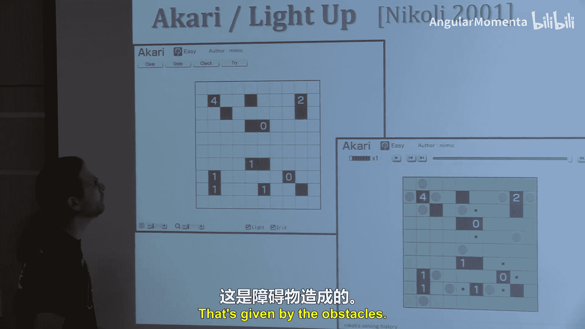
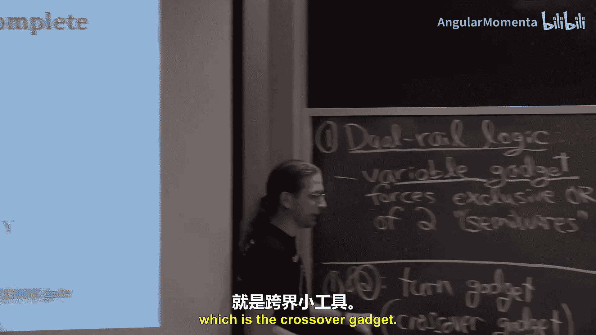
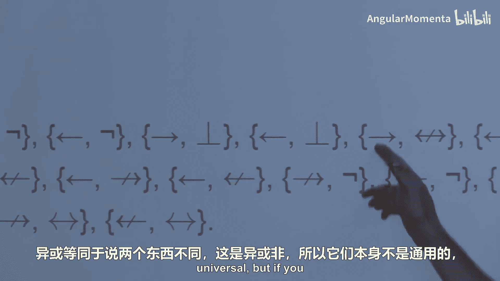

# 【麻省理工】算法下界 ｜ MIT 6.890 Algorithmic Lower Bounds, Fall 2014 p06 6. 电路可满足性问题 -BV1dPYpz9E4V_p6-

The following content is provided under a Cative Commons license。

 Your support will help Mi T OpenCourseware continue to offer high quality educational resources for free to make a donation or to view additional materials from hundreds of Mit courses。

 Visit Mitopcourseseware at Ocw。mt。 Eduu。

All right， welcomee back to 6890。 Today will be our last lecture about pure3at， so to speak。

 and we'll be focusing in particular on circuit set today。

 But before we get started with more reductions， I want to highlight two styles of three sat proofs that we've seen。

 this orthogonal to the circuit perspective versus logic perspective。So I think。

 and I think it's interesting to highlight the two different approaches。So approach one。

I'm going to call dual rail logic。These are not the usual names。 we're making up names here。

 They aren't really names for these types of reductions。And the other type， I'm going to call。

Binary logic。These names come from。啊。Actual circuit stuff， real hardware。 So， for example。

 the all the Nintendo proofs we saw are in the style of what I would call dual rail logic because the variables have two outputs。

 The idea is that this one is activated when X is set to true。

 This one is activated when not x is set to true or X is set to false。

 Never should both of them be activated。 So you have a separate rail。

 separate line for the true case a separate line for the false case。

So and this is usually called the variable gadget that does that。

And I'm going to make up some more terminology， I'll call these semiwis。To distinguish from wires。

So over here in the binary logic case。This is sort of half of a distinction。s the semi distinctions。

嗯。But this is my attempt to unify things slightly。 So we have。嗯。Yeah。

 so so the idea is that these semiwis， either they get activated or they don't get activated at all in the unactivated case。

 they' I mean there nothing happens to them。 So they're not really interesting In the binary logic case。

 the idea is that the wire gadget is active in all situations。

 but it can be active in two different ways。 You can either set it to the true state or you can set it to the false state。

 and it represents both sort of in one wire。Now this distinction is going to get a little bit vague。

 but we saw an example of this kind of proof when we were talking about crease pattern。

 flat foldability and the hardness， the wire was the pleat and the pleat can be folded one way or the other。

 but either way the information is right here。 and the same wire gets put into this gadget。

 whether you're true or false。Where is over here？You're connecting to this clause。

 only the true halfwi or semiwi goes to this clause。

 the false one goes to this clause and to this clause。

 so there's a distinction between here where the wire' has been split in half and here where it's all in one place and the wire goes to the gadget。

 whether it's true or false。I think that's。Sort of what I wanted to say。

 my main intent here is to highlight what kind of gadgets you need。So。

We have a wire gadget on this side， a variable gadget on this side for binary logic， you also need。

A splitter。Our split gadget？To make copies of the wire。So the idea is you have one wire coming in。

 there's some magic split gadget， which makes two wires or three wires， whatever coming out。

So then you can repeat split， however many times that variable occurs。

 you can make a copy in the non monotone versions of threeat。 you may also need a negation。

not gadget。If you need negation， then you'll need a negation gadget。 in some cases。

 you also need a terminator gadget。And this perspective。Terminator gadget。Is just the end of a wire。

 you might say， So if you want to just not use a wire， then that's you would put a terminator gadget。

 and the idea of the termminator gadget is it leaves it free。

 leaves the wire free to choose true or false。Now， sometimes you can get away without a terminator gadget if you can。

 for example， if each of your variables occurs exactly four times。

 then you can just use two splitters， make four copies。

 and then the connect those directly to the clauses。 So maybe with sgations。 So in that case。

 you wouldn't need a terminator。 over here， we're using a terminator in a certain sense。

 which is the edge of the paper。 If a wire goes to the edge of the paper， it becomes free。

So that sort of the terminator gadget here， though we didn't make it explicit。

 it was part of this overall plan。嗯。In both cases。In one and2。

You probably need something like a turn gadget。And maybe a crossover gadget。And we've seen。

 we've seen these in various forms。 In this case， the turn gadget was very explicit。I mean。

 it was also a splitter and also a negator， but in particular， it changed the angle。

 and we needed that in order to take this truth value and send it up to the clauses and aim everything right。

And in general， if you're doing any kind of embedding into two dimensions。

 you're probably going to need to turn gadget so you can move your wires or semi wires around。

Most a lot of the time people might call this also a wire， so that's why。

 I I think it's useful to have a word to distinguish these kinds of wires。

 which are only active or inactive versus the wires which are always active。

 but in two possible states。Hopefully that's that clarifies or makes more explicit the types of proofs we've seen so far。

嗯。Now， today we're going to do a couple of circuitat proofs。

 which all of this applies to circuit sat proofs as well as sat and one in three sat and not all equal S。

 not all equal3 set circuitat， you're going to have。I guess in principle， you could do it。

Dual rail logic or binary logic， although usually we probably think of them in this capacity in binary logic。

And you're gonna have wires。 You still need splits because you need to be able to take the output of a gate and send it to multiple other gates。

 In addition to not gadget， you're gonna want some other universal。Logic gate。

So we're gonna to talk about that in a bit after we see some examples。So。Our first example。

Is called Akari or light up。 This is another nili puzzle， like Sudoku and。

Number link we saw last time， so here's the sample input and a sample output。

Ignore the black dots there。So you're given a grid。

 there's blank squares and there's obstacle squares where you're not allowed to put anything。

 Some of the obstacle squares may have a number between 0 and 4 on them。

 and that number represents how many among the four neighbors， edge neighbors of that square。

 how many of them should have a light these blue circles are lights。Okay。

 so like this one has zero lights in those four positions。 This one has two。 This one has four。

 that's forced and so on。A lot of the cells are free， but whether you're lit or not。

 and then the rules are， so you can think of a light as a rook in chest so it can see everything horizontally in the same row up to obstacles and in the same column up to obstacles。

 So this guy， for example， lights these this portion and this portion。

 this guy lights that portion and a thing here and so on。And the goal is， first of all。

 to light the entire board。 So that's why it's all green。 It's all lit。in such in that way。

 And no two lights should light each othercause then it's too bright， I guess I don't know。

So no two rooks can attack each other would be another perspective。 And I think those are the rules。

 So you've got to have， you've got to satisfy the number constraint。

 you can only place lights in the blank squares。 You have to light everything。

 and they can't see each other。 So this is a valid solution。 This is puzzle one on the nieli website。

 and there's a ton more if you want to。To play。I mean， they can be in the same column。

 but they have to be separated by an obstacle。 Yeah。

 so they can't see each other within a sort of sub columnn or within a sub row。

As given by the obstacles， Co。 So that's the problem。

 And now we're going to prove this's MP complete。 This is a nice proof because it's relatively simple。

 and it illustrates a kind of circuits satin style reduction。

So for starters， and most。I would say most S proofs， a good starting point is a wire gadget。

 You want to think about， can I make some construction that has ideally exactly two solutions。

 one to represent true， one to represent false。 So here our very variety of ways to do wires。

 And this is a fairly flexible kind of game。 The basic one looks like this。

 most of the things are going be obstacles to make to tie it down， make it easy to separate gadgets。

 But here we have two blank squares， a1，2 blank squares， a1，2 blank squares。

 that's sort of a simple kind of wire， because， you know， from this one。

 either x or x prime is a light。😊，Exactly one of them is。 So that forces alternation done。Why。

 because if we choose x， we can't choose x prime because then they're in the same sub row and all the way down the chain。

 So in general， if x is true， the idea is that the xs are the lights， if x is false。

 then the x primes are the lights。Okay now that's a basic wire。 but sort of part of the wires。

 we need a turn gadget。 So this is a 90 degree turn。Just check that this is still lit。

 If these guys could not see each other。 I think this is black。 It's also okay。

The altern is forced by the one， but some flexibility。And。Let's see。

The other fun thing you can do is spread out the X and x prime。

 If you put a bunch of zeros here to force that there's no lights here， because this has to be lit。

 again， one of these has to be active and the ones force an alternation。 So this is helpful because。

If our wires just look like this and this will come up again today。

 then you're forced to be congruent to0 mod3。 your width has to be a multiple of three。

 and this can be an issue。 if you have a bunch of gadgets， each of different sizes。

 maybe one is 5 by5 and there's 3 by3 and other fun prime numbers。

 then you might have trouble actually getting gadgets to meet edge on。

 maybe there's a gap of one or two or something between the gadgets。 But once you。

 if you have a setup where you can make wires， you can adjust the wire lengths to be any integer。

That's good because then you can go do this most of the time。

 but then when you're getting close to the gate， if you're off by a one or two or three。

 you just make it a little bit longer。And you're all set。The unfilled one can also just。

Have a crossover gadget then sorry since you have nothing it's very natural to have a crossover gadget by putting two of the Oh yeah。

 you can make a crossover gadget easy in this setup， but I think that is a future slide。嗯。

Let'sSo we'll do crossover in a bit， let's start with， yeah， you can very easily do a crossover。

 we won't need a crossover here。That's what I mean。So we definitely need splitting， though， general。

 whenever you have wires， you've got to be able to make copiescause if your variable only appears in two places。

3 Sa is easy， or circuitat is probably easy。So。Here is a splitter。 This is the the main mechanism。

 I guess these ones and this two。 So these ones force an alternation between here and here。

 these have to be opposites of each other。And then， the two。So if both of the x's are present。

 if this is absent， then these two have to be present by the ones。 And so by this two。

 that's all there is。 and therefore this is absent。 So these guys have to be the same。

 these guys have to be opposite。 and conversely if this is present by these ones。

 these have to be absent and by this two， this has to be present。

 So this is this is almost sort of a， well， you could also put some ones here。

 I guess you felt like it。Anyway， if you think about the parity here， what we。

 we have for when we represent a signal coming into a gadget。

 there's X on the left and x prime on the right。So that means coming out here。

 there's not x prime on the left an X on the right。 So this is actually a negated copy of x。

 And up here with some turns， we have a regular copy of x and a regular copy of X。

 This is actually a fairly common thing that happens when you try to split。

 maybe you also get a negated copy or instead you get a negated copy。

 This is actually great because it kills two birds with one stone。

 You can use this as a splitter kind of makes three copies of your signal。

 but you can also use it just as a negation gadget as a not gate。

And I think I have a slide of those done explicitly。诶。Yeah。

 so here we're effectively using a terminator gadget， we're saying， well。

 we could throw away this negated copy because we already have two positive copies and that's enough for a splitter。

 So if we just end this wire here， great， we've got to split or if we throw away the two copies of X and we just want the negated copy of X。

 then ends up looking like this。So we get a split gadget。And a not gate。

 essentially for free out of this。 you could just present this gadget and say， oh。

 I also have terminators。 And then you know that you get these。 But for fun。

 he drew them and I'll show you them。 I won't show you them in future proofs， but。😊，Cool。

 so let's see what do we have。 We've got a wire。We've got a split。 We've got a knot。

 We've got a terminator。We need some kind of claws or some kind of logic gate。

 and then possibly we also need a crossover。 We have turns。Okay， so。Next up is a gate。

 sort of a a mega gate。 I'm guessing McFil tried various little configurations and then found one that did interesting things。

 It actually does two interesting things at once。 So we have X coming in on the left。

 and Y coming in on the right。 So both of them have this X prime and y prime。 then ne gated copies。

And then we've got some fun stuff in here。 So let's start with maybe the bottom。

 which is supposed to be an or of X and Y。So let's say that they are both false， for example。

 And general， we're gonna to check all the cases， but I won't do all of them。

 So let's say this is absent。 This is absent， meaning the other， it's lit from the other end。

If it's false X Oh right， sorry， right。 If they're both false。 good。 then both of these are present。

 and therefore we're gonna get， hopefully that this one is absent because the oe of false and false is false。

So the claim would be that a prime and B prime must be activated They weren't and you couldn't light both A and B。

Right， these are at best ord together at most one of these is present。

 these regions both need to be lit。So we're going to need。At least。One of them to be on。

 But once one of them is on， we know that Z is absent and then the other one must be on。Fry this too。

Good。And then we should up here get x nor because so when these were both false and present。

 these were present， these are absent and therefore this is present， and the x or of 0 and0， 0。

 the x nor is 1， so that's good。So in general， you check all the cases and confirm this is the case。

 again， by putting terminators on here， we can get either X or y or X nor X， X nor y， soundss funny。

That's great。 We actually， this is the one that we really care about。😊，The or gate， well。

 so different answers to this but。You should know。And we'll talk more about this later。 N， and。

 or let's say。The Nand gate is universal。And a no gate by itself， is universal。

These are just good things you should know。They go back at least 50 years。

And what does universal mean， So universal means that from that， those。

 from if you're just given a bunch of Ns， then you can construct any logical gate you want。

I will talk about that more in a moment。 So this or is particularly interesting because we already have not。

 And so from， from or and not， we can make nor， It's just the knot of the or。 And so from that。

 we should be able to make anything。Which is great， except for one thing。

 which is the crossover gadget。 So in the case of light up， crossover gadget is easy to construct。

 But because we have Xor anyway。😊。

We can use this fun fact that if you this is a symbol for Xor， if you have Xor gadgets。

 you can make a crossover gadget for free。So this communicates x to x Y to y again there's four cases。

 I won't check all of them。 but that's cool because we have x nor， we can negate it and get x or。

 And then we can take three of them。 plug them together and we get a rather complicated crossover gadget。

 If I expanded it out。 There is a simpler one， but we don't care about simplicity here。

 These are just constants。 and we just care about polynomial。 So that's light up as MP heart。 Yeah。

 Do we need crossover gadgets in general for circuit set is planar circuit set heart。😊，Please wait。

 Yeah， this is something。 Well， yeah， I wanna talk about that after the next example。

 which we'll get to an answer to that question。😊，Which as far as I know hasn't hasn't been explicitly raised before。

 but it's pretty。 The answer is basically， you don't need crossover gadgets。

 And for all the cases I can think of。So that was light up is NP hard。

 it's also in NP because the certificate is just where do you put the lights。

 there's only a polynomial number of places to put them。And checking it is easy， cool。

 so MP complete。Oh， here's for fun and overall construction， which McVil worked out so。

Putting all the pieces together and possibly using， I think here there's maybe no crossovers。

But so in general， with circuitsat， you can construct sort of any boolean formula you want once you have a universal set of gates。

But yeah， you can work through details here。 Once you have。

 it's easy to convert between and and or just by negating the inputs by de Morgangan， right。

 So you've got。X or Y。Is not X and not y or vice versa。

 So as long as you've got n and or you can construct n and vice versa by indicating things appropriately。

So that's what he's doing here for getting some or's and so on。AndBecause there's two copies of x。

 well x is sort of getting split here。I guess you didn't have to split X。

 you could just connect directly， but。If this is a pretty nice clean construction。

 it could actually make decently sized puzzles with it。

So you end up with the wired carrying with formula just by all theses right and then you do good point。

 Thank you。 there was one more point to this picture， which is this zero。

This should be an or of x false and this or of this n of blah， blah， blah， which is this thing。So。

 so if that wire is carrying true， then you don't need to put a light next to the zero。 Otherwise。

 you would have to。 But then that means the puzzle can't be solved。 right。

 So for this puzzle to be solvable， we better not put a light here， which means it has to be here。

 which corresponds to this formula being true， I think。If I got the parodity right， so or either way。

 you could put a one there force there to be a light。So this makes the puzzle feasible。

 if and only if this formula is feasible， because the wires are unconstrained。

 except by setting this thing equal to one。Yeah， so this is a special kind of terminator。

 you might say， a true terminator。 if you want to force the thing to be true in the end。

 that's usually pretty easy to do。 Termininators are usually one of the simplest gadgets to worry about。

 But yeah， you do need it for circuits at you need， let's add that。おぱ。Circuits that you need to。

 let's say， a true terminator。There are other ways you could do it， but。Cool。

 other questions about Akari。Alright， so next topic is Minsweeeer。 This is from our poster。

 We did Super Mario Brothers and briefly did rush hour。 So Minsweer is the last one on the poster。

 Let's prove it hard。We're actually going cover two proofs about Minsweeeer because there are sort of two natural problems you might ask about it。

 The first problem is consistency。 So this is， I give you a setup。

 I'm gonna give you a partially solved board that you're not given the X levels。

 So just a regular instance of Minsweer。 Maybe you're told where some of the bombs are。

 it won't actually matter because all the bombs that I'll draw here are derivable。 You know。

 from this， I should mention the rules of Minsweer。 just in case you haven't played。

 Anyone not played Minsweeeer。m not willing to admit it。

 So the numbers here representing among all your vertex neighbors， all8 neighbors。

 How many of them are bombs， You don't want to click on the bombs'ca then you die。

 So your goal is to from this partial information， these blank squares represent zeros from this partial information。

 You wan to figure out where the bombs must be。And here's a very familiar looking wire。Here。

We can't just have obstacles that are wild carts， So we have to put it numbers if we don't want there to be bombs there。

That makes the gadgets quite a bit trickier to work with。 but this looks pretty similar。

 We've got these ones which force an alternation。 exactly one of these two is a bomb。

 So if x is present， x prime is absentbsin vice versa。 and then this one forces。

 I guess actually this one forces these to be opposite。So that forces the alternation down the line。

 So again， there are exactly two solutions to this wire gadget for where the bombs could be。

And so the Mins sweeper consistency problem is I give you some picture involving these things。

 and I want to know， is there a solution？To， is there a placement of the bombs that satisfies all of these constraints。

Okay， now。啊。You might ask why is that the problem we care about？And one reason。

 if you're playing Minweeeer， you'd like to know， for example。

 could there be a bomb at this position。So could there be a bomb at this position。

 I could solve that problem potentially if I could solve mindsweer consistency by saying。

 let's put a bomb there as part of the partial information， is that consistent with everything else。

 So add a bomb to the partial information， I that a consistent configuration。

So if I could solve mindsweer consistency， I could play Minsweaper very well by just testing which arebominable positions if they're not possible to be a bomb there I actually should click there and get more information and cook until done Now maybe you could solve Minsweer in a different way than using consistency。

 but one way to solve it would be consistency。Questiont I do not mean unique solution， Right？ Yeah。

 so when you actually wan to solve the game， you'd like there to be a unique solution。

 that's a problem we will get to in a moment。Yes， completely blankboard is consistent。

 and it wouldn't be interesting if， as you're playing， you imagine you've got。

 you've gathered some information， you add a bomb。 you wanna say， is this consistent。 It says yes。

 like you have a blankboard。 like， could there be a bomb here， Of course。

 there could be then that's not a safe move。 So this will help you， if you could solve this。

 you could identify safe moves。 Turns out you can't solve it。 So it doesn't directly help you。 Yeah。

😊，So there't always exist a move there doesn't always exist a safe move， right is it？Ha。😊，yeah。

 I would say consistency is the wrong problem to solve for Minsweeeer。 We will get。

 but it was the first problem solved。 It The gadgets are relatively easy。

Which is gonna be fairly complicated。 And then we'll get to the right problem for if you wanted to solve the puzzle。

 It's just at this point， it's an interesting question。 you just want to know， iss it consistent。

 Did the computer cheat would be one other perspective。

 or you could imagine some adversarial mindsweer where you only decide the bombs as the person is playing。

 So this would。 So here， just even telling whether your opponent is cheating is hard。😊，Okay。

 so that's that's another perspective。 So， okay， let's finish this proof。 We have a terminator。

 which is actually a little bit tricky here。 You can't just end with ones because that would force this guy to be a bomb。

 So you end with these threes， which force these guys are already bombs because of this picture。

 And then exactly one of those will still have to be a bomb。Okay and then we have a splitter。

 This is a similar picture to Ari， We have this two。

 which forces exactly two of these to be present and these ones force alternation。

 So that makes now I'mienting things I'm orienting these arrows for the splitter and defining true to be when the the point the pointy end of the arrow is present。

So that means this is actually a negated copy and these are unnegated copies。

 but that's only from the orientation， the gadgets actually symmetric fourfold。

 but if you put these arrows in which you would do if you're actually following a circuit it's directed our circuits are directed basically grass remember so this is negation which is good because it gives us a knot and also gives us a split。

 you can also end these two things and get a turn so great three gadgets in one。啊。

So we already have not。 This is another way to do not。

 And it's interesting here because with a curry， we could stretch wires to any length。

Any integer length？long this is sufficient long here， we're forced in this modular 3 picture。

Normally， but when we do something like a negation here， we get kind of messed up。

 we're no longer in the same position， modulo 3。We should be。Off by one， I believe。 So the idea is。

 if you do two negations in a row。Then you can end up shifting by exactly two and still have the same signal。

So。You can see here we have X X bar， but down here we have it shifted two positions over。啊。Yeah。

 or I guess it's more impressive over here。 So x bar X。

 and normally this would repeat in this kind of pattern。So it actually shifted by one position。 Good。

 That's， that's actually what I want。 So see the pattern here， here。Here。

Here and ship I one Yeah or two the other direction。Okay， so that's good。 That。

 that lets me adjust my wire lengths。 These are also often called shift gadgets。

 They just sort of let you shift by one。 And whenever you have gadgets that force certain modular constraints。

 just having the ability to add one is great because then you can break all such constraints。

 You no longer have to live in a mod 3 grid or whatever。If you don't want to。

So this is important in general， maybe I'll add it to the list here。um。

When you're dealing with wires， you may need some kind of shift gadget that lets you fix parodity issues。

 or in this case， a mod 3。Podity。Okay， here's a more complicated gadget， which I will not go through。

 It looks scary。 It's not actually a ton going on。 It's a lot of gadgets we've already seen。

 It uses a slight。 I've mentioned a turn gadget。 This is another way to do a turn。

 There's a few reunddant gadgets in this paper because it's fun to make gadgets。

 So why not have more。😊，And so there's， for example， just a turn gadget here。

 there's a splitter here， another turn gadget， this is reflectionly symmetric around the x axis。

 there's basically just a turn here， so x is just getting copied and negated into here。

 Z is getting copied and neated into here。This is the output value。

 which is getting copied around into here， and then a little bit of magic happens here and here to get these to interact in the right way。

 and it's essentially just checking cases to see that this computes an and of these two inputs。Okay。

 but you know， a little bit complicated。Is coming up with these gadgets harder than checking them。

Good question。It's unclear often when you're designing things。

 you have a lot more control and it could potentially be easier to design hard problems than to check them。

Because we know it's imp complete to check this。 So， in a certain sense。 Yeah， I mean， of course。

 in this case， there's only four cases。 So it's not really that hard。 But yeah。

 when you're designing things you， you have in mind a certain connectivity structure。

 And then it's a matter of getting things to resolve in the grid and not have cross things overlapping and so on。

 which is a different kind of constraint。 It's usually I might say it's a more fun one。

 I would call designing these puzzles meta puzzles。 And to me， that's more fun。 But of course。

 a theoretical computer scientists thats。😊，That's why we're here， anyway。Fun， abstract question。

So here's a fun thing。 I hadn't seen this paper before by Goldlaer in 1977。

 They were worried about P completeness， which we haven't talked about yet。 But in particular。

 they give these two pictures。 This one we've seen。😊，From if you have an Xor gadget。

 you can construct a crossover。 Now， we don't have an Xor gadget in this case。

 but we have an and gadget or N gadget。 This is a funny way of writing Nand， not of an and。

And if you have Nand gadgets， you can construct an Xor。

 So if you plug this picture into each of these three pictures， you get a kind of ugly thing。

 but it's planar and it implements a crossover， which means if you have Nand。

 you get planarity for free。Okay， so I'm gonna call this。Planar circuit set。

Slight catch is that this， I think， is also a made up term。

 I haven't seen it in the literature because it's a little bit vague what it could mean。

But let's say we're given a planner。Directed acyclic circuit。And let's say。All gates。2。Nans。

Then this is MP complete。All right， sorry， and at the end， you want it to be true。 Thank you。

So you have the， let's say the sources。Are unconstrained。So those represent the variables。

And there's a sink。Which is set to one。And we can say there's just one sink。

 So you have some starting points。 Those are completely free to choose， two or false。

 And then at the end， you have a sink。I guess it just has one thing probably coming into it wouldn't make sense otherwise。

And we set this to be one。So that's just like satisfying a formula but drawn as a Boolean circuit and it planer。

Okay，Now we're gonna see more versions of planar S next class。 but this one。

 as far as I know is newish。 I mean， it's obviously， it's essentially argued in this paper。 say hey。

 look， this paper was not talking about MP completeness， but the K paper， says。

 hey we've got these two things。 So as long as you have Nand， you've got crossovers for free。

 So you don't have to worry about planarity。Which is good news， so no crossover gadget。Needed。

 There is one。 It's actually not that hard in Minsweer， but it's nicer when you don't have to do it。

Questions。I guess I did talk about termination。But if you。

 we do need a true terminator here because we're doing circuits at， that's really easy。 In fact。

 this would do it。Just ending with all ones means， in fact， you have， if there's zeros out here。

 that means this has to be a bomb。 And so that sets it to one。So there's a true termminator for。

Mindweer consistency。 but as we've seen in various ways。

 mindsweer consistency is probably not what we want to actually play the game。

The algorithm I gave you is is one way to think about playing the game where you you add a thing and you check for consistency。

 That's also a little bit weird where you're just where you're assuming that the input is consistent。

 and then you add one bomb and you want to see whether that makes it inconsistent。

 That's a special case of this instance。 Maybe not as hard as the general picture。

 Everything was consistent up until the moment you added one new bomb information。

 These pictures don't look exactly like that。Another thing I want to point out in these gadgets。

Is that the， let's say the number of x and x bars is not the same。 Maybe this negation。

 this equal numbers of x and x bars over here， but there's one extra x bar。

What that means is local to this picture， the number of bombs that get used。Vries。There's either one。

2，3， four bombs if you choose x or there's five bombs if you choose x bar。

 and one of the minor things in Minsweeper is that the number total number of bombs is given to you as input。

So that actually also kind of messes things up。 Anyway， Luckiily。

 this problem was solved is actually。Independently solve by multiple people。 It's claimed in。

In Bob Hne's PhD thesis， though never got fully written up。 and then it got published。

 So no reason to write it up anymore。 So here is their proof。

 both this proof and the previous one appeared in mathematical intelligencer。

 So they draw the gadget slightly differently。 And so far， everything looks about the same。

 They're not going to use a phase changer in this form， at least。

 So they're gonna draw the wire gadget like this。 And the idea is that you would copy it。

 you get things mod 3。 that will turn out to be okay for them。

 But what they really want is that in each diagram， They're an equal number of x and X bars。 Why。

 and also what are they proving。 So this is what they call the。Minine sweeper inference problem。

But it's also what you might just call mindweer。I want to solve this puzzle。

 What does it mean to solve the puzzle， Well， it means you're given this partial information。

 You want to know， am I done， Did I solve it， Can I solve it。

 Can I figure out where all the bombs are， This is like there being a unique solution。嗯。

So I want to conclude that， okay， I can figure out where all the bombs are。So。

Can you figure everything out。Okay， so again， the reduction is from something like circuit sat。

 It's going to be a reduction from circuit unsats。Unsatisfiability。So。Satisfiability。

 you want to set the variable so that the outcome is true。You might say， well。

 I could try to set the variable so the outcome is false， that's the same problem。

 That won't change anything。 You just put a nod at the end。Okay。

 unsatisfiability means that you cannot satisfy this formula。

 There's no way to set the variables to make the output true。There is no。

There does not exist choices for the XNs。Such that some F of。Xs equals1。If we do some， sort of。

 I don't know if its called de Morgangan， probably not。Another fun fact is。Not there exists。

 not is the same thing as for all。Or however we want to read it。

 So if we put this negation over here， this turns into universal quantifiers。

 These are existential quantifiers to for alls。 So this is quite a different problem。 right。

 Three sad is about do there exist the settings for these and variables such that this comes out to be true。

 Now， we're saying for no matter how you set the variables， this comes out to be。True or false。

 I guess。But again， that doesn't matter。 You can just put the negation inside F if you want to。

So the key difference here is we switch the quantifier direction。

 This is such a big difference that this problem is not aming complete。Unless N P equals co and P。

 this problem is co and P complete。Okay， recall Co N P are the problems where it's easy。

 you can always give a no certificate When the answer is no。

 I can give you a short proof that the answer is no。

 How would I tell you that the answer to this question is no。

I would give you a satisfying assignment and give you X1 through X N， where F ends up being1。 Then。

 you know， this is not true。 It's very hard to prove， yes here。 youd have， I mean。

 you might have to check all possible exponentially many assignments to the X I。Of course。

 we don't know whether that's possible。 that's Co MPP completeness。

 It's the same NP versus P problem， but neggate it。Cool， so claim is Minweer。

 inference is Co and P complete。 And in general， the proper statement is mindweer is Co and P complete。

's Minweer consistency is N P complete。 But Min sweeper。 the game。

 I want to solve the game is Co and P complete。 Cool。 This will be one of the few。😊。

Cases where CoMP arises for us。Yeah， where does Co MPP lines We don't know where in my one dimensional diagram。

 you can think of NP and Co MPP lying in the same space， but maybe like in a parallel universe。

I think people always draw this picture of。😊，NP Co N。P is here， and this is NP P inter secco and P。

 and some people think that's the same thing as P， Who knows。嗯。So it's， it's really off， it's。

 their parallel universe is one about positive problems，1 about negative problems。But in some sense。

 equal complexity， if you think about when in this class。

 we think about reductions as being one color reductions。 you take your problem。

 you map it so that the output， when you solve this new problem has exactly the same solution to your original problem if you instead think about multi-col reductions where you can make calls to an oracle that solve the target problem multiple times and then do stuff with it。

 you could， for example， call that thing， then negate the answer and return that in that universe NP and co and become the same thing。

Or NPP completeness and co andP completeness， which are about reductions， become the same thing。

 So that's the only thing holding them apart is that we're not allowed to ne the answer。

So I I view them as almost the same， but obviously， they're different。

 and you have to distinguish one from the other。 But in terms of difficulty， they're about the same。

 difference between MP and Co and P versus P space is totally different。Or X time or， you know。

 the other things in my one dimensional diagram。Would P equals in P imply P equals co P？

If P equals N P， then I'm pretty sure N P equals co P because。Cl under in polynomial time。

 you can do。 Yeah， P is closing under a compliment'cause you can just solve the problem then the gate。

So I should say MP and Co MP are different， but MP complete and Co MP complete are very close。

 Let's say theyre， you know， this， they're sort of duall for every problem over here。

 a corresponding problem over here is like the hardest。 and they're sort of symmetric or something。

All right。Mh。😊，Back to mindweer。 So here is the Co MP completeness。 We have wires just like before。

 but I'm drawing them differently。Because part of the issue here is。

 we are told how many bombs there are。And we don't want that information to help us。

 So we want every diagram to have an equal number of， say x and x bars。

 So if we set it with x or set it with x bar， we use exactly the same number of bombs。

 which means just knowing what gadgets are glued together。

 we can just add up how many bombs each one has。 that will be the total number of bombs given to the puzzle。

And that shouldn't give you any extra information because all of these pictures will have equal number of x's and x bars。

So here we have wire， Terinator， and turn。Pretty similar to before。

 But now checking that everything has equal number of x's and x bars， I think。This turn， for example。

 that one happens to be balanced。 but some of these gadgets are not balanced。

 This one almost certainly。Okay。So in this case， they construct a knot gate and an or gate。

 And then they also build the shifter。 This is a different kind of shifter。 It's actually。

It still has， you， width a multiple of three。 we're taking the wire and shifting it perpendicular by one unit with turns。

 you can simulate the other type of shifter。 But this turns out to be the only one that they need。So。

It's， let's， let's talk about that first。 let's say。 So if x is set by this two and this bomb。

 this one is not set。Okay， this four already has three of them。 So it effectively becomes a one。

 So then these two have to be opposites from each other。 This is sort of where the shift happens。

And then because we have to deal with these bombs that are left over， let's put some more in。

And then this is five， so there's already four here。 and so that forces an alternation there。

 so same idea， but with some bombs added in to fill the space， let's say。

Could I do a one here and a one here， a one there。 This is a problem。

 I couldn't can't put a one here because that would force this guy to be present。

 So that's probably why that bomb is there because we don't want to have to say how many bombs are adjacent to this corner。

With regular wires， you don't have corners。 Good。 But when you're doing this shift。

 you have sort of corners， Sam thing with a turn gadget that we already saw。Okay。

 I think not is also pretty intelligible， but it's fairly complicated。

 It essentially involves making another copy of the signal。

Just so we get an equal number of x's and x bars。Because we saw in the previous reduction with the knot gate。

 we had this one isolated guy that would be like this one。 And so if you just have this picture。Yeah。

 it would negate things。 And and again， this is designed to be mod 3。 So there's 3，6。

 it's hard to do，9，1215。 Okay， so things are nicely aligned on the mod 3 boundary。

 but they end up with these three dudes they end up flipping the signal。 Here's x。 here's also X。

 which is like the reverseca on the left。啊。But this would have an unequal number of x's and x bars。

 There's too many x's in this row。So we end up splitting off a negated copy here basically to balance things out。

 and now if you count all the x's and x barss， they should be equal。Cool。

 and then they build a Nor gate。So， it's， again。Looks fairly complicated。

 probably pretty simple in essence。 But I don't feel like checking all those cases。

 What is annoying is that this thing is not mod3 aligned。 Mo 3 aligned would be here or here。

With the output always in the middle finger。 But instead， it's here。

And so they use the shift gadget over here to offset that by one and similarly in all three pictures。

And then you get an or gate with proper alignment， everything works out mod3。Okay。Cool。

 so we have not。And we have or， therefore we have nor。

 and therefore we can build any logical gate we want。And so we have turns。

We have shifts that we need。 We have not。 We have。 Do we do split。

 I think we did split on the previous。No， we didn't do split。 Okay， then let's do split。

So we need to copy our wires。 This is a more complicated version of the previous split again。

 with some extra things thrown in。 like this is not needed。 You don't have to put this here。

 but it adds an extra X bar。 So there's actually two of those things。

And so together that offsets all the extra x copies that are on the inside， and so that forces。

 again， equal number of bonds， whether it's x or x bar chosen。

So we can just count how many bombs are needed in this picture。Cool， this is again。

 a symmetric version。 So if you're thinking of， let's say this as the input。

And these two is the output， then negation happened。 So if you don't want negation to happen。

 just put a big knot gate there。Okay。And in this case， they give a crossover gadget in particular。

 because it's not that hard to give a crossover gadget。But it's also not necessary。

 So you could do crossover explicitly。 But in fact， I just looked on Wikipedia earlier today。

 How do you build， We already know that planar circuit S with Nand gates is hard。

 So can we build Nand。 And so I looked up in Wikipedia。 How do you build Nand out of Norse。

 And the answer is this， And that's planer。So we're done。SoYou take this picture。

 you plug it into each of these guys， and you take that picture， you plug it into each of these guys。

 make sure it preserves planarity all the way through， it does。

 And then from I should know that's how you construct Nandda of Nor。

 it's exactly from De Morgan's law。Becauseuse this is just ne。

So cool thing is all these constructions preserve planarity。

 which means we can add to our definition of planar circuit set。 All gates are nned。😊，呃。Or。

All gates are north。This is nice because when you're solving next Pet or whatever， you can just。😊。

Take planar circuit and。 if you happen to construct a N gate， you're done。

 If you happen to construct an or gate， you're done。No crossover needed。

 You'll still need turns and maybe a shift and maybe a terminator。

 You won't need not if you build Nand or nor。You'll need a split。

But you don't need a crossover anymore。 This is cool。As far as I know a new result， but I mean。

 obviously implicit in all of these things。yeah， do you know if there's any subprom， I guess。

 of S where you don't have universal gates and you can't be planer and yet it's still hard？

So maybe you can you can， oh interesting， you can split wires and you have a variable that has。

 you know， the negation of it coming out， but that's all you can do， no other not。啊。

My guess is that all such problems are polynomly solvable。

 but maybe that's something we could think about。Certainly plausible that you don't need to be able to construct all Boolean formulas in order to be hard。

 But my vague sense slash experience playing around with weird other gates。

 most of them are all equivalent to splits if they're not universal。Something like a split。

 maybe with some like  five upper hand operator， you could do something cool。

 but usually they degenerate to other split like things。😊，Or。Claws like things。

 But if you don't have both， you don't get enough to be hard。We should prove a theorem like that。

 but I would guess that。You need something like this。 Now。

 these are not the only universal gate sets， I think in a moment。

 I will have a I if you are curious about more of what universal gate sets are。

 these are usually called functionally complete or functional completeness。

 If you look at that Wikipedia， This is an excerpt from Wikipedia。

 you see Nand and Nor are the only among Er2 operators。 So you have two inputs， one output。

Nandanno are， the only things that by themselves are universal。

 But once you allow two different gates， you can do other things。

So these are particularly interesting。 This is false。I think。It's called bot。 and this is。

 this is called top。 That's true。 And so these are slightly unusual ways for me to think about writing them here。

 We have， of course， and and not。But this is， this is right implication。

 which is like not the left thing or the right thing。 We talked about that in the past。

 that by itself is not enough because you can just follow implication chain。

 but if you also have false， that is universal。So that's kind of funny。 And this is。Xor， I think。

XO is the same as saying that the two things are different。And this is XNR。

So those by themselves are not universal， but if you have some other kind of one way implication then。

That gets you。Any logical formulas。 Now， whether these in the planar version are hard， I don't know。

 but I know that these in the planar version are hard。Okay， back to Minsweeper。

 they drew a picture of how everything fits together。 So it's maybe nice to have the big picture。

 but let's in particular think about what the decision question is and make sure I mean。

 I claim this is coP and that we're doing unsatAT， but we should actually check that at this point。

 we've just simulated a circuit。 We haven't thought about what we're trying to solve overall。😊。

Now we want to know whether we can derive everything。So we compute our formula。

 and then the output is here。And at this point， there's just a terminal there saying。

 I don't know what it is。Different from the previous proof， right。

 The previous proof said that should be one at the end。

 And then you have to figure out how to fill in the things。 Now， we're saying。

I don't know what's there。Can you figure out what's there。

And if it's the case that no matter how you set the variables， you always get false。

Then you know what this wire looks like。 You know that it's false。 And in fact。

 you can figure out everything。 If you know what all the X's are。

 you can just run through the circuit。So you can figure out。The entire diagram。But in general。

 just asking the question， can I figure out this square， I is there a bomb or not。

In order for there not to be a bomb， you would have to solve this problem。

Youd need to determine that no matter how you set the things， you end up with a zero。

Or the adjacent position， it would be the opposite。Okay， so conversely， what I really care about。

 that was the wrong direction。 I want， I'm given a circuit unsai instance。

 I want to turn it into a mindswe for instance。 So I do that。And then the， the， the question is。

 you know。Get this right。 Can you derive whether there is a bomb in this square。

 Can you determine that there。ItM be a bomb in the square， for example。

 that would be a slightly cleaner version。And that will be true if and only if no matter what you do。

 there's a bomb in that square， which is like saying no matter what you do。

 this formula comes out to zero。 so any kind of inference question like that is going to require you to solve this problem。

Or rather， this problem can be reduced to any inference problem like that。Cl。

 it's easy to get backwards here。 So hope I got it al right。And that's Co N P completeness。

 Reductions look the same for Co NP。We just start with different problems。Cool。So that was Minsweer。

And functional completeness。 I have one more。 well， sort of two more proofs。

 only one that I will talk about in detail for candy crush。 And soon enough， bejeweed。 So， but let's。

 let's think about candy Cru。 That's the modern version， I'm guessing you've all played。

 But in case not， please don't play。 It's very addictive。😊，But on the slides， we're allowed to。

 So you have a grid of colors。Colored candies and a move in this game is to take two candies and switch their order。

I guess in this picture， I did these two。If you switch switch these two。

 you get this picture and whenever and the the mechanics of the game。

 the physics or whatever is whenever you have three or more candies of the same color in a row or column right in a row。

 then they disappear and anything above them false。 So like this red candy ends up there。

 in this case， there were no more candies above in the real game。

 Usually there's always more candies above。 But if we're in a smaller game this form。

If we're in a big game and looking at a small window， we know everything about what will fall。

Do you need to me。Make them fall or do they automatically fall once get。 They automatically fall。

 Yeah， so they， they're forced to fall。all I get to do is make this move and then stuff happens。

 So I make this move。 and then anything that any three in a rows or more disappear。

 And then if that makes more three in a rows， they will disappear and so on。

 And my hands are off at that point。 once the chain reactions are finished。

 not all games work this way。 But candy crush happens to work this way。

 once these things are finished， then I can do another exchange。 And when I do an exchange。

 I must make three in a row。 I can't just swap these two guys because it's not interesting。

 it's like a in yeah， okay， in this picture will never have Ts always be three in a row。

 whenever have four in a row with four in a row， magical striped candies happen and you don't want to know So potentially can get up to five in a row with these rules。

 But in these reductions that won't happen。 So we don't care what the rules say there。😊。

We're only going get three in a rows。 There is a weird catch in this proof。

 These are I'm gonna cover two mentioned two proofs from 2014。 It all very recent。

 I guess the game isn't that old。 And in this proof， we're going to assume if there are in general。

 there may be multiple three in a rows at once。And the proof is going to assume that they are resolved bottom to top。

 so you do the bottommost one first。Things fall。 then you do the next one， things fall。

 do the next one， things fall。That's not how the actual game works， game in the game。

 they all disappear simultaneously。And then stuff false。 Okay， but ignore that for the moment。

 The next proof will change the model。Okay， this is a much easier one to think about and draw the pictures。

 So in that model， here's a variable gadget。 We have this is the starting point It's the same picture top and bottom。

 And the idea is either you exchange these two to make three。Or you exchange these two to make three。

And the consequence is either the right column falls by 3 or the middle column falls by 3。

 And that's all you can do local to this gadget。 So that's easy。 Things are gonna get messier， but。

Okay， so you have this picture， variable gadget for X I above it。

 I'm going to make one of these two gadgets。 Actually both of them， but one at a time。 So， in fact。

 it will actually look kind of like this stacked on top of the variable， which is down here。

 So variables down here。 either the center column falls or the right column falls。

Now the idea is this is going to eventually connect to a clause。 and this variable。

 I should say this is not from circuitsat。 this is from threeat。Regular old three set。

 So that variable appears in the clause， either in positive form or negative form。

 Poitive use this gadget。 negative use this gadget。So in the positive case， if this falls by3。

 we get this picture。And then these disappear。 And so this guy falls one more。

 And the idea is that's gonna trigger something off to the right。 That will be next slide。 Okay。

 that will be the wire gadget。 If the center column fell by three， Nothing would happen purples。

 I should mention how these gadgets are constructed。

 There's a four color sort of checkerboard pattern， every in odd rows， it's alternating orange。

 green， orange green in even rows， it's alternating red， yellow， red。

 yellow And then in a few places we gonna put the purple ones because purple's best。

 and all the action is gonna be in the purple candies。

 Okay these guys are just out there and the real game has six colors， we're only using five of them。

 So cool。 These guys are just sort of filler to make sure nothing else happen。😊，But still。

 things fall vertically in a most controlled way。Okay， so if you， if these fall by3。

The purples don't align， so nothing happens。 In this case， if the center one falls by 3。

 we get alignment and that falls by one。So。Great， also， note， these gadgets stack。Somewhat nicely。

In that other than these， this three gap， in reality， more candies will fill in here。

 I drew it this way so you could see how much the columns actually fall。Remember。

 this all sort of happens in one， one move。 So this falls these clear。

 then this will clear and stuff happens。It's annoying。 So so far。

 everything's good because we've each of these is fallen by one in addition to the original three。

But in this case。This follows by an extra 1。 I think you need to add an extra candy here。

 I'm a little unclear in the details of how to do that。 It's mentioned in the paper。

 but without details。 So anyway， in the end， we will have a bunch of these stacked on top of each other each time the variable occurs in various clauses。

 We're gonna to have some positive and some negative ones。 and we want the same variable trigger。

 That's right。 There will be， well， okay。Yeah， I'm going to leave it like that。So at this point。

 we have。A purple thing triggering something to the right。

 So now I'm gonna show you how that part works。 This is the wire。 So the wire itself is like this。

 And the idea is that when there's a purple one here， chain reaction happens。

And it happens in this way as soon as there's a purple candy here， this clears。

 which makes these two fall by one， which clears that。

 which makes this fall by one and triggers the next thing。Okay， this one。啊。Some stacking happens。

 Let's see。 So overall， I think this one is actually better behaved。

 This falls by one here and then 2。 So overall， these columns fell by2。

This column has fallen so far by one， but it's about to fall by a second one because this will always trigger something。

 And so these do stack nicely because you always clear exactly two columns。

 So the worry is that the gadget above it will be skewed。Okay。

Let me give you one more gadget then I'll tell you no， actually， I think at this point。

 I should tell you how things fit together。Which is。This picture。Okay， so we have。Variables。

Down here， in the lower left。Then let's worry about one thing at a time。

These are the connection gadgets。I didn'I don't think I told you their name。

But theyre your connector gadgets。 This is sort of making a 90 degree turn from the falling action。

 We're gonna get a purple in a particular position， which causes right word motion and then。

The wires， as you saw， basically go in some angle off to the right。

I want these all to be non intersecting。诶。And。There's sort of two of them。

 there's going to be the true case and the false case。Okay。

 and then way over here somewhere we're gonna have。Cluse。Where these wires all attach。

 and then above it， we're going to have a reward。Where you get tons of points and etc cetera。So。

Let me tell you what happens next。This is a fun one to draw the picture。

So above these we'll have some other connections。I should not do it in the same pattern。

 I should not do it like that。 Yes， sure connection。Connection。Okay， again， diagonal lines。Great。

Not quite diagonal， theres some angle， we have a clause。

 everything connects up above the clauses is a reward。Okay， and then I move the boards。

And that's the picture。Okay， so and just above the variables。

 we just keep adding more connections connected to some clauses。 and in this way。

 and it's not just three variables， of course， we can have different。

 there's n variables down here and we use some three of them and then connect that off to a clause and they're all just sacked I happen to draw the clauses one on top of the other that shouldn't happen。

 So there's some extra space here。 This is more over to the right。

So that none of them will interact with each other。 That's the goal。嗯。

Except there are some issues like notice this wire gadget。Notice dual rail logic， right。

 either this is active or this is active。 And we hope that not both of them are active。

 although that can actually happen here。 I'll get to that。 So when this activates。

 notice this might this goes on top of a variable gadget。Now， wire by itself is kind of good。

 We've seen it removes two things from every spot。 so things don't shift too much。And furthermore。

 we know we hope that either this activates or this activates。

 so this will shift by a consistent amount in either case。But。

The wire may get messed up because the variable actually removes three things from one of the columns。

 So we need a better wire gadget。Which looks like。This。This is a super wire gadget。 It's really cool。

 It works， no matter how you use it。Kind of， So this is what it looks like in general。

 And this is regular use。 So this is as before， if we trigger this。

 then this triggers and this guy falls by one。 just like before。 But now also。

 if there's a variable down here and this column falls by 3。 or sorry， if this column falls by3。

 So same picture。 But things fell by3。 still， everything works out。This， these two fall。

 It's a different。 these two fall， but they meet a different dude。

 But there were a bunch of guys to meet up with。 So it was fine。 and I。

Clearly drew the output in the wrong place。 The output should be here， I think。Yeah。

 so in this picture， the output was here。Also， it's shifted by one。 And this picture。

 the output is here， not up there。Okay， so in both cases， it triggers。 and finally。

 if the middle column fell by three before this gadget activated。

 then this again triggers this time with this guy being different instead of this one matching。

 this one's matching。That still triggers these guys， and this is still the output。Okay。

 so this is a different wire gadget that works in three different scenarios。

 depending on what happened below it。 So that's good news。 That lets us。😊，Do this type of wire。

 And in general， we're going to have a chain reaction all the way down here till we get to the claw。

啊。From bottom to top， this will a resolve。And let me show you the claws。

I think details are a little bit messy， there's a little locking mechanism here。

 but basically the idea is all of these things come in x1， x1 bar， x2， x2 bar。

 all of the half wires or semi wires and so we we expect one of these to activate。

Maybe you don't do that， but that would be weird。 and you won't end up satisfying the clause。

 So if this one activates， then these align and you're happy。 if in general。

 if you can get this column to fall， you're going to be happy because above this thing is this reward gadget。

 if this column falls by one， you get a million points。Okay。

 and every clauses has its own reward of a million points。 So a million here is like。

And squared or something。 So you really want to get these。

 And the only way to do it is to satisfy the clauses。

 The only way to get all the points is to satisfy all the clauses。Okay， now。

The goal in this game I didn't mention is to maximize the number of points you can get for a given number of moves。

 usually in Candy Cru， you have a limited number of moves。Okay。

 so the idea is you're just going to have enough moves to set each of the variables， right？

If you end up setting one of the wires directly， you can trigger any wire by doing a little flip。

 You can say， Ill trigger this one wire。But that will satisfy at most one clause。

 Whereas if you do it on a variable， you're gonna satisfy a bunch of clauses。

 And that's clearly better。 So that's a bit of an argument you need to make。 doesn't help enough。

 you could even set this wire and this wire。 you know， an X wire and an X bar wire。

 But you can show the claim is that will never buy you more。

 that will never buy you as much as setting an entire variable。 You And here's the reason why。

I drew this picture。Simply that say， oh， for every clauses。

 we're going to have this picture connected to some variables。 In fact， every time you have a clause。

 you make a million copies of the clauses。A million is like n so that it's really worth setting the very。

 every variable appears in it in millions of clauses。 So you really want to set the variables。

 If you just satisfy one measly clause and get one measly million points。 it's not worth it。

 But if you can get a million times a million points， whoa， trillion points。Okay。

 so that's why you should only set variables， not set wires directly。O。嗯。

I think I have roughly covered this proof except I didn't go up the chain here。

 setting X1 bar doesn't do much， except setting one or the other of these ends up shifting all of these things by one。

 which ends up clearing this， which shifts all of these columns by one and basically。

 things look really spread out here。 But as you work your way up。

 they're coming more and more into alignment。 The idea is as long as things resolve from bottom to top。

 you。For， well， it doesn't， yeah。Yeah。Then first you figure out whether x1 satisfy the clause if it doesn't。

 it sets things up for x2， and then maybe x2 sates the clause， if it doesn't。

 it sets things up for x3 here， they're spread out even more。

 but by the time we've done these things below， that thing will be ready。O。

So that was the first proof。The second proof， oh sorry before an interlude。

 Candy Cru is based on a variety of games。 most famous is bejeweled。

 but there's a long history of even Teetriss in there。

 But there's a long history of match three games。 And pretty much all of these are emptycomplete。

 I don't know the details of all of them。 but there's this paper by three authors a little bit later in the year。

That proves basically all of these games are emptying complete。

 even when you're not given a move limit。 So this is interesting and bejeled the goal is just to maximize your score。

 you don't necessarily have a limit on the number of moves unlike candy Cru so or also in some levels of candy crush。

 it's like that。So here， it was very crucial that we only had enough moves to trigger all the variables。

 We didn't want to be able to do other things。So here's a different proof。

 And I'm just gonna give the high level picture。Basically。

 this is cool because even just figuring out whether you can get this one gem。

 this one candy is hard in order to do so， you have to line up all of these things for each clause。😊。

And here it's a reduction from exactly one， three set，1 in three set。

So only if exactly one of the variables get set correctly， does this shift to the right level。

 And only when all of these are shifted to the right level。

 can you trigger this wire to go all the way here and get that guy。

 And's the only way to get that guy you can't do it directly。

 can only be triggered from the left hand side。 And there's also a sequencer over here。

 which forces all of the variables to get set before this happens。

So it's a little trickycause you don't wantna have to。

 you don't want it to be you could set half of them and then trigger this。

 and then things happen to a line in a cheating way。 The details are complicated。

 but they actually implemented their reduction。So this is it。 Now， is， as it says here。

 there are 4000 rows above and 2000 rows below。 So it's a large construction。

 And this is for this formula。um。I can clean it up a little bit， remove the again。

 there's a background checkerboard pattern here。 So if I generate instance。

 then things are a little bit cleaner。And I think it highlighted in red or the moves you can make。

 So here's the first variable。 you can either let's do the simple one first。

 move this guy with this one and then trigger， trigger， trigger。

 all this happens without you able to do anything and that will move some stuff up top or。

We can move this one here。 and then this is fun。 The variable goes down and it just keeps。

 it goes down basically to where the X1 bar is down here。 And then it triggers that guy。

 and maybe that guy also。Okay， and that one。Yeah。That one。Okay， lots of stuff happens anyway。

 Eventually， we'll get down to X 2 and we'll be able to set it one way or the other。

 So the details are obviously a little bit complicated， but clearly。

 they've been explicitly worked out because they can even play the game， which is pretty awesome。😊。

Anyway， and they also have the greatest URL Candy Cruush dot is NPhard dot com。

 We should try to get other things。 dot is NPhard dot com。 And that is Candy Crush ambejeled。

 And all of its friends are NP hard。 And I think that's it unless there are questions。😊，So we've。

Just started to scratch the surface on the idea that planar graphs are hard。 And next class。

 we'll see planar versions of three set and one and three set。 If we weren't using here。

 this is using a non planar thing。 So that will， that helps with a lot of proofs。

 especially ones that happen in the plane。So we've seen it with planar circuits set。

 But next we'll do plan air，3 S， planar 1 and three S， planar not all equal S， those kinds of things。

 And again， be able to avoid crossovers， which is nice。Co。

