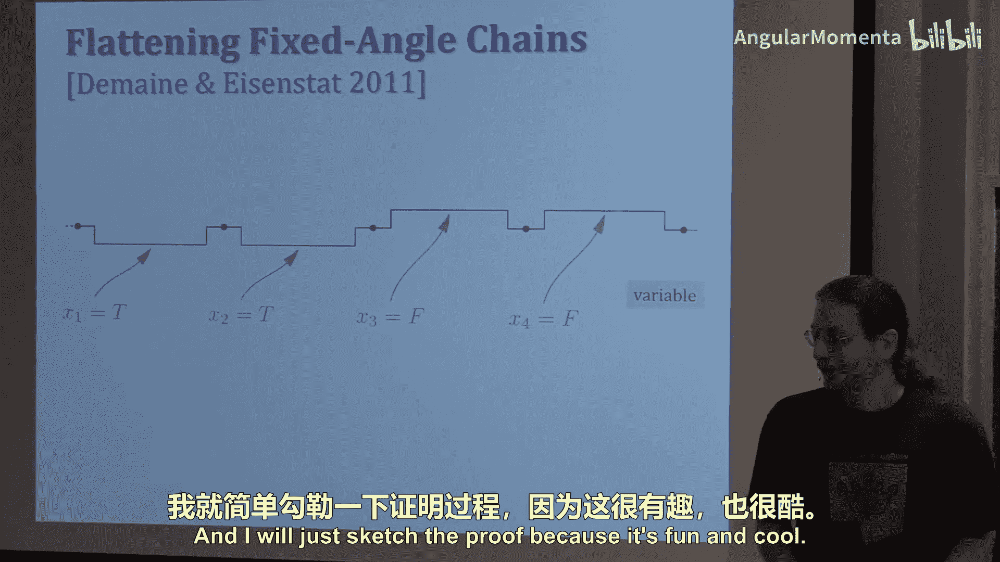
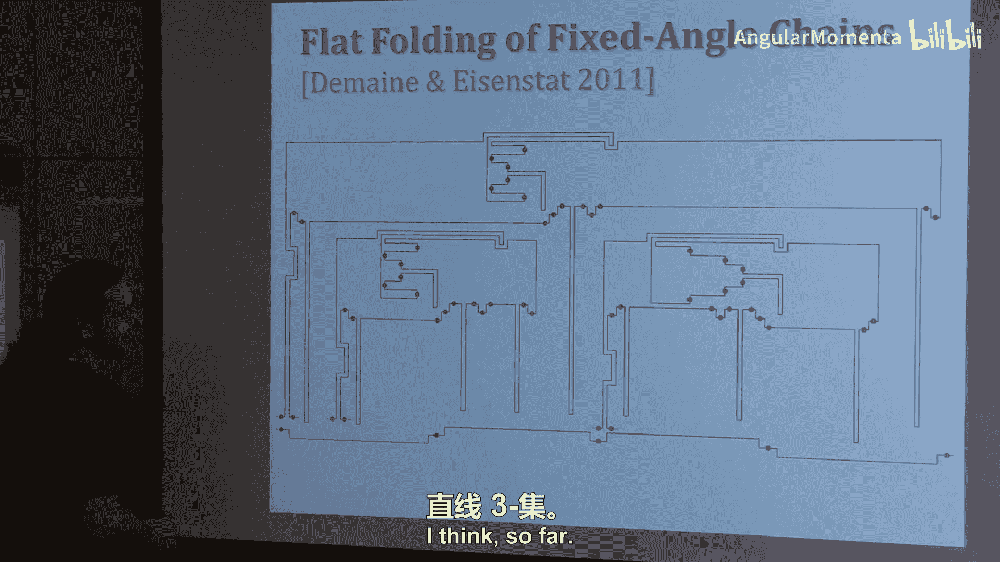
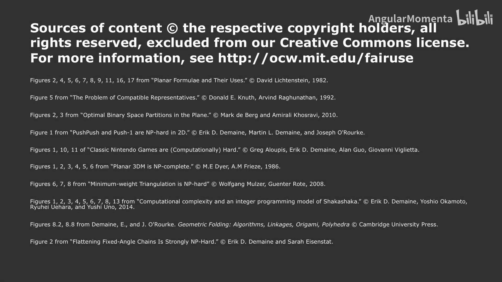

# 【麻省理工】算法下界 ｜ MIT 6.890 Algorithmic Lower Bounds, Fall 2014 p07 7. 平面布尔可满足性问题 -BV1dPYpz9E4V_p7-

The following content is provided under a Cative Commons license。

 Your support will help Mi T OpenCourseware continue to offer high quality educational resources for free to make a donation or to view additional materials from hundreds of Mit courses。

 Visit Mitopcourseseware at Ocw。mt。 Eduu。

Alright， welcome back。 today is probably our last lecture about three set。 But this time。

 it's about planar3 set， which we've sort of alluded to。In the past。

 and we saw a version of what might you might call planar 3 S with planar circuits set last class。

 But Planar 3 S is a very useful special case of threeat。 it is。Just like threeat。

But you also are told that the bipartite graph。Let's say， of。Variables versus clauses。

Is a plan graph。So the idea is you have some vertices。Representing variables， V for variable here。

 And then you separately have some clauses。I I say， I should really have more。Varis。

 and then the you have a。Edge between a variable and a clause whenever that clause includes that variable。

 either in positive or negative form。 So maybe some of these edges I'll draw red to indicate。

 actually， that's V。Bar that is included in this clause。So this clauses VI or。J bar or VK。And so on。

 And this graph should be planar， Should't have any crossings。

Something like that would be a valid input to planar 3S。Quest youre。The fact that a particular graph。

A particular bike draft as a planer。Is there a phone only operation to find a planner？Yes。

 deciding whether graph is planar and finding a planar embedding when it is is linear time。

So here I'm just saying it's given as a planar graph， but not with an embedding。

 So we're going to use the embeddings in a reduction。 Yeah， good point。

 So we do actually need the ability to draw these things without crossings。Good。

So first thing I'm going to do is prove that this is hard。 Usually。

 I don't prove base problems are hard， but this is a sufficiently sophisticated。B problem。 I mean。

 we do lots of reductions from Planar3at。 But the proof is actually from threeat。

 And I think it's a representative example of how to build a crossover in this kind of setting and what kind of extra properties you can get out of it。

 so。Here it is。 This is the proof in a single diagram。

The idea so the notation here is that the little green circles are clauses and the bigger circles are the variables。

 purple circles are variables。 So the idea is that in your initial instance。

 So we're going to reduce from threeat。 we're given an arbitrary threesat instance。

 So that is that has a corresponding bipartite graph of variables versus clauses just not planar。

 So consider any drawing。 Actually， we'll look at a specific drawing in a moment。

 but it's going to have some crossings like this， this is a clause variable connection。

 another one that cross here。 We're going to replace that with this picture。

Which is technically not three sat because there's a four variable clauses in the center。

 but we can fix that。 That's not too hard。 Let me first convince you this will take a little while that this is equivalent to this。

 So the， the ultimate claim。 So there's four Greek letters in the center。 but the as extra variables。

 The main claim is that a1。Equals a2 equals a and B1 equals B2 equals B。If that's true， then。

 of course， this connection simulates that connection and that connection simulates this connection。

 And the claim is， as long as you satisfy that， you can always set the stuff in the middle to be happy。

 So those those are the only constraints， basically。So let's start with over here。And down here。

 these little sort of length two paths sorry also the coloring is like similar to what I did in the board。

 the red are negative connections meaning that clause has not a and this clause has not a2 and the blue connections are positive connections。

 So when you have this sort of alternating for cycle here， you can read that as not a or A2。

 which is the same as saying a implies a2 and also a2 implies a， that means they have the same value。

A， if and only if A2， or I'll just write the quality of their truth values。 Same thing here。

 So that part is just to get。Warmed up。Now， the fun part is on the inside。

 and I think the next step is to think about these sort of triangles in the corner。

If you stare at them for a little while， you get these kinds of constraints。

 So let's work through this one。 You'll see there's a certain symmetry among what the alpha beta gamma deltas are。

 They're going to be all patterns sort of all patterns of a to possibly complemented ended with B2 possibly come possibly complimented。

 So these are supposed to be the four cases of a versus B。

 The trick is that some of them are twos and some of them are once。

 So this is what makes a little bit annoying it would be nice to make it perfectly asymmetric。

 but that would in terms of these labels but that would destroy planarity。

 So this is the planar version。So let's look at this。 We have， for example。Not alpha。Or B2。

 So alpha implies B2。 Also alpha implies a2。 So if alpha is true， then they must both be true。

And conversely， I want A2 and B2 to imply alpha， right， So if these are both true。

 then this guy's unsatisfied from those two red clauses。 So alpha must be true。

 so works in both directions。 You get a quality。 It's exactly the same in each of these four corners。

 just the coloring is different。So and you're connected to a different B。 So here if you reflect。

 you're connected to B1 instead of B2， and there's a complement here basically because these two colors switched。

From here， so it's exactly the same argument， but you just imagine flipping the value of B1。

And then reflect over here， switch the value of the A's， reflect over here。

 switch the coloring of the Bs。 Okay so that's what's happening in the corners。And at this point。

 I had to draw a table of all the cases。 but a lot of the oh sorry this is a little bit about what happens in the center。

 So of course， the center clause says that at least one of these is true。

 we want exactly one to be true， because exactly one of these cases should happen。

 but that's so we constraint， and then we also have some constraints like if。Alpha is true。

 Then this is not satisfied from alpha。 and similarly this。 And therefore， beta must be false。

 So if alpha is true， then beta and delta are false， I think that's actually all you need。

 I think these might not be necessary， but they make for a nice symmetric diagram。

And they don't hurt。So now I drew a table。 There may be a more direct argument， but。

Of all the possible settings for A 2 and B2。 And from what you can derive from that。

 And everything except this part is really easy to derive。

 assuming I can remember what I did last night。 So let's say A 2 and B2 are false。

 I claim Al is false because we have this equation。That's easy。 And in general。

 you can compute alpha directly，ca it's just a function of A2 and B2。 It's the end function。

 So that's good。 What about beta， I claim if alpha is。False here then in this。Particular case。 Well。

 okay， here's one thing we wrote。 Alpha implies not beta and not gamma。 So this in this last row。

 if alpha is true， we know that beta and gamma are false。Okay， that's good。 We hope also that sorry。

 beta and Delta are false。 We hope also that gamma is false， but I don't think we need that。

Because if you look at this equation on。Delta， which we know is 0。

That must mean that one of these two things is 0。But B2 is true。Sorry。

 I'm gonna use true and one interchangeably and0 and false for whatever reason today。

 So this needs to be 0， but this is one。 So this must be 0， which means that a1 is 1。Okay。

 and symmetrically on the top， this is a symmetric between A and B。 So up here。

 you know that A2 is1 and therefore B1 bar must be0。 So B1 must be one。

 So we transfer the information。 And the only other thing to check in all these cases that actually everything is satisfied。

 but that that's sort of boring。 I want to do the other direction。

 which is that you are forced to communicate the copies of a and the copies of B。 Okay。

 so that was the last row， I think the first row should also be easy for a slightly different reason。

So， a2。And B2 are false。Alpha is false， beta is false。 That's as far as we've gotten so far。呃。

Let's see。Delta。Is A2 bar。And Im sorry， A 1 bar and B2， right， So we have。嗯。RightBecause B2 is false。

 We know that Delta is false， but it doesn't matter what A1 is。Okay。

 so sort of the reverse direction。 And similarly， we should be able to。Oh， because from this。

 we know at least one of them is true。 At least one of the Greek letters is true。

 and we've got three down。 So it must be gamma that is true。 And once you know gamma is true。

 you know exactly what A1 and B1 R。 So that's another good case。These are slightly more annoying。

 at least as far as I could see， maybe there's a cleaner argument。So let's say they's symmetric。

 though。 So let's do the second row。 So A2 is 0， B2 is 0。I think just like this argument。

 we get that beta is 0 because beta involves a2。 We know a2 is 0， so beta equals 0。

 just like this case actually。Okay， so that's good for that。

 I think it's harder to figure out Delta in Gen， but the idea， or here's one way to argue it。

 supposeose that gamma were1。 be it should be0 because gamma is supposed to be only one in this situation。

If it's one。Then I claim that alpha1 and beta 1 must be0。 that's from this equation。

And then we should get a contradiction。Help me find the contradiction。

Delta becomes one Delta becomes one and then very close betweenlta。And then this is unhappy， good。

 Okay， so we do need a couple other constraints like this one。嗯。Cool， so that's the idea。 Therefore。

 gamma is 0。 And then by that， Delta must be one。 and then we're happy again。Okay。

 so that's the idea in a nutshell。 there's maybe other ways to see it。

 but this is an old proof by Lichtenstein in 1982。 It's a cool paper。 It has a lot of results in it。

 willll be covering a few different results。 but at this point we have shown this。

 You just apply this to each crossing Eventually you get a planar bipart graph。That represents。

 that's satisfiable if and only if the original is。 And so a planer3 sad is N B hard。

Question so many questions I guess Yes， okay， right， so I cheat it a little bit here。Okay， yeah。

 some I have， some have two。嗯。So for that， I need to be able to construct the value false。

 and some have four， the four。 I believe the claim is you can take a little clause like this and convert it into。

A clause。With another variable。 I just can。あごですん。Right。Like this。So let's。

So the claim is this four way clause， so the foursAT clause is equivalent to these two three sack clauses。

 let's call this new variable x。So。We want at least。

So the idea is x is going to represent whether the left side satisfies the clauses or the right side satisfies the clause。

 If it's one， if x is1， then it satisfies this for free， but doesn't satisfy this one。

 So at least one of these must be satisfied。On the other hand， if x is0。Then it satisfies this one。

 And so at least one of these two should be satisfied。 Okay。

 so that's a reduction from fourat to three sat。So to speak now。I didn't create any degree2 clauses。

 but I have tons of degree 2 clauses over there。 Just use parallel edges。 Just use parallel edges。

 So you could just repeat the same， same variable in the clauses multiple times。 That sounds good。

 I don't know if there's an easy way to avoid multiple edges。 But I think it's a little tricky。

 You can't construct false in the circuit S sense because everything you build should be satisfiable So you have to be a little careful。

 but it might be， it might be possible to like pair them up because there should be。嗯。And。

Even number of those guys。 And so maybe you pair them up and connect them in some way。

 But let's just allow multiple edges here。 Yeah in the instance does it allow。Good forgetting thing。

Yeah， I mean， in general， this would work for any kind of sat any kind of CNNF sat。

 We're not relying on threeness at all。In this picture。

But it's not going to split things three distinct。There are a couple definitions。

 one has exactly three。But we never， I think， specify that they're distinct。 I think they're。

 I think that is hard when they're all distinct， but I don't know the reduction off hands。

I think way， the way we define is that there's exactly three， but we didn't say any uniqueness。

So let's say that。 And then we're still happy here because we can duplicate variables。Yeah。

 why did we include the。A equals a2 and b equals B2。I think it's for the next slide。The next claim。

Is it not only is that bipartid graph planer。But it also remains plainar if we connect all the variables together。

In a cycle。So let's say we number the variables one through n。 It doesn't matter how you number them。

Well， in a certain sense， you can restrict to instances of threeat that this cycle plus the vertex。

 the variable clause adjacency graph is together planar。Okay， so that's。Less clear here。

But let me prove it， this proved in the same paper。So。

Here's a top level diagram of what we're trying to do。 So we've clauses on one hand。

 let's put them all in the y axis。 We have variables on the other hand。

 these are the original variables in the original threeet instance， put them on the X axis。

 then draw the connections in the bipartite graph and furthermore draw this cycle on the vertices down here。

Okay， and obviously， we put them in the order that they appear in the cycle。 otherwise。

 we're making our lives harder。And here is that crossover gadget。 This is how it's originally drawn。

 In this case， it's already been expanded in the center。Into that picture over there。

 this is where I got that reduction from。And then there's no color here。

 but you'll notice the curvy line。Is an attempt to connect together all of the variables that appear in the crossover gadget。

In linear order， without introducing any crossings。So that diagram is still plainar。

When we add all of those edges。And so what this says is that if if we we're trying to build a global cycle that connects all the variables。

 So obviously， we have this for these variables， but we need to add into this cycle all the variables that appear in all these crossings。

And so what this says is if we are coming in either here or here into a1。

 we can follow this path and then leave either here or here on A2。Okay。

And because the diagram is symmetric。 Also， if you're coming into B1， you can end up in B2。

And I'm guessing this is why I separate B2。The reason we separated B2 from B in general is to basically add this connection so we can separate this gadget from this gadget。

So just showing we can copy and extend things， may not be necessary。

 but it definitely matches this diagram。Okay， so this diagram is this diagram。

 but where every intersection， plus a few extra places， like over here， we add these little diamonds。

 the diamonds indicate that gadget。Then， sorry， there's no color。

 But in curved lines is the attempt to connect all the variables together in one single path question。

 So what are the extra crossover gadgets that don't cross anything over。

 They're just to do this path thing。So what are they， I mean， they are exactly this gadget。 Just。

 there's no connection。 So theyre crossover of the path on the variables。Is that right， yeah。

 so instead of going straight here， you just put a crossover gadget in the middle。

 You can still go through。 you're copying some arbitrary information here to some arbitrary information here。

 So you don't preserve the number of solutions。 let's say， but。Who cares？

The reason for that is so that we can take this path， connect to this vertex。

 and then get out over here。So， I mean its so that we can do this kind of loop thing。So we're adding。

 So how do we follow the path。 I mean， we basically do it in scan line order。 that it's like。

I know some printers used to do this where they print back and forth left and right line printer。

 so we come in here， I don't know quite why they draw it coming in the middle here。

 but it's essentially coming to this vertex， then ending on this vertex on the left side then going into this vertex which brings us to here。

 say coming on the top doesn't matter and then we go to the right till we get to the end here we add an extra crossover so we can basically cross over this line with our path and add another one and whenever we visit an intersection we can just go and then we go to the next line and so on。

Pre clear then at the very end， we're either on the right or left， depending on parity。

 probably we want to be on the right。 So if we're on the left。

 we'll just add extra crossovers here to end up on the right。

 Then we can go through all these variables in reverse order and then come back up here。

So that will be one non crossing path in this planar embedding。Therefore。

 we've constructed a new formula where the bipartite graph plus the path through all the variables is planar。

 and so this new version of planar 3 set is hard， This version is usually called planar 3 set。

 but if you wanted to distinguish it， you could call it planar 3 set with a variable cycle or something。

Yeah， it that we care about why do you care， we'll get to that a little bit later， Well。

 we've seen a lot of proofs actually， where you wanna， you visit a variable， make a choice。

 then visit the next variable， make a choice and so on。😊，And when you make a choice。

 you go visit the clauses and things like that。 So in when we're reducing from planar3atAT。

 it's often handy to have this traverible path。 if we have like a robot or somebody moving around。

 then we can guarantee parity of that motion still and the connections between the variables don't have to cross anything。

 in general， our goal goal here is to avoid crossover gadgets。

 when we're reducing from3atAT to something else。So this gives you kind of a generic crossover。

So that as long as you can do variables and clauses more or less independently。The connection。

 and you can build connections。 Then you don't have to worry about the connections crossing。Yeah。

 when you're given this。Actually tell whether an edge is engaged or not。嗯。Well， so the。

 you're still given a formula， let's say。And then you're given。

 you're just told this extra fact that the bipartite graph。

 plus this path and the variables in that order is planar and。The variable nodes。

 you have one for every variable and it's foration or just No， just sorry， one。

 there's only vertices for variables and for clausets， not for literals。

But the next version is actually about that case， so。um。The next one is。So the idea， if。

 if you were just given the bipart graph， you'd have to be told the coloring of the edges here。

 So to know which literal you're talking about。嗯。But also， the problem remains plainer if we。啊。

If we use literals。Instead， variables。So if you're wondering about that version。

That will also be planar。 Its not doesn't follow immediately。 but the idea is suppose we have V I。

 So in the regular bipartite graph， we have some positive edges， and we have some negative edges。

Instead， I want to represent that as。VI。And V bar。And the positive connections are over here。

 The negative connections are over here。 now I don't need the two color because I have the label to tell me which is which。

 And furthermore， I can add this edge connecting them。 That will still be planar。

 So just split V into two parts。 What this tells me is that the positive connections to V I appear as a contiguous chunk。

 And the negative connections appear as a contiguous chunk。 So it's not like alternating white red。

 white red。 So far it is。 but if you look at the reduction。 But we can fix that。Okay。

So I just want to add with an edge between。Exi and Xi bar。Well， I mean， this。

 the graph already wasn't bipartite。 So we start with。

We start with a bipart graph between variables and literals。

 Then we also add the edges between variables in their complements。

 And then we also add a path or a cycle among all the variables。Among all the literals， say。

 so I guess this could be part of the cycle， for example。 And that graph， which is not bi partheite。

 must be plainer。 That's the constraint。 claim as all such problems are and be hard in general。

 we're we want to make as small a problem as we can as special a case as we can and be hard because then when we're reducing。

 We have more structure that we get to exploit。this is a special case of this is a special case of this。

So the more we can confine it， the better。Cool， so this is proved also in the Lichtenstein paper。

 although we'll see a cleaner proof in a moment。 So I won't cover this in too much detail。

 But the idea is this。So we're taking each variable。 We're replacing it with a big cycle like this。

 I think it's the same kind of trick as over here。 It doesn't matter。And so the variable end up。

 all these A should be the same or sort of alternating。 And we're connecting the negative side。

 So this is really two vertices connected by an edge。

 But do I like that to make clear that that represents the same variable to literals of it and do this thing。

And then this is the path。 So suppose the path used to go through this way。Then the path now by sex。

 and you see that all of the positive copies are on one side and negative copies are on the other side。

That's the。The idea， we will see another proof of a stronger statement。

 so I think let's not worry about this。Too much。 That there。Questions。嗯。So。

Here's the stronger statement。So， in general。The variable cycle。

So I'm going to not subdivide into literals for the moment， but we could put that back。

So here's the variable cycle。This decomposes the plane into two regions。

 the interior and the exterior。Of course， I can flip the edge And one doesn't matter which one's interior or exterior。

 but there are two regions。And what I'm going to require is that every clause that I draw here。

Should have entirely positive connections。On this side， and every claws that I draw out here。

Should have entirely negative connections。Okay， this is monotone3 set again。So， this implies。Moone。

We know monotone 3 S is hard。 Now， we're claiming the planar monotone 3 set is hard when。

All the positive clauses are on one side of the variable cycle and all the negative clauses are on the other side。

 This is really helpful。Be。I haven't yet given this problem a name because it has a name that uses another word。

 which I should first introduce。 So that's。The next page。That word is rectilinear。

So this is a relatively simple modification to what we have already。

I want the variables to live on the x axis。You can think of them as horizontal segments on the X axis。

 I prefer。This drawing。 So imagine each variable is like a little horizontal segment or in this case。

 a box， but and the clauses are horizontal segments。

 and then they're connected by vertical segments between clauses and the variable。

 and all of the clauses that are above the X axis should be all positive。

 All the clauses that are below the x axis should be all negative。

 That would be planar monotone rectilinear 3cent。 I jumped the gun。

 Planar rectilinear has no such constraint。 Each of these could be positive or negative。Okay， so。

Varis。Our segments。 each variable is a segment。On the X axis。And each clauses。

Is another horizontal segment。Plus， vertical connections to。

The three variables that it includes in positive or negative form。Okay， so then planar。Monione。

Reecttilinear。3re set。Is a special case of monotone 3 set， where。The all positive clauses。

Are above the line and conversely。Of x axis， every clause above the X axis should be all positive。

 and every clause below the X axis should be all negative。Okay。

 so I guess this one you could call monotone planar 3 set without rectilinear。 but of course。

 recallinear doesn't change much。I didn't say why， but if you have a planar drawing like we had before。

 this is just a particularly nice way to make that drawing。 I didn't really to go here。

 I just used the fact that there are no crossings and I stretched out the variables to decent length so that clauses can just go straight down。

 You can prove any planar graph can be drawn in this way。

Any plan graph that has the VI cycle and has some degree three vertices that connect to variables。

 they have to nest in this way because if you think of a clause。

 it could either be in this pocket or outside of it or you know down in this region and so you can just。

Figure out how big this thing needs to be and then make the next one a little bit bigger。

 And so you can represent the nesting in this nice orthogonalalline structure。

 rectiline just means horizontal and vertical lines。Cool， so that's。Planar rectilinear 3 set。

 first observed by Knuuth and Ruganoffen。 Now we wanna。

 let's prove that planar monoone rectilinear 3 set is also hard question。 Wait。

 if recallineity just is a nice way to draw the graph。

Can we use the fact that it's rectiline in our reductions， I mean， is that going to help us anymore。

 The recalline helps us mainly when we're reducing to a problem that lives on a grid。

It's just a convenient way of thinking about it。 doesn't directly help us， I mean。

It's a linear time reduction。 I mean， all of these are reductions。 So， of course。

 none of them help us in theory， but the more the cleaner you can make the problem。 I mean。

 it looks pretty。 And we'll see， I think， at the end of class proof that it directly mimics this structure。

 So that's the only reason。 you could， of course， as the first step， say， hey， draw it rec linearly。

 but。To save you that step。Cool。All right， so。Planar monotone recline 3 set。

So the idea is here's an explicit example， though it's not going to be modified。

's just another example of plainar rectilinear 3 set without the mono。

 you see there's negations above lack of negations below。 and here is the trick to fix things。

So suppose you have a variable X I on the X axis。 you have a clause above it that uses that variable in the wrong orientation。

 So， of course， or the reflected picture， but let's say it's above， it's used negated。 So in general。

 we have a bunch of connections up。 We have a bunch of connections down。

 This one is somewhere in the middle。This these bold lines are just to distinguish。

 These are the ones to the right。 These are the ones to the left。 They don't mean negation。

Necessarily， because， this one should be negated。Okay， so we're just going to replace it like this。

 We're basically going to。 this is the trick that we saw in the right and bottom corner of the crossover gadget。

 We're going duplicate X I， except we' neggate it at the same time。

 So the other one had a negation here。And one negation here， not here。

 this X or a together with Xi bar or a bar， again， these are two stack clauses you have to duplicate an edge to make it three set。

That forces Xi to be not a。I think maybe I even have that as a fate。 Okay， X I is not equal A。

  Similarlyly， A is not equal B， which means B equals X I。Okay。

 so we just duplicated X I to be used in all the old scenarios。

 and maybe these guys still all go down。 We could move some of them over here if we wanted to。

 the ones to the left have to be over here。 the ones to the right have to be over here。

 This one you gets used a negated copy of X I。 So boom， negations are one negation down。

One negation that was on the wrong side， repeat this and times and now so for where you have a negation you're not supposed to and everywhere you don't have a negation that you're supposed to apply this trick。

 you'll increase the number of variables by some constant factor and get and now you're in the monotone case。

 so that's actually really easy。This is our first proof that monoone3 sad is hard， but。prettytty。

 pretty easy one， yeah。Can we use it at similar construction to recover splitting the variables into literals。

啊。Oh， to do this。So we we dropped that when we moved over here。you said it't Well， we sort of did。

 No， actually， this is supposed to be a generalization of this because you could just split apart the。

 I mean， you can carve VI in half to the positive side and the negative side。

And all the negative sides are below and all the positive sides are above。 So yeah， we could R D。

Do that。Right，Because this was not about having them。 I mean。

 this was just that was about having the vertices labeled。As literals instead of as variables。

 So we don't need to explicitly say that this one does not equal that one。

 That's already in the problem。So we can combine all of the things I've said so far。

 That may not always be the case， but so far we can combine all。 Yeah， silly questions。

 If we're caring them into positive side of variable own sign of negative on the other side。

 wouldnn't make all the connections below that positive connections to that negative connections。

Sorry， I don't mean split it in the way of that diagram。 I mean， that we could， in this sense。

 we could have vertices represent a positive。V I and a negative V I and have the connections。

 This was saying that we could separate the positive connections from the negative ones。

 And I'm just saying we already have that here。 This is a stronger property to say that they're also all in the same direction。

 If you just had this property， then you can have some white here and some white here and red here and red here。

 But this is saying you can get them all aligned in the right direction。In fact， if we。Look at。

This diagram。啊。This is， maybe you didn't understand this diagram， but it's this， it the same issue。

 or this is exactly that kind of picture。 So here we have a 5。 The positive is over here。

 The negative is over here。 Here we have a 4。 The negative is there， and the positive is there。

 So this was getting the weaker property。Again， you。

 you don't have to worry about it because we got the stronger one， but。

But that's to show that there's a difference between the two。Good。So， that was。Planar， monotone。

 rectilinear 3 cent。Okay， I have。嗯。A governor general's warning。诶。So here's another problem。

Suppose we have the variable cycle。And I say， well， every clause is inside the cycle。

And you're free to have positive and negative connections。It's going to get hard， okay。

 something like that。嗯。And it's planer。That problem is polynomly solvable。Thanks so。I phrase this。

If all the clauses。All。On one side。The variable cycle。

Then that version of 3SAT is polynomly solvable。And the intuition is that this kind of nesting structure is essentially a tree。

If you look at what nests and size of what， what clauses fall underneath other clauses。

 that is a nesting relation which corresponds to a tree。

 and then you just do dynamic programming over the tree。That's easy。

 The sort of surprising thing is that just having two of these trees， one on the inside of the cycle。

 one on the outside is enough to make the problem hard。 That's a typical thing， actually。

 because the trees。Interditate。 they have no real relation to each other。

 And there's no way to keep track of both of them simultaneously， with the dynamic program。

Unless P equals NP so。呃。Okay， so that's one gotcha to be careful of。

 so when you're doing your reductions， you have to worry about things above the line and things below the line。

But。就呃。Also， here's a special case of this。Suppose I phrase the following problem。

 I want the bipartite graph on variables versus clauses plus the cycle V1 through V N back to V1。

Plus， another cycle on the clauses， C 1 to C N and back to C 1。 I want that whole graph to be planar。

OkayThat if you think about that for a second， that would imply all the clauses are on one side of the variable cycle。

 And so we're in this case， which is easy。 So this is a special case of that case。 Now。

 this 1 I mentioned because this would be， if this were hard， life would be so easy。 It's not。

 so like it's easy， but you already need that。 recall， say proving push1 is hard in 2D。 Well。

 first we did it in 3D。 And then we had a crossover gadget。

 And most of the work was in the crossover gadget。 The base proof was trivial or very easy。

And all we wanted。 so we can get all of these connections between variables and clauses to be planar。

We can get all of these connections。 The variables in a line， to be planar。Together。

 all those things together。 But we cannot also have a path connecting all the clauses together。

 even a path。 So I said， yeah， I said a path here。Which is what we want。So， that's annoying。

Ca if we could make all these things plainer， we wouldn't have to worry about these crossovers。

 Same thing with all the Nintendo proofs， like Super Mario Brothers again。The。

 the player is going from one variable to the next。 So you need。

 you need those edges connecting all the variables in a path。

 You need the edges connecting the clauses in a path for the final check。

 So Planer 3 set basically doesn't buy you anything in these proofs。Now。

 if we could somehow avoid adding these connections， everything else could be plainer。

 That's sort of the point of planar 3 sets。 So if you can avoid these things。

 and there are a lot of games where that would happen， just you have to like get a point here。

 And it's just added to your total score and some never neverland， not in the plane。

Then life would be much easier。Because you wouldn't need a crossover gadget。

Cause you can just reduce from planar three set。Okay， so that's。

That should give you some intuition why we care about planar  threeet。

 but also why we didn't use it for those problems。As far as we know。

 there's no way to use Planar 3 set and make a simpler Super Mari Brother's proof or whatever。Okay。

So。Next topic。We will see some planar three set proofs。呃。Rs from planner 3 set。

 But let me first tell you about other versions of three set。 Remember。

 there are three main versions， Planner 3 set， Planner 1 and three set， and sorry。

 there are three versions of three set，3 set，1 in three set， and not all equal set。

 Turn out one in three set is hard。When graphs are planar。

 not all equal sat is easy when graphs are planar， so I'll show you both。Does for this easy case。

 do you have to have both the variables in a cycle and the causess in a cycle or is it just like seeing the causess in a path or cycle immediately triggers this easy condition。

So I don't know。 I think if the clauses are in a path and the variables are not connected at all。

 it should still be hard， but I couldn't find a proof of that。 It's just a vague recollection。

 So I'm pretty sure if variables are in a path and clauses are in a path。

 then that's enough to be toast。 but all I proved here was cycle。But I think a path is enough。

 it will still behave like a tree。Maybe not， I'm not sure。Yeah， so that's a good question。Alright。

 let's do planar 1 and three set。 So it is pretty much the same thing。

 I won't duplicate all of the text here。 We take the bipartite graph of variables versus clauses。

And we。Also add a path or cycle connecting all the variables， and that graph should be planar。

And otherwise， it's one in three cent， exactly one three cent。So。Here's the proof。

 One of the easiest proofs we'll cover。 Suppose you have a clause。So it's a reduction from non sorry。

 It's a reduction from planar3 set。Two， planer1 and three set。Okay， so I'm gonna represent。

 So this is also our first proof of one and three S being hard。

 We are going to take a regular three S clause and turn it into3，1 and three set clauses。

 And that transformation preserves parity。 So done。

So all of our proofs are going to just keep building up in this way。

 We've already proved this problem is hard when the graph is plainer。So let's do this。

At least one of them should be one。 We don't want them all to be 0。 So let's try when they're all 0。

 See something should break。 Let's say this variable is 0， easier to reach。 So that。

Makes this guy satisfied， which means both of these must be false。 This variable is just hanging out。

 It's just to make everything degree 3。 So if this is。0。This is 1。 So this must be 0。 So this is 0。

 This is 0。 That means exactly one of these should be one。 If Z P is1， obviously， we're happy。

 but this will end up forcing this guy to be 0。 or sorry， Actually。

 it'll leave this guy free to do whatever。 So if this is 0，0。0ero。Then this must be1。 This is1。

 This is one。 Therefore， both of these are 0。 If Z R bar is 0， that must mean this one is 1。

 So if both of these were0， it forced this guy to be a1。If this was0 and this is one， for example。

 this is one。Then， this must be0。Okay， this is 0， but we're free to set either one of these to one。

 So Z R is free。Which is what we want to do。 We're simulating regular three set。 If this is one。

 then both of these guys should be able to do whatever they want。

 And that's what that's what these guys let you do。 They're free floating。 They let you。

 This guy can toggle if it's not constrained to be the only guy that's one。Yeah。

 what's the dashed line represent？dashash line is the outline of a gadget。

Just saying you replace that blob with this blob。I mean， slightly more formally。

 I think it's saying something like if you contract this to a point or if you contract this to a point。

 then it's exactly the same diagram， so it's one way to argue you preserve parity。

Something like that。So ignore it， basically now。I guess you would have to argue that you can still have a path if visits all the variables that question。

 Yes， What prevent from setting pulse。if you set， thats one of the cases I just did。

 If these two are false， then these have to be true。No， sorry。 these have to be0。 So these are both0。

 And then this has to be a one。 or satisfy this。It's。

 it's easy to get confused'cause that one is three set。 This one is one and three set。

 So these all have exactly one constraints。Okay， now this proof has negations。

 and you may recall that。Moone， I'm gonna switch to saying positive  one and 3 set。

 where you have no nes is also hard。 so we can also define。Plelanner。Positive。1 in three set。

This was， this is also hard by a slightly more complicated proof， more recent proof。 also。

 surprisingly， this。This planar monotone rectilinear 3 set or just planar monotone 3 set is also very recent。

 I think， 2010。So a lot of these just fell recently。

 but are a natural culmination of all these simplifications。So this is a version that， well。

 these are some gadgets。 actually。 This is one way to force that two variables have opposite values and force that two variables have equal values using。

I guess this is really plainar， positive。Reecttiline 1 and three set。 Okay。

 it's the one and three set version of this problem。 So again， variables are on the X axis。

 Everything above is implicitly all positive。 Everything below is implicitly all negative。呃。

 sorryorry。Here， everything is all positive。Yeah。Another nice thing to note about that particular construction is that each of the variables in the causes are unique。

 so it's exactly three。They're rather unique， which someone was asking about。Good。

 so in this construction， one and three set， all the very all of the clauses do not repeat any variables。

Get exactly three distinct guys。 Yeah So to be clear this problem is hard， but in this terminology。

 plainar positive。Reectalline three set， not one in three set is easy。

Because if everything was on one side of the line， I mean， positive three set is easy。

You said all the， all the variables to true。I I'm confused。

 The positive means that positive is sort of the one and three sat version of monotone。

 So three sat monotone means they're all po， every clause is all positive or all negative。

 in one in three sat， you just need everything positive。And still hard。But with three said。

 that doesn't work because you can say everything to true。

One and three set requires some false things。So sort of the analog。

 this is sometimes called planar monoone recttilinear31 and 3 set。

 but to avoid confusionca they are somewhat different， I'm calling it positive。

 And I think this paper actually calls it positive， which makes me happy。Anyway。

 you can check these gadgets that they force in particular here。

 you're basically forcing A to B 0 by this little construction。 You can C is one。 but therefore。

 this clause forces exactly one of these to be true。 the other to be false。

 So it forces them to be different。 You repeat that twice， you get a equality。 Then you do this。

So if you have。First you get rid of all negations。Because you have this way to force two things to be different。

 if you have some these x out ones or the red lines。 Those are the connected to negated copies。

 you just duplicate the variable in negated form and then use a wire there。

 So this wire becomes that one。 X2 is different from x1。 x 3 is different from x 2。

 So it's equal to x1。 same trick we saw before。 Now you have no negations。

 So now this type of clause is a three s clause。 This little weird on right of the arrows。

 These are1 and three S clauses left of the arrows are regular three S clauses。

 So we replace this with this construction。And。With enough， it's bit sort of like the old one。

 but a little bit spread out with the duplications with these equal gadgets。

 we get a copy of X over here。 that's so that if we have more connections below。

 we can easily access X still。 and yeah。These， not， these are one in three gadgets constrain this。

Yeah， there's in equal ga equals are not part of the problem。

 they're just referring to the are that's no take shorthand for these gadgets。

 So you would plug in each of those things into those little pictures。Yeah。Okay。

 so let's skip those details。 But you get that planar positive rectilinear 1 and 3 set is hard。

And that was 2008。Cool。Let's do。Planer。Not all equal three set。This is polynomial。

 important thing to remember。Plan a world， you have to be careful with all sorts of things。

It would be nice to have a chaffer type dichotomy theorem for planar graphs。

 but that I don't know of any such theorem。 so meanwhile。

 this is the sort of main characterization you have the three standard problems。

 this one falls in the planar case same setup if not all equal clauses and the connection between those in the variables negated or not even when you allow negations。

 this problem is polynomial。Okay， the fun thing is the proof of this theorem is a reduction。

And it looks exactly like a hardness proof， I mean。

It just happens to be from this problem to a known polynomial time problem， namely planar Max cut。

So we're going to reduce2。one of the few times we were reduced to something planar。Max cut。

So max cut as I give you a graph。And I want to color the vertices， two different colors。

 Think of them as the two sides of a cut， say red and blue。

 And I want to maximize the number of edges that go that are red， blue。

So I want to maximize the number of。Here， white black edges， bychromatic edges。

That's max cut in general graphs， that's NP hard， but in planar graphs， it's easy。

Because if you look at the dual graph and then solve the Chinese postman tour problem。

 which is the shortest path it visits all of the edges at least once。

 which you can do in polynomial time by perfect matching in a biparttheite no in a cl anyway。

 you do that。 and then all the edges that you double are not in the cut。

 I think and all the edges that you don't double in that tour are in the max cut。Fun fact。

 So this is a known fact。 Planar max cut is easy。 So if we reduce from planar not equal 3 set to max cut。

 problem is easy。 And here's the proof。 It's got a variable gadget and not all equal clause gadget。

 So we want to represent。Not all equal。 And so the idea is we're going to represent a variable with this alternating chain。

And if you want to maximize the number of red blue edges。

 you should alternate because it has even length。 if you don't alternate anywhere you're gonna not get as many edges in general。

 we'll say， well， the target cut size you're trying to get And the decision problem is。

 is there a cut of size， at least something something is going to be in particular。

 it's going to be sum of things， but for this gadget。

 it is two times the number of occurrences of the variable， let's say。

Or two times basically the length of this， this cycle。make the cycle big enough。

 So we get lots of copies of X I， lots of copies of X I bar。 So this is one possible setting。

 This would， if blue means true， this is like saying that we set X I to true。

 We could do the reverse。 We could set X I to false。And said X I bar are true。

 but they have to be opposites。 So now we have， this is basically a split gadget。

 We have several copies of X I and X I bar。Then we're gonna connect them with this not all equal clause。

 which is just a triangle。And the idea is if these are， so this is really negated version of X I。

 But doesn't matter if you negate all the variables， they'll still be not all equal。

 And if exactly when they're not all equal， we get two points。Out of this gadget。 Well， we should。

 we also have to get the three points from these connections that forces this alternation。

 So we say the target in this gadget is to get a cut of size 5。 We want 5 red blue edges。

 That's the most you could ho for because of an odd cycle here。

 And if you get the sum of all these cut sizes。In total， you must have not all equal in every class。

So that's simulating not all equal planar or not equal three set。 This is also preserves planarity。

 And we would just contract the variable to a point that clauses to a point。

 and it is the bipartite graph of the not all equal picture。

And we've simulated that planar not all equal three set instance with planar max cut。

Which here we actually have a polynomial algorithm So that it gives us a polynomial algorithm for planar not only equal 3 cent。

So that's kind of fun。Similar style。啊。It's also， yeah。Good。So many problems。

So I guess now we're going to do some。Reductions from various planar three sat things to problems you might care a little bit more about。

I'm going to start。 I mean， it's sort of a vague transition because these you could think of just more problems of the same type。

 X 3 C is something we talked about in the context of three partition。 This was exact cover。

With sets of size 3。I think see exact cover with sets of size 3。 So this was。

 you could think of it as a hypergraph。Or you can think of it as a bipartite graph。

 you have sets of size3 which cover variables。You want every variable that could be covered exactly once。

啊。By， but you can only choose sets of size 3。So this is closely related， I guess， to planar。

One in three set。Here。😔，Each of these things could have arbitrary degree。

 Each element can appear in many different sets。Whereas over end， you're covering these。With these。

 I think this is the reverse setup。Where every。Let's see。The clauses again。

 have to be exactly covered by these things。呃。And。These things have arbitrary size。

These are the things that you're choosing。 I'm choosing to make this variable true。

 which covers this guy。 These have arbitrary size here。 The thing that I'm choosing has size 3。 Okay。

 so it's sort of the duall of planar one and three set。So the goal you have， you're given。

 one I should write down the problem again。 You're given three sets。 These are sets of size 3。

And you want to choose。Say K of them。Actually， it would be choose n over three of them。

That are disjoint。And therefore， every element， there are n elements。

 Every element is covered exactly once， exactly one three set。Okay， so it's。

 I think sort of complementary to planar 1 and three set。

 The planar version is that this bipartite graph is planar。And。Dire and freeze。

 It's the same people that proved one of these many problems is hard， I think the。How it back。

Pinar  one and three set。Okay， so no surprise。 So we're going to reduce from planar 1 and 3 set。

To this problem prove this is hard and here's a very simple proof， they make it more complicated。

 but for starters let's make a variable by this kind of even cycle trick。

 and the picture here is that the big circles are three sets。

 the dots are the elements you're trying to cover and every element should be covered by exactly one set。

So this looks good because there are exactly two ways to solve this thing。

 You could choose these guys and cover those points exactly once， in which case this is covered。

 this is covered， this is covered， but these are these other guys are uncovered。

 Those are going to attach to other gadgets。Or you could do the reverse。

So that's going to correspond to true or false setting。And I think this is not in their paper。

 But I think this would be a clause for exactly one，3 set。 just connect。Take you know。

 if you want to you could have even negated versions of your variables。

 but let's say we have all positive。Par 1 and3 set。 So I'll just take a positive copy of X I。

 a positive copy of X J from somewhere， and then just bring them together at a common dot。

Then that point should be covered by exactly one of them， which means exactly one of those is true。但。

Very easy。 Now， they want to prove more things。 So they end up using。

 I think I will just show you for fun。 They end up using a more complicated clause and a more complicated way to connect these things into the clause。

😊，Because。They want to prove another problem hard， which is。Planar。3 dimensional matching。

 This was another，3 dimensional matching was a generalization of。

Nummerical three dimensional matching， which was closely related to three partition。In general。

 three dimensional matching， you every， you could， it's like this problem。

 but you also have the extra information that for every set of size 3， one of these is red。

 Another one is blue。 Another one is yellow。This paper uses the additive primary colors。

 I don't know why but。Could be green if you prefer。So there are three types of elements， and you。

 you are told that every set has one of each type。 So that's extra information that's useful in some proofs。

So this is a better construction because it's going end up being three colorable。Yeah， I guess。

I don't know how much you care about this reduction。

 I think I will skip the details so I spend a lot of time understanding it。

The the rough idea is that these connectors， there's a positive in a negative version because they're worry about negations。

 but these connections will attach to these three terminals for one variable。

 these three terminals for another， these3 for another。 And just by accounting argument in here。

 there's 1，2，3，4，5，6，7，8，9。 of these guys， and there are however many I guess I should really be counting the black dots 12。

3，4，5，6，7，8，1112。Points here。 So the best you can do is to choose three of the sets inside that will cover all of the black dots。

 except for three of them。 And so from that， you get exactly one three set。

 Exactly one of these should be covered from somewhere else that would correspond to this situation where you cover these three points as opposed to this situation where none of them get covered。

 That's like these guys。 then you can only satisfy the rest by adding three in there。

So that's roughly how that clause works。嗯。Then that picture is three colorable。 And this way。

 you can color all the dots with three colors。And it pretty much works。

 The variable alternates red Y yellow。 so we get always get blue connections。

 which is good so we can attach to anything， except that the way that we attach is like this。

 And these are three colors， which match。😊，Here。😔，And in these， this case。

 these three colors match here， but you might want to attach here。 for example。

 So you need another connector。Slightly different。 It does exactly the same thing。

 But now this color pattern matches。Here， but in negd form。 And if you switch these two colors。

 it matches。Here， I think when it's upside down。 So there's this version and there's the reflected version。

 And then there's also this coloring of the same gadget。 And so you， you do all these things to。

 you know what you're supposed to connect to。 And so you just choose one of these three gadgets。

 and it connects to one of the three appropriate places。 That's the， that's their proof。

 It was fun to read。 And that proves that plainar three dimensional mashing is hard。😊，Okay。

 plus in their diagrams， or they have dashed lines through everything in order to illustrate that you can have one path that visits all of the elements。

 just like in planar  three sets。 So also both planar three dimensional matching and planar exactly cover exact cover by three sets。

 you can have one cycle that visits every element。呃。Cool。Here's another relatively simple proof。

 This is in the original Lichtenstein paper。 So this is one of their motivations for Planar3at。

Plaar vertex cover。 So what's vertex cover？You're given a graph。

 you want to choose a set of vertices。That cover all of the edges So for example。

 if you have a triangle， I choose this vertex， it covers this edge and it covers this edge。

 I have one edge uncovered， so I'm going to add this one and cover that。

 so I don't require exactly one cover just every edge has to be covered by at least one of its endpoints。

So you can think of it as an or of its two endpoints。But this problem is NP hard。

 even for planar graphs。And here's one way to do it。

 This is like the whole proof in one little picture。 You have a variable claw， a variable gadget。

 which， again， is just a even cycle。And even cycle， the vertex cover has to if you， if。

 if let's say this has size K。 and I give you a budget of only K over two for your vertex cover。

 then you have to alternate。 So either these three guys are in your vertex cover or these three guys are。

This proof actually looks the same as the last one we saw Then those things are just connected to triangles。

 samee deal here。 you're going going to give you a budget of two for this clause because to cover all three of these edges。

 you need at least two vertices like we did over there。

 And if you're going to get away with only two。 So if I choose， for example， these two。

 that also covers this edge in this edge for free。 But it does not cover this edge。

 This would be the one edge not covered by the clause alone。 if you only get a budget of two。

 And that's the one that better be covered by this side， which means this variable is set to true。

 And in general， at least one of these three things better be covered， otherwise。

 you won't have enough budget to figure to finish that triangle clause。So the。

 the hexagon versus square here is just to give you more connection plants and other。

 just make these cycles big enough to connect up to all the things you needed in。

 So if you have I NI occurrences， you're gonna do like2 N I or something。Cool。

 so that's planar vertex cover。 And because this reduction preserves planarity。

 we get planar vertex cover is hard because planar 3 satisfied。 Here。

 we didn't need any connections between the variables。

Here's one where we do need connections between the variables。

 So this is planar directed Hamiltonian cycle。So I think you all know what Hamiltonian cycle is。

 And you're given a directed graph here。 You want to find one path that visits every vertex exactly once。

 Don't care about edges。So we can do a similar kind of thing。proofof is a little bit。

 checking this works is a little bit more annoying。 But here's our idea for。

 or Lichtenstein's idea for a variable， essentially a wire。The graph is directed here。

 So we get to say there's an incoming edge here。 then you get a choice of which way to go。

 but then you basically have to alternate because of these vertices in the middle。

 you've got to visit all of them。 And the only way to do that is to alternate。

So you get this alternating pattern， which means if you look at these edges， A1 and A1 bar。

 exactly one of these is in。And then the opposite of these are in。 The variable here is called a。

So there's many instances of a。 and these， these are going be in。

 They're going be both in or both out。 And then these are going be both out or both in and so on。

 So I just， because I have to zigzag， I made a bunch of copies。And I copies of the variable A。

 but you're free to choose one setting or the other。

 And then the clause is just gonna be a single vertex。And the idea is， if we want B。

 if we want B bar to satisfy this clause， we're gonna add in those two edges so that instead of going straight here。

 you could have done this and grabbed the claws for free。 You don't have to。

But this is gonna get grabbed if only if exactly at least one of these chooses the appropriate edge for using this edge。

 there's no way to cover this class。 But ifre using this edge， you can do that。

OkayYou have to check that you can't let go from here to there to over here。

 That's what this figure is about。 basically if you're if you're alternating here。

 you switch sides and then you're alternating here， this guy is uncovered。And apparently。

 this proof works even when the graph is undirected， but that's even less clear。

 We'll see other Hamiltonian cycle proofs that are stronger than this。

 but it's a nice illustration here。 we're using that we can connect all the vertices together。

 That's what these connections are in the cycle。So there's this big vertex loop on the outside。

 taking these gadgets， pastcing them together in a big loop。

 because we want an overall Hamiltonian cycle。Because we know that preserves parity， life is good。

Okay， so there'll be some clauses inside the cycle， some clauses outside the cycle。

 but that doesn't matter。Okay， thats planner directed Hamiltonian cycle。Time for a niel Lee game。

I've， I bumped into this slide that I made a while ago。 So for fun。

 these are all the nickly games I know that have been proved hard。

 except the one I'm gonna talk about。 These are the references。We we covered one of them， right。

 the light up。But there's a lot。And lots of papers proving them。

 So here's a relatively new game which came out a couple years ago in in Nickelly Land。

 although it was invented before that， Shaka Shaka。😊，Which is like shaking sound。

 So we have square grid。Blank squares and obstacle squares， obstacle squares。

 Some of them have numbers。 Some of them are wild cards， and。

What you're allowed to do for a blank square is or some of the blank squares you can fill in one half。

 so you have like four different halves of the square you can choose there they are， this one。

 this one， this one and this one， and you can fill it in half black half white。

So you cut along a diagonal， and then you choose one of the two halves to fill in black。

 You don't have to。 You could just leave it white。And when you have a numbered square。

 then the number of filled things must be exactly that number。

 So here there's one adjacent to it and nothing down here。

 This guy has exactly two half filled squares next to it。This one has exactly one。

 this one has exactly zero half filled squares。Okay， think of blank squares as zeros。

 and these counting as one。Plus， the goal is that the regions you make。

 this would all be easy so far。 I think， but the extra constraint is that all the regions you make must be rectangles。

Okay， this is a 45 degree rotated rectangle。This is a regular rectangle。 So you can use either one。

 So that's a funny constraint。 It's actually quite a fun game to play。

 You're not allowed to fill in a square 100%。 That one was already filled。😊，That's the rules。

Here's a reduction from planar three set。Pretty simple looks a lot like mineweer， in some sense。

 a little bit thickened， but this is a wire because the one says that one of the two sides is half filled。

 Once that's half filled， you have to make this a rectangle。

 you can't just leave it as like a pentagon。 So you got to fill that into a rotated square。

 But because of the one， this must be an empty square。 So it alternates。 you can do this or this。

Okay， you can easily split just by connecting those things in the obvious way。

 You can do 90 degree turns， no problem。啊。Here's a slightly more sophisticated。

Slightly more sophisticated gadget， you can think of this as a terminator。

It would be hard to just stop this somewhere。Well maybe you could just go all black。

I think that's okay as well。 This could also be a terminator。 You can also。

Think of this as a negator。 Of course， also the splitters is like a negator。

 this gadge is probably not so necessary。 Let's get to clauses。

So clause is bringing three things together with one of these blocks， but we do it in a funny way。

 There's no ones here or here。 So we end up with this L blank shape。

 Everything else is not drawn as black。Okay that's just obstacles。

 So this is not happy the way it is。 There's lots of ways to resolve it。

The one case where we can't resolve it is when all of these wires are zeros because， I mean。

 when there's already stuff here and stuff here and stuff here， so we can't put anything here。

 can't put anything here or here or here because of those ones。

 then you're forced to have the L shape in your your toast。In every other case。

 we can decompose into sometimes a big rectangle， sometimes little squares。

 sometimes rotated squares。 But it's okay。 So this is a regular three set clause。

The one thing that's missing at this point。嗯。Is a parodity shift gadget。

Because all a lot of these gadgets have very specific lengths， Moular 3 or whatever。

 So it turns out this is a way to shift things slightly。 It can be filled in two ways。 You can。

Put fill in all of these guys。Like that， I make it this giant rotated square。

 Or if these are not allowed because these are here。Then you can do this weird filling。

 You end up with a rectangle there into rotated square as another rectangle。So。

 and you count the total length。 This is length 4， whereas most of the things are length。呃。Qu。😔，3。

 okay so。That makes me happy。Shift the parodity， and that is Shaka shockka。

Here's an overall picture we actually plug some gadgets together。It was fun。A。So。Think， I have。

One more proof to just sketch。 So this is a problem of so calledled fixed angle chains。 So you。

 you have this forced 90 degree angle。 We had a similar thing with the Hamiltonian path with cubes and elastics between them。

 You could， you could twist one edge around the other，1 block around the other。

 but you couldn't adjust this angle。Okay， so the problem is I give you such a chain which is specified by lengths in the 90 degree angles。

 they can be。 you don't know whether the 90 degree angle goes up or down。

And you want to just put it into the plane without crossings。 And this is an old proof from 2000。

 The problem is weak npy hard。 It's basically a partition proof。 So it is a partition proof。

 You get to choose for each of these things， whether it goes left or right。

 and you need to line up this with that。 Otherwise you get collisions。Okay。

 you would just need to argue this outer structure has a unique embedding， roughly unique enough。

 It always looks like that。So we proved a few years ago that it is strongly NPp hard。

And I'll just sketch the proof becauseuse it's fun and cool。

So here's the rough idea。 Imagine this is like a， a piece of wire， and you can flip it up or down。

 All the angles stay 90 degrees。 These is at the down case。 Here are some example。 up cases。

 One of them is gonna represent false。 The other true。Question， what's the difference the car roller。

Which carpenter Oh， to fit inside a given length。That， that。Well， the goal is different。 Here。

 the goal is to draw it in the plain without crossings。

Before the goal was to draw it in the plane with minimum span。Or to fit inside box。 Yeah， I mean。

 this proof was pretty much the same。 This proof would be totally different。

 That problem was also only weekly hard。 There was a pseudo polyly algorithm。

This problem is strongly and behind。 There is no pseudo polylyalgo unless peak equals N P。

 So just a slightly different goal。 That one was more one dimensional。

 This is going to be much more two dimensional。See other difference。 Okay。

 so this is our some kind of variable gadget， or this is the variables， this gadget。

 All n variables are represented here。 This represents one variable at this point。

 I only have one copy of each variable because there's no constraint between these。

 Each of them can independently flip up or down。Next， we have a clause。 This is where things get fun。

So there's some infrastructure， but the main action is here。

Each of these is sort of independently pop in or outible。 It's like some kind of pleadted form。

 It can either pleat back and forth like it's doing here where it pleas in and out and out and in。

 that gets this to this position or it can with a slightly different pleating。

 it ends up in this position or a slightly different pleating， where they're all out。

 you end up in this position And notice this structure。So go through it again。 Here's the left one。

And then， the。Middle one。 and then the last one。What ends up happening is that these pegs。

 in order to avoid hitting that peg， I occupy either P1 or P2 or P3。Okay。

 so I'll go through one more time here。 it's hitting P1 because this basically pushes this thing down。

Whereas the other ones can be up， this is up and up and up and up。Or if we shift it into the middle。

 then this one has to be down， but this guy can be up and avoid P1， but hit P2， or this one's down。

 these are up and we hit P3。 We want to avoid collisions。

 so we have to collide with exactly one of these things。Or at least one of them， I guess。

So that's the sort of picture。 You just have， this is a bunch of those clauses。You know。

 there's one here， there's one here。And there's one here。Look familiar， this is。Planar， monotone。

 rectilinear 3at。I think。All so far so good， except this chain is separate from this one。

 So we're gonna connect them together a little more。

Yeah， connect them together。 So now it is one big chain。 What I ended up doing。

 There's still this big thing to represent the entire variable。

 But I basically made a whole bunch of copies of it。So that I could attach things here。

But for example， when this is up， all of these guys have to simultaneously be up。

 So it forces the variable to be all all the copies of the variable here to be one way or the other。

 This is one variable。 This is another variable。 This is another variable。

 and this is another variable， just like before。So same thing。

 But now I can connect them all together up here。 These are all the。Negative， I think。

 clauses doesn't matter。 And then down here， you put all the positive clauses。

 And that's the proof question。 have all those like three dos in a row。

 Like it seems to me that it two like by straight line they might as well discourage into one do。

I think the idea is， yeah， this could be a single line。

 We subdivideed just to point out that you can attach things to it。Yeah， those extra dots。

Just for consistency's sake， I guess。 so now everywhere here， you can attach one of the clauses。

 And that way， they all kind of hold to the same infrastructure， yeah。Cl， so obviously。

 you get pretty complicated pictures in the end。 But this is a proof that clearly benefited from the rectilinear aspect and the monotone aspect that all the true thing we could not get some true above and some true below。

 They all wanted to go the same way。 And the rectilinear was nice so we could draw this all in a horizontal line and only have to worry about vertical connections between the top and the bottom。

 So I get to your question about why do we need rectilinear。😊，But there you go。

 So that was just a few examples of planar  threeAT。 But in general。

 the idea is that a lot of threeat or many threeat proofs get easier when you use the appropriate planar version。

 you just have to be careful of ones that are not hard as long as you avoid that。

 And you have the right sort of graph setup up。 You don't have to add too many extra edges。 Then you。

 you'll have planarity and not have to worry about crossovers and a crossover right。

 It wouldn't have a clue how to do a crossover and something problem like this。啊。

And other times it just makes your life a little bit easier because you skip one gadget。

But that is Plan threeet。

