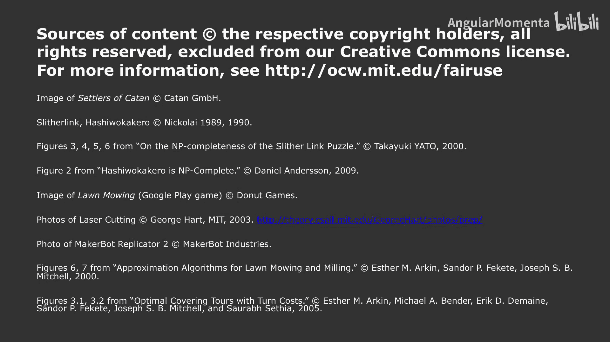

# 【麻省理工】算法下界 ｜ MIT 6.890 Algorithmic Lower Bounds, Fall 2014 p08 8. 哈密尔顿性 -BV1dPYpz9E4V_p8-

The following content is provided under a Cative Commons license。

 Your support will help Mi T OpenCourseware continue to offer high quality educational resources for free to make a donation or to view additional materials from hundreds of Mit courses。

 Visit Mitopcourseseware at Ocw。mt。 Eduu。

Alright， today we start a new section of NP hardness。

 I think there'll just be one lecture about Hamiltononicity。 So Hamiltonian cycle and path。

We've talked about these briefly， but。Ccle is just a cycle visiting every vertex exactly once。

And usually when you talk about a graph being Hamiltonian， you mean that there's a Hamiltonian cycle。

 also called a Hamiltonian tour or Hamiltonian Circuit， all mean the same thing。

 and then there's Hamiltonian Pa。Another problem we have looked at before and same thing。

 but path that visits every vertex exactly once these are pretty much the same problem。

 but different versions are useful in different settings in case you're curious where this comes from。

 It comes from this game introduced by Hamilton in 1857。 He was the royal astronomer of Ireland。

 back then， but he had fun with games as well。 So here you have something like the graph of。😊。

Ddeahedron， the dual is an Icoahedron， hence the name and you want to find a Hamiltonian circuit through it。

 or there's actually a two player game where one person chooses a subset of the graph。

 the other one tries to find Hamiltonian' circuit in that subset。

So that's where Hamiltonity comes from。 But for us today， it is a nice MP P complete problem。

 We've actually seen one proof that。Pinar max degree4， I think Hamiltononicity is hard。

 I think that was in the planar sat discussion and this is the original paper that does planar 3 sat。

 and there was this proof， I guess it's not actually max degree4。

 it probably max degree6 or something。You could get direct。 We argued the directed case。

 for if apparently works for the undirected case， we'll get a an even stronger result here。

In general。呃。The problem is， andP complete。In a lot of different special cases。

Such is the one we saw。For example， if you're looking for a path and you're given the two。Enpoint。

So normally you say is there a Hamiltonian path or is there a Hamiltonian cycle。

 those are both hard and general graphs， but if I give you a graph and I give you two nodes S and T。

 and I want to know is there so here's the graph。Here's S and T。 I want to know。

 is there a path that starts at S ends at T。 This is NP hard by a reduction from Hamiltonian cycle。

Tell me what to do。You're added a new node， which has。

add a new node connected to S and T and nothing else。 Yeah， so we'll add this new node X。

Connect to S and T。 What's interesting about adding a degree2 node is， you know， it has， I mean。

 has to be in the cycle。 So you know that these two edges have to be in the cycle。

Also it's not directed。All these are going to be undirected。

This would preserve directedness if you wanted it， but yeah。So。There you go。

 So if Hamiltonian cycle is hard， then Hamiltonian path given to endpoints is hard， easy warm up。

It's also MP complete for。Plainer。Three regular。3 connected。Graphs。

Where every face has degree at least five， but by writing that down。

 it and be hard for bipartite graphs。These are all various results。呃。Proved in the 70s。

It's going to be hard for squares of graphs。Squares of grass is interesting。

 This is whenever you have a length two path， you add an edge。It's a square， and that's still hard。

Another fun problem is computing a Hamiltonian cycle， given a Hamiltonian path。Its also hard。

On the other hand， some variations are easy， so you have to be a little bit careful。

There are a lot of papers about。Various graphs that are always Hamiltonian。

 And usually when they're always Hamiltonian， there's a good algorithm to find them。

 Here are just a couple of examples。 One is cubes of graphs。So if you take all length。

3 paths and connect them by an edge， or maybe length at less than equal to 3。 I'm not sure exactly。

 That's easy。 All such graphs are Hamiltonian， Where squares it's still hard。

So that's kind of a limit。 And the other one here is。Plainar 3 connected graphs is MP complete。

 Planar 4 connected graphs is polyennoial。This is Tuts theorem， one of many Tut theorems。

 all such graphs are Hamiltonian。So those are a few cases to worry about。

 we will see some more today and these are relatively simple。

 we're going to prove even stricter versions of this problem and be completelete。

 but starts to give you the flavor of what's there。So。In fact， the first one we will prove。Is。

This may seem a little weird because I wanted to do undirected。

 but we're going to make it undirected in a moment we're going to do a series of reductions。

First one we'll do。Is planar。Max degree3。Gras。Okay， so this will be。A reduction from threeat。So。

 the general。Idea， and use。Please wait why you should care about this problem。

 We're gonna reduce it to another more interesting version of Hamiltonity。

 But here's one way to represent3at as Hamiltonity， Another way similar to the one we did before。

 We've got clauses here over on the left here some of the clauses have size 2。

 but the works for the three case。 here we have the variables。

And the key concept here is this notation， this is notation shorthand for a more complicated gadget。

 which is to say that these two things should not be both chosen， this is an exclusive or。In fact。

 exactly one of them should be chosen。 So that forces X 1 to be the opposite of X1 bar。

 And it also lets you duplicate things。 So here we get multiple copies of the variable。

 You keep doing that several times。 You get many copies of variable in its complement。

 And then we're also going to use some connections like this。 We're gonna need a crossover gadget。

 But this will say that you。Well， so this is going to be some clause。

 which it's not literally as drawn。 Again， this is notation for a gadget that force is going to force at least one of these to be traverible。

Okay， so that overall should represent3 set。 We need a clause gadget。

 We need this exclusive or so that we can split duplicate things overall。

 the the cycle is gonna do this。 So it's gonna visit all the variables in order。

 Then all the clauses in order。 So we don't， we can't get anything interesting out of planarity becauseuse that graphs with these connections is not gonna be planar。

 So we'll need a crossover。 And those are the three gadgets we need。 Yeah，啊。

So the idea is here there's a choice， do I choose this edge or this edge in the Hamiltonian cycle。

 and I want the choice for this copy of x1 to be the same as for that copy of x1。

So the exclusive or forces each instance of x1 to be the same。 in general， if there's K instances。

 you'd have K of these the。Ins instance I' been pause。呃。I guess the， the， the issue。

 the reason why we need two copies here is that you can't。

 We'll see you can't have two X or gadgets going to the same place。

So it will be clear once we've seen the X1 gadget。 we want two distinct copies so that these two things can point to different copies of x1。

That's why we're making a copy like that， so it makes sense。Okay。Next slide。Actually。

 same slide I should just show them。So， here is。Maybe let's start with the Xr gadget because the clause doesn't actually use it。

So the XR gadget is if we have two edges of opposite direction relatives to the way we're being connected。

 I think it also works in the other way because these are now these are also opposite if you redraw this way。

u。We're just going to have this picture， which can be。

Traversed either that this guy can come in here。 we're really using direction。

Dictionality of the graph， you can traverse the top edge or you can traverse the bottom edge in the opposite direction。

But you can't。 you can't just turn around because then these vertices would be uncovered。

And as soon as you've gone this far， you can't come back this way。 So once you enter here。

 you're forced to leave there， once you enter here。

 you're forced to leave there if you want to cover everything， so that's an exclusiveus or。

 and at least one of those better happen。So， that。It's what happens over there and also what we'll end up doing here。

 except we also need the crossing case。On the other hand， for the clause。The idea is。Basically。

 there's a cycle over here。Which is fine。 But somehow that cycle for that clause has to be connected into the big cycle that we've drawn already。

 And at least one of the variables needs to connect to that， so。The idea is we can come up here。

So also these vertices need to be covered。So we can come up here， go over here， loop around。

And be happy。 And then we've， we've grabbed the entire cycle。Also， when we've grabbed this cycle。

 we can。Also。Hm。We can also grab these vertices。All of them。

That's only going to be possible if this is possible。So in the outer side。We。

 we can't go here and then up here。 we can go here over here。 That's also fine。 Okay， good， I see。

 So the the issue is， so these are actually flexible。

 These guys can be covered basically from the right side or from the left side， either way。

 So it doesn't matter whether you take this path or this path。

But at least one of them has at least one of these sort of pairs of edges as they're drawn over here。

 you need to be able to choose the left choice and therefore get the big cycle。

And the issue with that is because you have this X or is an exclusive or。

 at exactly one of those two things must be true。 So in some cases。

 you'll be forced to choose the right thing。 if this one。

 if this variable chose the right path then this one will also have to choose the right path because of this exclusive or and preventing you from grabbing this cycle。

 you're fine in this clauses， if at least one of them， you choose the left path。 In fact。

 if you look very closely， there are some bold edges indicating which ones got chosen here。

 So here three of them were on two of them were on the right。

 one of them was on the left for this clause。 in general if at least one of them is on the left you're okay。

For the class。Clear at a high level。 Now， this would work fine if we didn't care about parity。

But I want planar directed max degree 3 at this point， we should be directed max degree 3。

So that's an improvement from last time in terms of degrees。

And then there's this fun figure for the crossover。 So in general。

 that's just a repetition of what our X or gadget was。 Now we have crossing X over。

 we have crossing X or constraints。 So here's a typical example。

 Let's say we have this X or trying to go from there to there。 and it crosses these other XOs。

So what we're going do is build something like that gadget for the。

 for the vertical connection with this and this and this and this。 And we duplicate these edges。

 That doesn't help you from， I mean， it's the same as that picture。 just happened to duplicate them。

 The reason we do that is we're going to put xhors across like this。And this forces。An alternation。

 right。 So if this is in， then this must be out。 So this must be in。 So this must be out。

 So this must be in。And so on all the way through， And so that forces an XO between this edge and that edge。

Cool。So that is the crossing x over x or gadget， which you plug into all of these pictures and you end up with planar directed max degree 3。

Alright。So far so good。Next。I have a goal。 I'm still not going to tell you the goal。

Where next one is going to be planer。Bparttheite。Max degree three。Crafts。ああ。Undirected。

This is going to be one of our simplest reductions ever。There it is。

So the cool thing about max degree3 directed。 I mean， there are few cases you can exclude。

 You can't have three incoming edges。 You can't have three outgoing edges。

 be pretty hard to have a cycle that includes such vertices。 So you can have degree 2 vertices。

 but I don't think we even had any， did I say， do we have degree 3， degree2。In this picture。

Probably not。 I mean， if we did， we could double the edge or something。

 So that was probably actually。Planner directed three regular。Okay， but now undirected。

But you can basically have two edges in， one out or one edge in and two out。And we're going to。

 we're going convert that。 So interesting thing here， you have to visit this vertex。

 which means you have to visit this edge。RightIn any Hamiltonian cycle， because once you come here。

 you've got to leave on that edge。 Similarlyly， you have to visit this edge。

 You can tell that just from this picture。 So we call these forced edges。

And we can kind of represent that by adding a vertex there says， hey， you've got to visit that edge。

 so you're gonna visit it by that little path there。Okay， and now。Things are bipartid。嗯。

And the bipartiteness is essentially forcing the directionality as well。

 So let's say when you come into a vertex and you're blue。

 So that means these guys have had to have been red you're leaving whenever you leave。

 you first visit a red vertex and then go。 So here you're coming in again as blue and then before you leave。

 you turn red and so you will alternate always， because you've satisfied directionality over here。

I mean， the the outgoing edge here becomes an incoming edge to the next vertex。

 That means you'll be going into a blue vertex either because it's like this or like that。Okay。

 and you are。Effectively forcing directionality。嗯。I mean， everything could be reversed。But I。Yeah。

 because you're always coming into a blue vertex and leaving on a red that forces you to be going from the tail of an arrow to the head of an arrow。

So same thing by symmetry。Okay， so these problems are actually really close to each other。

And it's sort of。These were done in different papers， but this was an older one。

 and then this problem was introduced for another reason。Which is grid graphs。

This is where I really want to go。So the idea with a grid graph is you， let's say。

 have a set of points。On the square lattice。And then you're going to have an edge。

Whenever you have two points at unit distance。So let me draw an example。

Cheat and have some examples drawn for me。 This is in a much more recent paper。

 but it some nice pictures。 So we're just choosing a set of points in the square grid。

And then whenever we have two points that are unit distance apart。

 you're forced to have an edge there。 you can't say， oh， there's no edge。

 that would be a subgraph of a grid graph。 But for example， when this point is absent。

 you don't get any connections through here。So these are all examples of grid graphs。Okay。

 now there's one special case。 or in general， we， we distinguish there's sort of three types of faces in such a planar graph。

 There's what you might call pixels， little one by one squares。 There's the outside face。

And then there's everything else， which we call holes。 So any non length for face we call a hole。

 If there are no holes， we call it a solid grid graph。This is interesting， because。Solid grid graphs。

 you can solve Hamiltonity and polynomial time。It's not always possible。

But there is a polynomial time algorithm。For solving this solid grid graph case。By Umans in Lenhart。

97。It's a very complicated algorithm。Luckily， this is a hardness proof class。

 so I don't have to cover it。I'm going to focus on the hardness when you allow holes。Okay， so。

This is where think get fun。 We are going to reduce。So we did a reduction from here to here。

 We're going to do a reduction from here to here。So we're gonna suppose that we want to solve Hamiltonity in planar bypartite max degree。

3 graphs。 And we're gonna convert such a planar bypartite max degree 3 graph into。A grid graph。

That acts the same。So。嗯。The first step is to draw the graph on a grid。 Okay， that's pretty。

 pretty obvious。 So here， here's an example of what we want to do。

 And then this is a picture of how to do it。 Suppose you have a bipartite planar graphs。

 Not obvious this is planar， but it's obvious that it is bipartite。 It happens to be planar。

 It's max degree 3。And we want the vertices are labeled， the X's and the Y eyes's。

 And you can see the corresponding labeling here。 So not all of the grid dots are going to be labeled。

 Some of them are just auxiliary in order to connect to vertices。 We're going to have to draw paths。

 orthogonal paths in the grid。But the key thing I want is that the square grid has a two coloring inherently。

 And I want that two coloring to match this two coloring。 Okay。

 that's what I would call a parity preserving embedding of the graph。

HowAnd you can see in this example， the three X's are white and the three Y eyess are black。

And if you check all the edges， they should correspond。

 Just ignore the dashed lines that's to show you the grid underlying。So this is a valid embedding。

 How do we do it。Well， we just take any embedding in in the grid。

 It's well known that if you have a max degree for graph。

 you can draw it in the grid without crossings。 and each edge is some orthogonal polyline。啊。

I won't prove that here。AndThen。Suppose the parody is wrong for some vertex。

 Suppose you draw vertex v and it happens to be black， but you want it to be white。

Then I'm just going to shift it over by one and do these kinds of wiggles。And that's it。

So you scale everything by a factor of three， and you'll have room to do those wiggles。

 So you take an arbitrary orthogonal grid drawing and then add the wiggles and you get whenever things are in the wrong parodity。

 And now every vertex will be in the correct parodity。That will be crucial for the reduction。

So at this point， we've got an orthogonal。Sorry， we've got an orthogonal parody preserving drawing of our given bipartite planar max degree3 graph。

 and the issue is there are sort of two types of vertices here。

 There is the ones that we really need to visit。 And then there's these other vertices which are representing edges。

 We don't need to visit every edge。 that's the or tour problem。

 Hamiltonian tour we just need to visit every vertex which are the labeled dots over here。

So this is where things get fun。Here is a key gadget before we see the overall architecture。

 these are called tentacles in the original paper， I'm calling them edge gadgets because they're just simulating a single edge of the original graph。

 but tentacles is cooler， whichever you prefer。😊，I mean。

 these are the dots that haven't all been drawn explicitly here。

 And so it's just like a two by n sort of corridor。 The base version would be this。

But the if you want to have turns， which we're going to need 90 degree turns。

 it looks more like this。And there's basically two ways to cover this sort of three ways。

 But the way parity will work out， there will only be two ways that we care about。

 This is not a variable gadget。 Okay， it's， it looks like kind of maybe a variable gadget。

 But that's not how we're using it。So one way you can visit this gadget is to zigzag like this。

 We've seen this in pretty much all of our Hamiltonity Planer Hamiltonity proof。

 So that's the core idea is the same you could start at A and end at C or you could start at B and end at D。

 And that's true in this version as well。 once you start alternate A and your're force to alternate it all the way through。

 So you could imagine using that for a wire， but we're not going to use the two alternations by parity。

 we'll be forced to do it one way or the other。😊，We'll be told whether we're starting or ending at one of them。

I think， well， it won't matter。But there's this other way you could visit。

 which is to just go all the way down and then come all the way back。Okay。

This is going to correspond to an edge that is in the Hamiltonian cycle。

Becauseuse I want to start at some vertex up here， and I want end at some vertex down here。

 If I follow the edge， this is going to correspond to an edge that we don't use。

Because at this vertex， I still need to cover these vertices somehow。

 but I don't want that to really matter。 I want this edge to be coverable for free。

 And so the idea is， as I visit this vertex， we're just going to zip down here， zip back up。

 and all these vertices get visited。For free。It's not really part of the tour。

Let me show you in some more detail。Here's what a vertex looks like。

 vertex is just going to be a three by three grid of dots。Now， remember。

 there are two kinds of vertices。 There's the ones that were。 So again。

 we're expanding everything for this to work out。 The。

 the vertices that were originally white and the vertices that were originally black。

Doesn't matter which is which。 but there's two classes of vertices。

 And we're going to attach the edge gadgets， which were these2 by n kind of things。

 So here this is all edge gadget here。We're gonna attach it to a vertex。

That's white in this sort of flush。Length to connection。 So here， this is the variable up here。

 this3 by three thing。 And here we're add， we're having two edges connecting to the， the edge gadget。

For the black vertices， we're only gonna have a single edge connecting them。

 This is called a pin connection。Between the wire gadget or the tentacle and the three by3 down here。

Okay， why。诶。cause。So here， let's consider two vertices that are attached by an edge。

 So they have opposite parodity ones。I've forgotten which is which this is white and this is black。

 I think here we have the pin connection here。 we have the length2 connection。

 And the idea is there's exactly two ways to traverse this edge as we saw。

 But now you can see the connections。 Let me put it that way。 So the idea is， well。

 maybe you choose to use that edge in the cycle。 And so I want to be able to just traverse it。

 Everything is good。 And so here I know that I'm entering at this point。

 which means I know they'll have to be exiting here。 So the parodies are forced。😊，That case。

 the zigzag parody is forced。The other possibility， because there's only one connection here。

 you couldn't traverse this way and then come back。 but from this side。

 you could traverse and then come back。 and it doesn't touch the vertex at all。

The idea is you could ignore this edge entirely and it gets covered for free。

 provided once you erase this， this edge is in the。Hamiltonian tour。And at this point。

 I should mention the what all this labeling means on the vertex gadget。 The idea is。

 for this vertex， if you start at any of the P I's， any of the four corners。

Any of the private investigators， then you can end at any other P I， P J。

In such a way that you visit all three of the E Is。There are four of them。There are four of them。

 EIeO， EI EI O no， okay。So you， so's skip to the point。

 You can start a P I and at PJ and visit all the vertices and all of the EIs。Of the case。Okay， so。

 for example， if I want to go from here to here， I can go like this。Visited all the edges。

 If I wantan to go from here to here， I can go like this。Visited all the vertices。

 visited all the Es。So that's good because each of these E EIs is potentially attached some to an edge gadget。

 and we might want to visit all of the things out there and come back。Okay。So。You see the。

 the kind of the key thing。The reason why we only want a pin connection here is if we had a full connection with with two edges。

 you might imagine that you come out here， do something， eventually do other stuff。

 and then come back on this path。 But because we have a pin connection always on one of the two sides。

 you can' you can't have two separate traversal paths。 as soon as you get here。

 you have to turn back around。 If you went this way， then this guy would never be visible in a cycle。

Okay， so that's the key thing。 This was one of the Es。

 And so the idea is you can completely forget about this path。

 you can just think about going from one of these white vertices to another。 In general。

 it's going to correspond to which edge gadgets that vertex gadget is connected to。And yeah。

So you can go from one vertex to another。 You will visit this edge。 And so you can add in this part。

 if you don't use the edge。 if you do use the edge。

 then this you'll be starting from one of these white vertices and you want to go to this one。

And then you'll follow this path， and then you get to this vertex and you go from one of these black vertices to one of the other four corners and so on。

Should that line of three white。Yes， this should be black。It's not my fault。

 It could be the scanner or it could be there's， this is a hand drawn figure， as you might guess。

 So yeah， that should be black。 Everything should alternate。So you see there's。

 you can tell the parodity of the vertex based on the， the color of the corners。Any other questions。

About that proof。Okay。So this is pretty cool。And I would say Hamiltonity in grid graphs is used a lot for as a base problem for reductions in computational geometry。

 especially tour like problems。 and you'll notice a theme every reduction so far except the very first one。

 I guess， was from one type of Hamiltonian circuit to another type of Hamiltonian circuit。

 and this tends to be common。That you can work within Hamiltonian circuit and modify your graph and all sorts of ways to get to a very simplified version of Hamiltonian circuit。

 And that's cool。 And so you get a lot of mileage just within the Hamiltonian circuit family。😊，嗯。

Cool， let me give you a couple of applications right off the bat。Why。This is going back a little bit。

 but are there any sort of natural families of graphs for which finding a Hamiltonian path is strictly easier than finding a circle？

呃。I think the only this problem would be easy。 Find a Hamiltonian path given a Hamiltonian path。

 but I'm not aware of any other problems where one is， where Hamiltonian path is easier than cycle。

I mean， in general， you can reduce one to the other。Somehow。

 it's maybe a little tricky without the two given endpoints。

And if you have lots of structure like parity and three regularity， it's not so clear。

 but definitely Hamiltonian path is still hard in this problem。 I think one easy way to do that is。

To just。Do the same chain of reductions， but start with Hamiltonian path instead of cycle。

And follow through。 And pretty much every step should still be path based。 So it's actually useful。

 We'll want Hamiltonian path and good graphs， also。At some point。

 But what I showed was Hamiltonian' cycle。 Yeah， so for pretty much everywhere。

 they seem to be the same， but it'd be cool to find an example where they have different complexity。

Okay， so here's another problem。Euclideian TSP。Traveling salesman problem。

 you've given a set of points in the plane。Buttter not make it too bigcause this is n hard。

And I w to find。A tour It visits every point exactly once and has minimum total length。

 Euclidean length。So the usual notion of length。I claim this is NP P hard。 Now。

 this is a little scary。 Most of the problems we've been working with are very discrete。 I mean。

 the output here is sort of discrete。 You choose permutation on the points。 but there's sort of。

 it feels like there's almost no control here。 I mean。

 how would I construct localized gadgets when I can just jump from any point to any other point at any time。

As long as that point hasn't already been used。But it's really easy to prove that this is NP hard。

 given what we just did。Oh， I should say。Here's a a full worked out example。

 So that is what I should be pointing at。 This was the。Pody preserving graph that we drew before。

 And this is what you get in the reduction along with an actual solution。

 which is the one drawn in orange here。So you can see。

You can read that off because wherever you see zigzags， that's where you're using the path here。

So these correspond and then this corresponds。Right， and then up and over。 and then the。

 the unused edges， the， the not orange ones。 That's where we get these kinds of loops starting from the。

Vertices of one parody， I guess the white ones， and then going to the black ones and turning around at the pin joint。

Cool。So given that this is hard。Why is this hard？So the decision problem， let's say。

 is I give you a set of points。 I give you the length， the desired length of the tour。 I wan to know。

 is there a tour visits every point exactly once and has length at most that given length。

So if you look at some。佢家。They'll have some number of notes。😔。

whichch means the tore would have to necessarily have， if you just choose those points。

 the tore would necessarily have at least the exactly that many edges。

Each age would have to have like at least one。Because because airpoints。

Whatever and so if you just count。Points and say that that's the desired length of your tour。

 then you can only do that if you can get through this by following only edges that are length。

Exactly， so we're going to reduce from this problem。Given such a grid graph。

 the reduction just looks at the vertices throws away the edges。 That is our input。

 those points are the input to TSP。And then the claim is that every tour。

Let's say there are end points in this picture。Every tourr has to have length at least n， as you say。

 because there are end points， the total number of edges is n in a cycle， a Hamiltonian cycle。

 and every edge must have length at least one because that's the nearest pair and。

So that's a lower bound。 And then on the other hand， if there is a tour that。Has length only N。

 Then it must actually be a Hamiltonian cycle in this graph because that you then you're only using edges that exist in the grid graph。

So it's really the same problem。 Euclidean TSB really is a special case of this。嗯。Which is cool。

This problem was proved hard， much earlier。Oh。冷すぎ。And grid graphs。

But here is now a nice simple proof。Using what we know。I'll tell you more reasons in a little bit。

 If I have one more at this point， which is。Platform games。

I don't have a graphic because there's so many games that could apply here。

 Super Mario Brothers among them。 Sose you have a little dude。

 you can walk around and you've got some kind of coins。I don't know how to draw coins。

 Thats look like eyeballs。 But anyway， you've got a bunch of coins， which you want to collect。

And let's say， and you have some way that you can walk around if you're top down game。

 then that's pretty much the entire reduction。 And then also， you have a timer。

So timer plus collectibles。Ebles or ebbles。Sa apples and。Any such game is NP hard。

 at least because if you want to get all of these coins。

 that's like vertices you need to visit if it say a top down game you're walking in a grid graph the time limit will prevent us from going out into the white space because there's no coins there and so if the time limit is exactly the number of coins and every step you make you have to get a coin then。

That will force you to only follow the edges and the grid graph can't go out here。

No obstacles needed。 And you understand that in the real game， of course。

 there might be stuff happening here。 you know， maybe there's a ladder so you can go up here and it's you just have to set up all of these traversal links to take the same amount of time in under optimal play。

 and then you can simulate a ton of video games in this way。Okay， this is a result。

 This is in fun 2010 by forshck。Okay， so some reasons why you care a lot of games map naturally onto grids。

 a lot of real problems map onto Canmap onto grids。But in general， grids will be very helpful。啊。

So next problem I want to solve。Is by solve， I mean show hard。As usual。Let's say， max。Degree。3。

Grid graphs。I don't have a great motivation。 Well， I have a motivation for this。

 There probably others that I'm not aware of。 I hadn't didn't actually know about this result until recently。

 It's pretty cool。 If you look at this reduction， there are some vertices that I mean。

 here we're drawing the cycle， but some vertices have degree 4。 Of course。

 every grid graph is max degree 4。 and max degree 2 it's pretty easy to solve Hamiltonity。

 So what's left is max degree 3。 So natural question in between is can you do max degree 3 grid graphs claim is that is also hard。

 and it's going to be basically the same proof， but we're going change all the gadgets。

 Well most of them。😊，And so this was by， there's one shared author。 This was E type up inometrio and。

sh thats feeter。And then this is Paupppitoometri and Vaarani。A couple years later。

So this is actually very similar to the edge gadget we saw before。

 Here's the old edge gadget and the turns， see before when we had a turn。

 we had a degree 4 of vertex。 I want to get rid of that。

And I'm going get rid of it by just sort of shifting these things apart and blowing up this circle。

 this cycle。 So I end up with a bigger cycle here。 end up with an edge connection there。

 But effectively， it's the same kind of topology。 if you're coming in and alternating。

I guess you have to get the parodity right， If you're coming in from this side and you're alternating。

 then you can come around and visit like that。 and everything is okay。Back and forth。Cool。

 it's drawn right over here。 That's his zigzag path。 The return path is just as before。

 And so we can use this edge gadget exactly as we did before。 but now it's max degree 3 everywhere。

So that's easy in general， using this trick that if we have here we had a corner with a vertex on it。

 you can turn that into a longer path with various vertices on it。

 that will act the same from a Hamiltonistity perspective。

So that's the key thing we're doing and then we're it's a matter of putting things to fit on the grid。

Okay， so that's。First change。 Now， the second change is going to be a little bit more drastic。

 a little weirder。 The vertex gadget used to be this 3 by3 thing。 very hard to get rid of that。

 vertex of  degree4 in the center。 Well， if you did that， you would be left with a little square。

 an empty square。And we're gonna need two of those。So this is the dumbumbbell picture used in many。

Theoretical results。 So we have two of these ver these squares。

 We're going to separate them by a fairly long path of the right parity。And the idea is。

 you can have up to two connections over here to edges and up to two connections over here for edges。

And here's typical connections are gonna look just like we had before。

 but it's not gonna quite all be like this。 So it used to be we can have a full edge connection。

 or we can have a pin connection。As before it's just the when this edge turns。

 it's going to use the weirder turn gadget。 So we just the edges look basically the same。

 It's just the turns that we changed in the last slide。Okay。This almost works。

 but I have to specify some details。So， for example， let's easy case degree2 vertex。

Suppose the original graph has a degree 2 vertex。 We had that in our reductions because in fact。

 every other vertex pretty much was degree 2。When if you track all of these things。

When we went from the directed case to the bipartite case， we added in lots of vertices。

 lots of degree 2 vertices。 So if we want to simulate a degree2 vertex。

 we will just have one of the edges attaching up here and one of the edges attaching down here。

And again， up in this in this picture， it's one on the left side， one on the right side。

 and again we have this feature that if we start at any of the PIs。

 we can get to one of the PJs by visiting all the EI edges。Okay， so， for example， if we start here。

 we go like this over here， and we have a choice。 We can either go like this and end at P3 or go like this and end at P4。

 We visited all the Es。But we can't start at P1 and end at P2。We want to visit everything。 right。

 Start at P1。 If you go out there， you， you can never come back to come around here。

 You've already visited P2。So we cannot start an end on the left side or we cannot start an end on the right side。

 So for a degree2 vertex， that's fine。 We just put one of the connections on one side。

 one on the other， and you know we'll come in， visit everything， come out。

 And because we visit all the E Is， we can do this kind of traversal every time。Now。

 for degree 3 vertex， this is a little bit troublesome。Remember。Our picture。嗯。

What do degree through vertices look like If you follow through the chain of reductions， we had。

This case。And we had。This case。 and this one， we converted into。That。And this one， we converted into。

That， I think。Yeah， because this was a forced edge。 This was a forced edge。

 And so we added a dot to represent that。So good news is every time we have a degree3 vertex in this in the starting graph。

 one of the edges is forced。One of the three edges is forced。 So it's really a choice between。

 do you take this one or do you take this one。 I mean， that's， of course， what we had over here。

So what we're going to do is take these two edges， which are exclusively ord together， right。

 and choose exactly one of these。We're gonna put that on one side。So one of them will go up here。

 one of them will go down here。And then the forced edge we'll put over on the other side。

 forced edge is always chosen， so that means we'll come in on either P1 or P2 or leave on P1 or P2 depending on which of those two cases we're in。

 and then we will leave or enter from P3 or P4， according to which of the two edges you choose。Happy。

 no。And we'm understanding that we're actually reducing from a sub problemm with thing bypartite actually3 graphs in that every vertex is connected to at least one degree2。

Yeah。Right， so we could say。At this point。In fact， it's planar bipartite max degree3 graphs where every degree3 vertex is adjacent to at least to exactly one or at least one degree2 vertex。

 and then we can carry that condition through all the reductions and that would make this an actual reduction or you can think of this as a reduction going from here。

 just copying all the details yeah。Other questions。Okay。

I'm a little confused'cause there's one more gadget， but I didn't seem to use that gadget。 So。

 this is， so I'm not not sure whether this is necessary。 but here's another thing you can do。

 which they're using for the forced edges。 You can have one wire。 Sorry， this is the picture。

You can have one edge gadget that attaches to both ends of the dumbbell。So then you have a choice。

 whether you end up connecting that edge to the bottom of the dumbbell or to the top of the dumbbell。

So。This is connecting to the top， and this is connecting to the bottom。The dumbbell。

 So that's another way to do the same kind of degree 3 vertex。 You could have this guy coming in。

 This is the forced edge。 So， and the forced edge has to come to this vertex。

 You get a choice of whether you start up here and then leave along this nonfor edge， or you。First。

 traverse down this way and then leave along this non four edge。

So that's another way to do it but it seems just as good as the way I described。

 which was to put forced edge only on one side and then the other two guys on the other side。

Unless there's a parodity issue， It could be that the。You know。

 this connection and this connection have the。Opposite parodies。

Which is not good because we want the two connections。In this case。

 both of these are going to be white。And in this case， both of these are gonna be black。

 So the two nonfor edges connect to vertices of the same color。

 And I think if you try to attach one of them over here and one of them over here on a variable。

 they will have the wrong colors。 They have opposite colors。I think that's why you need this gadget。

cause now the， this left connection and this other left connection will have the same parodity。

Because this count is odd， I think。So I think that's why you need it。And that preserves parity。

 So it's a bit subtle。 You have to be careful all the connections preserve parity。Cool。

So that was max degree three grid graphs。Any other questions？

Here is one motivation that's from this Paupppi Diometriria Orai paper。For this problem。

Related to Euclidean traveling salesman problem。Oh。

So this notion of degree bounded minimum spanning tree。

 minimum spanning tree normally is a polynomial problem where you're given some graph。

 you want to find a spanning tree， you a tree that visits all the vertices。

 but it can be a tree instead of just a path。And it's minimum。

 in that it has minimum total length of all the edges。 So that's a polynomial problem。 If I say。

 well， I want a minimum spanning tree where all of the。Vertices in the tree have max degree2。

That is Hamiltonian path， or I guess its really traveling salesman problems。 So where you proved。

Euclidean max degree 2 minimum spanning tree is hard。 What about max degree 3， Does that somehow。

 Does the branching make it easier， And the answer is no。You start from this problem。

And the cool thing about a max degree 3 grid graph is if you look at any。Point。

At most three of its neighboring spots are actual vertices。

 One of them has to be absent in max degree 3。So what I'm going to do。

Is at a point really close to that one。And now。You can show in any minimum spanning tree。

 these guys must be connected。And this one basically has to be a leaf because everything else is quite far away。

I mean， at， at most， you have。These guys occupied。You know that this is completely absent。

So I add this point， I'm going to have to connect this。

 I won't be able to connect any other way if I'm using the shortest possible length。

 and so at that point， if this has degree 3， there's only two incident edges left。

 and so it's Hamiltonian path again。In the grid graph。 so this is why they were motivated。

To define max degree 3 grid graphs and prove that hard。Cool， some more geometry。Alright。

 so for a long time， you know， this is all done in the 80s， all the grid graph stuff。

 We only had square grids。We couldn't afford triangles back in the day。 So， but recently。

 people started to think about triangular grids and hex grids。

 Those are the only tiling regular endgons， so。You can define the same kind of thing。

 a triangular grid graph， a hexagonal grid graph。 Again。

 you take a set of points in the triangular lattice or the hex lattice。

 Is the hex actually a lattice。 Well， anyway， you know what， I mean， the hex grid and you。

Connect any two points when they' are unit a distance apart。Why that's defined to be one and one。

Okay， so again， we have the notion of solid triangular or hex good grass。 when there are no holes。

 Again， we can characterize the。Pixels， they're not really pixel and hexels， and。Triggles。

 I don't know。 In the paper， they're all just called pixels。 There's those types of faces。

 There's the outside face。 And then there's the whole faces。HOLE not WHLLE。Okay。Cool， they。

 they defined some other terms， which I will get to。Let me tell you what's known about all of these。

Problems。So first thing， So these are。very good。So first thing that's known is that if you have a solid grid graph。

呃。Then the triangular case is also a polynomial。So I mentioned solid square grid graphs are easy to solve Hamiltonity in。

 turns out solid triangular grid graphs are also easy to solve grid graphs solve Hamiltonity。

 And almost all of them are Hamiltonian， certain sense。

 As long as you check for some basic things you shouldn't have。啊。But， hex is open。

So theres actually a ton of nice open problems still。呃。Next case。It's called super thin。

So what is super thin， super thin means。There are no pixels。

Every face is either a hole or the outside face。I don't have an example here。

 but this kind of connection is what you would have in super thin graphs。

 So you've got a whole face here， a whole face there。

 you shouldn't have any of these pixels to be super thin。

 That case turns out to be polynomial for squares and hexes open for triangles。All right， next case。

Is comp thin？I won right there implies。In the thin case。

 both the triangle and the square problems are np hard， Hexes are open。 What does thin mean。

 Tin means every vertex is on the boundary。Okay， so super thin is something like every edges on the boundary。

 Thin is that every vertex is on the boundary。 So， for example， this part here is thin。

 The boundary is actually drawn in bold here。 So if every vertex has bold edges in into it。

 then we call that thin。 So it's a little bit thicker than super thin。So。

It's maybe it's also easier to think in the duel if you， if you care to。

 if you draw a vertex for every pixel in the super thin case， there are no vertices in the due。

 In the thin case， the duel is super thin。I don't know if that's easier to think about。

 but these cases are actually hard， at least in two out of the three pictures。

 one of them we have already proved。If you have a max degree 3， grid graph。If it's degree。

 max degree is 3， then it it must be on the boundary because of that absent pixel。

 So we already showed the thin case for squares as hard。 Max degree 3 implies。Thin。Four squares。And。

呃。So you might ask what about triangles？Okay， so triangles is。So finally， we get to an actual proof。

 it's going to be the same kind of thing。 I'll skip this detail。

 but this is the planar embedding part。 so again， we're going to reduce from bipartite max degree 3 planar Hamiltonity。

As we did before。And then we're going to draw it。In the plane。

 in some kind of pary preserving sense with edges routed on the triangular grid。Okay，That's not hard。

Then we have very similar looking gadgets， although in this case。

 a vertex can just be a little triangle。Of dots， the edge gadge is gonna look pretty similar。

 It's like a ladder， but now the ladder has。Funny rungs on it。Turns are just what you would expect。

Notice we get degree5 here。But otherwise， things are the same。

 You can traverse either in the loop back configuration when you have this pin joint there。

 you'll be forced to turn around there or you do or you zigzag all the way through。

 And then that's used for present edges。 So this is the edges you don't use in the Hamiltonian cycle。

 These are edges you do use。 and there are two types of vertices。

 There's the ones of one parodity where you always meet。Here you're kind of meeting with three edges。

 but you're kind of meeting on a whole edge。Like that。 And from here， you have the choice。

 whether you do this or do this。 Two of them will be zigzags。 one of them will be double back。

And then there's the other parodity class where you only have pin joints。

 These are again just connected by single edges， so they act just like we had before。Okay。

 so pretty much the same reduction， but with different。In some ways。

 this is an even easier reduction。u。Cool， now that was max degree 5。 What about max degree 4。

 So here we had。Degreee 5 vertex there。If we kind of do our same trick of spreading them around。

 you end up with degree 4 at most。And it acts the same。And the。

Vertices were going to explode into a hexagon。And it works。Okay， so。I should say。Max degree 4。

Triangle。Is MP hard。This reduction should also be thin。Previous one may have also been thin。

 but again， all of the vertices are on the boundary。

 So this is the thin triangle as hard Next before triangle is hard。We did this one。

 So we've done all the hardness proofs。Okay， that will cease to be the case in a moment。 Okay。

 here's。One more thing。Max。So what about？Hexgris。 iss there any。

 I haven't mentioned any hardness for hexgrids yet。

 And one thing we know is max degree3 already new squares， but also hexagons。Our NP hard。 Now。

 this is not so impressive。 Every vertex in the hex grid has a degree at most 3。But you。

 you can't hope for two。 So that's the best you can hope for max degree characterization with respect to hex grid。

Okay， this proof is tricky。嗯。Maybe before I go there， let me just mention one other result。

 so this is delayed。One other thing is one other notion you can think about for grid graphs is called polygonal grid graphs。

And that's what's supposed to be illustrated here。 Polgonal is kind of the opposite of super thin。

 So super thin， we had an an edge that had non pixels on both sides。In polygonal。

 every edge has a pixel on at least one of the two sides。Okay， so you never have。

 you never have an edge between two holes or a hole in the outside face。

That's the playgonnal situation， and。So that's something you might assume。

 It's sort of like saying you had a polygon。 and then you sort of took the interior of the polygon。

 Where here， this was not really a polygon because it's like。

There was a double edge there or something that's not really a nice picture。

 So polygonno is something you might hope for in， in the practical applications。

 which we will get to soon。Funny thing is。For polygonal triangular grid graphs。

 the problem is polynomial and for polygonal。呃。Hexgrid graphs。 The problem is NP hard。

And for polygonal square grid graphs， we don't know。Yeah。😊，Now they're open problem。Okay， I。

 I won't prove this。 I think again， this is almost always feasible。

 There's almost always a Hamiltonian path for this。I'm guessing it follows from the same proof。

Let's go into this， this proof。Max degree， well， hex grid hardness。Again， there's a drawing step。

 You're given some bipartite max degree 3 graph and。Pparttheite planar max degree3 graph。

 And then we're gonna draw it on the hex grid。 In this case。

 we're gonna represent variables by sort of horizontal strips。

Just because that's what is a little bit easier to do。 So it turns out。

 I think turns are are really annoying on the hex grid。 It's hard to do a turn。

 So we're going to focus our turn attention within these little rectangles。

 And turns out you can draw everything in such a way that all of the edges are straight lines。

Straight line segments， if you grow the vertices to be these longer， horizontal things。Okay。

 so believe that。诶。Then。Main idea is， it's a very similar kind of thing。 In general， in this case。

 they're going to draw the pictures and they're going to draw all of the forced edges that must be in there。

 And here they haven't drawn the part in the middle， there's two ways to fill it in。 essentially。

 you could zigzag back and forth， just like before。

 or you could go there and come back just like before。 So edge gadget looks pretty reasonable。

These are some more gadgets。 These are like subrines。 They're going to use。 They're named。

 and they have color patterns to give you a sense。 This is gonna be the center of a vertex。

 And there's a few different things you could do with that。 This is some kind of turn gadget。

 That's what I call it。 They call it something a little different。 I think a rosette。

 But you can sort of zigzag。 or you can kind of go there and double back。

 But you end up with different orientations at the ends。 This is what they call a U turn。 Again。

 these edges are forced。 You can either use it as a zigzag or they could both kind of cancel each other out。

 sort of。Don't， don't meet each other。 So you do different kind of connectivity。Okay。

 with that in mind， here is all the vertex gadgets。So I， I， I。I don't know all the details here。

 I think there's a lot of cases because of the different ways things could be connected。

 You could have like one on top of the the dash things are the rectangles that I had before。

 Normally， they'd be really spread out So maybe you have two in the bottom。

 one on the top here We have two on the top， one on the bottom。

 And they could be oriented like this or oriented like that。

 So there's a lot of different cases as a result。 The， the core part in the middle is the same。

 It's pretty much like the examples we had before of。

Essentially like a little three by three square for the square case or a little triangle in the triangle case。

 a little bit bigger in a hex it's basically a cycle with an extra dot in the middle。

 But then there's this was a U turn gadget So if something was coming up here。

 you could just sort of turn back around。 if you don't want to use the edge。啊。

I think these are pro well， yeah， so there's probably also two parody classes。

There's these turn gadgets。And it works。Okay， so but it's complicated。I think that's I'll。

 all I'll say about various grid graphs。 no， it's， that's not necessarily the same。 So if you have。

Heckgrid， I mean， this could still be a boundary cycle。 And you still have degree 3 vertex。

 something like this part。I's thin。 I'm guessing you could complete that。

So they're probably very special。 So I could imagine that thin hex grids are polynomial。

 but it's not known。Okay， one more picture。 This is an actual explicitly constructed example from that graph。

To this。Crazy gadgets。 But now you can see a little better what the rectangles look like。

 If you wantan to stretch something out， you just make。

 there's always horizontal wires that you can stretch out。 And I keep calling them wires。

 So there's horizontal pieces of edge gadgets that you can just stretch out so that。

You end up firing and hitting the next vertex， which is this rectangle。

And when you spread out the rectangles， you have to stretch out these diagonal shots。Cool。

 that was hex grid graphs。 Why do we care about hex grid graphs so much， because。

Seettttlers of Qan and various other board games that have a hex grid。Now。

 has anyone here not played settlers of Katan。 Okay， a few base， there， there's。

 there's a whole game to it。 But what。What I'm gonna focus on is this card。 It's called Longest Road。

So in general， you're constructing cities don't worry about cities。

 but you're constructing these road segments。 They are edges on the hexgri。

And longest road says that you get two points，2 victory points。 If you have the longest road。

 meaning the longest path that can be formed using edges of your color versus edges of anyone else's color。

 then you get two points。 So here's the idea for settlers of Katon has randomness and stuff like that。

 But again， if we look at a mate in one problem that that goes out the windows。

 just can I win in this one move， There's no randomness to that。

 Let's suppose you have tons of resources， This is what you need to build a road。And inconveniently。

 your opponents have built cities and things in all of these white spots。

So you're not allowed to build roads there。 That's just part of the rules。

 So that's the opponents form obstacles。 And then because you have infinite cache。

 you can basically build the entire grid graph here。

 And then to figure out whether there's a really long road。

 namely a road length N where N is the number of pixels that were not occupied by opponents。

The numberumb of dots that are not occupied by opponents is MP completele。Cool。

 and suppose your opponent has a slightly shorter road。

 So you really have to distinguish whether you've， whether you have the longest road。 In fact。

 I like to say mate in 0 is empty complete。 deciding whether you've already won the game is MP complete。

 right， now you don't even need cash。 It's just， I give you a a configuration。

 Do you have the longest road。😊，Is N P hard。 So it's the only mate and0 hardness result I know of。

 Maybe we can find more。Okay， so that's why hexgris are cool。Let's do some more games。

 Here' is another Nickly puzzle slither link。More famous ones。 So you're given a grade of squares。

 Each square is either blank， meaning no constraint， or there's a number。

 saying there should be exactly two edges among those four。

 and there should be exactly three edges among those four。

 Your goal is to find a cycle not Hamiltonian， but just a cycle。

 It doesn't visit all the dots that satisfies that。Neighbooring constraints。

 so here there were exactly two， here they were exactly three。Edges in your cycle。Okay。

 this is the very first puzzle on the website that again， there are books absolutely linked puzzles。

 and here is a little over overkill of hardness proof。 But in one slide。

 So this is a reduction from Hamiltonity。In planar graphs。

So you take any planar graph and draw it in the grid。

 This is one of the very first steps we did today。And then if you do that。

 there are two types of vertices。 There's the ones you have to visit。

 and there's the ones you don't have to visit。 Now， we know grid graphs are hard。

 So we could actually assume all of the vertices have to be visited。But for whatever reason。

 this proof did not do that， probably at that， this was back in 2000。 So at that point。

 maybe it was not so well known。But these days， grid graphph， Hamiltonist is used a lot。

 but probably not so much then。 So anyway， there's this gadget。

 which is you can do whatever you want。 Basically， these are the vertices that don't need to be visited。

 The key gadget is this one。So let's focus our attention here。 We have these ones。

 which means the cycle must come here。And so collectively。

 these are going to form Hamiltonian cycle constraints。

 You're building a cycle and you have to visit these ones。 Now。

 it turns out no matter which end you come in and which end you leave， you can visit all of the ones。

 you can be adjacent to all of the ones。 So with different terms or going straight。

And so if there is a Hamiltonian cycle， you'll be able to visit all the ones。And conversely。

 if you can visit all the ones that must be a Hamiltonian cycle， the one extra thing we need to say。

 if you just glue these gadgets together， then there's no。

 you can go from anywhere to anywhere so that you just add in some zeros here。

 if you don't want there to be a connection from left to right。

 So you can use that to delineate the boundary。 So this could actually do a subgraph of a grid graph。

 even more special。Or you leave it clear if there's an edge。 and so you get a picture like this。

In this case， they're using these bunch of zeros to say， well。

 you don't have to visit these pixels because they're just simulating a big edge。

 but we already have infrastructure to simulate edges。 We don't really need that。

So that's a really easy proof。I would say in general。

 what you have to be careful about here is that edges are freecause in Hamiltonian cycle。

 you're not supposed to pay for the edges。 You just have to visit every vertex。

But that's really easy in this kind of setup。Another Nickly puzzle。Hahiwa kquero。Bridge building。

You have a bunch of dots in the plane。 Each dot has a number on it。Specifying a degree request。

And your goal is to make a connected structure。It looks like it's usually a tree。

 but that's not part of the constraints where every vertex has that degree。

 you can use multiple edges。 You can build multiple bridges between the same two cities。

 And so there's four here incident to that，8 incident to that。 And everything is orthogonal。

 can only build horizontal vertical。 you can't build a bridge like this。

 hard to make not allowed to make turns。 Yeah standard poing you only get two parallel edges for and okay。

 so also standard is that max double edge， no triple edge。Thank you。

I obviously haven't actually played It won't matter in this reduction。

 So here we are reducing from Hamiltonity and grid graphs。

 So these are edges that we might want to allow in general。

 we're going to use these little ones to delineate the boundary It's just the same kind of trick we use here with Euclidean degree3 MST。

 We added a little dot just off to the side。 it's not a metric problem here。

 So we're just adding it one unit over。 that delineates the boundary that basically is forced to connect into the only neighbor。

 if you tried to do this kind of connection you'd end up being disconnected。

 You just get a single edge there。Because ones will only face ones。So， sorry。

 the other constraint is you're not allowed of crossing bridges。That won't matter here。

So we delineate the boundary at the ones， and then every other vertex is going to have value2 plus the number of boundary edges。

Incident to it。 So here it happens to be 4。 here it happens to be three。

 So I could have gone like this。 That would have been fine。 but in this cycle。

 I happened to go around that way。Okay， and that's representing this cycle。 So again， very easy。

 This shows you how useful it is。 Once you have grid graphs。

 you can do any problem on any grid pretty much that has any kind of tour like thing that will be hard using these reductions。

 So that's why we care。Allright， here's some practical motivation。 Well， I have a game here。

 But suppose you're mowing your lawn。 And so usually lawn mo has a circular cutting tool。

 But in this game， it happens to be a square cutting tool。 It's basically the same。

 And you have some polygon with holes that you want to。😊，Moo。

There's actually two versions of the problem。呃。And they were introduced by Arkkin。

Fcateate and Mitchell，2000， one's called lawn mowing。So lawn mowing， you're given a polygon， you。

 you have to visit， let's say， if we're using a square cutter。

 you have to visit every pixel of the polygon。 You have to visit the entire。

 you're moving a square unit square around。 You've got to visit everything to cut the entire lawn。

 But you're also allowed to leave the polygon because you for lawn mower。

 you can go outside the grass。 You can go into the pavement。 Most lawn mowers that doesn't break it。

 So that's called lawn mowing。 You can go outside， if you want。😊。

And the other problem is called milling。And with milling， you can't go outside。

 that video game is probably some hybrid between these two problems。

 but both problems have been considered a lot， especially from an approximation standpoint。

 but just from a there are lots of situations where this kind of problem comes up。

 supposeuppose your laser cutting this is one of the first laser cutter projects we did with George Har back in 2003 where cutting out these double two- headed salamanders like that and then assembling them if you've ever been to。

G6 in stta。 It's hanging there。 So you can think of this laser cutting problems。

 You have a lot of dots， and you have to cut them all。

That is literally what happens to laser cutting。 It is pulsing with little dots。 And in this case。

 it looks pretty clear how to connect them together。

 But if you're cutting many salamanders out of one sheet and you think of the salamander is pretty small。

 that's like a TSP problem or or really a milling problem。 You have to visit all these things。

 using the shortest it's really a lawn mowing problem。

 So you can turn off the laser and you can move around somewhere else。That you don't want to visit。

3D printing。Is like a lawn mowing problem in each layer。

 So 3D printing is done by printing each layer and then stacking them up one at a time。

 So in each layer， you have to deposit material in FDM。

 say we additive printing you have to deposit material。 if you're doing laser curing。

 same kind of thing。 How do you move the laser with the shortest amount of work。 It's called milling。

 I don't have an image for this。 because if you're doing NC milling。

 you have a drill and you're moving the drill around to cut out some shape or to cut a region。嗯。

You there， you're not allowed to go outside the shape you want to cut because if you go outside。

 you cut too much。And you don't want to have to pay to retract。

 There are other versions of the problem where you can retract the cutting bit and so on。呃。So。

Of course， we proved milling is hard。 That is exactly the Hamiltonstein grid graphs。

 if you're not allowed to leave the region。 Of course。

 that also shows lawn mowing is hard because you never want to go outside the region。

 One fun result is lawn mowing is hard even when you have no holes in your region。

 So if you cut these little slits from a lawn mowinging perspective。

 it basically makes no difference。 because you can still go over it。

 and it doesn't really save you anything to not have to cut that。So lawn lyinging is hard。

 even without holes。呃。Cool， I have one more problem。 Do you want to see it。Okay。So here's sorry。

 a brief warm up。 supposeuppose you have a good graph。 You rotate it 45 degrees。

 You can represent each of these vertices as a vertical segment。

 if they're black parodity or horizontal segment， if they're white parodity。

 such that segments intersect， if and only if there's an edge joining。

So these are unit orthogonal segments。 It's called an intersection graph where you the vertices are the objects and the edges are whether things intersect。

Okay， I need that， so Hamiltonity in these graphs is hard。

Here's a problem called minimum turn milling。So a big issue for 3D printing， for milling。

 usually when when you're cutting or you're depositing material。

 you can move really fast in a straight line。 But when you need to make a turn。

 you have to basically come to a stop and then speed up again。

So suppose you have infinite acceleration。 So to speak or close to infinite acceleration。

 So once you're going straight， you can go arbitrarily far for the same cost。

 And what you really pay for is the slowing down and speeding back up at every corner。

 So then you want to minimize the number of turns， not the length。

This is one of my first hardness proof that it was not about puzzles。

 I think the original paper was 2000。 Then journal version was 2005。

 So suppose you have one of these rectangle intersection graphs。

 What we're going to do is explode it， replace each of these things with a cycle and then thicken that cycle。

 This is a。Thin grid graph。Not super thin。Maybe， maybe super thin。Here it's super thin。

 and here you have a little square that you're cutting with。So each of these things。

 you have to make four turns。Then also to go from one of these to one of these。

 to go from one vertex to the next， you need a turn。

 So in general you're going to need five n turns in order to visit n of these original segments and you can do that if and only if there's a Hamiltonian cycle in the original graph。

 which was this picture。Basically， if you come in one position。

So here's a cycle you're trying or one of these rectangles you want to visit。

 you come in one place and you know you want to leave on some other place， so you double this edge。

 you're going to cut it twice that's allowed in this model and then you loop around and the number of turns here is exactly one to come in four to go around and then one to come out in general it's one per edge in the cycle and four per vertex in the cycle。

So again， Hamiltonity。Gives us what we want。 even when we're minimizing number of turns。

 we can simulate that by counting vertices as turns， basically。And that's it for Hamiltonity。

