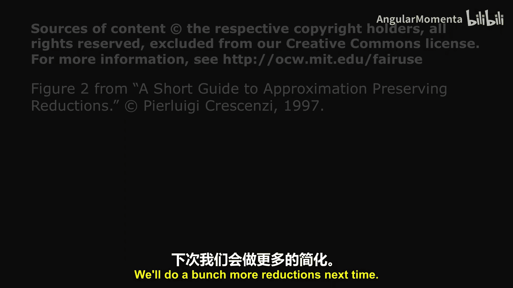

# 【麻省理工】算法下界 ｜ MIT 6.890 Algorithmic Lower Bounds, Fall 2014 p10 10. 不可逼近性概述 -BV1dPYpz9E4V_p10-

The following content is provided under a Cative Commons license。

 Your support will help Mi T OpenCourseware continue to offer high quality educational resources for free to make a donation or to view additional materials from hundreds of Mit courses。

 Visit Mitopcourseseware at Ocw。mt。 Eduu。

Alright， welcomee back。 today， we start a series of lectures on approximation algorithms。

 So something rather different， although we're still gonna be doing reductions。

 there're just going be stronger sense of reductions。 So let me start with reminding you。

 I assume you've seen approximation algorithms at some level before。

 But I want to define a few things。😊，Which will'll need for the。Lower bound side。

So pretty much throughout we've been in the context of NP。

 we've been thinking about decision problems because that's where NP makes sense。

 now we need to change the setup to where the output is not just yes or no。

 but it's some kind of solution with a cost。 So in general。

 the goal in an optimization problem is going to be to go from some instance。To a solution。With。Men。

Or max cost。So there's minimization problems， maximization problems。 And so you are given。

 in order to specify this， you're given a set of possible instances。

That's your usual notion of input。 And then， for each instance。We are given a set of solutions。

 usually these are called feasible solutions or valid solutions， I'll just call them solutions。

 Those are the allowable outputs to that problem。And then for each of those solutions。

 we're gonna define some cost。 I We'll assume that they are non negative。

So I don't have to worry about signs。And then， you're also given。It's usually called the objective。

Which is either min or max。Okay， so you're gonna be given an item from this set。

 You want to produce an item from this set that minimizes or maximizes this cost。

That's not going to be possible because all these problems are going to be MP complete。

 But the point of approximation is to relax， getting the best solution and aim to get an approximately best solution。

Which we will define。In a moment。But， let me start with。Some useful notation。

 which is opt of xx is an instance。This is going to be two things。No。

 definition should be unambiguous。 So it's going to be。The cast。They a min or a Mac solution。So。

 cost solution。 and it's also going to be such a solution itself sometimes。And yeah， cool。

So this is sort of the usual setup。 Now， let's make it a little bit more interesting by defining an NP optimization problem。

This is going to be the analog of NP。For optimization。 So one thing is that all solutions。

Have polynomial length。The polylymial in the length of the input， the instance。嗯。

Another thing is that。诶。Instances and solutions。Can be recognized。

So there's a polynomial time algorithm that tells you， yes， that's a solution， yes。

 that's an instance or no。And。Let's see the cost function。Should be proally computable。And。That's it。

Okay， so just making these actual actually reasonable from an algorithmic standpoint。

 And so now it's， you know， thinking like NP P， the solution is gonna be something like the certificate that you had a yes answer here。

 it's gonna be a certificate that the cost is a particular thing。

 So given an empty optimization problem， you can define a decision problem。Our decision version。啊。

NPO。 So NPO。Is going to be the class of all such problems and P optimization problems。Just like MP。

Was all the problem solvable and nonteristic poll in the meal time？These things， I claim。

 if we convert to。The decision version， which is for a min problem。 The question is， is。Opt of x。

The cost less than equal to some query value。 And for a max version。It is， is。Opttive x。

G or equal to query value。This thing is in NP。OkaySo let's see why if you have these properties。

 then the resulting decision problem will be an NP。

 because if I give you a solution and solutions have polynomial length， you can compute its cost。

 verify that it was a valid solution。 and then you know that opt opt is some min。

 So it's going to be less than equal to any particular solution。 So if I give you a solution。

 then I verify that opt of x is less than equal to  Q in polynomial time。For Max， it's the reverse。

And for example， if to check， if you wanted to know whether the min was greater than or equal to something。

Well， that's a Co NP P problem。 So that's this， these are the correct decision versions of those NP optimization problems in the sense that you get a problem in NP。

So this is a strict generalization， in some sense， of NP problems or specialization。

 I suppose this is a particular。Well， we have optimization。Versions which still give us NP problems。

 We can still talk about NP completeness of these problems， but we're interested。

 we're setting all this up so that we can actually talk about costs of not just the best solution。

 but costs of subopmal solutions。So let's get to approximation。So we're going to call an algorithm L。

 a C approximation， I write C， but it's not necessarily a constant。ItCould be a function of n。呃。

If in the min case。What we want is the cost of the algorithm。Applied to an input X divided by。

The cost of the optimal of x here， for whatever reason I write cost of optt instead of just opt。

That should be less than or equal to C。Okay， just we look at the ratio。

 we want that to be bounded by some value。 In the max case。

 there are two definitions that are standard in the literature。啊。That correspond to well。

 just different ways of looking at the same thing。1 would be。Cost of opt。Divided by。Cost of Al。

That should be at most C。 This would correspond to C being greater than or equal to 1。

And the alternative is to flip the inequality instead of the ratio。Okay， so first。

 let's thing think about min with a minimization problem。

 whatever the algorithm produces will be greater than or equal to opt。

 So this is a ratio that will give something greater than equal to 1。

 And so usually we think about two approximation，1。5 approximation，100 approximation。

 whatever just saying the algorithm is within a factor of 100 of the optimal for maximization。

 the thing that the algorithm produces will be less than or equal to opt。

 And so if you want something that is greater than1， you have to flip the ratio。 in this situation。

 C would be less than equal to 1。😊，So， some people call。

If you have an algorithm that produces a solution that is at least one half times optimal。

 you might call it a two approximation， or you might call it a one half approximation。

 depending on the paper。 I think this is by now more common。

 but it really depends on the era and the person and so on。 So good to be aware of both。

 measuring the same thing。 of course， just C is either bigger than one or less than one。 Yeah。

 that over all instances。 Oh， yeah， this should be for all X。For all valid instances， X。Good。So。嗯。

Usually。When we say a C approximation algorithm， usually we're interested in polynomial time。

 C approximation algorithm， almost all the time that is the case。

 I will probably forget to say polynomial time， but I always mean it unless I say otherwise。

 which will probably be never， but there are a few papers that look at exponential time。

 approximation algorithms that have better exponent than the exact counterparts and so on。

So this is interesting because while you're the straight up decision problem。

 which is basically deciding opt exactly， that might be NP P complete。

 the approximation version like finding a two approximate solution might be polynomial。

 and that would be。Observed by finding a polynomial to approximation。How good。Okay。

 sometimes you can do even better。Then， con well。So here we've been thinking about constant factors for C。

 Sometimes you can do even better than any constant factor or you can achieve any constant factor would be another way of saying it。

This is called a polynomial time approximation scheme， usually PTS。呃。

You can think of this as a one plus epsilon approximation for any epsilon， but the general。

 or you can think of it as an algorithm that given epsilon produces a one plus epsilon approximation algorithm。

 or you can think of it as an algorithm with an additional input， not just the instance。

But also a value epsilon。Say aration。Epsilon greater than zero。And then， the。呃。Say， it produces。

A solution。呃。That's。1 plus epsilon。Approximation。Okay， so this would be a sort of ideal situation。

 You get to specify what the error bound is， and the algorithm will find a suitable solution。

And the polynomial time part is that this algorithm must be polynomial time。4。Any。Fixed epsilon。Okay。

 which means that the dependence on epsilon could be horrible。

 You could have an algorithm if n is your input size。

 it runs in something like n to the 2 to the 2 to the one over epsilon or whatever that's。

Polynomial time for any fixed value of epsilon。 It's very rather large for any reasonable value of epsilon。

 like a half， but anyway， or even one still getting up there。But that's considered a P task。 Now。

 there are stronger notions of P tasks that have prevent this kind of thing。

 We will get to that when we get to fixed parameter tractability。 But for now。

 this will be considered。The gold standard， this is the best you could hope for at this level of detail and。

For， let me。Give you some more classes。 So we defined NPO。 There's the class P tests。 again。

 reuse of term。 But this is all problems。NPO problems。With。A PAS algorithm。Okay， and。More generally。

If we have some class of functions。u。Then I'm going to write FAPX to be all the NPO problems。With。

Polytime。F approximation algorithms。All right， F of n。To be clear what we're depending on。呃。For some。

Little F in the class Big F。So， for example， F of n could be3。

 That would be a constant factor approximation。 In that case， we just call it A X。

 A X is what you might otherwise call order 1， A X things you can approximate in some constant factor。

 any constant factor。 Another class that's commonly studied is log A X， This is。Log n。Apprximable。

Some constant factor。And there are more。 There's a poly A P X。

 where you just want n to some constant， usually less than one， but not always。

 but I think this will be enough。For us。 And so we're interested in distinguishing these classes。

 we're gonna do that by defining reductions， using reductions， defining hardness。

 and then getting the hardest problems in certains of these classes to show that's the best kind of proximity you can get。

Today， we'll be thinking in particular about the boundary between Pta and A X。 So Pta。

 we can get1 epsilon for any epsilon A X， you can get a constant factor。

 but there's some limit to how small that constant factor could be。 at least in the hardest case。

 A X includes Ptas， but there's problems in A X minus Pta。

 Those have a limit how far down you can get。Okay， we have Ps。Is a subset。Of。A PX， and furthermore。

 if P does not equal in P， it's a strict subset。Okay， and let's say。Log A X or whatever。

 You pick your favorite approximation factor。 And there are problems where you can achieve that and nothing better。

It's actually。An easy exercise to come up with such a thing this is if。P does not equal N p。

So you can take， I du't know。Hamiltonian cycle or something or pick your favorite MP hard problem and if the answer is yes to that problem。

 then you construct a solution with some cost and the answer is no， it's way。

 way smaller and so any approximation within your desired factor will be hard to。To find。

Let me get a little bit more specific。 And let's talk about some real problems。

 So in the world of graph algorithm appxiability， these are the typical kinds of approximation factors you see。

 Of course， it depends exactly what subdomain。 This is not a complete list。

 but it starts to give you a flavor。 And today we'll be thinking mostly at the top level， but。

Let me define some of these problems for you。 A lot of them we have seen or a few of them we have seen。

 such as。Siner tree， we talked about Richtilinear Steer tree。 That was a Euclidean problem。

 You were given points in the plane。 and you wanted to connect them up by the shortest connected network in a graph。

So that problem is has a PS， rectilinearstein tree because it's a euclideium problem。

 A lot of Euclidean problems have Ptas， and I'm denoting pS here by one plus epsilon。 in general。

 epsilon here means for all epsilon greater than zero。啊。Sino tree in a graph is， I give you a graph。

 and you have a bunch of special vertices， K special vertices。

 You want to find a connected subgraph of that graph that hits all of the special vertices。😊。

 that problem has a constant factor approximation， and there's no PS for a general graph。

Ser For is almost the same instead of giving vertices that all have to connect to each other。

 you say which pairs of vertices need to connect to each other。

 this guy and this guy and this guy and this guy， you can still。

 this is a generalization in the case where you want to connect them in a clique pattern that's Steer tree。

 but a Steiner For has the same approximation up to constant factors traveling salesman in a graph you've probably seen in 1。

5 approximation to that， definitely two approximation is really easy like MST and in a graph that's the best you can do in 2D or in a planar graph or in an H minor free graph there's a PT。

I think H minor free traveling salesman problem。Wighted was solved just a couple of years ago。

 but that has a PTTS。Let's see。 There usually most people like to think about minimization problems。

 but there are maximization problems， too。 Let's see what else haven I defined。

Do we talk about set cover？You have， I think we did briefly， you have sets and you have elements。

 you want to choose the fewest sets that hits all elements。

 Each set is contains some of the elements。 you can think of that as a bipartite graph。

 sets on one side elements on the other， you want to choose few vertices on the left that hit all the vertices on the right。

Dominating set is the。Non bipartite version of that problem。 You're just given a graph。

And if you choose a vertex， it covers that vertex and its neighboring vertices。

And your goal is to cover all vertices using the smallest dominating set by choosing the fewest vertices。

 So these problems turn out to be equivalent from an appability standpoint and in a stronger sense。

 they're both log n appxiable。 and that's the best you can do。

 this is assuming P does not equal in P。Not， some of these results assume slightly stronger things than P P versus NP。

 but we won't worry about that too much。Let's see another fun problem。

Just highlighting the ones you should know about chromatic number。

We've seen what we thought about three coloring， but the chromatic number problem is to minimize the number of colors k。

 such that your graph is k colorable， and that's really hard to approximate。

 The best approximation algorithm I think is n divided by log n or something roughly n。

 It's not so good。 And there's a lower bound that you can't do better than n to the1 minus epsilon for all epsilon。

 So you really that's pretty tight。 not completely tight， but pretty close。嗯。And。Let's see。

Other good problems。 So maybe out here， another really hard problem to approximate。

 These are problems you should try to avoid。 If you're trying to solve things approximately。

 or if you're proving hardness， you want to use these if you can。 If your problem looks like this。

 Inence set， just find me a set of vertices that induce no edges。 So no edges connecting them。

 That's really hard。 if you。Complement the graph everywhere。 There's an edge。

 deletelete it and everywhere there wasn't an edge at it。 That's the same problem as Cique。

 So these are the same from also from an approximation standpoint。Okay。

This is annoying because cliques are useful in practice。

There's another problem called dense subgraph， which is approximate clicks。

 That's actually easier to approximate。 Yeah， what's the hardness assumption for the chromatic number。

I think that's like P does not equal Z PP or NPP does not equal E PP， I think。Yeah， for that。

 that strong lower bound。 there are weaker lower bounds， assuming P is not equal in P。Yeah。啊。Okay。

 one other good one， fun one to think about is set set cover。

 You want to choose the fewest sets to hit all elements， maximum coverage。

You don't have to hit all the elements， but you want to hit as many elements as possible using K sets。

So in the decision problem， these are the same。In some sense， here， I give you K sets。 I wan to know。

 can I hit all the elements。For， for example， here， I'm giving K sets I want to know。

 can I hit at least J of the elements。So this， you think。

 is a generalization from a decision standpoint， but it's actually easier to approximate because the objective is different here we have to hit every element。

 No question it's asked here， it's okay if we miss some of the elements because we only need a constant factor approximation and we can get a constant factor here。

 whereas the best we can do is log n here。Cool。But， but unique coverage This is a result of ours。

 If you're trying to maximize coverage， but if you double cover an element。

 you no longer get points for it， that's， that requires log n approximation so。I think I will。

Leave it at that directed graphs are much harder， though it's not known exactly how hard。

 here's an example of a big gap in what we know between log squared and the epsilon。

Something we will get to in a later class is called label cover。

 I won't define find the problem here because it takes a while to define。

 but there there's very strong lower bounds on inapproxiability。

 it's similar to n to the1 minus epsilon， but it's not it's a little smaller so you see two to the log n would be n that would be great and so you'd really like2 to the log n to the1 minus epsilon。

 but what we have here is something a little smaller than log n。Log n to the1 minus epsilon power。

 and then you exponentiate that。So it's， this is somewhat smaller than what we'd actually like。

 which is something like n to the1 minus or n to some epsilon， I guess， would be ideal。

 This is smaller than any n to the epsilon。The best upper bounds。

 it depends on the problem and to some constant， like for label covers and to the one third for directed Steer forest。

 which is if pairs of vertices you want to connect， but with a directed path。

 so similar to a problem we've seen。Best approximation known for that is n to the4 fifths plus epsilon。

 And this is just a couple years ago。 So that seems very hard to do better than any constant。

 Probably there's an end to the epsilon lower bound， But this is the best we know so far。

 bit smaller。呃嗯。K。Any questions about that table。We will probably come back to it a few times。But。

In more depth。So how do you prove the lower bound side， We're going use reductions Now。

 this field is a little bit messier in terms of reductions for MP completeness and hardness。

 We just worried about carp style  one call reductions。

 That's all we had to think about In this universe， there are。呃。One， two， three， four， five， six。

 seven， eight， nine， at least nine definitions of reduction。You don't need to know them all。

 I will define。Through four of them， I think。They're all very similar。

 and they all lead to slightly different notions of hardness。

 So You have to be a little careful when you say， oh， this problem is something hard。

 but I'll give you some definitions that are pretty easy to work with， I think。In general。

This family is called approximation preserving reductions。So let's say we want to go。

From some problem A。To some problem B。Okay， so you're given。An instance of A。Let's call it X。

 And you want to produce an instance of B。Let's call it。X prime。

And we're going to do that by a function F。 So x prime is f of x。So so far， just like NP reductions。

 but now usually what we said is that the answer to x equals the answer to x prime。

 so you could say opt of x equals opt of x prime， but that's not going to be strong enough。

What we want。Is that if we can find a solution to this B problem。Let's call it。Why prime。

Its the problem X prime。So the x prime is an instance of B。 You can find some solution。

 any solution Y prime to X prime。 Then we want to be able to convert it back by function G。Into。

A solution to a。呃。Which we'll call Y。And says G。You might think it's G of y prime。

 but we'll make a G of x comma Y prime。 So it can also depend on what you started with。Okay。

 so this is the general flavor。 A reduction consists of two steps。 First。

 like before we convert instances of a to instances of B。 Now， in addition。

 we want to be able to recover solutions of B into similarly good solutions to A。

 And there's many ways to define similarly good。Let me give you。Let me give you one。

So if we're just interested in Ptass。Then like you want to know。

 does my problem have a PtaAS or I want to prove impossibility of Ptas。

 Then I think there's one clear notion reduction。Which is obviously enough called Pta reduction。

So what we want to say。Is。I I hope you've seen calculus at some point。

 And calculus's this notion of epsilon Delta proofs or definitions。 So I'm gonna say。

 you don't have to think of it this way， but I， I find it useful to think of it this way。

 Let me get to what the statement is。呃。Y prime。Is a one plus delta。Approxiation。To be。Then。呃。Wai。

His and。1 plus epsilon。Approxiation。To a。Okay， so ultimately， we're interested in Ptas。

And we want to say that if you have a P task for B， then you get a P task for A。

 It used to be when we did a reduction from A to B。

 that showed that if B had a polynomial time algorithm， then so did A。

 because you just plug in these chains together。 You convert a into the B instance。

 you run your poly algorithm get a solution and convert it back。Well with NP。

 we didn't have to convert the answer was the same。 Now we could do that。

 We want to do the same thing with Pta。 So if we have a P task for B， we can convert a into B。

 run the P task， get a solution and come back and get what we want is it to be a one plus epsilon approximation to a。

 So that's the goal one plus epsilon approximation。

 And what this is saying is there's some function delta of epsilon。 for any epsilon。

There's some value。Delta， where you can give， you just give that value to the P task for B。

And it will give you what you want for a。Okay， because。You know。

 PTAS is supposed to run for any fixed constant。We call it epsilon， but it could also be Delta。

And so you plug in this to the P。 You will get a one plus delta approximation to your B problem。

 And then what we want is that this conversion。 So y here is G of。X， Y prime。Okay， so we want G。

 This is a constraint on G。 We want G to have the property that if y prime is that good。

 then y will still be as good as we need。Okay， so maybe you just， you wan to get a。A 1。

1 approximation。 you want to get within 10% of the right answer。

 maybe you have to call B with a much smaller thing。 maybe maybe delta is 0。01。

 You need to be within 1% of the right answer， but there's for a PT reduction。

 you want there to be some appability you ask for so that you get what you actually want。Okay。

 this is sort of the obvious。 this is the natural thing。

 If you want to preserve P testness in this direction， the B to A。 So okay，1。

One slight note is that we also allow F and G。To depend on epsilon。So this reduction。

 it would be hard to get this property for all Epsilon with the same instance conversion。

 So now we allow the conversion of the instances to depend on epsilon So you can do fun things that way。

For the purposes of PA reductions， but the key thing we get is that if B is a PAS。Then。

Or has a P task。 Then A has a P task。 That's in the complexity class P task。 Of course。

 what we care about is the contrapositive of that。 So if a is not in P T。Then B is not。Ps。

So we can use this， we reduce from our hard problem that we know is not in P。

 assuming P is not equal in P， and we get that our new problem B is not in PS。That's the。The point。

This is also true for something like AX。So if you just want constant factor approximation。

 this will convert one constant factor into another constant factor。So。Yeah， if you have， I mean。

 its maybe stronger than what you need， though。We'll give you constant factor。Appximations as well。

Yeah的。Okay。To do。So here's some easy more definitions。Oh， okay， so so a few more fun facts。

 If this statement also holds true for epsilon equals 0。 And when you plug in epsilon equals 0。

 Dlta equals 0， then you are just getting the regular notion of reduction from NP P land。

 This is saying the ops are equal。So usually your solution also works in that setting。

 that's usually the easy thing to do。 So this is a strictly stronger notion of NPP reduction if you allow the zero0 case。

Also， reduction chain。 So if A reduces to B and B reduces the C， then A reduces the C。 Okay。

 the usual things you expect。Some special cases of interest。Our AP reduction。

This is when the deelta function is linear and epsilon。And。So this is nice because it tells you。

 for example， if B is in。呃。Has some order F approximation。Then a does， as well。

It just changes this constant factor。Okay， so this is useful if you care about。

 if you care about like log and approximation， if you use this definition。Things could change， right。

 because you're allowed to change what the con what the factor is at here in crazy ways。So。Over here。

 we force just a linear blow up in the approximation factor。 then we only lose constant factors。Inro。

 And one more is。Strict reduction。This is when。There's no blow up。If you have。C approximation here。

 You get to C approximation there。Okay， that， that's nice when you can get it。

 We're not gonna aim for this in particular， but there are a bunch of reductions we'll talk about today that are strict。

 So it's nice to just have a word to say， oh， this is even strict。

 So you don't even need any blow up like this stuff。😊，Okay， so that was。Strict AP。And PTs。Reductions。

诶。There's one more。But maybe first， let me define hardness。啊。So today we will focus on A X hardness。

And。These are supposed to be the hardest problems in AX。And so， I mean。

 because we're trying to distinguish between Ptaable problems and just constant factor proximal problems。

 we are interested in P task reductions。So it's going to turn out that AX hard。

 Well I guess we sort of already know this implies you're not in PTS。If p equals NP。

 P does not equal NP。Because of this。Strict containment P is not equal in P then Ptas is different from A P X。

 And so if you show that your are hardest problem in A P X using a reduction that preserves Pta ability。

Then， you know， I mean， the the idea is that。When we're doing these reductions。

We know that B had a P test， then A had a P test。 And what we're saying is you can， if you。

 your A X hard means you can reduce from any problem in A X to your problem。

So if your problem had a PtaA， that would mean all problems have Pta。 All A X problems have Ptas。

 but we know that's not the case。 Therefore， your problem does not have a PT。Okay。

 so it's just like MP completeness， just with different letters。呃。Cool， and different reductions。嗯。

These reductions are all a little bit awkward to work with directly。For。

 or these definitions are a little awkward to。To check directly， although ultimately。

 it's the same thing。 In practice， people seem to use a different notion of reduction。

For the most part， called L reductions。That's stronger。Then it's stronger than AP reduction。

 not as strong as strict。I guess it's not directly。Related either way to strict。It's okay。

So while I define this in terms of P task reduction，cause that's what you need to get this result。

 most people think about L reduction， which is going to imply。Okay。

 it's going to be stronger than the other two notions of reduction， A P and P tests。

So what's the definition， we want to satisfy two properties。First property。呃。Is a kind of blow up。

Going left to right。So funnynily enough， the other reductions do not have this property because they don't quite need it in the way they're going。

 But we want that the transform problem。 Its optimal solution is not much bigger。

 It's bigger by only a constant factor。 This is like less than equal to alpha times the optimal。

 the original optimal solution given。Givenive instance。So a。Okay， second property。

And we'll see why we need this in a moment。Is if you look at the absolute error instead of the ratio。

Between your the computed solution， why。Why was the thing that we got in the lower left corner。

 We produced solution Y， we look at the cost that we get out of。You know， why is a solution？

 So we look at the cost of that solution， We compare it to the optimal solution to our original instance。

'cause it is a solution to that instance that should not be much bigger than the error on the right side。

Again， absolute error。So we want this to be Big O。Of。Cost in B's problem of y prime minus。Us B。

Of x prime。So these are both in B land。 again， we look at the optimal solution to the produced instance。

Versus some solution that we were given。 We didn't produce that solution。 So this has to hold。

 no matter what solution Y prime you're given to the instance x prime。

 when you convert it using G to a solution to X and problem A， you want that the gap。

Absolute gap is not stretched by more than a constant factor。again。

 this is at most some constant times that thing。Okay， now it should not be obvious that this implies。

This。But， it does。With deelta equal to， I think。Some color。Let's say the constant in here is alpha。

 the constant in here is beta。Then this should be alpha times beta times epsilon。

That is Delta of Epsilon。That's the claim。Let's prove the claim。Ideally。Without。Cing， so。

I claim that if I have such an L reduction。That。This holds where when Delta is that linear function of epsilon。

So I want to conclude that y is a pretty good approximation。 So to do that。

 I will look at the cost of y divided by optt。Opt of x。ItBe the original input。

 So we want to show that this is at most one plus epsilon。Now， what do we know， I should write A。

 I guess this is all about problem A。What do we know， we know this property。

 I wrote absolute value here。 So this works for maximization and minimization。

 You can even convert minimization to maximization problems using this definition。

 We will do that at some point。啊。Okay， so let's just try to plug this into here。

So I think I need to split into cases and I'll just worry about the minimization case。

 so let's say that cost of a is bigger than opt， so then cost of a is going to be opt plus this thing。

At most。So this is going to be。嗯。At most。呃。Ot。Of x。Plus。Beta。

 I'm gonna not use the big O notation just right there。The beta thing， beta times。

I guess there's no absolute value needed 'cause this is a minimization problem， let's say。

So this will be cost。So B of y prime。Minus。Os of B。Of x prime。

So that's what I get from expanding out the numerator。And denominator is the same。Co。

Just rearranging terms here， essentially。Okay， now these two terms cancel。 so we get。1 plus。That。

That's good。 Ca I want that to be epsilon。Let's see， what else do we know， one plus this thing。啊。

Scroll down。Okay， we have one other property。 We ought to use it。

 The other property is that opt sub B is related to Ops sub A。Now we have Ops sub A here。

But it's in the denominator， which flips the relation。

 so we can write that relation up there as ops sub a of x is omega of ops sub B of x prime。

 That's the same as statement 1。 And because the denominator is omega。

 that means the whole thing is big O。So this is going to be at most。呃。1， plus。

So now we have this thing。 So the numerator is the same we had before beta times cost So B a y prime minus。

Opts B of x prime， so that's unchanged。But now， instead of dividing by Ops sub A。

 we're going divide by Ops sub B。X prime。And we lost a constant factor。

 that constant factor turns out to be alpha and the numerator because we inverted the equation。

 we divided by the constant factor there。Okay， so what well， now this cancels with that。

I said this is gonna be one plus。Alpha beta。Times。呃。Cost of B。Why prime。Over Op be。

Of x prime -1 still looks kind of weird。But what we， there's one more thing we didn't use。

 which is we assumed the， the we were given some solution Y prime。

 that was a one plus delta of epsilon approximation where Delta is this thing that we define there。

 It's obviously set to cancel out everything that happened here。 So this thing。Should be， at most。

1 plus delta。Because this is exactly the approximation ratio for y prime versus the optimal solution to x prime。

And one plus delta。Is。1 plus alpha beta epsilon。So this one cancels with that one， these alpha betas。

Oops。Which is backwards。 The definition of Delta。Okay， oops。Let's try。Epsilon over alpha beta。

That makes sense because Delta should be smaller than epsilon， probably。

And alpha beta are probably bigger than one。So， now we get。Epsilon over alphapha beta here。

And then that alpha beta cancels with that alpha beta。 and we are left with one plus epsilon。Okay。So。

This is why it's not obvious， but it's just， you know， plugging in all the things。 And it works。

 And the funny thing is， somehow L reductions， though， they a little bit less natural， I。

 I feel like。 I mean， if you're thinking about constant factor approximation。

 why should you care about absolute error the short answer that I've seen written in various papers isca it's easier to think that way for a lot of the。

😊，Typical reductions that you do。So let us do some of those reductions。And we'll get some intuition。

Okay， L reductions also， they do work in the zero case。 right。

 If you have an optimal solution to x prime， you will get an optimal solution to X。

 So they are also NP P reductions。 Again， it's a generalization of or strengthening of the type of reduction we saw in all previous lectures。

All right。So I want to simultaneously tell you a bunch of problems that are A X complete so that。

 you know things to reduce from， but also show you examples of such things。

 So some of these are will limit the proofs because they're messy and it's just useful to know that they're there。

 So you can reduce from them。 Other。 I， most of them， I will cover the proofs。Alright。

 and we're going to return to an old issue。From。Yes。The first sat lecture。

I gonna introduce some some new notation。 So a lot of the starting points here are just max S。

 So or let's say max CNF set， you're given a CNF formula。 It's got a bunch of clauses。

 You want to maximize the number of clauses that you satisfy with some variable assignment。

 So that's gonna be A X complete， there are constant factor approximations。

 if the clauses are constant size I should say so like max 3at has a constant factor approximation。

 I forget what the current pest is and no better。 there's no P task for max 3at。😊，Okay。

 this is a stronger form of max 3 set。Which we have not seen before， though we've。Hinted around it。

 The E means every clause has exactly three distinct literals。Okay。

 this is an issue that we stumbled into。 Oh， do we allow clauses to have only two literals。

 I said no in the original definition， but I did allow repeated literals， which is the same thing。

 So when I say threeatAT， I mean， you can repeat literals or you can have fewer than three literals。

 when I say E3 set， then you're not allowed to do that。

Then you may remember we talked about three S5。 that meant every clause has only three literals and every variable appears at most five times。

E5 means。Exactly， five times。Each。Variable。Appears。Exactly。fiive times。Do you have a question。

It gives you a conditional。Number of clauses。 Oh you right。

 that that gives you a linear relation between the number of clauses。

 numberumb of variables can work it out。 This is hard。 I will not prove it。 It's， it's not hard。

 but it's just a little bit messy。Sorry， it's not difficult。I will prove a slightly different result。

 which this one is based on。Which is a little bit more familiar。

 but also introduces something new we hadn't seen before。 This is regular three S。

 Each clause has it most three literals。And every variable appears at most three times。

 This is something I didn't realize was hard。 It's not written in most places。

 but it is here in the world of inappxiability。 This is the reduction。It's。Kind of funny。

 So suppose you have a variable X， which appears a million times。 You're gonna make a。Cycle。

 so to speak it's a formula。 it's not really a cycle， but of size a million。

And you're going to write down this two sat constraint。

 not X or Xi plus1 for all I and do it around them in cycle， so not x6 or x1。Or x million or x1。

That's， of course， equivalent to saying if X， I is set to true。

 then X I plus one must also be set to true。 So if any of these are set to true， they all are。

 So the only satisfying assignments here are everybody true。Everybody， not true。

So if you're just worried about NP reductions， this is a reduction from three sat to 3 sat dash 3 because every variable now will appear in exactly3。

Exactly three in fact， so constraints， this one， this one， and whatever it originally。

 whatever you want to plug it into。So each of these was an occurrence of that variable。

Maybe use the positive form， maybe use the negative form。

 But each variable appears three times in this picture。 Now， that's a great reduction。For 3 set，3。

 notice， I didn't write max'cause this reduction will not work。As a L reduction， say。

You cannot prove that max 3 set is hard using this reduction because。You could， for example。

 just violate these two constraints and make all of these guys true and all of these guys false。

 And if this is size a million， that means you're setting， you， I mean。

 you're setting the variable half true， half false or you could choose any ratio you want。

At a very small cost， you're only paying a penalty of two constraints violated。And yet。

 you're able to satisfy one half of the clauses using X I equal to true and some other set of clauses using X I set to false。

 And there's no way to bound how many clauses you can sort of misrepresent。

 And the objective in max 3 S is to maximize the number of clauses satisfied。

 So if you allow this kind of thing where you can flip in crazy ways and change a huge number of clauses one way or the other in this sort of false way。

 How if you're trying to actually construct a solution to max 3 SAT from a solution to this three S3 instance。

😊，You wouldn't know which way to set the variable X to。 If you set it to true。

 it's a whole bunch of clauses that wanted it to be false。 If you set it to false。

 a whole bunch you wanted it to be true。 Yeah， if we're just talking about empty hardness your can make those edges very happy by repeating the clauses many times。

If we're just worried about MP hardness， this is fine。cause then all of these have to be true。

 I mean， the Well， you， then the decision problem is， can you satisfy all of them。

 That is a special case of the max。 K。 Yeah， But if you set K equal to n。

 that's a special case of the general form。So。Yeah， if you， if you didn't。

 if you wanted to make KN n different， you could just add a bunch of things that are unsatisfiable or lots of ways to change how many there are。

 yeah。嗯。Okay。Nonetheless， we can prove max 3 set 3 is hard with an L reduction。From three set。

 So I'm not going to prove that three set is A X hard。 We might do that in the future lecture。

 but just take that as given。 What I want to show you is how to convert max 3at into max 3 set 3。

Not like this， but using a different trick。So。So， we reducing。From。呃。Max3 set。

So we're given a formula。 We're given some variables。 Let's say， let's look at variable X。

And let's say it appears k times。What we're going to do。Just like before。

 we're going to make k new variables we're going to make k variables x1 through xk that replace x。

 and we're going to use those instead of x， and I want to force all the values of x to be the same。

 but I want to force it even when you're allowed to cheat and set some of the things incorrectly。

And we're going to do this using a powerful tool just good to know about called expander graphs。

So there's two things to tell you， one is what is an expander graph。

 and the other thing is once I have an expander graph， what do I do。

 let me start with the latter because it's a little simpler。

If I guess a lot of you have heard about expander graphs。

 and the short answer is they're complicated and confusing， but really cool and powerful。

 We're not gonna try to prove that the expanders exist here。 I'm just gonna tell you they exist。

 And that's actually pretty simple what they， what properties they have。😊，So what I want to do。

Whenever I have an edge in this graph， this is a graph whose vertices are the X x1 through x K。

I'm going to convert an edge into a constraint which is effectively X equals Xj。Which， in reality。

 is not X I or X J。And not Xj or Xi。Okay， so I really probably shouldn't think of it as X I equals X J。

 That's what I want to do。 I want to force lots of things to be equal。 But really， we have to。

 in the end， think about it in terms of constraints because some of them might be violated。Okay。

 but so what is an expander graph。 There are different types， but what we will use is。Two properties。

So this is for k nodes。We have founded degree。And we have。For every cut。A B。

 I think we've talked about cuts in this context in the context of max cut。

 So the idea is that A and B are disjoint and their union is the set of all vertices。Okay。

 so A is one side of the cut。 B is the other side of the cut。We want the number of cross edges。

 the number of edges between A and B。Is big。It's at least the min of A and B。Okay， some intuition。

Imagine a cleeique。 A cleeek is not bounded degree， but it has this property。 If you have。

 if you look at any cut， there's a lot of edges between them。 Okay。

 it's actually more like the product。 But in particular， it's at least the mint。

 So you can think of the expander as a sparse cleeique。 It's cl， cleay enough。In， in this sense。

 which we'll see why this is the property we want。 But it has bound a degree， therefore。

 a linear number of edges。 So it's very sparse。In the construction we are applying。

 which is due to Labuttski， Phillips and Sarak。The degree is 14， but doesn't matter constant。

It's actually 14 regular。Nice。So we， we take this graph， which was known to be out there。

 basically random graph size property， but won't worry about how to construct it too much。

 although you do have to。But there's tons of papers on how to construct them。

 And then for every edge， we convert it into these two constraints。

So let's prove that this is an L reduction。Okay。😔，Fm。Or reduction。So。

Maybe I don't have anything to point at，'cause I can't point at an expander graph。

 but let me draw the graph。So I can point at something。

 let's draw the cl just a little easier to think about。This is an expander， K4 and。

Let's say in your solution， some of these end up getting assigned true value。 Let's represent by red。

 some of them not。Maybe three of them are true。 One of them is false or whatever。 in general。

 I'm going to choose。 So， I mean， we're given some solution， right。

 This is the solution Y prime to the constructed instance X prime X prime has this expander。

 So we look at a solution。 Y prime to X prime。 We have no control over what it is。It， it。

 if you look at a variable， some fraction are set to true。 some of them are set to false。

 we're gonna choose the majority。Okay， so here it's majority red。

 So we're going to change this guy to be red。Now， does that hurt us？Well。

 we can think of there as being a cut of the red nodes versus the not red nodes， the black nodes。

Okay。S。And I claim。The number of edges here。Is big。 It's at least the minimum of A And B。 Now。

 what we were doing is taking the minimum of A And B and recoling that side to be the other side。

When we do that。We have these constraints， which are supposed to be equality constraints。

 These things are supposed to be equal， but they weren't before， before I recoled this。

 these were at least one constraint here was violated because this one of them was red。

 One of them was black。When I fill this in， I improve my solution because by at least the size of the cut。

啊。Each of these guys now become satisfied。 It wasn't before。 So I improved my solution by this much。

I also worsen my solution potentially because that node appears in one clause。And so。

 it gets worse by。Wan。So suppose there are B nodes on the smaller side。 and we re recol B nodes。

 So we got an improvement by P。And also， we worsen things by up to P because these P guys appear in P different clauses。

 Each one potentially we mess up is no longer satisfied。But for everyone that we mess up。

 so these guys appear in some actual clauses。Each one we mess up。

 we also make at least one thing happy。Because we fix the cut。Okay， so if we have any solution。

 we can convert it into one where variables is all true or all false and not lose anything。Therefore。

 there exists in optimal solution。To exist in optimal solution。 And you do this variable by variable。

 where variables。R。All true or all false。Okay。呃。Now。

We do change the value of optt here because we added a ton of constraints。And we just said， well。

 in the optimal solution or A an optimal solution， In fact。

 all of these constraints will be satisfied， which means optt has increased。 So the opt for x prime。

 this thing is going to be larger than the opt for x。Opt of x prime is going to equal optt of x。Plus。

Order。The total number of occurrences。Of all variables。Okay。

 which is at most three times the number of clauses。So we w to know。

 does it satisfy this definition of L reduction， We need to know that the opt does not explode by more than a constant factor。

And yet we added this big term。But the good news is。In three S。

 you can always satisfy a constant fraction of the clauses。 So opt is always at least。

I think I have written here， like half of them。I think you just randomly assign the variables and some constant fraction will be satisfied。

In expectation。 So there's definitely a solution where opt。

 So opt X is definitely at least some constant times a number of clauses。

 And so this adding some constant times number of clauses doesn't change the overall cost by more than a constant factor。

 So property 1 holds property 2 holds， in fact。With， with beta equal 1， you're not。

You're not making your solution in you see， we have this additive thing because we add these gadgets and stuff。

Multipicly， it's confusing。And that's what we were worrying about here。 But additively。

 it's very clean。 We always add the exact same amount to your solution。

So if you have a solution y prime， you convert it back to a solution Y， the gap。

 the additive gap between the cost of y versus opt of x will be equal to the additive gap between the cost of y prime versus opt of x prime。

Question。So here， how many times are you using？We are using each variable 29 times， yeah。

We're using it。Why 29， because。Right， we have degree 14。 but then for every edge。

 we actually have two constraints。 The implication in both ways。

 So that's 28 plus the ver each of those nodes actually appears in one。Actual clause。 Okay。

 so this proves that Max 3 S 29 is hard。 Yep， good question。 Why did I claim max 3 S 3。

 Because we can use this reduction now。So there was another reason I showed you this。

 I haven't seen this explicitly said in the literature， but it's it's all the pieces are out there。

So once you've show shown Max 3 S， some constant is hard。

Then you can do an L reduction from that problem to max 3 S 3 just like this。 So first。

 we do the expander， and then still these nodes have to high degree degree 29。

 Now we're going to expand those into little cycles。Of constraints。Okay， now this is actually okay。

When the cycle has constant length， Because， you know， maybe suppose some of these are set to true。

 Some of them are set to false。 Then just set them all to false。 Don't even take majority。

 Se them all to false。 How much does that hurt you。 Well。

 you know that each of these variables appeared in a constant number of clauses。So。

So it only hurts you by a constant amount。 Every time you flip a variable from true to false。

 you only lose an additive constant in your in your solution。

So when we're converting from a solution Y prime， which does weird things on a cycle， potentially。

 we convert it to y and set them all to false。 we， I mean， we know。So there's two cases。

 One is all of these constraints are satisfied。 Then you should choose exactly what's written。

 and then they will all be true or all be false。 But if at least one of them is violated。

 you can charge to that violation。And set them all the false。 when you do that， I don't know。

 you know， most 1000 violations happen。 some constant。 Its like  three times 20， whatever。

 some constant。And then you know that you can charge that cost to the violation that you were given in y prime。

 And so you can get that L reduction property too and say， oh good。

 my the additive gap in my produced solution where I just set all those to false is at most10 times the original additive gap。

 And so that's an L reduction from max 3 set constant to max 3 set 3。Questions。

So how do you know there's a constant number violation？

Because now we are given an instance of three set constant。

 meaning each variable appears in a constant number of clauses。

So we were given a situation right sorry， also， when we do this， each， we set it up。

 So each of these variables appears in one。Original class。Yeah。

 and we know the total size of the cycle is constant。 So each of these。

 every time we turn one of these to false， we lose one point and there's only a constant number of these。

 So it's actually， the constant is only 27。Or 29， sorry， 29。Okay。

 it's a little weird to get used to L reductions。 I'm still getting used to them。 But as you can see。

 it's pretty powerful。 You， you can do a lot。 And it's just okay。 you definitely have to be careful。

 In general， you want things to have bounded degree。 That makes things really helpful。

 That's why I'm telling you about these two problems。😊，Okay。What next， Let's just continue。

 Let me at least mention， in case they run out of time， max， not all equal3 set， also hard。Positive。

1 in three set， even one in E3 set， Also A X hard， A X complete。

So those are good friends from Threeatland carry over here。But let's prove some。

 and I will eventually prove those。Let's prove some other fun problems。Next one is In set。

Now I have to be a little bit careful here。Independence set is really， really， really hard。

But an interesting special case is bounded degree independent set。

So that's what I'll talk about next。I think I'm gonna prove max degree 4 independent set。

 although it's known that max degree 3。诶。Its hard。Also。

So constant degree independent set is actually AX complete。

So there is a constant factor approximation。啊。Which is take any maximal independent set。

 Just keep adding vertices until you can't anymore。 That will be within a factor of this of optimal。

You can show。That's pretty clear。So that puts it in A P X。 And furthermore。

 we claim that's tight you。 So there's a constant factor， and there's also a constant factor in app。

 some constant you cannot go below。And the proof is this。

 although it's a little bit and so it's a reduction from。Let's say the one we just did max 3 S3。

And it's gonna be a strict reduction。 We're not gonna lose anything，If I did things right。 now。

 in fact， so I drew here six occurrences of X I， but there's really only three of them。

 But the idea is complete bipartite graph between the positive instances of X I and the negative instances。

 And then these are going to be plugged in directly to the clause gadgets。

 These are the same variable。Okay， and so the idea is each of these is plugged into only one clause。

 So I need to make copies。 I do this complete bipartite graph between them。

 And now we're trying to do max independent set。Which means whatever we， whatever solution we find。

 it will be an independent set。That's cool。 There's no slack in independence here。

 It's just about how many we choose。 Independence said is you want to choose a set of variables that have no edges between them。

 Sorry， a set of vertices that have no edges between them。

So that means that if I choose any one of the blue nodes here。

 I can't choose any of the red nodes in vice versa。

 So I may not be able to choose all of the blue or all of the red。 but that's how it goes。 Now。

 if we look at a clause， there's in this case， we have to actually handle the case of clauses of size 2。

And clauses of size3。If you have a clause of size 3， you'd just build a triangle on them。

And the idea is only one of those can be chosen。But it could be0。

 get chosen because you might be screwed。 Maybe you choose you chose a red X I。

 then you won't be able to choose this blue X I。 Maybe you chose a red Xj。

 maybe you chose a blue X K。 In that case， you won't be able to choose any of these vertices。

 But if at least one of these is set is true。If you chose。

 if you're either choosing the blue X I's or the blue X Js or the red Xks， then in fact。

 you get one point for each clause。And in general， the number of points you get。

 the number of things you'll be able to put into your independent set is exactly the number of clauses you'll be able to satisfy。

Okay， and。But just by looking at whether any of the blue X's are true， then you set Xi to true。

 looking at whether any of the red X's set are chosen in the independent set。

 then you set X to false that will recover the assignment and have exactly the same cost as the independent set size。

The number of clause you satisfy will be exactly the number of independent set size。Okay。

 so and similarly for clause of size2。So that's cool。

 Independence set is really easy to reduce from max 3 S3。In fact。

 it would work for max3 set constant， but if you do max at 3 set 3， there's only three of these guys。

 then I think the biggest degree you get is four， this guy maybe is attached to two things and then also to two things over here。

So。Great。Next。Problem is vertex cover。So this is a funny one。So that's your constant degree。

Vertex cover， in general， there's a two approximation for vertex cover。

We don't need the constant degree to be an APX， but。Its also A P X complete。

 and it's kind of identical to independent set。In a funny way， which is for any graph。啊。

If you look at a vertex cover， its complement is an independent set。

If you look at any independent set， it's complement as a vertex color。Sorry。

 any maximal independent status complement is a vertex cover。

So they're kind of dual in that if you look at the size of a vertex cover plus size of a maxal independent set。

It will always equal the number of vertices。So maximizing this is the same as minimizing this。

But approximating this is not necessarily the same as approximating this， right。

 One's a maximization problem， one's a minimization problem。But it's still an L reduction。

For bounded degree graphs， because， you know， if you have degree at most Delta。

 there's always an independent size of at least an over Delta。

And there's always a vertex cover of size N。 So they're within constant factors of each other。

In fact， these are both。Always theta the number of vertices。Okay， so so the reduction is。

 you give me an instance of independent set。I give you that exact same instance to vertex cover。

 And then so F is trivial。 G takes the complement wherever you had a vertex in the vertex cover。

 you don't put it in the independent set and vice versa。Okay。

 and then you just have to check that this is an L reduction。

 So the first thing is the ops are within a constant factor of each other。

 That's true because they're both within a constant factor of the number of vertices。

 And then you prove that the additive gap。Its fixed。 And this is the same thing。 If you。

 if you decrement this accidentally， then you increment this accidentally。 There are one for one。

So this is kind of cool。 it feels a little scary， but we can convert a maximization problem into a minimization problem with L reductions。

 This would be very hard to even。😊，Think about in the the other reduction types。

Which is one of the reasons L reductions are so successful， I think。呃。That was vertex cover。

We can do one more。呃。Okay， really easy。Doinating set。Remember。

 a dominating set with vertex cover when you put a vertex in your cover。

 you cover all the edges instant to it and you want to cover all the edges。

 dominating set when you put a vertex in you cover all the neighboring vertices and you want to cover all vertices。

 So I'm going to reduce from vertex cover。If you have an edge。

 what you do is convert it into a path of length 2， plus that edge。

So then you know that if this was in the dominating set。

 you can just move it over to say being V or W。 it will cover all the things it could cover before and maybe even more。

 So that so then in the optimal solution over here， you'd never need to choose one of these vertices。

 which means we can assume they're on the original vertices。

 which means you are just solving vertex cover because covering that is the same as covering that edge。

Good。I think that's good for now。 We'll do a bunch more reductions， next time。

