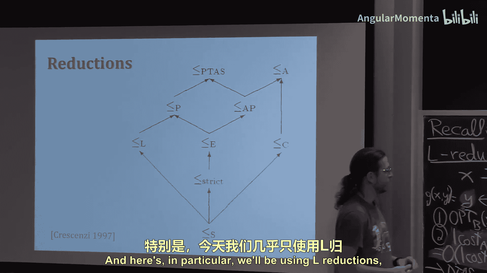
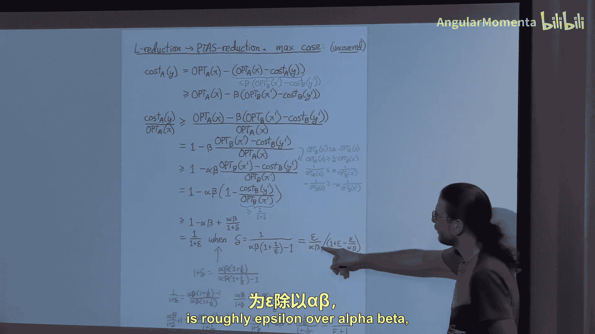
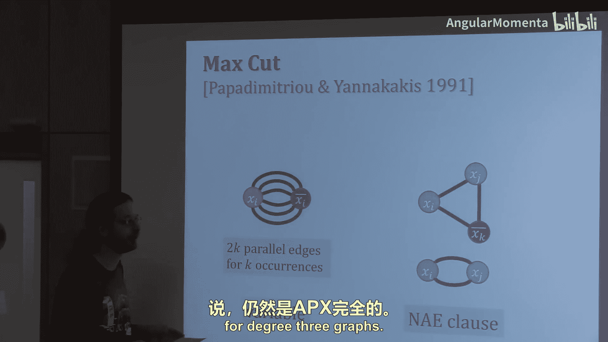
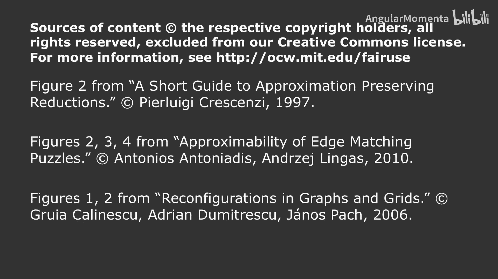

# 【麻省理工】算法下界 ｜ MIT 6.890 Algorithmic Lower Bounds, Fall 2014 p11 11. 不可近似性示例 -BV1dPYpz9E4V_p11-

The following content is provided under a Cative Commons license。

 Your support will help Mi T OpenCourseware continue to offer high quality educational resources for free to make a donation or to view additional materials from hundreds of Mit courses。

 Visit Mitopcourseseware at Ocw。mt。 Eduu。

All right， today we continue our theme of approximation lower bounds in app。

 quick recap of last time we talked about lots of different reductions we I guess in particular talked about PTA。

 AP and L and here's in particular we'll be using L reductions almost exclusively today。

 except the occasional strict reduction which is even stronger in a sense。

So what's an L reduction， We're trying to go from one problem A to another problem B。

 We're given an instance X of a， we convert it via a function F to an instance x prime of B。

 then we imagine that somehow we obtain a solution。 We don' know anything about it。

 Y prime to x prime That's in B space。 and then we're in the reduction we're supposed to be able to map any such solution y prime to x prime via G into a solution Y of X in a problem。

 So that's given by the function G， such that two things hold the first one is that for F the optimal solution of x prime should be at most some constant times the optimal solution to X。

 so we don't blow up opt too much， and secondly， the absolute difference between the cost of y versus the optimal solution for X should be within a constant factor of。

This kind of gap， additive gap between the cost of y prime versus the optimal solution to x prime。

 meaning that if we were given a y prime that's very close to optimal for x prime。

 then the y we produce is very close to optimal for x so and we want that in an additive sense。

 additive sense that will imply the things are good in a multiplicative sense last time we prove that for the min case。

 for minimization problems。 if you're curious， I worked out the details for maximization problems。

 it's a little bit uglier in terms of the arithmetic。

 but you again get that if you had a constant factor approximation over here。

 you preserve a constant factor approximation over here and you only you lose a reasonable factor that it turns out from。

We also have that if you can get a Pta over here so you can get an arbitrarily good approximation。

 you also get a Pta over here。 that was the Pta reduction and it turns out the constant in the end is roughly epsilon over alpha beta where alpha was this constant and beta was this constant that's what we had before it's a little bit different for small epsilon it's about the same but for large epsilon it does make a difference and this is why in case you were confused and L reduction does not imply in the maximization case and APp reduction because you have this nonlinear term here everything was linear and epsilon with maximization with minimization that's true L implies AP but for maximization it's not quite true。

 It's close。

So there's some funny。What I said didn't quite match this picture， that's an explanation。

And then we did a few reductions。 I claimed that Max E threat E3 S E5。

 this was exactly three distinct literals per clause。

 exactly five occurrences of each variable in in five different clauses。I claim that was AX complete。

 We didn't prove it。 What we did prove is that assuming max 3at is Apx complete。

 we reduced that to max 3 S 3， which was at most three occurrences。

 each thing first by using the expander and then splitting the constant size constant occurrence variables in with the cycle of implications trick。

 and then we reduced from that to bounded degree， I think we did like max degree4。

 but all of these can be done in max degree3， In set， vertex cover and dominating set。

Vertex cover we've seen a lot。 You want to cover all the edges by choosing vertices dominating set。

 you want to cover all the vertices by choosing vertices。 Each vertex covers his neighbor set。

 an independent set this was。For general graphs， this is super hard， but for bounded degree graphs。

 there is a constant factor approximation。 This was choosing vertices that induce no edges。

So with that in mind， let's do some more AX reductions， AX hardness using L reductions。

So the next problem we're gonna do。Is。Max3 set or sorry， max2 set。

So because we're in the world of optimization， in some sense。

 the distinction between two set and  three set is not so。Important。

 it turns out Max 2 set will be A P X complete just like max 3 S was。 So when we didn't have max。

 of course， the complexities were quite different。 Three set was hard。

 Two set was easy with maximization， they're gonna be equivalent in this perspective。So。

 I'm going to do。An L reduction。From Independ set。あ。Let's say degree3。

This would work with any constant degree， but we'll get a different number of occurrences and the reduction is the following。

There are two types of gadgets for every vertex， so I'm given an independent set instance for every vertex V。

 we're going to convert that into a clause， namely V。I want I want V to be true， if possible。 Okay。

 this is， it's a funny way of thinking when you're maximizing a number of clauses 'ca a lot of the clauses won't be satisfied。

 But you're gonna try to put V in the independent set if you can。

 That's what the meaning of that clause。Then， for every edge。Let's say， connecting V to W。

We're gonna convert that into a clause， which is not V。Or notW。

We don't want them both to be in the independent set。 That's the meaning of。Yeah。

 I'm trying to simulate independent sets。 So I don't want these both to be in。

 This is a two sack clause。 So what's the claim here。

 Suppose you have a sum assignment to the variable。 So there's one variable per vertex over here。

 The idea is that variable should indicate whether the。The vertex is in the independent set。

And the claim is that we will never violate an edge constraint。Or it's never useful to violate。

Claim is that there exists an opt optimal solution， satisfying。Oh。Of these edge constraints。

Because so we're doing max  two sets。 So we get a point for every one of these things that we satisfy and。

So in particular， if you didn't get this point， not the。Or not W。

 The converse of this is that they are both in。Then the idea is that you instead take one of those ver one of those vertices out of the independent set。

And that will be better for you。In general， when you put a variable in an independent set。

 it only helps you for one clause。 There's only one occurrence of positive V in all of these things。

 You might have many edges coming into a vertex， and they they all prefer the case that V is false。

So things are going to be easier if you set V to false。 So if you discover a clause like this。

 which is currently false， meaning both V and W are true。

 you're going to gain a point by setting V to false。 You'll also lose a point。

 but you'll only lose one point。 potentially you gain many points。

 but you gain at least one point and lose at most one point by switching from both V and W true into just one of them true。

So it's you can always convert without losing anything in opt into a solution that satisfies all edge constraints。

And then we know we have an independent set。That's what the edge constraints say。And therefore。

 we're just trying to maximize the remaining problem is to maximize the number of vertices that are in the independent set。

So。So that means if we're given any solution Y prime to this max 2 set instance。

 we can convert it back into an independent set。 Now it's not quite of the same value。 in general。

 the optimal solution here for the two set instance。

Is going to be the optimal solution for the independent set instance plus the total number of edges。

Because we're going to satisfy all of these， that's what we just should。嗯。

This is where we get a kind of additive behavior， like in this L reduction。

 the gap is an additive thing。 But here it's a nice fixed thing。

 And so these are pretty much the same。There's just this additive offset。

 So that's gonna be fine in terms of the second property。

 The additive difference between one of these solutions and opt will be exactly the same。

 The beta here and this constant will be one。But we do have to worry about the first condition。

 We need to make sure opt doesn't blow up too much because we did make it bigger。So for that。

 all we need is that this is。Omega， the number of vertices。

And that's because we assumed our graph had bounded degree。

And so we can always find an independent set of size， something like an over or Consant。

So because that's already linear， we only added another linear thing。 Again， also， this is。

Order number of vertices。So we're not adding too much relative to this。Because bounded degree。Cool。

 so that's max2at Apx hardness。Fun fact。I won't prove max。E to set。Yi3。Is also A P X complete。

 So here we got some bounded number of occurrences each。

I guess each variable is going to appear in one plus three， four clauses。

 you can get that down to three clauses per variable。Okay。Now that we have max 2at。

 we can do another one。Which is Max。Not all equal。3 set。So， from。呃。From S land， we have three sat。

 not all equal3 sat， and one in three sat。 we're going to get all of those。 actually。

 we can even get one and two sat a little bit stronger， but let's do not all equal3 set。

So here we are going to do。I believe a strict reduction。From max2 set。

 which we just proved AX complete。Right， yeah。It's again， in AX。

 because you can say take a random assignment and you'll satisfy some constant fractionction of the clauses。

And。Okay， so here's the reduction again， very easy。

 suppose we're starting for max 2 set So all our clauses look like this， these may be negated or not。

And we're going to convert it。Into。Not all equal。Of X， Y。And A， A is a new variable。

 and it appears in every single class。Okay， so it's kind of funny。So A appears everywhere。

And not all equal has this nice symmetry。 right， There wasn't really a 0 or 1。

 You could think of them as red as blue。 doesnn't matter whether red is true or blue is true。

 So in particular， we can use that symmetry to make a consider it as false。

So by possible flipping everything， we can imagine that a equals 0。If not， flip all the bits。

And you'll still be not all equal， or all the things that were not all equal before will still be not all equal。

 You'll preserve opt。Now， once you think of a as false。

Theyre not all equals saying that these are not both zero。Which is the same thing as saying twoa。

Okay， again， you need check， I mean， this is saying opt is preserved。

 but if you take any solution to this problem， you first possibly flip it so that a is 0 and then convert the X Y is just to exactly the X Y' is over here and you'll preserve the size of the solution。

 You won't get any scale here and you also preserve opt exactly。So it's in particular an L reduction。

 but it's even a strict reduction。Didn't lose anything。No additive slotp or whatever。Okay。

 that's nice。Next is。Usually called。Max cut。You're given a graph。

 you want to split it into two parts to maximize the number of edges between the two parts。

But this is the same thing as Max。Positive。One in two set。Which is simpler than one in three set。

 You have。I mean， in the cut。Again， you have two sides。

 Call them true or false or red and blue or whatever you would like to assign exactly one of these to be true。

 Then that edge will be in the cut。 So it's the same problem。 And you can also think of it as max。

Positive。Exor set。Maybe I should call it。2 X or set。

 same thing is just every constraint is of the form。 this X or this。

 You want to maximize the number of those constraints。

 So a lot of these problems have different formulations depending on whether you're thinking about logic or thinking about a graph problem。

 So we're gonna get all of these for with one reduction。 And it's gonna be from probably this one。

 Yes， it's great， great chain of reductions here。😊，So we're gonna reduce from max。

 not all equal three set。I should mention all of the reductions we've been seeing。

 including this initial batch where we started from3at， convertence to 3 S 3。

 convert to independent set to vertex covered a dominating set to max 2at max novel equal3at to max cut are all in this seminal paper by Paa Diomeo and Ynakas 1991。

 This is before Apx was really a thing that had a different name at that point。 Max SP。

 which later is proved to be essentially equal to Apx。 or the completeness version is the same。

 You don't need to know about that。 It's another comes from a different world。

 but all the reductions apply here。 So here is the reduction for max cut。So again。

 we're trying to simulate max not all equal3at。 Now we actually saw in the planar lecture。

 planar 3 set that you can reduce planar， not all equal3at two planar max cut and then we use that to get a polynomial time algorithm for planar not all equal3 set。

 we're just going do the reverse and if you recall this was the the heart of that reduction。

 The point is that you can represent a not all equal clause。

 as a cut as a max cut problem on a triangle because in a triangle。

 either they're all equal and then there's no cut edges or they're not all equal。

 and then there's exactly two cut edges。Okay， so that's for a clause of size 3。

 We also need to handle the case of a clause of size 2。 but that's a two gone。

 I guess instead of a triangle， it works the same way here。

 you get one if they're not all equal and 0 otherwise。 This is shown as the0 case。Okay， now。

 the one thing we need，ca not all equal three set here， we need negation。So。

We're going to build each variable and its negation with this gadget。

 this is a new gadget variable gadget， it's just a whole bunch of edges connecting X and Xi bar and you can make this。

 you can avoid the multigraph aspect here， but let's not worry about it here。So in general。

 if there are k occurrences of this variable， then we're going to have2 k parallel edges because the cost over here is。

 the potential benefit here is too。Again， we want to argue that in if we take an optimal solution。

 we can make it another optimal solution where X I and X I bar are on opposite sides of the cut。

And the reason is， if they're both on the same side of the cut， you're not getting this benefit。

 when you put， if you flip one of the sides， you get this huge benefit， which is 2 k。 and you say。

 well， how much do I lose if I flip this from one side of the cut to the other。 Well。

 it appears in at most k different clauses， Each of them gives me at most two points。

 So I'm losing at most 2 k points by making these opposite， but I gain2 K points。

 So it never hurts me to do that switch。 So I can assume these two guys are in opposite sides。

And therefore， I can assume it's sort of validly doing mitigation part。

 and then it just reduces to not all equal。3 sad， there's， you know， a difference between this one。

 We only get one point。 This one， we only get two points， but you get two points。

You get two points here， oh yeah， you get two points， that's why we double the edge。啊。So that's cool。

 I don't think， I think it would be fine。 It would still be an hour reduction。

 even if you have one edge， but this is nicer。😊，And yeah， that's it。Cool， this is max cut。

 It will be bounded degree。Based on the number of occurrences we got， which was like 4。

 I we can use3。 and then we'll multiply in general。

 you can prove max cut remains A X complete4 degree 3 graphs。

So we're not going to prove it here。 So's another kind of reduction trick to reduced degrees。

Just say degree3 is possible。It's also max cut in degree3 graphs is。AX complete。

So you could call that max positive one and two sat hyphen 3。Maybe even E3。All right。

So this gives you a flavor。 This is a fun series of reductions each one building on the previous one。

 but it it gives you kind of starting point。 A lot of the problems we're familiar with in M B completeleness land。

 If you just add max in front， they become hard。😊，So I mean， I guess Maxco always had a max in front。

 Max 2 set for MP completeness。 We also had a max in front。

 So those are familiar and are A X complete。 All the problems I've described。

 at least for bounded degree graphs have constant factor approximations。 So this is the right level。

 They are A X complete。 and that determines their proability。 constant factor， no P tests。啊。Now。

It would be nice to know which problems are hard with empty completeness。 And in the sat universe。

 we had Schaffer's dichotomy theorem that said。😊，he and look at my notes from。

 I think lecture 4 that satAT is polynomial， if and only if the clauses that you're allowed to do。

 the the operations you're allowed to do with variables。

A either have the property that when you set all the variables true， everythings satisfied。

 or you set all the variables false， everythings satisfied。

 or every single clause is a conjunction of horn clauses， horn clauses were like a few variables。

 and at most one of them is positive。Or all the causes you have are conjunctions of dualhorn。

 which was。In every clause that most one of them is negated。

Or all of the clauses are conjunctions of 2 CF。Only like two set。Or。

What I didn't give a name at the time， but is essentially。A slight generalization of x or that。

 Let me give it a name here。 I'm gonna call it X parenthesis， N， O， R。SAT。This was the。

 you can also phrase them as linear equations over Z2。So this is 0 and1。

 and it's either x or meaning know that you take the x or of all the things。

 that's like the summation of all the things， or it's x nor， meaning when you take that sum。

 it should equal 0。And such systems of linear equations can be solved in polynomial time。

Using Gaussian elimination over Z2。And those were all of the。

 all the things I just mentioned are all the situations where sat is polynomial。

 Every other type of clause sat is empty being complete。Or set of classes。Now， why do I mention this。

 Because there is an analogous theorem for。It's not quite sat because we need something like this max。

 We need to turn it into an optimization problem。 Sa is not normally an optimization problem by itself。

And characterizing how approximateximal those problems are。Now， it is。呃。

A complicated theorem so complicated that I don't want to write it on the board because there's a lot of cases。

 but the point is it's exhaustive。 it will tell you if you have anything of the type we had with Schchaffer。

 which was you define a kind of clause functions either satisfied or not。

 it applies to some number of variables， and then once you define that clause type。

 you can apply it to any combination of variables you want that family of problems with no other restrictions is what we get。

 and I will tell you what the problems are。There's four of them。

 This is part of what makes the theorem long， but also extremely powerful。

First dichotomy is max versus min。And then the second dichotomy is。

 they call it CSP for constraint satisfaction problems。 So you have a bunch of constraints。

 you want to satisfy as many as possible。 So this would be the number of satisfied constraints。

Is your objective。Or your cost function。Or the other version is what's called the ones problem or max ones or min ones。

 This is the number of true variables。So again， we have a chaer like sat style set of clauses。

 either we want to maximize the number of satisfied clauses or we want to minimize the number of satisfied clauses。

 or we want to maximize the number of true variables and satisfy everything。

 or we want to minimize the number of true variables and satisfy everything。Okay， now， obviously。

 if the Sap problem is hard， it's gonna be hard to do this， but it's still interesting。

 You can still think about it。 And even when the Sap problem is easy， max ones can be hard。

So I am going to， I wrote it all down， and then I realized how long it was。

 And so I will just show you the， imagine I just hand wrote this。So this is the easy case。Max CSP。

 so we want to maximize the number of constraints that we satisfy。

And I'm going to characterize when it is。Polynomial now here， P， O， I haven't defined。

 but that's the analog of P for optimization problems。

 So's instead of all optimization problems that are in P that have a polynomial time algorithm to solve them exactly。

So it turns out in this situation， you are either polynomial or A X complete。

 So it's only about constant factor versus perfect。 There's never a P test。

Unless there's a polynomial time algorithm。 and the cases should look familiar。

 it's either when you set the variables true or all the variables false that satisfies everything。

 in that case， max EP is of course， easy。 you can satisfy everything。

 another case is if you write the clauses in dejunctive normal form。

 this is a new type that we hadn't seen before。 all your clauses are when you write them in DNF。

 they have exactly two terms。 So it's the or of two things that are ended together。

 Sorry there's an or in the middle And you have a bunch of things ended together in each of my hands。

 And all the ones in here are positive and all the ones in here are negative。

If every clause looks like that。Then you can solve this in on meal time。And in all other cases。

 this problem is AX complete。So that's a nice， very clean characterization。

 the that we learned about earlier is this。Yes， this is destructncive normal form。

 So it's the or of ants。As usually we dole with CNF ands of Os， but for this characterization。

 every clause can be uniquely converted into a DNF and uniquely converted into CF。

 So that's a well defined thing to say。With Schaeffer， we just had to look at the CNF form。

 but here we get a new set of things。All right。That was one out of four。Maxman， CSP1s。

 Next one is max ones。This is not the most complicated。 So， let's， but let's go through them。So。

 again， we want to maximize the number of true variables。 So， of course。

 if we set all the variables to true and everything satisfied， yeahy， polynomial。 Okay。

 but curiously， if you set all the variables to false and that satisfies everything。

That's going to be here。 That's poly Ax complete。Poly A X complete。

 you can translate to something like n to the1 minus epsilon appxiable。

 and that's the best you can do。Or there's a lower bound of n to the1 minus epsilon。

Upper bound might be n or something。Okay， so because maximizing ones when you。

 when setting things all false does not necessarily help you。 There are some more positive cases。

 If you have a dual horn set up。 So this is another one of the chaffer situations。 If every clause。

 when you write it in CNNF， every sub clause is dual horn at most one negated thing。

That is a good situation for maximizing ones，'cause only one of them has to be negative。

But with horn， for example， you get polyap X complete because we have the asymmetry here between ones and zeros question Yes。

 good question。 this is， this is a sequential algorithm for determining what you have。

 if any of these says， oh， you're in P O， then you should stop reading the rest of the theorem。

 the way they write the theorem is， as less is probably clearer。 they write an Elsif for each one。

 But I wrote it backwards。 So it's hard for me to write Elsif。 Yeah。

 occasionally I'll mention that the previous things don't apply。

 But you should read this so actually。嗯。Okay， so that was dualhorn。

 Another polynomial case is what I call 2 x nor sat， where the n is in parentheses。

 So in other words， you have linear equations。 Each equation only has two terms。 So like two sat。

And you have equations that say equals 0 or equal 1。On those two terms。

 that is also polynomly solvable。 This is a special case。 We didn't need the two for chaaeffer。

Here we need the two because if you have X nor or sat in general， and when I say this。

 I mean that all constraints fall into this category， if all constraints are of this form。

 all clauses are of this form， then you're good if all clauses are of the form X nor sat。

 but they're not in this class， they're not all of length2。

Then the problem becomes A X complete by contrast to chaeer， where， I mean。

 deciding whether you can satisfy all those things is easy。

 maximizing the number of ones when you do it is A X complete。 So that's particularly interesting。

Not only you said Paul in that。Not all equal3 set。Those are x causes。No。

 they should not be X nor clausesca it's empty complete。 And that when you have Xn clauses。

 it's always polynomial to decide whether you can satisfy everything。So it's in the other case。

But good question，cause we should be getting A X completeness。Yeah。

 but max not all equal 3 S is different here。 We're trying to maximize the number of clauses that we're satisfied。

 So if you have not all equal 3 S and you want to maximize the number of ones， that means first。

 you have to satisfy all the equal3 S， which is hard。 So that's going to fall into this。 this。

 the bottom one is feasibility。 just finding a feasible solution is NP P hard。But you the。

 the X nor S is this thing。 Line equations over Z2。And it could be equal to0 or equal to1。

 This is what you might call an XO clause， or this is an X or clause， this is an x nor clause。

So if they don't all have size 2。Then your A is complete。

 but you can find a solution by chachaers there。Okay， so as I mentioned。

 horn clauses and two set clauses are actually really hard。

 They're poly A P X complete into the one micepsilon。 And also。

 these are all situations where you can find feasible solutions easily by chaefer。

 like when you can set them all false。 and that satisfies everything doesn't help you when you're trying to maximize the number of ones。

 it just gets you to 0。😊，Then you want to do better， and it's really hard to get any better factor。

One more situation。 sorry， this is。There's a slight distinction here。

 So suppose you have the feature that you can set one variable true and the rest false。

If that satisfies all your constraints， then great。 you found the value 1。

And there's a big difference between 0 and 1 when you're looking at relative approximation because anything divided by 0 is huge。

 So it's really hard to get a good factor。 That's this situation distinguishing between 0 and greater than 0。

 which is an infinite ratio It could be NP hard。 That's when in this situation。

 we set all the variables false。 you get 0。 but finding any other solution is going to be NP hard here。

 if you can at least get one， you can get an n approximation whereas here you can't get an n approximation here。

 you can get poly approximation。 And finally， if you have none of this above situations。

 then testing feasbil NP hard by srs there。😊，Okay， so it's like Schchaffer's theorem。

 but some of the cases split up。In the parts。Now， that was maximization question。

What's special about it seems me that if you it should still be in this case if I just replace that one with a fixed？

Yes， so that problem will still be。 so if you can set all but K of them true。

I think you can also set all but one of them true and still satisfy。 Yeah。 So here's the thing。

 This is all variables， right， So you have the idea is you have tons of variables。

 And let's say two of them are set to true。 So if you look at a clause。

 the clause might just apply to these guys， or it might apply all the false guys or it might apply to false guys in one of the true guys or it might apply to false guys and two of the true guys。

 all of those would have to be satisfied in your hypothetical situation。

 if that's true that implies that all the clauses are satisfied when only one of them is set true and the rest are false。

So your your case would fall into this case as well。 And you get poly Ax completeness again。 So yeah。

 it's not totally obvious when these things apply， but。This is the complete list of different cases。

Other questions。O呃。Two out of four。Next one。 This is the longest one is min CSP。 Now， here。

 we don't get as nice a characterization because there are some open problems left。

 I haven't checked whether all of these open problems remain open。 but as of 2001， they were open。

 which is a while ago。And we can check whether there's more explicit status。

 but I have the statuses of this paper here。So min CSP。

 this is you want to minimize the number of constraints that are satisfied。

 whereasas before we looked at maximization， there are only three cases。

 which were something like this。Again， if setting all the variables false or true satisfies all the clauses。

 this is good。 Apparently， that's less obvious in this case， in general。

 minimization problems behave quite differently from maximization problems in terms of appxiability。

 maximization is generally easier to approximate。Becauseuse your solutions tend to be big and it's easier to approximate big things。

 minimization small is hard。Also， we had this situation from Mac CSP。 if when you write it in DNF。

 there's exactly two terms for every clause， and one of them is all positive variables and the other is all negative variables。

 That's also easy and。Here's a new case of A X completeness。

 So if the problem you're trying to solve is exactly this problem， they call this， I think。

 implication hitting set。 So you have a clause which lets you say x1 implies x 2。

For any two variables。And you have some set of clauses like this where you can say here's five variables。

 the or of them is true。 No negation here。So this is called hitting set。

 meaning I give you a set of vertices in a graph。 and I want at least one of them to be。

Hit to be included to be true。 And we're trying to minimize the number of such things that we satisfy。

So this turns out to be hard， but only there's no PTAS。

 but there's a constant factor of approximation。And then we have these four cases which show that they are equivalent to known studied problems。

 So they are these special cases other than these getting any approximation factor less than infinity would require you to distinguish between zero is opt and opt is greater than0 as empty complete unless you have these。

So there are some special cases like min uncut。 This is the reverse of max cut。

 You want to minimize the number of uncut edges。 so that plus max cut should be equal to the number of edges。

 but the app of the two sides is quite different。 And here the best results that I know of are Apx hardness and log n upper bound for approximation。

 So that's a little bit harder。 maybe it's at least as hard as this but。

And that happens when you are in the two x norat situation， something we saw in the last slide。

 So here it reduces to this other problem， basically the same。

 but the XNs don't buy you anything new。啊。In the case of Tat。

 you get a problem known as min 2 CF deletion， and it's similar A X hard。

 and best approximation is log times log log。IfIn the case where you have x norat in general。

 but it's not all of the linear equations have only two terms， you have some larger ones。

 then it turns out to be equivalent to nearest code word。

 so it turns out you can write all such equations using either equations of length using equations of length 3 always so this is linear equation。

 this should equal1 or this says equal0。And that from that， you can construct all such things。

 This is a really hard problem。 I don't think polyapx or no， yeah， polyapx hardness is not known。

 current lower best lower bound is this two to log to the1 minus epsilon。

 which we saw in the table of various inappxiability results last time。

 So this is a little bit smaller than logged than end to the epsilon， but it's kind of close ish。

And finally， in the I didn't write if you're in CNF form and all of the sub clauses are either horn or all of the sub clauses are dual horn。

 then you get something called minhorn deletion。And this has the same inapproxiability。Here。

 it's known。 So up here， the best approximation is N。Nothing， basically， put them all in。

 And here there's a slightly better approximation known。

 I think and to the 1 minus epsilon or something。 But these are all super hard。

 The main point of this is， so you're aware of these problems。

 if you ever encounter a problem that looks anything like this。

 or it looks like some kind of CSP problem。 You should go to this list and check it out。

 So don't memorize these， but look at the notes。Definitely memorize these guys。 That is good to know。

 but there's few。Obsscure problems here。 Okay， last one。Is minimizing the number of ones。

So this is like the hardest of two worlds。 Minmization is kind of harder。

 And here you have to satisfy everything， but minimize the number of true variables。

So this is easy if you can set them all false。 when this is easy in the horn case。

 horn case is when at most one is positive， So most of them can be set to 0。

 This is easy in the two x nor case。 If you have linear equations， two terms each。

Equals 0 or equals1， that's also。And you want to minimize the number of true variables。 that's good。

If you're in two cF form， there's a constant factor approximation。

 that's the best you can do AX complete if this is an case from the last slide。

 if you have the hitting set constraints on constant number of constant size vertex sets and you have implication constraints。

 then your problem is ApX complete again。If you and then we have these guys appearing again nearest code word and min hornn deletion。

 this one we get in the dual horn case。 The horn case is good。 dual horn， we get this thing。

 which was like log n appxiable。 or no this was the two to the log n to the one minus epsilon。

And this is x norat when are not all binary。Then we get nearest code word complete。And finally。

 two more。The dual to this， if all the variables being set true satisfyes your constraint。

 that gives you a solution， but it's like the worst solution possible。As you get N。

 And so in that case， you can get poly a poly approximation， not very impressive。

 And that's actually the best you can do some n to the1 minus epsilon。 And in all other cases。

 by Schfer theorem， deciding whether even finding a feasible solution is NP hard so good luck approximating。

😊，K。This is the Ka Sudan Trarevison Williamson multi economyomy theorem。All right。So。

Let's do some more reductions。My goal。On this page is to get to our good friend from one of the first lectures edge matching puzzles。

You have little square tiles， colors on the edges， max and so normally we want to satisfy all the edge constraints。

 only equal colors match or adjacent to each other。

 Now the problem is going to be maximize the number of satisfied edge constraints。

So but before I show you that reduction， I need another problem which is APpX complete。

 so that problem is APX complete。So here's I need two more problems。1 is。Max In set。

And three regular。3 edge。Colorable。Graphs。Okay， I'm not gonna prove this one because we already did a version of In set。

 and it's just tedious to make it first， make it exactly degree 3 everywhere。 and secondly。

 make it three edge colorable three regular three edge color is is a nice kind of graph because every vertex。

 you've got one edge of each class。So that's kind of cool。 And we can use this。

 This problem is basically equivalent to the actual problem I want。

Which is a variation of three dimensional matching。So remember  three dimensional matching， you have。

Three sets， A， B， and C。You look at the triples on A， B and C。

 and you're given some set of interesting triples。Among those。And with 3DM。

 what we wanted was to choose a set of such triples that covers all the vertices and no two of them intersect。

 That's the matching aspect。 In this problem， we want to choose as many triples as we can that don't intersect each other。

Okay， so the problem is choose。Max。Subet。It's prime of S。With no。Duplicate coordinates， I'll say。

So let's assume A B and C are disjoint。 Then I don't want any element in A union B Union C to appear twice in this chosen set S prime。

Okay， so that's the problem。Now I'm going to prove that that's hard。It is， basically。

The same as max independent set in three regular three edge colored graphs。Because。

What I do is I take such a graph。 And for each edge color class， there are three of them。诶。

Those are going to be A， B and C。So if I have red， green and blue。

 all the red edges are going to be elements of A。 All the blue green edges are going to be the elements of B。

G B for green， and then all the blue elements are elements of C。Okay， then。A vertex。As I said。

 has exactly one of each class， so that's going to be my triple。And that's it。

So now if I want to solve three dimensional matching among those triples。

 that's going correspond to choosing a set of vertices in here。No two of which share a color。Alright。

 no， no two of which。 yeah， share。's say an item of a。 Let's say a is this colour of edge。

So that means that the vertices over here。Are not connected by an edge。

So the cool thing here is that each element of A， B and C only appears in two different。Tris。

' corresponding to the two ends of the edge。Okay， so now we have max， three dimensional matching。

Where every element in ABC appears in in exactly two triples。So I guess I can even write E2 fell two。

Okay。That was our sort of homework。 Now we have。Max edge matching puzzles。Again。

 we're given square tiles， there's different colors on the tiles， any number of colors。

And we would like to lay things out。 And I'll tell you the instance here is going to be2 by n。

 So it's fairly narrow。 unlike the， the construction we saw in class。And。

We're reducing from max 3DM2。 That's why I introduced it。那事实。Four years ago result。

 So the idea is the triple is represented by these three tiles and some more。 but for starters。

 these three tiles， the U glue is unique， globally unique， so it wants to be on the boundary。

 and here tiles are not allowed to rotate， so it wants to be on the bottom boundary。

So this is supposed to this A B glues only appear as single pairs。 so for the。

 I guess they'll also appear over there， but not very many of them。

 So basically A B and C have to glue together in sequence like that。

 and the percent signs are going to be the same on the bottom row。Nothing else。

 This is basically forced to do this。 We'll actually have to do it a few times。

 but you have to build this bottom structure。 then the question is， what do you build on top。

And the idea is， there're exactly one。Each of these three tiles。

 which just communicate dollar sign left to right。And have ABC on the bottom。So those are cool。

 And if you want to put a triple into your three dimensional matching， then you do。

 you put those in sequence。 No mismatches。 This is great。 You can take a whole bunch of these。

 stick them next to each other that everything will match。 No errors。😊。

So you're getting some constant number of points for each of these。But。

You will have to build more at least two copies of this bottom structure。

And there's only one copy of this top thing。So that's the annoying part。

 But there are some variations of these tiles， which look like something like this。

 I'll show you all of them in a moment， which have exactly one mismatch。

So you don't get quite as many points。You get， I don't know 15 instead of 16 points or whatever。

The bottom structure looks the same。And the point of this is。You know。

 we know a appears in two different places。 So we need two versions of the a tile。

 but we only want one of them to be happy and give you all the points。

 because you should only be able to choose the a thing once。So yet this triple will still exist。

 ADC will be floating around there。 You want it to still be buildable， but at a cost of negative1。

So this parts still built when you have these sort of filler tiles。

 your goal is then to just get rid of all the stuff and pay a penalty but you want to minimize the number of times you do this or maximize the number of times you do this。

And then it will be simulating max 3DM。 There'll be some additive。Consistent cost。

 which is the cost of all the unpicked triples。And yeah， then this will be an L reduction。

So I have some more slides。 It's a bit complicated to do all of the details。

 but this is a fully worked on example with two triples。We have ABC and ADDC。

 And because they share A， we don't want them both to be picked。

 So same as what I showed you just in the previous slide。

 But then there are all these other tiles that are floating around in order to make all the combinations possible。

 And there's all these tiles to basically make allow them to get thrown away and the。

So that's not so clear， this is the overall。Construction for every triple you're going to have exactly these three tiles that we saw。

 it got rotated relative to the previous picture， maybe rotations are allowed。

And then for every variable here， they're called X， Y， Z instead of ABC。

 but same thing for every A thing we'll have some constant set of tiles that includes the really good one sorry was the good one has2 signs。

 This is the one you really like。 and there's all this stuff to make sure things can get consumed and you can get rid of the triples and pay exactly one per unpiced triple。

So I don't want to go through the details， but once you have that。

 you get an L reduction from max 3DM2。Questions。Alright。嗯。So。I want to go up the hierarchy。

 We've been focusing on constant factor proxiable problems that have no Ptas。嗯。

I will mention there before we go on that there are some constant factor appximable problems that are not。

That have no PTAS and yet are not AX complete。So A X complete is not all of the。

 is not all of A X minus P tests。So there's Ax。Minus P task problems。That are not ApX complete。

So these are still useful from a reduction standpoint。

 You can use them to show that your problem has no PT。But you have to state them differently。So。

 here。And there's somewhat familiar problems。One of them is bin packing。This is your。

Moving out of your house。 you have a bunch of objects。 You live in a one dimensional universe。

 So each box， each box is exactly the same size and it's one dimensional in size。

 you have a bunch of items which are one dimensional。

 and you want to pack as many as you can into each box。 But overall。

 use the minimum number of boxes as a minimization problem。This has no constant factor approximation。

But you can find what's called a asymptotic P， where you can get like a P style result。

1 plus epsilon times opt。Plus，1。An additive error。 And so in particular。

 distinguishing between like  two bins and three bins is weekly MP complete。 That's or yeah， that's。

That's like partition。Right between two bins and three bins。

 So you need this sort of additive one you can't get a P test without the additive one。

 So it's not as hard as all constant factor inroximal problems， but somewhere in between。

A P X intermediate is the technical term。 Some other ones are minimum。没。Oh。

 this is all assuming P does not equal in P。 Yes， if P equals MP P。

 then I think all these things are equal。 So thank you。诶。

Another problem I've seen in some situations is。You want to find the spanning tree in a graph that minimizes the maximum degree。

 This is also A X intermediate。 There's a constant factor approximation， no Pta， but。

Not as hard as all of A P X。 And another one is min edge coloring。

Which is quite a bit easier than vertex coloring。So these are problems to watch out for。

 They're the only ones I know of that are AX intermediate。 there may be more known。Okay。

 so unless there are questions， I w to go up to log factor approximation。Surprisingly。

 in the CSP universe， we didn't get。Any log approximation。As the right answer。

 but there are problems where log is the right answer。So this is the。Again。

 there's probably intermediate problems。 But here are some problems that are actually complete over all log appximable problems。

 So there's a log lower bound and upper bound on their appability。 I've mentioned。Two of them。

Set cover。And dominating set。First thing I'd like to show is that these two problems are the same。

 We're not going to try to prove lower bounds on them， at least for now。

 but let me show that you can L reduce one to the other。

So the easy direction is L reducing dominating set to set cover。Becauseuse dominating set says， well。

 if I choose this vertex， then I cover these vertices。Okay， so let's call this for text V。

 and then maybe A， B， C， D， I can represent that by a set， namely V， A， B C D。If I choose that set。

 it covers those elements， just like when I choose this vertex， it covers those vertices。Okay。

 so that's a strict reduction from dominating set to set cover。In some sense。

 the bipartite version gives you more control。Okay。

 this is the nonpart the non bipartite version of set cover。

 So what about the other reduction reducing set cover。To dominating set。嗯。

So this is a little more fun。What we're going， we need to build a graph dominating set that has somehow has two very different types of vertices。

 We want to represent sets， and we want to represent elements。So here is what we're going to do。

 We build a clique。Representing the sets。So there are nodes and this clique one for every set。

And then we're going to have an independent set over here that will represent the elements。

And then whenever a set over here contains an element over there， we will add an edge。So in general。

 an element may appear in several sets， and a set is going to consist of many elements。But over here。

 there's not going to be any edges between these elements， these are independent。And over here。

 all the edges exist。So the intent is you choose a set of these vertices corresponding to sets in order to cover those vertices。

And that's going to work because these vertices are super easy to cover in the dominating set。

 You choose any of them。 You cover all of them。These guys。

 you never want to put them in a dominating set。Why would you put this in a dominating set when you could just follow one of these edges and put this in instead。

 that vertex will cover this one。And it will cover all of these。

 And the only edges from here are to over here。 So if you choose a set。

 you'll cover all the sets and that one element。 If you choose the element。

 you'll cover the element and some of the sets。So in any optimal solution， if this ever appears。

 you can keep it optimal and move over here。 Lets sort of arguments we've been doing over and over。

 So there is an optimal solution where you only choose vertices on the left。

And then that is a set cover。 Again， it's a strict reduction。No loss。Cool， so that is。

Why these two problems are equivalent。 Now， we're just gonna take on faith for now that they are lo in proxiable。

And you've probably seen that this one is log appximable。 So now you know that this is log appxiable。

So here's a， there， I would say， most of the。Most， I don't know。 there's。

 there's most of the literature I C。For inapproxiability is either APpx hardness or what people usually call set cover hardness。

嗯。I mean， the fact that Se cover is log AX complete that is complete for that class。

 not just a log lower bound is fairly recent。 So people usually have called it set cover hardness now you can call it log A X hardness。

 So let me show you one example。 there are a lot of both out there。

 and I've just shown you sort of a small sampling。Because there's so much。 So here's a fun problem。

 It's called token reconfiguration。And the idea is you're doing some kind of motion planning in a graph。

 So something like pushing blocks except thes you have a bunch of robots， which here represented。

 well， you have a graph and each vertex can either have a robot or not。In some， you have。

 you're given an initial configuration of how the robots are placed and you're given a final configuration of how you want the robots to be placed。

 And they have the same number of robots because you can't eat robots or create them yet。

 when robots can create robots。 That's will be another problem。 So here you have robot conservation。

 And this is。So in a configuration， there are three types of vertices in that situation， it could be。

 you have a vertex that currently has a robot here。

 they're called tokens to be a little more generic。 it could have a robot。

 but not be a place that should have a robot。 So in the initial configuration， it has a robot。

 but in the final configuration， it does not。It could be you have some robots both that are basically where they want to be。

 they are a robot and also in the target configuration there's a robot there。

Or I guess there's four cases， but in this case， we'll only have three。

 or it could be that you want to have a robot there， but currently you do not。

So this is an instance that simulates set cover。And this is a situation where robots are all treated identically。

 So you don't care which robot goes where。So you've got these robots over here。

 which don't want to be here。 they want to be over there。 And if you measure this length。

 it's the same as this length okay。So， and these robots don't want to move。

 but they're going to have to because they're in the way in this tripartite graph。

 they're in the way from here to there。I didn't tell you a move in this scenario is that you can take a robot and follow any empty path。

Okay， so you can make a sequence of moves all at a cost of one as long as it doesn't hit any other robots。

 So collision free path， you follow it， then you can pick up another robot。

 move it along a collision free path， pick up another robot and so on。

So if you want to move all these guys over to here。

 you're going to have to move some of these out of the way。

 How many set cover many here's the set cover instance in this bipartite graph。

 So what you can do is take this robot， move it out of the way， move it to one of these elements。

 and then for the remainder of the set which are these two nodes， you can take this guy。

 move it there in one step， take this guy， move it there in one step。

 The length of this doesn't matter because you can follow a long path and you just drain out this thing。

 one at a time， except for this guy who you moved out of the way。

 you'll move one of these to fill his his spot。And if you can cover all the elements over here with only k of these guys moving。

Then the number of moves will be K plus。A， so that's what's written here。

 Opt is this is a fixed additive cost plus the set cover。

And this is going to be an L reduction provided。This is linear in a。Which is easy enough to arrange。

So that's the unlabeled case。 You can also solve the labeled case。

 Maybe you want robot one to go to position 1， and you want robot 2 to go to position 2。Same thing。

 But here， these robots are going to have to go back where they started。

 So you just add a little vertex so they can get out of the way。

 Everything can move where they want to again， choose a set cover， move those over。

 and then move them back So you end up paying two times a set cover， but just a constant factor loss。

 still an L reduction。And this problem is motivated。 It's sort of a generalization of the 15 puzzle。

 You know， you have a little4 by4 grade。 You've got movable tiles。

 You can only move one at a time in that case， because there's only a single gap。

This is sort of a generalized form of that where you have various tiles。

 you want to get them into the right spots， but you can't have collisions during that motion。

So that's where this problem came from。15 puzzle， by the way， in。

 in the generalized end by N form is N hard and in A P X。

 But I think it's open whether it's A X complete。I would show you the proof。

 but it's very complicated。I won't。呃。Cool。Well， in the last little bit。

I wanted to tell you about the。Super high end。 So we went to log approximation the there， I mean。

 there are other things。Noown， but not a lot of completeness results。

 So we're going get to other kinds of interproxiability next class。 For now。

 I want to stick to something A P X complete。 And the most studied class above log is polyly。

Which is like n to the one minus epsilon。And my main goal here is to tell you about some problems that you should。

 if you think your problem is like poly Ax hard。These are the standard problems to start from。

There are two of them。And I've mentioned them， but not quite in this context。They are cleek。

An independent set。These are really the same problem， one is the complement graph of the other。

Both maximization problems。And those are the standard ones， I don't leave it at that。

I'm gonna keep going up。The next level most studied is X A X。Complete。So for these problems。

 the best known approximation is like n divided by log squared n。

And there's a lower bound of n to the1 minus epsilon。 So there's a gap in terms of app。

 But what we know is that they are the hardest problems that have any n to the C approximation。

They're all reducible to each other。V Pta reductions。 so it's fairly preserving。呃。

So next class up is。X A X complete things problems。Approxximal in exponential in N。

approximationxi vector。 How would that happen？This is kind of funny。

 And the canonical problem here is。The basic reason is numbers。There's。

 we take the traveling salesman problem and every edge can have a weight。

 let's say it's integer weights， but any integer weight that can be expressible in n bits is fair game。

 which means the actual value of that edge is going be exponential in n。And from that。

 you can get a very easy lower bound。 And， in fact。

 all problems that are appxiable and exponential A X can be reduced to general TSP。

 where you're just given a bunch of distances between pairs of vertices。

 It doesn't satisfy triangle inequality。 That's the non metric aspect。 The triangle inequality T SP。

 which is what normally happens。 There's constant factor。 It's A X complete。But for。Not general。

Weights between pairs of vertices， non metric。 It's X A P X complete because you can basically make a graph。

And solve Hamiltonity by saying all the edges in the graph have weight 1。Or0。 and all the edges。

 I guess one would be a little bit more legitimate。

 And all the non edges in the graph are gonna give weight infinity。

 Infinity is the largest expressible number， which is 1，1，1，1，1 n Bs long。

 And so either you use one of those edges or you don't。 And there's an exponential gap between them。

So even if we disallow zeros being an output， then we can。Exponential separation。

That doesn't prove completeness， but it proves that you can't hope for better than exponential approximation there。

Okay。Two more even crazier classes。Now， we did see these classes come up with the characterization theorem。

 so these。啊。But these are probably how those results were approved。So you might think， well。

Doubly exponential， I don't know。 what's next。 Next， you could define that。

 but what seems to appear most。Often as did， this is the ultimate class among all N P optimization problems。

 You could imagine being complete against all of them。 And this is with respect to。A P reductions。

 one of the ones we saw。啊。And I'm going to define a very closely related class， which is。

NPO B NPO polynomly bounded。Okay， so this is， these are the hardest problems to approximate。

 This is basically the problems that have numbers in them。

 And this is the problem that have no numbers。 Or if they have numbers。

 they are polynomialally bounded， like the pseudo polylynomial situation。So non metric TSP， Well。

 it's not as hard as NPO complete， but it's more in this category。

Is there a notion of weaknessThat's funny。 This is a stronger result。 So it's。

 there's not quite a analog， but this is， you can do trick exponential tricks and give yourself a hard time over here。

 And here youre， you're just not allowed to use everything's polynomial。

So three partition is sort of more in this universe。 But in this situation。

 if you sort of have three partition， but with exponential numbers， then you get this harder class。

So there， so this is not the analog of weak。 You could maybe imagine。哇。In some sense。

 weak is a modifier in the problem where you say I want to restrict all the numbers to polynomial size。

 So when you do。Something like three partition。 It's。Yeah。

It's sort of a weak problem or it's a polynomly bounded problem。

Strong MP hardness means that that is MP complete。Anyway， it's very analog， but not quite。

It's possible some of these you could add a weak modifier and it would mean something。

 but I don't know。All right， so I just want to give you some sample problems on both of these sides。

 Maybe let's start with。This side， which is a little more interesting because you get some kind of familiar problems and they're super hard。

呃。Minimum。Independent。Dominating set。We've seen independent set。 We've seen dominating set。

 Independ set is already hard to approximate。 but this problem。Is worse。

Cause even finding an independent dominating set is MP complete。Whereas finding an independent set。

I could choose nothing。But if I want to simultaneously be dominating an independent。

 that's MP hard to find any solution in general， in NPO PB problems， NO PB complete problems。

 you it's always MP complete to find a feasible solution， but it's worse than that。

 So the first level will be to find a feasible solution。 And this is saying on top of that。

 you want to minimize the size， I think max would also be hard。

 but I think there's a general theorem that if you're hard in the Min case。

 you're also hard in the max case。 but depends on the exact setup。

So this is sort of an optimization version that makes it even harder than NP P complete。 So I think。

 you know， this is NP P complete。 and this is kind of even worse。 saying a stronger thing about。

When you're trying to optimize over a space of solutions that's NP complete to decide。

 notice that still an NPO problem， we define that solutions need to be recognizable in polynomial time。

 but we didn't say that you can generate one in polynomial time。

 So it could be MP complete to find a single solution like here。

 all of these problems will have that property。诶。Another fun problem is。Shortest computation。

 This should be this is sort of the most intuitive one at a certain level。

 If you know Tring machines and you have a non deterterministic Tring machine。

 which can take non deterterministic branches。 you want to find the computation in such a machine that terminates the earliest using the fewest steps。

So that's kind of， you might think of that as canonical MPO PV problem。 There's no numbers in it。

 but it's can imagine that's super hard to do。Here are some more graph theoreticaloretic ones。

Quite natural problems， but super hard。Longest induced path induced means there are no other edges between the chosen vertices。

 So this is sort of longest path。As one thing that's quite hard to approximate like I think into the 1 minus epsilon that's sort of the analog of Hamiltononicity along this induced path is worse。

 even finding an induced path of length K， finding a feasible solution is finding an induced path is hard。

呃。Another fun one is。Longest path。With。Forbidden pairs。

So there are pairs of edges that you're not allowed to choose together and subject to those constraints。

 you want to find the longest path。So these are all NPO， PV， complete， no numbers in any of them。Now。

 let me give you some number problems。诶。So ones was you want to maximize the number of true variables。

 Now we're going to add weights。So we want to maximize the sum of the weights of the true variables。

And while satisfying a Boolean formula。So again， finding a feasible solution is hard。

 That's not surprising here， the weights can be exponential in value because we allow n bits for the weights。

 and that pushes you into NPO completeness。If you say the weights have to be polynomly bounded。

 then this problem is NPO PB complete。 And that's sort of the starting problem that they use to prove all of these are hard。

 So there are reductions from this with polynomial weights to these guys。呃。Yeah3 sat。I。

 I don't know how much like whether you could go down to Tuc sad is interesting here they say。

 I think。Probably three sat or CNF set。 Those reductions definitely still work。

 whether you could put the two set into the max aspect。 I don't know， but it could be fun to look at。

There isn't There aren't a ton of papers about these two classes， but there。

 there are a few before they nailed down any interesting problems。

 Here's another interesting problem。呃。Suppose you want to do integer linear programming。To keep it。

Simple assume that the variables are 0 or 1。And then that is equally hard。 Here's a little。

 unless you know a lot about linear programming， it's not so obvious that finding a feasible solution here is hard。

 but in general， linear programming， at least in the non integer case。

 you can reduce optimization to to feasibility。 So I think the same thing applies here。

 if you're not familiar with linear linear programming， it's basically。

A bunch of inequality constraints， linear inequality constraints。

 And now this is a bunch of integers。 These are both given integer matrices and vectors。

 and they can have exponential value。Qu for the maximum weighted ones for polynomial bounded。

 is it still hard if you just do like ones and minus ones？

I think min or max Wands without weights is NPO PB complete。 I should double check。

I didn't actually mention， but this characterization theorem。Works for weighted problems， also。

For every single case， they show that weighted and unweighted are the same complexity。

 except for this one。In the min ones case， if all the variables true satisfy it。

 you get polyappis completeness。 if you're unweighted， if you're weighted。

 then you get you can't find any approximation。 It's MP hard to find any factor。

Which I think this is， I think before the introduction or or popularization of these classes， so。

That may be distinguishing between poly A X complete。

 which is definitely smaller than MPO P B complete。 This might be MPO P B completeness。Unclear。

 but it's definitely worse than poly A P X。Yeah， so how is it distinguished from like EXP because I'm just confused like how you would ever get anything worse than？

It。That's the good biggest step you can even think for a way to do。

So this problem is exponential A P X hard if you forbid 0。If you allow zero。

 then you can't get any approximation here， I think even when you allow zero or even when you forbid  zero。

 you still can't get an approximation。 I think that's the idea。Here， here， these problems generally。

 you can get， but depending on your setup or these problems。

 you can only get like a factor n approximation。诶。Well， maybe not in polynoial time。

 This is hard to find Some of these you can。 longest induced paths just have a path of length  one。

That will be induced。 So that gives you a factor in approximation。

 There is a lower bound this situation of n to the1 minus epsilon in approximationability。

I think morally， it should be factor n。 but this is the best result I found。 So it's funny。 You know。

 this is only for number problems。 So I presented this as in between。

 But this is actually some sense lower than X， A X completeness。

it's sort of a harder version of polyapX， I think。This is a slightly harder version of X Ax。Yeah。

I think it's a small difference， but。It's good to know if there is this difference。Other questions？

Alright， so this ends what I plan to say about。L reduction style proofs。

 which are all about preserving app。 The next class， we're gonna to look at a different。

Take on inroability， which is called gaps where and gap preserving reductions。

 where you can set up a problem that either it has a great solution。

 The next solution below that is way lower。 and there's a gap between the best and the next to best And whenever you have such a gap。

 you also have an inter interrexiability gap because you know there's this solution out there。

 but finding it it's empty completete to find this to solve it exactly。 And so the next level down。

 you lose some factor and whatever that gap is is your interability bound。

 It doesn't give you completeness results like this。 in general， not always。

 but it tends to give you really good inroxiability bounds here I've completely ignored what the constant factors are。

 most of them are not so great。 like when you prove apx hardness。

 usually you get like a one plus one over 100 kind of lower bound on the appxi factor。

 but the best upper bound is like 2 or 1。5 And we'll talk about next time you can get much closer。

 sometimes exact bounds between upper and lower。But that will be next week。

