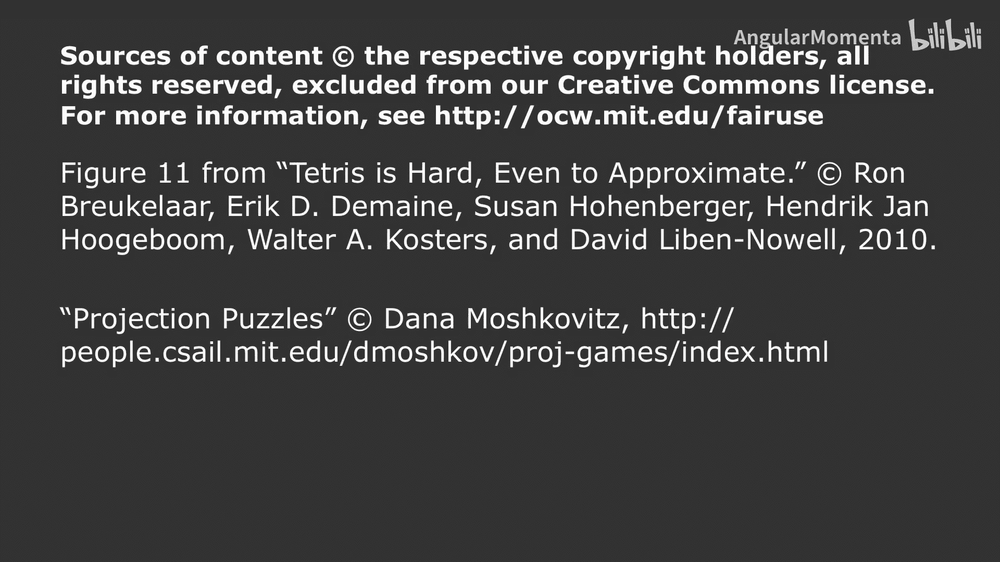

# 【麻省理工】算法下界 ｜ MIT 6.890 Algorithmic Lower Bounds, Fall 2014 p12 12. 差距与PCP -BV1dPYpz9E4V_p12-

The following content is provided under a Cative Commons license。

 Your support will help Mi T OpenCourseware continue to offer high quality educational resources for free to make a donation or to view additional materials from hundreds of Mit courses。

 Visit Mitopcourseseware at Ocw。mt。 Eduu。

Alright， so today is our third and probably final lecture on approximation algorithms。

 We're going to do take a sort of different approach to proving inapproxiability to optimization problems called gap problems and we'll think about gap preserving reductions。

 We will prove along the way optimal lower bound on max 3at and other fun things。

So let's start with what a gap problem is。I haven't actually seen a generic definition of this。

 So this is new terminology， but I think helpful。Gap problem is is a way of converting an optimization problem into a decision problem。

 Now， we already know one way to do that。 If you have an NPO optimization problem。

 you convert it into the obvious decision problem， which is opt at most K for the minimization problem。

 that is MP complete。 But we want to get something useful from an appxiability standpoint。

 And so the idea is。Here's a different problem。Instead of just deciding whether optt is at most K。

We want to distinguish between。Opt being at most K。Versus。Opt being at least K over C。

For some value C and the analogy here is with C approximation algorithm。

 C does not have to be constant， Despite the name could be a function of n。 maybe it's log n。

 maybe it's n to the epsilon， whatever。So for a minimization problem。

 normally don I get this the right way， sorry that should be C times k。

For minimization and for maximization， it's gonna be。The reverse。

And I think I'm going to use strict inequality here also。Okay， so minimization。

 there's a gap here between k and C times k。 we're imagining here C is bigger than1。

So distinguishing between being less than k and being at least c times k leaves a hole。

 And the point is， you are promised that your input， you have a question。The second。It really be or。

嗯。Sorry， no。you。😔，C and K sound the same。 So it's always easy to mix them up。嗯。Cool。

 so the idea is that you're， So in， in both cases， there's a ratio gap here of C。

And the idea is that you're promised that your input falls into one of these two categories。

 What does it mean to distinguish， I mean， I tell you upfront the input either has this property or this property。

 and I want you to decide which one it is。And we'll call these yes instances。And these no instances。

Normally， with the decision problem， the no instance is that opt is just one bigger or one smaller。

 Now we have a big gap between the no instances and the yes instances。 We're told that that's true。

 This is called promise problem。And effectively， what that means is if you're trying to come up with an algorithm to solve this decision problem。

 you don't care what the algorithm does if opt happens to fall in between。

The algorithm can do whatever it want， it can output digits of pi in the middle as long as when optt is most k or greater than equal to K。

 it outputs yes， and when optt is at least a factor C away from that， it outputs no。

So that's an easier problem。And。The cool thing is。If the C gap version of a problem。Is NP hard。Then。

So is C approximating the original problem？あ。Okay， so this really is in direct analogy to see approximation。

 And so this lets us think about an NP hardness。For decision problem and prove an interapproxiability result。

 This is nice because in the last two lectures， we were having to keep keep track of a lot more in just defining what interappxiability meant and Apx hardness and so on here。

 it's kind of back to regular N hardness。 Now， the techniques are completely different in this world than our older N hardness proofs。

 But still， it's kind of comforting to be back in decision land。😊，啊。Cool。So。

Because of this implication in previous lectures， we were just worried about proving inapproxiability but。

Today we're going to be thinking about proving that gap problems are NP hard or some other kind of hardness。

 This is a stronger type of result， so in general inapproxiibility is kind of what you care about from the algorithmic standpoint。

 but gap results saying that hey， your problem is hard even if you have this huge gap between the yes instances in the no instances。

 that's also sort of of independent interest and more about the structure of the problem。

 but one implies the other， so this is the stronger type of thing to go for。

The other the practical reason to care about this stuff is that gap。

 this gap idea lets you get stronger in app results。

 the factor C you get by thinking about gaps in practice seems to be larger than the gaps you get by L reductions and things。

So。Let me tell you about one other type of gap problem， this is a standard one。

A little bit more precise。Consider Max SAT， Pick your favorite version of Max S or max EP was the general form where you could have any type of clause。

 instead of just a C gap， we will define slightly more precisely an A B gap， which is to。

Distinguished between。啊。Opt is less than a times the number of clauses。And opt。Heres at least。

B times the number of clauses。Okay， so whereas here sort of everything was relative to some input K that you want to decide about here there's with S。

 there's a kind of absolute notion of what you'd like to achieve。

 which is that you satisfy everything。 All clauses are true。

 And so typically we'll think about B being one。And so you're distinguishing between a satisfiable instance where all clauses are satisfied and something that's very unsatisfiable。

 There's some usually constant fraction， unsatisfiable clauses。Okay， so that lets us be。

 this is we need this level of precision thinking about when you're right up against 100% satisfied versus like 1% satisfied or something like that or 1% satisifiable。

Okay， the same notation for one only for one problem like the maximum number of ones I haven't seen it。

 but。Yeah， it's a good question。 certainly valid to do it for we will see it for one other type of problem。

 I mean， for any problem， if you can define some absolute notion of how much you'd like to get。

 you can always measure relative to that and define this kind of A B gap problem。Cool。All right。

 so how do we get these gaps？There's two， well， maybe three ways， I guess。A。In general。

 we're going to use reductions， like always。And you could start from no gap and make a gap or start from from a gap of additive1 and turn it into a big multiplicative gap。

 That will be gap producing reductions。 You could start with some gap and then make it bigger。

 That's a gap amplifying reduction or you could just start with a gap and try to preserve it。

 that would be gap preserving reductions in general， if once you have some gap。

 you try to keep it or make it bigger to get stronger hardness for your problem。

So the idea with a gap producing reduction is that you have no assumption about your starting problem。

 A general reduction。 We're going from some problem A to some problem B。

And what we would like is that the output instance to problem B。呃。The output of the reduction。Has。

Let's say opt equal to k。Or。For a minimization problem， opt bigger than c times k。

And for maximization problem ops。Less than K over C。

So that's just saying we have a gap in the output。 We assume nothing about the input instance。

 that would be a gap producing reduction。Now， we have seen some of these before。

Or at least mention them one of them， this is from lecture 3， I think， for Teris。

 we provedmp hardness， which was this three partition reduction and the idea is that if you could satisfy that and open this thing。

 then you can get a zillion points down here and most of the instances down here。

 we squeeze this down to like an end to the epsilon that's still hard and so end to the one minus epsilon of the instances down here and you know you're given a ton of pieces to fill into the space。

 get lots of points， if the answer was no here then you won't get those points and so opt is very small at most say end to the epsilon。

 if you can solve this instance we have a yes instance in the input then we get like end points。

So the gap there is n to the 1 minus epsilon。So Teris， the Tetriris reduction。

 we assume nothing about the three partition instance。 It was just yes or no。

 And we produced an instance that had。A gap of。And the one minus epsilon。

 we could set epsilon to any constant we want bigger than 0。Okay。

 we also mentioned another such reduction。And in general， for a lot of games and puzzles。

 you can do this。 It's sort of an all or nothing deal。

 And gap producing reduction is a way to formalize that。Another problem we talked about last class。

 I believe， was non metric TSP。 I just give you complete graph。 Every edge has some number on it。

 That's the length of that edge。 You want to find a TSP tour of minimum total length。

 this is really hard to approximate， because depending on your model， you can use。Let's say。

 edge weights。And to be really annoying would be 0 comma 1。And if I'm given a Hamiltonity instance。

 wherever there's an edge， I put a weight of0， wherever there's not an edge， I put weight of 1。

 and then if the input graph was Hamiltonian， it's a yes instance。

 then the output thing will have a tour of length 0。And if the input was not Hamiltonian。

 then the output will have weight n ratio between n and0 is infinity。

 So this is an infinite gap creation。 if you allow weights of 0。 if you say zeros cheating。

 which we did in some papers do you can instead do one and infinity。

 where infinity is the largest representable number， So that's going to be something like2 to the n。

 if you allow usual binary encodings of numbers， if you， if you don't the PB case。

 then that would be n to some constant。 But you get a big gap in any case， So you get some。Gap。

Itals huge。Okay， so these are kind of。Trivial senses of inapprexiability。 But hey。

 that's one way to do it。 What we're going talk about today are other known ways to get gap production that are really cool and more broadly useful。

 This is useful when you have a sort of all or nothing problem。 A lot of the time， it's not so clear。

 there's a constant factor approximation。 So some giant gap like this isn't going to be possible。😊。

But still gaps are possible。Now。An important part of the story here。Is the PCP theorem。

This is not about drugs。 This is about。哈。Another complexity class。

And the complexity class is normally written PCP of order log n comma order 1。

 I'm going simplify this to just PCP as the class the other notions make sense here。

 although parameters don't turn out to matter too much and it's rather lengthy to write that every time。

 So I'm just going to write PCP。 let me first tell you what this class is about briefly and then we'll see why it's directly related to gap problems and where a lot of these gap producing reductions come from。

 So PCP stands for probabilistically checkable proof。The checkable proof refers to NP P NP P。

 every yes instance has a checkable proof that the answer is yes。

 Probabilistically checkable means you can check it even faster with high probability。

So normally to check a proof， we take polynomial time in NP here we want to achieve like constant time。

That's the main idea that can't be done perfectly， but you can do it correctly with high probability。

 So in general， in a problem in PCP has certificates of polynomial length， just like N。

And we have an algorithm for checking certificates。Which is given。A certificate。

And it's given order log n。Fits of randomness。That's what this first parameter refers to。

 how much randomness the algorithms given。 So we restrict the amount of randomness to a fairly small amount。

And it should tell you whether the instance is a yes instance or a no instance， in some sense。

 if you're given the right certificate。 So in particular， if the instance was a yes instance。

 So this is back to decision problems， right， just like NP。 There's no optimization here。

 But we're going to apply this to gap problems and that will relate us to。Optimization。So。

Let's say there's no error ons instances， although you could relax that。

 it won't make a big difference。So if you give， if you have a yes instance and you give the right certificate。

 So this is for some certificate。The algorithm is guaranteed to say yes。

 so no error there where we add some slack is if there's a no instance。Now， normally in NP。

 for no instance， there is no correct certificate。Now， the algorithm will sometimes say yes。

 even if we give it the wrong certificate， there is no right certificate。

 but it will say so with some u most constant probability。So let's say the probability。

That the algorithm。Says。No。Is at least。Some constant。Presumably less than one。If it's one。

 then that's N。If it's。A half that would be fine。 a 10th，100th， they're all be the same。

 because once you have such an algorithm that achieves some constant probability。

 you can apply it log one over epsilon times。And we reduce the error。To epsilon。

The probability of error goes to epsilon。 If we just repeat this log1 over epsilon times。

 So in constant time。So I didn't say the order one here refers to the running time of the algorithm。

So this is an。Order 1。Time。algorithmgothm。So the point is the algorithms super fast and still in constant time for constant epsilon。

 you can get arbitrarily small error probability， say one in 100 or one in a million。

 and it's still pretty good and you're checking your proof super super fast。Question。呃。哎。

This limit on randomness is not strictly necessary。 For example。

 n bits of randomness turned out not to help you。 That was proved later。

 but we're going to use this in a moment。 It will help us simulate this algorithm without randomness。

 basically。Yeah， verify runs。So this is constant time in a model of computation where you can read log n bits in one step。

 So your word， let's say is log n bits long。 So you have enough time to read the randomness。

 Obviously， you don't have time to read the certificate because that has polynomial length， but yeah。

 constant time。Cool， other questions。 So that is definition of PCP Now， Let me relate it to。

Gap problems。So。Let's say。First claim is that if we look at this gap satAT problem where B equals 1 and A is some constant。

 presumably less than one。Then， in fact， that should be lesson than one， why did I write。

Strictly less than one。Here， this is a constant lesson one， then。I claim that problem。Is in PCP。

That there is a probabilistically checkable proof， for this instance， namely。

 it's a satisfying variable assignment。Again， it's this instance。

 either has the proper when in yes instance， all of the entire thing is satisifiable。

 So just like before I can have a certificate。Just like an MP。ASatifying assignment to the variables。

Is good。In the no instance， now， I know let's say almost half of the things are satisfied if this was one half。

And so what is my algorithm going do。In order to get some constant most constant probability of failure。

 it's going to choose a random clause and check that it was satisfied。Yeah。啊。Uniform random。

 So I've got log n bits。 Let's say there are N clauses。

 So I can choose one of them at random by flipping log n coins。😊，And then。Check， so that involves。

 this is three setss。 So it only involves three variables。

 I check those three variable value assignments in my certificate by random access into the certificate。

 and constant time， I determine whether that clause is satisfied。 If clause is satisfied。

 algorithm returns yes， otherwise return。 no。 Now， if it was a satisfying assignment。

 the algorithm will always say yes。 So that's good。 if it wasn't， if it was not satisfiable。

 we know that let's say at most half of the clauses are satisfiable。

 which means in every certificate。The algorithm will say no， at least half the time。

And half is whatever that constant is。So， that means。The probability。That the algorithm is wrong。

Is less than one over the gap。Whatever that ratio is。Cool。Yeah。

 so does this group not done hold a lot hold done for a general CF， so for general CNF you。

We will let me tell you， the PCP theorem。Is that MP。Equals PCP。This is proved。

 So all problems are in PCP， but this is some motivation for where this class came from。Yeah。Okay。

 I'm not going to prove this theorem。 The original proof is super long since then there have been relatively short proofs。

 I think the shortest proof currently is two pages long。

 I' still not going to prove it because it's a bit aside the point to some extent。

It does use reductions and gap gap amplification。 but it's a technical to prove it， let's say。

But I will give you some more motivation for why it's true。 So， for example。嗯。So here's one claim。If。

Or one。change its notation。If less than one， comma1。Gap，3 set。あ。Is MP hard。Then。MP equals PCP。

So we know that this is true。 But before we know that here。

 So we just proved that this thing is in PCP。 And if furthermore。This problem。

 we're gonna prove this is NP hard。 That's the motivation。 If you believe that it's MP hard。

 then we know all problems in MP can reduce to this thing。And then that thing is in PCP。

 So that tells us that all problems in NP， you can convert them into less than 1 comma1 gap 3 set and then get a PCP algorithm for them。

 So that would be one way to prove PCP theorem。In fact， the reverse is also true。

And this is sort of more directly useful to us。If。Let's say。3 sat。Is in PCP。Then。

The gap version of  threeat is NP hard。Okay， this is interesting because。

This is true because NP equals PCP in particular， three set is in PCP。

And so we're going to be able to conclude by a very short argument that the gap version of 3at is also NPP hard。

 And this proves constant factor in proxi of threeAT。 We will see a tighter constant in a little bit。

 but this will be our first， first such bound。And this is a very general kind of algorithms it kind of cool。

 so suppose so PCP is easy for the gap version of 3at。

 but suppose there was a probabilistically checkable proof for just straight up three set when you're not given any gap bound。

Which is true。 It does exist。So we're going to use that algorithm。

And we're going to do a gap preserving reduction。Let's say。呃。The PCP algorithm we're given。

cause we're looking at PCP log n， comma order 1 runs in constant time。

Constant time algorithm can't do very much。 In particular。

 I can write the algorithm as a constant size formula。

It's really a distribution over such formulas defined by the log n random bits。

 but let's say it's a random variable where each for each possible random choice is a constant size formula that evaluates to true or false。

 corresponding to whether the algorithm says yes or no。

 we know we can convert algorithms to formulas。 if they're a short amount of time。

So we can make that a CNF formula， why not？3 cNF， if we want。 My goal is to。

 I want to reduce three sat。To the gap version of  three set， because threeat， we know is M hard。

 So if I can reduce it to the gap version of  three set。

 I'm happy then I know the gap version of  three set is also hard。So here is my reduction。u。

I'm going to， so I'm given the threeat formula and the algorithm evaluates some formula on it and the certificate。

What I'm going to do。Is。Try all of the random choices。Because there's only log n bits。

 there's only polynomly many possible choices for those bits。It's order log ns as n to some constant。

 And I want to take this formula， take the conjunction over all of those choices。 If。

 if the algorithm always says yes。Then this formula will be satisfiable。 So in the yes instance case。

 I get a satisfiable formula。So， yes。Implies。Satisfiable，100% satisfiable。

That corresponds to this number。 I want it to be 100% in the yes case。In the no case。I know that。

A constant fraction of these random choices give a no。

Meaning they will not be satisfied for any choice， any certificate， I know that constant fraction of。

These terms， which I'm conjunctionjuing， will evaluate to false。Because of the definition of PCP。

 that's what probability algorithm saying no means。So。Let's say， constant。Fraction。Of the terms。

Are false。The terms are the things we're conjuting over。

 but each term here is a constant size CF formula。So when I add those together。

 I really just get one giant and of clauses。Constant fraction larger than the number of terms。

 And if a term is false， that means at least one of the clauses is false。

And there's only a constant number of clauses in each term。

 So this means a constant fraction of the clauses in that giant conjunction are also false。

And that is， essentially it。Yeah。That is my reduction。So in the yes instance。

 I get 100% satisfiable thing In the no instance， I get some constant strictly less than one satisfiable thing because in any solution。

 I get a constant fraction that turn out to be false constant fraction of the clauses。

 Now what the constant is， you'd have to work out things you'd have to know how big your PCP algorithm is。

 but at least we get a constant lower bound proving。In particular。

 proving there's no PTA for max 3 set。This is what you might call a gap amplifying reduction in the sense we started with no gap。

 the instance of three set was either true or false。

 and we ended up with something with a significant gap。嗯。F。

 so what we're going to talk about next is called gap preserving reductions。Maybe before I get there。

What we just showed is that the PCP theorem is equivalent。 and in particular。

 we get gap problems being NP hard。 This is why we care about PCP and。诶。Then in general。

 once we have these kinds of gap hardness results， we convert our when we're thinking about reductions from A to B。

 I mean， because we know gap implies interraxiability， we could say， okay。

3at is inapproxiable and then do say an L reduction from 3 satAT to something else。

 the something else is therefore inappproxiable also。That's all good。 But we can also。

 instead of thinking about the inapproxiability and how much carries from A to B。

 we can think about the gap directly。And this is sort of the main approach in this lecture that I'm trying to demonstrate is by preserving the gap directly。

 A， well， you get new gap bounds and generally stronger gap bounds。

 And then those imply in proxiability results。 But the gap bounds are stronger than the inter appxiability。

 And also， they tend to give larger constant factors in the。Inro results。

 So what do we want out of a gap preserving reduction， let's say。We have an instance。X of a。

 we convert that。Into an instance。X prime。Of some problem B。

We're just going to think about the opt of x versus the opt of x prime。And what we want。For。

 let's say， a minimization problem is two properties。1 is that the opt。

If the opt of x is at most sum k。Thenhan the opt of x prime。Is it most sum K prime？And。Conversely。

Okay， so in general， opt may not be preserved， but let's say it changes by some prime operation。

 So in fact， you can think of K and K prime as functions of n。Okay。

 so if I know that opt of x is at most some function of n。

 then I get that opt of x prime is at most some other function of n。

 but there's some known relation between the two。 What I care about is this gap C。

 should be a C prime here。So this what this is saying is suppose I had a gap if I know that all the solutions are either less than k or more than c times k。

 I want that to be preserved for some possibly other gap C prime in the new problem。

 so this is pretty general， but this is the sort of thing we want to preserve。

 if we had a gap of C before we get some gap C prime after if C prime equals C。

 this would be a perfectly gap preserving reduction， maybe we'll lose some constant factor。

 If C prime is greater than C， this is called gap amplification。

And gap gap amplification is essentially how the PCP theorem is shown。Bai。

Repeatedly growing the gap until it's something reasonable and if you want to say prove that set cover is log n hard。

 it's a similar thing where you start with a small gap， constant factor。

 and then you grow it and you show you can grow it to log n before you run out of space to write it in your problem essentially。

 before your instance gets more than polynomial。Or if you want to prove that Cique can't be solved and better than whatever and to the 1 minus epsilon。

 then a similar trick of gap amplification works。 Those amplification arguments are involved。

 and so I'm not going to show them here。But I will show you an example of a gap preserving reduction next unless there are questions。

Cool， so。I'm going to reduce。A problem which we have mentioned before。です。

which is max exactly3 x or and x norat， this is linear equations， mod2， where every term has exactly。

 sorry， every equation has exactly three terms。So something like。X I， X or X J。So Xk。

Equals one or something。You can also have negations here。Okay。

 so I have a bunch of equations like that。I'm going to just tell you a gap bound on this problem。

 and then we're gonna reduce it to another problem， namely Max E3 set。So。

The claim here is that this problem is。1 half plus epsilon，1 minus epsilon。Gap hard。For any epsilon。

Which in particular implies that it is1 half minus epsilon in appxiable unless p equals NP。

But this is， of course stronger， it says if you just look at instances where' say 99% of the equations are satisfiable versus when 51% are satisifiable。

 it's n hard to distinguish between those two。嗯。Why one half here。

 Because there is a one half approximation。I've kind of mentioned the general approach for approximation algorithms for SAT is take a random assignment。

 variable assignment。 and in this case， because these statements are about a parody。

If you think of x K as random， it doesn't matter what these two are，50% probability。

 this will be satisfied。 And so you can always satisfy at least half of the clauses because this randomized algorithm will satisfy half in expectation。

 therefore， at least one instance， it will do so。 But if you allow randomized approximation。

 this is a one half approximation or two approximation， depending on your perspective。

So this is really tight。That's good news。 And this is。

 this is proved this is essentially a form of the PCP theorem。嗯。PCP theorem says that you can。

 there's some algorithm。And you can prove that， in fact， there is an algorithm that looks like this。

 It's a bunch of linear equations with three terms per。Equation。Okay， so。Let's take that as given。

Now what I want to show is a reduction from that problem。To max E3 set。So remember maxi3at。

You're given CNNF， where every clause has exactly three distinct。Literals。

 you want to maximize the number of satisfied things。

So this is roughly the problem we were talking about up there。um。So first thing I'm going to do is。

Well。So I， I want to reduce this to that。And。This is the reduction。

 And the first claim is just that it's an L reduction。 So that's something we're familiar with。

 Let's think about it that way。 Then we will think about it in a gap preserving sense。Okay。

 so there are two types of equations we need to satisfy the sort of odd case or the even case。Again。

 each of these could be negated， and I'm just going to double negate means unnegated over here。

So each equation is going to be replaced with exactly four clauses in the E3 set instance。

And the idea is， well， if I want them。All the parity of them to be odd。

 it should be the case that at least one of them is true。And if you stare at it long enough， also。

 when you put two bars in there， I don't want exactly two of them to be true。

 That's the parodity constraint。 If this is true， all four of these should be true。

That's the first claim。 is by the parity of the number of bars。

 There's either zero bars or two bars or three positive or one positive。 Those the two cases。

 And in this situation where I want the parodity to be。Even， even number of truths。

I have all the even number of trues cases over here， here， two of them， even， and here。

 none of them even。Okay。And again， if this is satisfied， then all four of those are satisfied。Now。

 if these are not satisfied。By the same argument， you can show that at least one of these is violated。

 but， in fact， just one will be violated。So for example， if so this is just a case analysis。

 let's say I set all of these to be0。 And so their x or is 0， not one。So if they're all false。

 then this will not be satisfied， but the other three will be。And in general， because we have。

 for example， X I appearing true and false in different cases。

 you will satisfy three out of four in when on the right， when you don't satisfy on the left。

 So it's the difference is three versus four。 when these are satisfied。

 you satisfy four on the right， when they're unsatisfied， you satisfy3 on the right， that's all。

I claiming。So。嗯。So if the equation is satisfied。Then we get four。诶。And the three sad instance。

And if it's unsatisfied。We turn out to get exactly three。Okay。

 so I wanna prove that this is an L reduction to prove L reduction。 we need two things。

 One is that the additive gap。If I solve the3at instance and convert it back into a corresponding solution to Max E3 x norat。

 which I don't change anything， the variables are just what they were before。

 that the additive gap from optt on the right side is most some constant times the additive gap on the left side or vice versa。

In this case， the gap is exactly preserved because it's 4 versus 3 over here。

 It's 1 versus 0 over here。 So the additive gap remains one。And that is called。Beta， I think。

In L reduction land。So this was property2 in the L reduction so the。How to do。Error， in this case。

 is。Exactly preserved。So there's no scale beta equals 1。If there's some other gap in four。

 if it was 5 versus  three， then we'd have beta equal2。Okay， then there was the other property。

 which is you need to show that you don't blow up opt too much。

 We want the opt on the right hand side to be at most some constant times opt on the left hand side。

This requires a little bit。More care， because we need to make sure opt is linear。 Basically。

 we did a lot of these arguments last lecture。Because even when you don't satisfy things。

 you still get points And the difference between 0 and 3 is big ratio。

 So we want that to not happen too much， and it doesn't happen too much because we know the left hand side opt is at least a half of all the clauses。

So it's not like there are very many unsatisfied clauses that most half of them are unsatisfied because at least half are satisifiable。

In the case of optt。So。Here's the。Full argument。In general。

Opt for the three set instance is going to be four times all the satisfiable things plus three times all the unsatisfiable things。

 This is the same thing as saying the。Soorrry。You take three times the number of equations。

 Every equation gets three points for free。And then if you also satisfy them， you get one more point。

Okay， so this is an equation on those things， the two ops。

 and we get plus three times the number of equations。 And because there is a one half approximation。

 we know that number of equations is at most。Two times opt。

Because opt is at least a half the number of equations， and so this thing is overall at most6 plus1。

7 times。Opt E 3 x， nor。And this is the thing called alpha and L reduction。

I wanted to compute these explicitly because I want to see how much inapproxiability I get because I started with a tight inapproxiability bound of one half minus epsilon being impossible。

 whereas one half is possible。It's tied up to this very tiny arbitrary additive constant。

And over here， we're going to lose something we know from L reductions if we're in proxiable before。

 you get inapproxiability in this case of max E3S。So what is the factor？

If you think of there's one simplification here relative to what I presented before。

 a couple lectures ago， we always thought about one plus epsilon approximation and how does epsilon change and that works really well for minimization problems for maximization problem。

 your approximation factor is more I mean an approximation factor of one plus epsilon means you are at least this thing times opt and this thing gets awkward to work with equivalently with a different notion of epsilon you can just think of a one minus epsilon approximation and how does epsilon change and in general。

 so for maximization problem。If you have one minus epsilon approximation before the L reduction。

 then afterwards， you will have a one minus epsilon over。Alpha beta。So for maximization。

 we had one plus epsilon， and then we got one plus epsilon over alpha beta with the minuses it also works out that's a cleaner way to do。

Maximization。 so this was a maximization problem。 We had over here。 Epsilon was sorry。

 different notions of epsilon。 Here we have one half in appability that it one half is also known as one-1 half。

 So epsilon here is a half。And alpha was7， beta was1。And so we just divide by 7。 So in this case。

 we get that max E3 set。呃。Is。1 minus1 half divided by7。Which is 114th。Technically。

 there's a minus epsilon here。Sorry， bad use of， bad overuse of epsilon。 This is， again。

 for any epsilon greater than 0， because we had some epsilon greater than 0 here。

 slightly less than one half is impossible。 So over here。

 we get slightly less than1-114th is impossible。 This is。13 over 14。Minus epsilon。啊。Which is， okay。

 it's a bound， but it's not a tight bound。 The right answer for max 3 sat is 78s。

 because if you take a， again， a uniform random assignment。

 every variable flips a coin heads or tails true or false。

Then seven8s of the clauses will be satisfied in expectation because if you look at a clause if it has exactly three terms and it's an or of three things。

 you just need at least one head to satisfy this thing。

 so you get a 50% chance to do it the first time and then a quarter chance to do it the third time and general seven8s chance to get it one of the three times。

78th is smaller than 1314s， so we're not quite there yet， but this reduction will do it。

If we think about it from the perspective of gap preserving reductions。

So from this general L reduction black box that we only lose an alpha beta factor。

 yet we get this bound。But from a gap perspective， we can do better。

 The reason we can do better is because gaps are always talking about yes instances where lots of things are satisfied。

 That means we're most of the time in the case where we have fours on the right hand side or a situation where we have lots of things unsatisfied。

 That means we have lots of threes on the right hand side。 It lets us get a slightly tighter bound。

Let's do that。All right， so here is a gap argument。About the same reduction。

 what we're going to claim is that 7，8 minus epsilon。Gap。3 set。Is NP hard？

Which implies 78s in approximately， but by looking at it from the gap perspective。

 we will get this stronger bound versus the 13 over 14 bound。So。

The proof is by a gap preserving reduction， namely that reduction from max E3 X norat to。Max 3 set。

 E3 set。I should say。Okay。And so the idea is the following。

Either we have a yes instance or a no instance。If we have a yes instance。To the。Equation problem。

Then we know that at least one minus epsilon of the。Equations are satisfiable。Okay， so。

We have one minus epsilon， let's say M is the number of equations。In the no In case， of course。

 we know that not too many are satisfied at most one half plus epsilon。Fraction。The equations are。

Satisfiable。So in both cases， I wantan to see what that converts into。 So on in the yes instance。

 we get。All four of those things being satisfied。So that means we're going to have。At least。

1 minus epsilon times M times 4。Cllauses satisfied we' also have Epsilon M times 3。

Those are the unsatisfied， and maybe some of them are actually satisfied。

 but this is a lower bound on how many clauses we get。Okay， on the other hand。

 in this situation where not too many are satisfied。 That means we get a tighter upper bound。

 So we have。One half plus epsilon times M times 4。And then there's the rest， one half minus epsilon。

Times 3。And maybe some of these are not satisfied， but this is an upper bound on how many clauses are satisfied。

In the three set instance versus equations in the3 X star set instance。 Okay， now I just wantan to。

Compute these。So everything's times M。And over here， we have four minus4 epsilon。 over here。

 we have plus3 epsilon。So that is4 minus epsilon。Zam。And here we have， again， everything is times M。

 so we have。For hves， also known as two。Plus four epsilon。Plus， we have three halves。-3 epsilon。

So the epsilons add up to plus epsilon that much。 I can see for epsilon minus-3 epsilon。And then。

 we have。4 halves。Plus， three halves also known as seven halves， yes。Okay， so。We had a gap before。

And we get this new gap after when we have a yes instance。

 we know that there'll be at least this many clauses satisfied in the three set。

 and there'll be at most this many in the no instance。So what we proved is this bound that。嗯。

Get them in the right order，7 halves is the smaller one。7 halves， plus epsilon，a。4 minus epsilon。

Gap three set。Ne need three set。Is NPR。Because we had MP hardness of the of the gap before。

 we did this gap preserving reduction， which ended up with this new gap this being， for no instances。

 this being for yes instances。And so if we want to。

 this is with the common notation for the yes and no， how how it fraction is satisfied if you。

Convert it back into the C gap notation。 You just take the ratio between these two things。

And ignoring the epsilons， this is like 4 divided by 7 halves。 So that is。78 or 8/7s。

 depending on which way you're looking。So we get。Also，78s。Gap。Sorry， I guess stayed sense。

The way I was phrasing it before。Is also NP hard。 And so that proves there's also a minus epsilon。

 So I should have kept those slightly different epsilon， but minus2 epsilon， whatever。

And so this gives us the8/7s is the best approximation factor we can hope for。 Yeah。

 and the first not isn't the of clause is between。0 and1Oh， yeah。4 is a little funny。 right。

 I needed to scale。 Thank you， because the number of clauses in the resulting thing is actually 4 M。

 not M。 So everything here needs to be divided by 4。It wonon't affect the final ratio。

This should really be over four。And over 4。So also known as。呃。7，8。Plus epsilon。

 comma 1 minus epsilon。Now it's a little clearer in seven/8s。Cool。Yeah。

 so are there any CP where we need rent this？So for Mexico， you can beat the randomness。

 randomness would give you one half。The Drs Williamson algorithm gives you like one point。

So you can beat it by a constant factor， probably not by more than a constant factor。 But yeah。

 Max cut is an example where。You can beat it。 I think I have。The Gumumms Williamson bound here。

Max cut， the best approximation is 0。878， which is better than what you get by random， which is half。

 I guess。Cool。All right。Cool， so we get optimal bound for a max E3 set。

 assuming an optimal bound for E3 x nor set， which is from PC P。 Yeah so I'm sorry。

 can you explain to me again why we don't get this from the L reduction。

 but we do get it from the gap argument， even though the reduction is the same reduction Its just it lets us give a tighter argument in this case by thinking about yes instances and no instances separately。

 we get one thing。 because this reduction is designed to do different things for yes and no instances。

 whereas the L reduction just says generically if you satisfy these parameters alpha beta。

 you get some in approximately result on the output。 but it's conservative。

 It's a conservative bound。 if you just use properties1 and 2 up here。

 that's the best you could show， but by essentially reanalyzing property1。

 but thinking separately about yes and no instances， this held for all instances。

 we got a bound of 7 but in the yes in the no cases。

 you can essentially get a slightly tighter constant。Cool。Alright， I want to tell you about。

Another cool problem。Another gap hardness that you can get out of PCP。Kind of analysis。

Byy some gap amplification， essentially。Yeah。Just called label cover。

So this problem takes a little bit of time to define。

But the basic point is there are very strong lower bounds on the approximation factor。So。

So you're given a bipartite graph， no weights。嗯。bipartition is AB。And。Furthermore。

 A can be divided into K chunks。And so can be。these are disjoint unions。And let's say。Size of a is n。

Size of B is N。And size of each AI。Its also the same。You don't have to make these assumptions。

 but you can， so。Let's make it a little bit cleaner， So in general。

 A consists of k groups each of size n over K， B consists of K groups each of size n over K。

So that's our you know， we have。And here with these little groups。我 be。These little groups。

 and there's some edges between them。In general， your goal。Is to choose。Some subset of a。

 let's call it a prime and some subset of B， call it B prime。And one other thing。

I want to talk about。Is called a supered。So。And then I'll say what we want out of these subsets that we choose。

 Imagine contracting each of these groups。 these are there are n over K items here。

 and there are K different groups。Imagine contracting each group to a single vertex。 sos this is a1。

This is B3。I want to say that there's a super edge from the group A1 to the group B3 because there's at least one edge between them。

 if I squashed A1 down to single vertex B3 down to single vertex， I would get an edge between them。

So， a super edge。AI， B I， AI， BJ， I should say。诶。Exist if there's at least one edge。In AI cross BJ。

At least one edge between connecting those groups。And I'm going to call such a super edge covered。

By a prime， B prime。If。At least one of those edges is in this chosen set。

 So if there's at least one edge。So。If this AI cross BJ。

 these are all the possible edges between those groups， intersectex。A prime cross B prime。

And in general， I want to cover all the hyper edges if I can。

 so I would like to have a solution where if there is some edge between A1 and B3。

 then in the set of vertices I choose a prime and B prime in the left。

 they induce at least one edge from a1 to B3。And also from A 2 to B 3 because there's it。

 there is an edge that I drew here。 I want ideally to choose the endpoints of that edge or some other edge that connects those two groups。

 Yeah， so you're choosing subset a prime of a， is there some restriction on the subset you choose。

 why don't you choose like all of a， Wait， okay。You're not done yet nope。

That's about half of the definition。😀呵呵呵。😊，It's a lot to say。 it's not that complicated of a problem。

So there's two versions。 It's part of what makes it longer。We'll start with the maximization version。

 which called Max Re。So we have two constraints on a prime and B prime。呃。

First is that we choose exactly one vertex from each group。So。A prime intersect AI。Equs one， and。

B prime， intersect BJ。Equals one for all INJ。Okay。And then subject to that constraint。

 we want to maximize the number of covered super edges。Okay。

 intuition here is that those groups are labels， and there's really one super vertex there。

 and you want to choose one of those labels to satisfy the instance。

 So here you're only allowed to choose one label per vertex。

 You choose one out of each of the groups。Then you'd like to cover as many edges as you can。

 if there is an edge。In the supergraph， from AI to BJ， you would like to include an induced edge。

 like there should actually be an edge between the label you assign to AI and the label you assign to BJ。

So that's this version。The complementary problem。Is a minimization problem where we switch what is relaxed。

 what constraint is relaxed and what constraint must hold。

So here we're going to allow multiple labels for each super vertex。

 multiple vertices to be chosen from each group。Instead we。Force that everything is covered。

We want to cover。Every supered。That exists， and our goal is to minimize the size of these sets。

A prime plus B prime。so this is sort of the dual problem here， we force one label pert。

 want to maximize the number of cover things here we force everything to be covered。

 we want to essentially minimize the number of labels we assign。Okay， so。

These problems are both very hard。 Just to build you some more intuition， let me show you a puzzle。

Which is basically exactly this game designed by our MIT professor Dana Mushkovich。

 so here's a word puzzle。Your goal is to put letters into each of these boxes。 This is B。

 and this is a。 And such that， for example， this says animal， which means these。

 the three things pointed by the red arrows。Those letters should concatenate to form an animal like cat bat。

 right's the example。 So if I write B， A and T， animal is satisfied perfectly because all three letters form a word。

 I get three points。So far， Okay， next， let's think about transportation。 For example， cab。

 who's a three letter word that is transportation。 I notice there's always three over here。

 This corresponds to。Some regularity constraint on the bipartec graph。

 there's always going to be three arrows going from left to right for every。Every group。

So transportation， fine， we got CA A B that is happy。 We happen to reuse the A。

 So we get three more points， total of six furniture is we have B。Blank and T left。

 this is gonna be a little harder。 I don't know of any furniture that starts with B an ends with T and is three letters long。

 but if you， for example， write an E here， that's pretty close to the word bed， which is furniture。

 So in general， of course， each of these words corresponds to a set of English words。

 That's going to be the groups on the left。 So this AI group for furniture is a set of all words that are furniture and three letters long。

And then for each such choice on the left， for each such choice on the right， you can say。

 is are they compatible by either putting an edge or not。And so this is。

We got two out of three of these edges。 These two were satisfied。 This one's not。

 So we get two more points So for a total of 8。Okay。

 this is for the maximization problem minimization would be different。

Here is a verb where we almost get cry， C， B， Y。 So we get two more points。 Here is another。

 we want a verb， blank A Y， There are multiple such verbs。You can think of them。

And on the other hand， we have a food， which is supposed to be blank E Y。

 So a pretty good choice would be P for that top letter。 Then you get pay exactly and almost get P。

 So a total score of 15。 And so this would be。A solution to Max rep。Of costs  15。 it's not the best。

 And if you start at this example long enough， you can actually get a perfect solution of score 18。

 where there are no violations， Basically， in particular， you say here and get soy for food。So。

 so the sets on the right are left 26 letters。 Yes， the B I here are the alphabet A through Z。

 and the sets on the left are a set of words。 And then you're gonna connect to them by an edge if that。

That in that letter happens to match on the right， the I letter。So it's a little， I mean。

 the mapping is slightly complicated， but this is a particular instance of max rep。Okay， so。What。um。

Well。We get some super extreme hardness for these problems。So。嗯。Let's start with Epsilon， comma 1。

The gapap。Max rep。Is MP hard。诶。Yeah。So what I mean by this is in the best situation。

 you cover all of the superegs。 So the one means 100% of the superegs are covered。

 Epsilon means that most an epsilon fraction of them are covered So that problem is N B hard。

 This is a bit stronger than what we had before before we had a particular constant comma 1 or one minus epsilon or something here for any constant epsilon。

 this is true。And there's a similar result for a Minre that's just from one to one over epsilon。

So this means there is no constant factor approximation。 Max rep is not in A P X。Okay。

 but it's worse than that。 We need to assume slightly more。In general， what you can show。

If you have some constant P。OrThere is a constant P。Such that。

If you can solve this gap problem one over Peterta decay。

 So a very tiny fraction of things satisfied versus all of the super edges covered。嗯。V。N p。

Can be solved。In end to the order， K time。啊。Okay， so we haven't usually used this class。 Usually。

 we talk about P， which is the union of all these for constant K。 But here。

 K doesn't have to be a constant。 It could be some function of n。And in particular。

 if P does not equal N P， then k constant is not possible。 So this result implies this result。

But if we let K get bigger than a constant。Like。Log， log n or something。

 Then we get some separation between。Well， we get a somewhat weaker statement here。

 we know if P does not guump P， we know that NP is not contained in P。

 but if we furthermore assume that NP doesn't have sub exponential solutions and very sub exponential solutions then we get various gap bounds inter approximatelyability on maxRA。

 So a reasonable limit， for example， is that。Let's say we assume NP is not in。u。And to the polylo N。

And to the polylog n is usually called quasi polynomial。 It's almost polynomial。 You know。

 log n is kind of close to constant ish。This is the same as two to the polylo N and to the polylo n。

 but it's a little clear。 This is obviously closer， close to polynomial， quite far from exponential。

 which is 2 to the n， not polylo。 So very different from exponential。

 So almost everyone believes that NP is not does not admit quasi polynomial solutions。

 all problems in N would have to admit that3 sat， for example。

 people don't think you can do better than some constant to the N。呃。Then。

What do we get when we plug in that value of k？That there is a。No one over。

2 to the log to the 1 minus epsilon and。Approxiation。Or also that the same thing gap is。Hard。

 now it's not N hard， but it's as hard as this problem。If you believe this is not true。

 then there will be no polynomial time algorithm to solve this factor gap， maxrap。

So this is very large， we've seen this before in this table of various results near the bottom there was a lower bound of 2 to the log to 1 minus epsilon n。

 this is not assuming p does not equal in P， it's assuming this statement and P does not have quasi polynomial algorithms and you see here friends max rep and MinRP。

Two versions of label cover。So。I'm not going to prove these theorems， but again。

 theyre PCP style arguments with some gap boosting。

But I would say most or a lot of approximation lower bounds in the world today start from maxrap or Minr and reduce to the problem using usually some kind of gap preserving reduction。

 maybe they lose the gap， but we have such a huge gap to start with， and even if you lose gap。

 you still get pretty good results。So a couple of quick examples here on the slides。

 directed Steiner For， remember you have a directed graph and you have a bunch of terminal pairs and you want to in particular connect via a directed path。

 some AIs and BJs， let's say。And you want to do so by choosing the fewest vertices in this graph。

So what I'm gonna do if I'm given my bipartid graph here for Minreap。

I'm just going to add to represent that this is a group。

 I'm going to add a vertex here connected by directed edges here， and there's a group down here。

 so I'm going to have downward edges down there。 and whenever there's a super edge from， say。

 A2 capital A2 to capital B1， then I'm going to say in my directed Ste force problem。

 I want a path from little A2 to little B1。So in general， whenever there's a super edge。

 I add that constraint， and then any solution to a directed Steiner For will exactly be a solution to Minrap。

 You're just forcing the addition of the AIs and Bs。It's again， an L reduction。

 You're just offsetting by a fixed additive amount。 So your gap to opt will be the same。

And so you get that this problem is just as hard as Min rep。这呀。And， wellow。

 this is another one from set cover。 You can also show node white weighted Steer trees log n hard to approximate。

 That's not from Minra。Thre it in there while we're on the topic of Steer trees。All right。

 I want to mention one more thing quickly。In my0 minutes remaining。And that is。Unique games。

So unique games is a special case of say， max rep or either label cover problem where。The edges in。

AI。Cross BJ。For a matching。Okay for every choice on the left。

 there's a unique choice on the right and vice versa that matches。Well， there's at most one choice。

 I guess。 And I think that corresponds to。These games， right， if you。

 once you've choose a word over here， there's a unique letter that matches。 the reverse is not true。

So in this problem， it's more like a star left to right star。 Once you choose this word。

 it's fixed what you have to choose on the right side。 But if you choose a single letter over here。

 it does not uniquely determine the word over here。 So unique games is quite a bit stronger。

 You choose either side。 it forces the other one。 if you want to cover that edge。Okay。So far。

 so good。 Uni game's conjecture is that this special case is also hard。Un need games conjecture。

Is that。Epsilon 1 minus epsilon。Gap。诶。Unique game。Is NP hard。Of course。

 there are weaker versions of this conjecture that don't say NP hard。

 maybe assuming some weaker assumption there's no polynomial time algorithm。

Unlike every other complexity theoretic assumption I have mentioned in this class。

 this one is a subject of much debate。 Not everyone believes it is true。

 Some people believes it is false。 Many people believe， or basically people don't know。

 Its a short answer。 Theres， there's some somewhat scary evidence that it's not true。

 There are slightly stronger forms of this that are definitely not true。 which I won't get into。

 There is a sub exponential algorithm for this problem， but it's still up in the air。

A lot of people like to assume that this is true because it makes life a lot more beautiful。

 especially from an appability standpoint。 So， for example， Max  twoat。

 the best approximation algorithm is 0。940。 If you assume unique games。

 you can prove a matching lower bound。 It was max 2at for max cut。 as was mentioned，0。

878 is the best upper bound by Gomans Williamson， Williamson， this， if you assume unique games。

 then that's also tight。 There's a matching this epsilon。😊，Plus。

 epsilon in app result and vertex cover2， you probably know how to do two。

 If you assume you need games，2 is the right answer。 If you don't assume anything。

 the best we know how to prove using all of this stuff is。0857 versus 0。5。

So it's nice to assume unique games is true。Very cool results is if you look at over all the different CSP problems that we've seen。

 all the Mac CSP problems， and you try to solve it using a particular kind of semi definite programming。

😊，There's an SDP relaxation。If you don't know STPs ignore the sentence。

 there's an SDP relaxation of all CSP problems。 you do the sort of obvious thing and that SDP will have an integrality gap。

 and if you believe unique games conjecture， then that integrality gap equals the approximatelyxiability factor。

One for one。 And so in this sense， if you're trying to solve any CSP problem。

 semi defite programming is the ultimate tool for all approximation algorithms。

Because if there's a gap in the SDP， you can prove an interapproxiability result of that minus epsilon。

So this is amazingly powerful。 The only catch is we don't know whether unique games conjecture is true。

 And for that reason， I'm not gonna spend more time on it， but。😊。

This gives you a flavor of this side of the field， the gap gap preservation approximation。

Any final questions。Yeah。嗯。It's it's fine for a problem to be slightly sub exponential。

It's like two to the end to to the epsilon or something。 So when you， when you do an N P reduction。

 you can blow things up by a polynomial factor。 And so that end to the epsilon。Becomes n again。

So even for， if you start from threeat where we don't believe there's a sub exponential thing when you reduce to this。

 you might end up。Putting it， you， you lose that polynomial factor。 And so it's not a contradiction。

Yeah。Good subtle， but。Cool， see you Thursday。

