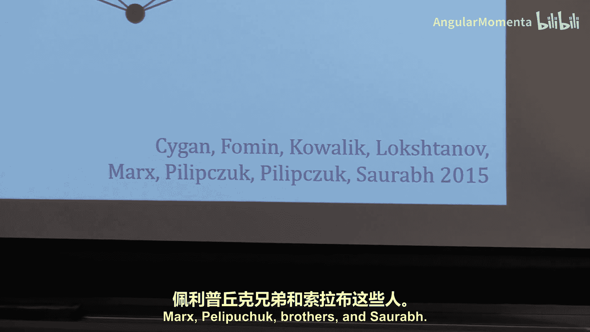
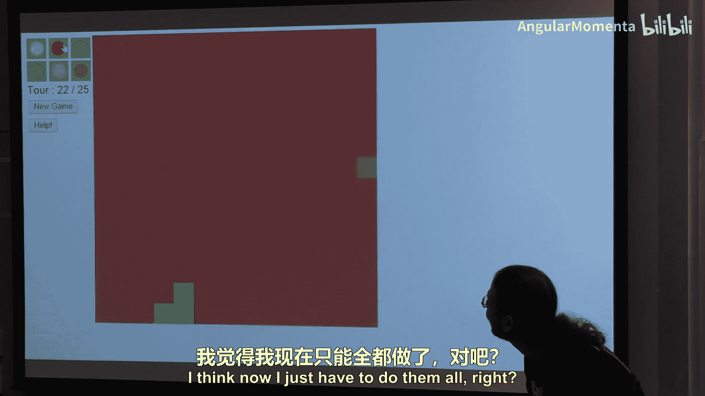
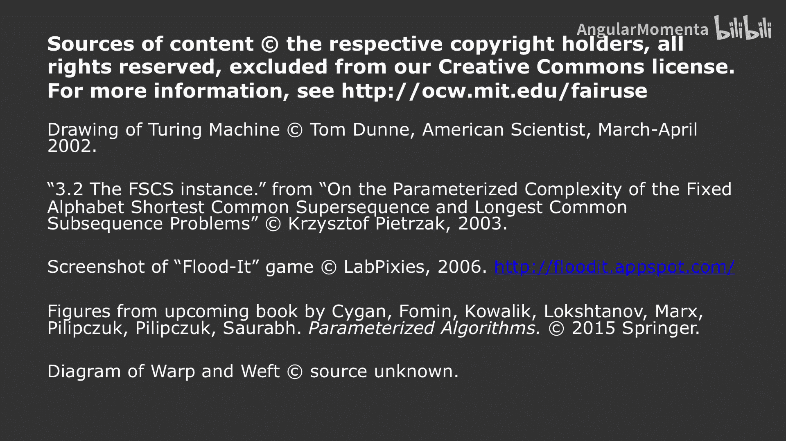

# 【麻省理工】算法下界 ｜ MIT 6.890 Algorithmic Lower Bounds, Fall 2014 p13 13. W层次结构 -BV1dPYpz9E4V_p13-

The following content is provided under a Cative Commons license。

 Your support will help Mi T OpenCourseware continue to offer high quality educational resources for free to make a donation or to view additional materials from hundreds of Mit courses。

 Visit Mitopcourseseware at Ocw。mt。 Eduu。

Alright， today we begin a new topic， which is parameterized complexity。

This is one of the most recent。Areas of hardness that。Has been invented that we will cover。

At least so far started around 1999 and then since the 2000s it's been getting really big originally by Downing the fellows and the general idea is we're going to take problems which normally we think of as being parameterized by the problem size n and thinking about polynomial versus exponential growth in n and we're going to add another parameter so you could say this is a two parameter analysis in some sense。

 usually we call problem size and then we call the parameter K。In general。

 a parameter is just some way of measuring instances。So parameter K is a function from instances。

To non negative integer，0，1，2。And usually。This number K is just part of the instance， for example。

Well， let me go over here to。嗯。Examples， let's say a problem that's called K vertex cover。

And usually I'll just call it vertex cover for simplicity。

 you know the problem vertices to cover edges， and usually the decision version of that is。

 are there k vertices？They cover all edges。 so k is an input to this problem。

 and it appears in the statement of the problem， but in particular， it's an input。

 and so this function K of a vertex cover instance just pulls out that one number and throws away the graph。

Okay， that's， that's the typical parameter。 But in general。

 a parameter could be some hard to compute thing， maybe。K， you think of the parameter。

 you take vertex cover as your problem， but you define your parameter to be the smallest independent set or largest independent set。

 smallest is pretty small，0。 or， you know， pick your favourite。 You could， for example。

 think about vertex cover。With respect to。This is how we'll write the parameter crossing number。

So the idea here is sorry， I forgot to cover。We always measure our instances with respect to the problem size。

 which is the size of the graph for the vertex cover instance。

 but we're also going to parameterize by some other quantity here。

 maybe it's the minimum crossing number for your graph， so0 if it's planar and so on。

 we prove that that's MP complete to compute。So this parameter may not be easy to compute in general。

 but a lot of the times it's just part of the problem。 And in general， this is called the natural。

Pramatization。If you have an optimization problem like vertex cover is minimum vertex cover and you convert the optimization problem into a decision problem you're asking is opt less than equal to K。

 that K is the natural parameter for an optimization problem。

 so most of the time we'll be thinking about that but things like this also arise so just to be a little more precise。

A parameterized problem。Is a decision problem plus a parameter？

So when I said vertex cover with respect to crossing number。

 I meant my decision problem is vertex cover and I'm going to choose to use this particular parameter function to parameterize those instances and in general。

 we'll call the parameter K and problem size n。And our goal is to get a very good dependence on N at the cost of a bad dependence on K。

So。Let me start with。And so so dependence X P would be the set of all。Prameized problems。Solpable。

And n to the F of K time。For some function K， for any function K。Any function， F and FPT。

Is set a parameterized problem solvable in F of K。Times and to the order 1。

So this is considered a good running time。 This is considered a bad running time。

And this is F is presumably exponential， assuming your problem is NP hard。

 you have to have exponential in something。 And the goal is to get the exponential away from n because n is hard to control。

 We like to solve big problems， but maybe we can somehow characterize that the problems we care about have some small measure K for some interesting measure K。

 if such an algorithm is possible。 and in practice your ks are small， then your golden。

 these give really good algorithms for solving lots of problems。 Any problem in FPT。

 if k is not is somewhat reasonable。 even when n is huge， we can solve the problem。

OkayThis running time is also polynomial for fixed k， but the polynomial changes depending on K。

 So here we typically get linear time algorithms for any fixed K here as K increases the polynomial gets bigger and bigger and in practice。

 you probably can't handle more than an n squared algorithm for a large n。

 So this is considered not useful even for small K。 This is considered very useful for small K。

Depending on your notion of small， of course， but。And parameterized complexity。

 the main name of the game is distinguishing between FPT and XP is actually rather large。

 but distinguishing between when this is possible and when it is impossible。啊。Cool， so， for example。

 vertex cover is FPT vertex cover with respect to crossing number， I think is FPT。

 although I have to think about that a little bit more。Oh， right。 FPT is fixed parameter tractable。

That's the good word。Intuitive， I mean， etymologically， that means when you fix the parameter K。

 you get a tractable problem， although it's a strong sense of tractable。

 you can say it is n squared for any fixed K or its's n to the fifth for any fixed K。

 This constant does not depend on K。But the lead constant does。So that's FPT X P。m。Experience points。

Yeah。Good question。Alright， one other good thing to know。

You might wonder why F of K times polynomial n， maybe I could hope for better like F of K plus polynomial n。

 That actually is the same class。So， FPT。Also equals the set of all parameterized problems。

Solvable in。F of K。Plus， and the order one。That's a nice general theorem。

 I won't bother proving it here。 I think the F ended up becoming square of the original F。

 It's a very easy case analysis based on whether these which of these two things is bigger。

I'll leave that as an exercise。 It would be a good problem set problem。嗯。Cool。

 so that answers one plausible question。 Let me give you an example of an FPT algorithm， let's say。

 for vertex cover。 So back over here to vertex cover。How about an X P algorithm for vertex cover。

 So that's really easy， Not very interesting。You could just guess a vertex cover。

 Try all possible vertex covers of size K。 Remember。

 we want to know whether there's a vertex cover of size K K is given to us so we could。

Try all vertex covers。Or I shouldn't say that all vertex sets of size K。

There's only n to the K of them。And for each of them。

 we'll spend I linear time to check whether it's a vertex cover。

 so this proves that the problem is in XP。That's kind of trivial。

 Most problems you'll find are in XP with the reasonable parameterization。 some it's not obvious。

 And now let's prove that it's in FPT。 This is a little more interesting。

 There are lots of FPT algorithms for vertex cover。 It's， it's an active area。 Every year。

 there's a better algorithm， pretty much。Question。For vertex cover， K is an input right。

 So you could also think about。Vertex cover。With respect to vertex cover。So here。

Let's say this is a little bit funny。 But so here the idea is K。

 the parameter is the minimum vertex cover。 Let me right， minimum vertex cover。

 And here you're given some other value。 Let's call it J。

 And you want to decide whether vertex cover is at most J。 but you're not told what K is。

 You're not told what the optimal value is。 So this is a little bit subtle。

 It's essentially the same problem。 You're just not told the critical value。嗯。But if you can solve。

K vertex cover， when K is given， you can just run that algorithm for k equals 1，2，3。

 and you'll end up solving this problem。 So even though so in this problem， you can say， oh， well。

 if I discover there's no vertex cover size K， I can just return no。Here。

 it's a little more annoying。 but just by iterating and stopping when you get the first vertex cover。

 your algorithm will end up having a good running time with respect to K。

 even though you didn't know it。So that's a subtlety。 in general， this is kind of messy to work with。

 so we usually think about k being an input， but that reduction sort of shows they're more or less the same。

 but the complexity theories for this is annoying in the same way that for NP。

 we restricted decision problems here， we're going to usually restrict to the natural parameter。

So's a good question。Okay， let me prove vertex cover is in FPT。

 So much better running time than into the K。 I think I will get something like 2 to the K times n。

Look at an edge of the graph。Any， big an edge， any edge。 And we know for this to be a vertex cover。

 one of the two endpoints has to be in there。 Which one， I don't know， guess。

So I'm gonna guess either the left guy or the right vertex is in the vertex cover and then repeat。

 So when I put somebody in the vertex cover， I delete。All of the incident edges。

That takes linear time over here I would delete。Whatever edges are incident to this guy and the vertex itself。

 of course。And。So I get a smaller graph。I do this K times。 So in general， my， my running。

 my execution tree will have two branches every time I pick an edge and say。

 do I put the left guy or the right guy in， But I only need to worry about。A tree of height K。

cause after I make K decisions， I'm supposed to get a vertex cover of size K。

 after I make K decisions， if there's anything left to the graph。

 that means that wasn't a vertex cover of size K。 and that should backtrack。

So I just explore this tree， look at all the different leaves。 If。

 if there's any vertex cover of size K， I will find it。

And so I only spend two to the K to explore this tree two to K is the size of the tree times n'ca Id maybe delete n things every。

 at every node。Okay， that's one of the simplest。FPT algorithms for vertex cover。

 There are much cooler， fancier ones， but this is now about hardness。 So I will stop with algorithms。

嗯。Also related。Is a stronger notion of P tasks。So I mentioned before。With P tasks。

 you could have a running time， something like。And to the two to the one over epsilon。

 which is actually fairly common in the Phtass， not so great。 if epsilon is anything good。

 then this is going to be a really huge polynomial。Well， the corresponding notion in FPT land is。

A running time of。F of epsilon， or I'll write， one over epsilon doesn't matter times n to the order  one。

So this is really saying that this， the approximation scheme is FPT with respect to one over Epsilon。

This is to get a one plus epsilon approximation。So this is relating the two worlds。

 if you want an FPT algorithm for approximating a problem and getting within a factor of one over epsilon。

 if you get this kind of running time versus this kind of running time， I consider this good。

 this bad。And in general。These are called efficient Pta or E P T。 And in general。

 if you have an E P T， you also have an FPT algorithm。With respect to the natural parameter。

Which is to basically compute what the optimal value is。

 because you can let epsilon be something like。1 over。To k to do it。 something less than1 over k。

 if you have a， you're trying to decide whether you have a solution of less than equal to k or not。

 whether optimal is strictly greater than k。 And I said K is an integer。

 So this is an integer valued problem you're trying to optimize。

 And so the difference between k and k plus1 multiplicatively is about1 plus1 over k factor。

It's exactly one plus1 over k。 So if we let epsilon be smaller than one over k。

 then to get within a multiplicative factor of one plus1 half one over k。

 you actually have to be within an additive plus one of the right answer at K。 So this will decide。

Whether opt is less than or equal to K。Based on whether that approximation algorithm will give you something value at most K or strictly bigger。

 Str bigger would be K plus1。So this is particularly interesting because it means if a problem is not an FPT。

Then it is not， does not have an efficient P test。So we can use before in previous lectures。

 PTA was considered gold， now we can distinguish between E P tasks and Pta。

 and there are problems that have Ptas that do not have FVT algorithms。

 assuming P FVT does not equal W1 an assumption we will get to in a moment。 So if you can in general。

 establish something is probably not an FVT， then we get it probably does not have an efficient Pta。

 So this is useful for lower bounds about approximation。

 even if you don't care about fixed parameter retractability。

 This will give us cool things about app。嗯。A few examples of E P tests。嗯。For example。

 most of the planar results I talked about， planar independence that planar vertex cover。

 those things all have efficient ptasis。啊。But that gets us into the world a boundary tree with algorithms。

But in general， if you have like a lot of bounded tree width algorithms are are FPT。

 there'll be some exponential in tree width times polynomial n。

 so that's and a lot of the times you can use those to get EP tasks for planar and H minor free problems。

So that's one set of examples。 There's no like short example I can give you， but that's a big class。

Okay， so for either reason， either you want to solve problems for small K or you want to figure out whether there's an E P test。

 how can we prove that problems are hard in this world using reductions like usual。

So in this context。Luckily， there's only one type of reduction we need to learn。Unlike approximation。

 where there were a lot。And I'll call it parameterized reduction。

 although throughout this lecture and the next one。

 I'll just say reduction usually because we're always talking about parameterized problems。

So in general， we have some problem A， decision problem A and parameter K。

 and we want to convert into some decision problem B with parameter K prime。And， of course， as usual。

 the setup is we're given in instance， X。 This is going to look almost identical to NP carp style reductions。

 but then we're going to have one extra condition。So instance x of a gets mapped 2 by a function F to an instance。

X prime。Of B X prime is F X。Okay， as usual。This needs to be a polynomial time function。

Just like for NP reductions， which means in particular。

 x prime has polynomial size with respect to x， it should be answer preserving。So x is yes instance。

For a。If and only if x prime is a yes instance for B。So so far， exactly NP reductions。

 and then we need one extra thing。Which is parameter。Preserving。This is。There's some function G。

Which I'll call the parameter blow up， or I guess you could call it parameter growth for G。

 such that the new parameter value for the converted instance is at most that function of the original parameter value of the original instance。

Question G should be a computable function。 I think that's all we need。

 Probably polynomial time is also fine。 But yeah， usually this is gonna be like linear or polynomial or exponential。

 It's rarely some insanely large thing， but computable would be nice。Yeah。Okay。Cool。

 so that is our notion of。Prametterrized reduction。 and the consequence。

 if this exists and B is fixed parameter tractable， then a is。

Because we can take an instance of a convert it into B。

 if the original parameter was bounded by some K， this new parameter will be bounded by G of K。

 new instance will be bounded of G of K so we run the FPT algorithm for B。

 and that gives us the answer to the original instance of A。So， if we don't care about。What。

This function is。We're basically composing functions。

 So there's some f dependence on k in this algorithm。

 and we're taking that function of G of K is our new function。

 and we get a new dependence on K in the running time of FPT。

So what that means is if we believe A does not have an FPT， then B does not have an FPT。

 if we can do these reductions。 So same style， we're going to reduce from a problem we know is hard。

 A into a problem that we don't know about。 and that proves B is hard as well。Yeah， well。

 just's the relationship between FBT and XB。呃。Yeah， overlap well， FPT is contained in XP。

And they are different if you believe the exponential time hypothesis。

 if you believe SAT does not have2 to the little o of n。Algothms。If that's not possible for SAT。

 then X， P and FPT are different and much， much more things are different。

 But we'll talk about that more next class。Relating to exponential time hypothesis。

 So at this moment， we don't really care what G is。 But if you assume exponential time hypothesis。

 then G matters。 and you can get very explicit lower bounds about how good an algorithm you could hope for。

 So were we won't just prove you're probably not in we won't just prove you are not in FPT。

 but we will give an actual lower bound and how much running time you need something like n to the little low of K。

 But the running time we get will depend on this blowup function。

 So next class will care about what G is。So I do try to minimize it。 But so far， we don't care。

 Energy G is fine。XP will not turn out to be the class that we think about very often。

 There are things in between that are a lot easier to work with， which we will get to in particular。

 W1 is the most common。Okay， so let me do two examples， one of which is a correct example。

 and the other is not。 You can help me figure out which is which In set to vertex cover。

These are reductions we've seen before， we have tons of reductions。

 but usually we weren't thinking about parameters。An independent set to cleeique。

These are basically identical problems left and right。 And I want the natural parameter。

 which of these is a parameter preserving reduction。I need some quiz show music。Second， the second。

 yeah。Because if we take a graph on a parameter K， what we convert it to is the complement graph with the same parameter。

Okay， so that's obviously parameter preserving， whereas independent set。

These are complementary in a different sense that if you take everything that's not in the independent set。

 it is a vertex cover。 So it's actually the same graph。 but with n minus K is the new parameter。

 So this is not a parameterized reduction。 This is。Okay， so and in fact。

 vertex cover we just showed as FBT。 In set is not。If you believe W1 is not equal cl PTT。

Or if you believe exponential time hypothesis， and that would contradict this statement。

So this is definitely not a valid reduction。But those are some pretty trivial reductions， Let's。

IllDo some more interesting。Things， and I want to start to introduce the notion of W1。呃。Yeah。

 therere I want to find W1 yet。I'd like to weigh it a little bit becauseuse the definition is not super intuitive。

 But here is a fairly intuitive， hard problem that you should be fairly。Convinced is not FPT。

So I'll call this。Okay， step。No deterministic。Tururing machine。Okay， the one downside is。

 I've never mentioned touring machines in this class。 I thought I could get away without it。

 but I'm going to have to mention them how many people have know what they are。Anyone does not。Okay。

 couple。 here's a toring machine。 I will give you very briefly a very nonstandard definition of touring machine。

 Let's think of， so you have this infinite tape， Infinite memory。 And for our purposes。

 these are not just binary symbols。 you can write up to end different symbols on each of the squares。

 So this is basically your memory。 but it's in the style of old fashioned tape drives in that you。

 in order to get to position K away from you， you have to spend K time。

 So you can only step one unit at a time。 And this is basically computers that we are used to。

 So let's say it has a sequence of instructions。 and it has an instruction pointer。 And in general。

 I want the。😊，The machine to have order n states。And anything else？Yeah， let's say order N。

Lines of code。And yeah。And order N。Options per cell of the table。Okay。

 this will look actually a little weird if you're used to trying machines。

But I wantan to use this definition。 So it's basically regular algorithm。

 but you're very limited to the number in the amount of internal state。

 These are basically registers。 but you can have sort of only a constant number of registers that that vary from one to N。

 One of them will be， what line of code are you on。

And then you have those lines of code or instructions like jump here， compare these things。

 write a particular symbol to the current square of the tape， move the tape left。

 move the tape right。Regular types of instructions。 let's say， except you have this weird tape thing。

 Now I， I mentioned these parameters。 N usually we think of touring machines if having been constant size。

 But here I need an N， and I need a K。Question Okay， so n is the input。 I mean， basically。

 the Tring machine is specified by these things。 You have order and instructions and。

 and we're guarantee there's only order n possible states， let's say。And now what we。

 and this is a nondeterministic machine。 Now， nondeterminism。

 we have talked about this in the context of NP， a nondeterministic Tring machine at any has a funny kind of instruction。

 which says nondeterministically branch to one of n different locations in my memory。

 So there or let's say， choose a symbol from my， I have this alphabet。That I'm using in my cell。

 choose a symbol non deterministically。So I have order N。Choices。Made non deterministically。

In the usual sense of NP， that if there's any way for the T machine to output yes。

 one of the instructions is output yes， then I will find it。 these are guesses。

 and they're always lucky guesses。 So I always end up finding the return。 yes。

 if there is such path otherwise， all paths return no and then the machine returns no。Okay， yeah。

I mean， the。The states are also given to you as part of the Tring machine。Right， there's。

 there's not one toring machine。 Well， there is actually one turing machine to rule them all。

 But that's， that's not the point here。 I give you a machine。

That has think of this as firmware built into the machine。 and the。

 the number of states of the machine includes which instruction you're currently executing。So。

 I mean， this is just saying you're given an arbitrary machine of size of complexity n。

 in usual Turing machine land， there n states， because I give you a state diagram that's size n。

 So you're given everything about the train machine。So that is the input to this problem。

And the question is， can I find a return yes solution that only is k steps long？

So I'm given this huge machine。 And yet， I want a very short execution of the machine。

 I want the running time to only be K。 K again， it the parameter and is， and is big。 K is small。

So I want to know， is there a yes path？From the initial state of length。Okay。So this is basically。

 yeah， question。Yeah， let's say it has no input。Input is all embedded in the code。Yeah。

 so the tape is initially blank。Good， there's a reason I need to do tuuring machines here instead of usual algorithms。

 but if you usually NP is defined in terms of these things。 so by analogy to NP。

 we expect there are no lucky algorithms and so we expect that when you have non-deterministic branches。

 the best thing you can do is to try all the branches。 and so if I have an execution time of k。

 and at each step I can potentially make a nondeterministic choice among n different options。

Then you would expect the best algorithm is n to the K。To tryry all the branches。

 That's just like our vertex cover algorithm。 But in the bad case， where I have branching factor n。

 instead of branching factor 2。So presumably， there's no way to replace a guess among n options with a guess among two options。

啊。That's an assumption。And this problem is。W1。Complete。I will define W1 a little later， but for now。

 just take this as given， you could define W1 complete to mean problems that are reducible via parameterized reductions to this problem。

And then we'll get lots of examples of problems that are as hard as this。Okay， so。A modullo。

 the annoyance of having to define turing machines， I think this is pretty natural assumption。

It's stronger than P does not equal in P。 This would imply that， but。um。

So let's do some simple reductions。Some reductions， maybe not simple。So I mentioned this problem。

 In set。That's also W1 complete。And。To prove， first of all， that is W1 hard。

I'm going to reduce this problem to In set。So I'm given a Tring machine and a number K。

 I want to convert it into a graph and a number K such that there's an independent set of size K in that graph at most K in that graph。

 if and only if there's an except path of length at most k。In the T machine。

So I'm gonna skip a lot of details'cause I've been a little vague about how toring machines work。

 but the idea is is kind of nice。Squared。So my graph is actually。

'Going to consist mostly of K squared cliques。嗯。The cliques are actually quite large because this graph has size n total size。

 but there's gonna be k squared clusters， which are cliques。Draw some cliques。Not very many。

Different cliques， only K squared of them。 And my target independent set is size K squared。

 which means if there's going to be an independent set。

 I must choose exactly one vertex from each clique。Okay， so one。Fortex。P clickique。

Independent said has to have no edges among them。 So if I chose two from a clique。

 there would be an edge among them。 that's disallowed。And so the。Clleeks。

 I'm going to parameterize by two parameters。 I and J between1 and K。And the idea is that I J。

Represents。Memory， cell I。At time J。Plus， the state of the machine。Okay， so。

What I mean is there are order and states of the machine。In general。

 that completely characterizes what the machine is about to do and where it。

 what it's thinking about all of its internal state。

 And so I'm just gonna take those n states and plop them in。

 and each node in this clique represents one of those states。呃。But also。

 I want to keep track of what what symbol is written on that square of the tape。 And so in general。

 there， because my running time is bounded by K， Also the number of squares I write to the tape is bounded by K spaces at most time。

So I only have to worry about k different cells for times1 up to K。

So there are only order n states for this。 Only order n states for this。

 So the size of each clique is order n squared polynomial。That's cool。 It's messy clique。

 I won't try to draw what it really looks like。 And then the general approach is。

 I'm going to add some edges between pairs of vertices to say， well， look。

 if this cell was this thing at this time and the state of the machine was moved right。

 then you better not change what was on the cell at that time because nothing changed。

 You weren't here。😊，So we can just。Forbid that by saying， well， here， here is one state。

 these two states should be mutually exclusive。 So if I choose this vertex in an independent set。

 I can't choose this vertex。 So you just draw all these connections of forbidden things。

 If something is true time I time J， then something else should not be true at time J plus1。

 you draw all those connections and it works。I'll leave it at then because the details are messy。

But it gives you some idea。 At this point， I can plug a。

Book on this topic that is coming out next year。 a little bit far in the future， but it is。Oh。

 I didn't write it down here， of course。嗯。Sorry， it is。By these guys， San， Foing， Kovalic Lachnaov。

 Marx， Philipipchuk brothers and Sob and。

It does go through the details the great details。 If you're interested in that， I can。

 I can share with you that section。But unfortunately， the book's not released yet。Cool， so。

That was a reduction to independent set。Which shows that independent set is at least as hard as this problem。

 which we think is hard。W1 hard。 So that proves W1 hardness。

 but there's another question of is independent set in W1。As you might guess from the name W1。

 there's more than just W1。 There's W2 and W 3 and W4 and even more。

And there's no one notion of hardness like we had with N here。

 So we get a bit of complexity in that hierarchy。 But， in fact， In set is W1 hard。Al sorry。

 W1 complete。So， we can do。High reduction from In set。2 Tring machine。Let's say K step。

No deterministic terrain machine。And the idea is pretty simple。嗯。Aimly。😔，We have K steps。

 so let's get guess all the vertices。Okay， you can see here。

 this is where we need the ability to guess among n different options in each guest step。

So we're give it。 We want to know whether there's an independent set of size K。

 So guess all those vertices of size K。 and then check it。 So this was our X P algorithm。

 but now phrased as a nondeterministic Tring machine algorithm。

 And it's a little bit subtle what it means to check。Of course。

 what we want to do is make sure there's no edge between any pair of the chosen vertices。

So what we're gonna do is when we guess these k vertices。

 we're gonna write them one at a time on the tape squares。

 So we'll use K tape squares destroy store the K vertices that we've chosen。

 Then we want to check each pair of them。 So this is like a doubly nested loop for each vertex among the K for each vertex among the K。

 So what that means is you're gonna have to。Well it's a little bit annoying。嗯。

Loop through the vertices on one tape。And then the fun part is the graph is encoded inside the machine。

 You can think of there being like a data section within the code that says where all the edges are。

 Yeah， the graph is size n。 and so you can put the entire graph into the machine。

And then given two vertices， you can check that there is indeed no edge between them。

 basically by using the code as a lookup table， you say， hey， is there vertex from I to J？If yes。

 then we're in trouble， abort this option， try the other guesses。

 if you look up in the table and it says there's no edge。

 then you keep going so you test all the pairs， make sure there's no edge by the code as it is is a constant size algorithm。

 which looks like this， plus an order n size thing which is the lookup table for what edges are in the graph。

So that part's a little bit weird。Yeah， so the stuff the and aren't the same that's right， Yeah。

 it's right is。K prime。Yes， so probably K prime here is actually order k squared。Thank you。

Makes me a little happier because I'm doing this doubly nested loop。

 I'm gonna have to loop over this thing several times。 I would look at the first vertex。

 memorize it by loading it into a register and then loop over all the other guys for each of them。

 Check that they're bad。 So I'm gonna have to go over the tape K squared steps。😊，And。Yeah。

 and also N prime is whatever。We get a machine that size， basically the size of the graph， v plus E。

So the point of doing that was to show that independent set is also W1 complete。

 So if you are not happy with throwing machines now you can completely forget about them they're mainly used here as a motivation for why you should expect this problem to be hard。

 but it's equally difficult from a parameterization perspective if you ignore how big the blow up is it's just as hard as independent set。

 So independent set is a problem we think there's no good algorithm。

 and by this reduction ands and also the reverse reverse reduction Cique is also W1 complete。Okay。So。

Bunch more reductions。In general， most W1 hardness results start from Cique。

So this is a good problem to know about or independent that same thing。

And there are some simpler versions of Cique that are also hard。 So first one。Is cleeek。

In regular graphs。So it's helpful。To assume all the vertices have exactly the same degree。

 is it hard in three regular graphs， No， if it's three regular is's only a clique of size 3。

 So that's pretty easy。 But in regular graphs and the regular， the degree is going to be huge。

 going to be some function of n。Clleek is hard and in general。

 let's say capital Dlta is the maximum degree in your given graph。

And we want to convert it into a Delta regular graph。

 So we're gonna increase all the lower degrees up to Delta。 What we're going to do is take。

Delta copies。Of the graph。So for every old vertex， we get。Delta copies of it。And then。

We do this reduction。 So the blue is the original is the graph that's been duplicated Delta times here。

 Delta is 5。 But suppos in the graph， this vertex only had degree 3， some number less than 5。

Then what we're going to do is create Delta minus D new vertices， and then add a by clickique here。

 a bypartite click connecting all of those delta minus d things to all of these Delta things。

 they're deelta copies of the original。Vertex， this is V over here， V1 through V delta。

And so what that means is these vertices will have in indeed degree Delta because there were deelta things to connect to over there。

 And now these things will have degree Delta because they used to have degree D。

 and now they have an additional degree Delta minus D on the left。So cool。

 Everything's now deelta regular。 And I claim that this reduction preserves cliques because if you look at these added vertices。

 they do not belong to any triangles。This， this thing here is an induced biite graph。

 and so there are no triangles， no things of size， no cycles of size 3 because all cycles are even here。

Which means， if if you're in a clique， if you have three guys in a clique， then they。

Better have triangles everywhere。So if you put one of these vertices in。

 you will have a very small clique， namely size 2。 And there are always cliques of size 2 in a graph。

 there's at least one edge。 So if there was at least one edge before， afterwards。

 we do not increase any of the clique sizes。 So clique size is preserved。 Everythings cool。

So in this situation， K prime equals K。 We didn't blow up anything。Except the graph size， of course。

 that got a little bigger。And now everything's delta regular。

 Let me give you an example of why this is useful。Of course。

 every time I say something is true of cliqueek， it's also true of independent set。 can just。

Flip things here， We have to be a little careful。 But when you complement a graph。

 if you start with a regular graph， your new graph will also be regular。Every protects5 degree。

And-1 delta or n minus Dlta， something like that。Okay， so here's another problem。

Eerly similar to vertex cover。Called partial vertex cover。 This is also。W1 complete。We want to know。

 can I choose K vertices？That cover。然。Edges。So usually vertex cover， you need to cover all the edges。

 And that let us do some crazy things because whenever we looked at an edge。

 we knew one of the two things was in the vertex cover。 Now， we don't know that anymore。 It may。

 Now it's a matter of which vertices get the most bang for your buck。And this is。诶。Easy to reduce。

From。Delta regular。Independence set。Because。K independent set。 If we want to be explicit。

 I want to know， is there an independent set of size K。

 I just give that to partial vertex cover with K prime equal to deelta times k。No， sorry， that's L。

L prime is delta times k。So the idea is here， I want to choose k vertices that are independent。

 And if I can do that， I will be able to choose k vertices that cover exactly delta times k edges because if they're independent。

 none of the edges will be shared among my independent set。 And this is if and only if if I。

 if I try to choose k vertices that cover exactly deelta K edges。 then they can't。

 they can't be adjacent on the vertices can be adjacent。

 So these problems become the same under this mapping。 So I didn't even blow up。

 My parameter here is K， I forgot to mention。I mean， you could guess from the letter。

 but parameterized by K， this problem is W1 complete。 parameterized by L。 This problem is FPT。

So to be a little careful。But here's the reduction for okay。There is no reduction for。

There's only good reductions for L。Okay， so there were clearly using that the graph was regular。

 Otherwise， it would be at most K， at most Delta for everybody。

 And then it's hard to get the actual independence。 Yeah。

 sorry I'm still confused about the relations between W1 and XP andF。I don't know what everyone。yeah。

 well， we'll get there。For now， you can think W1 is all problems that can be parameterized reduced to K step non detertic machine。

 that that's a fine definition。 some people use that。And in general。

 FVT is contained in W1 is contained in other things which we will get to。

 W2 and so on is all contained in X P。And these are strict。

 if you believe exponential time hypothesis。 So if you believe there are no sub exponential algorithms for S。

 then this problem has no FPT algorithm with respect to K。And all the W1 complete things。 I mean。

 from a complexity theoretic standpoint， it'll be fun to look at these larger classes from。

 is there an FBT algorithm standpoint， All you care about is it's not here。😊，And any hardness。

 W1 or worse will imply。 there's no FBT algorithm if you assume E TH。Like I said。

 they're all strict if you assume exponential time hypothesisis。嗯。If you。

Prove XP is different from FPT than you prove P does not equal NP P， I think。Pretty sure。

So we're not going to non categorically say these things are strict。

 because these are sort of all stronger versions of P does not equal in P。

 but if you believe exponential time hypothesis， then they're all strict， so that's one。

Standard assumption。That gives us everything。Cool， let me give you another version of click。

 That's hard。Multicoled click。If you remember way back to three partition。

 we had a variation on three partition called numerical three dimensional matching。

 where you had to choose your triples from three different sets。

 So this is sort of the analog of that or the analog of three dimensional matching where you had three different sets of vertices for Cique here。

 the set vertices partition into。K。Cluters， and the question is， is there。K， click。With。1 vertex per。

Cluster。And in fact， so you think of these things as being colored， color 1。

 and these are colored color K and so on。 And in fact。

 this is a we can assume this is a proper coloring because if you're not allowed to choose two vertices from one class。

 then there's no reason to have edges between vertices of the same color。 So this is， in fact。

 a K coloring。Up the graph。So we are given a K color graph。 and we want to know， does it have a K cl。

And if it has a K cl and its K color， then in particular， you。

 you will have exactly one vertex per color class。Okay。We can prove this is hard。By a reduction。

From click。Namely， if we have a vertex V。We're going to make copies of it。

You'll see this is a common trick。And we will color them12 up to K。So good。

 Now we have and vertices in each colour class。And then if we have an edge， V W。

We will convert it into。Edges， VI。WJ。For all， I not equal to J。So pretty much the obvious reduction。

 once you said make K copies， will also duplicate the edges in all versions except because it's supposed to be a K coloring we're not allowed to connect V WI。

 but otherwise we'll just throw in all of those edges。And the point is this again。

 doesn't really blow up your cliques because if you have some clique in this structure。

 you can just forget about the eye indices because you know it's a clique。

 you will never choose two vertices from the same color class， two vertices with the same index。

 and so you can take any clique here and collapse it to a clique here conversely if you have a clique here。

 you can just assign those vertices arbitrary numbers。As long as they're all distinct。

 any permutation of one through K， and you' will get a click down here。 So' same problem question。诶。

Yeah， this is for all the。And for all VW。Yeah， so for if there's an edge in the graph。

Then we do that。 And if there's vert textex in graph， we do that。Cool。So K prime here equals K， no。

 no expansion。This may seem trivial， but it's actually a fairly recent innovation to think about multicolor cl and in general。

 it simplifies proofs I've heard of proofs simplifying from tens of pages to one page。

 we'll probably get to some more to such sophisticated example soon。

 but I can give you one simple example。Before I get to the simple example。

 I wanna show you a fun example。Not simple。But let me tell you what the problem is。

 I won't cover that proof。Problem is shortest。Common。Super sequence。

This is a problem that comes up in computational biology。 You're given。Okay strings。

Let's say alphabet。Sigma。And。Yes， you're given。A number， which。I'm going to write L。You want to find。

A string of length L。あ。That's a super sequence。Of all the input strings。

So maybe you're given the DNA sequence of human and DNA sequence of mouse。

 and you want to know what is the shortest DNA sequence that contains all of the letters of those strings in the correct order。

So this is often called an alignment， maybe you have a C G E G。

 this is probably not valid but whatever， and we have some other guy like CA。G， G A T。

So I tried to draw those aligned。So then the common super strain here is AC， A， G， G， A，T。

This is a super string， meaning I can drop letters from down here and get this。

 or I can drop letters from down here and get this。 That was for k equals 2。 in general。

 this problem does have and the K dynamic program。 but the question is whether you could get FPT and K。

 could you get a small dependence on the better dependence on the number of strings。

 and the answer is no， because this is W1 complete。And this is a sketch of the proof。It's basically。

 it's a reduction from multicolored clique。 I think this is the paper that introduced multicolored clique。

 In fact， it's the earliest one I could find。 And this is 2003。 It became more popular since 2009。

 So you're basically encoding the edges by whether there's a zero here in between a huge set of ones and then this is intuitively and then for every vertex you're looking at all of the other vertices and encoding whether they have an edge to them。

 And so if you have a clique that will be a pattern that you see repeated among multiple vertices。

 And so you'll end up being able to shrink your longest。Your shortest common super sequence。

 but the details are messy。 It's a few pages to prove it。

 I will skip that and tell you why I wanted to tell you about this problem other than it's computational biology and useful because it's used to prove that flooded is hard。

Time for some fun， so。Here is。Flood it。So the you have a grid of colored squares。

 And in the top left， we have colors。 And this is the special square。

 What I can do is control the color of that square。 So， for example， I could set it to red。

 And then anything that was in that connected group becomes red。

 And now I've got a bigger connected groups。 And now I can make it blue。

 and then pink and then red and then blue。😊，And then re see how well I can do。 And the trouble is。

 I have a limited number of moves， right。So， this is。A model for。

Ebola virus spreading or zombie infection， or。Pick your favorite。It does。 I mean。

 you imagine these are different species green。Thank you。 lot easier to play when I have an oracle。

 yellow， it's better。😊，I don't know。I actually doing pretty well here。

I think now I just have to do them all， aren？

I made it 25 moves， wow。Flicitations。 that's the first time I've won。 It's a good demo。

 only played a few times。 but this was apparently became quite popular in 2006。

 a company called Lapicixy since bought by Google。 but there's tons of free versions out there you can play。

 It's W1 complete with respect to。😊，Number of colors and number of leaves。 So I'm gonna。

I don't know if this is a generalization or a specialization， but it's a variation of the problem。

 that's been studied。It'sThe only one I could find that talked about parameterized complexity of flooded。

And。So this is flooded on trees。So same setup， but instead of being a square grid graph。

 I'm on a tree graph and the root of the tree is the one I can control。And。

My graph is going to look like my tree is going to look like this。And' so on。

These are going to be my strings。And if I want to be able to solve this in some number of moves L moves。

 then I need to I need to the sequence of colors I do is a longest common sub super sequence of these strings because they all have to get to the bottom。

It they can they'll sit there and wait。 and you you can essentially drop letters。 And that's cool。

 Happ。 This is not literally true， because if I have， let's say a0 and a0 here， both the same color。

 So I representing letters by colors。 then when I play， if I eventually get here and play 0。

 actually get advanced two spaces instead of one。 So for that， you need to first map every letter a。

😊，So let's say in string I。We map every letter A to A followed by a special character for that string。

And so this blows things up in particular， blows up L。

 L grows by a factor of the total length of all strings， because of all these things that we add。

 these are not really compressible。But it means that we alternate between regular characters and special characters。

 and therefore， we never have two characters in a row that are the same。So first。

 you take this problem， then you reduce it to the version of the problem that has no repeated characters。

 and then you can reduce that to flood it。Guse that's what we care about。

 What's the parameter shortest common right， parameter is， they're actually two parameters。

 So this is a fun thing。 K and sigma。So two parameters。

 you can think of that as being parameterized by the sum or just by the vector K comma sigma。

 Basically， we get to assume both of them are relatively small。

 We can be exponential in both k and sigma。If you put L in there， it would not be hard。

 but if you put K and sigma in it's still W1 complete。 And so over here。

 it's the number of leaves in the tree is one parameter and the number of colors is the other parameter。

 So we're fixed parameter tractable with respect to that joint parameter。 Yeah。

 Why is it obvious that you can reduce flued on trees to that。

It's not obvious that the grid problem is related to trees。There。

 there are hardness results for like2 by N flooded， but they're just NP hardness。

 I didn't see a W1 hardness for2 by N flooded。 So as far as I know。

2 by N color is is open from a parameterized complexity standpoint。Okay。呃。K。

I want to do one more reduction。 and then I'll finally define W1。So。Dominating set。

This problem is actually W2 complete。 So this is even harder。 but before we worry about。W2。

 let's prove that it's W1 hard。 So we're going to reduce from multicolored cleeique。

To dominating set。And I have a nice figure。This is a preview of this cool parameterized algorithms book。

So。I am going to represent each。Get it right。嗯。Yeah。F。

I'm going represent each vertex in the multicolored independent set problem by a vertex in the dominant set problem。

 So vertices map to vertices。 This is the joy of multicolored cliques。 We。

 we did all this K duplication stuff once so that we don't have to duplicate our graph anymore。

 We just take this graph。 we port it over。 Now， what that tells us is that the V's form color classes。

😊，And what I'm going to do is connect each color class。

 So this is the set of all things of color 1 set of all things of color 2。 First of all。

 I'm going to add two dummy vertices to each color class just to hang out there。

And then I'm gonna connect everything in the color class by a clickique。Okay。

 before we only had edges between color classes。 but now I want to color。

 I'm gonna also change those edges。 But the vertices map to vertices。

 I add two vertices of each color。 And then this the circle represents that there's a click in here。

 click in here， click in here。 Now， my goal is to find a dominating set。

 And so the intention is that you need to choose one vertex from each color class in the dominating set。

And that's actually what these dummy vertices are doing。

 They are only going to be connected to things in here。 They have to be covered by somebody。

 So that means you have to choose someone in this clique。 You have to choose someone in this cl。

 when you do it covers everybody in there。And there's going to be no point of choosing these dummy vertices because they're only connected to other things in theique。

 you might as well choose these things。 Now， how do I represent an edge in my independent set graph。

If I have an edge between， say， U and V。That's in this color class in this color class。

 we know they're in different color classes by multicolored clique property。

Our multicolored independent set property。 Sorry， same thing。 So I want to not choose both U and V。

So I'm going to represent that by adding a vertex here， which must be dominated。

And connect it to everyone， except U over here。 and everyone except V over here。 The red patches。

 So there are edges from this vertex to every red。A vertex here and here。 So what that means is if。

 if I don't choose you。I will cover this added vertex。 If I don't choose V。

 I will cover this added vertex。So I will cover it as long as I don't choose both U and V。

So it's like I should choose at most one of these two guys。

 then this will be covered for free and it has to be covered for free because we just。

 if I set k prime to be the number of color classes， which is k， then I don't have any flexibility。

 I can't choose any of these vertices to dominate。 And so that simulates independence using dominating set。

Pretty simple and clean。So that gives you a flavor of nice reductions you can do with multicolored cleeique or independence set。

Once two。Extrover Y 2。The two you added it looks like are not adjacent so we get right of them。Right。

Okay， so we want， we want them to be there in order to force choosing somebody down here。

 but we don't actually want to choose one of them。 And so we emit that edge。 So if you choose one。

 you don't cover the other。Thanks。Allright， it I think it simplifies the argument it's probably not necessary because I think you can argue by a replacement argument that you won't choose them。

 but。Anyway。All right。Time for some definitions。 I wanted to do some fun problems before we got to the somewhat。

Weird definitions。The time has come。By the way， dominating set is W2 complete， so is set cover。

 and most most W2 hardness reductions start from one of these two。

 We already know how to reduce dominating set to set cover。

 You make a set for every neighborhood set。In the graph。 So this reduction is easy。

 and that preserves a parameter， so。Just front， same reduction we did two classes ago， I think。

All right， here is a problem which will look familiar。But under a slightly different name。

This is what I might call。Circuit ones。Ones meaning you want to set some number of the inputs to be one。

 just like our optimization version in this universe， it is called weighted circuits set。

 I'm not a fan of weighted because there aren't actual weights here。

 The goal is to get minimum heming weight， meaning the minimum number of ones in your input。

 So I give you a circuit。I'll draw a very simple circuit。And it has one output。

 It has some number of inputs。 My goal is to set K1s。And get a one out。Did I do it， I did it。 Yeah。

 I wasn't even looking。So that's an example of an input and an output to weighted circuits at the parameter here。

 k is the number of ones。1 inputs。So the question is， can you satisfy a circuit using only K once？

That's weighted circuits at。This problem defines a class called W P。

 This is the original definition of WP。 is all problems that reduce to weighted circuit set。

In a parameterized reduction sense， it's all parameterized problems。That reduced to weighted circuit。

I lost my hierarchy， but this is even bigger than all the things。 So we have FPT。

It's contained in W1。Contained in W2， etc cea。And then we have WP， and then we have X P。

So it's not bigger than everything， not bigger than Xp。I won't prove this here， but it is true。Now。

 I want to specialize this problem。 I'm going to simplify it。Using a notion called weft。So。First。

 depth of a circuit。 This is the longest path。That's a normal notion。Then the weft of a circuit。

Is the。Maximum number of big gates。On an input to output path。Big gates means。

Let's say more than two inputs。Okay， in general， it's more than some constant number of inputs。

 but two is fine。Becauseuse if you use a bunch of two input gates， you can build a 10 input gate。

 but there's a distinction between constant input gates and super constant input gates。

 So if you count how many super constant input gates you need，In a constant depth circuit。Then。

 we get。The W classes， W for weft。Okay， WT。Is the set of parameterized problems。That reduced to。

Constant depth。Weft T。weighted circuit set。T is not the parameter。K is still the parameter。

 K is the number of ones。 T is this thing。Okay。Let's do some examples。Yes。

 depth is always larger than weft。 So we allow。 So T is a fixed constant。 depth could be， you know。

1 hundred times t or something。They both have to do with weft， but that's the P is a polynomial。

It sort of corresponds to polynomial weft。hich is basically unbounded whft。

W does not stand for weighted。 In both cases， it stands for weft。Yeah。What is weft。

 Weft is the opposite of warp when you're weaving， you've got the warp threads。

 and then you've got this weft thread that goes back and forth and kind of ties the whole circuit together。

 So it's sort of sideways。 So if you imagine that constant input gates do not need a weft to hold them in。

 But super constant ones do， then it's sort of how many layers of wefting do you have to do to cover all those things。

 that's the largest the longest path。 in terms of counting the that's the term。 Okay， So。

 but it's actually fairly useful to think about。 So for example， independent set inputs are up here。

 output is down here。 I need to choose for each vertex， whether it's in the independent set。

 And if I negate them。Then I need various constraints。 This is the graphs that's being represented。

 I want to say， either I don't choose this or I don't choose this。Okay。

 and then all of those clauses must be true。 That's the end of those things。 This is big。

 These are not big。 They have two inputs。 This has one input。So these are all free。

And then we just do one， in terms of the depth here， where there's one level of big gates。

 So independent set is in W1。 That's a proof that it's in W1。

So that proves all the things we've been talking about， except dominating set in W1。 Now。

 dominating set， you need two levels。So we have the A constraint。

 So this is saying that A should be covered。 A is adjacent to A， B and C。 I mean， if I choose A。

 B or C， then A will be dominated by the definition of dominating set。

 because a is adjacent just to B and C。 But also if I choose A， then it's dominated。

 So this is an or of those three things。 and a should be dominated， B should be dominated。

 C should be dominated。 So it' an and of all those things。 But if we don't have bounded degree。

 which we can't because this problem is easy for bounded degree。

 then the we have two levels of big gates。 So this problem is in W2。Now， funnily enough。

 W1 and W2 are the most common things you see。 I have never seen a paper about W 3。Some statement。

 I think， about problems that we tend to care about and an ofvores are common。 this， of course。

 CNF set is in W2。 I should say weighted CNF set is in W2。 It's actually W2 complete。Waied。

3 set is W 1 complete because things of size 3 are okay。

 We can split those into two things of size 2。 So in general。诶。Order oneat。5 S。 That's W1 complete。

And CNF set。IsW2 complete。 And I think most of the problems we care about can be expressed as this should be weighted。

We're gonna write W， But I mean， weighted。This is a capital W different。 That's weft。 So fine。

 that's。And most of the problems we care about can be represented as CNF set。

 I think that's why we rarely get outside of W2。 But there are other things there。

 You could do an or of ands of or's or an and of or's of ans。 Now。

 we know such formulas can be converted into CF form and only get a polynomial blow up。

 what's going on。 Well， when you do that in efficient form， you add extra variables。

 When you add extra variables， are no longer preserving the weight。

 It would not be a parameterized reduction。So if you're just caring about satisfiability。

 that's fine， but if you're considering weighted satisfiability。

 you want to minimize the number of ones， it totally changes when you convert to cF。

 and so it matters。嗯。One more fun result。 if you look at。2 tape。Non deterterministic Tring machines。

So what， the reason I had to define one tap non deterterministic touring machines is because they're different from two taped non deterterministic touring machines。

 These are W2 complete。The K step version of two tape two tapes is you have two tapes that can advance independently。

 or you can think of there are two fingers you can independently move on one tape。

 Those are equivalent。 and they give you W2，3 tapes gives you W2 Any constant number of tapes。

 you still get W2。 But and this is another， I think， natural reason why W2 comes up a lot。

 I have seen problems that are hard for what's called W star。This W star is WT for all fixed T。

 You can think of that as W order1。Sort of the same thing。

 So I've seen problems that don't depend on what T is。 They're hard for all of them。

But I've never seen a W3 complete problem。 Maybe we can think of one。 I've also seen WP come up。

 and there's also a problem called W S。Which is if you have weighted formula set instead of weighted circuits at。

 you get W S instead of W P， I think it's a little。Weaker because in circuitat。

 you can reuse things and in informing those set， you can't。

 And it turns out to give slightly different classes。 So things are messier here。

 But if you just care about whether a problem is fixed parameter tractable。You know。

 these are all bad。 But the point of knowing about them is you wan to know if your problem first。

 you should check where it fits in the W hierarchy by just thinking about what's a trivial way to write it down in the CNF style thing。

 Figure out whether it's W1 or W 2。 then you'll sort of know which problems you should start from。

 If it's W 1， you probably want to start from a version of Cique。 It's W 2。

 you probably want to start from a version of dominating。 That's why you talk about them here。

 And usually it's W1 or W 2。Cool， questions。We'll do more next time。 This is a fun， fun area。

 And next time we'll talk about in particular， how the exponential time hypothesis relates to all this。

😊。

