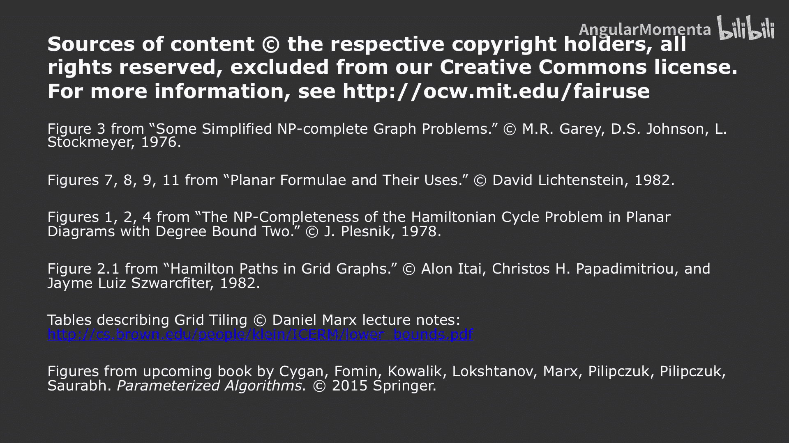

# 【麻省理工】算法下界 ｜ MIT 6.890 Algorithmic Lower Bounds, Fall 2014 p14 14. 以太坊与平面固定参数可解 -BV1dPYpz9E4V_p14-

The following content is provided under a Cative Commons license。

 Your support will help Mi T OpenCourseware continue to offer high quality educational resources for free to make a donation or to view additional materials from hundreds of Mit courses。

 Visit Mitopcourseseware at Ocw。mt。 Eduu。

Alright， today we start a， we're gonna take a little break from parameterized complexity and talk about something called the exponential time hypothesis。

 which I've mentioned a few times， but we haven't really talked about。It's many cool consequences。

I'll abbreviate it ETH。And the idea is。Think about threeat。And the claim is it has no。To。

So a little o of n。Time。Algola。So， of course， you could make analogous assumptions about kat for various k。

 but in general， the the hypothesis is that for any fixed K。

 there is no2 to little low of n time algorithm。 So three sat is the smallest one where that should hold twoat。

 of course， is easy。This is not the maximization version。

And our evidence for this is merely that we haven't been able to find such an algorithm。 There are。

Better than2 to the N2 to the n algorithms， The obvious algorithm is 2 to the n。

 Try all possible assignments times n， but we won't worry about the the non exponential part。

 The best algorithm to date is 1。31 to the n。That's just from three years ago。

 So at an active area of research， many people have tried to find better sat algorithms。

 but conjecture is you cannot get like2 to the square root of n though sum n completete problems have2 to the square root of n time algorithms will'll see some today I'll mention some but seems like two to some constant times n or some constant to the n power equivalently is the right answer for3at Now one issue。

To talk about very briefly， it won't actually matter is what is n。

 normally n is the entire problem size， which be the number of clauses。

 essentially because each clause has three variables。

 but the usual assumption is to say this is the number of variables。And M is the number of clauses。

 but these turn out to be the same thing。So one assumption is equivalent to the other assumption。

 So henceforth， we don't need to worry about this。In general。

 M is at most n cubed because variable each clause can have three different variables。

 so there's only n cubed possible clauses， but when we're worried about this little O thing。

 we actually care about polynomials and because we're in the exponent。

So it turns out you can sort of think of M and N as being linearly related。 That's okay。

 by something called sparsification。 Lemma says that if you have a formula with a。

 with a super linear number of clauses， you can convert it into some vaguely reasonable number of。

Formulas with a linear number of clauses。It's like two to the epsilon and different formulas each with a linear number of clauses。

 And so the end effect what we need to know is that these two。Our equivalent。

 we can think of situations where clauses and variables are linearly related。That's the hypothesis。

 Of course， we don't know how to prove it。 if we proved it， it would imply P does not equal N P。

 This is sort of a strong form of P does not equal N P from the satAT perspective。

 because we have so many reductions from sat。You can turn this kind of lower bound。

 if you assume this lower bound about satAT， you can prove corresponding lower bounds about other problems we've seen。

While I'm here， let me just。Tell you another version of ETH called strong ETH。Which is that。CNF set。

Has no。2 minus epsilon to the n。Algorithm。So the idea is there's some ideal constantsonant to the n for each K at。

 but as k goes to infinity， that constant goes to2。So if you have really large clauses。

 you can't beat two to the end。Roughly。This is for all epsilon greater than zero。

So I won't talk about anything that needs this assumption， but there is some work on。

 you can get very specific bounds on what the constant should be if you assume strong A TH。Okay。

 so let me tell you， let's， let's take a review of past reductions。

 And I'm gonna start with three coloring。A graph。For here。

 So this was our proof that three coloring was hard。 There was a clause gadget， variable gadget。

 this thing of constant size。And the point is， if I start with some3at this is a reduction from3at。

 if I start with a three sat instance that has n variables and M clauses。

 the number of vertices and edges over here will be some constant times n plus m。Okay。

 so three coloring we get。Order N plus M。啊。Vertices and edges。

So what does that give me in terms of a lower bound， Well， if I assume ETH。

 that there's no2 to the little of n and no 2 to little of M time algorithm。4。3 S。

 Then I get a corresponding thing that there's no。2 to the little of and。Time algorithm。For。

Graphs with。Number of vertices and number of edges。Linear and M。

So I stated it this way because for graphs， again， there's issue of sparse versus dense graphs。

 I could just say for sparse graphs here where have a linear number of edges。So。This is。

I should say ETH。Implies this。So。Wellhy， I thoroughly believe P is not equal P E P is not equal and P E TH is a little bit more。

Unknown， so I'm gonna explicitly mention E TH every time I use it。And more generally。

If we look at various past reductions， all we need to measure。Is something called size。Blow up。

Remember， an NP reduction carp style。 you start with some instance X。

 You make an instance x prime an x prime， the size of x prime。This was our reduction F。

The size of x prime should be polynomial in the size of x。 What's that polynomial。

 that's your blowup。So if we have。诶。N， which is size of x over here， and n prime。

 which is the size of x prime。This was polynomial。And N。And that is the size blow。

And so in particular， if we have linear blow up。Like in this example of three coloring。

 then we preserve the。The kind of ETH statement。嗯。No to the little of n。Algothm。

Meaning if there was no2 little of n algorithm for problem A。

 then there will be no2 little of n algorithm for problem B because you could just convert to B run only get a linear size blow up。

 run that algorithm if if there was a2 little of n algorithm。

 and then that solves a in2 little of n time。 So the usual argument。

 but now we're giving explicit bounds on the running time。More generally。

 if you don't have linear blow up。Let's call。This function， B of M。

Let's say X size of x prime is always at most some function B of n B for blow up。Then。

If there's no2 to little o of n algorithm for a。Then there will be no。

2 to the little L of B inverse of N。Hrihythm for B。So for example。

 if you have quadratic blow up B of n is n squared。

 then you will say that there's no2 to the square root of n。

2 to the little low square root of n algorithm。Can that in。Can imagine how that goes。

So here are some nice examples of reductions we've seen。 This one was from lecture 7， then from。

Lecture 10， we had dominating set。That was sorry。I one more before dominating set This was in the context of proving planar vertex cover was hard。

 First planar 3atAT was hard and then a reduction from3atAT。

 but ignore the planar issue because things are going to be a little different for planar graphs but for general graphs this was a reduction from3atAT and it spent there was a constant number of vertices and edges for each clauses and then also here we had to make a copy of variable for each occurrence。

 but the total number of occurrences of all variables is linear because there's only three occurrences per clause。

 So the number of total number of vertices in these variable gadgets is also linear so the whole thing is linear sizeiz below is linear and so vertex cover is。

Another example。Of this type of result。Assuming E TH。

 there is no too little of an algorithm for graphs whose number of vertices and edges is order and that shouldn't have a class。

 but。Id， I can make one up if you want， we could call it an ETH style graph problem。Say。

As fare graphs， no too little O and assuming T H。 So it's sort of saying it's linearly related to set。

 But as far as I know， it doesn't have a proper name。Should。

 because I had to write it many times in my notes。Okay， another one was dominating set。

 I don't have a slide for thiscause there never was one。Because the reduction was so simple。

 it was if you have an edge in the vertex cover instance。

 you convert it into a subdivided edge and the original edge for dominic set。

And then you have the same problem。It the domination。 So it's the same as thing as vertex cover。

 You never w to put this thing in a dominating set。 You might as well move to one of the neighbors。

 so。That's， again a linear size blow up， and so dominating set is also in this class。

Who shall remain nameless And another one is Hamiltonity。 We saw a couple of different proofs。

 This one is from lecture 7。 This was sstensibly for directed。

 that also claims to work for undirected graphs。Linear。

Maybe I'll jump to the next one because it's a bit of a stronger result。 This was maximum degree3。

 Hamiltonity directed。 this was lecture 8。It's also linear。 You have to， I mean。

 the main diagram is this。 It's linear if you're not aiming for planar graphs。

And then there's no crossover gadget here， and so the total complexity of all these things is linear。

So that's cool。Hiltononicity is another example。The graph problem with no to。

 the little of an algorithm。Siming E TH。啊。And from this proof。

 this was for directed max degree 3 then， and it was also bipartid。

And then we reduce that to undirected。Sorry we reduced from planar directed max degree 3 to planar bipartheid undirected max degree 3。

 and that's， of course， also linear。 So all these things we get for free。

 we did them in different context。 that was for planar graphs。

 This one was for Ax hardness for independent set， but we use the same proof and we have this bycle for the variable Now here you start to worry this could be quadratic blow up。

嗯。But。This was actually a reduction from 3 S 3 so that we didn't have a very large cleaique there it was actually only three nodes in it。

 so it's more like a two edges， but in general， three sat， any constant would suffice for that proof。

 You also have to check that this reduction from3at to3 S3 is okay。

 but it's again linear blow because a total number of occurrences of all variables is linear。

So that was a whole bunch of free results， In set。3 set3， it's not a graph problem。

 so I won't write it in this list， but now normally independent set is the same thing as Cek in this universe that's not quite right because we're talking about sparse graphs for Ceeique。

 it's still the case that there's no two to the little low of number of vertices algorithm。

 but the number of edges become used to be linear for independent set and it becomes quadratic for cleeique。

So you have to be a little careful with cleeique。Okay。啊。

So all is good as long as we're talking about。Non planar graphs。 What about planar graphs。嗯。Well。

 this is not true for planar graphs。 in general， you tend to get2 to the square root of n algorithms。

 and that's tight。Assuming ETH。 so for example， Planar3at， we had a crossover gadget。

 and in the worst case， there are a quadratic number of crossings and so the blow up in our problem size because we spend some constant number of vertices per crossover。

 the blow up is quadratic。And so。For say。Planinar ETH。Sorry， planer threeat。E T，H implies。

No2 to the little O of N。Or2 to the little o of M。Yeah不。Sorry。We' square root。So with three S。

 it's a little annoying because we have to think about variables and clauses separately。

 so the size blow up is not quite as uniquely defined。

 but just applying analyzing number of variables， number of clauses separately。

 the blow up is quadratic in both so。That's the lower bound we get。And then。I have planar。

Free coloring。Protext cover dominating set。Hamilton City。Independence set。

All of them have the property that ETH implies no2 to little o of square root of n。好个 them。

For planar graphs。Now，Pargraphs are always sparse， so I don't need to worry about how many edges versus vertices and is。

Within a constant of both。Have you proved that exactly the same proofs that we just looked at。

 They were all actually proof for the planar problem， but they all had some kind of crossover。

 Either they started from planar3 set， in which case they were already quadratic and like。嗯。

This one was from planar 3 set， and it was a linear blow up from that。

 So it's only quadratic overall。 This one was， again， from planar 3 set and linear after that。

 this one。Was from threeat。 And then there was a custom crossover gadget。

 which I don't have the slide for here。 But for each of these crossovers， we paid something。

 So we get quadratic from3at。And that's linear， of course， and。

This is not a planar independent set reduction， so I don't have one here。

 you have to fill in your own。um。And one other one was coloring。

 We did the planar three coloring gadget。 Again， you pay constant for each crossing。

 So quadratic reduction from three set， all of them end up being quadratic overall。

 Independence that's the only one I haven't shown you。And。Cool， so。This is a sense in which。

 even though the planar problems are NP hard， they're a little bit easier。Question yeah， so I think。

I should double check。 I'm pretty sure all of these problems have to。

To the square root of n time algorithms。I'm confident enough I will write it down。

 I think the general approach is lift and separator。But that's about the level detail I remember。Oh。

 oh， yeah。 Also， all planar graphs have tree width order square rootd of M。And， generally。

That will give you such an algorithm。Kol。All right， so that was question there any of these？

Can in a sense， preserve the difficulty in a p graph？啊。Yes。Yeah， it's a good question。

W we might get to some。I'm about to shift gears into parameterized complexity。 and in that setting。

When。I would say generally， no。But there are certainly some exceptions where you can encode a non planar problem into a planar structure。

But most natural problems tend to be like this。But there definitely are examples。

 We might even see one。嗯。This is sort of this could have been at in lecture 2。

 And maybe it should have been。 Buts it's E TH is nice because it gives you a bit more of a quantitative sense of how much running time you should expect out of your algorithms。

 it gives you a motivation for going for linear blow up when possible or at least minimising your blow up。

And lets you distinguish between planner and non planar problems。

We're in the middle of parameterized complexity。 And I mention all this in particular。

 because it has an even bigger impact on parameterized complexity。So let's shift over to that world。

Now， first of all， we get two sort of trivial。Consequences， just from these statements。

They're trivial， but in some cases， they're actually interesting， so。They're easy to prove。

 but actually give tight。Answers for a few problems。So for the parameterized。

 the natural parameterizations of vertex cover is the vertex cover size of most K。 longest path。

 which is the optimization version of Hamiltonity is there path in the parameterized version is their path of length。

 at least K。 Dominic said of size K， independent of size K。Upper bound and lower bound。In particular。

 there can't be a2 to the little o of K times polynomial in n algorithm because there's no2 to the little o of n algorithm。

 This is assuming E T， H。Becauseuse in particular， K could be N。Now。

 it's not exactly what we care about。 What we care about is whether there's an F of K times polyen ouline algorithm。

 but this at least gives you a lower bound on the F。So in particular。

 for Dominic set an independent set， this is not a very interesting result because in fact。

 we will show assuming E TH these do not have FPT algorithms at all。 there's nothing of that form。

But for vertex cover， it's interesting because that is FPT。

And there is a constant to the K times polynomial N in an algorithm。

 We saw a two to the n times n algorithm。 And this shows that that's tight。 So there's no better。

 It gives you a bound on F。For vertex cover， C to the K is the right answer for some constant C。

 And if you assume strong E T H， you can actually figure out what the constant。 Well。

 you could try to prove what the constant is。 We don't know the right answer for vertex cover。

 Some of these problems。 we do。 long as path same deal， there is a。It's FPT。

So it's easy to find short paths and。The algorithm is like 2 to the order k times polynomial in n。

And similarly， for planar problems， if we have ETH。There's no twos a little of square root of k。

Times polynomial n。Or those same problems on planar graphs。For Cek， actually。

 so this should also work。呃。Cleek is O because K is the number of vertices in the clique。

 And so even though the number of edges is quadratic， this will still halt。For planar Cique。

 of course， it's polynomial。 So can't put clek down here。

Because there's maximum clique' size is four。So it's an end to the four algorithm。그。Again。

 this is interesting because for。Dominating set， In set， vertex cover。And longest path。

 there are two to the square root of K times polynomial and n algorithm。

 So this is actually a tightness result。啊。Exist to to the order。A square root of K。And the order one。

Algorithms for planar graphs for those problems。 This is called sub exponential fixed parameter tractability。

 And there were a bunch of those results in the early 2000s。

 And then the theory called by dimensionality， It kind of characterizes when it's possible or gives you a big。

Set of examples where it is possible。But that's algorithm。 So we're not covering it。啊。

So all well and good and so for planar dominating set， that's interesting。

 but for a general dominating set we know domining set is W2 complete。

 we think that means there's no FBT algorithm， independent set and Cique our W1 complete。

 we also think that means no FBT algorithm， assuming ATH， we can actually prove that。So。

Let's say there's no。FBT algorithm。u。For。Creek。Independence set。Assuming E TH。

So that's a theorem we will prove。 if you believe in E T H， then W1。

 these problems are complete for W1。 W1 does not equal FBT。 These are the FBT problems。And， in fact。

 we can prove a much stronger bound。Very non FPT。These algorithms generally have an end to the order K algorithm or if they're an XP。

 then they have some n to the K to some constant algorithm。

But we can't even reduce that exponent below K。For any for a cl and independent set， let's say。

And if you reduce click an independent set to some other problem。

 you can just like we've been doing over here。 you can keep track of the parameter blow up。

 And if it's a quadratic blow up， then you'd get that there's no n to the square root of K algorithm。

 We'll actually do that in a moment for planar graph problems。 But for general graphs。

 click an independent set， no f of K for any computable function F times n to the little of K algorithm。

 So this is much stronger than。FPT does not equal W1。And。This is a result from 2006， fairly recent。

By Chan at all。So let's prove it it is essentially a reduction from three coloring。

But it's unlike most reductions we think about， because。呃。Well， it's unlike parameterized reductions。

 It's a question。 Yeah。From claiming that it's X hard。These problems。Yeah。

 X P hard is really way up there。 None of the problems we've talked about are X P hard。Unless。

Something happens with P versus NP。These are inX P。But they're also in。

 these problems are actually in W1， which is much smaller than X P。Yeah， I was。

 I mentioned X P because the end to the K to the to some constant is related in the same vicinity。

 but it's not directly about X P。Okay， so normally when we do parameterized reductions。

 we start from a parameterized problem and we reduce to a parameterized problem。 Here。

 we are reducing from an unparameterized problem。3 coloring has no parameter。

And we are going to reduce to cleeique， which has a parameter， namely the size of the clique。

So it's a little weird， but you' got to get started somehow。

So we're going to introduce a quantity K and set it how we want to。嗯。So here's the idea。

We are given an instance of three coloring。 Gr' a graph。 We're gonna split the vertices。Into。

K groups。Each of N over k vertices。And remember， we know that three coloring has no to the little low n time algorithms。

 That's what I just erased， assuming E TH。So I'm going choose K in a little bit。

 but let me first tell you the reduction。So we're going to create。A new graph。It's called a G prime。

With。Okay groups。Of not n over K， but3 to the n over K vertics。Y3。

 because we are going to think about all possible three colorings of those N over k vertices。

So it's corresponding for every group up here。 We're going to just write down every possible three coloring。

 So obviously， N over K has to be quite small。Every possible three coloring of those N over K vertices。

So。The intent is that in our clique problem。That we want to choose exactly one vertex from each of these groups。

So K is supposed to be the size of our clique。That's why I wrote it this way。呃。Ku。😔。

And then so at the moment， I have vertices， but I have no edges。

 Each of the groups is gonna be an independent set。

 So that means you can only choose at most one vertex from each group and to make a clique。

And we are going to connect two colorings if they are compatible。By an edge。Nng prime。If。Compatible。

So the idea is here's one group， size n over k。Here is another group。OfSize n over k。

 And if you color these vertices， you know some。Some colors and you color， I'm only using one color。

And you color some colors over here。 Now we've it's a coloring within the group。

 but there are some cross edges between here， which may be incorrect。 They may be monochromatic。

And so we check whether the coloring of this and the coloring of this is consistent with all the cross edges between those two groups。

 If it is compatible， if it's a valid coloring of both groups。

 we connect them by an edge this coloring corresponds to single vertex and G prime and this coloring corresponds to a single vertex and G prime and we add an edge if it's okay。

 we don't add the edge if it's not okay。 And if we're looking for a clique。

 that means we need to choose a coloring for each of the groups that where everything is powerwise compatible。

And that represents all the edges。 Every edge is either within a group。

 in which case it was taken care of at this stage。I guess I should say。Is at most 3 to the n over K。

 I only want valid。Three colorings。Or there's， or the edge crosses between two groups。

 And then it will be considered when we think about whether there's an edge in a clique。

 there are pairwise edges。 And so everything is parawise compatible。So never mind the claim。

You should be convinced this is a valid reduction in terms of a correctness standpoint from three coloring to K clique。

For any K。The construction depends on K。Okay。呃。That's nice。um。So what do we set K to？

Here is a setting for K that will work。 I don't have a ton of intuition for this other than the algebra works。

Essentially， we need to set it to just， we want to set K to like a tiny， super constant thing。So。

Just a little bit， little omega of one。And。诶。We need to， I need to give that little of Ka， a name。

 So I'm going to say， let's say。Okay， click。嗯。Could be solved。In F of K。Times， and。To the。

K over S of K。Time。Where S of K is some。Monione。Increasing。An unbounded function。

I need that S goes to infinity。 That's the meaning of little of K is that you can divide by something。

And you can assume with that last generality， that the something is mono increasing。

 but in particular， it should go to infinity as K goes to infinity might go there very slowly could be like one over two to the N or1 over2 to the K or something。

But。Something little。S is little omega of one。But now I have this quantity S。And I'm going to set。K。

呃。As large as possible。So that。嗯。F of K is at most n。And K to the K over S of K。Is it most and。

My goal here is to make K a function of n。And so one choice of k is basically f inverse of n。 So F。

 remember， was the dependence on K。 So here。This will turn out to work。

You can think of K just being F inverse of n。 But where there's actually another constraint。

 it's another inverse thing。 I want K to be at most the inverse of this relation。Okay。

 so I'm basically taking the min of these two functions of n。That will be a function of n。

 which is growing。Why， I mean， you can check， if you set K to be a constant， of course， this is true。

 If you said K to be a constant， of course， this is true。

So you can set it a little bit super constant。By inverting this relation。

 that gives you some value of K that would satisfy this， some value， some function。

 K equals K of n that would satisfy this。 And I want to take the min of those two。

 still a growing function of n。We'll need that in a moment。And I get these two inequalities。Okay。

 now it is just a computation。Of how much running time I have。So I want to plug this algorithm。

 This was an algorithm for K clique。 I have this instance of K clique。

 which looks a little weird because it's got potentially a lot of vertices。

 I'm just going to plug that in。 This is my n prime。 The new， well。

 the number of vertices is this times k。Because therere K groups。

So a number of vertices in G prime is k。Times3 to n over k at most。

So we just plug that into this running time。And we get。F of K。Times that number of vertices。

 K times 3 n over k at most。I guess less wrinkle too。To the power K over S of K。

And now we do some manipulation。 We know that F of k is at most n。 That will be enough for this term。

 This is at most n times。 I'm going to split this apart。 So we have K to the K over S of K power。

And then separately， we have3 to the n over K。To the K over S of K。 again， K to the K over S of K。

 That's something I get to assume is less than equal to n。 So this is less than equal to n squared。

And then， the。Some color。The Ks cancel。And we're left with。3。To the end。Over S of K。

 I'm going to remind you， K is a function of N that is。Unbounded and monitoring increasing。

So this is。Three to the little O。Also known as2 to the little low event。Cool。

So I just needed to choose K to be slightly super constant。 And I wanted to get rid of these terms。

 So I made them at most n and took those inverses， took them in。 And boom， we get a contradiction。

 This contradicts E TH。 This implies E TH is false。So if you assume E T H running backwards。

 you get that K clak cannot be solved in such a running time。

 And so we get this very strong lower bound。 There's no f of K times n to the little of K algorithm for K clique。

 So in particular， K clak is not fixed parameter tractable。I think that's pretty neat。And。Henceforth。

 you care about parameter blow up。 I mentioned it briefly last class， but in general。

 you map some function summit problem X with parameter K into a new instance。

 x prime with parameter K prime。And K prime just has to be bounded by any function。

 any computable function of。K， but if it's a linear function， you preserve this strong bound。

 If it's a quadratic function， then you get there's no F of K times n to this little o of square root of k。

If it's an exponential function， which is fair game here， you get a weaker bound。

 You still get that there's no FPT algorithm。But you don't get a nice。

 not a very impressive bound in terms of N。On the right。Okay。

 is there a name for this type of production？I don't have one。呃。There's only one that I know。

 So I don't think I will， I will try to come up with a name。Once you have this， you can， I mean。

 last class， we reduced K cl to all sorts of things。 And so we get a lot of so and for now。

 you just reduce from Cique or variations。 And so you get lots of。Good stuff。嗯。What do you get。

Last time we covered a reduction from Ceeique to multicolored clique。Any independent set。

And if you look at that proof。K prime equals k。We had a quadratic blow up in the problem size。

 but the。Parameter didn't change at all。 So this is good news。

 That means this problem or these two problems has no。Assuming he T。There's no。

F of k times n to the lula of K。How good。And also， we covered a reduction to dominating set。

 even though dominating set was W2 hard。We still reduced from a multicoled cl to dominating set。

 and then from a dominating set， we could reduce to set cover。

 All of these reductions preserve K exactly。 All we need is that they preserve it linearly。

 But then we get this kind of result for all of those problems。嗯。We covered a reduction。

For partial vertex cover。But I think the reduction we covered was not linear， but there is one。

 So I'll just state this as a result。 But this is another one where we， we covered a reduction。

 but it wasn't the most efficient  one。 I think we lost a quadratic amount。Okay。嗯。Any questions yeah？

Do we happen to know if FPT and W1 are separated assuming only PE not equalP and not assuming ET？

We do not know that。Yeah。The best classical assumption is that ETH implies W1 does not equal FPT。啊。

I also don't know offhand whether FVT does not equal W1 implies P does not equal NP P。

I think there's this result along those lines， but I'm not sure if that's literally true。Intuitively。

 it's stronger but。Other questions。Okay。um。So this is a strictly better lower bound than those of it there。

Right， good question。 So before we switched to parameterized land， we said， like over here。

 we had there was no2 to the little o of n algorithm Here。

 we're getting that there's no F of K times n to the little o of K algorithm。

 I think that is stronger than the old bound。Although I guess you have to think about it problem by problem。

 It's not。 it depends on how K could relate to n in general。I think for these problems， though。

 it is a stronger result。呃。Yeah。Because K is at most n。And K can be close to N。Okay。

So the next topic， just taking a little breather。 This is all good for non planar graphs。

 For planar graphs， we actually haven't seen any W1 hardness results yet。

 And that's because a lot of planner problems are FPT。There are， in fact。

2 to the square root of k times polynomial n algorithms for a ton of planar graph problems。

 but there are some that are hard， some that are W1 hard。 And as you might expect。

 this K becomes a square root of K because we get a quadratic blow up。For some problems。

 not quite all of them。So this comes back to Jason's question and maybe I'll go up here。啊。Let me。

So let me briefly mention in general， if K prime。Of x prime， is at most sum G of K of x。

 This was part of our。This is the， in the definition of parameterage reduction。

Then if there's no F of K。And to the little of。Algorithm。For problem A。Then， there is no。

F prime of K prime times n to the little o of G inverse of k。Prime。Algorithm for B。

So I think the analogous statement was up here for size blow up and regular NP P reductions。

 but for parameterized reductions， I mean， the dependence on K is just an arbitrary computable function。

 So that doesn't change。 but the exponent changes correspondingly。 So if you square K。

 you get a square root and the exponent。Okay。So let's do some planar problems。嗯。

I'm pretty sure all of the W1 hardness results for Par problems are within the last like。Five years。

 so it's a pretty recent direction。And the key insight is a problem called。Gridtyling。

Which I have slide 4。So this is a problem invented by Daniel Marx in 2007。

And so the input looks like this and the output looks like that。So in general。

 you're given a K by K matrix of sets。 Each set has some number of。2D coordinates。

 these coordinates range between one and n。So's K by K， small matrix。

 but each cell has a ton of stuff in it。Up up to n squared。Pars。Okay， and your goal。Is to。

 in this case， in this example， all the numbers are between1 and5。 so n equals 5， and it's 3 by3。

 So K equals 3。Your goal is to choose exactly one。Element from these sets。

Such that if you look in any column， the first coordinates are all the same。

Here the first coordinates are all one， here， first coordinates are all two。 and in any row。

 the second coordinate is the same here， they're all four， here they're all two。

 here they're all three。Okay， so that's a valid solution。As you might expect， this is MP complete。

 but furthermore， it's W1 heart。So。I should say。S I J。

 just gives you some notation is a subset of one up to n。Squared for all I and J。In one up to K。

That's what the input looks like。The squared means you have ordered pairs。

And then your goal is to choose an X I J out of each S I J so that in any row。

 the first coordinates match any column， the。Sorry， in any row。

 the second coordinates match and in any column， the first coordinates match。

So a claim is that this is W1 hard。 And also now we know W1 hardness is not the most we could hope for。

 We also want to know what the parameter blow up is and how we can relate it back to E T H。

So here we will get the same bound。 There's no F of K hence end the little of K algorithm。So me E TH。

 So here we will not lose a quadratic thing， but notice that this thing is K by K。 So it's。

While we define the parameter to be K， there's kind of a quadratic amount of stuff going on。

 you're selecting K square different things in a solution。That's still okay。 I mean， K is still the。

 the number of rows or columns of the matrix。But typically， the reason this problem is interesting。

 This is like a starting point for planar graph problems， because you can replace each of these。

Cells of the matrix， with the gadget。That somehow represents all the things in that set。

 but now these constraints that all the things in the column agree in the first coordinate。

 you can think of as a local constraint because really you just need that the guy that you select here has the same first coordinate as the guy you select here。

You only need to constrain adjacent cells because if adjacent cells are equal。

 then the whole column will be equal。 And if adjacent rows have equal second coordinates。

 then the whole column will have equal second coordinates。

 So if as long as you can build gadgets that just check with their neighbors。

That will give you a kind of planar graph structure or a 2D geometry structure if you're doing a geometric problem。

And it lets you work with things kind of locally。But when you do that， of course， typically。

 K becomes k squared。 And that's where you get the square root of K up here。

 but it won't disappear yet。Okay， so how do we prove this， we're going to reduce from Cique。

Because that is our favorite。W1 hard problem。And it has this kind of bound。

 and so it's going to be a linear reduction。 in fact， k prime will equal k。And n prime will equal n。

And here is the maximum coordinate values in the original problem。

 and prime is the number of vertices in the clique。And。Yeah。

 I'm going to write down the reduction and then show you a picture。

It's hard to actually draw the full reduction。 It's easier to write it down generically。

And then show you kind of a little slice of a real example。

It's a little bit confusing because there are four parameters lying around。

 There's which cell are you in， which I'm denoting by I J。 I is the。

Now which row you're in J is which column you're in。 So this is the set of things at row I column J。

But then separately， there are the coordinates that are inside the cell。

And here I'm denoting that by vertices。Because for us， the vertices。

 this what this says is that the vertices map one to one with。With coordinate values。Okay。

 but these coordinate values are different from the I J coordinate values。

 I Js are always between1 and K。 These coordinate values are between1 and M。

Probably should have a term for those that distinction， but such as it is。

 I J is between1 and K V and W are between1 and n。So there's two types of cells。

 There's cells in the diagonal of the matrix and cells off the diagonal。

 This is for I not equal to J on the diagonal， you just have。Pairs of the form V V。

 So that's supposed to represent the vertex。 And so basically。

 what you choose on the diagonal is going to correspond to the clique that you want。

Because the diagonal has size k。And so each diagonal item is going to have to choose a vertex。

 It's going to turn out that vertex will be in a clique。Why will it be in a clique。

 Because the off diagonal entries are going to force that there are edges between corresponding vertices。

 So the off diagonal entries will have for every edge。

And we're assuming no loops here for every edge we put。VW， as an item。In the set of pairs。

if this is an undirected graph， we'll put VW and WV。啊。And so， in fact。

 all of the off diagonal entries look the same。I guess and all of the diagonal entries look the same in terms of the S sets。

So let's look at an example。Suppose you choose this22 diagonal entry to be vertex I didn't assume very much。

 But from the constraints of the grid tiling problem。

 we know that the whole row here has the same second coordinate and the whole column here has the same first coordinate。

 So if you choose vertex I here， that forces I to be to appear throughout there。

 And if you look at some other vertex VJ。On the diagonal， then same thing happens。

 you have Js second coordinate here and J first coordinate。There。

 and I see there's a slight typo and these slides。 this should be a J。 that should be an I。

 The colors are right， though。 So just look at the colors。嗯。Cool， so。Now， for this to be in the set。

 there must be an edge between V I and VJ。And this is true for all INJ， therefore， you have a clique。

Now， one thing that's important is a VI is distinct from VJA。

 otherwise you could just put VI and all the diagonal entries and everything is VI VI。

But because we said V does not W for these sets， the fact that there is a valid choice here。

The fact that V I V J is a valid thing in this item means that。VI does not equal VJ。So。

These are all distinct vertices。 There's exactly K of them。 And so this problem has a solution。

 if only if there was a K clique。In the original graph。Claire。

I guess these entries are technically correct if you view these as unordered pairs and because we're in an undirected graph。

 everything is flipable。Alright。So that proves that grid tiling is as hard as cleeique。And it was a。

Linear reduction， we started with value K， we ended up with a thing whose parameter was k。

Say something again， why。It just seems like you've just redefined。

Your N and K to be square root would what you might normally。Yeah， so if， if you prefer。

 you could define K to be the number of cells in the matrix。

 And then what you would get here is there's no F of K n to the little L square root of k。Algorithm。

 assuming ETH， it's just a matter what you define K to be。

You're gonna either lose the square here or later。 And I think。呃。So I'll show you why in a moment。

 why you might define it this way， Because here's gonna be a planar graph problem kind of that does not。

Blow up K at all。Turns out sometimes you don't have to blow up this K， turns out to be the correct K。

So let's do。That example， it's called K outer planar list coloring。

 This there's two things I need to define list coloring and outer planar。Oh。

Let's start with list coloring。So enlist coloring， given a graph， and for every vertex。

 you're given a list of valid colors。And your goal is to color the graph。Again。

 noed should be monochromatic。And the color you choose for vertex V must be on the list， L V。

So this is a generalization of k coloring， K coloring is the case where Lv equals1 through K for all vertices。

 this is of course， a harder problem。And。Turns out it's quite hard。嗯。For example。

It's NP hard for planar graphs。 That's not surprisingcause three coloring is NP hard for planar graphs。

And size of Lv is less equal to three for Lv。By the hardness of plainar free color and gives you that。

So there's also no natural parameter here because you can't parameterize by like the number of colors you have。

 because even when it's three， this problem is hard。 So we're gonna parameterize by something else。

Namely， a quantity called outer planarity。If you know what。Tre with is。 you can think tree with。

 but tree with is a bit messy to define。 So I'll stick to outer planarity。

 which for planar graphs is within a constant factor。 So outer planarity， if you。

 if you have a planar graph。啊。This would be an example of a graph of outer planarity 2。

 Let me draw you an example of a graph of outer planarity 1。

Suppose all of the vertices are on the outside face of your planar graph。

 or all the vertices are on one face。Then that's an outer planar graph or one outer planar graph。

 If you have a graph where。There are vertices on the outside face and if you remove all of those vertices from the outside face。

 the remaining vertices are all on the outside face， this is two outer planar。In general。

 if you have to remove out the vertices on the outside face。

 k times before you're left with no vertices， then your graph is k outer planar。

 and that K is your outer planarity。Okay， so this is an example of a problem that's there's no natural parameterization。

 because it's not an optimization problem。 So we're gonna throw in a parameterization that often works out quite well。

 Usually， if you take planar graphs parameterized by other planarity。

 they are fixed parameter tractable。 For example， K coloring。

With parameterized by outer planarity is FPT， but list coloring is not question。

Doesn't the Iine energy independent bedding？It depends only slightly on the， the embedding。

I think only by an add of one or something。Yeah， so it won't matter from a parameterization perspective。

 definitely within a constant factor。Yeah， good question。Okay。

 so what we're gonna show is that this problem parameterized by outer planarity。

 So one note is it is in X P。 There is a。And N to the outer planarity and to the K algorithm。

Using bo a tree with algorithms。So I won't go into。

 but we will show that it is W1 hard and assuming ATH。

There is no F of K ands a little of K algorithm。 So here is an example of a planar graph problem where we do not get square of K。

 which I think would also answer your earlier question。And this is the reduction。

 It's a reduction from grid tiling。So the idea is， if you have a K by K grid。

 we're going to make something like a K by K grid graph。But now we have to represent。啊。

The choice here we're given a set of pairs for each of these grid cells。

 which we're now representing as a vertex。 And so we're gonna， but conveniently。

 we have a choice aspect here。 So this is not this is a thin veal for grid tiling。

We have this list LV for each vertex of valid choices you can make for that vertex。

 So we're gonna let L U I J。So this is reduction。From。Griid tiling。L sub U I J。Equals S， I J。

So that's the choice that happens for every vertex we have to choose one color that mimic the fact that every grid cell on the matrix。

 we have to choose one item from SIJ。So most of our work is already done。 Now we have to constrain。

 if you look at two adjacent vertices。 If they're adjacent in a row， then they must have the same。

First coordinate， I can never remember。They should have the same second coordinate， sorry。

 if they're in the same row and if they're in the same column。

 they should have the same first coordinate。So these vertices。

 which are called V for the vertical connections and H for the horizontal connections。

 are going to achieve that。And it's a little bit tedious to write down。Basically。Let's say， between。

U I J。And U， I plus 1 J。So it's too vertically adjacent。Vertices。We're going to add a vertex。V， I， J。

 C， D for two colors C and D。With。List。Of size 2， C， comm D。嗯。For all colors。Not。Agreeing。On。

First coordinate。Okay， again， this is hard to draw on the figure， but easier to write down。So。

There's a lot of these vertices。In between two adjacent U high vers iss gonna be a bunch。

 They're parameterized by two colour CDD。 Remember， colors are pairs of things， but you know。

 colors correspond to the items that are in the S I Js， but。Don't worry about that so much here。

 except there are colors that are compatible that they have the same first coordinate and their colors that are incompatible for any two incompatible colors。

 most of them， the ones that don't agree on the first coordinate。

 We are going to add one of these vertices whose list is exactly C， D。The two incomatable colors。

 What that means is suppose this vertex chooses C。Well， then there's a vertex here with list C D。

 It cannot choose C because then that edge would be monochromatic。 So it must choose D。

 which means this vertex cannot choose D。So overall。

 what this means is that these two vertices must choose a compatible color because we rule out all the incompatible pairs。

 So this is， of course this coloring you can do a lot。 But in particular。

 we can simulate grid coloring。 So we're， or sorry， a grid tiling。

 We're not exploiting a ton of the structure， grid tiling， but we get a result here， and it's tight。

😊，I didn't write down what you do for the horizontal， but it's symmetric。So， that's nice。

This is one of the few planar problems where you don't get a square root。呃。The next two。

 you will get a square root。 But before I get to the actual problem。

 here's a variation of grid tiling， which is a little tricky to prove hard。

 but is just as hard as grid tiling。 Here we need that。In every row， well， here's the input。

 Here's the output easier to look at the output in any row。 Sorry， that's a column。In any column。

 the first coordinate is monotonically increasing。 doesn't have to strictly increase。

 but you have a less or equal to constraint。 This is less than equal to this。

 It's less or equal to this。4，4，4。 Okay， here they happen to be equal 2，3，3。 here。

 they increase a little bit。 Similarlyly in every row，2，3，5， they're monotonically increasing 1，2，2。

2，2，3。 So this is a valid solution to grid tiling with less or equal to。 That's what's called。嗯。

I will not prove that this is W1 hard， I do have a figure for it。It's。

 it turns out to be linear expansion。 If you have a k by K grid。

 we're gonna end up with a 4K by 4K grid。 That part is important。 So we。

 we get the same kind of hardness result。 No F of K and to the little low of K。

 because it only expand K by a factor of 4。 And there are some。

 this is a description of what the sets are， it's kind of messy。

 but it effectively forces that the choice on the left is actually equal to the choice on the right。

 even though it only has。The ability to specify less or equal to， but you。

Equal is something like modo， capital N work n is some really large number， like 10 times little n。

 something like that。The details are kind of messy。 So I will instead， I mean。

 we we can just take this as given。 This is like a core problem to start with。

 and you can use it to represent lots of nice plangraph problems and 2D problems。

 So I have one example of each。These are all from this upcoming book on fixed parameter tractability。

You saw it here first。This book will come out early next year。So here's a problem。

 It's called scattered set。 This is。A generalization， in some sense of independent set。

So let me define it over here。I would also naturally call it D independent set。

Might even be called that in the literature。So in this problem， you're given a graph。

And you're given two numbers， to natural numbers。Cananddy。And you want to。Find。K vertices。

With pairwise。Distances。Grather equal to K。It's right， grand equal to D。Okay， so if d equals 2。

 this is independent set。Independent set says the distance between any pair of chosens and vertices should be at least two。

 There's no adjacent ones of distance 1。 equals 1 is not interesting。

 T equals 2 is when this problem becomes hard。 Now， interestingly。

 there are FPT algorithms with respect to。K and D。So if K and D are small， this problem is easy。

And for planar graphs， there's a sub exponential FBT algorithm as well。啊。But when D is unbounded。

 if it's not a parameter， only K is， then this problem is hard， even for planar graphs。

Okay so planer。Is W1 hard？With respect to K only when D can be part of the input。

 arbitrarily large function of n。And also ETH。Implies。There's no planar algorithm。With time。2， sorry。

 F of k。N to a little of square root of k。And in fact， for scattered set。

 there is an n to the big O of square root of k algorithm。 I don't think it's been published。

 but it's mentioned in the book。 And there is， this is tight。

 It says there is no n to the little o of square root of K algorithm。

 even when you get an arbitrary computable function F of K in front。So this is nice。 We。

 we're plainer， so we lose the。Square aspect。 but it's actually a pretty easy reduction from。

Grid tiling with less than or equal to。So。You can see the grid here。 K equals 3 in this example。

And here n equals 5， just like our earlier example， in fact。All the information is here。

 as represented by these little red sticks。 So we have a 3 by three matrix， in each matrix cell。

 we have a set of items。 In this case， there are two items。 In this case， there are three items。

 The items are encoded by where the red sticks are in this subgrid。

This is an n by N subgrade within a K by K matrix。Okay， so for every present pair in this set S IJ。

 we just add a stick。 Now the stick is a really long path。It's 100 times n。

So we have this n by N grid， and then we have these hundred n paths。 Now。

 this is still plainer because you can put that path in there。um。And also， this red path is 100。

 and these are length 1。 black edges are length 1。So what's shown here is actually a satisfying assignment where I I choose one of these vertices in scattered set。

 our goal is to choose vertices They are very far away from each other。 How far。How far。

Is 301 times n plus 1。Roughly three。Red sticks。Plus one traversal of a subgrade， plus one。

Roughly three red sticks。 So if I choose this vertex。And I want to choose one in here。

It's got to be three， at least three red sticks away。 So I'm going to get one red stick here。

 one red stick here， and one red stick there。So that's good。

But that just says I choose exactly one out of each of these things。

 Once I choose one of these endpoints， I certainly can't choose another one because it's only two red sticks away。

 I can only choose one per subgrid。 But then also， I want the lesser equal to constraint。

 And that's the plus n over here。 So I have three red sticks plus n。One。Because I have plus n。

 N is the， the width。 Let's say these guys。 So once I choose this guy。I have to be 3 red 6，1，2，3。

 red 6 away， but I also need to be an additional an away。 And here I am that because I have 1，2。3。

 four，5，6。Away， I'm actually one more than。And away。 And that's there's a plus one over there。

 So that's good。 I'm6 away。 I need to be6 away。And that corresponds to this being in the fourth column and this being in the fourth column。

 In other words， it corresponds to the。Second coordinate of this guy being lessed or equal to the second coordinate of this guy。

Becauseuse it's exactly the grid tiling with less or equal to constraint horizontally and symmetrically vertically。

 because the distance between a point of here to point here is going to be go straight down， jump。

 use the red stick and then go。Teleport left， right， and then go straight down from there。

So that distance corresponds to exactly when all the lesser equal to constraints are satisfied。

 if only if， so this is a reduction from grid timing with less equal to to scattered set for W1 hard Now here。

 notice K prime is k squared because we are choosing one vertex per matrix cell。

And they're case great cells。 So here we are losing the。A quadratic blow up。Questions。one more。

Similar example， there aren't a ton of hardness results here。 So not a lot to choose from。

 There are some multiway cut and other things。 But among simple examples。

 here's another simple example， very similar looking。 This is a graph in 2D plane。So to speak。

 you can also think of it as a unit disk graph problem。So， unit disk graph is。唉。Take some vertices。

 some points in the plane。2D coordinates， let's say given by rational values。

X and Y coordinates are given by rationals。 And if I look at any two vertices， if they live。

If they're， the distance between them is less than equal to1， then I add an edge。

 So here I might have。A graph。Thats going to be a lot of edges with that notion of one。

You can have big cliques in a unit this graph， but it's kind of plainar ish。And。

Especially if you have distantveres that are not going to be connected。

 So you have these local cliques， but they're kind of connected in a planar like way。

Definition clearly， I have an adject and only if distance at most one。So。

What about independent set in unit disk graphs， We know independent set in general is hard。

 In set in unit disk graphs is almost as hard。 Again， There's a quadratic loss in the parameter。

But problem is W1 hard and has the same kind of hardness as scattered set。

By similar kind of structure here， I'm actually giving you the grid tiling with less than equal2 probably also corresponds to the last example。

 but here it is in the independent set unit disk problem。

 In set in the unit disk is the same thing as choosing some vertices like this one as the center of a radius one half disk and then those radius one half disks should not intersect each other because these two things will have distance at least one if and only if a radius one half disk and a radius one half disk here or do not intersect。

Okay， so it's really about choosing centers for these disks that don't hit。 And so again。

 what we're going to do is imagine a an end by n subgrid within each cell of the matrix。

But not all of those points are actually in the set， only the ones that are in， in this case， S11。

 these pairs of guys， as written here。 So11 is in there。 I guess that's that guy2，5 is this guy 3。

3 is that guy those points will actually put in the problem。 These tiny dots are just place markers。

 there's no actual point there。 Then we construct the in a disc graph on this structure。And again。

 if we set the unit right， and these are super tiny。呃。

You know in the same way that we had the red edges。

 which were like 10 times longer than the small things over here， we're going to have。

 let's say this thing is100 times smaller than that distance。Enough so that these circles are。

Act kind of like squares。If you look if you look very close to here， this looks straight。

 So if these are very compressed。 So it's probably gonna be more like a factor of n smaller。

 then these are effectively act like squares。 it's just a matter of whether the horizontal extent of this disk hits the horizontal extent of this disk。

 and that is a lesson or equal to constraint。 Once you choose something in column 2 here。

 the next one has to be column at least two here， there's a gap because we chose column 3 here。

 there's a gap because we chose column 5。 But for example， here， we chose column 2 in column 2。

 and these guys are almost touching。But barely not touching and as long as you have the lessster equal to constraint on the columns。

 then you'll be okay， the dis one intersect and it's an if and only if。

 so again we represent gridtyling with lessster equal to an independent set or dispacking problem in the plane。

It's kind of cool。Questions。All right。Oh， more fun facts。 So we have。For。

Independence set and unit disc graphs。We have that there is no F of K。

End a little of square root of k。algorithmgorithm。There actually is an n to the big O of square root of k。

algorithmgothm。We also get， and I won't go through this。

 I think it's pretty trivial based on what I said last class。

But we get that there's no efficient PT for this problem。Unless。Well， oh， sorry。

 this we definitely get from last lecture。I said if you， if you're a W1 hard or FBT。Yeah。

 if you're W1 hard and FPT does not equal W1， then you are not FP T。 If you're not FPT。

 there is no efficient Pta， no F of one over epsilon times n to some constant。 In fact。

 if you assume E T H， you get an even stronger form of that。And in this example。

 we get that there is no。2。To the one over epsilon。To the1 minus delta power。Ands entity the order 1。

One plus epsilon approximation。This is the original result from the Daniel Mark's paper that introduced。

 this was his motivation for introducing grid tiling。So again， you get out of all these lower bounds。

 You also get results about inappopxiability， which is another reason to care。

Even if you don't care about parameterized complexity。

 these are the only ways known to prove lower bounds and how slow your PT has to be。

Because there are ptas for these problems，Only so。Cool， that's it for fixed parameter tractability。

Next class， we'll do something completely different。

