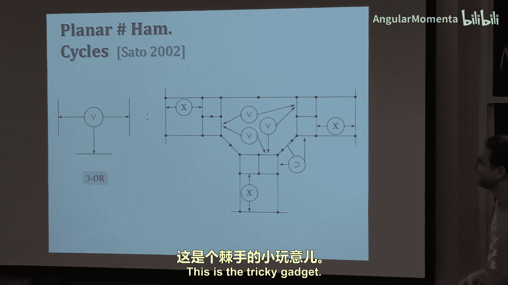
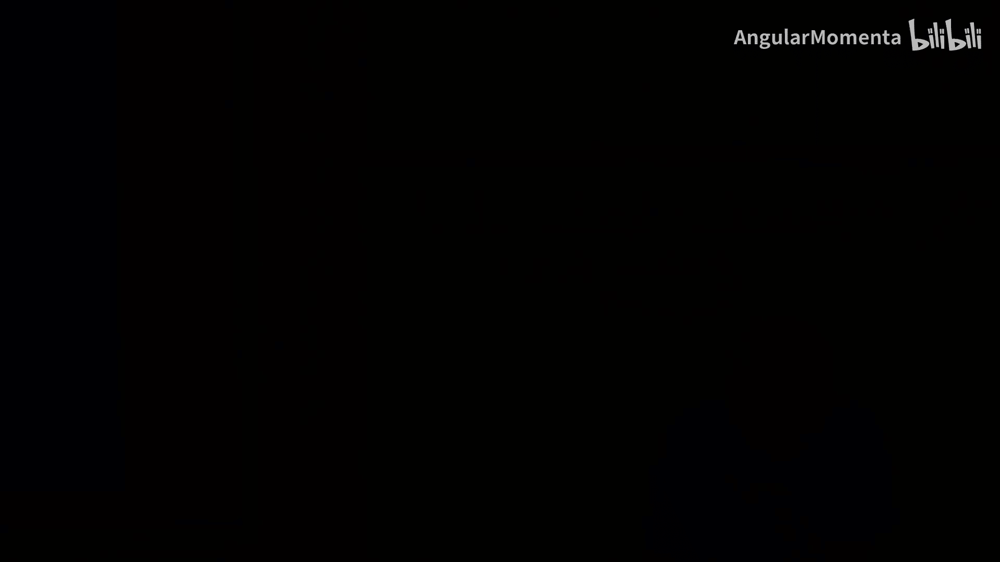

# 【麻省理工】算法下界 ｜ MIT 6.890 Algorithmic Lower Bounds, Fall 2014 p15 15. #P与ASP -BV1dPYpz9E4V_p15-

The following content is provided under a Cative Commons license。

 Your support will help Mi T OpenCourseware continue to offer high quality educational resources for free to make a donation or to view additional materials from hundreds of Mit courses。

 Visit Mitopcourseseware at Ocw。mt。 Eduu。

Alright， today， we are going to learn to count 1，2，3 in an algorithmic sense， of course。

 and prove hardness of counting style problems or more generally。

 any problem where the output is an integer。😊，嗯。Like like approximation algorithms。

 we need to define a slightly stronger version of our NP style problems。

 It's not gonna be a decision decision problem。The remaining type is a search problem。Search problem。

 you're trying to find a solution。 This is just like optimization problem。

 but with no objective function。 Today， all solutions are created equal。

 So we just want to know how many there are。So we're giving an instance the problem。

We want to produce a solution。Whereas in the decision problem。

 we want to know whether a solution exists。With a search problem。We want to find a solution。

Almost the same thing， but。Oh。So that would be a search problem in general， for an NP search problem。

 you can recognize what is an instance and you can recognize solutions to instances in polynomial time。

 given an instance in a solution， you can say， yes， that's a valid solution。Okay。

 for such a search problem， of course， there's the corresponding decision problem， which is。

 does there exist a solution， if you can solve this， then you can solve that。

 You can solve the decision problem in NP P。By guessing a solution。and so on。

 So this is intricately related to the notion of a certificate for an NP problem。

 the idea of solutions are certificates， but when we say a problem is an NP。

 we say there is some way to define certificates so that this kind of problem can be set up。

And the goal here， the point here is to solidify a specific notion of certificate。

 can't just use anyone because we're going to count them that if you formulate the certificates in different ways。

 you'll get different counts， but in general， every NP problem。Can be。

Convertted into an NP search problem in at least one way。

But each notion of certificate gives you a notion of a search problem。Okay。

 in some complexity context， these are called NP relations the way you specify what a certificate is。

 But I think this is the more algorithmic perspective。 Allright， so given such a search problem。

 we turn it into accounting problem。So let's say a search problem is called a。

 then counting problem will be sharp A。Not hashtag a。Some people call it number a。And the problem is。

 count the number。Of。Solutions， for a given instance。

 so in particular you detect whether the number is0 or not zero。

 so this is strictly harder in some sense than the decision problem does or exist a solution。

And we will see some problems where the search problem is polynomial。

 but the corresponding counting problem is actually。Heart。

I can't say NP hard was going to be a new notion of hardness。So some examples。

Pretty much every problem we've defined as a decision problem had a search problem in mind。嗯。

So something like satAT， you you need to satisfy all of the things。

 So there's no objective function here， but you want to know how many different ways。

 how many different variable assignments are there that satisfy the given formula。Or。

You take your favorite pencil and paper puzzle。We'll be looking at Shaka Shaka。Today， again。

How many different solutions are there You'd like when you're designing a puzzle。

 usually you want to know that it's unique。 So it would be nice if you could count the number of solutions and show that it's one。

 These problems are going to turn out to be very hard， of course。

So let's define a notion of hardness。Sharp P is going to be the class of all of these counting problems。

啊。This is the sort of certificate。 Yeah， question。 I it gonna turn there's one solution versus than count。

啊。It's not quite as hard， but we will show that distinguishing。1 from more than one is very hard。

 Is MP complete。 Actually， that's a decision problem。 We can show that that's MP complete。

 So normally， we think of0 versus 1， But it turns out one versus 2 is not or one versus more than one is。

About the same difficulty。 Counting is even harder， I would say。But it's bad news all around。

 There's different notions of bad。嗯。Cool， so this is the sort of certificate perspective with MP。

 we had， I had give you two different definitions， certificate perspective and a non deterministic computation perspective。

 You can do the same computational perspective here。 You could say sharp P is the set of。Problems。

Solved by。polynomial all time。I'll call it a non deterministic counting algorithm。

We don't need Tring machines for this definition， although that was， of course。

 the original definition。 So take your favorite nondeterministic algorithm， as usual for NP。

 it makes guesses at various points， multiple branches。

 with the NP algorithm the way we would execute it on an NP style machine is that we would see whether there's any path that LED to a yes。

 Again， this is going output yes or no at the end。In this case， what the computer does。

 the sharp P style computer is it conceptually， it runs all the branches。

 It counts the number of yeses and returns that number。

 So even though the algorithm is designed to return yes or no。The， when you， when it executes。

 it actually outputs a number。 the original paper says magically。

 it's just as magic as an MP machine， but a little， even a little more magical。😊，um。Okay， so you。

 I mean， if you don't not comfortable with that， would just use this definition， same thing。

This is all。Work done by less valiant。In the late 70s。These notions。Okay， so it's pretty clear。

 It's pretty easy to show all these problems are in sharp P because they were the corresponding decision problems were in NP P。

 we can convert them into。Sharp P algorithms。Now let's think about hardness with respect to Shar P。

 as usual， we want it to mean as hard as all problems in that class。

 meaning that we can reduce all those problems to our problem。

And the question is via what kind of reductions？And here we're going to allow very powerful reductions。

We've talked about these reductions， but never actually been allowed to use them。

Multi call cook style reductions。I think in general， this is a common approach for FNP。

 which is functions， NPP style functions， which you can also think of this as kind of the counting version is the output is a value。

 so you have a function instead of just a decision question。嗯。When the output is some thing。

 some number in this case， you might have to manipulate that number at the end。

 and so at the very least， you need to make a call and then do some stuff before you return your modified answer in your reduction。

 but in fact， we're going allow full tilt。 You can make multiple calls to some hypothetical solution to your problem in order to solve all problems in sharp P and we'll actually use multica a bunch of times。

 We won't always need multi callll。 Often we'll be able to get away with a much simpler kind of reduction。

Let me tell you that kind now。But in general， we allow arbitrary multi call， yeah。

You're not limited in the number of multis。Right， you can do polynomial number of multicols。

 as before， reduction should be polynomial time， but。So you're basically given an algorithm。

 It's usually called an oracle that solves your problem。诶。Solve your problem B。

 and you want to solve。Yeah， you want to solve A by multiple calls to B。Soll。

 we'll see a bunch of examples of that。 Here's a more familiar style of reduction。

And often for a lot of problems， we can get away with this。

 but especially a lot of the early proofs needed the multi call。 And as you'll see。

 you can do lots of cool tricks with multi call。Using number theory。So parsimonious reduction。

 This is for NP search problems。This is going to be a lot like an NP reduction。Regular style。

 So again， we convert an instance。X of a。Fhi a function F into an instance。X prime。B。

And that function should be computable。In poly time。So far， just like an NP reduction。

And usually we would say for a search problem， we would say there exists a solution for x。

 if and only if there exists a solution for x prime。

 that would be the direct analog of an NP style reduction。

 but we're going to ask for a stronger condition which is that the number of solutions。To problem a。

To instance， x equals the number of solutions。Of type B。To instance x prime。Okay， so in particular。

 if this one's greater than equal to 1， this one would be greater than equal to 1 and vice versa。

 So this is stronger than an NP style reduction for the corresponding decision problem。Okay。Yeah。

 so I even read that down。 This implies that the decision problems。Have same answer。So。

 in particular。This implies that we have an NP reduction。So。In particular， if a。

The decision version of A is NP hard， then the decision version of B is NP hard。

 But more interesting is that if a is sharp P hard。Then B is sharp P hard。So but also。

 this holds for NP。For the versions of A and B。Sorry， sharp A。And Sharppy。Okay。

 this is a subtle distinction。For Sharpie hardness。

 we're talking about the counting problems and we're talking about making calls to other counting solutions and then doing things with those numbers and who knows why making many calls with parsimonious reduction。

 we're thinking about the non counting version， just the search problem。And so。

We're not worried about counting solutions directly。 I mean。

 what's nice about parsimonious reductions is they look just like NP reductions for their regular old problems。

 We just need this extra pro property parsimony that the number of solutions to is preserved through the transformation。

 And a lot of the proofs that we've covered follow。F。

 have this property and will be good for us once we， if we can get our source problems hard。

 then we'll get a lot of target problems hard as well。呃。Cool， let me tell you about one more。Version。

Which I made up。ceonious reductions。This is my attempt at understanding the end enyomology of parsimonius。

 which is something like。Something like little money being very thrifty。

 So this is having a little bit more money。 You have C dollars。

 but you have to be very consistent about it。 I should probably add some word that means uniform in the middle there。

 But I want the number of solutions。Of x prime to equal c times the number of solutions。To x。

C is a fixed constant。And it has to be the same。For every X。

This would be just as good from a sharp P perspective， because if I could solve B。

 and I wanted to solve A， I would convert a to B， run the thing， then divide by C。

 There will never be a remainder。 And then I have my answer to A。Okay as long as C is not zero。

he should be an integer here。We will see a bunch of sionious。Reductions， I guess。Yeah。

 it doesn't have to be totally independent of X。 It can depend on things like n。

Something that we can compute easily， I guess。Shouldn't be too dependent on X。 Alright， let's do。

 let's look at some examples， so。'm going to make a list here of。S逼。Complete。Problems。

And we'll start with versions of sat because we like sat。So I'm just going to tell you that sharp。

3 sat。Is hard。 First， sharp S is hard。 and the usual proof of sat hardness shows sharp P completeness for sharp sat。

 And if you're careful about the conversion from Sa to 3 cNF， you can get sharp 3 sad is hard。

 It's not terribly interesting。 And TDious。 So I will skip that one。So。What about planar3at？

I stared at this diagram many times for a while。 This is lecture 7。

For replacing a crossing in a three sat thing with this picture and all of this argument and this table in particular was concluding that the variables are forced in this scenario。

 if you know what A and B are，So once you choose what A and B are。

 these two have to be copies of A and B， and then it ended up that we proved that A1 equald A2 and B1 equald B2。

 and then these variables were all determined by these formula。And so once you know A And B。

 all the variable settings are forced， which means you preserve the number of solutions。So planer。

Sharp3 sat。Is sharply complete。I'd like to pretend that theres some debate within the Sharp Pe community about whether the Shae go here or here。

I've kind of prefer it here， but I've seen it over here， so， you know。啊。Alright， I。

 I don't think I've even seen that mentioned， but I'm sure it's out there somewhere。So， you know。

 let's flip through our other planar hardness proofs。 This is planar monotone rectilinear3at。

 mainly the monotone aspect。 we wanted to there to be all the variables to be positive or negative in every clause。

 And so we had this trick for forcing this thing to be not equal to this thing。

 basically copying the variable with a flip in its truth， but again。

 everything here is forced the variables we make are guaranteed to be copies or negations of other variables。

 So we preserve number solutions。 So this is hard to。Okay， what else。I think we can。

 I've just made this up， but we can add the dash3 as usual by replacing each variable with a little cycle。

What about planar 1 and three cents。 So we had， we actually had two ways to prove this。

 This is one of the reductions and。You know we checked that this set of sat clauses。

 these are the satAT clauses implemented this one and three sat clauses。

 and I stared this for a while， it was kind of hard to tell。

 so I just wrote a program to enumerate all cases and found there's exactly one case where this is not parsimonious。

And that's when this is false and these two are true。And because of these negations。

 you can either solve the internal things like this， or you can flip all of the internal nodes。

 And that will also be satisfied。 Now， this is bad news because。All the other cases。

 there is a unique solution over here。But in this case， there are exactly two solutions。

 If it was two everywhere， we'd be happy， that would be tooonious。

 If it was one everywhere would' be happy or happy， that would be parsimonious。

 But because it's a mixture of one and2， you know， we approximately preserve the counts within a factor of  two。

 but that's not good enough for sharp P。 We need exact preservation。😊，So this is no good。Luckiily。

 we had another proof， which was actually a stronger result， planar， positive rectilinear1 and3 set。

 This was a version with no negation， and this one does work。😊，啊。There was， first of all。

 this the not equal gadget and the equal gadget， I don't want to go through them， but again。

 A was forced to be 0。 C was forced to be 1， which forces B and D to be 0 in this picture。

 so all is good。Again， parsimonious there， and then this one was too complicated to think about so again wrote a program to check trial the cases and every choice of XY Z over here that's satisfied。

 this is a reduction from three sets。 so if at least one of these is true。

 there will be exactly one solution over here。And just as before， after， if 0 of them are true。

 then there'll be no solution here that that we already knew。So good news。

 I should check whether that's mentioned in their paper。

 but it proves planar positive rectiline 1 and  three set is sharp P complete。😊，Shat go here， here。

Mmhm。😊，Okay， so this lots of fun results。 We get a lot of results just from by looking at old proofs。

 Now， they're not all gonna work。😊，啊。But I have one more example that does work。 Shaka Shaka。

 remember the puzzle， so the nioli puzzle every square。

 every white square can be filled in with a black thing， but adjacent to a two。

 there should be exactly two of those and you want all of the resulting white regions to be rectangles possibly rotated。

 and we had this reduction from planar three set。And there's basically this type of wire。

 and there's exactly two ways to solve a wire。One for true， one for false。

 So once you know what the variable is， you're forced what to do。

 there was also a parody shifting gadget and splits and turns， But again。

 exactly two ways to solve everything。 So parsimonious。 and then the clauses。

 everything was basically forced。 just you're forced whether to have these squared diamonds and you just eliminated the one case where the clause is not satisfied。

 So there's really no flexibility here， one way to solve it。 And so the parsimonious reduction。

 And indeed in the paper we mentioned this implies sharpie completeness of counting shock shockka solutions。

Cool。Here's an example that doesn't work。Different Hamiltonity。

 or I guess I want to count the number of Hamiltonian cycles。 Its the natural。

Counting version of Hamiltononicity。So we had two proofs for this。

 neither of them work in a sharp P sense。 This one。

 remember the idea was that you would traverse back and forth one way or the other to get all of these nodes that was a variable。

 that's fine exactly two ways to do that。 but then the clause。

 the clause had to be satisfied by at least one of the three variables， and if it's satisfied。

 for example， by all three variables， then it could be this node is picked up like this or the could be picked up this way or the node could be picked up this way。

 so there are three different solutions even for one fixed variable assignment。So that's bad。

 we're not allowed to do that。It' would be fine if everyone was three， but some will be one。

 some will be two， some will be three。And it's going to be some weird product of those over the closes。

So that doesn't work。 We had this other proof。嗯。The this was a notation for this gadget。

 which forced either this directed edge or this directed edge to be。Inc used， but not both next or。

So that's remember what these things meant and that we had the variable true or false。

 and then we connected them to the clauses。 Then separately， we had a crossover。

But the trouble is in the clauses。Because again， the idea was that the variable chose this guy。

 This one was forbidden。That's actually the good case。

 I think if the variable chose this chose this one， then this one must be included。 That's bad news。

 you if you follow this and then this and then this。

 then you cut off this part of the graph and you don't get one Hamiltonian cycle。

 you want at least one variable to allow you to go left here。

 and then you can go and grab all this stuff and come back。But again。

 if multiple variables satisfy this thing， any one of them could grab this， the left rectangle。

 And so you get multiple solutions， not parsimonious。But。Parts of this proof are useful。

 and they were used to make a parsimonious proof。So the part that was useful is this Xor gadget and the way to implement crossovers。

Just remember that you can build Xhors and that you can cross them over using a bunch of Xhors。

 So only Xor connections， these notations can be crossed in this view。

 we're going build more gadgets。 and this is approved by Sata in 2002。 It was a bachelors thesis。

 actually。In Japan。 And so here you see redrawn the Xor gadget here。

 it's going to be for undirected graphs， same， same structure works。

 And this is do the crossover using XO。 So he's denoting XOs with this big X connected to two things。

Okay， now， given that， we can build an ore gadget， which says that either we use this edge or we use this edge or both。

Okay， here we're not using an XR， but this is the graph， and the key is this has to be done uniquely。

That's in particular， the point of these dots。 This looks asymmetric。 It's kind of weird。

 But let's see， for example， if they're both in， then this guy can do this。And this guy can do that。

But it's not symmetric。 You couldn't flip。 This guy can't grab these points。

That would be a second solution， which would be bad， but we missed these points。

 So this guy has to stay down here if he's in it all。

 And then this guy is the only one who can grab those extra points。 or if just the top guy is in。

Then you do this。And if just the bottom guy is in， I think it's a symmetric， that is symmetric。Okay。

 and it's unique。Good， there's an implication。 So this says if this edge is in。

 then that edge must be in the Hamiltonian cycle。And this is essentially by copying。

 and we just have to grab an extra edge and add this little extra thing just for copying value。

 So if this one is in， then this edge must not be used， which means this edge， if it's used。

 must go straight。 But in particular， this is not used。 and we have an or。

 that means that this one must be forced by property of ore。 On the other hand， if this is not set。

 this one must be used。So I guess this must be an edge that was already going to be used for something。

 so that edge is just going to get diverted down here。

And then the or doesn't constrain this at all because zero or1， this one is one， so the or is happy。

So that's an implication。 It's gonna be a little more subtle how we combine these。 This is the。

 this is the。

Tricky gadget。 I sort of understand it。 but there's a lot of details check。

 especially on the unique mis front。 but this is a three way or， which we're using for claws。

 sackclos， of course， three sack clauses。 We want at least one of these three edges to be in the Hamiltonian cycle。

 And so here we use X ors ors implications。The more。 I'll show you the intended solution。

 assuming I can remember it。So let's say， for example， this edge is in the Hamiltonian cycle。Then。

We're going to do something like go over here。Come back around。Like this。 And then。

You just finally did that explain already？This Xor。No， I went here。 Oh， then I went up Good。

 So actually， I have to do this and around。 Yeah， so these。

 all these constraints are thrown in basically to force it to be unique without them。

 You could still， it would still work， but it wouldn't be parsimonious。Okay， let's see。

This doesn't constrain me。This， this one。Good。And go up there。 So I did exactly one of those。

 And then I need to grab these。 Okay， so that's one picture。

 I think it it's not totally symmetric Again， So you have to check all three of them。

 And you have to check， for example， it's not so hard。 Like if this guy was also in。

 I could have just gone here。 and this guy would pick up those notes。 So as long as and in general。

 long as at least one of them is on。 you're okay。 And furthermore， if they're all on。

 there's still a unique way to solve it。 And I'm not gonna go through that。

 but it's thanks to all of these constraints， theyre cutting out multiple solutions。Okay， so。

Now we just have to put these together。 This is pretty easy。 It's pretty much like the old proof。

 Again， we have we represent variables by having these double edges so you have in a Hamiltonian cycle you're going to choose one or the other and then we have this exclusive or forcing Y and Y bar to choose opposite choices and then there are these exclusive ors to say if you chose that one then you can't choose it for this clause and then the clauses are just represented by those threeway or's。

 So this overall structure is the same the crossovers are done as before and it's really these gadgets that have changed。

And they're complicated， but it's parsimonious。 So with a little more work。

 we get that the number of Hamiltonian cycles in planar。Max degree3 graphs is sharpr P complete。So。

So that's nice。And。From that， we get slither link。 So this is。

 I've sort of been hiding these facts from you when we originally covered these proofs。 these。

 these papers actually talk about。This one doesn't quite talk about Sha P。

 but it is also Sha P complete counting。 The number of solutions。 Just Li link is， is Sha P complete。

 This was the puzzle again。 have to have that number of adjacent edges。Each number。 and this。

 the proof was a reduction from planar Max degree3 Hamiltonian cycle。And at the time I said， oh。

 you could just assume it's a grid graph and then you just need the required gadget。

 which is the B part。Just need this gadget。 This was a gadget because it had these ones。

 It meant it had to be traversed like a regular vertex in Hamiltonian cycle。

 And it turns out there was a way to traverse it straight or returns。

And then we could block off edges wherever there wasn't supposed to be an edge。

 And so if you're reducing from Hamiltonity in grid graphs， that was the whole proof。

 And we were happy。 Now， we don't know whether Hamiltonity in grid graphs is sharply complete。We。

To prove that， we would need to be able to put bipartite in here。

 and I don't know of a proof of that。 It's a good open problem。

So this was the reason that they had this other gadget。

 which was to make a Hamiltonian to make these white vertices that don't have to be traversed。

 They're just implementing an edge， basically， Sos just the black vertices have to be traversed。

 we needed that for drawing things on the grid。 But if you just don't put in the ones and adding these zeros。

 again， you can traverse it or not at all。And this one is you can read here， it says。

This would be bad to have happen。 And in fact， you can rule it out it will never happen in the situations we want。

 because the white vertices only have two neighbors that are。Tversesible。Cool， And then， furthermore。

 all of these solutions are unique。 There is exactly one way to go straight。

 There's exactly one way to turn right， exactly one way to turn left。

 That's the subtle thing that was not revealed before。 But if you stare at it long enough。

 you will be convinced。😊，Okay， so this is a parsson money' reduction from Planar max degree 3 Hamiltonian cycle to Slither link。

 So accounting solutions in slitherlink is hard。 That was the。Fully worked out。Example。Any questions。

Yeah。So are there examples ofs NP whose counting versions are sharply complete Yes。

 and that will be the next topic？Well， it's gonna be a little while till we get there。

 but I'm gonna prove things。 and then we will get to an answer。 But the answer is yes。嗯。So。

So if we wanted to if we're like thinking about a problem that we're trying to bruise MD heartt and we start thinking maybe stop。

 we would just you know show it in P by finding an algorithm。

 is there a nice way to show that our problems is not and not for key heartt？Well。

 you usually you would say that sharp， that problem is in P。

You would find a polynomial count algorithm。And there are lots of examples of polynomial counting algorithms。

 especially on like trees， typical thing is you dynamic program。

 so like maybe you want to know let say you have a rooted binary tree and for each node you could flip it this way or not how many different ways are there to do that and maybe you have some constraints on how that's done then you just try it。

 flip and try it not， you do dynamic programming and then you multiply the two solution sizes together and you get the overall solution size so you basically do combinatorics and if there's independent choices you multiply if they're opposing choices you add that kind of thing and from that you get polynomial time counting algorithms and in tree like things that often works。

I about true with Do we know of NP problems whose count problems are not sure for you。

I would say generally， most problems that are hard to decide are hard to counts。

 And where MP P hard implies sharp P hard。 I don't think there's a。Hard theorem in that。There's。

 there's nothing that really says the mean that says that， but that's the feeling。Yeah。Be nice。

 Then we wouldn't have to do all the parsimonious work， but。Alright。

 so it's time for a little bit of linear algebra。Let me remind you。

 I guess linear algebra' is not a prere for this class。

 but probably you've seen the determinant of a matrix and you use if it's zero， then it's not invert。

lah， blah， blah Let me remind you of a definition。And we rarely use matrix notations。

 so let me remind you of the usual one。N by N， square matrix， this is a polynomial time problem。

 It is， but I'm going define it in an exponential way。

 but you probably know a polynomial time algorithm。This is not an algorithms class。

 so you don't need to know it。呃。But it's based on Gaussian elimination， the usual one。

So you look at all permutation matrices， all n by n permutation matrices。

 which you can think of as a permutation pi on the numbers one through n。

 and you look at I comma pi of n that defines a permutation matrix。

 you take the product of the matrix values， if you superimpose the permutation matrix on the given matrix A。

You take that product。You possibly negate it if the sign of your permutation was negative。

 if it does an even number， odd number of。Of transpositions。 then thats this will be negative。

 otherwise will be positive。 and you add those up。 So， of course。

 an exponential number of permutations， you wouldn't want to do this as an algorithm。

 But turns out it can be done in polynomial time。The reason for talking about this is by analogy。

 I want the notion of permanent。Of an n by n matrix， the same thing， but with this removed。

Permanent of a。Is the sum overall permutations pi of the product from I equals1 to n of AI。排在。Now。

 this may not look like a count problem。 turns out it is a count problem。

 sort of weighted count problem。 We will get back to count problems in a moment。

 This is related to the number of perfect matchings in a graph。But at this point。

 it's just it's a quantity we want to compute。 This is a function of a matrix。

 and computing this function is sharp peak complete。

So if you just been signed about minus12 is signed。Yeah。I don't know。 It depends。

 If you call the number of transpositions。Moud2。So then 0，1。 You know what I mean。Cool。All right。

So the claim is permanent is Sha P complete。 We're going to prove this。

 This was the original problem proved Shar P complete， well other than Shar 3 sat， I guess。

Same paper。嗯。Great。呃。So let me give you a little intuition of what the permanent is。

 We'd like a definition that it's not so algebraic。 I least I would like one more graph theoretic。

 be nice。 So here's what we're gonna do。 We're going convert a R matrix into a weighted graph。And。

Then。call the other board。OkayHow do we convert into a weighted graph， weighted directed graph well。

The weight from vertex I to vertex J is AI J。It's kind， the obvious transformation。If it's 0。

 then there's not going be an edge， although it doesn't matter。

 you could leave the edge in with weight 0， it will be the same because what we're interested in and the claim is the permanent of the matrix。

Equals。The sum。Let's say the product。Edge weights。Over all cycle cover。Of the graph。Okay。

 this is really just the same thing， but a little bit easier to think about。

 So a cycle cover is kind of like a Hamiltonian cycle， but there can be multiple cycles。

 So at every vertex， you should enter and leave。And so you have sort in degree1 and out degree 1。

 So you end up decomposing the graph into vertex disjoint cycles， which hit every vertex。

 That's a cycle cover。Porent note here。 we do have loops in the graph。

 We can have loops if AI I is not0， then you have a loop。 So the idea is look at every。

 every cycle cover and just take the product of the edge weights。That are edges in the cycles。

And then add that up over all cycle covers。 So it's the same thing。

 If you stare at it long enough because you're going from I。 I mean。

 this is basically the cycle decomposition of the permutation。 if you know in permutation theory。

Okay， so if you don't， don't worry， this is your definition of permanent。嗯。

So we're going to prove this problem is sharpr P complete。And we're going to prove it。By a。

Cmonous reduction。From。Sharp three set。You said this is the original thing introducing that， yes？

Did they not call it see？You made up the terms you。 Yeah， what did they call。

I think they just called it a reduction。In this， I think pretty sure they just called it reduction。

 And for them， and they said at the beginning， reduction means multi call reduction。

So they were thinking about that。 But it turns out to be a sonious reduction。

C will not be literally a constant， but it will be a function of the problem size。

And this is the reduction。So as usual， we have a clause gadget and a variable gadget。

 And then there's this shaded thing， which is this matrix。嗯。Which you can think of as a graph。

 but in this case， itll be easier to just think of as a black box matrix。Okay。

 all of the edges in these pictures have weight one。And then these edges are special。

 And here you have some loops。In the center， no one else has a loop。So， the。

High level idea is if you're thinking of a cycle cover。

In a vertex because sorry in a variable because you've got a vertex here in a vertex here。

 you have to cover them somehow， and the intent is that you either cover this one this way。

Or you cover this one that way。 Those will be the true and the false。And then。Okay。

 from the clause perspective， we we need to understand。 so then these things are connected。

 This thing would go here and this thing would go here and generally connect variables to clauses in the obvious way。

 and in general， for every occurrence of the positive form and the negative form， sorry。

 positive or negative form， you'll have one of these blobs that connects to the clause。

 So overall architecture should be clear。 what does this gadget do。It has some。

 some nifty properties。Let me write them down。So this matrix is called X in the paper。

So first of all。Permanent of x equals 0。I'm just gonna state these。 I mean。

 you could check them by doing the computation。 So we're interested in cycle covers whose products are not zero。

 Otherwise， they don't contribute to the sum， right， So I could also add in non zero。

Meaning the product is non zero。Okay， so if we had a cycle cover that just。

Where the cycle cover just locally solved this thing by traversing these four vertices all by themselves。

Then that cycle would have permanent 0。 And then the permanent of the whole cycle cover is the product。

Of those things。 And so the overall thing will be 0。 So if you're looking at a non zero cycle cover。

 you can't just leave these isolated。 You have to visit them。 You have to enter them and leave them。

Okay， now the question is， where could you enter and leave them。

 It's maybe not totally clear from the drawing。 But the intent is that the first vertex。

In which corresponds to row 1 and column 1 here is the left side。

 and the column 4 row 4 is the right side。 I claim that you have to enter at one of those and leave it the other。

Why is that true？For a couple reasons， one is that the permanent。Of x with。Row and column 1 removed。

Is 0。And so is the permanent。Of X with row and column 4 removed。可呃。

Vertex 1 and 4 out of out of this X matrix are the only places you could enter and leaf。

 but it's possible you enter and then immediately leave。 So you just touch the thing and leaf。

 that would correspond to leaving behind a 3 by3 sub matrix either by deleting this row column or by deleting this row column if you just visit this vertex and leaf those also have permanent0。

 So if you're looking at a non-zero cycle cover， you can't do that。So together。

 those mean that you enter at one of them and leave at the other。And furthermore。If you look at。嗯。

The permanent。Of X with rows and columns。1 and 4 removed， both removed。That's also zero。

So the permanent of this matrix is 0。 and therefore， you can't just enter here， jump here and leave。

 which means finally， you have to traverse all four vertices。 You enter one of them。

 traverse everything and leave it the other。So basically， this is a forced edge。If you touch here。

 you have to then traverse and leave there。In any cycle cover。

So we're used to seeing four edges in a Hamiltonian cycle。 This is sort of a stronger form of it。

 That's cool。 now one。Catch。So if you do that， if you enter， let's say。

 vertex1 and leave it vertex 4， you will end up。Your contribution to the cycle。

Will end up being the permanent of x minus row 1， and column 4。Or symmetrically with four and one。

You'd like this to be one， but it's4。So there are four ways to traverse the force edge。

 But because it's always 4 or0， and then it doesn't contribute at all， it's always gonna be 4。

 So this will be a nice uniform blow up in our number of solutions。C is not going to be4。

 but it's going to be 4 to some power。It's going to be four to the power。

 the number of those gadgets。So because you can predict that， I mean， in the reduction。

 you know exactly how many there are。 It's not dependent on the solution。

 It's only dependent on how you built this thing。 So at the end。

 we're going to divide by 4 to the power。It's， I think。Five times the number of clauses。So。

C is going to be 4 to the power of five times number of clauses。

 because there are five of these gadgets per clause。So at the end。

 we'll just divide by that and be done。At times because you've got it on the variable side too。呃。Yes。

10 times。 Thank you，Two of them did not connect to variables。 Yeah，8。8ight times number of classes。

 cool。All right。So now it's just a matter of now that you understand what this is。

 now you can sort of see how information is communicated because if the variable。

 say chooses the true setting。It must visit these edges。 And once it touches here。

 it has to leave here。 And this is a edge going the wrong way。

 So you can't try to traverse from here， you cannot touch the clauses down below。

 Once you touch here， you have to go here and then you must leave here and so on。

 But you leave this one behind and it must be traversed by the clauses。 And vice versa。

 if I choose this one， then these must be visited by the clauses。So from the clause perspective。

 as he said， there are five of these gadgets， but only three of them are connected。

 so these guys are forced。啊。And there's a bunch of edges here。 And it's a case analysis。

 So be the short version。 Let's just do a couple of examples。

 If none of these have been traversed by the variable。

Then the pretty much you have to go straight through。But then you're in trouble。

Because there's no pointer back to the beginning， you can only go back this far。

So if you have to traverse all these things， it's not possible with a cycle cover。

But if any one of them has been traversed。 So， for example， if this one has been traversed。

 then we'll jump over it， visit these guys， jump back here， visit this guy and jump back there。

 And if you check， that's the only way to do it。 It's unique。And similarly。

 any one of them has been covered， or if all three of them have been covered。

 or if two of them have been covered， in all cases is a unique way。

From the clause perspective to connect all the things。 Now， in reality。

 there's four ways to traverse each of these things。 So the whole thing grows by this product。

 But it doesn't matter which cycle they appear in， will always scale the number of solutions by factor 4。

So it's nice uniform scaling， sonious。And that's permanent。 It's pretty cool。Pretty cool proof。

 now one。Not so nice thing about this proof is it involves numbers， negative 1， 0，1，2， and 3。

For reasons we will see in a moment， it would be really nice to just use 0 and one。

And it turns out that's possible。But it's kind of annoying。It'snifty， though。

 I think this will demonstrate a bunch of fun number theory things you can do。So next goal is 0。

1 permanent。 When the matrix is just zeros and ones， this is。Sharp P complete。

I'll tell you the reason that is particularly interesting。As it gets rid of the weights。

 it makes it more clearly。呃。Makes it more clearly a accounting problem。 So first of all。

 it is the number of cycle covers in the corresponding graph。It's no more weights。

 It's just if it's a 0， there's not an edge。 And you can't traverse there。

 if it's a one you can traverse there， and then every cycle cover will have product one。

So it's just counting them。 but it also happens to be。The number of perfect matchings。

In a bipartite graph。Which bypartid graph。啊。The bipartid graph where one side of the bipartition is the rows。

And the other side is the columns of the matrix。And you have an edge， I J。If and only F AI， sorry。

I J is's not a good。It's not the best terminology for I， where I here is a vertex of V1。

 and J is a vertex of V2。Whenever I J equals1， if it's 0， there's no edge。

How was it's a little confusing because the matrix is not symmetric。 So you might say， well。

 how does this make an undirected graph，ca you could have an edge from I to J， but not to J to I。

 That's okay because I is interpreted in the left space and J is interpreted in the right space。

 So the asymmetric case would be the case that。There's an edge from here to here。

 but not an edge from here to here。 That's perfectly。 okay。 This is 1，2，3 for a 3 by 3 matrix。

We get a six vertex graph， not three vertex。That's what allows you to be asymmetric on a loop。

 what we were normally thinking is a loop just means a horizontal edge。Okay， so it turns out。

If you look at this graph， which is a different graph from what we started with。

The number of perfect matchings in that graph is equal to the number of cycle covers in the other graph。

In the directed graph， so this one's undirected and bypartite。 this one was directed and not byite。

And the rough intuition is that we're just kind of。Pulling the vertices apart into two versions。

 the left version and the right version。 If you imagine there being a connection from one right to one left and similarly from2 right to two left。

 directed。And three right to three left， hey， it looks like cycles again， you went here。

 then you went around， then you went here， then you went there。 That was a cycle。 And similarly。

 this was a cycle。 So theyre the same thing。Okay， this is cool because perfect matchings are interesting。

 in particular， perfect matchings are easy to find in polynomial time。

 but counting them is sharply complete。😊，Geting back to that question。So that's why we care about01。

Permanent or one reason to care about it， let's prove that it's hard。

And here we'll use the number theory。Pretty basic number theory。

So first claim is the computing the permanent of a matrix， general matrix， not 01， modo。

 given integer R is heart。呃。R has to be an input for this problem。 not like computing at Mov 3。

 necessarily as hard， but computing it modo， anything。Is hard。

And here we're going finally use some multicolor reduction power。So the idea is。

 suppose you could solve this problem。 Then I claim I can solve permanent。Anyone know how？

Chinese remainder Chineseine remainder theorem。Okay， if you don't know the Chinese remainder theorem。

 but you should know it， it's good。So the idea is we're gonna set R to be。All primes。Up to。嗯。

How big what we can stop when the product of all the primes that we've considered。

Is bigger than the potential permanent。And the permanent is at most M to the n times n factorial。

 where M is the largest absolute value in the matrix。Okay， that's one upper bound。

Doesn't really matter。 But the point is that it's computable。 And if you take the logarithm。

 it's not so big。 All these numbers are at least two。 All primes are at least2。

So the number of primes we'll have to consider is at most log based two of that。So， this means the。

Ps。It must log of n to the n times n factorial。 And this is roughly。I'll put a tilde here。

 This is like n log M。 That's exact plus log n。 That's approximate。 But， you know。

 it's minus little M minus order n， so。One hurt us， so that's good， that's polynomial。

Lo M is a reasonable thing。 M was given us as a number。 So log M is part of， is an input。

 size variable input。And it's obviously good。Ass the dimension， the matrix。

 So this is a polynomial number of calls。 We're going to compute the permanent mod R for all of these things。

 And then Chinese remainder theorem tells you， if you have， if you know a number。

 which is the permanent modular， all primes whose product， Well。

 if you know a number modular a bunch of primes， then you can figure out the number modo。

 the product of those primes。 And if we set the product to be bigger than the number could be。

Then we knowing it modulo， that is actually knowing the number itself。 Okay。

 so then we can reconstruct the permit。So here we're really using multicol。Cool。

I think that's the first time I've used Chinese remainder theorem in a class that I've taught。

Good stuff。Do know why it's called the Chinese I assume it was proved by a Chinese mathematician。

 but I'd anyone know this history。Sun too， okay。Pard of him。😀NotOh， okay， I don't know then。

 Another son， too。😊，Cool， yeah， so。Permanent mod R is hard。 Next claim is that the 0，1 permanent。

Mod R。It's hard。The whole reason we're going to mod R， I mean。

 it's interesting to know that computing permanent modar is just as hard as permanent。

 but it's kind of a standard thing。The reason I wanted to go to mod R was to get rid of these negative numbers。

 N numbers are annoying。 Once I go to mod。Any R N， negative numbers flip around。

 And now I can think of everything as positive for not a negative。Okay。

 now I can go back to Gadget land。So suppose I have an edge of weight 5。

 This will work for any number greater than one。 That's 1。 I don't touch it。If it's greater than 1。

 I'm gonna make this thing。啊。And the claim is， there are exactly five ways to use this edge。

 Either you don't use it and you don't use it。 But if you do use it。

 there are exactly five ways to use it。 If you make this traversal， there are five ways to do it。

Remember， it has to be a cycle cover。 so we have to visit everything。If you come up here。

Can't go that way。 Gotta go straight。 Can't go that way。 Gotta go straight。 Okay， so， in fact。

 thepressless cycle cover must be entirely within this picture。And so， for example。

 you can say that's a cycle。 and then that's a cycle。 These are loops。 then that's a cycle。

 And then that's a cycle。 And then that's a cycle。 And then that's a cycle。 And oops。

 I'm left with one vertex。 So， in fact， I have to choose exactly one of the loops。

Put that in when the rest can be covered。 So for example， if I choose this guy。

 then this will be a cycle。 this will be a cycle。 This will be a cycle， perfect parodity。

 This will be a cycle。 This will be a cycle。 and this will be a cycle。 Can't choose two loops。

 If I chose like these two loops， then this guy would be isolated。

 So you have to choose exactly one loop。And there's exactly five of them。 And in general。

 you make their B K of them if theyre， if you want weight K and you can simulate。

 if you don't use this edge， then there's actually only one way to do it。

 You have to go all the way around like this。So that's cool。 If you don't use the edge。

 didn't mess with anything。 If you use the edge， you get a weight of 5 multiplicativecause this is independent of all the other such choices。

So you can simulate a high weight edge， modular R。you can， in general。

 you can simulate a non negative weight edge like this。Just these are all weight1， obviously。

 and absent edges are 0。So， we can convert。In the modular R setting， there are no negative numbers。

 essentially。 so we can just do that simulation。 Everything will work mod R。So use gadget。Cool。呃。Now。

 finally， we can prove 01 permanent is hard。Why， because if we can compute the 01 permanent。

 we can compute it mod R。Just compute the permanent。Take the answer mod and you solve 0。

1 permanent mod。 So this is， this is what I might call a one call reduction。

 It's not our usual notion of one call reduction because we're doing stuff at the end。

But I'm going to use one call in this setting。Just call it。 In fact。

 we don't even have to change the input。 then we get the output。 We compute it on our question。

So and there the weight， you can have really high weight。

 but then you're amplifying the number of nodes。So then when these that wouldn have been。嗯。Oh。

 I see if the weights were exponentially large， This would be bad news。

 but they're not exponentially large because we know they're all at most three。

They're between negative 1 and 3， oh。Oh， but negative one，Yes， okay， good。

 I need the prime number theorem。Thank you。 So we have numbers negative one。

 Then we're mapping them modular sum prime。 Now negative1 is actually the prime -1。So indeed。

 we do get weights that are as large as are。So this is R here is sort of where' assuming is encoded in unary。

It turns out we can afford to encode the primes in unary because the number of primes that we use is this polynomial thing。

Wely polynomial thing。 And by the prime number theorem。

 the prime with that index is roughly that big， it's a log factor larger。So the primes are gonna。

 the， the actual value of the prime is gonna be something like。And log M。Times log base E of N log M。

By the prime number theorem and that's again， weekly polynomial。

 and so we can assume r is encoded in urary。Good。We get to use a prime number theorem。That's funny。

That's the first time you had to use probably。I' pretty sure I've used prime no theorem。

 if and only if I've used Cha Chinese remainder theorem。They go hand in hand， right。Cl。

 so this was of kind of roundabout way。 But we ended up getting rid of the negative numbers。Luckily。

 it' still worked。 And now0，1 Per is hard， therefore。

 counting the number of perfect matchings in a given bipartid graph is empty hard。

 These problems were equivalent。 It like they're identical。 So you could。

 this was a reduction in one way， but it's equally reducible both ways。😊。

So you can reduce this one reduce this one to perfect matchings or vice versa。All right。

Here's some more fun things we can do。I I can add to my list here， but。In particular， we have。

01 permanent。So。There are other ways you might be interested in counting matchings。So so far。

 we know it's hard to count perfect matchings。 So in a。In a balanced bipartite graph。

 we had n vertices on the left and n vertices on the right。 We're gonna use that。

 Then the hope is that there's matching a size N。 But in general， you could just count。

 maybe those don't exist at all。 Maybe just want to count maximal matchings。

 These are not maximum matchings。 Maximal， meaning you can't add any more edges to them。

They're locally maximum。Well， so that's gonna be a bigger number。It's gonna be always bigger than0。

Cause the empty matching， well， you could start with the empty matching and add things。

 Youll get at least one maximum mole matching。 but this is also sharp P complete。

 And you can prove it using some tricks from bipartite。Perfect matching counting。呃。

Don't have a ton of time。 So I'll go through this relatively quick。

 We're going to take each vertex and convert it。 and basically make n copies of it。

And when we have an edge。That's gonna turn into。I buy a clique between them。

Why I address such a big one。u。Okay。This was supposed to be N and N。Okay， so just blow up every edge。

 My intent is to make matchings become more plentiful。呃。So。In general。If I used to have a matching。

Of size I。I end up converting it into n factorial to the I power。Distinct matchings。Of size。

 n times I。Okay， because what if I use an edge here。Now。

 I get to put in arbitrary perfect matching in this bicle and their in factorial of them。Cool。

Why did I do that？Because now I suppose that I knew how to count the number of maximal matchings。

 So they're going to be matchings of various sizes。 And from that。

 I want to extract the number of perfect matchings。 Sounds impossible。

But when you make things giant like this， they kind of， all the matching is kind of separate。

 It's like biology or something。Chemistry。Let's see。It shows how much I know。

 number of maximal matchings。Is going to be some。I equals0 to n over 2。

 that's the possible sizes of the matchings。Of the old matchings， I should say， number of original。

Maximal。Matchings in the input graph。OfSize I。Times and factorial to the eye。Guy。

 this is just rewriting。 I'm just this thing， but I'm summing overall I。 So I have， however。

 many matchings。 I used to have a size I， But then I multiply them by n factorial to the eye。

 becauseuse these are all independent。嗯。Cool。And this thing。

The original number of matchings in the worst case， I mean。

 the largest it could be is when everything is a bike leak。 and then we have n over 2。Factorial。嗯。

Maximal matchings originally。And this is smaller than that。And therefore。

 we can pull this apart as a number modular n factorial。

And each digit is the number of maximal matchings of each size。 and we look at the last digit。

 we get all the the number of maximal matchings of size n over  two。

 also known as the number of perfect matchings。Question。So the second max is max。Yes。

 this is maximal。Other questions。So again， a kind of number three trick by blowing up。Well， by yeah。

 by making each of these get multiplied by a different huge number， we can pull them apart。

 separate them。 and in logarithm， these numbers are not huge。 So it is actually plausible。

 you could compute this thing。And a tree graph， you definitely could do it by various multiplications at each level。

Allright， so that's nice。Let's do another one。sThat flavor？

So find you could use the sivvariristosins We can handle pseudopoly here because as we argued。

 the primes are not that big。 So we could just spend， we could just do siv sivvariristoinies。

 We can afford to spend linear time in the largest prime。Or quadratic in that。

 even you could do the naive algorithm。Yeah。We not。

 we're not doing real algorithmic number theory here like crypto， where you have to be more careful。

All right。So。Here's another question。 What if I just want to count the number of matchings。

 No condition。This is going to use almost the reverse trick。So no maximal constraint。

 just all matchings， including the empty matching。 count them all。

We'll see why in a moment this is quite natural。So I claim I can do a multi call reduction to bipartite number of maximal matchings。

And here are my calls for every graph G。 I'm going to make a graph G prime。Where if I have a vertex。

 I'm going to add K extra nodes connected just to that vertex。So these are leaves。

And so if this vertex was unmatched over here， then I have K different ways to match it over here。

And my intent is to measure this number of matchings of size n over 2 minus k。That would be the hope。

 but。Well， okay。So if I have MR matches matchings。Of size R over here。These will get mapped， too。

MR times K plus1 to the R。Matchings。Of size。No， not of size。Matchings over here。啊。

Becauseuse for each1， I could either leave it unmatched or I could add this edge or I could add this edge or I could add this edge。

 And that's true for every unmatched vertex。 So sorry， this is not size R。

 This is size n over 2 minus R。 R is going to be the number of leftover guys。

 Then it kind of pops out over here。 So I'm going to run this algorithm。

 I'm going to compute the number of matchings in G K for all K。Up to like， n。Over two plus one。Okay。

😊，So。I'm going to do this。 And what I end up computing is number of matchings。In each GK。

Which is going to be the sum overall R。R is 0 to n over 2。Of MR。

The original number of matching of size n over 2 minus R。Times k plus1 to the R。Now， this。

Is a polynomial in K plus1。And if I evaluate a polynomial。At its degree plus 1 different points。

 I can reconstruct the coefficients of the polynomial and therefore get all of these。

 And in particular， get M 0， which is the number of。Perfect matches。た的。Cool。Okay。Having too much fun。

Enough matchings。We have all these versions of sat， which are hard。But， in fact。

 there are even funnier versions like。Positive twoat。Positive2at is really easy to decide。

 but it turns out if I add a sharp， it is sharply complete。 This is sort of like max2 set。

 But here you have to satisfy all the constraints， but you want to count how many different ways there are to solve it。

This is the same thing as vertex cover。 remember， vertex cover is same as positive2 set。

 So also sharp vertex cover is hard and therefore also sharp clique is hard。

So this is actually a parsimonious reduction from bipartite matching。

That's why I wanted to get there。So， for every edge。We're going to make a variable X of E。

Which is true if the edge is not in the perfect matching。And so then， whenever I have。

Two incident edges。E and F， we're going to have a clause。

 which is either I don't use E or I don't use F。That's two set。Dan。Satisfying， it's parsimonious。

 So satisfying assignments will be one to one with。Bpartite matchings。

 So this is why you should care。 And if we instead reduce from。

 do they era it bypartite maximal matchings。U here， then I get the， the counting， the number of。

Maximal。Maxxiimically true assignments that satisfy the two Sac clause is also hard。

For what it's worth， so a different way of counting。That。

Maximmal means you can't set any more variables true。 Yeah。

 since the edges in your positive two set reduction are。

The variables there are true when the edges is not in matching， I think it's maximally false。

So also true true Yes， right， right， right。 Sorry， I see。 right。 So as minimal solutions for 2 cent。

 Thank you。嗯。Okay， in fact， it's known that。3 regular。Bpartite。Plainer。Sharp for text cover。Oof。

I won't prove this one， but so in particular， you can make this planer。

Although it doesn't look like we have positive here， and you can also make it bipartite。

 which doesn't mean a lot in Tat land， but it means makes a lot of sense in vertex cover land。

In my zero remaining minutes， I w to mention one more concept。

To go back to the sort of original question of uniqueness for puzzles。

And you'll see this in the literature。 if you look at it， a lot of people won't even mention Shar P。

 but they'll mention ASP。A SP is slightly weaker， but for most intents and purposes。

 essentially identical notion to Sha P and from a hardness perspective。The goal for A S in general。

 if I have a problem， a search problem， like we started with。

 the AP version of that search problem is， I give you a solution。 and I want to know。

 is there another one。OkayThis is a little different from everything we've seen because I actually give you a starting point。

 And there's some problems where this helps a lot。 For example， if the solution is never unique。

 like coloring， if I give you a K coloring， I can give you another one。

 I'll just swap colors1 and two or more subtle。 if I give you a Hamiltonian cycle in a three regular graph。

 There's always a way to switch it and make another one。😊，So。AP is sometimes easy， but。

You basically use the same reductions。 If you can find a parsimonious reduction that also has the property。

 So parsimonious reduction， there is a one to one byjection between solutions to x and solutions to x prime。

 If you can also compute that。Byjection， if you can convert a solution from one to the other。

 which we could do in every single proof we've seen and even the ones we haven't seen。

 you can always compute up that bijection between solutions of a to solutions of B。

 And so what that means is if， you know， if I can solve。呃，B。SoSo let's consider the ASP version of a。

 where I give you a solution。 If I can convert that solution into a solution for my B problem。

 And then with the parssemon reduction， I also get a B instance。Then， I can。

Sold the ASP problem for B。 That's a decision problem。 Is there another solution， If yes。

 then a will also have another solution， because it's parsimonious。 The numbers will be the same。

 We don't need a weaker version of parsimony。 We don't。

 We just need that one and more than one are kept the same。 If This one was unique。

 then this one should be unique。 This one wasn't unique， then this one should be not unique。

 If I can solve B， then I can solve A。 Or if I can solve A SP B， then I can solve AP A。

A lot of these proofs are done so calledled ASP reduction is usually done by a parsimonious reduction。

 And so in particular， this was introduced。 This concept is introduced in the likes of like slither link。

 I think was one of the early ASP completeness proofs。

 And they were interested in this because the idea is if you're designing a puzzle。

 Usually you design a puzzle with a solution in mind。

 But then you need to make sure there's no other solution。 So you have exactly this setup。

And if you want a formal definition of ASP completeness， it's in the notes， but it's not that。

Difficult， the key point here is if you're gonna prove sharp P or ASP completeness。

 you might as well prove the other one as well。 Get it twice the results for basically the same reduction。

 All the versions of three sad and one and three sad and all those things。

 those were all parsimonious。 and all of those are ASP complete as well。

 But once you get into sonious， you're no longer preserving one versus more than one。

So while you preserve from accounting perspective and multicol reductions where you can divide that off。

 that's fine。 But from an ASP completeness perspective， you're not fine。 So in fact。

 all the stuff that we just did with the permanent matchings and two sharp twoat。

 they're sharply complete。 they may not be ASP complete。

But you'll notice the puzzles that we reduced from like。Whatever Shaka Shaka is one of them。

 that was from a version of  threeat。And the， the other one we had was from a version of Hamiltononicity。

The the sky。These were， which was also from 3 cents。 So these are all ASP complete also。Yeah。

 but if you use the weirder things like too sad。You don't get that。So usually in one proof。

 you can get N hardness， AP hardness and Sha P hardness。

But if you're going to go from these weirder problems with sonous reductions。

 then you only get sharprie hardness because they're not even NPR。Cool， alright， thank you。

