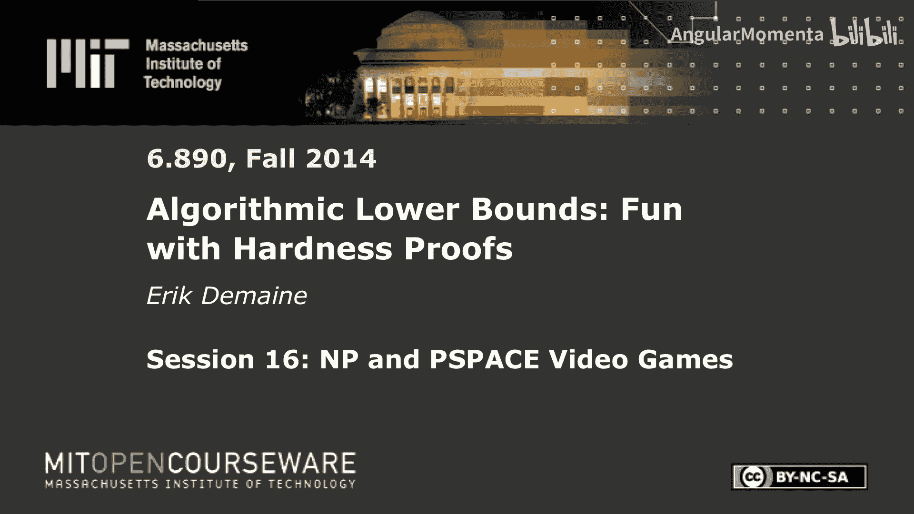

# 【麻省理工】算法下界 ｜ MIT 6.890 Algorithmic Lower Bounds, Fall 2014 p16 16. NP与PSPACE电子游戏 -BV1dPYpz9E4V_p16-

The following content is provided under a Cative Commons license。

 Your support will help Mi T OpenCourseware continue to offer high quality educational resources for free to make a donation or to view additional materials from hundreds of Mit courses。

 Visit Mitopcourseseware at Ocw。mt。 Eduu。

Al right， today， we go back to fun with hardness proofs in games。

 It's been a while since we've done many games and puzzles。

 So today we're going to talk mostly about this one paper。

 which has a ton of results in it by Giovannigta。 Gaming is a hard job。 But someone has to do it。

 And it has what's particularly cool about this paper， is it shows a bunch of meta theorems。

 which you can think of as general techniques for proving hardness。 And I'm going to talk about。😊。

Essentially two main meta theorems， although there'll be a few different versions。

 one for NP hardness and one for P based hardness， and this will be our first real peace based hardness proof other than lecture  one。

And。The proofs here run very hard， and the fun part is applying them to various games。

 and they apply to a lot of different games。So。Metatheorem we're using here in a。

 in a somewhat vague sense。 This won't be a formal theorem because it's hard to state all of the assumptions you need about your game。

 but its sort of think of it as a roughly true theorem。

We're not going to state all the assumptions you need， but the general setup。

For metheor 1 is that you have a player。Or paper calls it an avatar， a little guy walking around。

 you're traversing a 2D environment。So not allowed to have crossovers from a given and start location。

And。诶。Given that setup， if you have two features in your game。One is called location traversal。

And the other is called single use paths。Then your game is MP hard。That's the meta theorem。

So location traversal means that there are some locations on the board that you have to visit。

In order to win the level。 So there's no target location， your goal is to visit all of the locations。

 Once you do that， potentially you win， or maybe there is also a target location you have to get to at the end。

 but question on like。Either way， you could be sort of in a grid。 you could be in a planar graph。

 It's vague。 but the goal is two dimensional。 So the point is， we don't need， we'll。

 don't need crossovers for this reduction。And so location traversely。

 you have to visit certain locations， single use pads， you can only use them once。

 So once you traver， they're traverible， but once you traverse them once。

 they're no longer traversible。So from this， you can get NB hardness， and he guesses how？

What should I reduce from？Hamility， yep。All fancy to use。No， not all paths are single use。

 although it will work here。 The idea is that you mark some paths as single use。 others not。

So reduction from。Plainer。Let's say max degree 3。Hamilonicicity。Oh。And so the idea is。

 whenever I have a vertex in my Hamiltonian graph， I'm gonna turn that into。

A location that must be traversed。Becauseuse we w to visit all the vertices。 So there you go。

 That's where to put them。 And whenever I have an edge。

I'm going to convert that into a single use path。And because I'm maximum degree 3 and each of these edges is single use。

 once I use one of the edges， and it becomes。It disappears and then I use another edge I get the treat that was in that node and then I use another edge and that disappears。

 It's a really bad idea for me to use the third edge because then I'm trapped there forever。

 so I would have had to have already solved the puzzle I would have had to already get all of the vertices before going here and so there was no reason to traverse that edge therefore you're effectively doing a Hamiltonian path from the give and start position which we know how to reduce from Hamiltonian cycle。

And because we can do planar graphs。As a planar setup。

 max degree3 is critical for not being able to revisit a vertex。Okay。

 we've seen a very similar proof to this back in the Hamilton Nty lecture。 but there。

 the assumption was that there was a time limit plus collectibles plus。Location traversal。

This is another way to do the same kind of proof。 And it makes it a little easier to be convinced that your proofs work perfectly because with time limits。

 you're very sensitive to timing。 Every edge has to be exactly the same length Here。

 we're adding single use paths instead of that to force the。Force you to finish the level。

 The claim is also， it makes sleep puzzles more fun。 That's， of course， up to interpretation。

 But at the very least， using this proof， we can get a whole bunch more games that we haven't seen。😊。

So one of them is Bulder Dash。 How many people have played Bulder Dash， let's say， yeah。

 only not very many。 I used to play this in C 64 days， Commodore 64。

 but you are walking around these boulders， you can hold them up。 But as soon as you let go。

 they fall。 And if they fall on you， you die。 So you don't want that to happen。

 And the goal is to collect all the diamonds roughly。And then to get to a target location。

 there's some weird physics about how boulders fall， but。Basically， here are the two gadgets。

 location traversal。 You just put a diamond there， and then you have to get it。

 And then this is a single use path。 The idea is you can come from either side。

 push that this out of the way。 the boulder is then in the way。 So if you then try to traverse it。

 you can't。Can't turn it around the corner so you get stuck。 Okay。

 so once you have those two gadgets， you get an NP hardness proof of Bder D is NP hard。Load runner。

 How many people played load runner。 A few more。 I used to play these in。Some。

 I think Apple 2 E days or something。 But I think， well， originally C 64 again。

 So you have this guy who walks around has to collect all the parts again， these， these things。

 And the fun thing about load runners， you can dig a hole。 and then the monsters fall in。

 they'll drop their diamond if they have one。 and they might be able to climb back out。 eventually。

 that square will refill。😊，So it's a timed thing。 And so based on that kind of physics。

 we can build the two gadgets again， you put gold wherever you want to make the thing and this is a single traversal gadget this is after it's been traverse once you get stuck in the hole。

 but if there's a monster you can actually stand on it dig the hole let the guy fall。

 This will regenerate This guys stuck。 but now you cannot traverse this thing。

 There's no jumping in this game。 so you can't go you can't jump over there。

 you have to do get to the other side by falling and that's only possible in the initial configuration。

 So load runners NP hard。Questions。啊。Cool， also， legend of Zelda 2， Advures of Li is NP hard。😊。

On the one hand， we have single use paths illustrated on the left and location traversal we're going to do by keys。

 If you get enough keys， you can open enough doors at the end of the puzzle。

 there's going to be a whole bunch of doors。Let me。

Get this one going again for single traversal paths。

 they're actually these bridges that disappear after you traverse them。

 So you can do some amount of jumping。 But if you make it really long。

 you will be prevented from re traversing that， that path。 So we're gonna put a key at each vertex。

 And then at some at some finishing location， we'll have end doors， one for each vertex。

 and that should， that should do z to 2。Okay， so that is。Metatheum 1。

 I wan to tell you about a slight variation on this meta theorum， and then another。

Result based on it。嗯。So Metheorem 2。Is same kind of setup。啊。宝宝。So slightly different。Yeah。

I'll keep a little bit of suspense about why we care about this instead of single use paths。

 suppose that you could build。Tokens， which are things you can pick up。 And for this reduction。

 let's say you can only pick up one at a time， though it won't matter and toll roads where you have to pay with a token in order to traverse the edge。

 This essentially can be used to simulate a single use path。

 but it's slightly different perspective in that you can visit an edge if you what we're gonna to imagine doing is putting tokens at the vertices。

 but just one at each vertex。 when you pick up that token。

 you can then traverse one of the incident edges。 So again， every edge will become a toll road。

And every vertex will become a location traversal point that has to be traversed。

 and it will become have one token。And so you can use the same kind of proof。

 just different perspective on the same kind of thing。

And we can use this to prove that PACman is NP hard。This is the motivation。 So again。

 you have to get all the dots in Pman。 So you， in particular， have to get that one。

 When you get that one， this edge becomes traversible。

So this is a somewhat generalized version of Teettris。 You have lots of houses for the ghosts。

Lots of ghosts， obviously， the algorithms that the ghosts follow doesnt doesn't matter too much。

 The only constraint is that ghosts change direction。 if and only if the state changes。

 like you turn them into， I forget the names of all the modes。

 but you turn them into the blue mode or they turn back。

 then they will switch direction in their tunnel。 And as the only setting in which ghosts will actually change will reverse direction。

 double back of themselves。 They never double back otherwise。And given that setup。

 if we make these edges really long， we can make sure that the ghosts always stay within their edge because you're basically alternating between switching the state。

 turning the directions of the ghosts， traversing an edge and then doing it again and again so that the ghost always sort of go back and forth。

 If you happen to capture one， it doesn't really change its location much because it just goes back to the house。

 But you obviously need one of these in your possession。

 you end up using the token right away to tra one of the incident edges So you can actually get across。

But it's long enough， that by the time you cross over， the ghosts have reset。

So that is Metheem 2 applied to pCM， in case you were wondering。This is， I think。

 quite clever to get these things to work out。NP hardness we're used to that。

 The next metatheorems are about peace based hardness。 And before I get there。

 I need to tell you a little bit about some basic peace space hard problems like we have sat and Hamiltonity for for NP hardness。

For peace space hardness， there are a couple of natural problems。First。

 let me remind you because it was lecture 1 that I defined P space。

 These are all problems solvable in polynomial space。Yeah。So we're measuring space instead of time。

 this is contained in exponential time。Because there are at most exponentially many states of a polynomial space machine。

And it contains NP in particular， every NP problem can be simulated on a P space computer just by trying all possible options for the guess。

 but backtracking and throwing away the information from the other guess paths and just keeping one bit of state。

 which is did I find a yes solution yet so you can turn any NP machine into a P space machine。

So somewhere in between， the other fun fact is that it equals non deterministic polynomial space。

So non deterministic in the sense of NP， if you add guessing to a piece based machine that doesn't help you。

 you can always simulate it with a deterministic machine at most blowing up the space by fact by a square。

 So if you had。S space before you have S squared space after。

 and that is closed under polynoials are closed under squareing。

So this is especially useful for showing that a lot of games are in peace space。

 It's a lot easier usually to give a nondeterministic polynomial space algorithm。

 you have the freedom to guess whenever you like， just like with proving containment in NP。

 and if you prove containment in NP peace space， you are also proving containment in peace space。

 This is called savages there。😊，Okay， so that was just some recall。From lecture 1。And now。

 let's talk about some。Sort of base problems， piece based complete problems that we can reduce from。

I would say the most obvious one is to。Simulate a polynomial space algorithm。

You can relax it slightly to say simulate a linear space。Algorithm。Or Turing machine。

 if you prefer that， of course， if you are piece space complete。

 if you can simulate all algorithms that run a polynomial space and there are some proofs that work that way。

 take some simple model of a computer like Turing machine typically like you're reading and writing cells on a tape and you're doing whatever you can do in that linear amount of space and just simulate those transitions one at a time。

 but it's usually pretty tedious to do that。 I don't think we will see any proofs directly of simulating Turing machine。

 a more usually a simpler way to go。Is problem called Qat。 It's actually usually called Q BF。

And sometimes called T QBF。And occasionally called Q set。

 But I'm growing on the name Qat because we can specify things。

 It's consistent with our naming terminology。 We can say Q 3 set。 We can say Q 1 and3 set。

 We can say planar Qat， whereas Q B F， usually people mean Q3 set， I guess。

 But this is a little more explicit。 What kind of set we want。 So we're adding the letter Q。

 which is quantified。 So。😊，The general problem is given a fully quantified Boolean formula。

You want to know， decide， is it true？That's the T and T QBF。If you prefer that term。So， for example。

 here is a quantified formula。Took me a little thinking to become of one that is actually true in a not quite trivial way。

 So this is a twoat formula。 And so in particular， you can read this as x implies y， and y implies x。

 So this， and we're saying for every x， there is a y， such as this is satisfied。 And that's true。

 namely y equals x would be the correct choice。But it's not totally obvious given that formula that it's true。

 and in general， given such a formula， probably not with twoat in here。

 but other with three S formula is going to be piece based complete。To contrast with satAT。

 essentially there are a bunch of there exists at the beginning。With QSAT。

 you can have fors in addition to exist， that's what we're changing。And。

We can simplify things a little bit。We can assume prenex form。

Which just means that all the quantifiers are in the beginning。

 and then we have a three S formula or whatever。And we can assume。That we alternate。

 the quantifiers alternate between for all and there exists。Just by adding in extra dummies。

 if we happen to use a bunch of fors in a row or a bunch of there exists in a row。

 but really the hard case is when you have lots of both and they are interwoven。

So it's not enough to look in at formulas that have a bunch of fors。 and then a bunch of it exists。

 You have to think about the case where there are lots of alterns between the two。

We'll talk more about that when we get to two player games， iss that。Rels to two player games。

 But for now， we're gonna stick to one player games。

 And this is just something we need to simulate by our single player and。So now the question is。

 what should， what forms can this formula take， because we have lots of forms of sat that we know are hard and pretty much all of them remain hard in this setting as well when you add in the quantifiers。

And in fact， there is a Scher style dichotomy theorem。Like we had with SAT and NP。And basically。

This quantified sat is polynomial。 If and only if the types of clauses you allow are all horn clauses or all dual horn clauses or all two sat clauses or。

呃。A system of linear qualities mod to Xore and X quality constraints。

Those could all be solved before， they can still be solved in this setting in polynomial time。

 even with alternating quantifiers。So that's cool。However。

 it is no longer a polynomial time if your clauses are satisfied when you set the variables all true or all false。

Because we have these for all quantifiers now being all true is not not the panacea that it was before。

So that's one case。 And otherwise， you are P space complete。All other versions of set。

Ourp space complete。Sorry， if Q set。So it's almost the same as the shape of theorem。

 but there's one case that differs。It's hard whereas it wasn't before。So that's cool for general。

From a formula perspective， but we of course typically care about planar bipartite graphs expressing those clauses and their variables。

And good news is everything works as before。So planar Qat。And planar one in three Qat。Our hearts。

 planar。Not all equal， QSAT is also going to be easy。Like it was before。 but planar Qat。

 we can use the usual crossover gadget。 what that crossover gadget does。 I mean。

 it forces some variables to be the same， but it also creates new variables。

 and those variables need to be quantified。 All you need to do to simulate our old proof is put a whole bunch of existential quantifiers at the end of the quantifier list。

 So for every new variable you create， you put there exists at the end for those variables。

And we know those variables are forced to be equal to other copies of variables。That are given to us。

 And so it simulates the old。A planar satAT proof， but in a quantified setting。

 and that was actually done by Lichtenstein in the original planar satAT paper they also talked about planar Qsat。

And then once you have this problem is hard， the same reduction we had for one and 3q set also just works。

So。It was the same idea。So there are some base problems。 Now we can do some reductions。First。

We'll prove a meta theorem， and then we'll apply that meta theorem to a bunch of。Different games。

On player games。So。For next meta theorum， we're gonna have a similar setup。呃。

We're traversing a planar environment。But this time， we are given。A start location and a destination。

Because we're no longer gonna have the location traversal goal。 We need to add a some kind of goal。

 Otherwise， you've solved the game by starting。 So it's a path traversal。 Get from A to B。And。

What we're going to need。Is a door plus。Pressure plate。So the idea is that there is an obstacle。

 a door which is either open or closed。And there's a pressure plate where if you step on a pressure plate marked open。

So you're walking along here， you step on this square that will open this door and make it traversible as you go across it that you're forced to open the door。

And there's gonna be another pressure plate marked close。Which as you traverse it。

 you step on that plate， it forces the door to close。 So in order to get to the other side here。

 usually this is in some kind of tunnel。So in order to get from this side to this side。

 you must close this door， and we have more than one。 So there are many such doors。Sa A， B， C。

 And this is going to say open A。 This is going to say close B。

And we can furthermore assume that there's exactly one open and exactly one close for each door。Okay。

 so maybe I should divvertent a here。 So this is the complete story for a。

 And there's a similar open and close for B and open and close for C。 And otherwise。

 you can just walk around。And your goal is to get to destination sounds pretty simple。

 And this is a very powerful meta theorem。 This is the space complete。This applies to a lot of games。

But before I get to what games it applies to， let's prove that this is indeed piece based complete by a reduction from。

Q。😔，3 set。Yeah。We won't even need planar here。Because we won't need planner because we can open doors kind of remotely。

 When I step on this button， which could be far far away， I open this door。 So effectively。

 the connections in the between variables and clauses can be。Crossing。

There's no restriction on that here。So you're gonna to see a few different proofs like this。

 We'll see others in in future lectures， but this is a typical prototype for how to reduce from Q3 set。

 You have your start location， you have your finished location。 your goal is to traverse this thing。

 sort of like a circuit。And then you have these blocks which represent quantifiers。

 we'll talk about those in a moment， in the end you exit here and you have to satisfy this formula in order to get through。

If you get through， then you are able to enter this quantifier gadget。

And these are kind of in a nested structure。 You can think of this quantifier gadget as calling this one。

By traversing this path， you're recursively calling the rest of the formula。

 And then this is sort of the return value。 Yes， I did it。 I succeeded。 I got a yes。

And when you do that， so for the existential quantifier， what this is essentially doing is say， okay。

 I don't know what x is gonna be。 I'm gonna let the player decide between two different paths。

 set x to true or set x to false。 So there'll be two ways to go here。

 and then you'll exit along the same path。 but X will be set one way or the other。Recursively。

 you want that formula to be true。 If that happens， then the player will be able to come back here。

And if you successfully set the rest of the things true。

 if you set the rest of the formula to be true， then it means the overall formula is true because we just wanted to check that there was at least one setting for X that made it true。

 And so this is just a direct connection。Okay， on the other hand， for the universal quantifier。

 this is a little bit trickier。 and it's drawn at a very high level here。

 You need to check both settings of why。So what you're going end up doing is as if you enter this gadget。

 you're first going to set y to true。And exit out here。And then recursively。

 the rest must be better be true。 if it is， you come back here。 when you come back here。

 you mark the fact that you got one setting correct， then you set y to false or the other setting。

 and then you go out here again。And if the formula is again true。

 you'll be able to come back and if you've accumulated sort of two correct answers internal to this gadget。

 you know that the overall formula is true with a universal quantifier here。

 and then you'll be able to return out to the next to the collar。

So that's sort of the recursive algorithm view of what's going on here。

Let's do that with pressure plates。So it looks a little bit messy， but the idea is very simple。

 It implementing exactly what I said。 First， these clause gadgets， These are three sat clauses。

 And what we're going to do is just have three doors。 And you have to。

 this is drawn in the reverse order of what it should be， it's going right to left， usually。

 but it also works in the other direction。 If if any of these doors is open。

 you can get to the other side。 And in order to get through all of them。

 all the clauses must be satisfied。 So that's the three sat part。 really easy in this setting。

Where door open means that the variable is set true。 In fact。

 we will have both an X I and an X I bar door。And so you use the corresponding。啊。Literals there。嗯。

Cool， so now。This is an existential quantifier， the easier case to think about。

So let's say we come in from the left as in here that's coming into this part of the gadget and we have to give the player a choice。

 they can either take the top path or the bottom path。

 Now there's a worry that maybe you go a little bit this way and then double back。

 but that's not going to be possible。 we need to argue that。So， and my negative means close。

And positive means open。So if I come in here， the first thing I do is close the A door。

That's going prevent me from later coming back through this way。 I can only have。

One door for each button。 But I want a variable， aiteral to be able to appear in many clauses。 So。

 in fact， I'm going to have several copies of X here。 So this is the first。

 the first occurrence of x1 bar， the first occurrence of x 2 bar and so on。

 I want to open all of those doors so I can use individual copies of the variable up there。

 And then I'm going to close all of the positive versions of X。

 This correspond to setting x to false。 And then at the very end， I open the B door。

 which lets me go through here。And。Since the reason you can't mess up this gadget is if I went part way and then doubled back。

 I would immediately close the B door， which means I can't really exit this way。

 which means I'm gonna have to go all the way through here and reset all of the variables。

 And this is exactly the complement of this。 And so exactly one of these will be fully traversed。

 the other one will be nullified。 and then that corresponds to existential quantifier question。

 the doors start in a closed let's say all the doors start in the closed data。

 although I don't think close things more than once Yeah， sorry，'s one important thing is。

 if you click on open when it's already open， nothing happens。

 If you click on closed when it's already closed， nothing happens。 So you can close multiple times。

 it doesn't make it more closed。 It's just closed and then going back。B seems to work。

So if you could do some of this and then double back， you're right B will open up again。

 But by traversing all of these， you undo all of the things you did up there because these are complementary。

 So you fully traverse one as the last thing you did。 that's going to be the one that sticks。Yeah。

 so。That's pretty nice。And on the other hand， here is a universal quantifier， not that much harder。

 but this is essentially， there's one door inside here which is keeping track of。

 am I going through this for the second time。So in this case， there's no choice。

 We just have to try both settings。 The first thing we do is set X to be true。 That's this setting。

And we also open door or sorry， we close door D。 Ohright， sorry， Your other question is。

 do the door start open or closed， I don't think it matters because we have these closed things in the beginning。

 It essentially everything gets closed at the beginning。So here we're gonna close D。

 which is our final exit。 That's where we want to get。 So that's gonna be hard。

 We have to get to the open D spot。 Then we set X to our setting。 Then we open a。

 and now we're allowed to go here。 You could try to go this way。

 but it's just gonna close a couple doors。 So it doesn't really help you。

So we recursively call the thing with x true。 if it comes back with the thing being satisfied。

 we can't go through here because D is closed， So we're going to have to go through here。 We open B。

 We could immediately go through B。 We immediately close B。 So that's like that's a one way gadget。

Now we set x to false， the opposite of this thing。And we can't go backwards because B is closed。

 Now we open D。 So if we can get through again， we'll be able to exit。

 we can't immediately turn back because again， B is closed。 we open C， visit C， close C。

 So another one way gadget。 and we also close A to prevent other weird things from happening。

So now we go through again， if we get back with DO， then we can return and we're happy。

in this gadget in the actual construction。 Keep in mind。

 what's happening here is we are making an exponential length puzzle。 The number。

 the length of the solution is gonna be exponential because you have to try both settings of all the universal quantifiers。

 So any gadget is gonna be visited many， many， many times。

 But each time we're completely resetting X， resetting X again and then returning So we'll revisit。

 We'll reset X to to true and then later to false and so on。

 But we are checking all the possible assignments for here。

 And we're letting the player non deterterministically guess and assignment for。

The existential quantifiers。So that is pressure plates in the abstract piece based completeness。

 sorry for another question。 Yeah in our usual sense of reduction usually think of a polynomial size。

Thing that we make Good。 Yeah， I didn't mention it。 but there， I mean。

 there are different notions of reductions for piece based completeness。 But for the most part。

 we will just use the same notion of reduction we did before。

 which is the running time of the reduction should be polynomial time。

So here we're given a formula which is expressed in this kind of succinct form。

And we're producing a level which whose size is polynomial in that。 Now。

 the actual execution of the game， this sort of。The trace of what happened or the certificate that is solvable。

 that has exponential length。 but we're not talking about N here。

 So we don't need polynomial certificates， but the reduction itself is polynomial。And again。

 of course， you need to preserve the yes， no answer。So that's our notion of reduction question。

 Is there a way to make this reduction work where you just have toggle plates rather than so that they're not marked with open or closed。

 but just change the state of the door。嗯。I think let's come back to your question。

 I have a proof that does essentially that。 I was wondering the same thing， but I'm not totally sure。

So let's come back to that and try to figure out the answer。So。This applies to many， many。

 many games。Here is an example of an RPG， one of the earliest I of the beholder。

 I think it's officially D And D license。 It has a small number of pressure plates。 Here you are。

 You touch the pressure plate and this door opens。 Tu not， I mean。

 we don't know to what extent these things exist。 but reasonable to assume you have this kind of infrastructure。

 and then piece based complete。Even back in the early '90s。

A lot of first personson shooters have pressure plates。 Doom doesn't have literal pressure plates。

 but it has triggers， just like walls that if you walk through them， something happens。

 a block can appear or a monster can appear。 If you make a block appear that will essentially close the door。

 if you make a block disappear， which is also possible and the general script editor。 then yeah。

 you can do all this in doom。 a quake is the first 1 I know that has actual physical representations if a pressure plate。

 you touch this。 It's a little hard to see but this drawbridge is opening。

And a little more far adventure games。 It's hard to define the generalization of an adventure game。

 But one definition is that there's this an older engine for adventure games called scum for all the old Sierra Game。

 originallyig， This is， I think， stands for Maniac Mansion。

 That was the original game they read it for。 but you've ever played Monkey Island or Space Queest 12。

 which that doesn't exist， but there was Space Que 4。

 where they time traveled to the future and plays Space Que 12。That's a very good game， by the way。😊。

These are， a lot of these are actually freely available now。 And anyway， it's an engine。

 It has a very restricted set of scripting languages。 And in particular。

 it lets you do effectively the style of pressure plate things where if you talk to someone。

 then they make you go to a new place and they open up some other traversal options or vice versa。

 So you have to。Take this a little bit liberally， but you can essentially implement these kinds of things because you have rooms here you don't even need planarity and you can implement pressure plates。

 So that's cool。 a little more literally pressure plates， Prince of Persia。

 one of the first platform PC video games， I guess I don't know exactly the right qualifiers this。

 I think they even did motion capture。 one of the first instances of motion capture for video games in very early days of graphics And you see in particular。

 this was a pressure plate literally that opens up that door。😊，So that's pretty cool。

 One catch is that pressure plates in this game， you can jump。 So maybe you skip a pressure plate。

 But if you put a pressure plate on the top of a ledge that you have to climb up。

 that will force you to touch it， so。😊，That's。Prince of Persia， peace space complete。啊。

All of these games pretty much are in peace space because the state of the game is some polynomial space thing。

 which things have been pressed or opened or closed。 I mean。

 the the total space of the game is usually polynomial。 Each thing has some。

At most linear in number of bits of states。 So the overall thing is polynomial or says a constant number of bits。

That doesn't matter。 I get to take a log。 And so you're just traversing this giant state machine。But。

Because to store the current state of the game only requires polynomial space。 And at best。

 you're making a nondeterministic choice at each step of whether I push this button or that button or wait。

 as long as you discretize time， you get an easy NPP space algorithm for pretty much all single player video games。

 not quite all， but all the ones we've talked about here。K。So， that is。Metatheem 3。

 but this issue of。um。Having to force someone to pressure， play。

A pressure plate is a little bit restrictive and that you can definitely get rid of。And this is what。

Giovanni calls buttons and Methorem 4。If instead of doors and pressure plates。

 you have doors and buttons。 you get piece based completeness。 Now。

 this is a little bit more restrictive in that we are going to allow a button to。呃。Say open or close。

3 doors。So pressing one button has a bulk effect。 It affects three things at once。

 This has since been improved by2 down to 2， but that hasn't been published yet， so。

I am going to cover the published version， which is this one where you manipulate three doors for every button that you press。

 And here we're drawing it with the buttons on the sides of the walls。 There are many， of course。

 physical manifestations of this。And the proof is a reduction from pressure plates。 question。

 the buttons are allowed to close one door and open another。 Yes， so you can see that here。

 One button will close some doors open others。And what this， this is one gadget。

 just here's the gadget in the top left。 And this is a sample execution going left to right。

 This simulates a pressure plate。And in this case， you can enter from the left and go to the right or vice versa。

 although in the proof， we actually need one of those traversals。

 so you could just stick with the top half of the gadget。So， and the white means open。

 the black means closed here。 So the initial state is supposed to be A' is open。 B' is closed。

 C is closed。 So you come in here， you want to， if you want to traverse。

 you have to hit one of these buttons。 Let's say you hit the top one。

 And we're going to do this plus or minus x， which is the actual thing you wanted this pressure plate to do open or close door X。

 This was an open for X。 there would be a plus x here。But then also we will close the door。

 We just came through and open the door to go to the next spot， then you go to the next spot。

 let's say you press the bottom button and here you because that opens C。

 you want to go forward so it's the only one that opened C。

 This one would have closed C and we also close D and open B。

 which gets us to the next stage and say we press this button because this is the only one that opens D then we close C and open A。

 the point of that is to reset the gadget to its original state of open close closed open。And。

And then along the way， we also activated x in the way that we wanted it to be activated。So。

That was pretty easy。 Now， we have buttons which you can press or not。 But when you press them。

 it activates three things at once。And this also exists in many video games here were a few that I found。

 We have the original to Rar。 and I think all the to raidrs probably have some notion of switch。

 which opens in this case， one door， but you can imagine generalizing to more doors。

 We have Sonic the hedgehog here。 when you press that button。 it opens that door。

 you can use that to simulate the same effect。 And this game lost Vikings。

 which I barely remember playing， but I do remember in particular。

 that the main character here is called Eric the Swift。 So and you see him pressing a button。

 which in this case actually opens two doors。😊，So that's pretty compelling。 And in general。

 tons of video， I mean， almost every video game has with some puzzle element has buttons in it。

 So you now you know a ton of video games that are piece based complete。Questions。All right， so。

The next metatheorem is going to be a specific kind of implementation of that same construction。

 It's more of a physical realization of a door。 It's a door that can be open or closed。

 and it has various ways to interact with that door。If it's open， you can traverse through it。

 if you go through the clause connection， you are forced to close the door。

 in which case you can't traverse it。 If you go through the open connection。

 you can either just go through or you can open the door if you want。That doesn't really。

 you don't need this connection， but a lot of gadgets will end up doing that。

 So this is just one bit of state doors open or closed。

 and we can simulate this kind of thing or simulate the previous type of pressure plates if you have。

A door and an open pressure plate and a closed pressure plate。

 We're just sort of remapping that into this gadget with when you go through the open traversal。

 that's just visiting here。 And when you go through the traverse connection that's going through the door。

 and when you go through the closed connection， that's visiting that pressure plate， vice versa。

 So you can take the previous reduction， translated into this view。 Of course。

 you're going to end up with crossings， and it will be kind of ugly。 but you can do this。

 So as long as you have a crossover gadget。Doors， this is called a door gadget by themselves are piece space complete。

So we'll call this metatheum 5。I mean， this is very similar to metatheorem 3。

 just like2 and1 were very similar， but。Just give it another name。Doors。Plus， crossover。

A piece space complete。So this is sort of a reinterpretation， if you will。

 of the original thegta paper， Figtz is a coauor， but this is the Nintendo Games paper。So this is。

 you can think of as a simplification of that。Previous meta theorem。With pressure plates。

And then that has been implemented in even more games than you've seen so far。

So one of the first ones we did was legendgend of Zelda， linked to the past。

So a few things going on here。But this is basically the door gadget。 and then you're done。

 There are lots of ways to do crossovers in Zelda that's not too hard。

 We showed a hookshot version some time ago， but anyway， so there these notion of doors in Zelda。

 these are currently in the closed state when you walk through this in the open state。

 you'd come out on the other side。And so in particular。

 the traversal is going to be whether this door is currently open。 Now。

 in getting back to the question in Zelda linked to the past， you only have toggles。

 If I press this button， all the doors labeled one switch state。

But you can't jump and then land on the thing again。 In this case， you are falling down。

 drawing isn't clear。 This is the 2D drawing of falling down。Tunnel。

 and then the only thing you can do is walk down， and then you hit a teleport and you immediately go here。

 So this is one way to get traversals to work by preventing backtracking。

So getting toggles to work by preventing backtracking。

So the intent of this gadget is there doors labeld one and2。

 and it should always be exactly one of those is closed。

 either the one is closed or the two is closed， but not both。And。In Zelda。

 all the games are initially closed。 So this is annoying。

 So we have to build this initialized gadget。Through all of the these doors， where you come in here。

 this is the end。 You can only go from。 these are one way teleporters。 You can't go up here。

 So you have to go here， toggle2。Then go to this teleporter。 Go here。 This is a block。

 So you have to go over this way。 You go through， you。

 we're gonna chain all these gadgets together through these initialized pads so that all of the doors are initially in the closed state with one closed and two open。

And then， there's。Crystal something that you break， and it flips。

 all of these blue blocks become these， and all of these become blue blocks。

 And that only happens once。 So now， basically， the initialized paths are destroyed。

 So now think of this as being untraversible， and this is traverible。Okay。

 so now if the door is open， door number one is open， then we can traverse it。 That's cool。

 Let's look at the closed paths。 The closed path。 exactly one of these is gonna to be open。

 So if the door was already closed， that means two will be open， we go down here。

 we teleport to here。 And then again， because two is the only thing open。

 We go out through the clause the close exit。😊，On the other hand。

If the door was open and we're trying to close it， we， we have to be forced to close it。 And indeed。

 we'll go through door 1。 can't go through door 2。 We'll go down here。 We'll toggle door  one。 Now。

 door  one is closed。 and so is2。 We'll teleport here。And now we are， remember， this is blocked now。

 Now we're forced to switch2 as well。 So we're effectively simulating the effect of doing two doors with one choice of a thing。

 First， we flip one， then we flip two， then we teleport here。 then we one was open。

 We flipped everything。 Now two is open， and we go through the close。 So in both cases。

 we exit through close。 Yeah， you that the blocks only get。Okay， so I'd forgotten that detail。

Essential， we want to just put a one way gadget。 So when you hit the crystal， I mean。

 either you hit it or you don't。 But if you hit it。

 then we have a cliff that you fall off of and visit the rest of the game。

 So you can't go back and flip the crystal。 And if you don't flip the crystal。

 then the gadget will break in other ways。 If you， if you didn't flip everything。

 you won't be able to traverse again。😊，Yeah， I should have that drawn， but I don't so。Okay。

 so there's just one crystal。 and it's hidden in in between the initializer and the rest of the traversal。

Okay， so what haven't we done The open case。 So maybe we come in the open door。 And here we have it。

Well， we're not going to have a choice。 either it's already open， then we'll go through here。

 teleport to here， and we can go through the one， and we're out。Or it's closed。

 in which case two is open。Then we can't go here。 so we go out here。 we toggle one， we toggle2。

 and then we go out here。 and now one is open。 So it's kind of cool。 when we're going through open。

 we know that we'll end up open and so we we'll go out the open and we go through the closed traverse and we know we will end up closed。

 and so we will always go out the closed exit。😊，Andtroverse is just completely sever。Cool。

 so this is a door in link to the past。A。Yeah。And so that's a good example of toggles。

 And you can imagine setting if you again， have sufficient。Crossovers and so on forced。

 I think you could argue this is more generally letting you deal with toggles as long as you can right next to a toggle。

 put after traversing it， you essentially have can say you have a one way gadget before and after it in a certain sense here in Zelda。

 there's only two levels。 So we can't make you fall off another cliff。

 But it's the same thing with the teleporter have a one way right before it。

 one way right after it can only hit it once。 Then you're essentially doing toggles。Cool。Alright。

 next one is Donkey Kong country。 This is a recall of the physics of Donkey Kong。

 You can jump around and kill enemies and stuff。 But the main goal is to get to destination。

Other than points， there are these bees which kill you。 if you touch them。

 their are ropes and things you can climb， and there are also barrels。

 which you can throw at things but。And there are three main Donkey Kongong countries，1，2， and 3。

 And they each add an additional feature。But they none of them share that feature。

 So there are three different piece based hardness proofs， each with an additional feature。

 So let me tell you， this is Donkey Kong countryry 1， Let me tell you the notation。

 We have these bees， which are stationary。 So those serve as obstacles you can't touch。

 Then there are these bees highlighted in red。 They're not red bees。 that's different。

 but they are moving。 according to this arrow。So imagine this whole thing shifting over to here and then shifting all the way over to here and back and forth。

 And this is naturally occurring in Dokik country。 You have bees。

 which have some horizontal path that they traverse。

 but we're going generalize a little bit and allow the bees to move different amounts。

 This one only moves a little bit back and forth。I guess between here and here。Alright。

 so then there's this additional feature， which is this tire。And the tire， if you land on it。

 you basically bounce back up very high。 And that's going to be annoying from the traversal standpoint。

 We're going to be in this barrel。 It's going to shoot us。 We're forced to shoot straight down。

 If we hit this thing， we are basically stuck in this connected component。 There's bees everywhere。

 we can't get out。Okay， on the other hand， if the tire were up here。Then if we shoot down。

 we can wait， we can time it right， wait for the bees to be going to the right here。

 and then we can run down here and fall down and go through the traverse out。Because of these bees。

 which are going to go most over to here， we can't go out through the open setting from Traverse。

 But if we come from the open setting， because these bees are going to go away over here。

 we can run over and push the tire up to this position。 So if you land on it， you bounce。

 But if you come from the side， you can push the tire however much you want。

So that will be pushing it into the open state。 And these bees will go right up to here。

 And that's as far as we can push it right on that ledge because you don't want it to fall down the ledge。

 which also happens in donkey Kong physics。 Okay， so that's open。 You don't have to open。

 but you can。Now， close， you have to close the door。And this corresponds to coming through here。

 if there was a tire here， if we were in the open state。

 we have to push the tire off of the edge here。 and then it will roll down to that position。

And if we time it right， the bees will be right over here， and then we can jump around。

 You can climb the rope。 And ifre really fast。 for climbing the rope。

 And these bees are really slow rather than you can go over here。 This might not be to scale。

 Maybe you want to widen the section here so that you have more time to climb the rope。

 But that's just constant factors。😊，Either you allow me to slow down bees or you stretch this diagram a little bit。

Okay， so that's close in order to get from here to hear， you must push the tire off the edge。

 and then it will roll till exactly there preventing you from traversal。 So that's a door。

Donkey Kong country 1 is peace based complete。 What about Donkey Kong country 2， It has no tires。

 but it has the balloon。The balloon， if you're normally it goes， balloons go down。

 as you might know from gravity。 but if you have these air currents， the balloon will rise。

And when you're on the balloon， you can use it as sort of a ledge， it may still go down。

 but you can control whether it falls to the left to the right。

 according to whether you press left or right on the controller。啊，So。

This is actually the closed state。 Again， there are these bees。 They're moving a little bit。

 But if you time it right， you can get down here。 But if you land in the balloon。

 there's no way to get beyond this barrel。 And so you're stuck。If the balloon is out of the way。

 it willll end up being here at position A， then when you shoot for the sp。

 you end up in this barrel and you get to traverse out。So that's good。 Again， these barrels are。

 is a fourth shot。 so you can't make any decision at those types of barrels。Okay， good。

 So the idea with the open claws is that you would， there's a little bit of rope here。

 So you would climb this rope， jump when the bees are over to the right a little bit。

 they get over to here。 Then go on this balloon。Push it over to the left here and then jump back out and grab the。

The rope and， and leaf。Okay， and if you get the the balloon to here， it will settle to this position。

So that you've successfully opened the gadget， even though you couldn't get here from there。

On the other hand， the close is going to force you to reset that。 so we get shot over this way。

 shot down here。 Now it could be we just get shot shot shot and we're out。

 but if there was a balloon here， we will land on it。And then we have to。

 in order to get to this barrel or the next one， we have to push the balloon over。

 then we can go here。Or go here。 and we'll end up getting shot to this position and out。

 But because of these air currents， the balloon will go up to here。In Donkey Kongong physics。

 And so when you do clothes， you are forced to put the balloon back here。

 which is annoying for traversal。So that's a door。QuestionI there any those executive bes at the top？

Why do we need this zzag， I don't remember。I was wondering that， as well。Yeah， I think， I mean。

 what it does do is force a particular sort of timing。

 maybe about whether it's the left or the right button。Not sure。I bet there's a reason。M。😊。

But this figure was drawn by Giovanni。啊。Cool， what about Dy Kong Country 3， Well。

 Dunkey Kong Country 3 has neither balloons nor tires， but it has tracking barrels， the tea on it。

 So tracking barrels， if few land in one。😊，You can then slide it left or right。And when you leave it。

 you always get shot up。And even if you jump out and then say， go over here and fall。

 the tracking barrel tracks you。 So if you're coming from traversal and you get shot down here。

 if the tracking barrel is out of the way， then I traverse then I'm forced to go down here and leave via the close exit。

 which is not what I want。 I want to leave according to the traversal edge exit。

 Now this has some leakage， but you can show this leakage is okay。

You can go from Traverse in to close out， but that won't end up helping you。

Because you were already closed， so you knew you could already get to close out。

So this is the closed state when the tracker barrels over here， this is the open state。

 when we're in the open state， we come through traverse， we can jump out and leave here。That's good。

On the other hand， if we。Come via the open position， we can go get shot down here。

 and if the barrel was there， we're going to have to move it over to here。 I guess we don't have to。

 We could leave it there， but we are able to bring the barrel over here and leave through open。

 Now we're in the open state。That's good。 On the other hand， if we come from close。

If it's currently open， we will be shot into the barrel。And then to get over here。

 we have to bring the barrel over here， putting it into the closed state。Okay。

 now this is the relevant part where the tracking hurts you。 You go in here。

 you'd like to just jump out and get out here。 But because it's a tracking barrel。

 if you jump out here， the barrel will come over anyway， even though you don't go back into it。

 So if you leave through the clothes exit， you have to bring the barrel over to the right。

So that forces the close， preventing traversal。That's Don Kong country 3。But。

There's one Nintendo game that rules them all。And that is Super Mario Brothers。

 And for the first time were announcing a peacebased completeness result for Super Mario Brothers。

 This is so the Nintendo paper and another paper by Giovanni。

 which I will talk about next was prevented at fun with algorithms this earlier this summer to people were there。

 And then we started talking oh， we should really prove Mario Brothers is also peacebased complete。

 So this is our current reduction。 you may recall another crossover gadget that involves invincibility stars or mushrooms or something。

 Those are consumables， we can't afford consumables in a peacebased reduction because we have to visit the same thing many times。

 But using Mario physicsics， we designed this crossover where every you're gonna to be small Mario throughout this reduction。

 If you come up here and you run， you will fall here。And if you come over there， you run。

 you fall here， but you can't jump around and land here。 you'll end up down here。

 And that's larger than your jump distance。Okay， so as long as you can't glitch through walls。

 this is a valid crossover， and it's reusable。 It's a one way crossover。

 You can only go from up to down。Okay， now the door， the door is a little bit weird。

 but it has actually been built by modifying the Super Mario Brothers rom， so it does exist。

PIn in the physics of the real Mario， we're gonna make this is， doesn't have to be unit length。

 But you， this is a fire bar， which is normally rotating。

 But if it has size 1 and it doesn't really difference rotating。

 So these are things you're not allowed to touch。And you can act the version we implemented has fire barss。

 those do exist in the room。 But even if you have fire barss that are much bigger。

 you can still do all the things you need to do in those gadges just a lot harder to do correctly。

 I was trying it earlier today So And then we have this guy。 forget what they call。

 but they're dropped by the cloud thing in the sky。

 you can also create them at the beginning of the level。

 even though that doesn't appear in the the true levels。

 you can make a new level that has these guys initially。You'll。

 it'll just be the case that there's also a cloud floating around at the top。

 But if you shield from that， you're okay。 So there's one of these guys。

 and he can basically be walking back here， back and forth here or over here。

So and you can flip that by if you hit this block with the right timing。

 this guy will end up bouncing and walking over here in practice you have to hit it a few times。

 sometimes he'll walk back over， but if you get the direction that he's facing right。

 he'll jump up and then keep going and then he'll be over in the other side。

OkayBut you can't just reach everything here。 if you on the open side。

 you can hit him if you want and put them over there。 That's gonna to be the open setting。

 The traversal requires you to go through this way without the ability to hit this thing。

 And so if if the spiny guy is over on the left， you will die guaranteed。

 we checked And otherwise you jump if he's not there。 if it's on the right side。

 then you can traverse。 So this is the open state that's drawn。 And so this is the tricky part。

 We need something that's untroversible by the player， but traversible by the monster。

 And this could be a firebar that's rotating。 If you time it right， you can still rush by it。And。

 of course， close， close， we need to force this guy to be on the other side。

 And so we do the same thing that we did on the left to go through to close。 just like on the left。

 this guy has to be on the other side。 So first， you can knock him over to the other side。

 and then you can go back and jump through there。So Super Marier Brothers is piece space complete Yeah the of。

Oh， it's more naturally occurring。In Rio Mario， there are rotating fire barss。

 There's never this single fire just floating in mid hair。Fire bars can float in mid air in。

 in reality， or in all the levels that exist in Supermeer Brothers， fire barss are a fixed length。

We have6 fire things or whatever。 But in the rom， it has feet support for making fire barss of arbitrary length up to some size。

 so you can make this in the rom or you can have it rotating。

 And then it's a more intense experience。Why are there like fire barss in leave below water cricket。

Yeah。But's dealing with glitches。 Yeah， Here's a show guy dropped by the club。Oh， and in the game。

 the， the cloud is up there in every few seconds， he throws one and it falls in some kind of random spot。

 And then he he traversed left and right， like a regular turtle。 But in this。

 we're assuming that you can have him initially appear there。So he's not thrown by the cloud。

 There will also be a cloud throwing the spiny guys， but。

We get to us we're assuming that this guy can just be there from the beginning。

So it drops more than one。Oh yeah， it period out。 It drops one and then drops another and drops another。

 I think it's unlimited。 I mean， there might be a。Practical limit， given by the。

The memory of an N E S， which is pretty small。 But I think it limits to like。

8 creatures on screen at once or something。 But we're generalizing that as well。Other questions。

 Okay， I have one more proof I want to cover。 and this is the other Govanni paper in fun with algorithms this year。

 and it's about Lemmings。 If you haven't play Lemmings。

 It's sort of the first realtime strategy game。 So you have these characters which appear periodically。

 then you can click on characters and make them do different things。 you can make them build bridges。

 you can make them dig horizontally， you can make them dig vertically。

 And so going through that again here， we're making this guy climb and then digging down。

And then digging left and then digging down and then make him dig left to switch directions and then make them dig down again and then build bridge and dig through this。

 I think， level 2 or something' quite challenging。 And your goal is to get as many leings as possible to the exit。

And the way you do it is you select the ability you want。

 And then you click on the leming that you wna do it on it。 And otherwise， they are walking around。

 So how many people have played Lemmings。 Yeah， this is more popular one。 If you haven't played。

 you should， it's really hard though。I was reading Wikipedia。 Sarah， one of your favorite authors。

 Terry Pratcht was playing Lemings。 He wrote a book that is clearly inspired by Lemmings。

 and then he said he had to delete Lemmings from his computer and overwrite it in order to stop playing。

 It was so addictive。 There are a bunch of levels。 It's fun。And by now， I mean。

 there are many free versions as well that have duplicated the Lem's physics and so on with new levels and their level editors and all that good stuff。

So you might expect this game is pretty hard here。 we're gonna prove。Pace space hardness。

 there was the first paper by Gram Cor mode， which showed NP hardness and conjectured peace space hardness。

 so this was the results before， but in particular。

 even if you assume so there are all these abilities I haven't defined all of them。

 I'll show you just a few of them。If they're unlimited， normally。

 you're given a limit to how many you have。 But even when they're unlimited any of arbitrary time。

 the game is still in piece space becauseuse， again， the state is polynomial number of bits。Okay。

 there's another thing I didn't mention， which is hazards。 These are。Trapps， if you。

 if your lemon goes there， you die。 So those are also important for some of the proofs。

 And so Graham showed that if you have diggers and a time bound， then you get MP。 Well time bound。

 you actually get MP completeness。And you can convert that into other abilities。

 But the more interesting new results are this one， we're going to focus on this column。

 which is given builders and bas。Either unlimited or given an exponential number of them because we need to run for exponential time and hazards and just one leming。

 the game is piece based complete。Another result in the same paper that might interest you。

 but we're no longer in the approximation section is APX hardness for any ability you want。

And a polynomial number of lemmings and time and hazards。

 And it's based on this weird thing about hazards。 If you have many lemings go through a trap at once。

 then only one of them dies。 the trap has to activate and it takes a certain amount of time。

 So if they're really bunched up， then they most of them can get through。 So you can use that to。

 to reduce the number of lemings and you're trying to approximate how many lemmings get through。Okay。

 so that's fun。 But I I don't have those pictures here because the piecebased hardness is kind of the more impressive technical thing。

 and it's already quite complicated。 So in order to really get this proof right。

 Giovanni went through an incredible effort of documenting Leming physics at a pixel by pixel level because it is pretty weird。

 especially when you start using the bridge building。 If you've ever played this game。

 it will stop it kind of weird moments。 So here is the physics of what happens。 in general。

 Leming is represented by a pin right under its left foot。 I don't know。 maybe it's the right foot。

 And that pin should always be on the ground。😊，It's not on the ground。 The luming will fall。

 falls too far。 I diece， but that's not relevant here。So the， the general walking。

 this is all Lemming start as walkers。 And what they do is basically move left to right。

 There's an animation， but mostly this pin is moving one pixel to the right at a time。

 And so it's visiting these things once it sees， oh， there's no longer an obstacle beneath me。

 I'm gonna fall this amount。 and then I will fall one pixel at a time until I hit the ground。

 So there's a gap here， that won't be， that won't be important here。 But these are the real physics。

 If I hit a step。 And this is at most 8 pixels up。 Then I will rise up and go over。Okay。

 but if I have too big a step more than8 pixels， then I will when I hit the wall。

 I will switch directions。So in this case， he'll hit here and then climb back up。

That is the regular walker physics。嗯。Now we're going to use two abilities， one is called Basher。

And there's some animations here of what happens with bas。 in general， it's horizontal digging。

 but it's kind of weird horizontal digging。 There's this particular pattern that you dig。

 which ends up。Tunnelling a big horizontal rectangle more or less。

 But the way it tells whether it's finished is it looks at these four positions right in front of the dig mask。

 And if at least one of them is solid， you will keep digging。 If they're all empty。

 you will stop digging。 That's important because we need to see exactly when these things stop happening。

 Then you return to being a walker。 So if everything is normal， you just dig through here。

 that position was when all four were empty， one was empty， but then all four were empty。

 And so then you stop digging， keep walking。Okay， but there's also this notion of steel。

 Any pixel can be marked as steel。 It's a separate， independent bit。 Usually。

 there's some graphics to indicate your steel。 But here we're going to use blue。

And there's this one steel check。And if the that position is steel。

 you will immediately stop digging， or you will stop digging when that star position hits the steel pixel。

So we're gonna use that in the proof。 But that's how Basher's work。

Next we have builders these are building the staircases。

 and there's this subtlety that the solidity check are these three points。If any of them is solid。

 it will stop digging。And and if this one's solid， you also switch directions。

 There's also a limited number of stairs， but thatcause you can only fit so many in this little back。

That won't matter for the proof。 We're always gonna stop before we hit the。

I dont know 15 stairs or so，10 stairs， something like that。So you can see it in action here。

 you place the step。 It's， it's right。 you actually， the initial step overlaps your feet。two pixels。

 And then you do this offset of 2，2 to the right one up until you hit something like that。

 And then in that case， you turn around。Cause you hit the wall， so to speak。

 but notice there's this big gap here。Okay。So now we want to use Metheorem 5。

 We want to build a door。And crossover， I guess。I don't know if I have the。

 I do have the crossover here。 It's not so hard。 First， we just need to be able to like。

 move lemmings around and they move in a very simple way。 So， yeah， how did check these。

It's a good question。 I think definitely one thing you did is look at one of the clones of Lemmings and read the source code。

How that clone was done to mimic exactly the original endings， I'm not sure。

So I don't know whether this has been。Compared against disassembled original lemings code or what。

Worth， I'll follow up with him。 I was talking to him earlier today。Okay， so。

We are only going to give the player the ability to do builders or bashs。

 And we want to prevent the player from doing builders in random places。

 So these red things are traps。 If you ever at any point decide to become a builder。

 you will elevate。 your， your dot will not be here。 Your dot will be above。

 and then it will be touching the trap， and then you die。

 So these red things are prevent to prevent you from building anywhere。

You also can't bash anywhere because let's say this is all steel。Okay， or actually。

 I think the whole background here is steel， except in specific places in the gadget。

So this is a small thing。 This basically lets us ascend slightly because Lemmings only like to go left and right。

 and there's no jumpability。 You， we， we want to be able to make our wires go。 We want to be able to。

 you know， build a graph。 So this will let us go up a little bit。

 This will let us go down a little bit。 This will let us change directions and going up。

 change directions and going down。 This is a crossover。

 because Lemmings will just proceed to the right。 There's no way to make them change direction。

 unless they hit something。Okay， so that's basic fleming。Driving。诶。We also need。

 these are not explicitly stated in the meta theorem。 you see here。

 the weakness or the vagueness of the meta theorem。

 We need the ability for the player to choose whether Lemmings go one way or another way。 need that。

 for example， in the existential quantifier。 But in general。

 we are kind of assuming that the player has this kind of agency to choose directions of Lemmings。

 So for that， we need a kind of fork gadget。And you can either do a build immediately followed by a bash。

 or you can do a bash in order to get down。So if I do a build and then a bash。

 I will stop building and then just make one step because if I made a second step。

 I would die from the traps， that will let me choose to go to the top path or even if this is already there。

 I could bash it away or if it isn't there， just wait and then I will go down here。Okay。

 so no matter what the state of this gadget is， I can either take the top path or go down to the bottom path。

Cause here I have unlimited bas and， and builts。 So those are the two states。This is the non。

Steel part。We need that。For the bash to succeed。Sos it ends up bashing。

 but because there it's all empty here， you immediately stop bashing。Okay， that's the fork。

 And finally， the door。 So if the door it was open， you go through it， if it's closed， you die。

 even if you try to build a bridge。 If I go this way。

 I can either fall down or I could bash it away and then open the door。

 but I still fall to the bottom。If I come from here with a closed door， fine I can exit。

 if it's an open door， I'm in I better build this thing。 If I build too far， I'm in trouble。

 But if I build just once and then immediately bash that I will get to the right。

 What did I just do in rapid fire。 That was the closed path where I must put this back in in order to survive The open。

 I had a choice， I could bash it。 In either case， I end up to the open exit。 And for traversal。

 you will only survive if this is not there。 and you get out。Okay， so lots of crossing paths。

 But you can see why you need this pixel by pixel analysis to really be sure that this gadget does exactly what you want。

 And that is a door for Leming。 and therefore， Lemmings is piece space complete。Pretty， pretty epic。

 And that's all for today。Yeah， video games。

