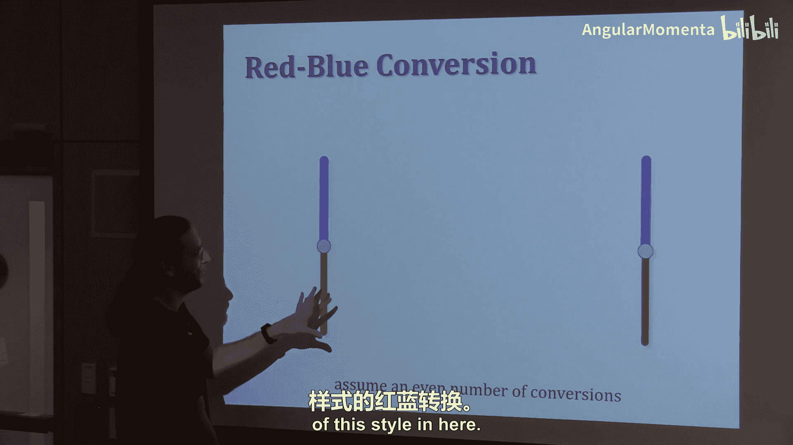
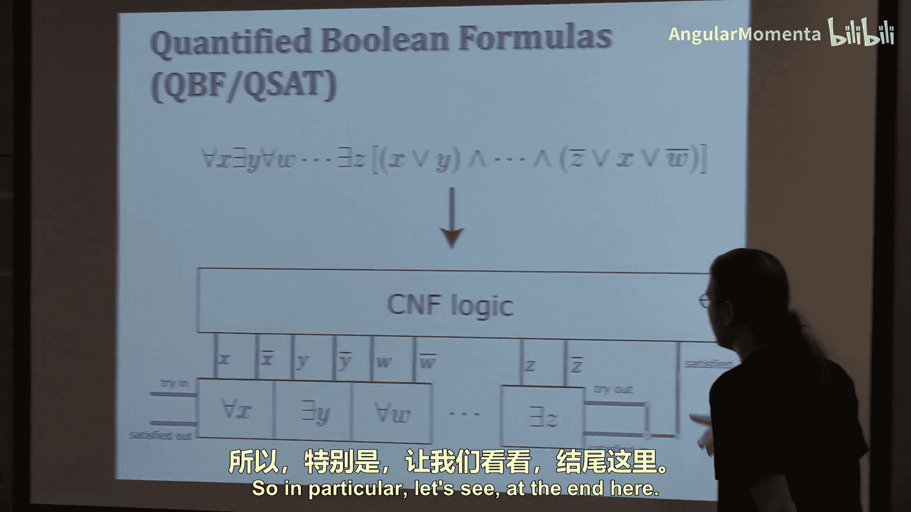
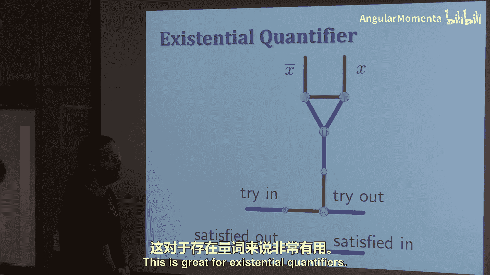
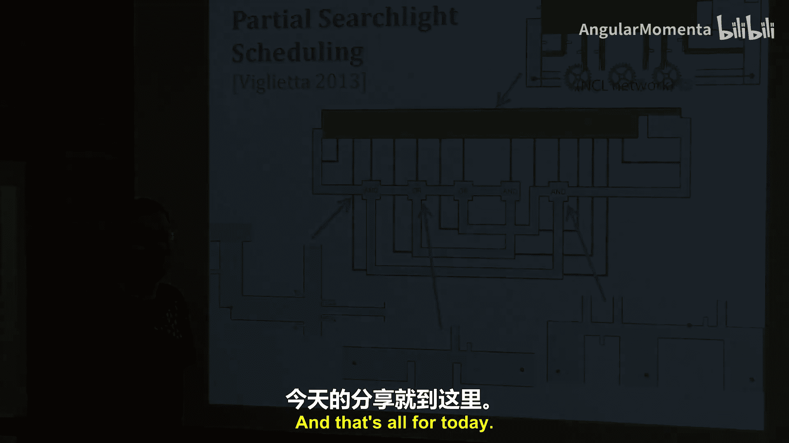
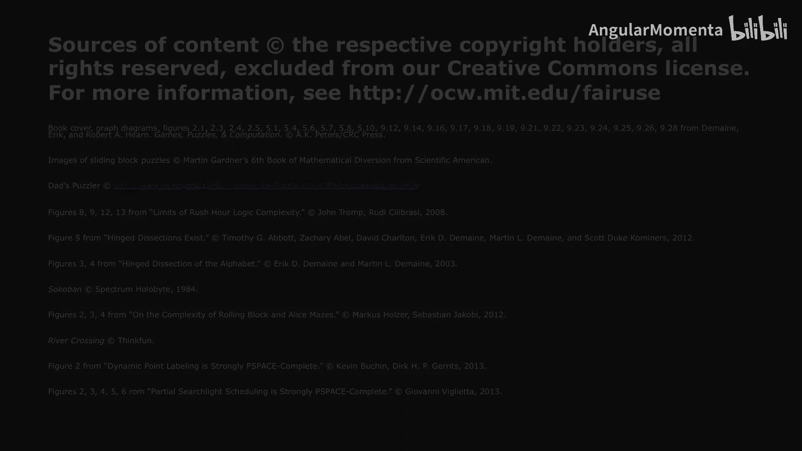

# 【麻省理工】算法下界 ｜ MIT 6.890 Algorithmic Lower Bounds, Fall 2014 p17 17. 非确定性约束逻辑 -BV1dPYpz9E4V_p17-

The following content is provided under a Cative Commons license。

 Your support will help Mi T OpenCourseware continue to offer high quality educational resources for free to make a donation or to view additional materials from hundreds of Mit courses。

 Visit Mitopcourseseware at Ocw。mt。 Eduu。

Alright， so today we start a new topic， but in the same spirit of peace based completeness of puzzles。

 we're going to talk about。A general theory called constraint logic。

This was the topic of a PhD thesis here by Bob Hn， which later turned into this book。

 Games puzzleles and Computation， and Constraint logicg is a big theory。

 but today we're going to focus on one particular aspect of it called nondeterministic constraint logic。

 nondeterministic like NP。And。That。Is specifically about puzzles。And peace based completeness。

So nondemin to constraint logic is usually called NCL。

And it's a very useful infrastructure for proving piece based hardness results of puzzles originally motivated by sliding blocks。

 but we will get there in a moment。 you've seen it very briefly in lecture 1。

 I'm going to go through it again more slowly and clearly and define everything and then we'll see lots of hardness proofs based on that。

So we start with the notion of a machine， we won't use this term too much。

 but the idea is we start with an undirected graph。 Think of this as a model of computation。

 so your computer is an undirected graph with red edges and blue edges， red edges have weight 1。

 blue edges have weight2。And then。A configuration of that machine。

Or a constraint graph in total is an orientation of that graph。

 so it's really a director graph with red and blue edges。

And you have to satisfy the constraint that at every node。

 the total incoming weight should be at least two。 So either at least one blue edge or at least two red edges。

 So this should be a satisfying assignment。 This one has two red edges。

 This one has actually one blue edge and an additional red edge coming in。But in general， we have。

So constraint graph。Is going to be a directed。Red blue graph。Satisfying。

I'll call it the inflow constraint。That for every vertex。The total incoming weight。

Its greater than equal to2。Where。Red is a one。And a blue is it too。Okay。

 and then we're interested in。Reconfigurations of constraint graphs by reversing one edge at a time。

So here let's look at a vertex here， this guy has total incoming weight of three， one from the red。

 two from the blue。And。A moveve we're allowed to do。 say reverse an edge like this。

 So now we have a total incoming weight of 4。4 is also greater than equal to 2。

 So that's a valid move。 Now we could also reverse this edge。 We couldn't be4。

We had done in the beginning， there would only be a weight of one coming in。

 but now that we have these two units of weight coming in， we can redirect this。

 at least local to this vertex。 We can redirect this guy。 It would only make this vertex happier。

The validity of this move depended on what that vertex looked like。 Okay， so in general。

 we start with some constraint graph。 We're going to do a sequence of moves at all times。

 We should have a valid constraint graph， meaning you satisfy the inflow constraint。

So those are the rules of the game and at each move or at each time step。

 you can make any valid move you want。 That's the non deterterministic aspect。

 and that mimics most puzzles。You're not told which move to do。 You get to choose which move to do。

Guess which move to do， if you like。 So the N C L problem is。

 I give you some crazy network like this。 And I want to know， can I reverse a particular edge。

 That's one version of the problem。 There are actually two decision problems we can think about。

That one is the most useful。Or most common， I should say。啊。And you reverse a specified edge。

Givenive a constraint graph。meaninganing。Is there a sequence of moves and the last move is reversing the target edge？

Another problem would be， can you reach a desired other constraint graph？

So I give you an entire configuration and another orientation of the graph。That's consistent。

 And I want to， in some sense， that gives you more information。

I don't just say I want to flip this edge。 I want to I'll say it will actually be。

 I want to flip this edge and no other edges。 It's gonna be the typical setup。 But in general。

 I give you one configuration and another。 And I want to know。

 can I get from here to here by a sequence of single edge reversals。 Yeah Does the 3。

It will always be max degree 3。So you can ascend that。 In fact。

 we will show both of these problems are piece space complete。For。Max for three regular graphs。

Although what I've drawn here is not three regular。 it has some vertices of degree1。

 you can actually assume max degree 3， and you can assume that there are only two types of vertices。

And those are。Red， red。Blue and blue， blue blue。So even just for these two types of vertices。

 both of these problems are piece based complete。 Yeah vertices have to satisfy。啊，异议。Yeah。

 this would not be valid。 Well'll， we'll， we can make。

 we'll show how to simulate degree1 vers with or without the inflow constraint。 Yeah。

 is the problem given the graph find a valid configuration。 Okay， that's a different problem。

 given an undirected graph Find a valid configuration。 that problem is empty complete。

 We'll also prove that。 That's called constraint graph satisfiability， So that's an analog of sat。So。

 this is given。Undirected。Red blue graph。Find a valid orientation。That's a good question。At present。

 there aren't very many NP hardness reductions that use this problem。

 But I think maybe there should be more。 It's a need。呃。

This was not our original goal with constraint logic。 So we sort of forgot about it until recently。

 we thought it would be cool to do more。 So this separation suggests you can't get from any configuration to any other valid configuration。

Right， so in， in particular， for lots of different pairs of configurations of the same graph。

 you cannot find a path from one to the other And deciding whether you can is piece based complete。

 I mean， that implies there are lots of no answers prevents you from being。

Ho it will become more and more obvious。 I don't have a great intuition why it's hard other than it's hard。

😊，I mean。You tend to get nice path connectivity in continuous spaces。 This is a very discrete space。

 And so。😊，And there's a lot of hard constraints。 That's my rough intuition。

 You'll probably get into this later。 But can you give us some brief motivation of why we care about this problem The motivation is a lot of puzzles。

Can easily simulate these kinds of pictures。 And in particular， the， you basically need two gadgets。

And we'll also prove that this is hard for planargraphs。

So you don't even need a crossover for planar， red blue graphs with just these two types of vertices。

 the whole problem is piece based complete。 So the ultimate motivation is to prove your problem piece based complete。

 if it falls into category games like this， you just need two gadgets and youll get proof by two pictures。

So that will lead to some very。Efficient piece based completeness proofs。 of course， to get there。

 we first need to prove this theorem。 And I'm going do that first to So you see where all of this comes from。

 though you don't have to understand it。 I think it's helpful in case you want to generalize it。Okay。

 so let me tell you about these two types of vertices。 This one is called。And and vertex。

And this one is called an or vertex。Because。If we think of the two red edges as inputs and think of the blue edges output。

This is sort of this picture is supposed to represent that  one and1 equals1 and this picture is supposed to represent that0 or 0 equals 0。

 And if we do some more moves， like if I flip this edge， now I have total incoming weight of3。

 it's still not enough to flip this edge because 0 and1 is0 still。And I could flip it back。

 maybe I flip the other edge， also one and0 is0， still can't flip this guy。

 but if I flip both of them up top， if both of the red guys are incoming， then I can。

 if I want to flip the bottom edge。But I don't have to right away， so I could go from here to here。

But this is sort of a a slow end gate。 I've put in the  two，1 inputs。 I don't yet have a one output。

 So speak， where one here is represented by two。 But you get the idea。Okay， so let me。

Write down the definition to make that slightly cleaner。呃。

So I'm gonna define the activation of an edge or an edge being activated。

input edge is going to be active， if it's。Incoming。And an output edge。Is active。If it's outgoing。

Okay， this is asymmetric， incoming and outgoing， always clear。

 either you're in going into the vertex or you're going out of the vertex。

 But just by labeling these inputs， I'm gonna say these edges are sort of interesting if they're pointing in and this edge is interesting if it's pointing out。

 these correspond to the1 B in in a Boolean logic。And what we say， for an and gate。

Property of an am gate is that the。Output。Can activate， doesn't have to。Only if。

Both inputs are active。So in this language， you can see that it's an an gate。

You need both of the inputs， the and of the input should be active in order for the output to activate。

Okay， so that's why we do this asymmetric thing。 Another reason to do this asymmetric view of inputs and outputs is if you have two vertices and an edge between them。

呃。Then， I mean， this it was， it was asymmetric to begin with， right。

 This edge from this guy's perspective is outgoing， from this guy's perspective is incoming。

 That's annoying to deal with。 I want the edge to either be active or not。And if this is the output。

Edge of this vertex。 And as the input of this vertex， then this edge is。Active。

And the other direction would be inactive。Okay， but it's active from this guy's perspective and it's active from this guy's perspective。

 So while this may seem as symmetric， it actually makes the picture more symmetric， yeah。That's true。

 With these gadgets， we never have a red edge being output。Imagine red being blue。Okay。

 so that is active and and。You don't have you have sort of delayed outputs。

 You can think of this same vertex。 if you relabel these guys as outputs and this guy is an input。

 It's just a perspective change。 It's just changing terminology。

 So it doesn't actually change what happens。 But from this perspective。

 you essentially are splitting or fanning out a wire。 So if you have a signal here of true。

 So this is an active input now， then both of these can be active if they want to be。

 they don't have to be but if it's false， then both of these have to be inactive。

 If this is inactive。 Both of these have to be inactive。

 and there are lots of configurations of this guy。 So maybe some of them point in。So， the split。

That's the same vertex， it's a relabelling of who's active and who's inactive。The outputs。Can。

Activate。诶。Only if。The input。Is active。And really， I should be saying if and only if。

 but I'm being a little。啊。Concise here。Okay， so that's a split vertex。

 And then the other vertex type is an or。 So this is really the second vertex type out of three。

Or the third out of 3， whatever。 So this， of course， looks very symmetric。 I mean。

 there's no clear notion of inputs or outputs here。

 But if you define two of them to be inputs and the other one to be an output。

 then that output is the ore of those two inputs。 This edge can activate only if this edge is active or this edge is active or both。

So it's an inclusive or。I probably have some animations， like if I flip this guy。

 now this one can choose to activate， I could also have both of them in or just one of them in。

 but in order for this one to now go back out and deactivate。

 this one would first have to deactivate。So that ands and o's。

 you get some sense for why this is a boolean logic1。

Point to make at this point is that I do not have a knot gadget。And in fact。

 not gadgets are impossible in this universe because we're always talking about outputs can activate。

 but they don't have to， it's up to the non deterterministic player to choose whether to activate an output or when to do it。

Not is impossible because a not would be something like。This edge。

Cannot activate if this other edge is active。 This output cannot activate if this input is active。

That would be the I， the idea。Maybe output is inactive。If the input is active。

And that kind of constraint is impossible to represent with a lower bound on incoming weight。

 Maybe if you had an upper bound， you could do it。 But with a lower bound。

 you're always happier to have inputs active。😊，So if it worked with the input inactive that the output could activate。

 then it should also work with the input。Active。Notth gates are impossible。

So that's a little bit annoying， but it won't be too much trouble。 We've， in some sense。

 dealt with that and other proofs before I get to。These hardness results。

 let me tell you a few other vertices that are helpful and can be simulated with anzynores。

So one of them is a choice vertex。 This is sort of like an exclusive or， in a sense。

So two of these edges must be incoming in the symmetric picture。

 two of them must be incoming at most one of them can be outgoing。

And this can be simulated by expanding this into a little triangle。So。If this guy is outgoing。

 then both of these must be pointing to it。And once both of these are pointing out。

Then the blues must be pointing in here because the red would not be enough to make either these vertices happy if this guy is making Mac eye happy。

 So if one of them is out， the other two must be in。 We'll see how to use this in a second。

 But it's useful to have red， red， red， in addition to。Red， red， blue， and blue， blue， blue。Okay。

 now one issue that arises here， as you're probably guessing。

 especially when I did this kind of transformation where I said， oh， three red vertices。

 that's just like this picture， except these are now blue。

 That's not gonna work so well from whatever they're attached to。Now， luckily。We can deal with this。

 The more direct version is， if we're trying to build some boolean formula like an and of or's。

 the inputs are in the bottom becauseuse these are the inputs to the and。

 The and wants its input to be red， but the or' is providing an output which， which is blue。

 How can we convert a red edge to a blue edge。 Luckily， we can do it。

As long as we have an even number of red to blue conversions， we can fill in this gadget in between。

And it works。So basically， this is in a forced configuration。 I think it can't change at all。嗯。

At least from this position， it can't change if and or what we need at this stage is that these guys can point out both of them。

 So you always get a weight boost of one。From both of these vertices。

 So now if this guy's pointing in， that's a total weight of two。 And so then this guy can point out。

 And of course， if this guy's pointing in， this guy can point out。

 and it's symmetric on the two sides。So maybe you do try to mess with this gadget。

 although I don't think you can。 What we need is that you are allowed to just leave it like this and you get a bonus point for each of those vertices and all as well。

 And we'll see later how to make an even number of conversions。 Now。

 one thing I should maybe mention at this point。 Also， this is sort of a technical detail， but。嗯。

If you used to think of this as a single edge。 When I reversed it。

 let's say it was pointing up before。 and I make it point down。

 This vertex will see that effect immediately。 This vertex doesn't see it yet。

 So it's kind of an even more delayed reaction because because we subdivideed an edge into two parts We can flip one side without having flip the other side。

 The way I would view this is in the original constraint logic graph。

 We used to have an edge pointing up。 We change it into an undirected edge。

 It has no orientation because it doesn't benefit either side。 It's pointing。Away from both ends。

And then we choose to direct it the other way。 So this is an alternative view of a move in a constraint graph。

 It used to be you're reversing an edge。 Another view is that you can change a directed edge into an undirected edge。

 and you can change an undirected edge into a directed edge。 So these models are almost identical。

 In fact， you can prove theyre exactly the same power。 And they are called。

A synchronous constraint logic。So if you are worried about that， you don't need to worry。

 I won't prove here that they're identical power， but it's not hard， yeah。

arrow you can't flip these red guys。 yet， are you gonna flip this blue guy first。But how， oh。

 you can't do anything first。 Yeah， nothing can happen first。 There is another configuration。

 But from here， I think it's rigid。 Oh There's nothing that can change。

 You can't flip this guyca this guy would be unhappy。Therefore， you can't flip this guy。Therefore。

 you can't flip these guys。Therefore， you can't flip this guy。So I think you get a。

 a cycle and nothing can happen first。Though we don't need that here， we will need it later。

That's why I wanted to mention it。 Okay， so we can convert reds to blues。

 So now we can chain things together and build a CNF formula as long as we represent。

 So here we're gonna to use a choice gadget to say So right now， nothing is activated。

 Our goal is to activate that edge at the top。 That's going to represent that boolean formula。

 satisfiability of that boolean formula。 We use a choice gadget to say， look。

 either W can activate or W bar can activate。 We need some notion of negation。

 And this is how we're gonna to get our negation， which is normally called dual rail logic。

 You have one channel representing X 1 representing X bar。We have this extra stragler。

 which we basically don't care about Right now， it is taking。The weight somewhere。

 but you can push it up。If we plug in a suitable terminator down there， which we need to talk about。

 But then other than red blue conversions， then we are basically doing an or。

 We have to do an or of three things and we only have degree 3。 So we do an or of two things。

 that gives this output， then we take an or of the other things。

 So now this output is the or of three things。 We convert it into a red edge。

 This is a reference to the gadget we just saw。 And then we can take an and here。

 we're taking end of three things in general be an end of n things。

 we build a binary tree of those ans。 And so that edge can reverse。

 If and only if that formula is satisifiable。Assuming we can plug in。

 assuming we know what to do with degree 1 vertices。Okay， so this represents CNF。

 Let me tell you what to do at De 1 vertices。 Here are three different gadgets。

Depending on what you want to do。On the one hand， this is a an unconstrained blue terminator。

 All the vertices are happy even locally。 And so this edge can go up or down。

I think that's pretty clear。 The sky already has two incoming edges。 Everybody has at least one。

 And the point here is， it's three regular。So this is actually a kind of classic way to make a three regular graph。

In out of a degree 1 vertex。 On the other hand， we can do the same thing with red。And actually。

 the reason I wanted two incoming edges here is when I recolor them red that still makes his vertex satisfied。

 so this guy can go up or down。 Now， you might say。

 why do I care about a blue terminator separate from a red terminator because I already have red to blue conversion because red blue conversion assumed that the number of red blue conversions was even。

 And this is how I'm going make it even。If it's， if it's not even。

 I'll take any of my degree 1 vertices and add an extra red blue conversion there。

 Now it will be evencause it was odd before， but I need either a red or a blue terminator or whatever I didn't have before。

 So this is where we'll get that。 And it's easy to do。In the middle， we have a different thing。

 this forces this edge to be pointed down。That's。Useful in some scenarios。For example。嗯。

So back to this picture。 one thing I've done is we had these floating edges that we w to throw away。

 We can just use a red terminator unconstrained for that so that guy can do whatever he wants。

 That still lets you choose W or W bar to be true。 if I shrink this picture a little bit more。

 and put here， this is a。啊。I guess a free terminator， I don't care whether this guy's used also。

 but I would really like this edge to be directed up。That， that's one way this is， of course。

 locally invalid。 You have to put in a satisfying assignment to make this go up。

So this is how we can prove that。Constraint graph satisfiability。

Finding an orientation is MP complete。 If we use that terminator on the top。

 this termminator in the undirected form， this thing will force this edge to be up。

 which means it will force this thing to be satisfied。 or there won't be a valid orientation。

 which means there's no satisfying assignment to that formula。

 So that's one way you could use the terminators。 We'll use them in other ways。

' usetrainator instead of the red to a red version。It slightlylight more than we actually did。

The unconstrained red Trinaator has a vertex with three ridage。That's okay。嗯。

But maybe that's relevant。 So this is gonna expand to。This， and that。

 that requires a red blue conversion。 There we go。 That's why。

So we're actually already using a red blue conversion of this style。

呃。In number of them in here。All right， let's move on to more interesting things。

So that was constraint graph satisfaction as MP complete。

 Let's go to the reconfiguration problems being piece based complete。 So now。

I want to do a sequence of moves and get and flip one edge or reach a desired configuration。

 we'll start with just flipping one edge。 we're going to follow the same kind of prototype that we saw last class with bigg' proof where we have we're going to reduce from QAT so we have this alternating set of quantifiers variables and then we have some Boolean formula。

 we'll assume it's in CF form because we just shown how to do CF formulas。

And we're going represent variables by two rails， X and X bar。

 And these things are essentially nested inside each other。

 And there's some magic mechanisms to glue them together。 So in particular。Let's see at the end here。

 So suppose these these variables， the idea is that one of them will be pointing up and the other will be pointing down。

 That corresponds to x being true。 If y bar is pointing up and y is pointing down。

 then y bar will be true。 In other words， y will be false。

 So then this thing will do its do its computation， and then the output y is this one。

 So it will be pointing out of the C and F logic， if only if that formula。

That without the quantifiers was satisfied。Okay， now here we have an end gate。

And we have a signal from this gadget saying basically all the variables are set and here it's called try out。

 we'll see what that means， Basically， I want to check whether this thing is true。

And if the tryout is pointing out and the satisfy thing is pointing out。

 then this guy can point to the left。And so that will tell this gadget that yes， it is satisfied。

So when activated and this thing has become satisfied， then we will report back to that gadget。

 In general， each of the quantifier gadgets。 This is an extension one。 This the universal one。

 don't look at them in too much detail yet。 But there will be one input here， which is a try in。

 and there'll be an output， which is a try out to say when I'm told by the previous gadget to do something。

 I'll do something， Then I'll tell the next gadget to do something。

 And if that gadget reports back with a positive answer。 In this case。

 I just return that positive answer back to my collar。 So this is the input and the output。

And same thing for universal， it's going to have a try in。 It's going to activate a try out。

 Then if it gets a satisfied end stuff will happen。 And eventually we might output a satisfied out。

 So these things are supposed to just chain together left and right。

 So let's look at each gadget individually。 and in particular， you will see this triangle pattern。

 A blue， blue red triangle in a few different places。That's a useful construction by itself。

 Let's think about that first。 It's called a latch。It's like a1 bit memory。

Currently the latch is locked when this edge is out is pointing to the left。

 then nothing over here can change。There are actually two possible states here。

 but if this is pointing out， this guy can't flip。Which means these two can't flip。

Which means this one can't flip。 I guess this guy could reverse， but that's all。Okay。

 so this is in a state where A be can output something， but B cannot。

Now I can flip it to the other symmetric state where B can output something and A cannot。

 but to do that， I first must unlock the gadget， unlock the latch by flipping this edge。

 If I can flip this edge， then everything becomes free。

 Now I can flip this edge and then I can flip B， actually now both A and B can output。

 which is kind of a weird state。 but in particular， I can flip this edge。 and then maybe put a back。

 that will let me flip this guy， and now this guy is happy from this edge And so I can relock the gadget if I want to。

If I click hard enough。So。So now we're back in a lock state。 And now B can output。

 it could choose to not output， but B can output A cannot。Okay。

 so when the gadget is in a locked state， we get at most one signal from A or B， and it can't change。

When we unlock， then we can do crazy stuff， have both of them output， whatever。 But then when we re。

 we know that only one of them is on。 And that's our1 bit memory。 At this point。

 it's a nondeterministic memory。 You can basically set it to a nondeterministic value。

 and then lock it down。Okay， this is great for existential quantifiers。

 That's basically all we need for an existential quantifier。 When we're told to do something。

 we're gonna convert that blue to a red。

And。Then。So this gadget。So right now， this， this vertex is happy because we haven't told the next gadget to do anything。

 This edge is pointed to the left。嗯。So this， this thing can go up or down whatever it wants。

 So basically， we are free to unlock this。And set it to either value。

 So where x is pointing out or x bar is pointing out。Or or neither。

 But the direction of this edge will sort of keep track of which thing is being set。

Then the next thing can activate only when this is pointing out， which means the latch is locked。

So when we activate the next existential or universal quantifier or the overall formula。

 we know both that we're told we're activated from the left。

 which means all the variables to the left have been locked into their state and we know from this end gate that this has been locked into its state so it has only x or x bar set and then we can proceed and for existential quantifier that's all you need that there's some value。

 some setting for x that satisfies the rest and so if you get satisfied from the rest of the formula。

 you know you are satisfied。And so here we're using the nondeterminism of the player to make the right call。

 whether to set X or X bar。It's the easy case。 The harder case is the universal quantifier。 Here。

 we actually use two latches。And there's a bunch of lines。So。嗯。So what's the idea。 So we're gonna。

 this is viewed as a split gadget。 So if we activate here， we can。

We can do that only with this pointing down。 Okay， fine。 and this points over。So。

For the computation to proceed to do a try out， we need that we are active from the try in。

 but also this latch must be locked。 This is the locking mechanism of that latch。

 So when when both of these are incoming， then we we will call the rest of the construction again。

 this is just setting x or X bar。 just like before， but we're making copies of x and X bar。

 So this is a split gadget。 We're taking if we have this set。

 we can set both this copy of x and this copy of x。 And if we have this one set。

 we can set this copy of x bar and this copy of x bar。 So those are splits。Okay。

 so now what about this latch？So this is the locking mechanism of that latch。And。

What we're saying is that if x bar is set。And the formula is satisfied。Then we can unlock this latch。

And set it to something。Now， we will want to set it to so that this edge is pointing down。 Initially。

 this edge will probably be pointing out。It doesn't have to， though。

 So we don't really care about this edge。 It doesn't buy us anything。

 This edge because we're gonna have a blue thing coming in。

 So we don't really care which way this edge goes。 We really want to set this edge。

 So if you're the nondeistic player and suddenly this latch is open。

 you will want to rearrange it so that it points down。Why。

 because we want to satisfy this thing and this is an and of this edge and that edge。

 So what this is saying is we can we can turn this latch on， meaning pointing down here。

 only if for the false setting of x we get a satisfied thing because here again we're taking a satisfied thing and splitting it into two parts and so satisfied in is true and x bar is true。

 then we can activate this latch and set to the new thing。Now。

 what do you do Now we're going to lock the latch。And then roll back the entire computation。

 undo everything。 In this world， everything's reversible。 if you can reverse an edge。

 you can also put it back。Okay， so now unwind everything。

 Come back to this place and unlock this latch again and now set X to true instead of false。Okay。

 so now， and then proceed。 And then once this is locked in the true state， we can again。

 activate try out。And now we're going to come back through here。 We don't care about this latch。

 We're now going to use this vertex。 This is the end of being satisfied and having x being true。

 So if we're satisfied with x true， then this edge will be pointing to the left。

And if we already remembered the fact that when we sex x to false， we also got true。

 then this and will be true。 And then we can output that， okay。

This is why you don't want to reduce from Qat all the time。

 There are these annoying gadgets you have to build。 But now once you have this。

 we just need to build ans and ors， which is much easier。 Yeah。

 if we have nondeminism do we ever have to roll back Can't we just set it to the right one。 No。

 with a， with a universal quantifier for all。 Oh， I need to check both of them， yeah。

Do we need to build crossovers for。 Yes， we would need crossovers， but we'll get there。

 So we're not yet doing planar graphs。 at this point。

 I think we have proved by this construction that for non planar graphs and only and an or gates。

 we have piece based completeness of flipping one edge。Okay。

 now what if you wanted to go from one configuration to another。Then， I could just put。A latch here。

That's unlocked by this thing。 So if the whole， so， I mean， the。

 the goal usually is can I flip this edge becauseuse if I can flip this edge。

 that means that the whole formula is true。Because of all the quantifier constructions。

 if I put a latch here。And I can activate the latch， and then change its state。

Then I could roll back everything else， and I would get back to the original state。

 except the latchches flipped。And that will be possible only if the formula is true。

 So that's how you can predict the entire configuration。 Nothing will have changed。

 except this one edge。Two edges this whatever。Okay， so next question is Planarity。

 but for non planar graph， we， we're good。Here's a crossover， a little bit。Annoying， I mean。

 to check all the cases。 but this is gonna be a blue blue crossover。Let's see。 So if basically。

 these three edges will be in the same orientation， roughly。And these three edges will be， I mean。

 I can't say they're always in the same orientation because， you know， there's a transition period。

So I think they could both point in。 That's like an undirected edge。

 But if this guy's pointing to the left， then this guy must point to the left。 Y。

 if this pointing to left， then both of these are pointing to left。

 This is pointing either up and down， up or down。 Let's say it's point a up。

That will actually have to do with the other edges。

 But if it's pointing up and this is pointing left， then oh， notice here I have a degree 4。

 it's another gadget。 please wait。But this is the usual constraint。

 There must be a weight of at least two coming in。 Okay， so if both of these are out。

 then both of these must be in。If this is this way， then this must be to the left。 Okay。

 so if this is to the left， then this must be to the left。 And by same argument。

 this must be to the left。 So that's how you transition horizontally。

 And it's a similar thing vertically， if this is pointing up。

Then both of these must be pointing into that vertex and。This guy is either pointing left or right。

 that depends on the other edge。 but let's say it's pointing to the right。

So if that's pointing to the right， both of these are pointing to the right， which means this guy。

 both of these are pointing out， which means both of these must be pointing in。

 And so if this is pointing up， this is pointing up。Okay，sh I mean， it depends。's。

 if this is pointing up， then this is pointing up or this is pointing up。 one of them。

 depending on the state of this edge。 But then you can use that again to prove that this is pointing up。

So could be they're both pointing in here or here。 But that's like an undirected edge。

 And so if you believe in asynchronous constraint logic， this is simulating the crossover。So。

 except we have degree 4 red， red， red， red vertices。 So we need one more gadget。Which is this one。嗯。

This essentially simulates， of course， the edges here are， are blue。

 That's why I've drawn off to the side。 Now here we have to be a little careful because we need that the red blue transitions do not introduce crossings because if we did。

 we have to use a crossover gadget。 we get in this infinite recursion。

 But you can just stick this on here and turn it red and connect it to this guy。

 And that will and similarly over here。 and you convert them all to red without any crossings。😊。

And I think I won't go through this gadget， but it simulates the constraint that least at least two of these edges must be pointing into the gadget。

Cool， and then so that was a blue， blue crossover。 If you have a red blue crossover or a red red crossover。

 again， convert red to blue。And then back again。嗯。Yeah， okay。So。One more version。

 So that we just did planar graphs or piece space complete。 If you draw your planar graph in a grid。

 naturally， you would also want the ability to just take an edge and go left or make a turn。

 So do we need turn gadgets and straight gadgets。 The answer is no， We can use ans and ors。

 actually we can just use ans to simulate wires and turns。

 So we're going to suppose this is one of the gadgets that takes inputs from two adjacent sides and outputs on one of the other adjacent sides。

 then it's always going to look like this pattern。 all of the instances of the end gate are rotations of that。

I think， no reflections。So。First， we build these fillers。These fillers。

 I guess we'll give them some initial state where。We get to choose。

 So maybe I think I want all of these edges to be pointing out。So I'm going to set everything to 0。

 This is going to be0 and 0 equals 0。 So that's locally consistent within this cycle。

 And it means that this edge is free to point out if it wants to。So in particular。

 I guess I want these four wires to be zeros。 And so then this one can be 01。

 It's still consistent with the ans。 And so that means when I put that box here。

 this is one of those filler gadgets that I have one unit a flow because those are red edges pointing out。

 And so in particular here if I have a unit here， I get a free unit from the side and therefore the an will be the same as the input。

Okay， so I put my two by two blocks here。 I also have a similar2 by three block。

 which I put in these chunks。And then this will just copy whatever value is here up there。 Again。

 non deterministically， we can have both of them pointing in， but。

This one can point out only if this one can point in。This can。

 this can activate only if this can activate。That's a straight turn is similar。

 and if you want to do an actual computation， you put whatever gadget is you want to compute and use these to copy the data。

Question。I'm sorry， do we have packages here？So the square filler into the top right of the street Yeah Yeah。

 Well I mean there's a termminator the input Oh you， you， you mean。

 there's an edge here which doesn't have anything on the site。 That's true。 Yeah。

 so that's this little thing。 So you have to， in this particular world。

 This won't work for all proofs。 but it's sort of an example of what you could do。

 There needs to be an input here which you ignore。 So it's like a degree1 vertex kind of。Right。

 and then we can like check into the grid and everything's okay。I mean。

 that the point is you have to only build one gadget or two gadgets， the end on the ore。

 but it has to have this feature that when you stick them on the。

 you stick an output you stick an input to this gate into a non used neighboring side from this gate that it just works。

So we'll see an example where that happens。Yeah。Can you change right。呃。I guessing to turn right。

 we might actually need the reflected form the and。 But mo gadgets。

 if it works one way and you reflect it also works。 So we'll， yeah。Good， one more。

 silly question about what non deterministic means in this case。

 since we've been using non deterministic post domain mean like you can guess correctly and being that the address are being reflected。

 So what exactly doesn't mean。What was the second version that edges。

 about the edges think a while to you transfer Oh， no， sorry， that was asynchronous。

 Asynchronous is that they take a while。 No deterterministic non deterterministic is that the player gets to choose which edge to flip。

 They're related。 I mean， asynchrony kind of comes out of this form of nondeterminism that we have。

 but。They don't have to be the way I originally said the model is when you flip an edge instantaneously in both the gadgets that we build。

 like the actual and and orig gateates we build for real problems。

 they will actually take a while to activate。 you'll like pull some things in and stuff happens before you can pull some things out so we will naturally get asynchrony。

The way I originally set it up， it was just non deterministic， and you'd have instantaneous flips。

But they're the same， so。You don't have to worry too much about that distinction。Okay。

One more catch it before， before I go to actual reductions。 And this is the notion of a protected or。

I call it protectect or or。Cause I like more， more os is better。Protected or is the proper name。

Protected ore gadget looks like an ore gadget。So we're going to have。呃。To inputs。One output。

And these are gonna be labeled， which are which I want that at most one input。Is active。At any time。

Okay， what I， what I mean here is that。If I ever have the state where both of these are active。

 then the entire universe explodes。 and I give no guarantees。 I mean， not only does this gadget fail。

 but all gadgets everywhere could selfdestruct。 because we're going to build some gadgets where you really only want one of these two things to be pointing in。

 if they both point in， then the framework that separates gadgets might shatter。

 And then gadgets are no longer separate。 you can't argue about them。

 and literally everything falls apart。 So we'll see some examples of that。

 but this is sort of forhaing。Turns out we can set things up so that you never have both things pointing into an ore。

Because we can build a fully fledged ore out of those protected oars。So this gadget acts as an ore。

 where these two are。The inputs say and that's the output。But it does so only using protected ors。

 Now， it uses a blue to red transition。 So we have to， again， inspect the blue to red transition。

 This is where I wanted that this is。Ridd， that you cannot make any moves in here。

Because that makes me happy about this or。This is the only ore in this picture。 And I might worry。

 maybe I could flip one of these edges。 and then I have two inputs activated。

 But because no edges can flip from this state。 In fact， this guy will only have one pointing in。

 So matter how you label the inputs and outputs， it is a protected ore。Okay， so that part is fine。

 And now this simulates an ore until we want to go through it。inputSo this is one input。

 and this is the other input， oh， for these or。I'm gonna guess， well， let's find out。

 I don't remember。 So let's say this guy is pointing in。 So if this is also pointing down。

 then this can point up。But if this is pointing down， this must point up into the left。

In order to satisfy this node， so if this is coming in， this one must be pointing out。

So I'm going to say that's the output。 these are the two inputs。I'm guessing symmetrically。 Yeah， if。

 if this one is pointing。Into the vertex。Then that must mean both of these red guys are pointing into that vertex。

 which means this guy must be pointing out of that vertex。 So if this one is active for this guy。

 this guy is inactive and vice versa。 So this is protected from those two， Similarlyly over here。

 But if this is active， and this is down and this is active。 and this is pointing up。

 then in particular， this can point out。And this guys satisfied。

 So then this edge can point to the right。 And then this one can point up here。

 And this can point here。 So the and actually outputs yes。 So if the left activated。

 then C can activate as well。 and symmetrically。 So this simulates an or。

 But it's guaranteed that these two guys are。Yeah。Sorry。

 I remember some motivation for this just to make our gadget building lives easier。 Yes。

 this is just to make our gadget building lives easier。

 It's so that I can now say that deciding whether a planar graph can reach can do a sequence of moves and flip an edge is hard for and and protected protected。

 yes。Protect it or。So that's a stronger statement。 Now， I only need to build a protected arm。

In general， we want to reduce this complexity of our gadges as much as possible for the hard part。

 which is actually analyzing a real problem。 Yeah， wait。

 so it's protected or easier to build or protected or is easier to build because you just。

 you don't need to worry about the case where both inputs are active。so you can have any behavior。

 You might have the correct or behavior or you could have any other behavior。

 including self destruction。Or universe destruction， I guess。 So that's gonna be。

 it could only be easier to build future reduction。 Yes， in fact， the very next reduction， I think。

 or the one after that， close enough。Allright， let's do real reduction， shall we？

So all of this stuff that you just saw was built for one problem initially and then happened to be useful for a lot more。

 And that's sliding block puzzles。 So these are a bunch of examples of sliding block puzzles。

 You have blocks， let's say， typically rectangles。And you can take you're an agent from outside。

 you can pick any block you want and slide it along some noncolliding path so I can move this over and then move this over and then move this guy down。

 In this case， the goal is to move this block to here。Becauseuse there's a， well。

 I think that's just a goal。 These problems。 puzzles go back to the 20s。

 Martin Gardner wrote about them and in his article called Sing block puzzles， he says。

 these puzzles are in want of a general theory and there is no general theory because their piece face complete。

 There's no way to easily tell whether a puzzle is going be solvable or not。

 which is annoying for puzzle design， but there you go。 Here's an actual instance of the puzzle。

 I showed you dad's puzzle where you take this one。 You're supposed to move it here。

 this optimal solution has 83 moves。And in general。

 number moves is gonna grow exponentially because your problem is piece based complete。

And here's the proof that it is piece space complete in two pictures。 We need an an gate an or gate。

 And the point is， so here， the notion of edges being active is maybe reverse from what you think about。

This edge is currently inactive。 And if I move， if I slide this block out by one。

That activates that edge， meaning it points up。 So in order to， so right now。

 the point edge is pointing down。 If I move this block down， then the edge is pointing up。

 So it may seem backwards。 But if you don't think about it too much， it's actually very clear。

What I mean to say is that in order to move this block down by one。

I must first move this block left by one and this block down by one。

Right so for this guy to be pulled， sucked in， this guy must be kicked out and this guy must be kicked out because then I can slide this block over one。

 then I can slide this block over and down， and I can slide this down and then this down。

So by sequence of moves， I can move this in， but I needed enough room to do it。

 So that's an andt gadget， asynchronous world。 and the ore gadget。

 this guy will be able to move in if only if at least one of these guys moves out because if say this one moves out。

 this can move down， this guy can move over and then this can move down and if the other one happened。

 this guy can move over two and then this can move down。At this point， we don't need a protected ore。

 Now， you have to think a little bit about how these gadgets are fit together。

 But I guess that's the next slide Before that here we have one by two blocks and one by three blocks。

 That's not satisfying because it's not tight。1 by one blocks are polynomial。

 So we can't do1 by one blocks。 But turns out just one by two blocks are enough。

And these were found by semi automatic computer search and a program that Bob wrote to analyze。

 in particular， these dots mean that there will always be one of the blocks overlapping that position。

So like this will， even if this guy moves out by one， this is still occupied。

 And so you can use that analysis to help cut down the search and see that actually all of the gray tiles cannot move at all。

 assuming that youre that you don't have boundary effects。And only the yellow tiles can move。

 And that kind of highlights what where the action is。 Again。

 if this guy slides out and this guy slides out， then you get this chain reaction。

 then this can move down。 It needs it。Two units of space。 And then this guy can move down。

 And similarly， if this one moves out or this one moves out。

 this guy has some freedom about how he moves。 and there's a couple extra units to gain。

 then this guy can move out。Now， this is a protected， or it turns out。

 it's not going to be obvious from the picture。 but if both of these move out。

 the whole gadget can fall apart。So this is the genesis of protected os。

But I won't go into the details here。I guess I don't have a figure about how the gadgets fit together。

 but essentially， these corners interact you knowca here we're vertical and here we're horizontal。

 you get a little nexus where nothing can move。 So as long as the overall boundary is fixed the big rectangular box that we're fitting in。

 you get this chain reaction that because this point is always occupied。

 even if this slides up or down one， you。Transfer the rigidity of this edge to the rigidity of this edge。

 And so you get that all of the gadget boundaries are rigid。 And it's just the action in the。

 the yellow tiles because of these dots， basically。

And I think one thing that might go wrong here is if you can move out by two。

 then who knows what happens， or if this guy could actually suck in an additional spot equivalently。

Okay， so sliding blocks。啊。Now， I said one by one blocks are easy。 but here's a version。

 slightlight variation where it's hard。 In a graph， suppose you have tokens。

And a move is to move a token along an edge。 But at all times。

 a set of tokens must be an independent set。 You can never have two adjacent tokens。

So this is what you might call reconfiguration independence set it's a reconfiguration problem in the sense that I'm interested in two solutions to the independent set problem of the same size。

 in fact， and I want to know is there a sequence of moves that converts one solution to the other solution in this case by moving one of the vertices in the independent set along an edge。

And here， you can very easily simulate it。 And this guy can move down only if this moves out and this moves out because of these constraints。

 And an or this guy can move down。 only if this guy can move here or here。 And for to move here。

 this guy must move out and to move here。 This guy must move out。

 So as you can see you get really short proofs of peace based completeness。 just need two pictures。嗯。

For fun。Well， and somewhat relevant。In particular to your P set， let me mention another。

Reconfiguration problems I don't have a figure for。But， this is。Reconfiguration， three set。

So suppose I give you two solutions to a three set formula， two satisfying assignments。

 And my move is flip a variable from true to false or vice versa。

 I want at all times to be a satisfying assignment。

 I claim it is peace based complete to find a sequence of such moves。

 This is originally proved by Paa deometri and。A bunch of other people， Goballon， Colitis and Manva。

But there's actually really easy proof once you have nondeterministic constraint logic。Which is you。

 so we're going to simulate nondetermin to constraint logic using this reconfiguration problem。

 So in order to represent an edge in our constraint constraint graph。

 we will just make that into a variable。And true for that variable means the edge is pointed one way。

 and false means the other way。 You just decide a canonical orientation for each edge。And then。

 if we have。Colors。If we have an ore。Fortex。Called the edges， X， Y， and Z。

Then the constraints are that X must be in or Y must be in。Or Z must be n。That's an or constraint。

 And in here means I write X or X bar， according to whether in is the positive or the negative orientation。

 The true or the false orientation。 However， you decided this。Okay， so that's a。3 S class。

And an and vertex。Say X， Y and z。Is going to be。Two constraints， two clauses。 if x is out。

Then y must be in。 And if x is out， then z must be in。Okay， so that's two clauses。

 We and them together。 We can convert a implies into not X out or Y in。 as usual。

 So these are two two set clauses。 You take the conjunction of all those clauses。

 You get a three sat formula and。That exactly represents that。 the configuration is valid。

That it satisfies the inflow constraint。 and so reconfigurations in the constraint logic are identical to reconfigurations in the three set instance。

A very nice， simple proof found by Sarah。So now you get the sense that constraint logic is really just a very simplified version of reconfiguration  three set。

We have some very specific constraints on what we need to worry about。

 some very specific types of vertices we need to implement， and that's it。So， of course。

 you could simulate all of re configurationfiguration 3 set。

 but your life is going be a lot easier by simulating this special case。

And you've seen already a few examples of that。Okay。um。Next problem。Rush hour。

 this one we actually covered in lecture 1。 So I'll just say。

 remind you that here the blocks can only move in the direction that they're oriented。 and again。

 you can build an and or protected ore in the setup。 This result was proved previously。

 but here is a constraint logic proof。Again， we do protected or。

Now this is one by two blocks and one by three blocks， that's as far as we could get。

 this is a picture here we actually see how the things come together at the corners。

So this is clearly a locked configuration， that's good。

And then Trump and Cilderbrassi came up with a purely one by two car version。

 It's more complicated and they had trouble getting just a single gadget so they ended up doing two and gates using I guess rotational symmetry here。

 two end gates at once， but of course if you just this is really a split viewed from below and so if you just throw away that end and they have a way to terminate things then that is just an an gate and similarly they had to glue two or gates together。

 but that also can be used to build an or gate they build something。Related to an ore。

 but in particular， it is a protected ore。 And so that's enough。 In fact。

 these actually act as latches if you want it to be more efficient， but。You don't worry about that。

 You can use them as protectedors and then build batches out of that and build all the things we built。

So that's cool。 An open problem in the world of rush hour is what about  one by one cars。 Now。

 this is a little weird because  one by one cars don't have natural orientations。

 But if each car is marked whether， I mean， you can see where the headlights are。

 So you know whether it's going horizontal or vertical only。😊。

It's open whether this problem is piece based complete in the same paper。

 they do a computer search to find the hardest 5 by 5 puzzle and the hardest 6 by 6 puzzle。

 I think was just one blank space。 And here， the first move is to move this up。 This app moves right。

 this right， this right， this down， this over。 the first chain of moves， so to speak。

 But it's1 hundred99 moves to solve this。 This puzzle is 732 moves as drawn here。And that's the。

 the longest puzzle that's 6 by 6。 So it seems to be growing exponentially。 maybe。

 So maybe it's piece based complete， but we don't know。Tangular rush hour。 You can do that， too。

And there's an and gate and an or gate here。 We had to build a straight。

 but then everything fits together。 Oh， right， what is the goal， I mean。

 if you put the final edge that you reverse up in the corner somewhere。

 then there'll be one car which can escape through a little slot in the exit。

 that's the usual rush hour set up。 If and only at that edge。 sorry， the pictures did not specify。

 it's true。 I think， oh， in these ones。 I think， I think it's like the one of these cars is gonna go out through the。

The right。 But I， I forget， I think might be the second row or the first row， something like that。

Yeah。Okay， so cool。 Here's another problem。 turns out to be related。

 though doesn't seem like a same sort of puzzle。 This is called a hinge dissection。

 It's a chain of blocks that folds from one shape。 in this case。

 elateral triangle to a unit square goes back to even before 19 hundred0s。

 but this one is from 19 hundred0s， early 19 hundred0s。😊，And so that's cool。 in particular。

 there's a motion that avoids self intersectionse。 And we proved a few years ago that for any two polygons in the same area。

 there is a finite chain of blocks that can fold one into the other。 without self intersectionction。

 So great problem solved。 But that's good for if you get to design the hied dissection。

 But what if you have some existing hingeed dissection that someone came up with。

 So this this is earlier work。 But it's a chain of these right isosce these triangles。

128 of them that can fold into any letter of the alphabet and any number and a square。

 So you can fold the6 into a square into an8 into a9 into the0。 So's cool。 open problem。

 Can you do it without self- intersectionction。😊，And it'd be great if we had an algorithm to tell us。

 but it's piece based complete。 So if I give you a hinge dissection， and I want to know。

 can I get from this configuration to that one without collisions。

 you can simulate essentially rush hour。😊，This is a gadget。 Wait this。

 the hard part here is to make everything connected and one， one connected。Hingnge dissection。

 and it can simulate this block sliding to the right or not in this kind of way。

Avoiding collisions locally。 And so now it's just each of these blocks can slide left or right or up or down。

 and they have some weird shapes but it ends up working out。So that's kind of a cool result。

This is before we proved hinge dissections actually exist。 So it was discouraging maybe。

 But when you're constructing your own hingeed dissection， it's a lot easier。To avoid collisions。

 Alright， pushing blocks。 Remember this table lecture 4， I think。

 So we did a lot of the N hardness proofs。 but there are some P based hardness as well。

 And I'm gonna cover these two。So soobbon first and push2 F second。So remember。

 Sukabon is this puzzle where you want to get the blocks into the target locations and you are walking around。

 You only have a strength of one。 You can only push one block at a time。 So I think this is level 5。

 apparentlypparently， in the original classic。So here is， this is a little bit。Akward in some ways。

 because in constrained logic， you're supposed to be able to flip any edge。 in Sokabon， you have。

An agent who's walking around。 So we're going to build a lot。

 We're going to cut a lot of tunnels in the walls so that the agent can go anywhere。And then also。

These blocks are exactly where they want to be。Meaning there is a target location where that block is。

 There's only one block that's in the wrong spot。 And so we're going to use our configuration to configuration thing to say。

 I want to solve the QatAT formula which lets me move one block out of the way。

 so I can move one block that's in the wrong spot down to a good spot that's in target location and then unroll everything and then all the blocks are back where they want it to be。

 and the the one guy that we need to move gut to where we need it to go。That's suabbon。

 And the rest is what's mostly this and and ore gadget。

 The idea is because these guys are where they need to be。 If I move the D to touch the A。

 you're permanently screwed， you can never separate them again。

 And so you'll never be able to fill one of those or some spot because those D in particular can no longer be useful。

 but every block needs to be used And so。Let's see in order to move B down。

We must move or sorry that's the other way around in order to move C to the left。

 we must first move B and E up one and A And D left one。

 and you can check that you can actually do that by moving this out and moving this over and then pushing E up and then pushing B up then C can move in。

 and it is reversible if you check carefully and for an or， we just separate these a little bit more。

 So separately each of them could move and then this guy can move in and you won't be trapped。

 if you just tried to move this directly， then you'll never be able to get in here。

 And so these guys are sort of locked in position and that's bad news or they could only get worse move A in here。

 but then。You're really in trouble。 Now， once you do that。

 you might have some parodity issues because of the widths of these gaps。

 but you can build this kind of extra， extra long tunnel to change parity。 We talked about tunnels。

 You also need turns。And then you can simulate constraint logic。

 This is one of the weirder constraint logic proofs， not directly mappingca of the agent issue。

 But it turns out to work。Okay， that was suabam。Next one is push to F。

 I will not cover this one in detail。Because it's quite a complicated proof。

 but I will tell you that we can simplify it now that we know what we know。

 This is a fairly old proof 2002， So it predates last lecture。 it predates the viglitta paper。

 So what we constructed in this case is a lock gadget。

 This is just like the final meta theorem from last class， we have an unlock traversal。

 or if you come in the U and actually come back out the same place。

 It unlocks the thing so you can then go from I to O。 or if you go from L to L O。

 it forces you're force to lock the door。Sorry， it was called a door in the last class。

 So that actually is a door。 Now we needed a door and a crossover。

And you can build a crossover like this。 I think at this point， we have a crossover。

 So left of this line would be a piece based completeness proof using the biggta。Framework。

 we didn't have it at the time。 So we did this part of the proof also to build an and in or gadget。

 We're essentially doing the。The three S thing。 I mean。

 we're just in checking that all of the things that need to be true are true for and and or。

 This reminds me of the。Reduction from three coloring to one of the other pushing blocks problems。

 P 1 X， I think we just check that all the things that need to be true are true。

 So that's the rough sketch。 But there are a lot of details getting it to work。 It'd be great to。

So I'll push 1 f in the same way。 But that remains an open problem。Okay， that was pushing blocks。

 Next， we have rolling blocks。 So this is a class of mazes。 usually you have one。

 So this is how you usually are given the input。 what this means。 The red things here are fixed。

 and the green thing is actually a one by one by two block sticking out of the board。

And so it was in this position。 then you can roll it over along one of the edges。

 and it ends up occupying。 we occupy this rectangle up here。 And you can keep rolling。

 your goal is to get the T sticking up。 And it's not so easy。Hence， the dot dot dot。

So that's sort of the traditional rolling block mas。 And if you have a lot of rollable blocks。

 In this case， all the blocks are rollable。 So these red things are actually sticking up and the green ones are obviously lying in the plane and the one by one squares mean it's sticking up。

 then it's piece space complete to roll a particular block， because in order to roll this thing down。

 you have to make space here， which means this has to have rolled up， which means， well。

 so if this rolls out。And this rolls out。 It will be like here and here。 Then this can fall over。

 replacing that rectangle。 This can fall over， replacing that rectangle。 So that's this and this。

 Then this guy can roll down So it comes here。 And then this guy can stand up。

 and this guy can fall over。So you get that picture， and so it's an end gate。

And this one is an or gate。 I think I won't go through all the things。

 But if either this one comes up or this one falls over， then this one can come down。

And you can show in this case that it's essentially impossible and never useful to make any of the red towers fall over。

 which lets you argue about gadgets independently。Cool， and that's a pretty recent result。嗯。Oh。

 in this proof， they also it， it took me a while staring at I guess these gadgets to think， oh。

 did these actually fit together。 This fits together。 But if I rotate this1 180 degrees。

 the A's will not match up。 And so you need a shift gadget。And so。

 and you also need a sort of straight gadgets for just。

Communicating information without any stuff going on。Okay。Getting near the end plank puzzles。

 These are a think fun puzzle under the name River crossing， although they predate that a little bit。

 So here you have， again， an agent moving around。So we're have to do some work to get rid of that。

 and you can， for example， walk along a plank。 then you can pick that plank up。

 you can only carry one plank at a time， and you can place it as long as this is a length2 plank as long as there's another dot that's exactly length to away。

 You can drop it down。 and then he walked here and walk here， then I pick up that unit length plank。

 put it down here， and get to this picture。 then I can walk here， walk here， pick up this plank。

 put it down。 But I also could have walked back， pick up this plank， walk over。

 drop it somewhere else。 but I can only carry one at a time。 and you want to get to a particular。

 you want to cross the shore。Across the river。This is piece space complete。

By nondeterministic constraint logic。And。There's stuff going on here。 I mean， rough idea。

 imagine you can sort of teleport to some extent， if this guy can move over here and this guy can move over here。

 then let me show you a bigger picture。 This is that a bunch of gadgets stuck together。

 But also what we see are the navigation mechanism。

 There's a length 3 guy here and a length  three guy here。

Those are the only sort of the length3s are the ones that go around each gadget。 This is one gadget。

 There's all these length  three distances。 There are no other length three distances。

 What that lets you do is grab this， move it。 And basically， you can walk around the boundary。

 Then you can also walk along the boundary， grab this other guy and move it somewhere else。

 So you can also， you can walk along the boundary and carry an additional length 3 thing with you。

So that turns out to be helpful in that when you're trying to traverse a gadget。

 you need to be able to like enter from this side and also enter from that side and you can set up those planks to make that possible。

 I'll just wave my hands and say that is possible， it's a little hard to see in these diagrams。

 but you get an NCL reduction again。And I have two examples of nonps。

 sort of real worldl problems reduced from nondeteristic constraint logic。

 One of them is dynamic map labeling。 So this there's a whole field of map labeling。

 one of the typical setups is that you have points， features， cities。

 whatever that need to be labeled。 labelbels are usually modeled by squares because if you scale things。

 if they were rectangles of fixed size， you turn them into squares。

 and typically you want to have that square。 One of its corners should be at the dots。

 So it's easy to read。嗯。But now suppose things are changing in your map。

 Maybe you're adding points or you're zooming out or zooming in。

 You'd like to continuously change the labels and avoid， you don't want any labels to intersect。

 So you can think of zooming out in Google Google Maps。 I'm not gonna talk about the zooming out。

 Although this paper proves that that is piece space complete， whether you， how many question is。

 how many labels can I preserve and be able to change， make a continuous change。

 A simple example is maybe you add one city。 In order to be able to add one city and add a new label。

 probably something has to move out of the way。And then you can get a nondeterministic constraint logic argument I love this figure because it shows all of the gadgets and the ways that they fit together。

 This is a nondeterministic constraint logic constraint graph。 and and gate here。

 is and the pinks are the inputs。 So if if this square can move over to here。

 then this one can move up to here。 and if this one can move over to here。

 this one can move down to here。 then these two can move left。 then this one can move left。

 It overlaps both of these。 So both of these have to move out of the way before this one can move then that one can move and so on。

 you can see how to build a wire， which is the chain of these things。

 they're these special obstacle blocks which prevent you from doing anything else。And。Cool。

 and then an or is actually easier。 You just sort of chain these two things together。 And if。

Which I don't doesn't matter which one is the input。 This guy can be in one of three locations。

 according to which one is directed in。Which corresponds to the blocks being away out of the way。So。

 again， so reconfi continuously changing map labelings is gonna be hard。 pretty much。

 however you slice it。And finally， this problem is even more complicated。

 but it's a well studied problem in computational geometry of search lights。 So there are these dots。

 and imagine you have a laser pointer， and so you can shoot array in any direction of light。

 and if the laser hits the sp spy diece。Okay， your goal is to eliminate all spies。

 Not quite what you have this yellow region， which is where all your treasure is。

 And you want to make sure there are no spies in the treasure region。 So how do you， I mean。

 normally， this is a finding the spy problem。 If you ever see the spy， you can capture him。

 But the spy can move around really fast while you're moving your lasers around。

 So how do you sweep your environment with lasers turns out piece space complete to make sure this region is empty。

And I won't go through the proof。 but it's an orchestration of laser continuous reorientations。

 and you end up with ends and or gates and crossovers。 That's this gadget and yeah。

 And then the nontertic constraint logics happening down here。

 You end up clearing all of this space pretty easily。

 And then there's this little extra spot that will only be cleared if you get an appropriate laser from this guy。

 Then you can sweep up to there and and make sure that it's clear without the worry is that there's a bad guy over here。

 and he somehow sneaks back into the the other region。

 That forces some of the lasers to stay where they are and ends up simulating nondetermtic constraint logic pretty epic proof。

 And I will leave it at that。 And that's all for today。

