# 【麻省理工】算法下界 ｜ MIT 6.890 Algorithmic Lower Bounds, Fall 2014 p18 18. 0人和2人游戏 -BV1dPYpz9E4V_p18-

The following content is provided under a Cative Commons license。

 Your support will help Mi T OpenCourseware continue to offer high quality educational resources for free to make a donation or to view additional materials from hundreds of Mit courses。

 Visit Mitopcourseseware at Ocw。mt。 Eduu。

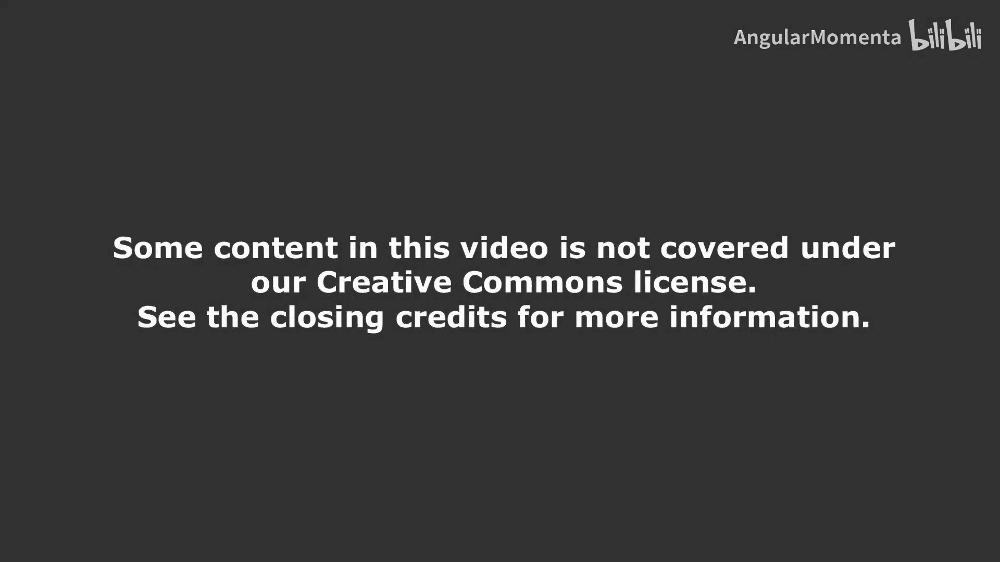

All right， today， more games last time in general， we're going to look at this categorization of different types of games。

 So far， we've been focusing on the one player category。

 which normally think of as puzzles or not games at a all。 But today， we're going to branch out in。

In the other directions， and we're going to talk about zero player games。

 which arguably are also not games and two player games， but to sort of fill out this space。

 we probably won't get out here yet to X time and undecidable games but。We will stick to this chunk。

 We're going to start with zero player games， also simulations。

 Game of life is the classic example here， and these can be very hard despite being very simple and not really having any choices。

So there's a funny equality here， the sliding block puzzles and things that we looked at last time where you have agency。

 you have a choice of which move to make， you remain piece based complete even when you don't have that choice。

嗯。This category is not so interesting if you have a polynomly bounded zero player game that is a computer and it can just compute something for polynomial time and recall this is polynomly polynomly bounded number of moves and this is an exponentially bounded number of moves。

 although you can actually go a little bit higher and we'll talk about that and get even harder problems when you have potentially infinitely many moves。

And then we'll go into two player in particular， two player bounded where we get another piece based completeness result。

呃。As you may recall from some time ago， all of these versions of games have constraint logic variations。

 so we've focused on this one， but I'll mention this one and this one and this one。Today。

 and they're all complete so we can use them to reduce things。But before we get to constraint logic。

 I'm going to be talking about both sort of more classical ways of proving hardness in these classes and then also the constraint logic way。

And we'll start with Game of life， let me write down a definition of the game in case you haven't seen it。

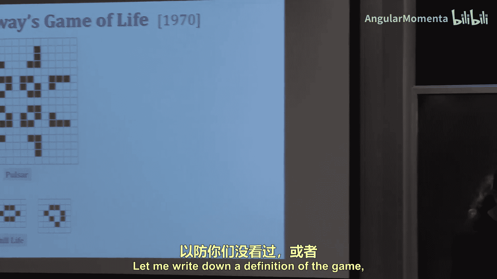

Or if you've forgotten。So this is invented by Conway。70s。So you have two types of cells。

 living cells， which are the black cells and dead cells， those are the white cells。

 and you have this iteration， every cell in parallel updates in general。

 this is called a cellularatmaone。And if we have。A living cell。It will continue to live。

If and only if it has two or three。Liv neighbors。This is among the eight neighbors in8 way adjacency。

And then if we have a dead cell。Then， it becomes。Living。It's born， if you will。

If and only if it has exactly three living neighbors。Okay， so those are the rules。

Really need to know the rules except for verifying that very small gadgets work。

 most of what I'll talk about are higher level than the specifics of these rules。

 but some things you should know is sometimes you get a periodic pattern like this pulsar。

 sometimes you get a static pattern。 these things don't change because for example。

 in the two by two square， each of the living cells has exactly three neighbors。

 and so it lives and each of the dead cells has not exactly three neighbors and so I guess a one or two。

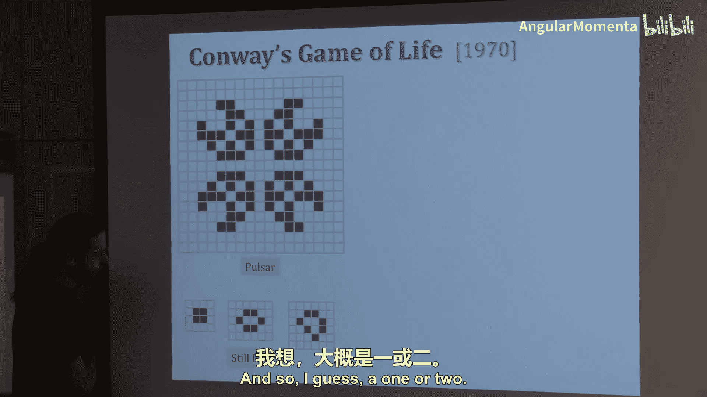

And so they remain dead。 And so nothing changes。 And that's called still life。

There's tons of puns in this area。 And so that that's well and good。

 And so one question you might ask you is， given a pattern， is it a still life， Well。

 that's easy to check。 is it periodic， That's harder to check。

 Does it ever die out and become nothing。 That's actually kind of common。

 And that we will prove is very hard to check。But all these questions are related other than still life。

 which is easy。So some other cool things you should know about are gliders。

 gliders are a kind of periodic pattern， but with a diagonal offset。

 so they go off to infinity in a diagonal direction unless they hit something then something might happen。

 but in the absence of anything else， they'll just keep going off for infinity。So this is。

Thiss a little different from most of our games。 Most of our games。

 we have a finite board or's some rectangular thing。 Sometimes life is played on a tous。

 So when you go off the south edge， you end up on the north edge and so on in that setting。

 life is going to be piece space complete。 So in general， for zero player games。

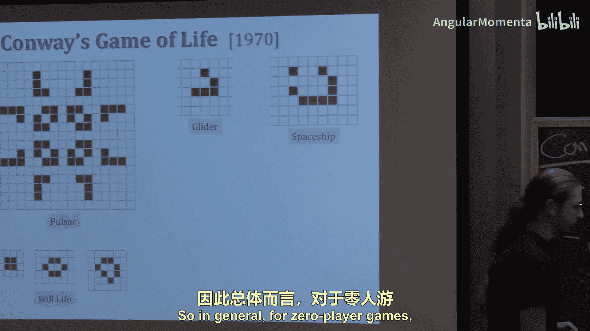

If we have a polynomial number of moves。Then。Of course， we're going to be in polynomial time。

If we have an unbounded number of moves， but a polynomial space， basically。Then， we're going to get。

Peace space。Okay， no surprise。 So the finite versions of， of life will be like that。

 But if we have infinite space。Normally， we can't think about infinite space， but with life。

 it's meaningful to have an infinite board， but initially。

 only a finite rectangle has any stuff in it。 So you encode。

If you just encode all of the positions of the living cells and say， well。

 everything outside of that is dead， then you can think about infinite space。

 And here we will get that the problem is undecidable。So there is no finite algorithm to solve it。

So that's cool。 And I'm going to tell you a little bit about both of these。

 Spaceship is like a glider， but it goes in one dimension instead of diagonally。

 So usually horizontally there are many spaceships out there。 This is one particularly efficient one。

😊，And one of the coolest things is this thing called Gosper's Gider Gu invented by Bill Gosper。

 I think while he was at MIT。 it's this construction up here and it creates gliders and so they just go off to infinity and you just keep making more and more and more of them。

So in some infinite sense， this thing is periodic， I guess。 But at any finite time。

 you have maybe n of these coming out and you just keep making more and more。

This is gliders and glider guns are the key things you should know about for hardness proofs。

 First I'm just going to show you a couple of pictures a fairly recent hardness proofs。

 this is an explicit construction of a particular Tring machine I think it is a Tring machine that given a number represented in unary doubles that number So a fairly clean machine which is in here and there's two stacks so you can think of a turing machine normally you have a tape and you have your head at some cell on the tape。

 you can think of that as a stack going to your left and stack going to your right and each time you can pop off an item from the stack and push it onto the other side that would be the same as moving to the left or moving to the right。

So this is implementing what's called a pushdown automata with two stacks。

 but basically a turningring machine。With one tape。 and you can do that。

 And there's this is done algorithmically。 So you also applied it to a universal tuuring machine。

 If you're more fan of that， that's a tuuring machine that takes a tuuring machine as input and simulates it。

 So that's encoded here。 It's much bigger。 now this construction relies on the tape being finite。

 So it's， it proves P space completeness for the polynomial space version。

 It will remain in this rectangle as big as it is。 And you know。

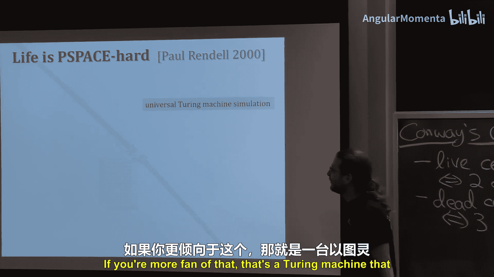

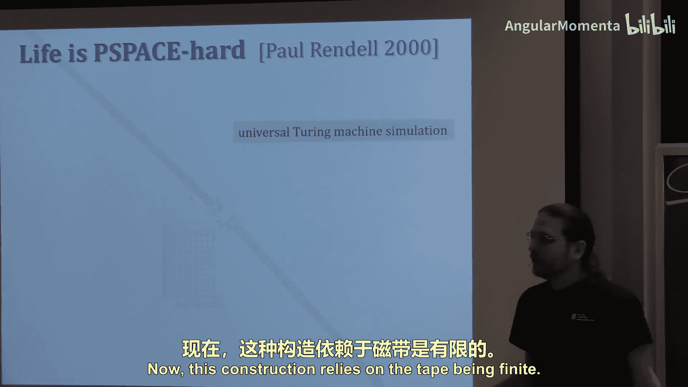

It will run the machine。 if it ran out of tape， then the machine might crash。

Or not do the thing that it was supposed to do if it was a tuuring machine。

 So that's fine for a piece space hardness because simulating touring machine is hard。

 I mentioned that last time， but not good for undecidability same guy a year later came up with a Turing machine that grows itself automatically So it's a little hard to see but this is the original thing And then as you run it longer and longer。

 this machine moves along this dotted line So it's moved here。

 this is like the dirt that it leaves behind and simultaneously it's been building larger and larger versions of its stack so that by the time it needs to use it。

 it will be available。Because time is bounded or space is bounded by time。

 So you have a limit on the rate of growth very complicated， obviously， but extremely powerful。

 this establishes that some version of life like will the thing ever stop growing is undecidable if the machine halts you can make this thing just stop。

 it will。Not answer the question of a machine or given a life setup。

 will everything eventually disappear？At least not easily。

So I'm going talk about that version and a somewhat older proof， partlyca I like old proofs。

 and it's a very epic proof。 So this one I don't understand the details of。

 but they are online if you want to study this thing。 There is a another proof by。

Burla Campamp Conway and Guy， and there are a series of books called Winning Ways。

 which a very cool set of books。If you're interested in two player games in particular。

 but they have this chapter about life being undecidable and it's at a high level， it's very simple。

 it's just if you have a glider， that's going to represent a one bit。

 if you don't have a glider in a particular area that's going to represent a zero bit。

 and so you can think of streams of bits and doing stuff with them。

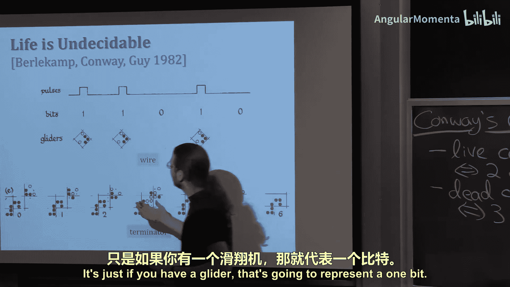

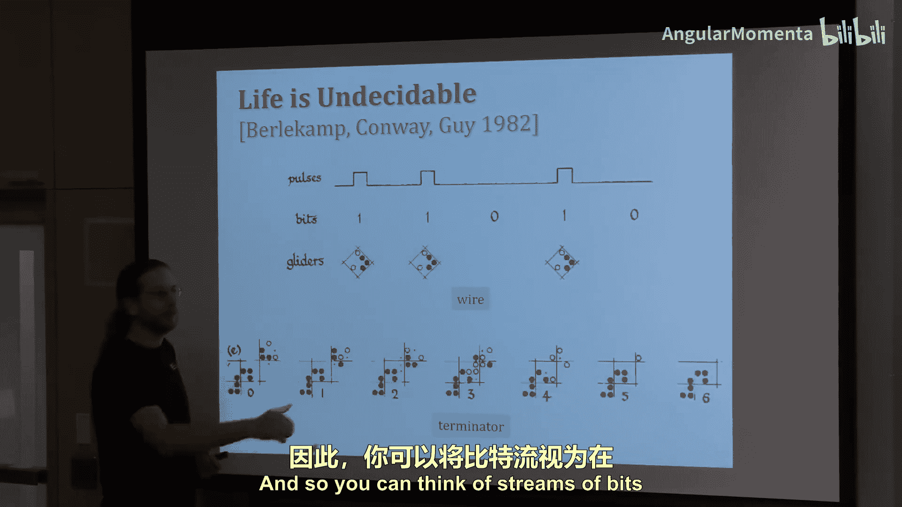

Over time and so that's cool， everything's going to be oriented diagonally， of course。

Now one useful structure， once we that's going to be our wire， we can also build a terminator。

 they call these eaters， so this is a particular construction where and this is frame by frame if the glider comes in here it basically gets eaten by the eater and the eater remains The notation by the way is that the dots are going to be newly born positions in the next step and the holes are going to die in the next step so you can kind of see the transition know stuff happens these are just things you need to check and boom it ends up just the eater remains。

 the eater is otherwise still life so it'll just hang out so you can send gliders into an eater and they'll just disappear。

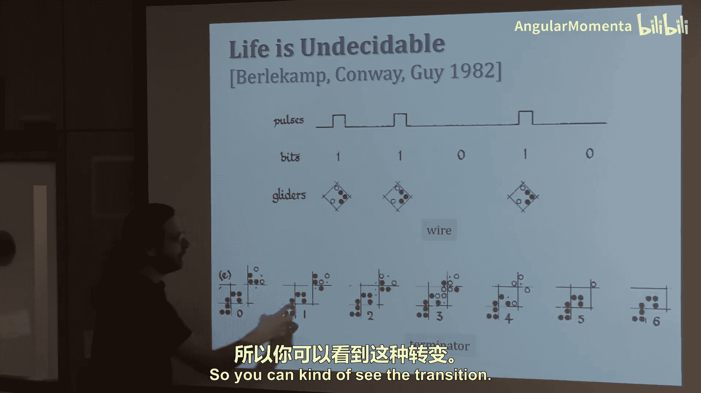

One thing to note is that the。The exact。What do you call it the exact offset of this stream versus the eater is very critical。

 You do something a little different。 Eer might explode or do something else weird。

 So if you're gonna build these， be careful。I'll talk a little bit more about pary and things in a moment。

Okay， so here's a fun thing you can do with a glider gun up top。And a stream of bits。

 So if you have a stream of bits coming in here and you have a glider count gun shooting 1，1，1。

1 down。Then if you set up your gliders with the exact right offsets。

 So I've got to shift that gun to be precise。 And if then when gliders hit each other。

 they annihilate each other。 Nothing is left。

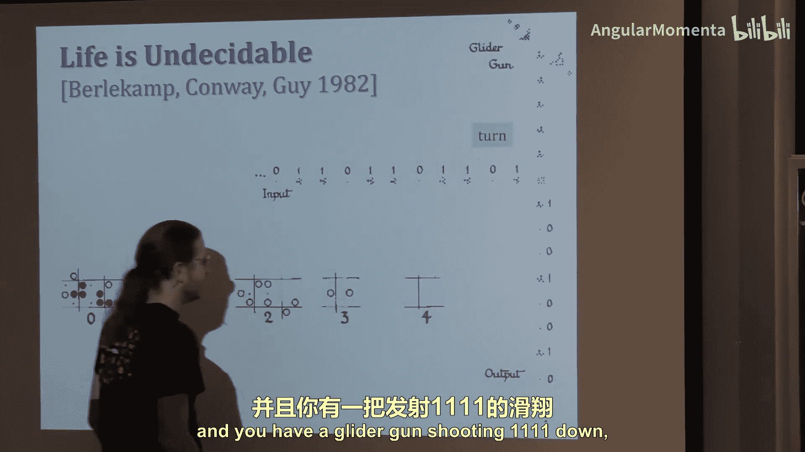

With this particular offset。 So what that means is in some sense， you're negating the signal。

 if a one comes in here， it'll hit another 1 and then 0 will come out here。

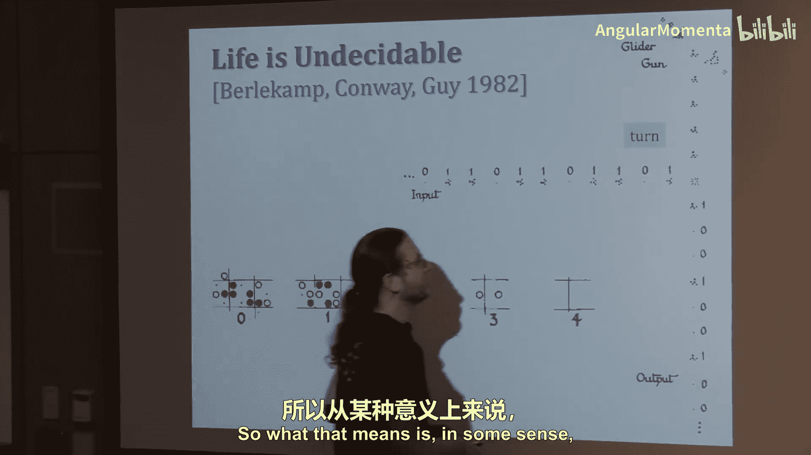

But in particular， if there's a zero here， there'll be nothing to stop this guy from going through。

 And so you get a1 out。 So this is really an negation because whenever it's horizontal。

 it's going to be one way。 whenever it's negative， it's going to be inverted。

 but this is really a turn。 So if I turn this and then turn it back。

 which I think is the next image you can you know I can now turn a wire。 So this is progress。

 but already a little challenging。 So we have this input wire gets turned by the gun turned back。

 turned back， turned back。 So。Sufficly zoomed out， you can do arbitrary turns。

You can use this to delay signals， which is useful because timing is really sensitive here with the wires and when there's a 1 bit or a zero bit。

 Another thing you can do with this is get a parity offset shift because there are actually many different offsets of the gliders that all lead to evaporation into nothing。

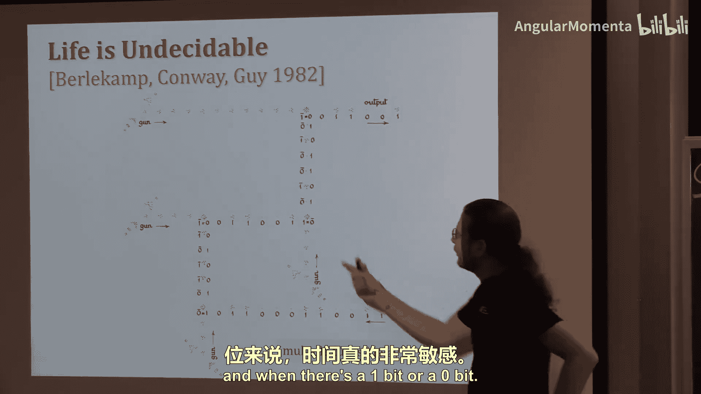

So youll have to believe this a little bit， but there are enough different offsets here that by doing a bunch of turns。

 like in this picture with slightly different offsets at each of these guns。

 you can shift your signal to be anywhere you want on the grid。

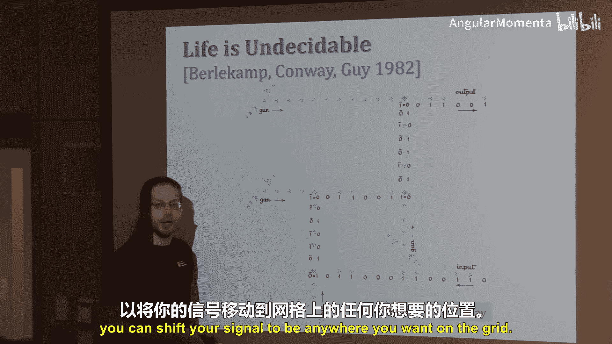

That's good because all the gadgets will require very careful alignment。So that's a shift。

 So now here's how we can do and and or gates pretty easily。

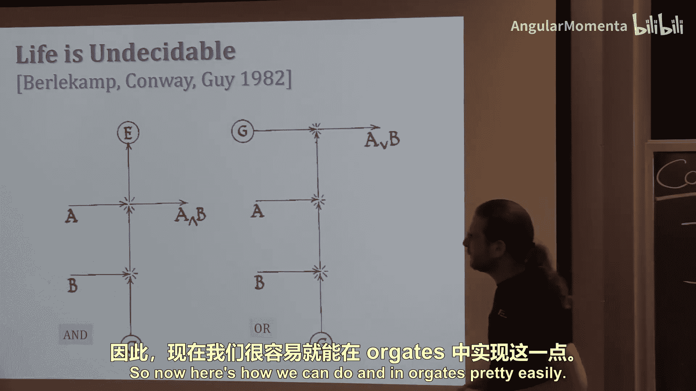

So on the one hand， if we have two streams A B， and we want to make the end of them。

 we're going to use a single glider gun to kind of emerge them together。

 so a one is going to get through here and only if there was a zero here and in that case it will prevent any A from getting through。

So if b was false， there's a0， then there'll be a glider here and it will annihilate whatever was an A and so the n will be0。

On the other hand， maybe both of them are0。 Then the glider will just go up here to the eater and disappear。

 So that's also fine。 And if a is 0。Then。There'll be nothing over there。 Obviously。

 And if they're both one， then A will get through it because there will be no B will prevent the gun here from getting there。

 So A And B have to be sort of offset in time because it takes a little bit longer for the signal to get here。

 but you get the and。And similarly， for the ore。If you。嗯。

We want to send up a gun here and then it's essentially getting negated on the right。

 so for there to be an output in the ore， there must be nothing here and for a glider to be blocked。

 either A blocks it or B blocks it。And so then the output is the or of A and B。

 and because everything here is horizontal， we're not mixing up and we're not negating anything。

 It's actually annoying it'd be better if we had a Nand and a no or a Nand or a or because then we'd be done so we still need negation。

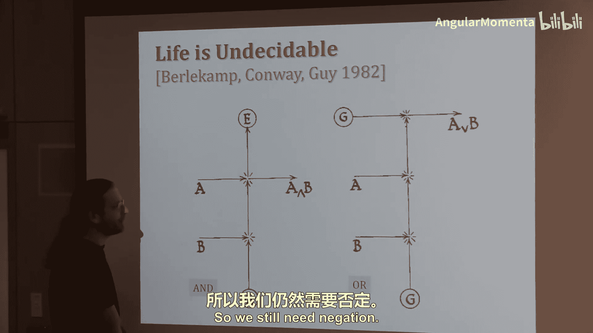

And。Yeah， question。

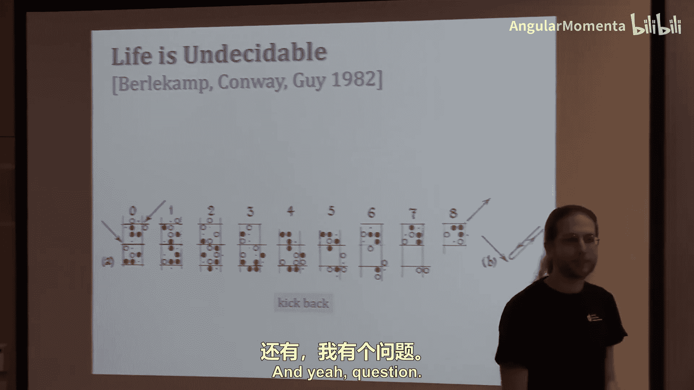

You are going to have this A and D output there as well again term。On the right right hand Right。

 right， Sorry。 So there should also be an eater here because this this is not fully occupied， good。

But because this is fully occupied。 We don't need either there'cause this is fully occupied。

 We don't need the eat here。 You could put them in for good measure， but。嗯。Okay， cool。

So before I show you the next gadget， I need another fun tool called a kickback。

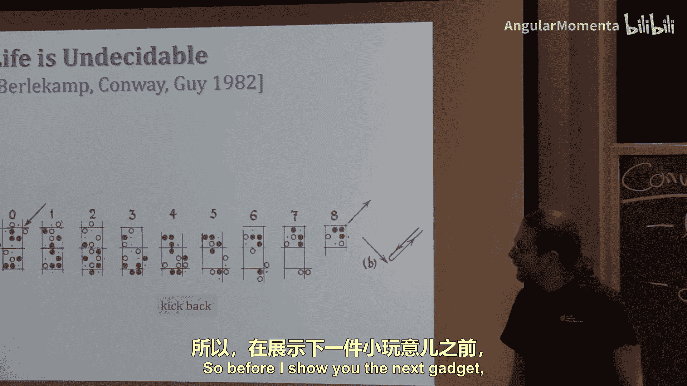

So this is a somewhat weirder offset between two gliders。 So one's coming in this way。

 the others coming in this way， and stuff happens。 and then this glider goes backwards。

ItReturn along its original spot。 So this is really cool。 It means if you're sending a glider。

 if you can kind of head it off at the pass with a perpendicular glider。

 you can cause that glider to come back。😊。

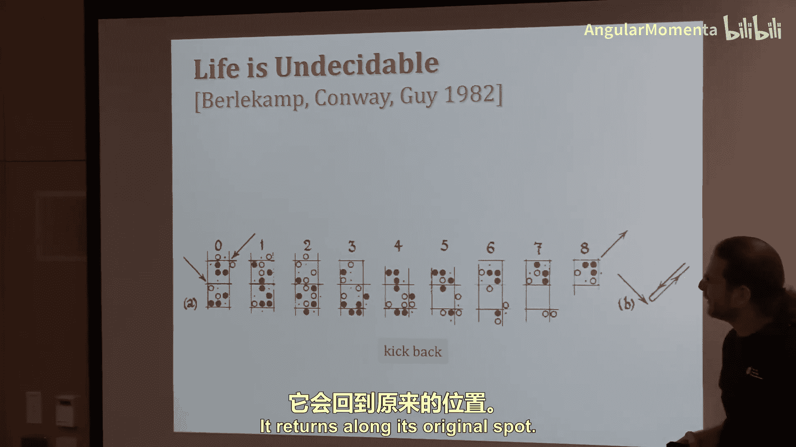

The way it was going。Which I think exactly the same offset even。嗯。

So this is useful for a lot of things， in particular it lets us build a crossover。

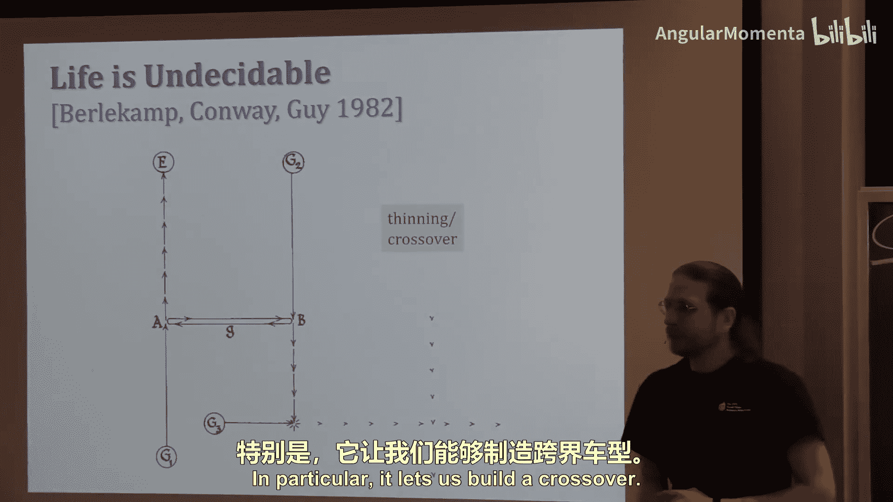

So the idea with a crossover is instead of every。YouGider produces a glider gun produces gliders at a certain rate。

 called that rate one。When it's so dense， if you cross two streams。

 your guaranteed collisions and something unintentional will happen。

 but if I could just thin out the stream so that every 10 position is a glider。

And then we only look at the bits modular 10， then there'll be no problem to do crossings。

 You just have to set up the parodity so that the gap happens whenever the other guy happens and vice versa。

 so they will never collide with each other。Even if it's all ones。

So here's how you thin out a stream。A single glider here。

 which is this going to be kicked back and forth。hanging out。 And on the other hand。

 we have these guns， G1， G2， G3。 So this is going to replace a single gun。So。

What happened these are the， this is the notation for the kickback mechanism。

 So when the mostly these guys are just going shoot off。

 but they're set up so that if this glider comes here， he gets kicked back。Okay， and also。

 we lose one glider here， but they're going to eat it all up anyway。 so it doesn't matter。

And same thing over here。 So this guy is mostly once， but every once in a while。

 this glider will come in and get kicked back and consume one of the gliders down this G2 stream。

 So there'll be a couple holes here。 And then if you basically negate that streams you send another glider gone through here。

 then only every once in a while will you have a glider。 and by controlling this width。

 you can control the rate。 And I think in this proof you just need all of them the same rate sufficiently large to allow crossovers。

Okay， cool， so that's thinning and crossover。Are the glyder gun constructions that we know about or at least that were known about at the time constrained enough that you can't just set the rate of fire from the gun construction？

UmThere's a gun for every period P greater than equal to 14。 Oh， cool。According to Wikipedia。

 must be true。I'll put make a weak claim the the extent to which I know glider guns。

 are're not like easily variable constructions。 They're kind of magical。 and they just work。

 Theyre probably many different glider guns， each with a different rate。

 but I don't think there's a general purpose glidder gun with an arbitrary rate。 Now。

 there might be one by now that has a large enough rate or slow enough rate that werere okay。

 But I don't know。 So this at least guarantees。 Yeah， that you can do it。 It's a little bit messy。

 but maybe there's a simpler one。Life is still actively studied。

 So there there are many more guns than there were in the early 80s。

 So I think I won't go through this construction in detail。

 but using or's and some kickbacks and some crazy ideas with guns。 you can build a split and a not。

 Is that okay in particular， we're using this idea of rate limiting。 So there's a lot of zeros here。

 this is whatever10 spots。 there's only one every 10 spots。 And。Yeah， there's， there's two cases。

 depending on whether a is there or not。 And by oring it together with something。

 and then having all these chain reactions， we end up with a。嗯。

Copy of a here and a negd copy of a here with， with different offsets。 Yeah， sorry， so not。

 isnn't there a super easy gadget of a。And you know， it gets sorry。

 the gun gets through if A is not there。 So that， that's what we had for the turn gadget。

 but it always turns the signal。sThat's bad because it means if you want。

 if you think of your gadgets having inputs horizontally。

 then you need to negate and still be horizontal。 So this negates and still is horizontal。 In。

 in they're， and they're right up， they actually call the turn and not gadget。

 But I think that's not。It's not a knot。 I mean， it depends on your perspective。

 but you definitely need a， a direction preserving knot。Okay。So that's cool。 And at this point。

 they say， just give this to the engineers and they'll build a computer。 Once you have and or not。

 you can build binary logic so you can do circuit at style things。

 and you can actually build you can make reenttrant circuits。

 and so you can compute on stuff and build a Tring machine with a finite size or any machine of finite size。

 bounded size。 So that that's enough to prove piece space， hardness。

 But if you want to prove undecidability you need some way to grow out to infinity。😊。

And their idea is to have a small number of registers， to are enough。 This is called。呃。

A minsky machine。Is a two counter version。 And Minsky proved that you can build。

 you can simulate a turing machine with two counters。 What's a counter。

 It stores a non negative integer。And you have three operations， increment， decrement。

 and check whether it's zero。So it's a little crazy。

 but that's enough to simulate an entire turning machine。With infinite tape。

 So the rough idea is to store a bit onto the tape。 you double it and possibly add one。

And if you want to you know， remove something from from the stack， then you divide by two。

 So with with four registers， you can use this this one to represent one stack and this one to represent the other stack dot dot dot that's not not too hard。

嗯。So how we're going to represent an arbitrary non negative integer。

 we're going to have a little two by two box。 This is drawn diagonally somewhere along this ray。

And then we're going to be able to increment or decrement the box by sending a wave of gliders。

Using these constructions so sorry this these are actually next slide will' have the constructions for incrementing here actually is a glider that's going to test whether this guy is currently zero and he happens to be。

 And so here's how you test I mean you just send a glider through the box。

And this there may be a cleaner test。 This one is a destructive test。 It destroys the box。

 but in particular， it destroys the glider。So then you can have a gate on this side that says， well。

 if I didn't get a glider， then I know that I'm actually zero and I can feed that back into my logic circuit。

 If I do get a glider， then I know this was empty。 So that's pretty easy。

 The only catches then you've destroyed the box you have to create a new box and you can do that by sending two gliders with a slightly different offset。

 this looks like the same as all the others。 but in this one， you end up with a box at the end。

 So if you send like another one here and another one time just right here。

 you'll recreate the box after you've discovered that it was there。😊，So that's cool。

 And then this is a swarm。 I think it's actually drawn somewhat accurately to push this block forward by。

😊，By one。 I think it's this， this stream。 So there are two constructions here。

 One is a wave of gliders that pulls a back a block back by 3。

 Another one pushes it forward by one together， You can use this to increment and decreement by one。

 So， I mean， lots of details to check here。 This one is。A little bit cleaner。

 we have one glider here， second glider here， and it ends up moving。

 it goes in this order and then back， and we end up moving the box up to here back three spaces。

I assume these are found by a trial and error。And then to push a block forward， one。

 this is pretty crazy there。诶。Yeah。Second wave of five gliders， Where's the first wave。the白。

That's right。Turninging the block into a honey farm。

 which is this particular still life pattern anyway。Dt dot， dot， You check the results。 It works。

 It's actually a lot of fun to implement these in a life simulator and and check that it works。

 But for now， I'm showing you the， the ancient diagrams， hand drawn diagrams。😊，Okay， so。

There's a catch with this that in order to generate these gliders。In this very specific pattern。

 currently the only way we have of making glider guns originally is sorry。

 making gliders is with a glider gun。Glaidder guns are large objects。

 and you can't put them right next to each other。And even worse。

 if you have a glider gun that's spitting out gliders in the middle of it。

 you can't put a glider gun like shifted over a little bit。

 And even if you slide it this way or that way， if you want to produce two streams very close to each other。

 one of them will go through the other glider gun and destroy the glider gun。

So we cant actually build this kind of pattern with glider guns ultimately but there's this trick using kickbacks to get a glider to go out far away from any guns。

And this is so here's your original gun and this has some holes in it so you can get a glider through here and then get this glider to bounce back and forth until you have the right timing or then this glider will escape through this little gap。

Ahhu。And then you， the result is you send a glider basically offset to the right from this gun。

So using that， you can have a bunch of glider guns sort of around where you need it。

 get all the gliders to come up。 And you know， now you're very narrow。

 you can have two gliders right next to each other without any trouble。

So you do a bunch of these constructions at various heights and then you can so this is their picture of two glider guns。

 one shooting and glider through the other。 That's bad。

 So instead we'll this put these away from it and send the gliders offset to be like that using two of these constructions。

Okay， so now we can increment and derement and test for 0 with this similar trick， we can。

Do some fun stuff in sending gliders forward and backward。 So this is cool。 Remember。

 I said that you could send a glider and cause it to come back using the kickback。

 But so normally if you want to send a glider and have it come back。

 you need another glider to be shot this way。😊，So that's okay in some cases。

 but here's a cool construction where all the glids are way down here and still I can make the glidder go up and then come back at some desired time and it's the same kind of idea you use this construction to make this glidder go back and forth。

 spend lots of time and then eventually hit this guy at it just the right orientation to send it back and if you had some more stuff you can actually get it to go back and forth many times and come over farther to the right。

Why do I care about this for self destruction？So the idea is， if the Tring machine says yes。

 if it stops， then you want the entire thing to collapse to nothing。

 And so when you get to this magical state， you're going send out a whole bunch of gliders and then turn them around using the mechanism I just showed the boomerang and get them to hit every gadget in the construction at exactly the right offset to make them disappear。

 This is how you kill an eater from going from slightly wrong orientation This is how you destroy a gun ends up with nothing。

啊。Oh， and sorry， this is a gun。 This is how you destroy a square。 We already saw that。

 So all of that infrastructure of being able to precisely place gliders exactly where you need them。

 lots of details to check。 But you should be able to get them all come out and come back and they all you always hit them on the backside of the guns。

 So I think first you kill all the guns So these stop generating gliders。

 you let the gliders get eaten by eaters and then you go out and destroy all the eaters。😊。

And squares and so on。 So pretty epic。 But in the end。

 we get undecidability of life in an infinite board。

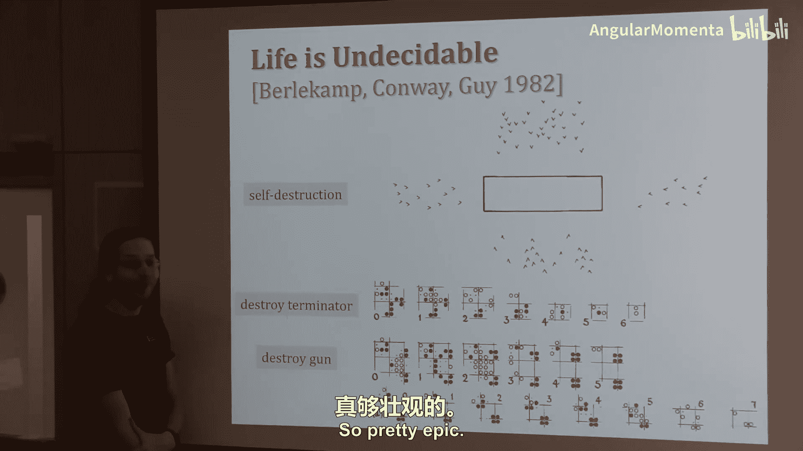

So。啊。Z players is more interesting than you might expect。

 This is certainly one of the more epic proofs in that direction。

 Next thing I want to tell you about is zero player constraint logic。

 This is called deterministic constraint logic， as opposed to nondeterministic constraint logic。

 which we talked about last time。😊，So， let me。Define it for you。お。

So in deterministic constraint logic。嗯。We have a little bit more state。

Before it's just in the state of the machine is just the orientations of all the edges。

 now we're also going to have， it's a little hard to see on this projector。

 but there are some highlighted edges which are active。So I'll describe what they are in a moment。

 so even if you can't see them， they are there。嗯。Active， intuitively， well， actually。

 literally means that you just flipped the edge。In the previous step。

So under deterministic constraint logic， we're going to be flipping multiple edges at once。

In one round， and in the next round， those edges are all called active。And the rest are inactive。

Okay， now that's for edges。 We're gonna define a vertex to be active。Basically。

 if that reversal did something useful。So， if it's。Active。Incoming edges。Have total weight。

Greatter and equal to 2。So if the just flipped edges sort of satisfy that vertex。

 possibly in a new way， then we call the vertex active。It's been activated by what just got flipped。

And then here's what we're going to do in each round。We are going to reverse。Inactive edges。

Pointing to。Active vertices。And we're going to reverse。Active edges。Pointing to inactive vertices。

And then these reversed edges are the new active edges。Okay。Okay， so。Let's look at an example。

 So here's a little gadget we're actually going to use this gadget in proving piece based completeness of this model and initially just this edge is active。

And so if we think about， if that's all that happens。 now， there' are some inputs and outputs here。

 If that's all that happens， this edge is active。 It alone does not satisfy this vertex。

 So this vertex is inactive。

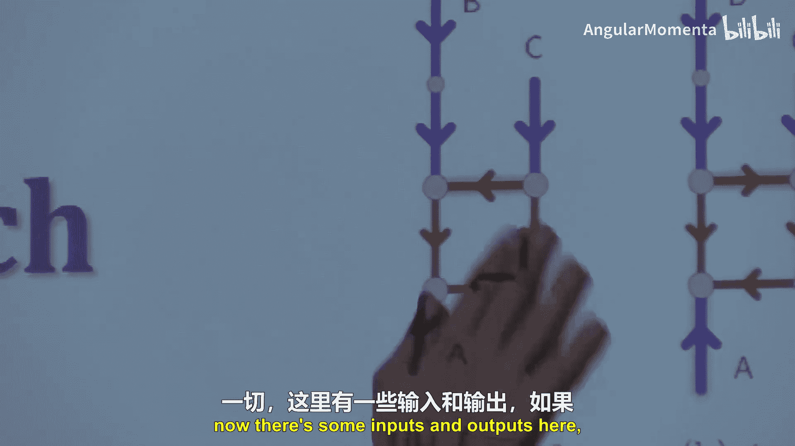

And in the inactive case， we are if the vertex is inactive。

 we're supposed to reverse the active edge。 This is basically bouncing back。

 If you try to satisfy vertex， you didn't satisfy it， you just undo what you did。

 You're gonna reverse the edge。So what's going happen here is this guy will just flip back and forth。

 First， it's gonna go this way， says， oh， I didn't satisfy this one。

 Soll reverse this edge now points into here still isn't satisfy that vertex。 It's inactive。

 So this sky will just flip back and forth。Forever until here we're drawing the picture where a reverses。

 So because of some gadget below it， supposeose a reverses at the same time， this one was reversing。

 So now this edge is active and this edge is active。 Still， this guy didn't satisfy what he wants。

 So he's going to reverse again in the next step。But this guy did satisfy the vertex because he has weight two。

 So now it alone satisfies his vertex。So now both of these are going to reverse。

 This is sort of the forward case。 We have an active edge satisfying。 So now this vertex is active。

We're going to reverse these inactive edges which point to the active vertex。

 so we end up flipping those now they're pointing out of the vertex。 this one remains pointing in。

 it's no longer active because we didn't just flip it。

So we propagate from this being active to these two being active。 This is a splitter。Right。

 we have the signal and we split it into two parts。 So it's acting like the splitter that we。

No and love from last lecture。Okay， mean， this guy just reversed again。 So。

 but now these two are simultaneously here。 So they together those two active edges satisfy the vertex。

 So this vertex is active， which will flip that edge up there。嗯。Yes。

 I should say this vertex is a little bit weird。 You can think of there being a red to blue conversion here。

 This guy only has a desired weight of one。This is basically a red edge。

 but it's subdivided to fix the timing。 so we'll see how to get rid of that subdivision。

 but you can think of this as a red to blue and there's two blue edges here。

 but this one this one edge will actually satisfy this vertex。

 And so then this guy flips in the next stage。嗯。And then it's just gonna hang out here。

 flipping back and forth along this path。 And meanwhile， this will go off and do something。

Until it comes back and reverses the edge。And I should say at this point that because there are a lot of timing issues here。

 we're going to set up all the gadgets so that they only get an input edge reversed at times divisible by four。

So this one happened at time zero， and then this one we know will happen at a certain parody relative to four。

 And so we know when this guy has gotten flipped， this one will also have just been flipped。And then。

 okay， and then stuff happens。 And then this edge ends up getting reversed。

And then more stuff happens。 then this edge gets reversed again， and then the A gets reversed again。

 So this gadget has sort of three cycles when you reverse A first B will reverse。

 then C will reverse， then B will reverse， then A will reverse。It's a little bit overkill。

 but we're going to use this to check two options。 We're just going to check one of them twice because that's what we can build easily。

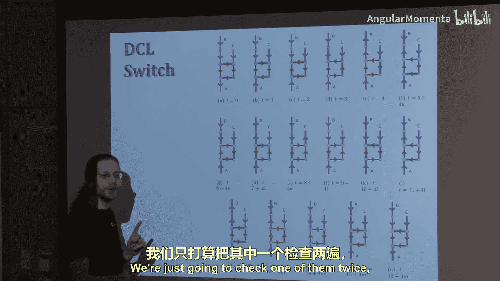

Okay，Now we want to prove peace based completeness of this model。 The decision question is， again。

 can does a particular edge ever get reversed。

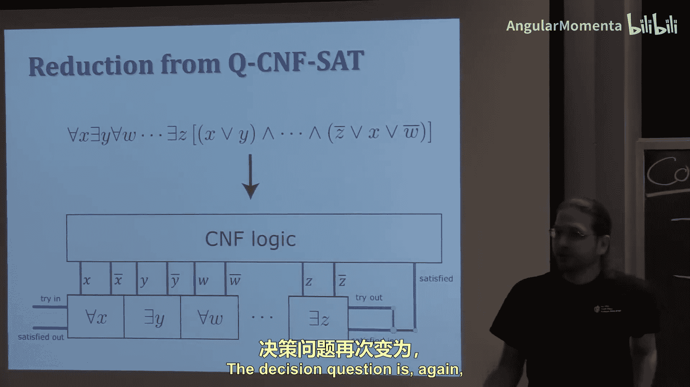

And。So we're going to reduce them the same usual way from quantified CNF set。

 we have our blocks which represent quantifiers， they're going to produce variable settings。

 we're going to have some CNF logic， and then in the end， this is actually not quite accurate。

 we're going to get some satisfied signal which gets piped into these guys。

So the first thing that has to change it are the quantifier gadgets， in particular。

 the existential quantifier needs to change because before it was。

We let the player decide whether to choose X or X bar。So in this case。

 we're going to use the gadget you just saw the little wheel， which will try x being false。

 then it will try x being true， then it will try x being false。

And all we need is that one of them is true。 So if at any point this formula satisfied。

 we'll just output that formula satisfied。 we have four edges here because everything needs to work module 4 in timing。

So there's a little bit more going on here， which I will get into in a moment。 On the other hand。

 universal quantifier。Is similar， I think I will leave it at that。

 There's this generator to try all the options。 This is going to act in some sense。

 like the one bit of memory， the latch that we had before。 So it's， it's similar。

 But I think the details are not worth getting into。

 If you look at the appendix of games puzzles computation。

 You'll see an explicit execution of this thing。 I mean， you just， it's like life。

 You just run it through and see if it works。 and it does。嗯。So what's going on up here。Is that。

When we set X bar to be false， we're going to flip this edge and。

We're basically telling this circuit， hey， x is false。And then at some point。

 it's going to acknowledge and say， okay， I I understand that X is false。So。

 but that's gonna be on a different channel。So let me illustrate the issue。

 So this is how we used to do CNF logic。 We did ans of ors using or vertices and an vertices。

And that was cool if we had a signal for what was true and what was false。

 we could throw away signals we didn't need。Then this would propagate and produce a true answer non deterministically it would。

 but deterministically， there's a lot of timing issues here。

Everything has to arrive at the inputs at exactly the same time。

 and and will only work if this edge and this edge simultaneously reverse。So， okay。

 maybe you could subdivide enough edges to fix the timing issue， but it's worse than that if you're。

 if you're doing an and of two things and you discover that the answer is false。

Then all bets are off。So normally that would be okay because we can always undo what we did。

 but we need to guarantee that the deterministic constraint machine will exactly undo what it was supposed to do。

 So it's an issue that if one of these comes in true， the others false。

 this one will bounce back and then you know chaos will happen willll end up getting edges just randomly reversing at annoying times so。

That seems messy。 And so instead， we build this much safer version called and Prime or prime and split prime。

 I guess should be a prime there。Where we don't each edge is each input is represented by two things。

 first， the signal and then the acknowledgeknowledment。And so there's some details to check here。

 the order is particularly messy， but where these are just deterministic constraint logic machines you see this gadget yet again to try various things。

But。In this case， if input 1 comes at some time before input 2。Then it will essentially。

 so this comes up， the signal gets split out here， and so we send off the acknowledgecment and then this edge will I think just be flipping back and forth。

So it's basically holding the input for a while， and later the second input could come in and it will trigger this to happen and also trigger the output and also trigger the acknowledgecment because it does all the things。

So， that is。Roughly how that works。So I think the details are not worth spending more time on this is the the final thing when you have after you have all the CNF logic come out then you this is how you end up sending it to satisfy satisfied out to the。

To the quantifiers which are here。So it's a bit messy， but the main point is that this works。

 And so hopefully we can use deterministic constraint logic to prove lots of interesting zero player games are hard。

 We don't know very many interesting zero player games。 so please help in finding them。

There's one detail I'd like to get rid of， though these degree2 vertices。

 it would be nicer to avoid those。 So this is a bunch of reductions to get rid of degree2 vertices and keep。

Things mod 4。 So we're going to take every edge and subdivide it into a path of length 4。

Because then if we have two red edges in the original graph together。

 instead of replacing it by two red paths of length4。

 we're going to replace it by two paths here with the first and last edge being red。

 but everything else being blue。The motivation for that is now we just have blue。

 blue edges and red blue edges。

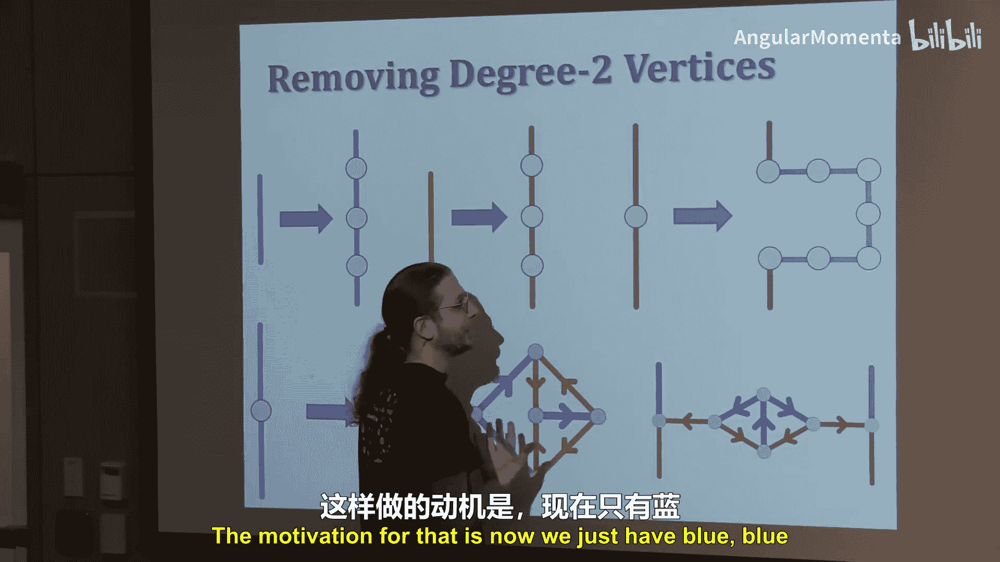

No red reds。 to get a blue blue， we just add on a thing like this that's forced to be out。

 And this will be satisfied if only if one of these is in。 So we've done that kind of trick before。

 and red blue edges， we've explicitly done before。 So we know how to deal with those。

 And so we do all the subdivision in order to get rid of the red reds also where these guys have a smaller weight constraint。

 Just one of them has to be in。So now we have no degree， two vertices。

 The other thing is we have a non planar graph。 It'd be nice to get rid of the crossings timing。呃。

This should preserve the fact that everything happens at times 0 mod 4。

 So it willll slow everything down by a factor of 4， but。Shouldn't be a timing issue。

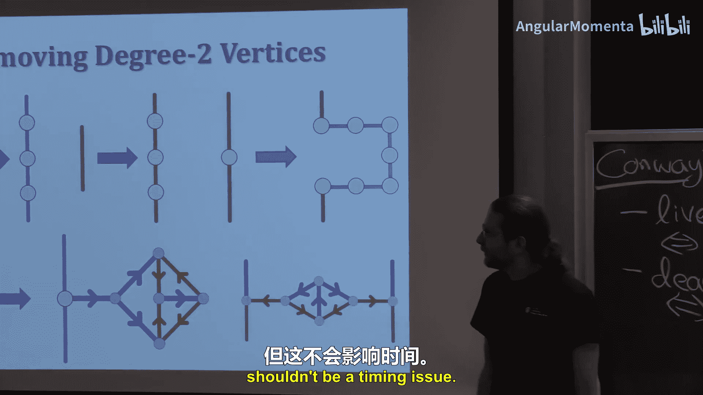

And because these things are rigid， they don't have any timing。Okay， so next we get rid of crossings。

 This actually is a little easier for once。 This was how we implemented a red red。

 red red vertex in the crossover gadget for NL。 But here it's actually enough as a crossover because we have the luxury of timing in some sense。

 We can there are a lot of things that could have happened on theministically that just can't happen deterministically。

 So does it work here I gave I past it in the figure。

 You run it through and you check that it works in both cases。

 They don't activate at the same time then it works。 activate it at the same time。

 I don't know what would happen， but we can offset all the timing so。

There are no collisions and boom， we get crossovers。 So the conclusion is。

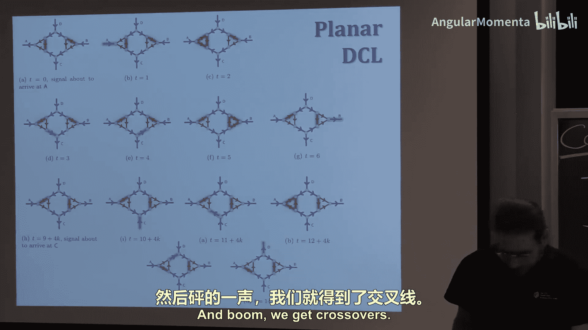

嗯。Deterministic constraint logic。Is P space complete？For planer。And or graphs。

I think I actually want to also say split。So normally we think of and and or is the same thing。

But it is helpful to distinguish them。Based on their initial orientations。So。

And and would probably be this way。Because you want to activate this and you can only do that if both of these have been activated and so this is the output。

For a split， this is the input。 So it's initially not active。

And then it would look something like that。 So if you want to distinguish between these two vertex。

 sorry。other way。If you want to distinguish what the initial orientations are。

 then you also need to list split here， so up to you， whether you feel like doing that。Okay。

 that's all I want to say about zero player games， any questions？What should happen in the end。

 Everything is。In the end， if you satisfy the whole formula。

 then you will get here this edge will reverse。

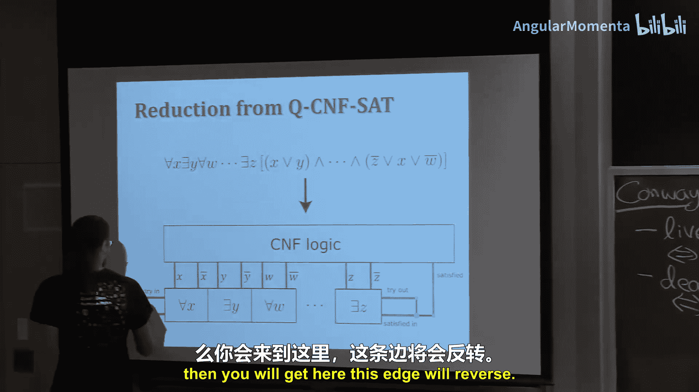

And so the decision question is， does the edge reverse。And either it will or it won't。In both cases。

 I think the behavior is periodic。'cause it's a funny thing。 But yeah。

 so there were two decision problems for non atturnistic constraint logic。 One of them was。

 can you reach this configuration， and none of them was can you put this edge。

 Do you know anything about。

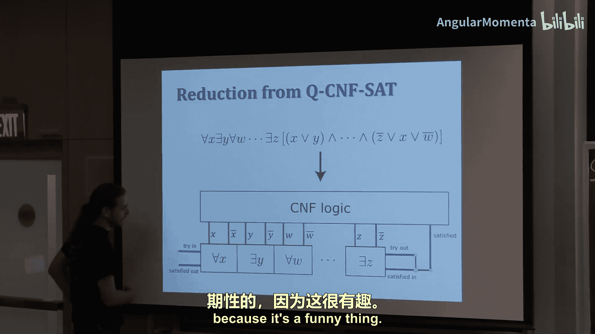

Yes， I think。Okay， if you w to solve configuration to configuration for DCL。

 I think you can add a little。Basically add some red edges here。

So if this thing activates you need to do a little bit more of a construction here。

 but I want to basically get an edge to start flipping over here， whereas before it was not flipping。

 I think you can get an edge flipping and then everything inverts and then you will be in the original configuration except this guy will be flipping and if you set your parodity right。

 then you'll be flipped in a state where everything else is in its original state。

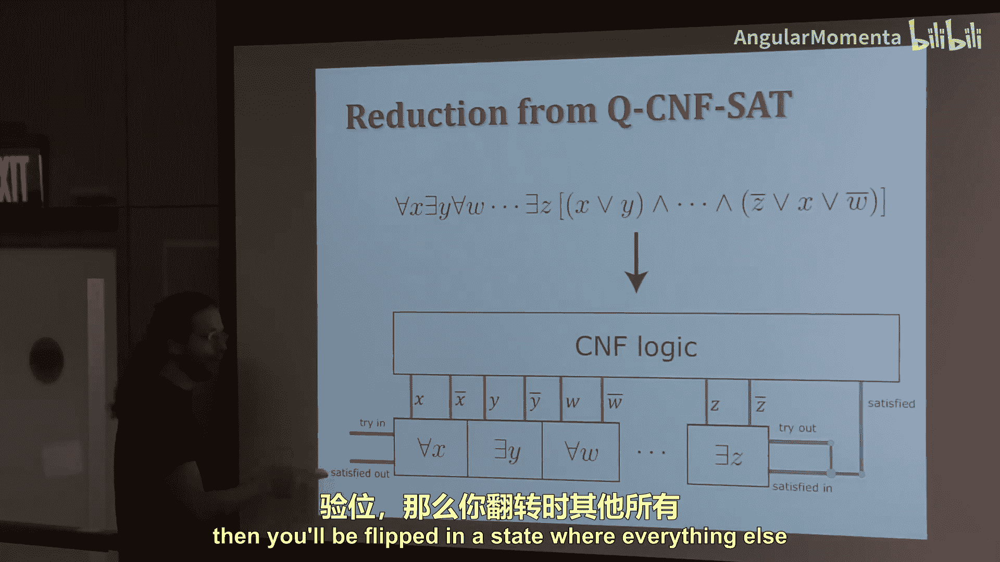

Pretty sure I forget whether that's in the book， but。I think configuration and configuration。

 also a piece space complete for DCL。Good。So， let's move on to。Multiplayer games。First。

I'd like to reduce to the two player case。So there's a big difference between one and  two players。

 but there's not so big a difference between 2 and 3 and 4 and 5 and 6 players。

 At least the usual decision problem is。Does the first player having have a winning strategy。

Can the first player win basically？Sometimes this is called a forced wind。Player forces a win。

If you think of it this way， then and all the other players are free agents。

 then the worst case is when they all collude to try to make you not win。

That would be the opposite of a force win if it's not possible for you to force a win。

 That means the players can somehow work together in order to prevent you from winning。

 So in that sense， they are all essentially one player。 can think of them as one hive mind。 Now。

 in the mechanics of the game， of course， there are differences between two players and three players because they have more power in some sense。

 they can do three things for every time you do one thing。 But at some level。

 that is just a two player game again where you are relatively impoverished compared to your opponent。

So the asymmetric， but it's still a two player game from a complexity standpoint。

So we just need to think about two player games and their complexity。Later。

 we'll add some variations that make this not true。 But in a perfect information deterministic game。

 this is true。 this reduction。That's true。So for two players， we're going to have。

At least for the duration of this lecture， the two players will be called white and black。

In winning ways， for example， theyre call， they're called red and blue。

 but this is problematiccause we have red and blue edges already， and I want。Red。

 white edges and blue， black edges and so on。 So the players will be white and black as in chess checkers。

 not checkers， go whatever。But color renaming， right。Okay。

And I'm going to focus today on games that have a polynomial number of moves。In any execution。

Which places the problem into peace space。So again， we're going to aim for peace space completeness。

 It's piece space because you can think of this question as being equivalent to， do I have a move。

Such that no matter how the opponent responds to that move。 So it remove for the opponent。

 which I will call response。I have another move。Such that no matter what the opponent does。呃。

Dot dot dot through the polynomial number of moves。 If there's only polynoly many moves。

 then there's only a polynomial number of quantifiers here。 And then in the formula。

 I'm going write whatever the rules of the game are。And then ended together with， I win。

So there's some so I think you believe almost all games you can write as some Boolean formula to do that。

Some polynomial size bull in formula saying at each step you satisfy what you need。And so， this。

Is a Qat problem。And therefore。Any two player game where you can write moves and responses succinctly。

 have polynomial number moves is in piece space because you can reduce it to Qet。

So that's why PeaceB is the class we care about for polynomly bounded games。

So now we want to prove hardness。And first， I want to give you some hard problems in this setting。

Starting with sat style games。This is from another paper by Schaffer。

 same guy who did Schefffer dichotomy theorem， but he also did some nice stuff on games。So。

First game is just your favorite flavor of Qsat。You can think of it as a game so because QatAT is exactly of this form。

 you can think of the game as in your first move， you're going to choose this variable in your second move。

 the opponent is going to choose this variable and the third move you choose this variable and so on because play alternates you are following exactly an alter and quantifier kind of thing and the goal of player one is to satisfy this formula the goal of player two is to have it not satisfied in the end and so player one will win if and only if this formula is true。

So in the game， you think of it as their sequence of variables， x1， x2， x3。

Play alternates between assigning X I and X I plus one。

 Player  one is always assigning the odd variables。 Player 2 is always assigning the even variables。

 And then if the formula is satisfied， then。Player  one wins。Okay。So this is what you might call。诶。

The game。Version of a satisfiable formula is that player one wins。

If and only if the formula is satisfied in the end。

But there are some other goal conditions you might consider。That Scheffer defines one is called Sik。

Which is the first。Player。To satisfy the formula。Winds。And。So what this means is if if so in general。

 if you're choosing some variables， you have a set of variables。

 some of them have been assigned 0 or 1。 Some of them haven't been assigned yet。

 So when I say satisfy here， I mean that unassigned things。R 0。So if。

 if you think of it everything as initially 0， seek whoever satfi the formula first wins。

Then the opposite version is void。So the first person satisfied， the formula loses。

So a formula starts false and then Blake starts。False， yeah。

 And the first person to said it's true loses the game Other person wins。Okay。

 so those are some rule variations。Of the goal state， now let me tell you about the moves。So。

Other than QsAT， we're going to have two types of moves， one is impartial moves。

 impartial means that both players have the same moves。

So an impartial move is going to be whoever's playing。sets。An unassigned variable。

So in all of these games， you can only assign a variable once。If you can assign it multiple times。

 then you're no longer polynoinately bounded and you get X time completeness。

AndBut in for the polynom bounded games， we're gonna define each variable can only be assigned once in the partial game。

 any player can assign any variable that's not yet assigned。Okay， so whereas in QAT。

 you had a fixed ordering first x1， then x2， then x3， and impartial。Game version of sat。

 Play can play any。They set take turns setting variables any they want。 It's not yet assigned。

 And in the end， if the formula satisfied player one wins， that would be impartial game。

 But I guess do impartial seek， impartial void。and then， by the way， I made up these names。

They don't match what Schchaefffer calls them， but these are more modern。

 These terms are in winning ways， for example。Seek and avoid he used。

 but the other ones that made up。Okay， partisan version is that there are white variables。

And there are black variables。And the white player can only set white variables。

 black player can only set black variables， there's 50% of each。And so。They have。

 they have balance at the if you play all the way to the end， like in the game version， then。

it's okay to have the white player play any unsatisfied white variable。And set it to true or false。

Okay， I think that defines all the games that I want。 Now。

 let me tell you which combinations are piece based complete。A bunch of them。So。Impartial。

In addition to this characterization， there's also all of the different versions of S that we know。

 So we have impartial game。Positive。11 set。So this is a version of CF set instead of  three set。

 I have 11 set， There are no negative literals。And it's impartial so anyone can set any variable。

 and it's the game version， so player one wants to set it true。

 player two wants the formula to be false。That's piece space complete。Also， if we do 11。DNF set。

So a DNF formula。With positive。This is also as hard。 I mean。

 that essentially corresponds to flipping the outermost or flipping all the quantifiers。

 So that doesn't make a big difference。嗯。So this is cool because， you know。

 positive set is usually pretty easy。 But in the alter， with all existential quantifiers。

 with alternating quantifiers， not so easy， yeah。The impartial game has with ten0 set。

We don't know the exact cutoff。There is a paper， I think， proving six is enough。

 but the positive disappears so。呃。I think that's an open problem。 How how low you could go。

It's hard to do the usual kind of reductions from many occurrences to fewer because games are very sensitive about who's playing when。

 timing and so on。So next one is partisan game。CNF set。Here。

 we don't have positive and we don't have the Bo 11。But we change impartial to partisan。

 that still is hard。And next， we have a whole bunch of games that work both for impartial。

And partisan moves。And。Okay， so we have a void。Positive。To DNF set。We have Si。Positive。3 DNF set。

We have。呃。Avoid。Positive。CNF set。And we have See positive CF set。

So the main point is most combinations are hard for some version of set。

 and these are the tightest ones that Schchaaffer could show not doesn't necessarily mean that they're tight。

And there's no dichotomy theorem here。 So we don't know exactly which problems are hard。

 But this is a ton of games to start from。 And in particular， we're gonna use at least one of them。

Okay。over here。Okay， a couple more problems， which are in。呃。In the chaffer paper， one is called ks。

 one is called。Geography。Kales is essentially the two player version of In set。

So there are a couple of versions theres。Notode cs。And bipartite node chaoss。

So the traditional names。You can also think of this as impartial ks and this is。Partisan chaoss。

 so here the moves are all the same。 the moves are here， pick any vertex， add to an independent set。

That's a move。 so players take turns adding at all times you must play you must add a vertex that keeps it an independent set。

 So you're effectively removing all of its neighbors and itself last player to move wins。

 If you can't move， you lose。Bpartite node scales。 you have a bipartite graph and one side you call white。

 one side you call black and white player can only choose from the white side。

 Black player can only choose from the black side。 So these are both if you space complete as well。

By reductions from these problems。 but I don't have those reductions with me。Okay。

 so that's independent set geographyography is essentially a two playerer version of longest path。

 It's inspired by this reallife game where one person names a city or country or pick your favorite class of objects and then the other player must name a word whose first letter equals the last letter of the previous word so you're forming chains of words and you can think of that as just having a graph where vertices are the words。

 the edges are valid moves between words， do they share do they have some common property。

So in general， you're given a direct graph and you're given a start node。

 and you have a token at that start node， and then each move you make a move in the game is to follow an edge。

 to move the token along an edge。But then there's some non repetition condition。

 So we have no geography。Where you're not allowed to repeat any notes。

 that would be the usual longest path。And again， last player to move wins。 If you can't make a move。

 you lose the game， just like the real game。And on the other hand， we have edge Ge。

Which is more like an oillearian path。longest edge destroy path。 So edge geography。

 you're not allowed to repeat edges。And for each one， you could think of a directed graph。

 You have to follow directed edges or an undirected graph and。Here， undirected， no geography。Is NP P。

Directed， no geography is piece based complete。And for edge geography， surprisingly。

 both are piece based complete。So this is a useful problem。

 I've seen a ton of piece based completeness proofs based on geography。

 It's kind of conceptually clean。 and I will show you one now。Everyone play a fellow。

Rversey heres here's you have in general， you have these pieces which are black on one side white on the other。

 The black side is the one that you play。 if you're a black player。 but then you can， for example。

 place if you place a new black stone here， given this configuration。

 because there's a black string of whites and then a black here。

 you end up flipping that one over because this is black and then a bunch of whites are black and then a space。

 nothing else happens in this picture， though， when if you place this black thing， this is black。

 a bunch of whites then black， black， a bunch of white's black， black， a bunch of white's black。

 So all of those flip over。And your goal is to maximize your color。

 You want more more stones of your color than the opponents。Okay， it's a cool game。

 Boed number of moves， polynomial number of moves， because every time you add a new stone。

 you've occupied one of the squares in the board， and you'll never get that back。Okay。

 so n by n board would be exactly n squared minus4 moves because4 is the original。

Number so this is piece based complete， given a particular configuration to decide whether black has a winning strategy。

 say， is peace space complete and。Most of the construction is in here。

 This box is actually this picture。 and we''s going to simulate geography。

 But let me tell you about this other part。 So right now， white has a huge amount of area。

 This is actually really big。 So， I guess this is very thin。 So there's not much action here。

 we've got a huge amount of white area。 So white will win unless black can take this part。

And what happens is there's a gap here。 And if black can play any of these spots。

 black will be able to play here if there's some corresponding black thing over here。

 So that's what these long horizontal channels will be。So if。

 if black can play over hereca there's a black stone among white channels here。

 then this will flip to black。And then in this picture is this。

If one of these stones up here is now black， that means you can play at position alpha。

And if I play a position alpha， black plays there， then I'll get black all the way here。

White can't really respond much to that。 And then in the next black move。

 black can go here and flip that one。And then black can go here in the corner。

Corners are very important in Othello。 So once you take this corner and flip all of these things to be black。

 then I can play here， here， here， here， here， here， here， and take all of these。

And because this is the edge， white won't be able to take anything back。Okay， so that's the threat。

Each of these lines is going to be a threat that if， if if any of these become black over here。

 White has to turn them back to white。 Otherwise， in the very next move， black will win the game。

Okay， this is a lot of two player game proofs have this constant notion of threat。

 One player is basically just slogging through trying to put out fires and the other player is constantly causing fires in order to force the other player to do what they want。

So almostless reduces to one player game。 but there's still some choices involved。So。Well。

 these are not terribly exciting。 But let me show you the， the typical setup。

 This is just a turn gadget， or it could be a degree2 vertex。

 I should mention we're reducing from directed， no geography。Where。嗯。This is directed no Ge。

 also a max degree 3。So that means you might have a degree2 vertex。

Or you might have a degree 3 vertex， there are two types of degree3 directed vertices。系。

Mmerging and branching。Okay， so we need gadgets for each of these also。Bpartite。

Bibpartite is useful because in geography， you're always moving along an edge。

 which means youll always be jumping from the left side of the bipartisition to the right side。

 So you can color the edges black and white， and black player will only play in the black side。

 and white player will only play in the white side。 So this is good。

 You can predict who's going be playing in each gadget。So in a degree 2 gadget。

 it works something like this。 If white has played here， that will be because of the。

The other gadget。 This is the trigger。 Then now this is black。 a bunch of whites。

 and now black can play here， reversing all of these。 This is a threat line。

 and there's now a black square， which means white must immediately play here in order to reverse all of those stones back to white。

But now this is a white stone， which lets this thing trigger。

 So now black can play at the end of this thing。E cetera。 so this just propagates a signal。

 does a turn， it's a degree2 vertax， whatever。All those things。

 And this is slightly different version for a different orientation。

 because these things have to go to the left。 This looks a little different。Okay。

 more interesting are the degree 3 vertices。 This is the type where I have two incoming edges of one outgoing。

Key thing here is we need to check that we do not visit this vertex more than once。

 If we came in here and then came in again， we want something bad to happen。 Now， what should happen。

 bad depends on whether it was the white player moving and the black player moving。

 If it the white player moving and they double visit。 It means white should lose。

 was the black player moving and they double visit。

 It should it means black should lose because of the the bipartiteness， we know which gadget to use。

 This will be they're almost the same gadget。 just these two dots had been added。So something like。

 if this activates。And it's symmetric。 but let's say that this one activates by it white playing here。

 Then black can play here。 F all of those， which has this threat line。

 which means white must play here。 Flip them all back to white。 But now this B1 position is white。

 which enables black to play here。Flip all those to black。 This is the threat line。 Therefore。

 white must play here， can't play there and turn all these back to white。 Now， this is white。

 and now this activates down there。Okay， so that's just following the vertex。 No big deal。

 But if you came along a second time。And activated this as white。 Now， this is already white。

So when you play black， you get a black here。And white can't do anything。

There's no white stone up there， yeah。No， well， there's it's， it's entirely black。 There's。

 if there's a white on either side， white could flip it and get them back。 but you can't。

 And so you actually have two threat lines activated and then black wins。

 So this is the version where black wins。 If instead we have a white thing here。

Everything else is the same。 so this was white， this was white， black now plays here。Now。

 white can go here and completely make this thing white。

 and then black doesn't have any moves anymore。And that's the way that white's going to win is to prevent black from playing anymore。

 Then the area that was white is whites。 and we are done。There are lots of details here to check。

 but that's how it works。 There's one more gadget， basically， that says。

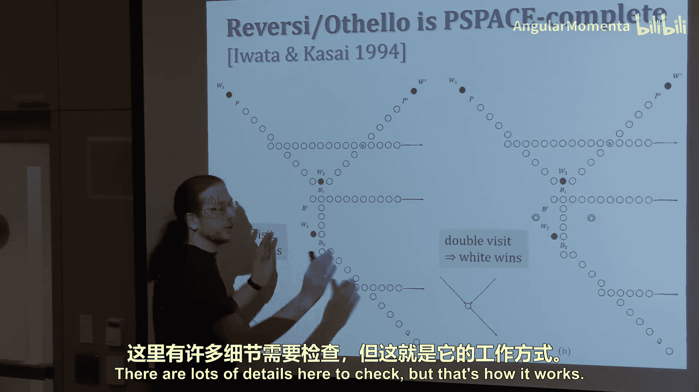

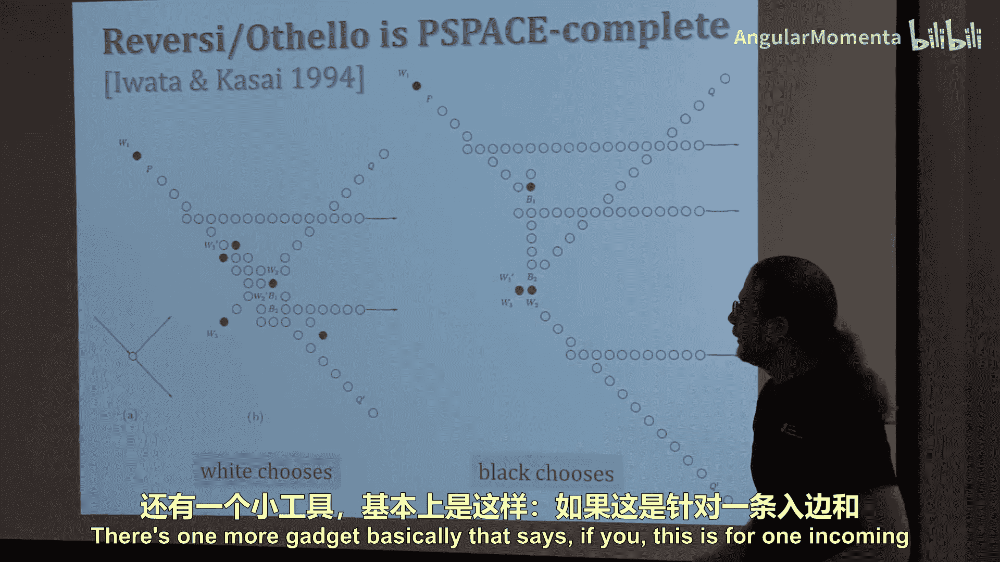

If you。This is for one incoming edge and two outgoing edges。

 So here you want the players to have a choice。 Either I go this way or I go this way。

 And if it's a white vertex， you want white to make that choice， If it's a black vertex。

 you want black to make that choice， but black is still kind of doing all the action。

 so it can be done， you know， when this activates， then。Black place here， flipping all these things。

 Then white plays here， immediately flipping it back。 That's the trouble。

 It always black is in control。 Now， black place here。

Flipping that one guy and white has two choices he can either play here and flip just this one or play here and flip those guys。

 and either put a white or here or here， and that will end up activating for black。

 either this path or this path。So white made the choice， and in this version black makes a choice。

 that's a little easier。

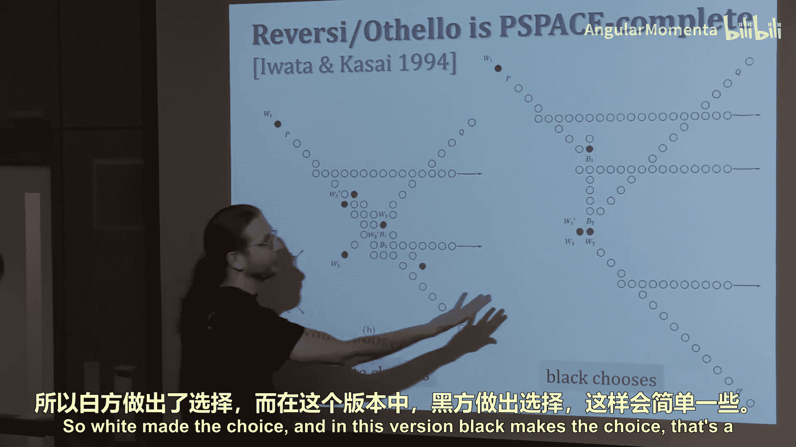

Yeah，Are these gadgets constructible？In an8 by8， No， like from a starting configuration。

 can you get to a configuration of these gadgets Oh， I see。I think so。I didn't read that as alemma。

 but it wouldn't surprise me if it's in the paper。 It's traditional in constructing these generalized games to actually show that you can reach this position from the initial state。

 Although the problem makes sense， even if you can't。 it's more interesting to say， well。

 we played like crazy。 And then we ended up with this thing， Can you finish it off for me。

 that's basically the problem we'd like to solve。嗯。Can can white win。

 It's like the commentator problem。 People are playing。 And now I want to know who。

 who's going to win at this point。But I don't know for sure for this reduction， usually they can。

Okay， so that's a sketch of Othello peace based hardness reduction from geography。嗯。

So the last thing I want to talk about back to this picture is。

The two player set up for constraint logic。 So bound polynomly bounded two player game should be piece based complete。

First， I'm going to talk briefly about what does bounded mean in general for constraint logic。

 so in particular for one player， which we know the bounded NCL means each edge can flip only once。

That's our definition and that game is clearly in NP because once you flip all the edges you're done and in the same way。

 we prove that just finding a satisfying orientation of a constraint graph is MP complete。

 we can show just I change the very top gadget。That。You bounded N CL。

 you just want to flip this one edge is MP complete because it's you basically have to make a choice for each of these vertices。

 which way to set them， and then you can propagate up。

 We don't have to re flip any edges for this very simple proof。 So MP completeness for bounded N CL。

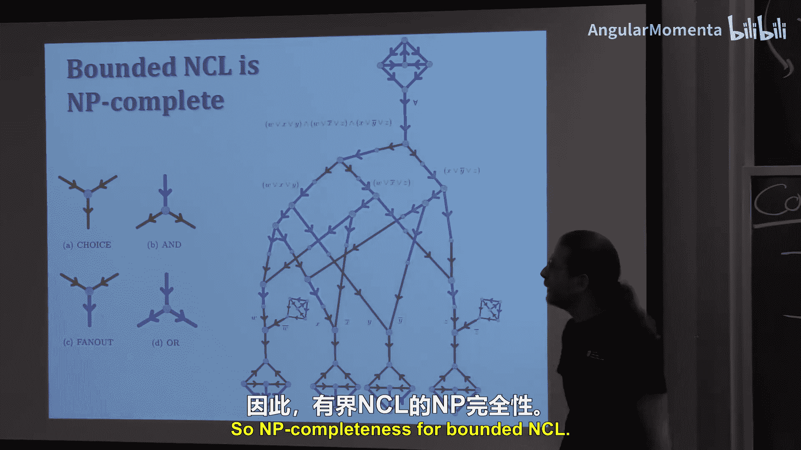

We do， for this proof need a choice gadget， so all three red edges。

 it doesn't work to just blow it up like we could before in the bounded case。Okay。

 and there's a crossover gadget in this setting as well。

 It's actually pretty simple becauseuse of bounded， you can't revisit。Okay。

 so now bounded to player constraint logic is called2 C L。

 This is piece based complete by pretty much the same proof。Structure， so what's the game。

 I have white edges and black edges。 Each edge is white and or white or black。

 and it's also red or blue。Exclusive horse。 So they're drawn these are all white edges。

 This is an example of a black edge。 So the fill is white or black。

 The outline is red or blue as before。 White players can only flip white edges。

 Black player can only flip black edges。 And otherwise， it's the same constraints。 I mean。

 in the inflow constraint doesn't care whether you're black or white。It's。

Politically correct vertices， I guess， so。We just need one new type of vertex。

 Everything else is going to be done by the white player。

 there's one new type of vertex which is an incoming black edge and an incoming white edge。

 call this a variable， the idea is that whoever gets there first white or black can flip it。

 preventing the other player from flipping their edge。

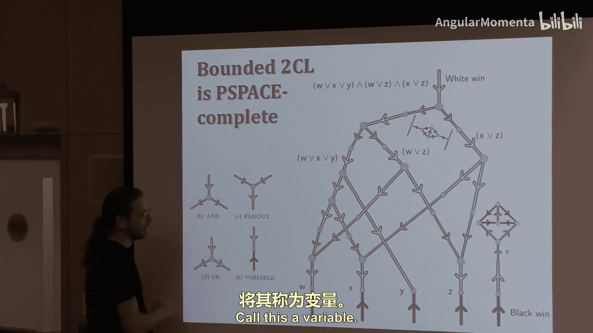

So that's what we're going to use for variable settings。 And I am reducing from。

Remember the terminology here？Impartial game， positive CNN set。

The very first one here inpartial game positive C F set。 So player one's goal。

 is's gonna one white is the player 1。 playerer one's goal is to satisfy the formula and flip their edge and。

It's the。Impartial version， meaning that anyone can set any variable。 So if black plays this edge。

 that's going to correspond to setting x to false。 If white plays the edge。

 it's going to correspond to x being true。 because this is a positive formula。

 Every time white chooses a variable， they're going want to set it to true。

 And every time black sets a variable， they're going set it to false because they want to prevent satisfaction of the formula。

 So that's why it's okay to just represent it this way。

 And then the rest just propagates once black has So if their n variables is going to be n over two rounds all the variables get set。

 And then black can't do anything else。 just sit in there。

 this one is not going to be flipable because of this gadget。

 So whites is going to fill in the formula。 And if it happens to be come out true and white can flip their edge。

 then they win the game and that will correspond to the formula being true。And otherwise not。Yeah。

 do in this game， you can pass。I think you could probably avoid that by just adding a bunch of floating black edges that you can flip or just flip repeatedly until until white either wins or white doesn't win。

 The decision question is， does white win。 Now， we end up with a tie in the case， white doesn't win。

 but。

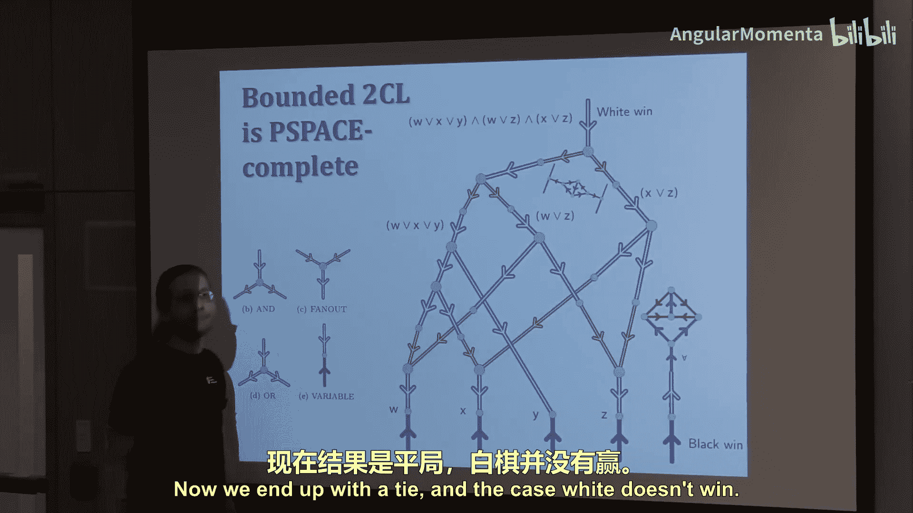

You could also change that by having a long path of blacks。

 and you black is just gonna sit there flipping， trying to get to flipping their edge。

 And the length of the wire is exactly how long it takes to fill in all these things。

We you probably need the reason why they have that gadget there at the end is probably you need to set exactly certain number of them true。

Before black can。And so。Oh， I see right。

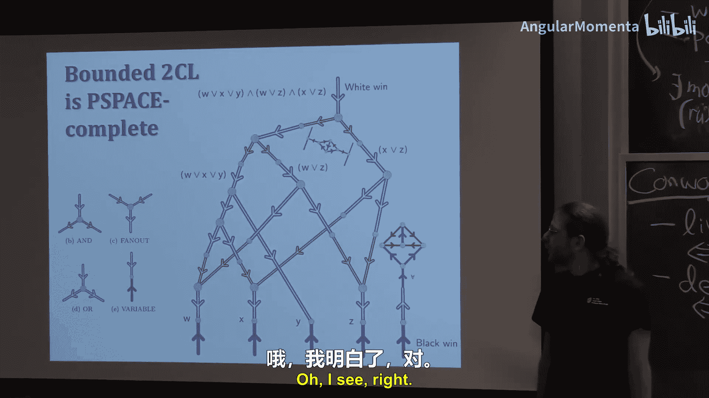

Yeah。That's a little more subtle。Okay。So a minutes remaining， there's same crossover works。

And you can also build a protected ore， protected ors where you never have both of these coming in if you will allow me the notion of a free edge。

 which is just floating there and can be reversed whenever you want， this is a white edge。

 then this will act as a or because this choice gadget can only go one way or the other so only one of the inputs can actually flip one of these edges and then the ore will just take it。

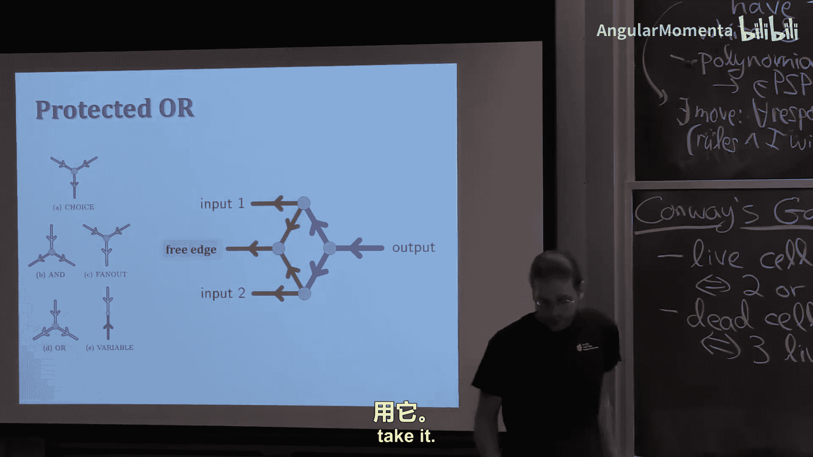

So we can build protected os。And then。I have a bunch of piece based hardness proofs based on bounded constraint logic。

 but I suggest we wait till Thursday to see this'cause they're kind of fun。

 And I'd rather spend a little time going through the proof details。So you have to。

Waiade and suspense before we get to Amazons， which is a very fun。 You should play Amazons。

 Meanwhile， if you get a chance， it's very fun。 if you have a chess board around and。😊，Kanane。

 which is an ancient， at least 7， at least 300 year old game from Hawaii and cross purposes。

 which is a modern game。 These are both bounded。 These are all three bounded to player games。

 and they're all piece based complete by a reduction from。诶。Founded to player constrained logic。

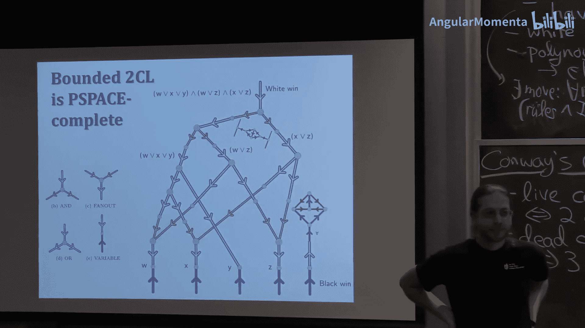

Cool。

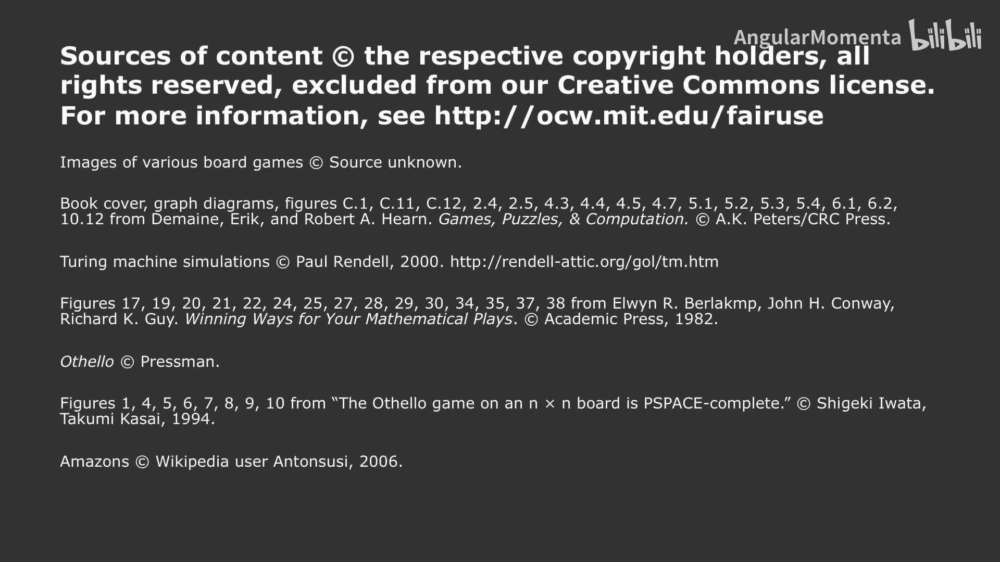