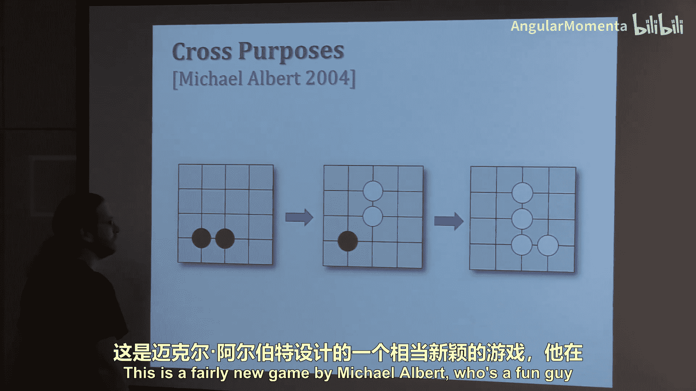
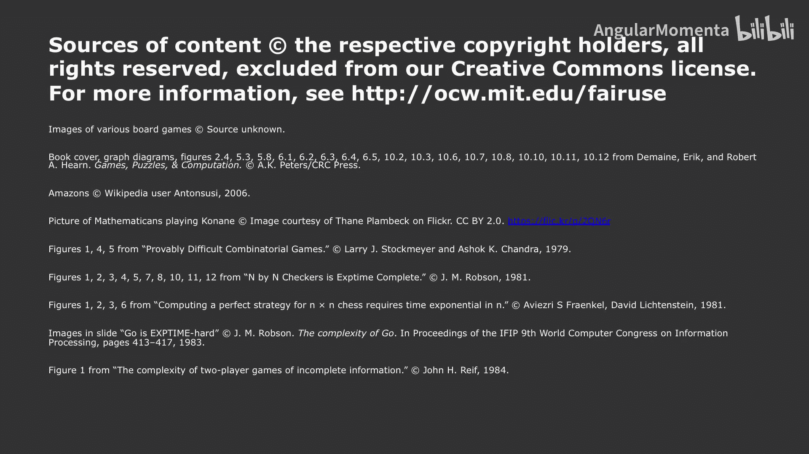

# 【麻省理工】算法下界 ｜ MIT 6.890 Algorithmic Lower Bounds, Fall 2014 p19 19. 无界游戏 -BV1dPYpz9E4V_p19-

The following content is provided under a Cative Commons license。

 Your support will help Mi T OpenCourseware continue to offer high quality educational resources for free to make a donation or to view additional materials from hundreds of Mit courses。

 Visit Mitopcourseseware at Ocw。mt。 Eduu。

All right， you guys ready for some more games？Today。

 we will finish off two player games in particular。

 so last time we were in this world of two player games with a polynomly bounded number of moves。

 we prove that Othello reverseersi is piece space complete。All of these games live in peace space。

And we ended with constraint logic in the two player case。 We proved that's piece based complete。

 I'll just show you that again in a moment。 And then in the rest of today。

 we'll talk about various other games that don't fit in this table， but in particular。

 two player an unbounded number of moves。 So exponential number of moves where you get X time completeness。

For constraint logic and for various practical games like checker's chess and go。

But I won't prove all of this。This is bounded to player constraint logic。

 remember we could simulate these formulas where here the setup was you could only flip each edge once and in particular players could take turns deciding whether to white player can set variables to true by flipping these edges。

 black player can set variables to false by flipping those edges then if the formula satisfied white wins and that was hard and two player constraint logic could。

Simulate that problem。So。What I want to show you next is three real games。

 real life games that can be reduced from bounded to player constraint logic。

 and for those we'll need two additional facts， one is that planar bounded to player constraint logic is piece complete with this crossover gadget。

 we just need the addition of a choice variable。With three red edges two in one out。

 this is what we will need and also that we can make protected ors。

 an ore where you're guaranteed at most one of these comes in by allowing an additional gadget which is a free edge so only one of our constructions will use this but in that setting we can both make we can make a free edge and we need the protected ore so they go together well and so this is review from last class。

So first real game we're going to look at is called Amazons from late 80s。

 but became popular in the combatorial game theory world， I think in the mid 200s。

 at least that's when I heard about it。 So the usual game is played on8 a checkerboard chessboard。

 I should say， with four black queens and four white queens。 Those are the Amazons， the Amazons。

 as you may know， carry bows and arrows。 So a move in this game is to take a queen。Of your color。

 move it in a queen like way。 So in this example， we're moving the queen up to this position。

And then you fire an arrow by another queen move from there。 So from here。

 we're shooting an arrow to this position， diagonally visible。

 You're not allowed to move through other players or through arrows。

 and you're not allowed to shoot through other players or through arrows。 So this。

 this square is destroyed forever。So this is clearly a bounded game every move we destroy a square。

 You have to do both of those things， move a queen by a nonzero mount and then shoot an arrow somewhere other than yourself。

 You're never allowed to land on a dead square。Okay， so a typical game after you play it for a while。

 It's really fun。 You should try it will end up in a situation where you've partitioned the queens into independent components。

 And so then it's basically a bunch of Hamiltonian cycle problems or longest path。 Now。

 these guys have to walk around。 It's a little bit weird because you can shoot not exactly where you're landing。

 But in particular， you could shoot where you just came from。

 So if each of these components usually they' Hamiltonian have a Hamiltonian path。

 And then with the queen moves。 And then you can you just sum up the areas than and whether white or black has more area is the winner because in general。

 once you can't move， you lose the game Go is to move last。😊，So in general。

 your goal is to partition up the space so you have more territory。

So we're going to prove piece based completeness of this game using bounded to player constraint logic。

So， here's the。The basic gadgets， in particular are the idea of a wire。

Or imagining this is an upward traveling signal and for it to travel up you think of this as an edge reversing from downward pointing to upward pointing。

 if a the a queen has to move down and also shoot down so leaving two blank squares in that situation。

 B can move down and shoot down one or move down two and shoot up one either way consume these two squares but leave two for the next guy。

This is a parody shift。 It also works if this guy moves down， shoots down， leaving these two squares。

 then D can move down， shoot diagonally， and so on。 So that's our wire。

 that's how we're going to propagate a signal because we only need single single use gadgets。

 You can do a turn， A moves down， shoots down， B moves down， shoots down， C moves over。

 shoots diagonally， D moves over， shoots diagonally and so on。啊。Variable gadget。

 So this is what we had on the bottom of the， of the construction。 This is a white or black edge。

And we'll never have to connect black edges to anything。 So they're just hanging out here。

 if black moves first here and obliterates these two squares， this wire is dead。If white moves first。

 then white can activate the chain。So that's going to simulate the usual setup where white and black are taking turns。

 setting their variables the way they want them。 And then if white can succeed and satisfy the formula。

 we have to get to end and or gadgets。 But if white can succeed and this guy can move down。

Then B can move to this place and shoot here。And then move over here and shoot into this giant room and then spend tons of room。

 tons of moves in here， and then come back here， shoot there， back there， shoot there， there。

 shoot there， and get to the other room。Okay， but if this guy does not move down。First， this guy。

 whichever way he goes， he'll have to destroy either destroy the room he's walking to or destroy the other room that he could have gone to。

 So you only get half of the points。 if this is not activated。

 And we're going set it up so that black has a bunch of other moves and some other room thats complete。

 that's already been cut off。 And it will be roughly equal to one of these rooms。

 And so only if you get both of them， do you win。And because we can't control which one。

 which way B goes， these two rooms have to be the same size。

So you happen to win by a factor of two in the number of moves。

 but that's not essential to the proof。Just for symmetry。Okay。

 so those are the basic gadgets now we have and and or。And split。And choice。嗯。Usually in， in N， C， L。

 we think of and and sorry， we think of。And and split as being the same thing， but in this setting。

 especially in the bounded situation， they're really different。Remember。

 it corresponds to whether initially things are point either the red things are pointing in or the blue thing is pointing in。

 red edges or the blue edge， and they behave quite differently in the setting。So for the and gate。

 these are the two inputs。 if both of them move out of the way， then C can move here。

 shoot here and decom move here and shoot there。So that and if you only move one of the two。

 you won't have enough room。Why， like if B moves out of the way， C can move and shoot here。

 but D only has one1 square。If aim moves out of the way， he can't move。Yeah。呃。On the other hand。

 an or。Gdget， these are the two inputs， and this is the output。 If either one of these moves。

 we sort of already have one square， we just need a second square for C to shoot into could be here or here。

 as long as one of them moves out of the way， we are happy。嗯。As a choice gadget， this is。

So this is three blues coming in， but with the， yeah。The orientations are different。Yeah， with this。

 okay， so a choice is we have an input coming up from the bottom。

And we want to activate one of the two， but only one。So that corresponds to a moving out of the way。

 leaving two squares， either B can take it and hit those two squares or C can take it。

 but only one of them。So same gadget does both。 It makes sense because we're not really distinguishing between red and blue very much here。

Split is a little bit trickier。Let's walk through it。 A moves down。B moves over and shoots here。

Then C can move down here and shoot here。Then D can move over here and shoot there。

Using our queen moves， so that leaves these four spaces unoccupied。

 now E can move down here and shoot there， F can move here and shoot there。

 and now we've got the four squares necessary to trigger both H and G。So that's a split。

 and that is Amazon。 Therefore， Amazon's is piece space complete。Question。

Choices needed for crossover gadget in particular。Next game we'll look at these spurs are gonna start to look similar。

 but I think it's helpful to see a few examples。 This is Kae。 It's a very old game。

 We don't know how old invented by Hawaiian Polynesians， first documented in 1778 by Captain。Cook。

And this was a world championship。 No， this was a regional championship in 2005 that I probably lost at。

 but。It's these we like to play it with ghost stones。 That's not the original formulation。

 but you have two colors of stones on a square grid， and it's something like peg solitaire。

 but with two colors。 So let me maybe show you a bigger image。

 the type of move you can do if you're white， you can jump over a sequence of black stones。

 You can only jump over one at a time。 So if I had two in a row， you wouldn't be able to jump it。

 And furthermore， you're not allowed to change directions in a single move in a single move。

 I can jump over any chain of black， blank， black blank things。 and they are removed。 I capture them。

And it has to be in a straight line。So， that's the。The rules and of course， every move I make。

 I capture somebody， so it's polynomly bounded number of moves。This is the general idea for。

A wire is that with white will be doing most of the action here。

 and so white will be jumping here at this point I have to change directions。

 but luckily after I obliterate those two pieces， black can't do anything。To me， I'm。

 I'm safe between these two black squares。 so I can so black will do something else。

 and then white is free to start jumping in the direction they want to。That will be critical。

 Here is a variable where if black moves first in this scenario。

 can capture the white thing and prevent it from activating this wire。 If white moves first。

 they can activate the wire。 so that has the。Whoever goes there first sets the variable。 Oh。

 in the original game， it's the whole board is filled where the color of your piece is equal to the color of the square or the checkerboard。

 except for the center to places are blank but we're not considering it from the actual initial configuration。

 We're considered it from a half played configuration， because the original configuration。

 the answer is just a function of the board size。 And that's not enough information to be interesting from a complexity standpoint。

 Yeah， the standard but general No， in general， none of those problems can be hard in the sense that we want。

Because they're sparse。 They have very few inputs of a given size。

So there is no such result unless you have a variable initial setup， like maybe games where you。

 what do you call it draft， your deck in the beginning， I mean。

 if you consider that part of the initial setup， then。That could be much more interesting。Okay。

 so we have， these are right， haven done the or in the choice。 So again， if we。嗯。So let's do the or。

 if we are activating from here， we can just keep going。

 be bad to stop here because then black could capture us， but we can go straight。 on the other hand。

 if we come from this position， we killed those two guys we're safe and then we can go up。

And a choice gadget would be coming， the input for a choice would be here。

 so you can jump here and then you have a choice whether to go up or down。So again。

 same gadget does or in choice。And here's one gadget that does and split and a shift。

 which is convenient for various ways to use it。 But what it really does is there's two traversal paths。

 input1 to output 1 and input 2 to output 2 and they have to happen in that order If you try to activate path2 you have to stop here。

 I mean， I guess you could jump here and then be captured that way。 If you stop here。

 you'll be captured by that guy。So that's bad news。 But if we first do the input1 traversal。

 this is safe and then go to the output traversal， this guy is gone。And so then we can do input 2。

 pause and then go up to output 2。 So that's what the gadget does by itself。If we。

Ignore what happens out here。Then we can think of this as an and gate where first this input has to come in。

 kill that guy and then go off get and go off to never， never land。

 And then if the second input comes in， then we activate the outputs。

 So that would be the output of the and gate that's garbage。 and these are the two inputs。

 Now there is an issue of we have to make this one trigger before this one。

 But in all in all of these setups， we have these pauses where you。The piece can wait。

 So if we have a turn gadget right before the input。

 it can just sit there and wait for the other input to the end to activate。

 And then this one can go ahead and activate the second one。 So there's no real。we have。

 we're very flexible in timing so we can make input 1 go before input 2 for an end。For a split。

We can just have a white token sitting here ready to go that's in a safe position。

And then once this input comes in and gets output there， then this one can trigger an output there。

 so we get both of the outputs for one input。And for a shift。We do both of these things。

 We treat this as garbage， and we have a safe white token here。 So if this comes in。

 then that can go out。 So we end up shifting by one and that fixes any parodity issues。Cool。

 so that's Kane。Pace space complete。How do you呃。Garanteed that black doesn't。呃。

By checking all the cases。In general。So， I mean， there's a question of what black is doing。

 basically within all these gadgets， we're preventing black from doing anything。So the。

 the main place where we care about black's motion is here。

 So there's going to be an initial phase where everyone setting variables。

 We're taking turns and white's going to set half of them。 blue is going to set half of them。 There。

 black is screwing you。 but in a controlled fashion。 After that。

 there's going be a pile of extra moves that black can just do。

 And black will always be forced to do those extra useless moves。

If we happen to satisfy the final output to the overall thing。

 then white will have a zillion free moves， and then white will win。That's the idea。

 But within these gadgets， you know， as long as we prevent。

 as long as we don't do something unintelligent， like going here and then getting captured by black and therefore destroying the whole construction。

 I mean， then white will lose。 probably we were always careful to go to positions that are safe。

 Black cannot jump us if we're there。So that's by checking all those cases。

 you can guarantee black doesn't hurt you。I didn't mention what。

What's black doing when we're not allowing it to play at all。Cool， so that's canane。

Next is a game called cross Purpos， This is a fairly new game by Michael Albert。

A fun guy in the combinatorial game 3 scene， so。

The again， we're gonna play with ghost stones。 But what you should imagine is that black stones are towers of two blocks。

And then you can push them over。 So in this case， we took this tower， pushed it up。

 And so it occupied those two spots。But once it's pushed over， it's kind of dead。

 so we draw it in white。 And then， for example， we could take this tower。

 plop it over to the right and get those two Now to make this a fun to play a game。

I mean this would be a natural enough solitaryre game， but to make a two player game。

 we're going to have two players， one called horizontal， which can only do this type of move。

And another player called Ver， which can only do this type of move。

So what's fun here is that it's the same black pieces used by both players。

 but one of them can tip them left or right and the other can tip them up or down。But again。

 it's bounded because once you top over tower， it's dead。

 So this is gonna be piece pace complete by reduction from bounded to player constraint logic。

So some question。 Yeah，'s the goal game Oh， the goal of the game is to move last。 If you can't move。

 if you lose。And that can be a symmetric， some pieces are only going to be flipable up or down。Yeah。

 a lot of games have that feature its called normal play。 In fact， it's so common。

 that last player to move wins。 So a wire is gonna look something like this。 in general。

 I think vertical is the player that we're rooting for。

 and we're trying to decide whether vertical can win。 and we're gonna set up horizontal。

 unlike the previous game， we're gonna set up horizontal in a position that it never has any moves except the one that you give it right then。

 So the idea is that we as soon as we move A down， then horizontal has a move， name playing B。

 And then we have a move and so on。 So that will trigger。😊，That better not stop at any point。

 Otherwise we never， we always want to set it up。 So when we're switching gadgets。

 it's our turn to move。Because the horizontal player will never have another move to make。

This is what it looks like after， I mean， things are just filling in。

 If you've partially filled in this thing， here's how we make a variable。

So here in the initial phase of the game， horizontalon will have moves， horizontalon could play this。

 filling those two squares， preventing us from playing this wire。

So whoever goes here first will claim the thing， and if it's vertical， then it triggers the。

The true value。Okay， we can also terminate a wire like this。 This is always good for us。

 We can just trigger it whenever we want， as vertical。So that's， that's we need that for free edges。

 which we need for the protected ore。So to。Clarify or to fix what I said before for the initial n moves。

 we're gonna horizontal vertical are gonna exchange their ables。

 take turns picking them At that point onwards， horizontal has no moves except the one right after we're forcing horizontal to always play the way we want。

So after this is done， then as soon as we move this， then horizontal has a unique move。

 so it will cooperate， horizontal has to cooperate with us to fill in wires。Okay。

 so here is a protected or。So if we trigger this， then this triggers， then this triggers。

 then this triggers， then that triggers its on， so that's all good。The reason it's a protected ore。嗯。

The worry。The trouble with if we activated this twice， so first we activate through here say。

 and then we activate here and then here， and then as vertical we move B down。

 now horizontal has no move。So that would be bad news if we' sort of waste a trigger like that。

 And so that's why we need a protected or。 we're only at most one of the two sides will trigger。Okay。

 choice gadget is the same， but rotated 90 degrees。

 And that makes a big difference'cause horizontal and vertical are flipped， so。Input is here。

 So if we trigger this and then this and then this。And then this， then as vertical。

 we get to choose whether this one activates or this one activates。

 So it's important to make it the right player。Okay。

 and here's the mega gadget that does and split and shift。If we try to activate input 2。

These topmple over。This topples down and now horizontal gets a choice and horizontal is going to be mean and push B over and prevent this thing from activating because that it wants to prevent you from doing whatever you're doing because eventually you're going to get to a place where where you win where you have a single move and then horizontal doesn't have a move。

嗯。So that's in horizontals interest to block you。 But if you first did all of these toppling。

 tople this down over， down， over， down， over， down， over， then in particular。

 you put a white token in here。 And so B won't be able to do that。 So when you activate these guys。

 D will have to go over。And out you go。Okay， so， and then it's the same thing putting。

 either putting a free wire in input 2 and or ignoring the output from output 1。

 we get and split and shift。And I think。That's it for cross purposes question probably。哎。

Maybe did not show a turn D。 There's a turn gadget good。 I didn't talk about it。 it's。

 it works in the obvious way。 But yeah， it is definitely a little tricky to make sure you can do it。

 but。It works， yeah back to the normal condition。Have used games different for like the Mier version of the rule set？

I in general， those games are di games are different if you wanna move。If you when you can't move。

 then you win， but from from peace based completeness perspective， it should be the same。

 it's really whether you are starting the quantifying sequence with an exists or for all and both end up with the class piece space。

 so there may be a way to distinguish them， but at our level of granularity。

 we're not distinguishing。Yeah， do you know whether it's piece space complete for arbitrary setups or the block starting。

是是。就跟。Oh， I see no obstacle。 more natural starting place like starting with a。 Yeah。

 that's definitely not known。 I think it would be cool to think about only black tokens， no。

 no initial whites。All right。So that's all I want to say about。P space。

 I think we're talking with P space。 We first did P space here， and then P space here， last class。

 and then P space here。 So now we're going move up to X time， two players， unbounded number of moves。

 X time turns out to be the right class。哦。I lied。one more piece space class。

Which I don't have slides for。This is a short topic， but it's a cool one。

I think something that deserves more study。But at the moment， there are no natural games。

 like real life games that have been shown to fall into this class or to be complete in this class。

 So this is stochastic games。 The idea is you're playing against a random opponent。So。

You have two players。And one of the players is random。So it's hard to identify with randomness。

 So the other player is you， your goal is to win the game。 and you。

 you know that your players is just flipping a coin every time and playing randomly。

 say uniformly or some distribution。That's known to you。

Think of games where you're rolling dice or drawing cards or there's some random aspect of the game。

 how hard are these games， Well what's been studied。

 this is a Papa Diometriria paper is for bounded to player stochastic games。

 the answer is piece space again。So。呃。So for example， here's a game， a formula game。

 a stochastic set。We want to know， is there a move such that for a randomly chosen move。

 I like this notation it exists and for all， backwards are is a random。Quantifier。

There exists in x3 such that random x4。 So this is uniform random over 0 and1。

The binary choice 01 we want the probability of this gives a distribution。

 we want the probability of the formula being satisfied being greater than a half。

 I'm guessing you can pump that up to be with high probability but just deciding whether you can win by a probability strictly more than a half is piece based complete。

So this is cool。 I mean， to me， intuitively， randomness should be weaker than an adversarial player where you replace these with for all。

😊，It's just。But it turns out they behave roughly the same。

 essentially by a probability amplification argument。 It's a little detailed to go into here。

And so far there are no reductions from this to what I would call natural games。

 there are a few examples in the paper， but none around rolling dice。

 or I would love to apply this to like playing Teetris or in the paper they mentioned backgamon as a candidate。

 something like that where you'd like to get piece based completeness in a bounded setting。

So throwing that out there as an interesting direction to study but。I will end it there。

Now we can go to X time two players， unbounded game， adversarial player， no randomness。

And we get X time completeness。So。So we're gonna start out with。

 I guess similar to what we did down here， I'm going start with some formula games。

 which are X time complete and then some graph games that are X time to complete。

 then constraint logic game， which is X time complete and along the way will prove some some hardness there are fewer results here in general。

 I would say in particular， I don't have a good example of using constraint logic to prove a fun game hard。

 though they probably exist， we just haven't haven't gotten there yet。 So more open problems。

But there are a lot of cool base problems out there and this field started a paper by Stockmere and Chandra in 1979。

 and it's been the basis for pretty much all X time hard proofs。

 X time hardness is really cool because it implies exponential time。

Any problem that's X time hard cannot be solved faster than exponential time。Whereas every other。

 all these other classes， we need to assume p does not equal MP or p does not equal p space。

 P we know does not equal extra time。 So these games require exponential time。It's kind of fun。

And I'm pretty sure the first results in this category were these games。So。Power of games。

So in general， we're gonna to have some formula， maybe。A couple formulas。

 but definitely we have a variable assignment and the state of the game is going to be a variable assignment。

 and who's going to move next， playerer one or player 2。啊。Black or white， again。

 we'll use that notation and we're going to start with some variable arbitrary variable assignment that's part of the initial state of the game。

The board， if you will。 And in general， you can set variables。To 0 or 1 as many times as you like。

That's what distinguishes this from bounded games。And all of these games are going to be partisan。

T we use last class。So meaning we're gonna to have black and white variables。And。Yeah。

 I'm gonna cheat a little bit。 There's gonna be one variable that's black and white。

 but only in one of the games。 So we'll get there。 So black player can only change the black variables。

 White player can only change the white variables， except for how I'm gonna cheat。So let's start。

 These games are very creatively named。 First one's called G1。

And it's amazing how consistent the literature is about the naming of these games。So in G1。

A move by player is to set all the variables of your color。So if you're white。

 you're going to set all the white variables。Black， you're gonna set all black variables。

 and set here means you get to choose whether it's 0 or 1。

 So you're just gonna completely rewrite all of the variables of your color。

And then here's the cheat。 we're also going to have a single variable that's shared between black and white。

Call it T。And it's going to be zero。If it's player two's move， one， if it's player one move， I mean。

 it doesn't really matter。But I guess one in one is nice。So that's the moves。

 What's the goal of the game you're going to lose。The game。If。You。Satisfy。By making your move。

You satisfy a common。Between the two players，4 DNF formula。Okay， so there's one formula in the game。

 It's DNF， which is very simple to think about。 there's just a bunch of options。 if this happens。

 you lose， if this happens， you lose， if this happens。

 you lose an or of various conditions So you want to move in such a way that you do not satisfy that formula every time and in each move。

 you can rewrite all your variables， but this formula does involve t。

 which lets you care about whose turn it was。So that's cool， very clean。 I mean。

 the players have a lot of power here。 This is the first game proved hard。😊。

A little tricky to work with， because in most games， you can't set all the variables at once。

 General only setting one variable at a time。 So all the other games are going to be setting one variable at a time。

AtThis point， we're just defining。Then we'll use these games to prove some hardness。Okay。

 G2 the next game。Is a move is going to be set one variable of your color。So in particular。

 if you set the variable to its original value， that's like passing。

 So passing is allowed in this game。 passinging is also allowed here。

 You could not change any of the variables。 You wouldn't win。 in that case。

 You only win if your opponent loses in this setup。And the question is， can you win？Okay。

 in this case， we're gonna have a wind condition。In this case。

 white and black have their own winning formulas。 They're in 12 DNF， still DNF， but a little bigger。

 And if you satisfy your formula at the end of your turn， you win。And vice versa and move is set。

 just change one variable at a time。 So that's a very useful game。Next is G3。Mis slight variation。G3。

 we're gonna flip。One variable of your color。And。Then we're going to lose。If you satisfy。Your。1Well。

 DNF formula。Okay， one thing to keep in mind， losing and winning are quite different because losing is essentially negating the formula。

 which turns DNF into CF。 So you can think of this as winning in a CF condition。

 You can think of this as losing in a CF condition。 but they're not interchangeable。

 So here we've flipped between DNF and CF。 we've also changed the definition of a move a flip。 You。

 you're not allowed to pass。 You must change a variable to its opposite value Here we're allowed to just pass。

So we changed the move definition and the wind condition。 It is also hard。 This is a common one。

 I would say most extra time hardness proofs use this one。G4。呃。AMove is going to be like this。

 You can set one variable of your color。And we here we're going to have a common wind condition。

 This is nice。When if。Satisfy。Comment。12 DNF formula。Oops， 13 DNF。Maybe a little more。Okay。

 so every time every move， we're， we're both checking the same formula in this case。 And here。

 that happens to win。 So it's a variation of G2。Okay， Gina G5 does not exist， G6。

There is a G5 in the paper， but it's a sp， it's a generalization of G6。 So you don't。

 I'll tell you what it is in a second but。Not important。So in G6。Same thing for the move。

 You set one of your variables。To whatever you want。

But we're going to make it asymmetric in the sense that。诶。

And this will be very helpful for constraint logic， player one wins。

Player one is the one that we care about， we're trying to decide whether they win。

If anyone satisfies a particular formula。Okay， so there's one CNNF formula。 If it's ever satisfied。

 player one wins。 If it's never satisfied， you get a tie。

And we want to know whether player one can force a win。

So this is very compatible with the sort of thing we were doing before with it was like the game problem from last class。

 but in particular the constraint logic games， so we'll use G6 for constraint logic G3 is most other proofs。

Okay。So these are all X time complete。Formula games Yeah。

 I have a little confused about G1 so I can pass by just setting none of my variables， right。Yes。

 so how could I ever lose because if you can lose it， the turn variable will change？3。Well。

 it changes every time。So， yeah， right。 I think you could set your variables in such a way when the opponents turn。

 no matter what they do， the， the formula becomes。Satisfied， and then they lose。Good。

 but then it became satisfied on my。 sorry。 but T was a different value。 So when。

 when it's your turn， you set t to 0 or you set t to 1。

And so then maybe the formula is not satisfied when it's the opponents turn， even if they pass。

 T is set to 0。 Yes， T is part of the formula。Where does the 12 come up is that from the previous。

 I think it's from the previous result。 Yeah， do't we have an 11 or 12。 It was 12。 Yeah， alright。

In case you prefer real games， as I do。 Here is a physical instantiation of it could be many of the games。

 The one they chose to highlight was G4。So this is a game called Peak。 and it's been。Reappropriate。

 that name has been reappropriated for many other games， which well talk about in a moment。

 But the idea is you have a bunch of trays。 Each tray has a bunch of holes in it。

 Everybody knows where all the holes are。 Each tray has exactly two positions in all the way and out all the way。

 It's like here。And there are。White trays in black trays， white player can so in G4。

 white player can take any of the trays of their variable。 And if they want to toggle it state。

 they can either push it in or pull it out or leave it as it is。And then you're going to win。

If viewed from above， there's a hole that sees all the way down to the ground。

So you could put something red here。 And if you see red at the top。Then。You've satisfied DNF formula。

 It's common between the two。 So the first player to make a move where you can see a hole all the way through。

 that is expressing a DNF formula。 So that's kind of a fun way。 Gemetric way to think about。

These games， and you could adapt it to all of these games just with slightly different geometric setups。

 We'll， We'll see one in a little bit。Okay。Cool。I have here。

 next thing to mention is why are the all these games in X time。 I think that's worth。Talking about。

诶。The idea is pretty simple。All these games， I mean。

 you can represent a state in polynomial number of bits。

 It's just the current set of setting of the variables and maybe whose turn it is。Therefore。

 there are an exponential number of possible states。

And the approach is basically to build the entire state graph。And then rank。Which for each position。

 whether it's a win for one player or win for the other player。

 And I think the easiest way to think about this is you start with all the configurations that satisfy the wind win condition。

 you call those mate in zero positions。 And then you do sort of min Mac search。 or you。

 you from there， you can compute in polynomial time。 sorry。In exponential time。

 you can compute find all of the moves that where all of the places where you can make a move in any response lead you to a wind position。

 And those are the main in one positions or in two ply  one move， one pair of moves and。

So on and so forth。 And so then there's at most， you are going to be mate in exponential because there are only exponentially many states。

 So the longest mate path is gonna be exponential。 So you can do like for。K equals0，2。

The total number of states， which is an exponential。嗯。Compute。Ma in k。

And then you've characterized the whole state space in merely exponential time。

 And now you know which ones are winning states。 and then you check whether yours is one of them。

Yeah。There's probably other ways to do it。 You could probably start from your initial configuration。

 but this makes it clear that it's the most exponential time that you'll be spending。

Not polynomial space because we're building the entire graph here for this to work。

 We have to remember for all all the states we visited so that we can check for duplicates。

So that's intuitively why we're in exponential time， bigger than P space。

 assuming P space is not equal x time， which we believe。Okay。Cool。So let's do some graph games next。

I have two games to mention and approved for one of them。First game is based on。Hamiltoniann。Pycle。

So this is a funny kind of game。But it's， well， and the claim is you can do this for a lot of different MP complete problems。

 But in general， we have a graph。Every edge of the graph is either black or white。

 and black player can only play black edges， white player can only play black edges。 In addition。

 every edge is either in or out。In the graph or currently out of the graph。And that's what。

These variables are going to correspond to the variable， I mean。

 we're going to convert into a corresponding game， and in this case。

 it's going to be a G6 style game。So。诶。The winning condition is that the set of in edges form a Hamiltonian cycle in the graph。

So you could think in means in the cycle out means not in the cycle。

 and if we ever get to a state where the in edges form a Hamiltonian cycle， player one wins。

 player two's goal is to try to avoid that。Player  two can only control the black edges。

 player one can only control the white edges， and in each turn。

 you can change if you want to one of the edges between in and out。

And one of the edges of your color。So I'm just going to leave it at that because I don't。The proof。

Is not terribly interesting。No gadgets。But。This next game is， I think， a lot more fun。

 more surprisingly hard。 And it has a nice， clean reduction also from G3。😊，So what's the game？

We are given。3 graphs on the same vertices。So really， you can think of this as a try。

 a three edge colored graph。 There's the red graph， the blue graph， the green graph。

 same set of vertices。And we are gonna have tokens。On vertices。

And we're going to have at most one per vertex。There are white tokens and black tokens。And move。

By a player。Is going to call it slide a token。Exactly one of them。Of your color。Along。Path。

In one of the graphs。There's three of them。And that slide has to satisfy a few conditions。

One condition， which is that。The target vertex you get to and all intermediate vertices。

That you follow along the path。Must be empty。They should have no tokens。Okay。

 so you pick up any token of your colour。 You pick a color， red， green or blue。

 and you follow a red path， or you follow a green path or you follow a blue path。

 As long as that path doesn't hit any other tokens。 Then you drop your token。

 erase it from where it was originally。And you keep making moves like that。

What about the wind condition？If we look at a player， I'm going to call the players one and2。

 player I。Or when。If。They。Get one of their tokens。To a node。In the Winet W I。 So there's going also。

 we're going to color the nodes as winning for white or winning for black。

And if you ever get a token to a winning spot for your color， game's over。 You win。Okay。

 so this is pretty natural token sliding game。As x time complete， very hard。And this one。

 we're gonna prove。So this is a variable gadget。So we're going to reduce from G3。

 I think I said that， this one。 So in G3， a move corresponds to you're forced to flip a variable of your color。

Although we could switch that to the other version， but and you're going to。Wose the game。

If you satisfy your DNF formula。There's lots of edges here。 But in particular， the colours are。

 there's the solid edges， dashed edges and the dotted edges。 That's red， green and blue。

This is before colour journals question what the purpose of colouring edge。Oh。

It's basically to decompose the graph into a bunch of different types of paths。

 So the coloring is you when you follow a path， it must be a path of a single color。Yes。

 so you can only follow a solid path or follow a dash path or follow a dotted path。

 Can't mix colours。 mix edges of different colours。So that's the three graphs。um。So what's going on。

 We've got a white token here， black token here， white token here。 This is a wind position for white。

 These are wind positions for black。So there's a lot of things going on here。

 but the main idea is that white can move the token to here， that corresponds to Xi being false。

 or can move it to here， that corresponds toxii being true。

And that's essentially all you can do in this picture。 Why， because if this guy moves to here。

 for example， then black can win， black can go along this path and get to a wind state。

And symmetrically， if white also goes off the track， then black can go to the wind state。 Also。

 we had to put this vertex here to make that this token here to make that true。 You might worry。

 maybe black tries to move out of that position to there or to there or to there。

 But then white will win by going like that。 So under optimal play if you're not make if you don't make silly losing moves。

 all you can do is move the white token between here and here。Okay， so， and I didn't say it。

 But the path here is supposed to be a non zero length path。 So you have to move your token。

And therefore， that represents this constraint that you must flip the variable。

 You must flip exactly one variable of your color。So that's the variable gadget。

 and for a while that's just going to happen。But now we have to implement the win condition or the lose condition。

So。That's this thing。 This is a。A clause。 This is a DNF clause。 is that x 3 is false and y5 is true。

 In that case， we want to lose or win。 It doesn't particularly matter here。 We want to lose， I guess。

Obviously， black can't move first in this configurationca then white could just win。 Okay。

 so black can't move first。 So what can happen in this gadget is that white moves must move here because you're not allowed to collide。

Once you move there， the threat is that white will win in the next turn。 So black must move up。

And then if this is empty， white can move here。嗯。Oh。

 it can actually move to here because that's a path， and then thread is white will win。

 so black must move up。Okay， also， there's a black one there， but we'll get to that。 Actually。

 I'll do it now。 So if this was blocked by x3 because x3 was currently set to true。

Then you won't be able to move this way。 So you'll basically be stuck here。

And then black can win like that。Okay， so you， you don't want to activate this gadget unless this is clear。

 Similarlyly， we don't want to activate it unless this is clear。 So if we're up to here。

 then white can move up， threatening to win therefore black must move up。 And then if this is clear。

 white can move up to there。And then black has to go there to prevent this win。

 but white can win that way。Okay， so white is going to win if this clause was satisfied or unsatisfied and I'm a little confused about which how many times we've negated。

 But I think you get the the spirit。 And if this DNF clause is satisfied， then。Then white wins。

And you can have a bunch of these clauses just sitting around。 They're all。

 These are all vertices unique to the claws， except for these guys。

 which are shared with the variable gadgets here。 So those are the same as these vertices。

 They're all glued together。 No parity here。Cool， so that's X time completeness of this game called blocklock。

All right。呃。This's a little ambitious， but the next one I'd like to prove is a real life classic game。

 namely checkers。This is most of the proof in one slide。 It's a little bit complicated。

 but let me give you。The， the high level idea。 it's actually a really cool proof。😊。

It's also from my birth year。 So I think that's cool。 So don't worry about this too much。

 But our construction is going to be this little square inside this little square。

 And then there's this giant spiral outside that will cause everything to self destruct when the game ends。

😊，I'll talk about that later。 Let's focus in first on what's happening within this little square。

But that will be the context。 We'll get to that。Again， so inside the square is this thing。

And basically。White。So， I mean， I think we're the perspective is from white。

 So the goals for white to win and whites， you know in checkers。

 there's two types of pieces and the circles are gonna be pieces that are going this way for white and that way for black。

 and the squares are gonna be kings。 they can move up or down。

So white has some variables that it can set between true and false up here。

 Black has some variables that can be set between true and false。 I didn't mention。

 but we are going to be playing。G3， you're going to be simulating G3。

 So a move is going to be forcing to flip something， and we're going to lose variable。

 a formula ends up being satisfied。So then there's this computation done in the middle。 Basically。

 each of these boxes is going to correspond to a DNF clause。

 What makes it tricky is each clause involves some black variables and some white variables。

 And those are going to behave quite differently。 But this construction is going to make that happen。

 And overall。Let's see where to go。Let's， let's start with the variable gadgets。

 So this is a white variable gadget。 black variable gadget， symmetric with all the colors flipped。

 I believe。Yeah， that should be fine。And the key actor is this king right here。

 I've drawn it at the intersection， but it could be on the T position or the F position。

 T corresponds the variables being set true。 F corresponds the variables being set false。

 And so most of the game is going to be all the players moving their kings back and forth between these T and F positions。

 Those will correspond to flipping variable of your color。Okay， now。Consantly。

 you're worrying about the threats。 These， these attack zones and defend paths are the threats。

 And if ever， a threat is。satisfiedatisfied， somebody's going to win and the game will end。

So when that happens。Players in the variable position can choose to activate a variable of their color。

And the way you would do that， a key rule， which you may have forgotten about checkers。

 is that if you can capture， you must capture。So that's how we're going to force the opponent to do lots of things we want them to do。

 If we move this white token up into the right， then suddenly this black token can capture。

 and it must capture along a unique path。 boom， boom， boom， boom。

 assuming we're in the true position。 then you must jump there， jump there。

 jump there and activate some stuff down here。 Okay conversely if we're in the false position。

 we're going to move this B guy up into the left and then black token we'll have to go off into this position。

Okay。So far， so good。Now at what we want。 so this variable may occur in several different clauses。

 There's one clause that matters because this is DNF thing。 We're trying to。

 we're just trying to prove that one clause has been satisfied。

So white's gonna want to send things that satisfy it。

 Black is going to want to send its variables that。Cause it to be not satisfied。

 So there's gonna be some。Some white variables and some black variables involved in this one clause。

 But we need the ability to send the a copy of this variable to the clause that matters。So the。

 the threatening players gonna white is going be sending their thing to a particular clause。

 They use do that using this fork gadget。So if you're coming from up here and you jump here。

And jump here。Black jumps here， and that's the end of black's turn。Now。

 white is going to move this position to either H or I， forcing black to。Go follow the next path。

 So whites always in control for this path。There's going to be a symmetric thing where black is in control and black can send their token to where they want it to go。

AndOne of these squares。Okay。Cool。Now有。Maybe at this point。

 I should mention that there are these letters here， MWD and MD。

 and this is relevant to the overall architecture of the game。

What we're essentially trying to do is get free moves。

Free moves will win the game because of the spiral on the outside。 but before I get to the spiral。

 here's a way to generate free moves。 suppose like right here。

 I'm going to throw in a whole bunch think of infinity copies of this gadget， so calledled white De。

 so black is forced to jump here。And just keeps going through。 There's no options for black。

 just has to keep going。But after that move。White has a penalty。

Because white is forced to capture that token。So white essentially lost a move sometime in the future。

 as long as there's still capture moves， it's okay。 but some that's kind of bad for white。

And there's a symmetric version for black， I didn't bring the picture， but it's pretty similar。

 and black will be forced afterwards to jump。So the point is if we essentially stopped here。

Black would win， actually。Because there's so many moves here that White is forced to waste。

 they'll end up being able to win the whole game in a way that I will get to。For that reason。

 you better not trigger this thing unless the king is in the right spot。

 otherwise black will stop there and then black will win。

But there's a matching MBD down here for black。 And so we're we're forced to make to use both of them。

 then they cancel each other outcause if if black has n free moves and white has n free moves。

 they'll just make all those captures and then get back to the game。Okay， so in general。

 the gadgets use these things to force you to not stop in the middle of the construction。Alright。

 But the heart of the matter is this gadget at， the clause。So there's numbers here。

 If you look closely， these are ones and then these are twos。 and then these are threes。

 So the idea is， let's suppose that there are three white variables and。

Two black variables in this class， that you can generalize。 That's what the figure shows。

So the idea is the first why it's trying to win。 And so it's going to send its variables of the appropriate truth assignment into the one clause。

 It's going to activate that， which everyone happens to be glued to the one clause first。

The the one position。 And what will happen is the white token will go here。

 I forgot to mention we've switched colors from white to black。

 That's because there's a color change gadget where you can convert white wires into black wires。

 So don't worry about it。 So now we have a white token。 It captures all these pieces。 notice。

 It captures this one， which will enable the two path next time。😊。

So the idea is first you send in this， it just stops nothing to do there。

 then we send in the twos and if this has been done already。

 so this is basically a conjunction of one and2， two we'll be able to get here if and only if both one and two are set。

 we'll also capture this position and this position enabling both of these threes。Basically。

 we have two copies of the three wired just because the opponent could mess things up for us by moving one of these。

 if you just black could move this over here and then we're kind of annoyed。

 But we have two copies for redundancy。 So even if black messes up one of them， we'll be okay。

Though the worry is after you activate this thing， black has a turn。

 And so maybe instead of doing something else， black could just move this。 But you know。

 we have enough redundancy that won't hurt us。 Finally， if we can send one，2 and three together。

 then we black will waste n moves。 and so white is in the lead and then white will win the game in the way that I haven't shown you。

Okay， conversely， black has a a blocking strategy， a defense strategy， which is after。And。

After two has activated。if black has either of these variables set to the right value。

 they can trigger them with the corresponding black variable gadget。

 and then the white token will come up here。And hit this gadget， the MWD。

 which is a whole bunch of these。 And then white is behind。

 And then black will immediately win before， before white gets to do this， black will win。So。

Overall structure makes sense。嗯。Basically， this gadget is active as soon as the white player sends down the one thing and then sends down the two thing。

 And then if black happens to have a response which blocks it namely what that corresponds to is that one of the black variables is in the wrong setting for this clause。

 then black will have a defense strategy and win the game。

 And so you only want to activate a thing if all the black variables are in the correct setting currently。

 and the white variables in the correct setting so you can do the 1，2，3 and then win。

And symmetrically， there are things like this for black。 That is the game。 Now， let me tell you how。

 once you have n free moves， how you can win the game。 This is the outer spiral。😊。

So all everything we were talking about was in here very far away from the spiral。

 like n squared away or something。And the spiral in more detail， looks like this。

There have a whole bunch of kings。And white king， black king。 And if you have a bunch of free moves。

 you don't actually need very many free moves。 It's like， I know， five or something。

 but they didn't feel like computing it。 So they just called it X and then figured it out for X。

 You can make a few moves and get from this position to this position。So far， so good。

 still have a free move。 I'm going to move。A this a king to the B position。At that point。

 black has a force jump。 Now， they may have other force jumps。

 We would just sit there and wait for them to do all their force jumps。

 And then black will have to make this jump。Capturing one of these kings。

 So this guy is basically to prevent you from jumping that way。 So this guy moves down。

 which forces this guy to jump here。 And then from here， you can jump here， here， here， here， here。

 here， here。 So satisfying。 Take all the black kings on the outside。 Now， you own the entire spiral。

 which is a huge number of things。 The number of rings of the spiral is greater than the number of pieces in there。

😊，And also， these things are very far away。 So with you have plenty of moves to whatevers happening in here。

 chaos could be happening， but you can rearrange the white spiral into a bunch of white rectangles。

 and it's already been shown conveniently that if you have N white rectangles in this sense。

 surrounding less than equal to n pieces then you win。So it doesn't matter what's in here。

 You can come in and use each ring to destroy one black token at a time and game game over。

Isn't that fun。So that's checkers X time complete。 Very cool proof。 There are details I didn't show。

 There's a parody shift a few other things， but that's pretty much everything。

And that's the power of G3。Okay。I'll just show pictures for chess， it's even more complicated。

 but chess is also extra time complete。Now， I mean， both checkers and chess in the real game。

 sometimes in some versions of the rules， it says you can make it most 200 moves or 500 moves or something。

 Those games are， of course， pieceb complete。 if you add an artificial move bound of n or something。

 but if you don't， the natural game， I think is when you don't bound the number of moves。

 then they become X time complete。This also from G3。 I that's all'll say about chess。 Yeah。

 do you know in chess what pieces are used。I think it's just ponds and bishops。Which is pretty cool。

 Some one of these figures。 Yeah， white pondn， black pawn， white bishop， black bishop。

 I'm pretty sure that's all of them。But hard to tell in this figure。

 I think you need a better scan to know which or which。Okay， and this paper is a little hard to find。

 but I gotta scan a copy。 Go is X time hard， so。How many people know go？Good almost everyone。

So go is a little funny because you might think it's a bounded game every time you place a token and you consume area。

But captures remove area。 And furthermore， codes are the action。

So cos are these threats that when I capture and then someone else can capture me back and you can flip back and forth from those types of states。

 there' are actually different rules for go， the Japanese rule set says that you are not allowed to repeat the position you were just at and this is the subtlety of a co。

So this is the canonical simplest co， so if you move white here。You capture this stone。

And under Japanese rules， you're not allowed to repeat the previous position。

 which means you're not allowed to immediately play back here and capture this stone。

 You can see why it would be kind of a boring game if you just went back and forth capturing the same guy。

 But if as long as you play anywhere else， then you can come back and capture。 That's the co threat。

Okay。That game is in X time。And， and go is X time complete under Japanese rules。Because well。

 you in some sense， because you the number of states is still only exponential。

 you just need to remember the current state and the very previous state because the co rule is that you're not allowed to repeat the previous state。

In the USA and China， there is something called a superco rule。

 which is that you're not allowed to repeat any previous state of the game ever seen。That means you。

 you are not necessarily still in X time because you might need to remember all past states。

 which could be exponentially long。 So it's like doubly exponential size。嗯。In general。

 you are in Xspace。And it's an open problem whether go is with superco is x space complete。

 currently best known lower bound is x time hardness。 I won't cover the gadgets here。 I mean。

 it's even more subtle because you can't really be capturing it's all about co threats or you can't really be adding pieces can only be you have to constantly be capturing because you must conserve volume。

 you're running for exponential time。Be quiteite an interesting game to watch， but。It's a reduction。

 I think， from G3 again。OK呃。That's go。Let me tell you a little bit about constraint logic。

 So we get a question。 I was just wondering if you allowed TV super polynomial reductions for time。

So in fact， all the proofs I've seen in this world use log space。

 which is even stronger than polynomial time。I don't know why probably just because they can。

 And it's slightly better。 It makes sense to use log space reductions for P space hardness。

 but they ended up still doing log space reductions for X time hardness。 For my purposes。

 I think polynomial time would be fine。 You could imagine using a little bit more time。

 Def don't wantan to use exponential time because that wouldn't preserve a lower bound。

 but you could use quasi polynomial or polynomial space or some some crazy thing。

 but all the claims I've made don't even need polynomial time reductions。 pretty strong。Yeah。

 that really confuses me a lot。咁个 u片。So I mean they can't ever go in the erased area。 Well you no。

 you could play here as long as something else changed you cannot。

You cannot repeat the entire board configuration。So it's not about the local local configuration can repeat。

So as long as something else has changed， then you can play here。

But then it's like the same rule right just make one other。 It's the same rule。

 But if you have five of these。 So in the co rule， as long as you're basically playing them in a different order。

 you can keep playing around and co co co coco。 But in the super co rule， at some point。

 you're gonna run out of co patterns。 And at some point， you won't be able to repeat something。

 And that changes how the game behaves。 Of course， we don't have a hardness proof of that case。

 but or stronger hardness proof。Yeah， it's subtle。Okay。

 two player constraint logic unbounded is also X time complete。 This is a reduction from G6。

You can set one of your variables， however you want。

And player one is going to win if we satisfy a CF formula。So the formulas out here or here or here。

 This is a white variable。 This is a black variable。 The only difference is this edge is white here。

 This edge is black there。 Okay， so the idea is this can be set left or right。 if it's left。

 that's corresponds to false。 if it's the。To the right， it corresponds to true。

 And so most of the time， players are just going to be flipping their edges back and forth a pretty boring game。

 But at some point， there's this constant threat network， which is if the formula is satisfied。

Then the white player is going to be able to win。How do they win。

First thing they do is lock a variable， so if this is pointing to the true state。Sorry。

 also left and right pictures are symmetric。 so symmetric that we didn't even draw it in the book。

 So I've reflected the image， and all the letters are backwards。

So let's say the variable is pointing to the right。 So blue white is going to lock the variable。

 prevent it from flipping anymore by flipping this edge。 This now we enter a attack phase。

And lots of things happen。 So this is a split gadget。 So immediately， for example。

 black can flip here and start winning the game。 There's a long path here。 it's slow。

 So it's a long path。 but eventually black will win the game。 if you just。

 the timer starts ticking now， potentially， if black chooses to follow that path。 simultaneouslyous。

 white is going to flip this guy， then flip this guy， then flip this guy and activate the formula。😊。

Okay， now。It's a little awkward because we needed one， two， three， four moves to trigger the formula。

We basically want to consume four moves of black so that things remain balanced。 And that's this 1，2。

3，4 flips。If， if black does not flip all of these edges。

 then white can flip this and then flip this and then flip this and then instantly win。

That's the fast win track。 So to prevent that， black must flip this edge and can't flip this edge until it's flip this one and can't flip this one until it's flip this one。

 So as soon as you lock a variable。Black must respond with a。And at that point。

 white can afford to flip here， and black must respond with B and then flip here。

 black must respond with C， and then flip here。 black must respond。

I guess flip here first and then flip D， and then you can activate the formula。

So then white and black are balanced again。What's cool about that is it means white can not only lock this variable。

 but lock all of the variables。 Every variable behaves the same way。

 And the goal for white is to get all the variables locked。 so it can start triggering the formula。

So every time you lock a variable， black is forced to respond in a particular way。

 And so after that white can lock the next variable。

 both the white ones and the black ones locks all of them。

 and now the formula is basically primed ready to go。 variabless can't change anymore。

 and now we're in full attack mode。呃。Cool， then the formula happens。 Meanwhile。

 this slow wind is probably happening。Fusing。 and we set up the formula so that it's。

 if it's satisfied， you end up flipping the win edge in time in a certain amount of time。

 And this is slightly longer。 So if you don't end up satisfying the formula， Black wins。

 And then that was not a valid threat。 You shouldn't have。

 you shouldn't have triggered this attack mode。Right， there's， there's another threat here， the。

 slow whirlwind。嗯。Which is。So I assumed that people were flipping these edges。

 but it could be actually black flips A early。 But if it does that。

 then white will eventually win through that path。 So this。

 this wind path is just to prevent a from flipping before it's locked。And the timing is， is set up。

 right。 Obviously， lots of timing issues here。 So we have to build up an equalizer gadget that ends up slowing down the traversal of an edge。

 basically。In particular way， and these are all of the edges we need or all the vertices we need。

's fair number。Including some white and black edges， which is a little bit annoying。

 be nice to simplify the set of gadgets， but。That's the best we have so far。

 and you can use the regular NCL crossover。Appropriately making everything else slower so that crossover doesn't slow things down too much。

Cool， a couple more minutes。 I want to mention a couple of games that do not fit into the table。

In some sense， they're higher than the table。 So we have polynomly bounded number of moves。

 And then above that， we have exponential number of moves。

But if you take those exponential number moves and。Add an extra rule。 So this is。

Entirely motivated by co go with superco rule And you take any of these games like G1 through G6。

 and you you add the additional rule that you will lose。 So you have the same lose rule or win rule。

 But in addition， you will lose if you ever repeat a pass game configuration。

 So it's forbidden to do that。Then Robson， same guy who proved go is X time hard。Prove that G1。

 G2 and G3 and chess and checkers become X space complete。Which is cool。 That's a little harder。

And makes sense they're in X space because you can sort of walk the graph in exponential space。

 but they actually become that hard。And even crazier to me is this rule。 It seems almost the same。

 So we're going to have two extra variables x and y， which can appear in the formula。

 and instead of this lose rule， we add this lose rule。

 which is if you ever repeat a past game configuration and between now and that past configuration at most one of x and y have changed。

And that inter turn， then you lose。So if both of them get changed， you're allowed to repeat it again。

I don't have a great intuition why this makes the game even harder。

 but it makes it it pushes up to the next level， which is doubly exponential time。

It just changed and changed back because it's a configuration or well you're。Right， I mean。

 one of them will have changed X or Y。嗯。You're repeating the configuration。

 So you change something could be some other variable Z。

 and then change it back As long as you didn't also change both X and Y， that's considered invalid。

 Once you change X and Y， you're free to repeat everything again。

Until the next time something gets repeated。 So I guess you have to keep track of when the X and Y changes are。

 So it's even harder to know the history of the game and which which repeats are valid and which are invalid。

 In this case， all that he could prove is that G1 becomes doubly exponential time。嗯。Cool。

 I think I will。Yeah。I could say a little more。In， in this world。

 it's probably good to know this fun fact。 If you have normally， we， when we think of nondeterminism。

 we think of like an NP， we have existential quantifiers on the guesses。

 If there's at least one branch that works， then we're happy。 then we return。 yes。

 You can also think of。😊，Universal quantifiers， where if all of the paths going out of here end up with yes。

 then we're happy。 You can also think of an alternating guess machine。😊。

Where alternating lucky machine， where every。Every other time。

 it's an existential guest branch and and the opposite times， it's a universal guest branch。

That corresponds to two player games in a natural way。 I mean， you could an alternating。

Alternating polynomial time。Thing corresponds to Qat。Right， so that would give you peace space。

Alternating polynomial time gives you polynomial space。

 Alnating polynomial space gives you exponential time。

 Alnating exponential time gives you exponential space。

 Alterating exponential space gives you doubly exponential time。So， in fact。

 this result is stated as alternating exponential space complete。

 which is the same as double exponential time。 So it's time and space or interleas。In the。

 in the natural way。 And if you add alternation to one layer， you get to the next layer。

So just fun facts。 And it's useful for reasoning about these games。 One more class。

 we've so far talked about perfect information games where everybody knows all the states of all the variables。

 You can define a private information game where you can see some。

 but not all of your opponents state。 you know all the your variable settings in this setting。

 slight variation on G1 and G2。 We have to generalize the formulas a little bit。

 become doubly exponential time complete just as hard as the。😊，The weird repeat rule。

 private information gives you a very hard thing。A more restricted form is when player 1 can't see anything about player 2。

 But player 2 can see a little bit of player 1。 This is sort of a semi blind game。 In this case， G2。

 at least is exponential space complete。 That's weaker than here。So lots of weird separations here。

 not a lot of well， there are no well known games in these categories that have been proved hard。

But here's the version of peak。 You can redesign the peak structure。 So you have some walls here。

 so you can't see whether this guy's in or this guy's out。 Play or0 can only play on these guys。

 playerer one can only play on these guys。 playerer one can see all of this state a little bit of this state in the blind version。

 you can't see anything to the right。And because they couldn't do G4， this is the。G2 version。

Which is there's， there's also a wall here。 And you can only see red through these holes。

 and your opponent can see red through these holes。 So you've got two different wind conditions。

 That's G2。 And so that's a version of peak， which is。

This one is doubly exponential time hard and complete。 And this one is exponential space complete。

So these are like way in the deep end。嗯。But next class。

 we'll talk about this category of team imp perfectfect information games。

 and then we even get undecidability， which is the ultimate hardness。But that's all for today。

